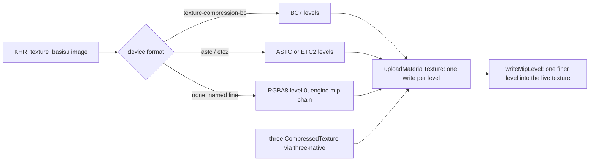

# PRD-867 — The owned engine uploads compressed textures and single mip levels

**Status:** DONE — the engine uploads BC7 and ETC2, KTX2 transcodes to the device's format, three's KTX2Loader and CompressedTexture run on the facade, one finer level writes in place, and the owned web cook ships KTX2: Midway downloads 21.5% less than with WebP.
**Priority:** P1 — the owned engine (the default on web and desktop) holds every texture as RGBA8, so a KTX2 costs bytes and saves no GPU memory; [PRD-861](PRD-861-the-owned-engine-decodes-meshopt-and-ktx2.md) keeps KTX2 out of its cook for that reason (AC-1, AC-5 open), and PRD-860's texture streaming (its AC-5) needs one mip level uploaded into a texture that already exists.
**Complexity:** 7 (HIGH) — 5 implementation files (+2): the engine `Texture`, the material upload, the glTF image decode, the three-native texture bridge and the bake gate (+2); a new GPU upload format family with block layouts (+2); the change crosses the C++ engine and the TypeScript packages (+1).
**Owner:** João (owner); an agent executes
**Depends on:** PRD-861 (branch `prd-861-decoders`, PR #650): the Basis Universal transcoder and the `KHR_texture_basisu` loader path. This PRD stacks on it.

## Context

The owned engine's `Texture` (`packages/runtime-native/src/engine/scene/texture.h:141`) stores RGBA bytes only. `Renderer::uploadMaterialTexture` (`src/engine/renderer/renderer_material.cpp:303`) writes level 0 and builds the mip chain itself. Both devices already ask for `texture-compression-bc`, `-etc2` and `-astc` when the adapter has them (`src/engine/wasm/web_host.cpp:233`, `src/webgpu/context.cpp:509`), but nothing uploads a compressed format. PRD-861 measured the cost: Midway with model KTX2 transcoded to RGBA8 shipped 71.3 MB more than with WebP.

## Solution

Follow three's own shape. A compressed texture is a `CompressedTexture`: `format` names the block format (`RGBA_BPTC_Format` = BC7, `RGBA_ASTC_4x4_Format`, `RGBA_ETC2_EAC_Format`) and `mipmaps` holds one `{ data, width, height }` per level. The engine `Texture` gains `mipmaps` and these `format` values. The renderer creates the GPU texture in the matching `WGPUTextureFormat` (sRGB from `colorSpace`) and writes each level with block rows. The glTF loader asks the device once which block format it samples, and Basis transcodes every KTX2 level to that format. A device with none keeps RGBA8, and the loader says so in one `TN_TEXTURE_TRANSCODE_TARGET` line.

### Conventions

- Auto by default: the engine measures the device and picks the format; no game option.
- A size that is not a multiple of 4 cannot be a BC base level on WebGPU; it keeps RGBA8, named in the same line.

### Risks

- Wasm size: at -O3 the BC7 and ETC2 paths cost the web engine 145,855 bytes, over its 4,194,304-byte budget. The transcoder now builds at -Oz on the web only (12,201 bytes); its transcode speed at load is not measured yet.
- Disk bytes: KTX2 on disk was larger than WebP for Midway (115.1 MB against 71.3 MB of shared images). The GPU win is real; the download may not be.

## Integration Ledger

| Capability | Reachable consumer/trigger | Replaces / disposition | Evidence |
|---|---|---|---|
| Compressed material texture | a `Texture` whose source holds `mipmaps` and a `mipmapFormat` (`src/engine/scene/texture.h`) → `Renderer::uploadCompressedLevels` (`renderer_material.cpp`), format from `textureFormat` (`renderer_internal.h`) | RGBA8-only upload; RGBA8 stays for the no-format device | AC-1, AC-2 |
| Device-format transcode | `Renderer` sets `compressedTextureTarget()` from its device (`renderer.cpp`) → `gltf::decodeImage(bytes, size, TextureSource&)` (`image_decode.cpp`) from the loader's decode and predecode paths | PRD-861's RGBA8-only transcode | AC-2, AC-3 |
| KTX2 in the owned web cook | `webRuntimeDecoders` → model KTX2 | PRD-861's `ktx2: false` stays (Decisions) | AC-4, AC-5 |
| CompressedTexture and one mip level | three's `new CompressedTexture(mipmaps, ...)` → `defineCompressedTexture` (`three-native/src/compressed-texture.ts`) → engine `CompressedTexture` binding, `mipmaps.N.data` setters (`abi/bindings_material.cpp`) → `Texture::writeMipLevel` (`scene/texture.h`) → the in-place level upload and view rebase in `Renderer::materialTexture` (`renderer_material.cpp`) | standalone `.ktx2` on `engine: "threejs"` only | AC-6, AC-7 |
| KTX2Loader on the facade | `KTX2Loader.detectSupport(renderer)` → `WebGPURenderer.hasFeature` (`browser-renderer.ts`) → web frame field `textureCompressionBc` (`web_host.cpp`); `Loader`, `FileLoader`, `LoadingManager`, `Cache` from three (`browser-loaders.ts`) | `TN_NATIVE_UNCATALOGUED_LOADER` | AC-6 |

## Execution Phases

#### Phase 1: the engine uploads a compressed texture

- [x] AC-1 [local]: a `Texture` with `RGBA_BPTC_Format` and its `mipmaps` uploads as `BC7RGBAUnorm` (or `BC7RGBAUnormSrgb`) with one write per level, and a device without `texture-compression-bc` refuses it by name. proof: a C++ test in `packages/runtime-native/tests/native-engine/` on the desktop Dawn device — Evidence: 2026-11-09, `tests/native-engine/compressed_texture_test.cpp` on Dawn/Vulkan, NVIDIA GeForce RTX 2080: `bc7_draws` loads `ktx2-textured.glb` as 8x8 BC7 (1 level, 64 bytes, no RGBA bytes) and a mapped plane reads back 253 0 0 against the RGBA control's 255 0 0; `bc7_refused_without_feature` on a device made without the feature: `TN_NATIVE_TEXTURE_UNSUPPORTED: BC7 needs the device feature texture-compression-bc`. 2/2 pass. Before this, the same map loaded as 256 RGBA bytes (`ktx2_decode_test` `transcodes_to_rgba`). ETC2 draws are not run: this adapter has no `texture-compression-etc2`.
- [x] AC-2 [local]: the glTF loader transcodes a KTX2 image to BC7 on a device with `texture-compression-bc`, to RGBA8 on one without, and prints `TN_TEXTURE_TRANSCODE_TARGET` naming the choice. proof: `ktx2_decode_test.cpp` for both targets, and `tests/web-host-decoders.test.mjs` on the real Wasm engine — Evidence: 2026-11-09, `ktx2_decode_test` `transcodes_to_blocks`: BC7 (36492) and ETC2 (37496) each 8x8, level 0 64 bytes, RGBA bytes empty; target 0 keeps 256 RGBA bytes. Native ctest 9/9 (decode, loader, meshopt, GPU) and the same tests on the Wasm toolchain under node 7/7. The GPU test prints `TN_TEXTURE_TRANSCODE_TARGET bc7`; `web-host-decoders.test.mjs` (no device on that page) asserts `TN_TEXTURE_TRANSCODE_TARGET rgba8: this process has no device with texture-compression-bc or texture-compression-etc2`, 2/2.
- [x] AC-3 [local]: the web engine stays within its size budget, or the budget rises in its own commit with the measured reason. proof: `pnpm exec vitest run scripts/__tests__/wasm-size-budget.spec.ts` (the spec lives there) — Evidence: 2026-11-09, threaded 4,184,647 and single 4,179,268 of 4,194,304 bytes with the transcoder at -Oz on the web; spec 5/5; `pnpm budgets` reports no web-engine breach. At -O3 the threaded engine was 4,318,301 bytes. The budget did not move.

**Status:** DONE — AC-1 to AC-3.
**Estimate:** about a day.
**Files:** `src/engine/scene/texture.h`, `src/engine/renderer/renderer_material.cpp`, `renderer_internal.h` (`textureFormat`), `src/engine/assets/gltf/image_decode.cpp`, `cmake/NativeEngineCore.cmake` (BC7 on in the transcoder).
**Verification:** the AC-1 to AC-3 commands, plus `pnpm native:build`.

#### Phase 2: KTX2 on in the owned web cook

- [x] AC-4 [local]: `webRuntimeDecoders` answers `{ ktx2: true, meshopt: true }` for the owned engine, and a cooked template bakes model KTX2 with no `TN_ASSETS_COMPRESSION_SKIPPED model` line (PRD-861 AC-1). proof: `pnpm exec vitest run packages/create-threenative/__tests__/web-engine.spec.ts` and the starter bake log — Evidence: 2026-11-09, `web-engine.spec.ts` "cooks meshopt and KTX2 on both engines" passes (red before the flip: it expected `ktx2: false`). A starter scaffolded from this branch's packs, `pnpm exec threenative build` exit 0: no `TN_ASSETS_COMPRESSION_SKIPPED` line (before: `model: 2 file(s), 0.3 MB kept its textures out of KTX2`); `model mannequin.glb (EXT_meshopt_compression, KHR_mesh_quantization): 664944 -> 263628 bytes`. The cook fix that made the flip pay: `model-texture-pass.spec.ts` "keeps a WebP whose KTX2 would be larger on a target that decodes WebP" red (`expected 'etc1s' to be 'none'`) then green; the three texture specs 127 passed, 1 skipped; `pnpm typecheck` exit 0.
- [x] AC-5 [local]: a KTX2 model draws on the owned engine on a real adapter, judged by a fresh read-only visual judge (headed `--browser-recipe webgpu`, `adapter.info` checked, two runs per arm, KTX2 against WebP), and Midway's cooked bytes are not above the WebP cook (124,671,659 B, PRD-861). proof: the judge's verdict and the Midway bake totals — Evidence: 2026-11-09.
  Bytes: one Midway source, the same cook, only `runtimeDecoders.ktx2` differs: KTX2 98,236,952 B against WebP 125,132,608 B (−21.5%); packaged by `threenative build` 98,243,259 B against 125,138,915 B. Before the cook fix (Decisions): KTX2 189,852,625 B (+51.7%).
  Draws: `examples/wasm-engine-boot` `pnpm playtest:ktx2-model` (headed, `--browser-recipe webgpu`, `adapter.info` `nvidia turing`) loads `tests/native-engine/assets/ktx2-textured.glb` through three's GLTFLoader (the engine's own loader) and reads two texels per map: ETC1S base colour inside 251,0,0,255 and UASTC emissive inside 0,255,0,255, both outside 0,0,255,255 (the clear), and `TN_TEXTURE_TRANSCODE_TARGET bc7`; exit 0. Red: the same page on a threaded engine built without the transcoder, `TN_NATIVE_GLTF_EXTENSION_UNSUPPORTED KHR_texture_basisu`, exit 1, black canvas. Images: `~/Downloads/prd-867-judge/ktx2-model-draws.png` (green, read: red, green and a UV-gradient triangle on blue) and `ktx2-model-draws-red.png`.
  Midway on the owned engine (`vite preview` of each cook, `nvidia turing`): 4/4 runs exit 0, KTX2 with `TN_TEXTURE_TRANSCODE_TARGET bc7` and 0 console errors; ready in 17.46/17.62 s (KTX2) and 16.17/15.46 s (WebP).
  Judge: a fresh read-only Opus subagent, spawn and one flight pose, BEFORE (WebP) and AFTER (KTX2) burned in, two runs per arm: NEUTRAL on all four pairs, no texture defect. Images: `~/Downloads/prd-867-judge/{spawn,flight}-{webp,ktx2}-run{1,2}.png` and `sheet-{spawn,flight}-run{1,2}.png`, on the `prd-867-screenshots` branch (3f7fba1b9). Its one flag, a more teal sea in the AFTER spawn frames, is not a texture change: the one sea texture the flip cooks, `ocean-normal.png` to UASTC KTX2 (cook SSIM 0.9970), decodes with a per-channel mean bias of −0.03/255, mean |diff| 0.45/0.46/0.23, max 6, mean normal error 0.36°; the sea region (850-1280, 230-360) has the same mean colour in all four spawn frames, (108.1, 123.5, 137.9) ±0.1, and its per-pixel difference across arms (1.6 and 4.0 mean) is the wave motion, of the same order as run to run inside one arm (0.9 and 2.4).

**Status:** DONE — AC-4 and AC-5.
**Estimate:** half a day, most of it captures, once the bytes pass.
**Files:** `packages/create-threenative/src/web-engine.ts` and its spec; PRD-861 moves to `docs/PRDs/done/` in the commit that closes its AC-1 and AC-5.
**Verification:** the AC-4 and AC-5 commands.

#### Phase 3: three's CompressedTexture and one mip level

- [x] AC-6 [local]: a three `CompressedTexture` (format and `mipmaps`) built on the owned facade draws through the engine, and `KTX2Loader.detectSupport` answers from the engine's device features. proof: `pnpm exec vitest run packages/three-native/__tests__/` for the bridge and one browser load (`examples/wasm-engine-boot` `pnpm playtest:compressed`, which replaced the device-free `web-host-decoders.test.mjs` for this) — Evidence: 2026-11-09. Unit: `browser-textures.spec.ts` builds a CompressedTexture from two levels, constructs `[2, 8, 8, 36492]` and sends `mipmaps.1.data` then `mipmaps.0.data` alone; red on the old `texture-sources.ts` (`TN_BROWSER_ARGUMENT_UNSUPPORTED: option data cannot cross`); three-native 578/578, 59 files. ABI: `native_engine_abi_compressed_texture_levels` (ASTC refused, short and out-of-order levels refused, `format` reads 36492); native ABI, GPU, KTX2 and registry snapshot 66/66. Browser: `playtests/compressed.playtest.json`, headed `--browser-recipe webgpu`, adapter `nvidia turing`: `detectSupport` gives `bptcSupported` true, KTX2Loader returns format 36492 and it draws 251,0,0 (sRGB map into a linear target), `pass: true` (3 runs: 2 to read values, 1 green on the final asserts). Before: the same page failed with `TN_NATIVE_UNCATALOGUED_LOADER: Loader is not available on the Wasm engine`.
- [x] AC-7 [local]: one finer mip level uploads into a texture that already exists, without re-creating it or rewriting the other levels. proof: a C++ test of `writeMipLevel` and one browser load — Evidence: 2026-11-09. C++ `native_engine_compressed_texture_finer_level` on Dawn/Vulkan, RTX 2080: coarse level only draws 0 0 0, after `writeMipLevel(0)` the same texture draws 254 0 0, and only 64 bytes go up (level 0; a re-create uploads level 1 again); level 0 before level 1 is refused (`levels arrive coarse first`). Browser: the same playtest's facade CompressedTexture with `mipmaps[0].data = null` draws `0,0,0,255`, then `mipmaps[0].data = blocks; needsUpdate = true` draws `253,0,0,255`.

**Status:** DONE — AC-6 and AC-7.
**Estimate:** about a day.
**Files:** the three-native texture bridge, `renderer_material.cpp`, the web host bindings.
**Verification:** the AC-6 and AC-7 commands.

## Acceptance criteria

- [x] The owned engine uploads compressed textures and single mip levels: AC-1 to AC-3 and AC-6 to AC-7 (Phases 1 and 3). proof: the AC-1 to AC-3, AC-6 and AC-7 evidence above.
- [x] The owned web cook ships KTX2, Midway downloads less than with WebP, and a fresh judge reads NEUTRAL: AC-4 and AC-5 (Phase 2). proof: the AC-4 and AC-5 evidence above.
- [x] Every shipped surface is in the capability manifest: `createAssetLoader` (owned-engine KTX2 upload, `TN_TEXTURE_TRANSCODE_TARGET`, `TN_NATIVE_TEXTURE_UNSUPPORTED`, coarse-first levels, `webRuntimeDecoders`) and `modelPass` (the codec ladder and its `textures.overrides`). proof: `pnpm capabilities:check` and `searchCapabilities` — Evidence: 2026-11-09, "capability manifest fresh: 548 entries"; `searchCapabilities` answers "compressed texture upload" with `createAssetLoader` and "texture bytes too big" with `modelPass`.

## Blocked on

- Nothing. The cook's KTX2 bytes (189.9 MB against 125.1 MB with WebP) were the keep-smaller-source rule: it kept an authored PNG or JPEG a KTX2 could not undercut, but never a WebP, so Midway's 300 KB WebP metallic-roughness and normal maps became 4 MB UASTC files. Fixed in the cook (Decisions).

## Decisions

- 2026-11-09 (lead): KTX2 stays off in the owned web cook until this PRD's Phase 1 lands (PRD-861 report accepted).
- 2026-11-09 (agent): BC7 first. Desktop Chrome, Dawn on Vulkan and the RTX 2080 lane all expose `texture-compression-bc`. ASTC and ETC2 follow only if the transcoder tables fit the Wasm budget; otherwise they are deferred here by name.
- 2026-11-09 (agent, measured): ASTC is deferred. The cook's ETC1S and UASTC levels reach BC7 (desktop web and Dawn) and ETC2 (mobile web) already; ASTC's transcoder tables are 350 KB of source and the web engine has 9,657 bytes left. Revisit when the budget moves or a device has ASTC and no ETC2.
- 2026-11-09 (agent): the block format and the levels live on the shared `TextureSource`, not on `Texture.format`, so every texture over one decoded image (the loader shares them by uri) carries them. three's `format` stays the RGBA format.
- 2026-11-09 (agent): no game override for the transcode target. The device decides; a comparison run uses `engine: "threejs"` or the WebP cook.
- 2026-11-09 (agent, measured; superseded below): `webRuntimeDecoders` stays `{ ktx2: false, meshopt: true }` for the owned engine. The engine path works, but the KTX2 cook downloads 51.7% more on Midway, and AC-5 asks for not more. The GPU-memory win (1 byte per texel instead of 4) does not outweigh 64.7 MB more download for every player.
- 2026-11-09 (agent): `hasFeature("texture-compression-etc2")` answers false on the facade. three's KTX2Loader picks `RGB_ETC2_Format` (8-byte blocks) for an opaque ETC1S on an ETC2 device, which the engine does not upload yet, so the loader falls back to RGBA there. BC7 answers from the device.
- 2026-11-09 (agent): the facade takes three's own `Loader`, `FileLoader`, `LoadingManager` and `Cache` modules, as it takes three's math modules (`browser-math.ts`): they fetch and track requests and draw nothing.
- 2026-11-09 (agent): the web engine has 1,214 bytes of its 4,194,304-byte budget left (threaded 4,193,090 B). The next engine change that adds code needs the budget raised in its own commit.
- 2026-11-09 (lead: fix the cook, not the engine; agent, measured): on a web target every runtime decodes WebP, so the cook keeps an authored WebP unless a KTX2 undercuts its bytes (`IModelTexturesOptions.webp`, set by `embeddedTexturesFor` for `platform: "web"`; `MODEL_WEBP_RETAIN_VERSION` rides the model pass's cache key). Per-role codec settings were not needed: with the source kept, UASTC wins only where it is smaller. Pairing every Midway image across the two cooks: the KTX2 cook was +52.7 MB on metallic-roughness and +29.3 MB on normal maps, all UASTC replacing WebP. Probe on one 2048x2048 metallic-roughness map (WebP 393,130 B): UASTC 4,560,138 B, UASTC RDO λ6 2,386,262 B, at 1024 px 679,480 B, ETC1S 493,347 B; none undercuts the WebP. After the fix: KTX2 cook 98,236,952 B against WebP 125,132,608 B (−21.5%), and `webRuntimeDecoders` answers `{ ktx2: true, meshopt: true }` on both engines.
- 2026-11-09 (agent): the desktop and native path is untouched: `webRuntimeDecoders` has one build caller, `buildWeb`, and `bundleNativeEngine` keeps `{ ktx2: false, meshopt: true }`. No native run for this flip.
- 2026-11-09 (agent): the number PRD-862 is taken (`refactoring/untangle-2026-11-06/PRD-862-untangle-native-leftovers.md`), and so are 863 to 866, so this plan is PRD-867.
- 2026-11-09 (agent, measured): the cook fix is WebP retention, not a new ETC1S rule. The ladder already tries ETC1S first on every colour slot; the bytes came from data slots, which may not take ETC1S, so a WebP normal or metallic-roughness map became a 4 MB UASTC. On a web target the cook now keeps a WebP that KTX2 cannot undercut (`model-textures.ts`, cache key `universal-containers+webp-v1`). BC1 stays out of scope (lead).
- 2026-11-09 (agent): the KTX2 report line moved off the decode pool. On the threaded web engine a pool worker's `printf` is proxied to the main thread while the main thread spins in `JobPool::run`, so the first KTX2 hung Midway. `gltf::reportKtx2` prints it on the loading thread after the join.
- 2026-11-09 (agent): the web engine budget is 4 MiB + 64 KiB (`scripts/check-budgets.ts`, its own commit). With PRD-860 merged the threaded engine is 4,198,621 B; the KTX2 cook it enables saves Midway 26.9 MB.
- 2026-11-09 (agent): the desktop and native path is not changed by the flip (`bundleNativeEngine` keeps `ktx2: false`) and was not run for it: unverified.
