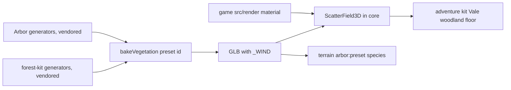

# PRD-889 — The forest floor bakes and scatters from one nature package

**Status:** IN PROGRESS
**Priority:** P2 — no generator makes deadwood, leaf litter, rocks, reeds or tussocks (AC-1, AC-2 open), and no runtime system scatters a mesh other than a grass blade (AC-4 open); the owner's broadleaf target (2026-11-14) needs a litter floor with twigs and deadwood.
**Complexity:** 4 (MEDIUM) — 6 to 10 implementation files (2), one new core mechanism `ScatterField3D` (2); risk override: none
**Owner:** João
**Depends on:** None. [PRD-883](../done/rendering/PRD-883-grass-grows-sways-and-parts-on-every-engine.md) and [PRD-884](../done/PRD-threejs-procedural-vegetation.md) are done; this PRD builds on them.

## Context

Owner, 2026-11-14: "We absorbed some of this material, but I dont think its well organized enough. Also there's this forest-kit-source with plenty material for a realistic forest. See what can be done extra please." Source: `~/Downloads/nature procedural/` (`arbor.js`, `GrassSystem.js`, `forest-kit-source.zip`).

Read on 2026-11-14 at `6f141ccb2`.

**Already absorbed (PR #675):**

| Source | Where it lives now |
| --- | --- |
| `arbor.js` (28 trees, 27 cover plants) | `packages/procedural-vegetation/vendor/arbor.js`, `bakeVegetation()`; the download is the same 1.0.0 core with `Arbor.three` and `encodePNG` still in it, so nothing new |
| `GrassSystem.js` mechanism | `packages/core/src/grass-field.ts` (`GrassField3D`) |
| `GrassSystem.js` look | `templates/adventure/src/render/grass.ts` |
| Arbor sway | `packages/terrain/starter/arbor/wind.ts` (copy-out TSL) |
| Arbor in a terrain world | `packages/terrain/src/mcp/arbor-species.ts` (`arbor:<preset>[@seed]`, calls `bakeVegetation` and `vegetationPresets` at run time) |

**`forest-kit` (3 651 lines, three.js only) against the repo:**

| forest-kit module | Repo answer | Gap |
| --- | --- | --- |
| `assets/debris.js`: `twig`, `branch`, `log`, `stump`, `leafLitter`, `rock` | none; Arbor has no debris | **yes** |
| `assets/grass.js`: `reedClump` (cattails), `tussock`, `seedGrass`; `plants.js`: `cloverPatch`, `dockSpike`, `plumeStalk` | Arbor cover has grasses, ferns, flowers and shrubs, but no reed, tussock, clover, dock or plume | **yes** |
| `plants.js`: `fern`, `flowerCluster`, `herb`, `broadleaf`; `grass.js`: `grassClump` | Arbor `bracken`, `swordfern`, `daisy`, `poppy`, `meadowgrass`, …; `GrassField3D` | no |
| `scatter/ScatterSystem.js`: tiles around the camera, a per-frame build budget, LOD = geometry swap plus density cut in a fixed shuffled order, variants with shared-transform parts | `GrassField3D` does this for blades only; `cookTerrainWorld` and `WorldCells` stream baked instances of a cooked terrain world | **yes**: a game without a terrain cook has no runtime mesh scatter |
| `materials/foliage.js`: wind, distance fade, wrap, translucency, sheen, sun-fleck shadow gaps | look: game `src/render/`; `addFoliageBackLight`, two-sided foliage in core | not here (Decisions) |
| `presets/forestBiome.js`: six-layer grass tapestry, flower, wetland, understorey, debris and tree layers | look numbers: game data or terrain biome rows (PRD-790) | not here (Decisions) |
| `world/BiomeMap.js`, `world/Terrain.js`, `env/Sky.js`, `env/SunRig.js`, `env/Water.js`, `textures/*` | `@threenative/terrain`, `Daylight`, `WaterSurface3D`, `WaterBodies`, `Arbor.barkTexture/groundTexture/leafTexture`, Poly Haven through the asset MCP | no |

**The organization problem:** an agent that asks for "a realistic forest" must find six places by itself. No document names them in one table, and `engine_search_capabilities` has no row for deadwood, litter or reeds.

## Solution

1. **No new package.** `@threenative/procedural-vegetation` already is the bake-time nature package and carries the one dependency (`@napi-rs/canvas`) that the others must not inherit. forest-kit adds only `three`. Vendor forest-kit's generator files (`core/GeoBuilder.js`, `core/random.js`, `assets/primitives.js`, `assets/debris.js` and the gap functions in `grass.js` and `plants.js`) as `vendor/forest-kit/`, with the three.js `build()` cut the same way Arbor's adapter was cut. Licence: MIT, owner-authored, as Arbor (Decisions).
2. **One preset list.** `vegetationPresets()` gains kind `"debris"` rows and the new `"cover"` rows. `bakeVegetation()` resolves a forest-kit preset id to its generator and writes the same GLB layout (`bark`/`foliage` primitives, `COLOR_0`, `TEXCOORD_0`, `_WIND` vec4). forest-kit's float `aWind` maps to `_WIND.z` (flutter), debris writes zero. The terrain `arbor:<preset>` prefix then grows `arbor:log` with no terrain edit, because `arbor-species.ts` reads the list at run time.
3. **`ScatterField3D` in core** (`packages/core/src/scatter-field.ts`): any baked mesh, one `InstancedMesh` per LOD per part, tiles streamed round a follow point under a build budget, LOD by distance plus a keep share that is a prefix of the shuffled instance buffer. Reuse `GrassField3D`'s chunk ring, budget and seeded hash, extracted to a shared module, so core keeps one streaming loop. The game passes `place(sample, out)`, geometry and material; core owns no look.
4. **Consumer:** the adventure kit's woodland edge in `Vale.ts` scatters baked logs, stumps, twigs, leaf litter and ferns under its trees, with the material in `src/render/foliage.ts`.

## Acceptance Criteria

#### Phase 1 — the bake
- [x] AC-1 [local]: `bakeVegetation({ preset })` for `log`, `stump`, `twig`, `branch`, `leaflitter` and `rock` writes a GLB with `_WIND` all zero, and the same preset and seed write the same bytes; `vegetationPresets()` lists them as kind `"debris"`. proof: `pnpm --filter @threenative/procedural-vegetation test` — Evidence: 14/14, `forest-floor.spec.ts` reads the `_WIND` accessor out of each GLB (every component 0) and hashes two bakes per preset; `log`/`stump`/`twig`/`branch`/`leaflitter`/`rock` are 68–504 triangles, `rock` buried 0.33 m, `log` 4.76 m long.
- [x] AC-2 [local]: the forest-kit cover presets that Arbor lacks (`reeds`, `tussock`, `seedgrass`, `clover`, `dock`, `plume`) bake with forest-kit's sway in `_WIND.z`, and an unknown id still throws naming the nearest ids. proof: same spec — Evidence: 6/6 cover presets bake, `_WIND` x/y/w read 0 at every vertex and z reaches 1.86 m of flutter on `reeds`; the foliage material is `alphaMode: MASK`, `doubleSided: true`. `"lgo"` throws naming `log`, `"twiggs"` names the nearest, and `form`/`leafImage` on a forest-kit preset throw instead of being ignored.
- [x] AC-3 [local]: `engine_search_capabilities` returns `bakeVegetation` first for "a fallen mossy log and leaf litter on the forest floor" and for "reeds and cattails at a pond edge". proof: `pnpm exec vitest run packages/engine-mcp/__tests__` (search spec rows) — Evidence: two rows in `search.spec.ts` assert `results[0] === "bakeVegetation"`; the manifest rebuilt to 575 entries and the suite is green.

#### Phase 2 — the runtime scatter
- [x] AC-4 [local]: `ScatterField3D` streams tiles round a moving follow point inside its build budget, swaps LOD by distance, and keeps the shuffled-prefix share; one seed gives the same instance digest twice, and `GrassField3D`'s attribute digest is unchanged after the shared-module extraction. proof: `pnpm exec vitest run packages/core/__tests__/scatter-field.spec.ts packages/core/__tests__/grass-field.spec.ts` — Evidence: 8/8 and 8/8. `packages/core/src/tile-ring.ts` holds the ring, the budget, the seeded hash and the shuffle both fields now share; the field's three live settings are read through getters, so a runtime change still re-keys the field. `GrassField3D`'s `grassRoot` buffers hash to sha256 `30e4d08d…6056` before and after the extraction — measured on `grass-field.ts` at c0295a124 and pinned in the spec. The scatter suite caught one real bug on the way: a part read another part's LOD slot when the parts had different level counts, so the flattening is now per part.
- [ ] AC-5 [local]: the owned engine draws a `ScatterField3D` scene on the desktop native host without a declined projection (`TN_RENDER_PROJECTION` is not `notWorthwhile`). proof: a `--target desktop` playtest on the Phase 3 scenario — Evidence: pending.

#### Phase 3 — the consumer and the map
- [ ] AC-6 [local]: from the adventure kit spawn, the woodland edge shows baked logs, stumps, twigs, litter and ferns; the scenario asserts scatter instances in view above zero and `TN_FRAME_BUDGET` and `TN_SCENE_WARNING` clean. proof: `pnpm test:templates` (adventure, new `woodland-floor.playtest.json`) with `--browser-recipe webgpu` — Evidence: pending.
- [ ] AC-7 [local]: a fresh read-only visual judge returns IMPROVEMENT on the woodland pose, two runs per arm, against: deadwood and litter read as a forest floor, no floating or sunk props, no visible tile seams or LOD pops at walking speed. proof: judge verdict on the PR, images on the `prd-889-screenshots` branch — Evidence: pending.
- [x] AC-8 [local]: `packages/procedural-vegetation/README.md` carries one "Nature map" table that names each piece above (trees, cover, debris, grass, scatter, sky, water, terrain, wind) and its import path. proof: `pnpm check:docs && pnpm exec vitest run scripts/__tests__/primary-docs.spec.ts` — Evidence: 10 rows: trees, cover, debris, `GrassField3D`, `ScatterField3D`, the game's `src/render/` look and wind, `Daylight`, water, terrain and textures, each with its import path.

## Integration Ledger

| Capability | Reachable consumer/trigger | Replaces / disposition | Evidence |
| --- | --- | --- | --- |
| Debris and extra cover bakes | `bakeVegetation()` (`packages/procedural-vegetation/src/index.ts`); terrain `arbor:<preset>` (`packages/terrain/src/mcp/arbor-species.ts`, unchanged) | new presets beside Arbor's | AC-1, AC-2 |
| Runtime mesh scatter | adventure kit `src/level/Vale.ts` → `ScatterField3D` | shares `GrassField3D`'s chunk ring; no second loop | AC-4 to AC-6 |
| Discovery | `engine_search_capabilities` | new rows | AC-3, AC-8 |

## Decisions

- 2026-11-14 (agent): no new package. The charter allows a package only for a dependency the others must not inherit, and forest-kit brings only `three`. The owner suggested a new package; extend `@threenative/procedural-vegetation` instead. A rename to `@threenative/nature` stays open for the owner.
- 2026-11-14 (agent): treat forest-kit as owner-authored MIT, like Arbor, because the zip has no licence file. Add `LICENSES/forest-kit-MIT.txt`. The owner corrects this if wrong.
- 2026-11-14 (agent): skip forest-kit's `BiomeMap`, `Terrain`, `Sky`, `SunRig`, `Water` and `TextureLibrary`. `@threenative/terrain`, `Daylight`, `WaterSurface3D` and Arbor's textures cover them, and the owner's forest rule puts scanned Poly Haven textures first.
- 2026-11-14 (agent): `foliage.js` (wrap, translucency, sheen, sun-fleck gaps) and the `forestBiome.js` layer numbers decide the look, so they stay out of packages. The strata forest lanes (PRD-584, PRD-887, PRD-888, branch `wip/forest-paused-1114`) can copy them into their own `src/render/` and biome rows. This PRD does not touch those lanes or `packages/terrain`.

## Execution Phases

#### Phase 1: the bake
**Status:** DONE
**Files:** `packages/procedural-vegetation/vendor/forest-kit/*.js` (vendored, `build()` cut), `vendor/forest-kit.d.ts`, `src/index.ts` (preset resolution, GLB write through the existing `Arbor.toGLB` layout), `LICENSES/forest-kit-MIT.txt`, the package spec, the engine-mcp search rows.
**Implementation:** map each forest-kit `GeoBuilder` to Arbor's `{ bark, leaves }` typed-array shape and reuse `Arbor.toGLB`. Fail closed on an unknown id and a non-integer seed, as today.
**Verification:** AC-1 to AC-3.

#### Phase 2: the runtime scatter
**Status:** DONE (AC-5 needs the Phase 3 scene)
**Files:** `packages/core/src/scatter-field.ts` (new), the chunk ring extracted from `packages/core/src/grass-field.ts`, the core export and API surface record, `packages/core/__tests__/scatter-field.spec.ts`.
**Implementation:** search the manifest first (`InstancedBatch`, `attachInstancedLod`, `meshSections`) and reuse what fits. `place()` returning false skips a candidate; a bad geometry throws naming the layer.
**Verification:** AC-4, then AC-5 after Phase 3 gives the scene.

#### Phase 3: the consumer and the map
**Status:** PARTIAL — AC-8 done (the nature map). The consumer scene, its playtest and the judge are open, and AC-5 needs the same scene.
**Files:** `templates/adventure/src/level/Vale.ts`, `templates/adventure/src/render/foliage.ts`, the kit assets, `template-playtests/adventure/woodland-floor.playtest.json`, `packages/procedural-vegetation/README.md`.
**Implementation:** bake the GLBs into the kit's assets at kit build, place them by the vale's existing tree mask, and keep them off paths and the arena.
**Verification:** AC-6 to AC-8.
**Open:** the adventure kit loads no assets at all — its trees, props and ground are generated source in `src/render/` — so "bake the GLBs into the kit's assets at kit build" adds the kit's first asset pipeline, next to `create-threenative`'s scaffold step. That is its own change, and AC-6's scenario has to prove it.
