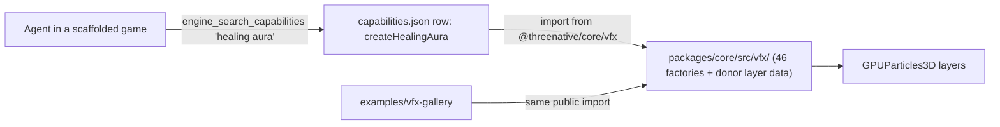

# PRD-917 — The 46 gallery VFX presets ship as engine capabilities

**Status:** IN PROGRESS
**Priority:** P2 — AC-1 to AC-6 are open: an agent in a scaffolded game cannot find or import any of the 46 gallery effects, so it hand-writes fire, smoke, rain and auras that already exist.
**Complexity:** 5 (MEDIUM) — 11+ implementation files (+3), new `@threenative/core/vfx` entry point (+2); risk override: none.
**Owner:** João
**Depends on:** None

## Context

`examples/vfx-gallery/src/render/` holds 46 effect presets (6 files, 2,735 lines): 21 from webgpu-vfx, 15 from Effekseer and 10 extras. The provenance record is `scripts/fixtures/vfx-niagara-46-effects.json`, and `scripts/vfx-niagara-coverage.ts` checks it. Each factory returns `readonly IParticleOptions[]` layers for `GPUParticles3D`. `archivePresets.ts` (1,960 lines) carries the donor layer data.

The examples do not ship in an install, and `packages/core/capabilities.json` has 0 rows for these effects. Measured on 2026-11-25 with `engine_search_capabilities`:

- "healing aura" returns verdict `none`, although `createHealingAura` exists in the gallery.
- "muzzle flash and smoke plume" returns only the bare `GPUParticles3D` mechanism.
- "fireball with explosion" returns `@threenative/core/spells`, which is already package-owned.

The gallery also caps every layer at 96 particles (`GALLERY_PARTICLE_LIMIT`, `fireSmokeWeather.ts`) so that all 46 effects fit in one capture. A game needs the donor capacity.

## Solution

Move the presets into `packages/core/src/vfx/` behind a new `@threenative/core/vfx` entry point. Use the same shape as `@threenative/core/spells`: a stock look as the default, with a named override on the same call for every colour, size, count and timing. `packages/core/package.json` already sets `"sideEffects": false`. Each preset becomes its own export, so a game bundle carries only the effects that it imports.

- Each factory carries JSDoc `@situation`, `@constraint`, `@override` and `@example` tags. `pnpm build` then writes its manifest row, as it does for `createFireball` (`packages/core/src/spells/spells.ts:75-86`).
- Public symbols describe the effect, not the donor. The donor names stay in the provenance fixture.
- The gallery imports from `@threenative/core/vfx`, and its local copies are deleted. It keeps its 96-particle cap as an `amount` override.
- AGENTS.md rule 3 extends the spells exception to `@threenative/core/vfx`.

## Non-Goals

- Rewriting a kit's own effects (for example `templates/action-rpg/src/render/vfx.ts`) to use the new entry point.
- A VFX source for the asset library (PRD-915 follow-up).
- New native or Android platform claims. The existing `vfx-compute` and `vfx-spawn-requests` conformance cases cover the mechanism.
- New effects beyond the 46.

## Acceptance Criteria

- [ ] AC-1 [local]: The gallery renders all 46 effects from `@threenative/core/vfx` with no local preset copies. — proof: `pnpm test:vfx-gallery` — Evidence: pending.
- [x] AC-2 [local]: A capability search for each of 10 representative effects (healing aura, muzzle flash, smoke plume, rain, snow, poison cloud, impact sparks, portal vortex, fireflies, blood splash) returns its factory as the top match. — proof: `pnpm caps:recall` — Evidence: Phase 2 box 1.
- [x] AC-3 [local]: Colour, count, size and timing overrides change the layer output of a factory, and the defaults match the donor values. — proof: `pnpm exec vitest run packages/core/__tests__/vfx-presets.spec.ts` — Evidence: Phase 2 box 2.
- [x] AC-4 [local]: A bundle that imports only `createHealingAura` contains no data from other presets. — proof: `pnpm exec vitest run packages/core/__tests__/vfx-tree-shake.spec.ts` — Evidence: Phase 2 box 3.
- [x] AC-5 [local]: A fresh visual judge reports NEUTRAL or IMPROVEMENT for the gallery between develop and this branch, at the same pose, headed WebGPU, two runs per arm. — proof: visual judge subagent verdict on the PR — Evidence: Phase 3 box 2.
- [x] AC-6 [local]: AGENTS.md rule 3 names the `@threenative/core/vfx` exception, and the mirrors are current. — proof: `pnpm sync:agents --check && pnpm check:docs` — Evidence: Phase 3 box 1.

## Integration Ledger

| Capability | Reachable consumer/trigger | Replaces / disposition | Evidence |
| --- | --- | --- | --- |
| 46 VFX factories | `import { createHealingAura } from "@threenative/core/vfx"` in a game; first consumer `examples/vfx-gallery/src/scenes/Gallery.ts` | `examples/vfx-gallery/src/render/*` deleted | AC-1 |
| Manifest discovery | `engine_search_capabilities` reads `packages/core/capabilities.json` | new rows | AC-2 |

## Decisions

- 2026-11-25 (João): The VFX presets become engine capabilities (option 1), not generated source in every project (option 2). With option 1, an unused effect stays out of the game bundle, and an agent finds each effect through the capability search.
- 2026-11-25 (agent): The fireflies recipe faulted the GPU on develop (NVIDIA Xid 31, `VK_ERROR_DEVICE_LOST`; bisected to `godot-fireflies` alone). Its cone direction `[0, 0.12, 0]` failed the raw-`y` parallel test, so `cross()` was zero and every position was NaN. `particles.ts` now tests the normalized direction. Red at 15:06:58 (fireflies alone), green after the fix (0 Xid, 0 device lost, full gallery). This fix ships in this PRD because the code becomes an engine capability.
- 2026-11-25 (agent): Public symbols describe the effect (for example `createHealingAura`), not the donor brand. The donor IDs stay in `scripts/fixtures/vfx-niagara-46-effects.json`.

## Execution Phases

#### Phase 1: The presets live in core, and the gallery consumes them

**Status:** IN PROGRESS
**Files:** `packages/core/src/vfx/*` (moved from `examples/vfx-gallery/src/render/`), `packages/core/package.json`, `packages/core/tsup.config.ts`, `examples/vfx-gallery/src/scenes/Gallery.ts`, `scripts/fixtures/vfx-niagara-46-effects.json`.
**Implementation:** Add the `./vfx` export and the tsup entry. Move the files and give each preset its own export. Remove the gallery cap from the defaults and pass it back as the gallery's `amount` override. Delete the gallery copies and point the fixture `renderSource` paths at core.

- [x] Core builds the `./vfx` entry, and the gallery typechecks against it. — proof: `pnpm typecheck` — exit 0, 2026-11-25; `pnpm --filter @threenative/core build` writes `dist/vfx/index.js`, publint "All good" — covers AC-1 wiring.
- [ ] The gallery playtest and the visual check see all 46 effects. — proof: `pnpm test:vfx-gallery` — covers AC-1.
  2026-11-25, RTX 2080 (Turing), headed WebGPU: the tile check passes (46 of 46 tiles occupied). The scenario then fails `TN_CAPTURE_BLANK` (bright pixel ratio 0.03478 < 0.05). Develop with only the fireflies fix fails identically (0.03429), so this red is pre-existing. The guard's dark-frame path requires max luminance ≤ 0.5, and the gallery's white HTML labels exceed it. Open: fix that playtest guard or the gallery scenario.
- [x] The provenance fixture still covers all 46 effects. — proof: `pnpm exec tsx scripts/vfx-niagara-coverage.ts` — "46 accounted (21 webgpu-vfx, 15 Effekseer, 10 extras)", exit 0, 2026-11-25 — covers AC-1 provenance.

#### Phase 2: Agents find and tune the effects

**Status:** DONE
**Files:** `packages/core/src/vfx/*` (JSDoc tags, override types), `packages/core/__tests__/vfx-presets.spec.ts`, `packages/core/__tests__/vfx-tree-shake.spec.ts`, the recall case list read by `pnpm caps:recall`.
**Implementation:** Write the JSDoc tags for every factory. Add the override object. Add 10 recall cases. Bundle a one-import fixture and assert that no other preset's data is present.

- [x] Recall finds 10 representative effects. — proof: `pnpm caps:recall` — exit 0, 2026-11-25: all 10 `vfx.*` rows return their factory first; recallAtK 0.952703 (141/148), above the old floor 0.949275. `ScenePicker` gained the situation "find which target a shot hit" so `brief.fps.9` keeps its recall after the 46 new rows moved the term weights — covers AC-2.
- [x] Overrides and defaults behave as specified. — proof: `pnpm exec vitest run packages/core/__tests__/vfx-presets.spec.ts` — 5 passed, 2026-11-25. It also checks every cone layer of all 46 recipes for a non-parallel spread axis; the old raw-`y` test fails it on `godot-fireflies` — covers AC-3.
- [x] One import ships one preset. — proof: `pnpm exec vitest run packages/core/__tests__/vfx-tree-shake.spec.ts` — 1 passed, 2026-11-25: a `createHealingAura` bundle carries 0 layer ids of the other 45 recipes; adding `createRain` makes it fail with `rainLayers:rain` — covers AC-4.

#### Phase 3: The rule and the look are confirmed

**Status:** DONE
**Files:** `AGENTS.md` and its generated `CLAUDE.md` mirrors.
**Implementation:** Extend rule 3 with the owner decision. Capture the gallery before and after, and give both sets to a fresh judge.

- [x] AGENTS.md rule 3 names the vfx exception. — proof: `pnpm sync:agents --check && pnpm check:docs` — 31 mirrors in sync, check:docs exit 0, prose-lane specs 316 passed, 2026-11-25. `packages/core/AGENTS.md` names both look subpaths too — covers AC-6.
- [x] The gallery look is unchanged. — proof: visual judge subagent verdict — NEUTRAL on all 6 pages, 2026-11-25. BEFORE = develop + the fireflies fix only, AFTER = this branch, headed WebGPU on an RTX 2080, 2 runs per arm; sheets on PR #736 (`prd-917-screenshots` branch). The bottom row of each page draws off its tile in both arms, so 15 effects are outside the image comparison; their recipe data is byte-identical to develop (0 diffs across 46) — covers AC-5.
