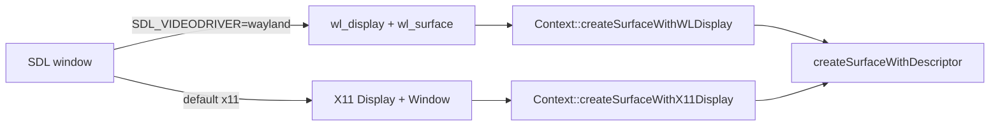

# PRD-614 — Catch the runtime-native fork up with MystralNative v0.1.6

**Status:** IN PROGRESS
**Priority:** P1 — unfinished Wayland, zero-length `writeBuffer` and linux-arm64 Canvas 2D proofs gate the requested native-platform catch-up.
**Complexity:** 4 → MEDIUM — estimated 6–10 implementation files (+2), independent linux-arm64 build/artifact boundary (+2), no new module; risk override: none. Compatibility risk: shared surface changes must preserve default X11; arm64 dependency versions and library layouts must remain compatible with the QuickJS/wgpu host and Canvas 2D.
**Owner:** João
**Depends on:** None

## Context

`packages/runtime-native/` is a maintained fork of
[MystralNative](https://github.com/mystralengine/mystralnative). `packages/runtime-native/NOTICE`
records the upstream baseline `841fe379` (v0.1.5). Upstream `main` is now `bafab09` (v0.1.6 plus one
merged PR). That range has 15 commits and changes 17 files (+325/−98).

Triage of each upstream change against the fork (2026-10-14):

| Upstream commit(s) | Change | Fork state | Disposition |
| --- | --- | --- | --- |
| `6eeb33b`, `4e01a6e`, `a5b93f1` | Wayland WebGPU surface: `createSurfaceWithWLDisplay`, Wayland `_Compat` descriptor typedefs, `runtime.cpp` tries Wayland before X11 | `src/runtime.cpp:681` fails with "Wayland not yet supported"; `src/platform/window.cpp:233` and `src/cli/main.cpp:1130` force SDL to X11 | **Port** (Phase 1). Keep X11 as the default. |
| `9bec9d7` (part) | `queue.writeBuffer` with zero-length data returns instead of throwing | `src/webgpu/bindings.cpp:1687` throws `writeBuffer: invalid data` on `dataSize == 0` | **Port** (Phase 2). The WebGPU spec makes a zero-size write a valid no-op. |
| `9bec9d7` (part) | MSAA `resolveTarget` on color attachments, and surface tracking through the resolve target | Already in the fork: `src/webgpu/bindings_commands.cpp:1150`, `src/webgpu/bindings_frame_stream.cpp:382` | Skip — present. |
| `9bec9d7` (part) | `externalTexture` bind group layout entry | Absent. three 0.185 sets it only for XR textures (`WebGPUBackend.setXRRenderTargetTextures`), and the fork has no `importExternalTexture` | Skip — see Decisions. |
| `9bec9d7` (part) | Debug `std::cout` per buffer binding in `createBindGroupLayout` | — | Skip — log noise in a hot path. |
| `0d87767` | wgpu-native: replace `wgpuInstanceProcessEvents` (an `unimplemented!()` abort in older wgpu-native) with `wgpuDevicePoll`; libuv-less `DebugServer` stub | Pinned wgpu-native v25.0.2.2 implements `wgpuInstanceProcessEvents` (`src/lib.rs:2690`, `poll_all_devices`). The fork gates `debug_server.cpp` behind `TN_ENABLE_DEBUG_SERVER` (`CMakeLists.txt:1672`) | Skip — not applicable. |
| `4e01a6e` (part) | `#include <cstdint>` in `http_client.h` | Already present | Skip — present. |
| `aa2c18e`, `de75cf7`, `0b2b225`, `53e96a3`, `8f748eb`, `fcd2e95` | linux-arm64 build (QuickJS + wgpu), Skia `arm64` lib subdir, quiche `0.24.6-4`, Canvas 2D on arm64 | Existing `native-platforms.yml` has a linux-arm64 starter row; upstream dependency and Canvas 2D compatibility remain unproved | **Port/adapt and prove** (Phase 3): arm64 Skia, quiche `0.24.6-4`, SWC `swc-41`, libwebp aarch64, Canvas 2D on. |
| `02c86dc`, `21611f0`, `fd2d126`, CI/release workflows, `install.sh` | `.gitignore`, README, version bump, upstream CI | Fork has its own `.gitignore` (`third_party/` ignored), CI and release | Skip — fork owns these. |

## Solution

Port the two behaviour changes and complete the linux-arm64 dependency/Canvas 2D catch-up.
Only after AC-1 through AC-4 have green proofs, move the provenance baseline so the next
catch-up starts from `bafab09`.



- **Wayland.** Reuse `createSurfaceWithDisplay` with its existing `PLATFORM_WAYLAND` discriminator
  instead of renaming the X11 API. Read SDL's Wayland handles when that driver is requested; keep
  X11 as the default. Honor the task's legacy `SDL_VIDEODRIVER` spelling and SDL 3's
  `SDL_VIDEO_DRIVER`, and log the observed SDL driver. The X11-only web overlay rejects an explicit
  Wayland request rather than silently overriding it. Actual presentation remains unproved:
  the current Dawn prebuilt rejects the Wayland surface descriptor; its supported variant and
  the existing wgpu build profile are being investigated.
- **Zero-length `writeBuffer`.** Return `undefined` when `dataSize == 0` before the null-pointer
  check, in the direct binding and in the frame-op stream decoder, to match the browser.
- **linux-arm64.** Reuse the existing `native-platforms.yml` linux-arm64 leg, adapting the native dependency/build paths for arm64 Skia, quiche `0.24.6-4`, SWC `swc-41` and libwebp aarch64. Keep Canvas 2D enabled and prove the candidate through a manually dispatched run; a skipped leg does not count.
- **Provenance.** After every required runtime/platform proof is green, update `NOTICE` to the full upstream baseline `bafab09d599bd55aeb7433ba7131c3f320334c99`. This PRD keeps the per-commit
  disposition table above; no separate record.

Risks: the Wayland path changes the shared surface function that the X11 path also uses, so the
default X11 run is proved again. The frame-op stream encodes `writeBuffer` in JS
(`src/runtime-scripts/frame-op-stream.js`), so the zero-length case must not trip the
`truncated writeBuffer record` check.

## Acceptance Criteria

- [ ] AC-1 [local]: A native desktop game run with `SDL_VIDEODRIVER=wayland` under a headless Wayland compositor presents 300 non-blank frames. proof: `weston --backend=headless` + `SDL_VIDEODRIVER=wayland pnpm native:verify:desktop` — Evidence: pending.
- [ ] AC-2 [local]: The default X11 run still presents 300 non-blank frames. proof: `pnpm native:verify:desktop` — Evidence: pending.
- [ ] AC-3 [local]: `device.queue.writeBuffer(buffer, 0, new Uint8Array(0))` returns without an exception on native, as on web. proof: new case in `pnpm parity` (`packages/runtime-native/conformance/registry.json`), RED then GREEN on both the direct binding and frame-op stream paths — Evidence: pending.
- [ ] AC-4 [shared]: The dispatched `native-platforms.yml` linux-arm64 leg is GREEN with Canvas 2D enabled, arm64 Skia, quiche `0.24.6-4`, SWC `swc-41` and libwebp aarch64. proof: `gh workflow run native-platforms.yml --ref <candidate-branch>` followed by `gh run view <run-id>` confirming the linux-arm64 job and dependency/build logs on the candidate SHA — Evidence: pending.

## Blocked on

- AC-1 currently lacks `weston` on this machine; no `weston`, `cage` or `sway` is installed. Unblock with a user-space compositor extraction (no sudo or host-wide install), or an available Debian laptop compositor. This is a technical prerequisite, not a human approval or platform-scope decision.

## Integration Ledger

| Capability | Reachable consumer/trigger | Replaces / disposition | Evidence |
| --- | --- | --- | --- |
| Wayland WebGPU surface | `mystral` CLI → `Runtime` surface setup (`src/runtime.cpp:655`) → `Context::createSurfaceWithDisplay` with `PLATFORM_WAYLAND` | Replace the unsupported Wayland branch; retain the existing X11 path and default | AC-1, AC-2 |
| Zero-length `writeBuffer` | Game JS → `GPUQueue.writeBuffer` binding (`src/webgpu/bindings.cpp:1687`) and frame-op stream decoder (`src/webgpu/bindings_frame_stream.cpp:334`) | Throw becomes no-op | AC-3 |
| linux-arm64 Canvas 2D | `gh workflow run native-platforms.yml` → existing linux-arm64 starter leg → native dependency/build paths → Canvas 2D-enabled host | Adapt upstream dependency versions and arm64 library layouts; retain the existing workflow | AC-4 |

## Decisions

- 2026-10-14 (AFK decision, Phase 2 detached sources): the detached-source check leaves the shared portable helper and lives in `runWriteBufferContract`'s async JS proof, because Android V8 has no `ArrayBuffer.prototype.transfer` and a `transfer`-requiring shared helper makes the parity row throw there. Desktop-focused proof keeps the fail-closed `transfer` requirement, so the case cannot pass silently on an engine that cannot detach a buffer. No public flag, new API or optional skip; no binding change.
- 2026-10-14 (AFK lane, Phase 2 detached sources): a detached `ArrayBuffer` or TypedArray reports `byteLength` 0 (ECMA-262 25.1.5.3), so the empty-source guard accepted it as a no-op. The guard now reads the intrinsic brand getter first and then probes: `new Uint8Array(data)` for ArrayBuffer, `%TypedArray%.prototype.values.call(data)` for TypedArray, both of which throw `TypeError` on a detached receiver (`quickjs.c:54120-54122`, V8 13.1 `v8-array-buffer.cc`). `ArrayBuffer.prototype.slice` is not used because it runs a species lookup on live receivers. The DataView entry keeps its getter, which already throws on detach. No `WasDetached()` virtual method and no constructor-name check, which user code can spoof.
- 2026-10-14 (AFK lane, Phase 1 source only): the user's exact command is `SDL_VIDEODRIVER=wayland pnpm native:verify:desktop`, and SDL 3.2.30 reads `SDL_VIDEO_DRIVER`, not the legacy spelling (`SDL_hints.h:3326`). Five harness sites set `SDL_VIDEODRIVER=x11` and `verify-desktop-core.mjs` wraps its run in `scripts/xvfb.sh`, so the literal command would run X11 and pass falsely. Decision: `window.cpp` resolves the requested driver from `SDL_VIDEO_DRIVER` first, then the legacy `SDL_VIDEODRIVER`, and defaults to `x11`; `verify-desktop-core.mjs` runs without the Xvfb wrapper when a Wayland driver is explicitly requested, and logs the request; `scripts/xvfb.sh` names the X11 it provides instead of silently standing in for Wayland. `runtime.cpp` logs `SDL_GetCurrentVideoDriver()` as the receipt, so a Wayland claim comes from SDL itself.
- 2026-10-14 (AFK lane, Phase 1 source only): keep `createSurfaceWithDisplay(void*, void*, int)` and add the `PLATFORM_WAYLAND` case rather than taking upstream's split into `createSurfaceWithX11Display`/`createSurfaceWithWLDisplay`. The fork's header already documents the second parameter as "X11 Window or Wayland surface", the behaviour is identical, and a public rename would touch two more call sites for no gain.
- 2026-10-14 (AFK lane, Phase 1 source only): the web overlay attaches to an X11 surface only, and `main.cpp` forces it with `SDL_HINT_OVERRIDE`. An explicit Wayland request with the overlay is refused with a message naming `ui.renderer: "native-css"` or unsetting the variable, instead of being silently overridden to X11. The X11-scoped desktop gates keep running on the X display `scripts/xvfb.sh` provides, and say so.
- 2026-10-14 (user pasted task, agent reconciliation): the explicit AC-4 supersedes the earlier linux-arm64 exclusion. Keep X11 as the default, include linux-arm64 in this PRD, and advance NOTICE only after all four acceptance criteria pass; no owner decision is pending.

- 2026-10-14 (agent, triage): skip upstream's `externalTexture` layout entry. three 0.185 sets `externalTexture` only for WebXR textures, and the fork has no `importExternalTexture`, so the entry has no consumer. Revisit when a game needs `GPUExternalTexture`.
- 2026-10-14 (agent, triage): skip the wgpu-native `wgpuInstanceProcessEvents` replacement. The pinned wgpu-native v25.0.2.2 implements that function, so the abort that upstream fixed cannot occur.

## Execution Phases

#### Phase 1: Wayland surface
**Status:** PARTIAL — candidate CLI compiles and two default-X11 core captures pass; actual Wayland selects the correct driver but the current Dawn library rejects its descriptor. Full candidate commands and Wayland presentation remain unproved.
**Files:** `include/mystral/webgpu/context.h`, `src/webgpu/context.cpp`, `include/mystral/webgpu_compat.h`, `src/runtime.cpp`, `src/platform/window.cpp`, `src/cli/main.cpp`, `scripts/verify-desktop-core.mjs`, `scripts/xvfb.sh`, `__tests__/linux-video-driver-routing.spec.ts` (all under `packages/runtime-native/`)
**Implementation:** Port `6eeb33b` and `4e01a6e` onto the fork's versions of these files. Delete `createSurfaceWithDisplay`. Keep the X11 default hints.
- [ ] Native desktop build compiles with the Wayland descriptor. proof: `pnpm native:build`
- [ ] AC-2 default X11 run. proof: `pnpm native:verify:desktop`
- [ ] AC-1 Wayland run. proof: `weston --backend=headless` + `SDL_VIDEODRIVER=wayland pnpm native:verify:desktop`

Candidate evidence (2026-10-14): `cmake --build packages/runtime-native/build/tn-linux --target mystral -j2` exits 0. Two `verify-desktop-core.mjs` runs report observed driver `x11`, 300 frames and non-blank 1280×720 captures (`artifacts/prd614-x11-after-{1,2}.png`). First explicit legacy-env Wayland run logs `SDL video driver: wayland` and `Creating Wayland surface`, then fails before frames: Dawn reports `Unsupported sType (SurfaceSourceWaylandSurface)` and zero surface formats (`artifacts/prd614-wayland-first-failure-runtime.log`). No unchanged retry or passing Wayland claim. The signed user-space Weston compositor passed socket/shm/EGL smoke; its owned process was stopped after this run. The existing wgpu profile and compatible Dawn artifacts are being inspected before another presentation attempt.

#### Phase 2: Zero-length `writeBuffer`
**Status:** PARTIAL — direct binding fixed and focused native RED→GREEN proved; decoder already correct; required parity RED→GREEN remains incomplete.
**Files:** `src/webgpu/bindings.cpp`, `src/webgpu/bindings_frame_stream.cpp`, `conformance/registry.json` and its new case
**Implementation:** Add the conformance case first and see it fail on native. Then return `undefined` for `dataSize == 0` in both paths.
- [ ] AC-3 direct binding path, red then green. proof: `pnpm parity` new case
- [ ] AC-3 frame-op stream path, red then green. proof: `pnpm parity` new case with the frame-op stream on

Test-first evidence (2026-10-14): focused `threenative-frame-op-stream-replay-test` built in this checkout with Dawn+V8, native Vulkan NVIDIA RTX 2080. Direct mode exits 1 solely on empty Uint8Array, ArrayBuffer and DataView (`writeBuffer: invalid data`); stream mode exits 0 with a native replay crossing. Both execute the same shared proof: five zero-size writes, three invalid-source rejections, and GPU readback `[11,22,55,66]` after nonzero writes. No runtime fix yet; the stream already accepts these inputs. Logs: `packages/runtime-native/artifacts/conformance/prd614-zero-{direct,stream}.log`. Registry dry-run validates the selected row (exit 2 because unselected rows remain blocked); JS syntax, focused Biome check and diff whitespace checks pass. Conformance runner/report specs pass: 2 files, 88 tests, 49.06 s (`pnpm exec vitest run tests/conformance-runner.test.mjs tests/conformance-report.test.mjs --reporter=dot` from `packages/runtime-native`).

Focused continuation (2026-10-14): direct binding now accepts genuine empty ArrayBuffer, TypedArray and DataView sources, validates source ranges before returning, and avoids null-pointer arithmetic on no-ops. Built-in byteLength getters reject spoofed `{ byteLength: 0 }`; the shared proof now checks seven invalid sources, five valid zero-size writes, and nonzero GPU readback `[11,22,55,66]`. Focused own-checkout Dawn+V8/Vulkan test: direct **RED exit 1 → GREEN exit 0**; stream **PASS exit 0 before and after**. Production encoder emits zero-byte records (no elision); the new backend observer counts exactly seven decoded writeBuffer records, proving all five zero-byte records reached the actual decoder. Decoder already accepts zero payloads with valid bounds; no decoder runtime edit and no invented RED. Both AC-3 phase boxes remain unchecked because the required parity RED→GREEN on both paths has not been met. Logs: `packages/runtime-native/artifacts/conformance/prd614-zero-{direct,stream}-{before,after}.log`; focused build: `prd614-zero-green-build.log` in the same directory. `pnpm parity --target web --only-tests 91-queue-write-buffer-zero --out artifacts/conformance/prd614-zero-web` passes the selected row on headed Chromium WebGPU (NVIDIA/turing adapter; zero GPU validation errors), **exit 2** because the other 107 rows remain blocked. Report/capture: `packages/runtime-native/artifacts/conformance/prd614-zero-web/`. Focused Biome passes with one existing complexity warning; `git diff --check` passes. No full workspace build, commit, push, or AC tick.

Detached-source continuation (2026-10-14): a detached `ArrayBuffer` or TypedArray reports `byteLength` 0 (ECMA-262 25.1.5.3), so the empty-source guard accepted it as a no-op — a security regression, not the AC-3 behaviour. The check is desktop-focused and now lives in `runWriteBufferContract`'s async JS proof right after `verifyQueueWriteBuffer(device)`, on its own 16-byte `COPY_DST` buffer destroyed in a `finally`; it detaches a real `ArrayBuffer`, `Uint8Array` and `DataView` with `ArrayBuffer.prototype.transfer`, throws when `transfer` is absent, and fails if any detached source is accepted. The shared portable helper is transfer-free, because Android V8 cannot detach a buffer and the parity row would throw there; its empty, nonempty, range and readback checks are unchanged, and the seven-record decoder count is unchanged because rejected detached writes emit no record. Focused own-checkout Dawn+V8/Vulkan test: direct **RED exit 1** (`detached ArrayBuffer source was accepted; detached Uint8Array source was accepted`) before the guard change, **GREEN exit 0** after; stream exit 0 before and after with `Decoded writeBuffer records: 7 (five zero-byte, two nonzero)` on the valid path only. The stream transport already rejected detached sources before the decoder, so no stream RED exists. The default no-argument replay-test suite still exits 0. Rerun after the split, against a freshly rebundled shared proof: direct **exit 0**, stream **exit 0** with `Decoded writeBuffer records: 7`, default suite **exit 0**; logs `packages/runtime-native/artifacts/conformance/prd614-portable-{direct,stream,replay-default}.log`. Guard change: the intrinsic brand getter runs first, then a probe that throws on a detached receiver — `new Uint8Array(data)` for ArrayBuffer and `%TypedArray%.prototype.values.call(data)` for TypedArray; `ArrayBuffer.prototype.slice` is not used because it runs a species lookup on live receivers. QuickJS `JS_GetArrayBuffer` sets a pending `TypeError` for detached input (`quickjs.c:54120-54122`), but only the detached path reaches it and that path now always throws a fresh `writeBuffer: invalid data`, so the leftover never escapes. Logs: `packages/runtime-native/artifacts/conformance/prd614-detached-{direct,stream}-{before,after}.log`, build `prd614-detached-green-build.log`, suite `prd614-detached-replay-default.log`. No AC tick, commit or push. `THREENATIVE_RUNTIME_BINARY="$PWD/packages/runtime-native/build/tn-linux/mystral" pnpm parity --target desktop --only-tests 91-queue-write-buffer-zero --reference artifacts/conformance/prd614-zero-web --out artifacts/conformance/prd614-zero-desktop` passes the selected row, **exit 2** with 107 unselected rows blocked. Report/capture: `packages/runtime-native/artifacts/conformance/prd614-zero-desktop/`; raw runner log: `packages/runtime-native/artifacts/conformance/prd614-zero-desktop-run.log`. This intentionally uses the pre-existing own-checkout runtime executable (not relinked by the focused test-target build); it validates the existing stream path, not the new direct-binding fix. The newly linked focused replay-test binary supplies the direct-fix GREEN. Other native verification remained untouched. Full desktop executable qualification of the direct fix and other platform rows remain unverified.

Reproduce from repository root:
```sh
packages/runtime-native/node_modules/.bin/esbuild packages/runtime-native/conformance/scenes/shared/queue-write-buffer-proof.js --bundle --format=iife --global-name=writeBufferProof --outfile=packages/runtime-native/artifacts/conformance/prd614-write-buffer-proof.js
cmake --build packages/runtime-native/build/tn-linux --target threenative-frame-op-stream-replay-test -j2
packages/runtime-native/build/tn-linux/threenative-frame-op-stream-replay-test write-buffer-direct packages/runtime-native/artifacts/conformance/prd614-write-buffer-proof.js
packages/runtime-native/build/tn-linux/threenative-frame-op-stream-replay-test write-buffer-stream packages/runtime-native/artifacts/conformance/prd614-write-buffer-proof.js
```

#### Phase 3: linux-arm64 proof, then provenance
**Status:** NOT STARTED
**Files:** Native dependency/build scripts, arm64 Skia/Canvas 2D configuration, existing `.github/workflows/native-platforms.yml` only if required, and `packages/runtime-native/NOTICE`.
**Implementation:** Adapt the upstream linux-arm64 changes to the existing leg; include arm64 Skia, quiche `0.24.6-4`, SWC `swc-41` and libwebp aarch64 with Canvas 2D enabled. Dispatch the workflow against the candidate branch and require its linux-arm64 leg to be GREEN. Only after AC-1 through AC-4 pass, set `Upstream provenance baseline:` to the full hash and name v0.1.6.
- [ ] linux-arm64 dependency/build configuration includes arm64 Skia, quiche `0.24.6-4`, SWC `swc-41`, libwebp aarch64 and Canvas 2D enabled. proof: dispatched `native-platforms.yml` linux-arm64 dependency/build logs on the candidate SHA
- [ ] AC-4 dispatched linux-arm64 leg is GREEN. proof: `gh workflow run native-platforms.yml --ref <candidate-branch>` + `gh run view <run-id>` (successful linux-arm64 job on the candidate SHA)
- [ ] After AC-1 through AC-4 are green, NOTICE names `bafab09d599bd55aeb7433ba7131c3f320334c99` and v0.1.6. proof: `git diff -- packages/runtime-native/NOTICE` + `pnpm check:docs`
