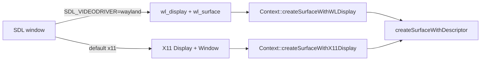

# PRD-614 — Catch the runtime-native fork up with MystralNative v0.1.6

**Status:** IN PROGRESS
**Priority:** P1 — unfinished Wayland, zero-length `writeBuffer` and linux-arm64 Canvas 2D proofs gate the requested native-platform catch-up.
**Complexity:** 4 → MEDIUM — estimated 6–10 implementation files (+2), independent linux-arm64 build/artifact boundary (+2), no new module; risk override: none. Compatibility risk: shared surface changes must preserve default X11; arm64 dependency versions and library layouts must remain compatible with the QuickJS/wgpu host and Canvas 2D.
**Owner:** João
**Depends on:** None

## Context

`packages/runtime-native/` is a maintained fork of
[MystralNative](https://github.com/mystralengine/mystralnative). `packages/runtime-native/NOTICE`
records the upstream baseline `841fe379` (v0.1.5). Upstream `main` is now `bafab09` (v0.1.6 plus one
merged PR). That range has 15 commits and changes 17 files (+325/−98).

Triage of each upstream change against the fork (2026-10-14):

| Upstream commit(s) | Change | Fork state | Disposition |
| --- | --- | --- | --- |
| `6eeb33b`, `4e01a6e`, `a5b93f1` | Wayland WebGPU surface: `createSurfaceWithWLDisplay`, Wayland `_Compat` descriptor typedefs, `runtime.cpp` tries Wayland before X11 | `src/runtime.cpp:681` fails with "Wayland not yet supported"; `src/platform/window.cpp:233` and `src/cli/main.cpp:1130` force SDL to X11 | **Port** (Phase 1). Keep X11 as the default. |
| `9bec9d7` (part) | `queue.writeBuffer` with zero-length data returns instead of throwing | `src/webgpu/bindings.cpp:1687` throws `writeBuffer: invalid data` on `dataSize == 0` | **Port** (Phase 2). The WebGPU spec makes a zero-size write a valid no-op. |
| `9bec9d7` (part) | MSAA `resolveTarget` on color attachments, and surface tracking through the resolve target | Already in the fork: `src/webgpu/bindings_commands.cpp:1150`, `src/webgpu/bindings_frame_stream.cpp:382` | Skip — present. |
| `9bec9d7` (part) | `externalTexture` bind group layout entry | Absent. three 0.185 sets it only for XR textures (`WebGPUBackend.setXRRenderTargetTextures`), and the fork has no `importExternalTexture` | Skip — see Decisions. |
| `9bec9d7` (part) | Debug `std::cout` per buffer binding in `createBindGroupLayout` | — | Skip — log noise in a hot path. |
| `0d87767` | wgpu-native: replace `wgpuInstanceProcessEvents` (an `unimplemented!()` abort in older wgpu-native) with `wgpuDevicePoll`; libuv-less `DebugServer` stub | Pinned wgpu-native v25.0.2.2 implements `wgpuInstanceProcessEvents` (`src/lib.rs:2690`, `poll_all_devices`). The fork gates `debug_server.cpp` behind `TN_ENABLE_DEBUG_SERVER` (`CMakeLists.txt:1672`) | Skip — not applicable. |
| `4e01a6e` (part) | `#include <cstdint>` in `http_client.h` | Already present | Skip — present. |
| `aa2c18e`, `de75cf7`, `0b2b225`, `53e96a3`, `8f748eb`, `fcd2e95` | linux-arm64 build (QuickJS + wgpu), Skia `arm64` lib subdir, quiche `0.24.6-4`, Canvas 2D on arm64 | Existing `native-platforms.yml` has a linux-arm64 starter row; upstream dependency and Canvas 2D compatibility remain unproved | **Port/adapt and prove** (Phase 3): arm64 Skia, quiche `0.24.6-4`, SWC `swc-41`, libwebp aarch64, Canvas 2D on. |
| `02c86dc`, `21611f0`, `fd2d126`, CI/release workflows, `install.sh` | `.gitignore`, README, version bump, upstream CI | Fork has its own `.gitignore` (`third_party/` ignored), CI and release | Skip — fork owns these. |

## Solution

Port the two behaviour changes and complete the linux-arm64 dependency/Canvas 2D catch-up.
Only after AC-1 through AC-4 have green proofs, move the provenance baseline so the next
catch-up starts from `bafab09`.

- **Wayland.** Take upstream's split of `createSurfaceWithDisplay` into
  `createSurfaceWithX11Display` and `createSurfaceWithWLDisplay` over one
  `createSurfaceWithDescriptor`. `runtime.cpp` reads SDL's Wayland handles when SDL runs the Wayland
  driver, else X11. Keep the X11 hint in `window.cpp` and the X11 override for the web overlay in
  `main.cpp`: the overlay and the key forwarding use X11 only. Result: an explicit
  `SDL_VIDEODRIVER=wayland` now presents frames instead of failing. Dawn's prebuilt
  `libwebgpu_dawn.a` already carries the Wayland surface symbols.
- **Zero-length `writeBuffer`.** Return `undefined` when `dataSize == 0` before the null-pointer
  check, in the direct binding and in the frame-op stream decoder, to match the browser.
- **linux-arm64.** Reuse the existing `native-platforms.yml` linux-arm64 leg, adapting the native dependency/build paths for arm64 Skia, quiche `0.24.6-4`, SWC `swc-41` and libwebp aarch64. Keep Canvas 2D enabled and prove the candidate through a manually dispatched run; a skipped leg does not count.
- **Provenance.** After every required runtime/platform proof is green, update `NOTICE` to the full upstream baseline `bafab09d599bd55aeb7433ba7131c3f320334c99`. This PRD keeps the per-commit
  disposition table above; no separate record.

Risks: the Wayland path changes the shared surface function that the X11 path also uses, so the
default X11 run is proved again. The frame-op stream encodes `writeBuffer` in JS
(`src/runtime-scripts/frame-op-stream.js`), so the zero-length case must not trip the
`truncated writeBuffer record` check.

## Acceptance Criteria

- [ ] AC-1 [local]: A native desktop game run with `SDL_VIDEODRIVER=wayland` under a headless Wayland compositor presents 300 non-blank frames. proof: `weston --backend=headless` + `SDL_VIDEODRIVER=wayland pnpm native:verify:desktop` — Evidence: pending.
- [ ] AC-2 [local]: The default X11 run still presents 300 non-blank frames. proof: `pnpm native:verify:desktop` — Evidence: pending.
- [ ] AC-3 [local]: `device.queue.writeBuffer(buffer, 0, new Uint8Array(0))` returns without an exception on native, as on web. proof: new case in `pnpm parity` (`packages/runtime-native/conformance/registry.json`), RED then GREEN on both the direct binding and frame-op stream paths — Evidence: pending.
- [ ] AC-4 [shared]: The dispatched `native-platforms.yml` linux-arm64 leg is GREEN with Canvas 2D enabled, arm64 Skia, quiche `0.24.6-4`, SWC `swc-41` and libwebp aarch64. proof: `gh workflow run native-platforms.yml --ref <candidate-branch>` followed by `gh run view <run-id>` confirming the linux-arm64 job and dependency/build logs on the candidate SHA — Evidence: pending.

## Blocked on

- AC-1 currently lacks `weston` on this machine; no `weston`, `cage` or `sway` is installed. Unblock with a user-space compositor extraction (no sudo or host-wide install), or an available Debian laptop compositor. This is a technical prerequisite, not a human approval or platform-scope decision.

## Integration Ledger

| Capability | Reachable consumer/trigger | Replaces / disposition | Evidence |
| --- | --- | --- | --- |
| Wayland WebGPU surface | `mystral` CLI → `Runtime` surface setup (`src/runtime.cpp:655`) → `Context::createSurfaceWithWLDisplay` | `createSurfaceWithDisplay(…, PLATFORM_XLIB)` is deleted; the X11 path delegates to `createSurfaceWithX11Display` | AC-1, AC-2 |
| Zero-length `writeBuffer` | Game JS → `GPUQueue.writeBuffer` binding (`src/webgpu/bindings.cpp:1687`) and frame-op stream decoder (`src/webgpu/bindings_frame_stream.cpp:334`) | Throw becomes no-op | AC-3 |
| linux-arm64 Canvas 2D | `gh workflow run native-platforms.yml` → existing linux-arm64 starter leg → native dependency/build paths → Canvas 2D-enabled host | Adapt upstream dependency versions and arm64 library layouts; retain the existing workflow | AC-4 |

## Decisions

- 2026-10-14 (user pasted task, agent reconciliation): the explicit AC-4 supersedes the earlier linux-arm64 exclusion. Keep X11 as the default, include linux-arm64 in this PRD, and advance NOTICE only after all four acceptance criteria pass; no owner decision is pending.

- 2026-10-14 (agent, triage): skip upstream's `externalTexture` layout entry. three 0.185 sets `externalTexture` only for WebXR textures, and the fork has no `importExternalTexture`, so the entry has no consumer. Revisit when a game needs `GPUExternalTexture`.
- 2026-10-14 (agent, triage): skip the wgpu-native `wgpuInstanceProcessEvents` replacement. The pinned wgpu-native v25.0.2.2 implements that function, so the abort that upstream fixed cannot occur.

## Execution Phases

#### Phase 1: Wayland surface
**Status:** NOT STARTED
**Files:** `include/mystral/webgpu/context.h`, `src/webgpu/context.cpp`, `include/mystral/webgpu_compat.h`, `src/runtime.cpp` (all under `packages/runtime-native/`)
**Implementation:** Port `6eeb33b` and `4e01a6e` onto the fork's versions of these files. Delete `createSurfaceWithDisplay`. Keep the X11 default hints.
- [ ] Native desktop build compiles with the Wayland descriptor. proof: `pnpm native:build`
- [ ] AC-2 default X11 run. proof: `pnpm native:verify:desktop`
- [ ] AC-1 Wayland run. proof: `weston --backend=headless` + `SDL_VIDEODRIVER=wayland pnpm native:verify:desktop`

#### Phase 2: Zero-length `writeBuffer`
**Status:** NOT STARTED
**Files:** `src/webgpu/bindings.cpp`, `src/webgpu/bindings_frame_stream.cpp`, `conformance/registry.json` and its new case
**Implementation:** Add the conformance case first and see it fail on native. Then return `undefined` for `dataSize == 0` in both paths.
- [ ] AC-3 direct binding path, red then green. proof: `pnpm parity` new case
- [ ] AC-3 frame-op stream path, red then green. proof: `pnpm parity` new case with the frame-op stream on

#### Phase 3: linux-arm64 proof, then provenance
**Status:** NOT STARTED
**Files:** Native dependency/build scripts, arm64 Skia/Canvas 2D configuration, existing `.github/workflows/native-platforms.yml` only if required, and `packages/runtime-native/NOTICE`.
**Implementation:** Adapt the upstream linux-arm64 changes to the existing leg; include arm64 Skia, quiche `0.24.6-4`, SWC `swc-41` and libwebp aarch64 with Canvas 2D enabled. Dispatch the workflow against the candidate branch and require its linux-arm64 leg to be GREEN. Only after AC-1 through AC-4 pass, set `Upstream provenance baseline:` to the full hash and name v0.1.6.
- [ ] linux-arm64 dependency/build configuration includes arm64 Skia, quiche `0.24.6-4`, SWC `swc-41`, libwebp aarch64 and Canvas 2D enabled. proof: dispatched `native-platforms.yml` linux-arm64 dependency/build logs on the candidate SHA
- [ ] AC-4 dispatched linux-arm64 leg is GREEN. proof: `gh workflow run native-platforms.yml --ref <candidate-branch>` + `gh run view <run-id>` (successful linux-arm64 job on the candidate SHA)
- [ ] After AC-1 through AC-4 are green, NOTICE names `bafab09d599bd55aeb7433ba7131c3f320334c99` and v0.1.6. proof: `git diff -- packages/runtime-native/NOTICE` + `pnpm check:docs`
