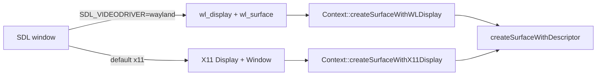

# PRD-614 — Catch the runtime-native fork up with MystralNative v0.1.6

**Status:** NOT STARTED
**Priority:** P2 — the open Wayland, zero-length `writeBuffer` and linux-arm64 feature boxes are planned parity work; no release depends on them.
**Complexity:** 3 (LOW) — about 10 implementation files, no new module; risk override: none.
**Owner:** João
**Depends on:** None

## Context

`packages/runtime-native/` is a maintained fork of
[MystralNative](https://github.com/mystralengine/mystralnative). `packages/runtime-native/NOTICE`
records the upstream baseline `841fe379` (v0.1.5). Upstream `main` is now `bafab09` (v0.1.6 plus one
merged PR). That range has 15 commits and changes 17 files (+325/−98).

Triage of each upstream change against the fork (2026-10-14):

| Upstream commit(s) | Change | Fork state | Disposition |
| --- | --- | --- | --- |
| `6eeb33b`, `4e01a6e`, `a5b93f1` | Wayland WebGPU surface: `createSurfaceWithWLDisplay`, Wayland `_Compat` descriptor typedefs, `runtime.cpp` tries Wayland before X11 | `src/runtime.cpp:681` fails with "Wayland not yet supported"; `src/platform/window.cpp:233` and `src/cli/main.cpp:1130` force SDL to X11 | **Port** (Phase 1). Keep X11 as the default. |
| `9bec9d7` (part) | `queue.writeBuffer` with zero-length data returns instead of throwing | `src/webgpu/bindings.cpp:1687` throws `writeBuffer: invalid data` on `dataSize == 0` | **Port** (Phase 2). The WebGPU spec makes a zero-size write a valid no-op. |
| `9bec9d7` (part) | MSAA `resolveTarget` on color attachments, and surface tracking through the resolve target | Already in the fork: `src/webgpu/bindings_commands.cpp:1150`, `src/webgpu/bindings_frame_stream.cpp:382` | Skip — present. |
| `9bec9d7` (part) | `externalTexture` bind group layout entry | Absent. three 0.185 sets it only for XR textures (`WebGPUBackend.setXRRenderTargetTextures`), and the fork has no `importExternalTexture` | Skip — see Decisions. |
| `9bec9d7` (part) | Debug `std::cout` per buffer binding in `createBindGroupLayout` | — | Skip — log noise in a hot path. |
| `0d87767` | wgpu-native: replace `wgpuInstanceProcessEvents` (an `unimplemented!()` abort in older wgpu-native) with `wgpuDevicePoll`; libuv-less `DebugServer` stub | Pinned wgpu-native v25.0.2.2 implements `wgpuInstanceProcessEvents` (`src/lib.rs:2690`, `poll_all_devices`). The fork gates `debug_server.cpp` behind `TN_ENABLE_DEBUG_SERVER` (`CMakeLists.txt:1672`) | Skip — not applicable. |
| `4e01a6e` (part) | `#include <cstdint>` in `http_client.h` | Already present | Skip — present. |
| `0d87767`, `aa2c18e`, `8f748eb`, `fcd2e95` | linux-arm64 host with QuickJS + wgpu | Already in the fork: `scripts/download-deps.mjs:1548` selects QuickJS + wgpu on arm64, and `native-platforms.yml` runs a `linux-arm64` leg on `ubuntu-24.04-arm` | Skip — present. V8 on arm64 is PRD-614's sibling [PRD-615](PRD-615-v8-on-linux-arm64.md). |
| `de75cf7`, `0b2b225`, `53e96a3` | linux-arm64 optional features: Skia from `mystralengine/library-builder` `chrome/m145`, quiche `0.24.6-4` (adds `quiche-linux-arm64`), SWC `swc-41`, libwebp `aarch64`, CMake Skia `arm64` lib subdir | The fork's arm64 host disables Canvas 2D, WebTransport and TS transpile because these archives were missing (`scripts/download-deps.mjs:1548`); `CMakeLists.txt:1099` hard-codes `x64` | **Port** (Phase 3). |
| `02c86dc`, `21611f0`, `fd2d126`, CI/release workflows, `install.sh` | `.gitignore`, README, version bump, upstream CI | Fork has its own `.gitignore` (`third_party/` ignored), CI and release | Skip — fork owns these. |

## Solution

Port the three changes that the fork lacks, then move the provenance baseline so the next catch-up
starts from `bafab09`.

- **Wayland.** Take upstream's split of `createSurfaceWithDisplay` into
  `createSurfaceWithX11Display` and `createSurfaceWithWLDisplay` over one
  `createSurfaceWithDescriptor`. `runtime.cpp` reads SDL's Wayland handles when SDL runs the Wayland
  driver, else X11. Keep the X11 hint in `window.cpp` and the X11 override for the web overlay in
  `main.cpp`: the overlay and the key forwarding use X11 only. Result: an explicit
  `SDL_VIDEODRIVER=wayland` now presents frames instead of failing. Dawn's prebuilt
  `libwebgpu_dawn.a` already carries the Wayland surface symbols.
- **Zero-length `writeBuffer`.** Return `undefined` when `dataSize == 0` before the null-pointer
  check, in the direct binding and in the frame-op stream decoder, to match the browser.
- **linux-arm64 features.** Pin the new arm64 archives in `native-deps.lock.json` with their
  SHA-256, add them to the arm64 `desktopDeps` list, and pick the Skia `arm64` subdir in CMake.
  The arm64 host then has Canvas 2D, WebTransport and TS transpile like x64. The JS engine stays
  QuickJS here; [PRD-615](PRD-615-v8-on-linux-arm64.md) moves it to V8.
- **Provenance.** Update `NOTICE` to the new upstream baseline. This PRD keeps the per-commit
  disposition table above; no separate record.

Risks: the Wayland path changes the shared surface function that the X11 path also uses, so the
default X11 run is proved again. The frame-op stream encodes `writeBuffer` in JS
(`src/runtime-scripts/frame-op-stream.js`), so the zero-length case must not trip the
`truncated writeBuffer record` check.

## Acceptance Criteria

- [ ] AC-1 [local]: A native desktop game run with `SDL_VIDEODRIVER=wayland` under a headless Wayland compositor presents 300 non-blank frames. proof: `weston --backend=headless` + `SDL_VIDEODRIVER=wayland pnpm native:verify:desktop` — Evidence: pending.
- [ ] AC-2 [local]: The default X11 run still presents 300 non-blank frames. proof: `pnpm native:verify:desktop` — Evidence: pending.
- [ ] AC-3 [local]: `device.queue.writeBuffer(buffer, 0, new Uint8Array(0))` returns without an exception on native, as on web. proof: new case in `pnpm parity` (`packages/runtime-native/conformance/registry.json`), red before Phase 2 — Evidence: pending.
- [ ] AC-4 [shared]: The linux-arm64 host draws Canvas 2D in the starter. proof: `native-platforms.yml` `linux-arm64` leg, dispatched with `gh workflow run` — Evidence: pending.

## Blocked on

- A headless Wayland compositor (`weston`) on this machine or the Debian laptop for AC-1. Neither `weston`, `cage` nor `sway` is installed here — unblocked by João installing one, or by approving an install.

## Integration Ledger

| Capability | Reachable consumer/trigger | Replaces / disposition | Evidence |
| --- | --- | --- | --- |
| Wayland WebGPU surface | `mystral` CLI → `Runtime` surface setup (`src/runtime.cpp:655`) → `Context::createSurfaceWithWLDisplay` | `createSurfaceWithDisplay(…, PLATFORM_XLIB)` is deleted; the X11 path delegates to `createSurfaceWithX11Display` | AC-1, AC-2 |
| linux-arm64 Canvas 2D, WebTransport, TS | `node scripts/download-deps.mjs` on arm64 (`scripts/download-deps.mjs:1558`) → CMake feature detection | Disabled features become enabled; no fallback copy | AC-4 |
| Zero-length `writeBuffer` | Game JS → `GPUQueue.writeBuffer` binding (`src/webgpu/bindings.cpp:1687`) and frame-op stream decoder (`src/webgpu/bindings_frame_stream.cpp:334`) | Throw becomes no-op | AC-3 |

## Decisions

- 2026-10-14 (João): linux-arm64 stays a supported target, and its optional features catch up with upstream (Phase 3). João prefers V8 over QuickJS for speed; that is [PRD-615](PRD-615-v8-on-linux-arm64.md).
- 2026-10-14 (agent, João delegated the call): X11 stays the default Linux SDL driver, also in a Wayland session. Wayland sessions already run the game through XWayland, and the web overlay and key forwarding use X11 only. Native Wayland is opt-in with `SDL_VIDEODRIVER=wayland`. Revisit when a game needs a Wayland-only feature, such as fractional scaling.

- 2026-10-14 (agent, triage): skip upstream's `externalTexture` layout entry. three 0.185 sets `externalTexture` only for WebXR textures, and the fork has no `importExternalTexture`, so the entry has no consumer. Revisit when a game needs `GPUExternalTexture`.
- 2026-10-14 (agent, triage): skip the wgpu-native `wgpuInstanceProcessEvents` replacement. The pinned wgpu-native v25.0.2.2 implements that function, so the abort that upstream fixed cannot occur.

## Execution Phases

#### Phase 1: Wayland surface
**Status:** NOT STARTED
**Files:** `include/mystral/webgpu/context.h`, `src/webgpu/context.cpp`, `include/mystral/webgpu_compat.h`, `src/runtime.cpp` (all under `packages/runtime-native/`)
**Implementation:** Port `6eeb33b` and `4e01a6e` onto the fork's versions of these files. Delete `createSurfaceWithDisplay`. Keep the X11 default hints.
- [ ] Native desktop build compiles with the Wayland descriptor. proof: `pnpm native:build`
- [ ] AC-2 default X11 run. proof: `pnpm native:verify:desktop`
- [ ] AC-1 Wayland run. proof: `weston --backend=headless` + `SDL_VIDEODRIVER=wayland pnpm native:verify:desktop`

#### Phase 2: Zero-length `writeBuffer`
**Status:** NOT STARTED
**Files:** `src/webgpu/bindings.cpp`, `src/webgpu/bindings_frame_stream.cpp`, `conformance/registry.json` and its new case
**Implementation:** Add the conformance case first and see it fail on native. Then return `undefined` for `dataSize == 0` in both paths.
- [ ] AC-3 direct binding path, red then green. proof: `pnpm parity` new case
- [ ] AC-3 frame-op stream path, red then green. proof: `pnpm parity` new case with the frame-op stream on

#### Phase 3: linux-arm64 features and provenance
**Status:** NOT STARTED
**Files:** `scripts/download-deps.mjs`, `native-deps.lock.json`, `CMakeLists.txt`, `NOTICE` (all under `packages/runtime-native/`)
**Implementation:** Port `de75cf7`, `0b2b225` and `53e96a3`. Move every quiche pin to `0.24.6-4`. Keep SWC `swc-11` on other platforms, as upstream does. Set `Upstream provenance baseline:` to `bafab09d599bd55aeb7433ba7131c3f320334c99` and name v0.1.6.
- [ ] Lock pins and download selection pass their specs. proof: `pnpm exec vitest run scripts/__tests__/check-version-pins.spec.ts scripts/__tests__/check-build-matrix.spec.ts`
- [ ] AC-4 arm64 leg green with Canvas 2D on. proof: `gh workflow run native-platforms.yml` `linux-arm64` leg
- [ ] NOTICE names the new baseline and the doc checks pass. proof: `pnpm check:docs`
