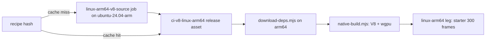

# PRD-615 — V8 on the linux-arm64 native host

**Status:** PARTIAL — V8 13.1.201.22 compiled, verified and published to the immutable CI cache; local locked consumer/performance wiring passes focused checks. Cached V8 startup and 300 non-blank frames are proven; paired performance and visual acceptance remain unverified.
**Priority:** P1 — linux-arm64 is a supported target; AC-1 now proves the V8 starter, and the remaining AC-2 box requires measured improvement over QuickJS.
**Complexity:** 6 (MEDIUM) — about 6 implementation files, a new V8 build recipe, a CI build-and-cache boundary; risk override: none.
**Owner:** João
**Depends on:** PRD-614 arm64 dependency pins ([PR #507](https://github.com/ThreeNativeHQ/threenative-engine/pull/507)); the four prerequisite dependency/build files are inherited from its published commit `a8b355190`.

## Context

The linux-arm64 desktop host runs QuickJS over wgpu-native (`packages/runtime-native/scripts/download-deps.mjs:1548`).
Every other desktop host runs V8 13.1.201.22 from `kuoruan/libv8`, which publishes no Linux arm64
archive (`native-deps.lock.json`, `v8-linux-x64`). The comment in `native-platforms.yml:96` says a
source V8 build is not allowed in CI, but the same workflow already builds Android V8 from source
once per recipe and caches the payload in the `ci-v8-android` release
(`native-platforms.yml:180-255`, `.github/actions/android-v8-source`, `scripts/build-android-v8.mjs`).

João, 2026-10-14: "i dont like QuickJS. V8 is way more performant." Upstream MystralNative also
ships linux-arm64 with QuickJS only (see [PRD-614](https://github.com/ThreeNativeHQ/threenative-engine/pull/507)),
so this is fork-owned work with no upstream to port.

## Solution

Build V8 13.1.201.22 for linux-arm64 with the same build-once, cache-by-recipe pattern as Android.
Then let the arm64 host select V8.

- **Recipe.** Same V8 version, same `v8_monolith` shape and same GN flags as the x64 archive, so
  the headers and ABI the runtime compiles against do not change. Build natively on
  `ubuntu-24.04-arm`, not by cross-compile. Follow the Android producer's fetch, integrity,
  transactional promotion and recipe-hash pattern while keeping its script and cache unchanged.
- **Cache.** A `linux-arm64-v8-source` job in `native-platforms.yml` runs only on a recipe-hash
  miss and uploads `v8-linux-arm64-<recipe-hash>.tgz` to a `ci-v8-linux-arm64` release, as the
  Android job does. No new workflow file.
- **Select.** `download-deps.mjs` fetches that asset on arm64. `native-build.mjs` stops forcing
  QuickJS on arm64. Other targets keep QuickJS where they use it today.

Risks: a native V8 build on a hosted runner can exceed its time limit. Measure the first run. If it
does not fit, cross-compile on the x64 pool with `target_cpu="arm64"` and a Debian arm64 sysroot.
The hosted arm64 runner has no GPU, so the speed comparison measures JS frame time, not GPU time.

## Acceptance Criteria

- [x] AC-1 [shared]: The linux-arm64 starter boots on V8 and presents 300 non-blank frames. proof: run `38733537384`, arm64 job `116417079168`, starter artifact `11973110297`: report `pass: true`, 300 frames, 13,123 colors, 187 cyan and 201 magenta asset pixels; raw runtime log names V8 `13.1.201.22`. Screenshot SHA-256 `bb67c3a573499f67684556064bfe10b3b65c68fa9a1442f927c708967a6e42cd`. The same published archive is consumed; source-cache reuse was proven in run `38728195060`.
- [ ] AC-2 [shared]: On the same arm64 runner, the starter's median JS frame time on V8 is lower than on QuickJS, across paired runs. proof: playtest `perf` for both builds in one job — Evidence: pending.

## Integration Ledger

| Capability | Reachable consumer/trigger | Replaces / disposition | Evidence |
| --- | --- | --- | --- |
| V8 on linux-arm64 | `pnpm native:build` on arm64 → `scripts/native-build.mjs` engine selection → `mystral` binary | QuickJS stops being the arm64 default; QuickJS stays where other targets use it | AC-1 |
| Cached arm64 V8 payload | `native-platforms.yml` recipe-hash check → `ci-v8-linux-arm64` release → `download-deps.mjs` | New; same pattern as `ci-v8-android` | AC-1 |

## Decisions

- 2026-10-14 (João): linux-arm64 uses V8, not QuickJS, for speed.
- 2026-10-15: the pinned V8 toolchain downloads Linux x64 binaries, so the native arm64 producer uses the DEPS-pinned `gn/gn/linux-arm64` CIPD binary (exact SHA-256 and AArch64 ELF checked, native `--version` required before generation), plus Ubuntu arm64 LLVM 18.1.3 packages at exact version `1:18.1.3-1ubuntu1`, recorded in its receipt. The producer is an explicit manual-dispatch auxiliary job; ordinary product qualification retains its existing inventory. Linux keeps its small fetch/integrity helpers local because modifying the Android build script invalidates its expensive cache.

## Execution Phases

#### Phase 1: arm64 V8 payload
**Status:** PARTIAL — native source compilation, the full payload/receipt/header audit and immutable release-cache publication are proven by run `38720103918` and asset `643500847`. The second workflow release-cache hit is proven by run `38728195060`, source job `116399254006`; compiler installation and source compilation were skipped. Local consumer gates pass; arm64 startup is proven below and paired performance remains open.
Cold run [38699446987](https://github.com/ThreeNativeHQ/threenative-engine/actions/runs/38699446987), source job `116303925220`, fetched the pinned sources and installed the exact compiler packages, then failed before compilation: depot_tools shadowed distro Ninja with its uninitialized launcher. Both GN bootstrap and V8 compilation now call `/usr/bin/ninja` explicitly; the 20 producer tests pass. A real distro Ninja 1.11.1 command-selection probe in an isolated Debian container passed both calls despite a poisoned PATH whose generic Ninja exited 88. No payload was produced or published. Retry [38701515417](https://github.com/ThreeNativeHQ/threenative-engine/actions/runs/38701515417), source job `116310671878`, compiled all 295 GN bootstrap targets, then failed copying over the read-only CIPD launcher. Bounded replan found upstream already provides the pinned native GN: exact V8 DEPS selects `gn/gn/linux-${arch}` at revision `95b0f8fe31a992a33c040bbe3867901335c12762`. Its official arm64 ZIP SHA-256 is `c6d06639cb71ae9771b4e5881e387476293c2bf47c64645d2ce1260a0509dc0b` (3,245,617 bytes); extracted GN is AArch64 ELF64 with SHA-256 `31739b62d88843b32726c4ace0c93b36b65efbcba89bb033891d454766d9e689`. Recipe 2 removes the unused GN source bootstrap/overwrite, fixes relative `custom_deps` keys, and verifies the native DEPS GN binary/hash/version before use. All V8/build license files remain; GN is a build tool and is not distributed. Run [38702992130](https://github.com/ThreeNativeHQ/threenative-engine/actions/runs/38702992130), source job `116315553882`, passed native GN identity checks and reached GN generation, then failed because GLib development pkg-config modules were absent. The Linux source job now installs `libglib2.0-dev` alongside pkg-config, records their exact installed package version/architecture and all four GLib module versions, and checks the adjacent system-C++ `libatomic` link prerequisite before building. Pinned Linux GN configs expose no other pkg-config modules in that adjacent compiler path. Subsequent run [38705493315](https://github.com/ThreeNativeHQ/threenative-engine/actions/runs/38705493315), source job `116324390005`, generated 565 GN targets successfully but Ninja stopped before compilation: Chromium defaults expected Clang 20 builtins under its target-triple layout, while the pinned compiler is Ubuntu Clang 18. The producer now declares Clang 18 and maps a private SDK directory to the exact compiler, resource headers and pinned compiler-rt 18 archive; V8 source files and features are unchanged. The official runtime package `libclang-rt-18-dev=1:18.1.3-1` contains 278 verified AArch64 objects with archive SHA-256 `af24a6be2920609e5dea1218caad93a17885497e764cef2dc78512fdec159e98`. The installed compiler-rt package copyright ships as a hashed build-dependency notice; embedding is not assumed and the actual monolith must be audited before publication. Its receipt identity is mandatory; native compilation/linking/execution of a tiny builtins caller must pass before GN/Ninja. Run [38709487399](https://github.com/ThreeNativeHQ/threenative-engine/actions/runs/38709487399), source job `116337148007`, stopped earlier at APT: the hosted image already contained newer compiler-rt, disproving the pristine-image assumption. The solver planned exactly one compiler-rt downgrade and no removals; the exact-version install now explicitly allows that downgrade. Producer recipe bytes remain unchanged; the SDK adapter has not executed on arm64 yet. Cancellation was requested for superseded own failed-source runs `38699446987`, `38701515417`, `38702992130`, `38705493315` and `38709487399` to release unused Android/Windows chains; all five source logs are retained, the first four saved their source cache, and the fifth stopped before source modification. No PRD-614 run was cancelled. Source contracts pass 24 tests; native preflight and full V8 compilation still need a fresh cold run.
The published PRD-614 prerequisite files are inherited byte-for-byte: `CMakeLists.txt`, `native-deps.lock.json`, `scripts/download-deps.mjs` and `tests/dependency-provenance.test.mjs`. The package's dependency-provenance spec passed 10 tests; version-pin, build-matrix and native-profile contracts passed 19 tests. The coherent PRD-614 native runtime prerequisite patch is also prepared locally: all 11 files byte-match its immutable destination blobs (patch SHA-256 `8062f0d25a3414839ab0eadf8a37ec42ca137cc8850254e299df7a804a9e44c9`), including the final per-frame binding/driver fixes and Dawn pin. The same 29 focused dependency/profile checks pass. The coherent runtime is included in PRD-614's published candidate `15d39`; both engines use the same inherited runtime bytes for final measurements. The seven related regression/conformance files and measured coverage record are inherited exactly from `bccd65166`; the coverage source/test digest matches all 240 inputs. The verified coverage-generator ratchet repair, its semantic regression test and canonical regenerated record are inherited from `1c908738e2`; the 240-input digest matches `4694f6c260feec4929114d04f323617c5d8b260073cdb3394f70e751c2122dce`. The recorded platform floor is now 63.81%; all seven root coverage-floor fixtures and three native digest-scope fixtures pass. Linux routing specs pass three tests. The earlier regression selection had 54 passes, two skips and four failures due to missing native binaries. After this checkout built its own fixtures, the same selection passed 59 tests with one skip; this does not claim arm64 runtime acceptance.
**Files:** `packages/runtime-native/scripts/build-linux-arm64-v8.mjs` (new, follows the Android producer pattern without changing its cache inputs), `.github/workflows/native-platforms.yml`
**Implementation:** Pin the recipe (version, source commit, GN args, recipe number). Add the build-and-upload job on a recipe-hash miss.
The source job requires `gh workflow run native-platforms.yml --ref feat/prd615-linux-arm64-v8 -f build_linux_arm64_v8=true`. On a feature branch it uploads only the verified tarball and SHA-256 artifact; publication is restricted to main/develop. The parent manually publishes those exact reviewed artifact bytes to `ci-v8-linux-arm64` before the second cache-hit dispatch. Existing recipe-named assets are immutable: identical bytes are reused and a mismatch fails.
- [x] Recipe builds a `v8_monolith` for aarch64 with the x64 archive's headers. proof: source job `116372375638` in [run 38720103918](https://github.com/ThreeNativeHQ/threenative-engine/actions/runs/38720103918) passed; the actual V8 13.1.201.22 header and all 1,286 monolith members verify as AArch64. The complete 126-file receipt verifies locally. All 108 public `*.h` files have identical relative paths and SHA-256 values in the installed x64 archive and verified arm64 payload (zero missing, extra or differing headers).
- [x] A second run reuses the cached release asset with no rebuild. proof: verified run `38728195060`, source job `116399254006`: the job logged `Published Linux arm64 V8 asset hit: v8-linux-arm64-1632c350bb78a60721a092ab696f0b3d274dbb0e5b926ebdca2c1b5edb8bb262.tgz; no rebuild.` at `2026-10-15T11:34:19.0996589Z`; compiler installation and source compilation were skipped.

#### Phase 2: Select V8 on arm64
**Status:** PARTIAL — local default selection and fail-closed locked-cache consumption are implemented; actual published payload descriptor is pinned locally. Fresh/cached downloader receipt and SBOM sidecar integration pass; canonical nested receipts take precedence after architecture changes. AC-1 is now proven by the corrected arm64 starter below; paired performance remains open. The first cached qualification (`38728195060`, arm64 job `116399253883`) failed before scaffolding at the final native executable links: V8 `isolate.o` and `wasm-code-manager.o` require `__atomic_compare_exchange`, but the consumer link omitted `libatomic`. Both `mystral` and `mystral-tools` failed; no starter, paired-performance or passing identity artifact was produced. The source cache-hit proof remains valid. The local correction appends `atomic` only to V8 system libraries on Linux `aarch64`/`arm64`, preserving x64 and Android. Executing the existing CMake system-library branch across five platform/architecture cases failed both ARM64 cases before the correction and passed all five after it; the native profile and registered-temporary-directory selection passed 12 tests. Full typecheck and lint pass. The broader focused selection initially passed 28 tests and correctly rejected the inherited coverage record as stale because the CMake input changed. Canonical `native:coverage` then passed with build parallelism two: 47 contract targets executed, three explicitly disabled targets retained, 19,470/24,835 lines covered (78.40%), and every retained floor unchanged. The generated record now carries digest `41cd2268ff5ae99a9e7a01b1353e376cff1113ad30646e32384d6cd1c3584dae`; freshness/profile/build-matrix/temp-cleanup/evidence-budget checks passed 38 tests, native coverage source fixtures passed nine tests, and `pnpm budgets` passed. No digest, measurement or floor was edited manually. Actual arm64 link/startup/performance acceptance remains open; the corrected full workflow has not run.
**Files:** `scripts/download-deps.mjs`, `scripts/native-build.mjs`, `native-deps.lock.json`, `packages/runtime-native/AGENTS.md` (all under `packages/runtime-native/` except where named)
**Implementation:** Add `v8` to the arm64 `desktopDeps`, resolved from the cached asset with its SHA-256. Drop the arm64 QuickJS override. Update the arm64 comments in `download-deps.mjs` and `native-platforms.yml`.
- [x] Engine-selection and pin specs pass. proof: version-pin/build-matrix/profile/qualification/paired-harness specs pass 54 tests; dependency provenance and SBOM specs pass 16 tests. The actual released archive installs through the downloader with one locked fetch and reuses its verified cache with zero fetches; SBOM includes `v8-linux-arm64`. This is acquisition proof on the x64 development host with the platform selector isolated, not an arm64 runtime claim.
- [x] AC-1 arm64 starter on V8. proof: run `38733537384`, arm64 job `116417079168`, starter artifact `11973110297` passed the 300-frame, non-blank capture gate; raw log identifies V8 `13.1.201.22`.

#### Phase 3: Speed proof
**Status:** PARTIAL — local same-VM orchestration preserves feature flags and one bundle, alternates QuickJS/V8 across three pairs, drops startup and compares median JS callback frame p50s with a strict V8 improvement requirement. The collector/profile/qualification checks passed 40 tests; actual arm64 runs and visual judging remain pending. Both engines must include the coherent final PRD-614 native runtime fixes before measurement.
**Files:** `.github/workflows/native-platforms.yml` (paired perf step in the arm64 leg)
**Implementation:** Build both engines in one job and run the same starter scenario on each, alternating, at least three runs per engine.
- [ ] AC-2 V8 beats QuickJS on JS frame time. proof: playtest `perf` paired runs in the arm64 leg

The sixth producer attempt (`38711129527`, source job `116342598739`) completed all 1,624 Ninja targets, including the V8 monolith, after native SDK preflight and GN generation. Packaging then failed because the pinned Chromium build checkout has no root `LICENSE`. The required build notice now comes from its owning Chromium revision `054463d932e1883832422ab7280c71899cde8ae7`, verified as 1,536 bytes and SHA-256 `368cca1106be99d39ecd32a38d8305585d802a475effb66380b91ffc9bcf709b`. A one-off migration accepts only the exact saved attempt cache and old/new producer script hashes with every other build-state field identical; native identity checks, SDK preflight, GN and Ninja rerun. The successful follow-up producer, verified receipt and cache publication are recorded below. Runtime acceptance criteria remain open.

The corrected source job `116372375638` succeeded in run `38720103918`: it restored the exact previous compiled-source cache, regenerated 565 GN targets and reported `ninja: no work to do`. Root independently verified the downloaded artifact. The exact 18,745,524-byte archive is published as release asset `643500847` in [`ci-v8-linux-arm64`](https://github.com/ThreeNativeHQ/threenative-engine/releases/tag/ci-v8-linux-arm64), with SHA-256 `ac379519d7e26039831ee7945018c67b48d98e30d04fe760bf5c684d61b82081`; a fresh remote download matches. The tag matches none of the npm/native product-release triggers, and no workflow subscribes to release publication. The payload receipt SHA-256 is `dbec689e6213490b1a581b27cc44fe86c5e6e54dfba2fb1235902f3cc074ab11`. All six required notices are included; the pinned compiler-rt archive's 278 objects share no member names or identical object bytes with the 1,286-object monolith, so its copyright is described as a build dependency notice. A second producer release-cache-hit workflow and actual arm64 starter/performance proof remain pending. The earlier x64 desktop UI budget run failed at 2.14 ms p95 against the unchanged below-2-ms requirement; the subsequent desktop parity job `116374639053` in run `38720103918` passed. The historical failure is retained without a gate waiver.

Local full `pnpm typecheck` and `pnpm lint` pass after building the checkout's missing workspace outputs. This checkout built its own V8/Dawn host plus native contract targets (502 tasks) and QuickJS host/two required contract targets (411 tasks), sequentially with two workers, Canvas2D on and native web UI/physics off. The previously missing-binary regression selection now passes 59 tests with one skip; this is x64 fixture proof, not arm64 starter or performance acceptance. For the pending visual judge, the ARM64 job separately runs the existing starter `native-playtests/render-chain.playtest.json` twice per engine on the same measured bundle, seeded scene and default fixed-step harness clock. Full reports/screenshots retain the actual camera, scene and recorded tick observations for comparison; BEFORE/AFTER labels, observed same-pose verification and a fresh judge remain pending. These four captures replace wall-time screenshot launches and do not alter the six performance launches.

Fresh read-only review of local candidate `4bd73df426` found that warm V8 cache validation did not enforce the lock's raw producer receipt SHA-256. Root cancelled its still-running full suite (`93125`, exit 130) to repair this real defect; that interrupted run is not a passing gate. The downloader now requires the selected payload's 64-hex receipt pin and exact raw `build-receipt.json` hash on fresh and warm paths before the existing full producer verification. A regression first reproduced acceptance of a substituted AArch64 object plus recomputed self-consistent receipt; it now fails before any fetch. Fresh acquisition also rejects absent, malformed or incorrect pins. Dependency-provenance/SBOM tests pass 16 tests; required full typecheck and lint pass after the repair. The real published archive also passes the new warm receipt-pin check with zero fetches. Producer bytes, workflow, native feature criteria and published asset are unchanged; the new full suite and arm64 acceptance remain pending.

Root's subsequent full suite at `339c3540b` completed with six failures (10,623 passes, 20 skips): five synthetic CI receipts still named the former ARM64 QuickJS default, while the strict production verifier correctly required V8; the temp-directory guard also found two test files bypassing the registered cleanup helper. The smallest failing selection reproduced all six failures (85 passes). The shared synthetic receipt now names V8, and both test files use the existing `makeTempDirSync` cleanup registration without a guard exception. Production receipt verification, producer bytes, workflow, runtime pins and acceptance criteria are unchanged. The focused CI/producer/temp selection passes 119 tests; dependency-provenance/SBOM tests pass 16 tests. Required full typecheck and lint pass after this fixture repair. The repaired full-suite result is pending.

The corrected frozen local candidate `c0bef30f7cd97cb5abe778882c042358b1797ff3` passed root's complete `pnpm test` run: 779 root test files passed (three skipped), 10,629 tests passed (20 skipped), 552.95 seconds; the native package passed 1,591 tests (62 skipped), and physics parity passed 29 tests. Suite-owned temporary directory counts stayed at one before and after. Fresh read-only review of the repaired production receipt path reported no actionable defects, and root reviewed the final fixture-only correction. Full typecheck and lint pass. These local gates permit cached qualification; they do not prove either arm64 runtime acceptance criterion. The first cached native workflow `38728195060` demonstrated the release-cache hit but failed the arm64 consumer link as described above. Corrected qualification must still demonstrate the V8 starter's 300 non-blank frames, three paired runs per engine on one arm64 VM with a lower V8 median, and fresh same-pose visual acceptance.

The frozen atomic-link candidate `574779a98b0da5ac741553aaf77c84d945cc1005` passed root's complete `pnpm test` run in 535.16 seconds: 779 root files passed (three skipped), 10,634 tests passed (20 skipped), 1,591 native tests passed (62 skipped), and 29 physics parity tests passed. Suite-owned temporary directories remained one before and after. Fresh bounded Codex review reported no actionable defects. Canonical native coverage passed at 78.40% with retained floors unchanged and current digest `41cd2268ff5ae99a9e7a01b1353e376cff1113ad30646e32384d6cd1c3584dae`. At that checkpoint, the corrected arm64 link, starter, performance and visual proof remained pending the next cached qualification.

Corrected qualification `38733537384` at `6f19dcb7f58e34b1af76f38433d498df8a03d531` cleared both native executable links and passed the V8 starter gate above. Its first QuickJS performance launch failed before steady-state sampling: `TN_ASSETS_UNRESOLVED` for `native-proof.glb`, because the direct decoder-free bundle reused Meshopt-compressed assets prepared by the V8 build instead of running the shipped engine-aware native asset compiler. The raw run presents only one frame and produces no performance JSON, comparison or same-pose images. Pair artifact `11972980580` preserves this failure; no performance or visual acceptance is claimed. The local correction uses the existing installed native build/cook entrypoint once with QuickJS selected, then reuses its canonical bundle and prepared public asset root for both engines and all captures. The actual starter scene, original proof asset inputs, materials, feature profile and strict performance criterion are preserved.

The installed cook correction passes actual local x64/Dawn startup on both own production profiles, with UI overlay, native physics and Canvas2D enabled and all feature flags matched: each existing render-chain scenario passed six assertions and 660 frames, reached `ready`, and captured a non-blank image (black fraction zero) without asset or UI startup errors. The same canonical `.threenative/build/game.js` (SHA-256 `a4e21f8b66f7044e3fb37c6aa17e1d8fb5a0eac748e297ff21cde7951850b19f`) and all 11 bundle/public-file hashes stayed identical before and after both runs; `public/assets.manifest.json` is retained in paired evidence. QuickJS game SHA-256 is `2372661acd3962522d5772c88096f0a3e45de4af579c71f05d52d6d795d93f8c`; V8 game SHA-256 is `27f7ed6b5c36f7fac7fcf9c7306bc41dbd917db0d163557e45dc481161e2c0d1`. Packaging used own V8 helper SHA-256 `cff68eb4f343aac9b6aaaf9de6a8d1ac3fc5f0b5a66c3465468a1a8ca9c76654` through the shipped `THREENATIVE_CLI_TOOLS` override (`src/cli/tool_dispatch.cpp:22`), matching the workflow's retained original helper; this tool is outside the timed game. The unrequired QuickJS tools link encountered duplicate `rust_eh_personality` between SWC and the UI overlay, so it was not retried or changed. The predecessor workflow failed the new executed standard-cook command regression; the corrected command and capture contracts pass. Typecheck, lint, 320 focused CI/profile/collector/freshness tests and 39 documentation fixtures pass; the committed coverage record remains fresh without regeneration because CMake/native source bytes are unchanged. The corrected candidate's full suite and next arm64 qualification remain pending. This local cook/startup proof is not arm64 performance or a visual verdict.
