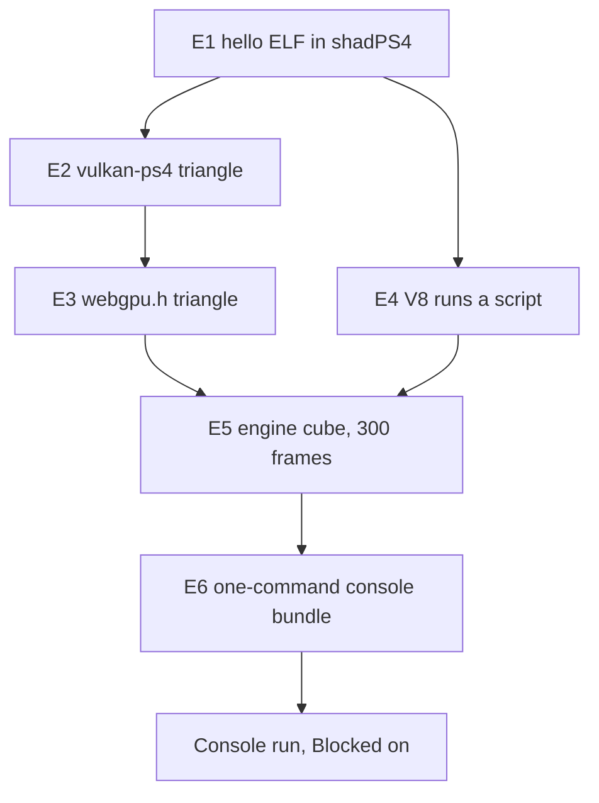

# PRD-784 — PS4 feasibility: emulator experiments, then one engine cube on the console

**Status:** NOT STARTED
**Priority:** P2 — Owner-requested feasibility: boxes E1 to E6 and the Blocked on console run are all open, and no release waits on them.
**Complexity:** 7 (HIGH)
**Owner:** Joao Paulo Furtado (console steps only); agent (everything else)
**Depends on:** None

Complexity: 6 to 10 implementation files (+2), new platform module (+2), new independent build
target (+2), external toolchains (+1) = 7. Risk override: none.

## Context

The owner wants to know if ThreeNative can run on a PS4, and wants at least one proof of concept on
the console. Emulator runs come first, so the work costs the owner as little time as possible.

[`docs/spikes/PS4_PS5_Emulation_Spike.md`](../../spikes/PS4_PS5_Emulation_Spike.md) (2026-08-27)
already maps the landscape. This PRD keeps its evidence labels and its fail-closed rule. It replaces
the parts below, because the spike predates the C++ engine decision of 2026-10-15.

| Spike says | This PRD says | Why |
| --- | --- | --- |
| Upstream `three/webgpu` on the host | The C++ engine behind the Three.js API | It is the default engine (`docs/architecture/NATIVE-ENGINE-DECISION.md`) |
| QuickJS as the bootstrap runtime | V8 only | Owner decision below |
| PS4 and PS5 lanes in parallel | PS4 only | Owner asked for PS4 |
| Trace recorder, bundle schema, 22 sections of process | One runner script, one log marker, one image check | Enough to answer a feasibility question |

### Checked on 2026-11-02

| Fact | Result | Source |
| --- | --- | --- |
| The engine draws through `webgpu.h` | ✅ The seam survives the spike | `packages/runtime-native/src/engine/renderer/renderer.cpp` |
| shadPS4 is current and boots a raw ELF on Linux | ✅ v.0.21.0, 2026-10-30, has a Linux SDL build and `--mount` | GitHub release, README, `src/main.cpp` |
| OpenGNM supports shadPS4 by design | ✅ `driver_orbis.c` forwards to the HLE `sceGnm*` | `PS4-OpenGNM/opengnm` docs |
| `opengnm-psbc` ran on a console | ✅ Project reports VS and PS shaders on FW 9.00, GFX7 | Project README, not run here |
| `vulkan-ps4` is a Vulkan 1.0 driver with compute | ⚠️ Project claim, not run here | Project README |
| Dawn runs on that driver | ❌ Dawn rejects a driver below Vulkan 1.1 | `dawn/native/vulkan/BackendVk.cpp`, `kRequiredVulkanVersion` |
| wgpu runs on that driver | ⚠️ wgpu has a Vulkan 1.0 path that needs `VK_KHR_maintenance1`, and a PS4 Rust target is unverified | `wgpu-hal/src/vulkan/adapter.rs` |
| V8 builds for the OpenOrbis target | ⚠️ Unverified, and JIT memory on PS4 is unverified | No source found |
| The player has a PS4 window path | ❌ `player/run.cpp` has 62 `SDL_` uses, and a PS4 SDL3 port is unverified | Repository search |
| OpenGNM has more than one maintainer | ⚠️ Two stars per repository, so a fork is likely | GitHub API |

## Solution

Run the cheapest experiment that can kill the idea first. Each experiment has a pass result, a
budget and a named pivot. Stop when a pivot also fails, and record why under `## Decisions`.

| # | Question | Pass result | Budget | If it fails |
| --- | --- | --- | --- | --- |
| E1 | Does our toolchain produce an ELF that shadPS4 boots? | ELF prints a marker to the emulator log, with no Sony module | 1 hour | If shadPS4 asks for firmware modules, add the owner dump line. If the boot still fails, stop |
| E2 | Does the Vulkan driver render in the emulator? | Non-blank triangle capture | 3 hours | Try the `freegnm-examples` GNM triangle to isolate the layer. If only GNM works, E3 pivots to route C |
| E3 | Which `webgpu.h` runs on PS4? | Triangle drawn through `webgpu.h`, shaders compiled at run time | 1 day | Move down the routes below |
| E4 | Does V8 run on PS4? | Script result in the log, and the mode (JIT or `--jitless`) recorded | 1 day | Try `--jitless`. If that fails, stop and ask the owner, because V8 is the owner's choice |
| E5 | Does the engine run? | 300 frames, a guest readback that is not blank, cube pose differs between frames | 2 days | Record the first failing call, then ask if the cost is worth it |
| E6 | Can the owner run it in minutes? | One command builds and sends the E5 artifact to a console address | 2 hours | The owner runs the steps by hand |

Budgets are estimates of agent time, not measurements.

**E3 routes, best first:**

| Route | Rating | Trade-off |
| --- | --- | --- |
| A. Dawn on `vulkan-ps4`, with the driver patched to report Vulkan 1.1 | ⭐⭐⭐⭐⭐ | Same backend as desktop. C++, so it uses the same compiler. Risk: the driver may lack required 1.1 behavior |
| B. wgpu-native on `vulkan-ps4` | ⭐⭐⭐ | Accepts Vulkan 1.0 and is the Android seam. Risk: Rust target and standard library for this platform |
| C. Narrow `webgpu.h` over `vulkan-ps4` or GNM, limited to the calls the cube makes | ⭐⭐ | Smallest dependency. Risk: we own WebGPU semantics and WGSL translation |

**Window path:** try SDL3 with its dummy video driver first, so the `SDL_` calls in `run.cpp` stay
unchanged. Present through the `vulkan-ps4` VideoOut swapchain. Clone the platform entry from
`src/platform/android_main.cpp`. Replace SDL only when E5 proves the dummy driver cannot work.

**Evidence rule:** each result says `PS4_EMULATED` or `PS4_HARDWARE`. An emulator result is not a
console result, because an emulator can accept what the console rejects. Performance numbers count
only from the console, because shadPS4 runs on the desktop CPU and GPU.

**Hosts:** builds over 5 minutes run on the Debian laptop inside Docker, because it has no clang.
shadPS4 runs on the desktop RTX 2080 through `sh scripts/xvfb.sh`. If Vulkan cannot present there,
use the real-display rules in `AGENTS.md`.

**Out of scope:** PS5, QuickJS, PKG Store packaging, audio, controller input, starter kits and
performance work. A go result opens a second PRD for those.

## Acceptance Criteria

- [ ] AC-1 [local]: The engine and V8 render the cube for 300 frames on `PS4_EMULATED`, from one command. proof: `node packages/runtime-native/scripts/ps4/run-experiment.mjs e5` — Evidence: pending.
- [ ] AC-2 [local]: A failed run exits non-zero and names the failing experiment and call. proof: `node packages/runtime-native/scripts/ps4/run-experiment.mjs e5 --scene missing` — Evidence: pending.

## Blocked on

- Real PS4 model and system software version, with no system update first — unblocked by João reading Settings > System > System Information.
- Console ready for homebrew, reachable on the LAN — unblocked by João jailbreaking it with the public method for that firmware, after an agent confirms the method from the version above.
- `PS4_HARDWARE` run of the E6 bundle, which is the owner's proof-of-concept goal, with frame time and memory recorded — unblocked by the two lines above. The agent sends and reads the run. João only confirms the cube on the TV.

## Integration Ledger

| Capability | Reachable consumer/trigger | Replaces / disposition | Evidence |
| --- | --- | --- | --- |
| PS4 build target | `cmake --preset tn-ps4` → `cmake/ps4.toolchain.cmake` → `cmake/NativeEngine.cmake` player target; fill `file:line` at E5 | New target, other presets unchanged | E5 |
| Engine on PS4 | `run-experiment.mjs e5` → shadPS4 → `src/platform/ps4_main.cpp` → `src/engine/player/v8_main.cpp` → `examples/native-smoke` scene | New path, no fallback renderer | AC-1 |

## Decisions

- 2026-11-02 (João): Goal is feasibility, then at least one proof of concept on a real PS4.
- 2026-11-02 (João): V8 only, QuickJS is out, because V8 is the default runtime.
- 2026-11-02 (João): No legal gate for now. Practical limit kept by the agent: dumped Sony modules, keys and jailbreak binaries stay out of this public repository, because a public commit is hard to undo.
- 2026-11-02 (João): Experiments stop at the engine cube and a go/no-go. A starter kit is a later PRD.

## Execution Phases

#### Phase 1: The emulator lane and a native triangle

**Status:** NOT STARTED
**Files:** `packages/runtime-native/scripts/ps4/run-experiment.mjs` (pins, boot, log marker, non-blank check, fails closed), `packages/runtime-native/scripts/ps4/e1-hello.c`.
**Implementation:** Pin shadPS4 v.0.21.0, OpenOrbis and the OpenGNM commits in the script. Clone them outside tracked paths. Pass the output folder with `--mount`.
**Verification:** each box below. A boot with no marker or a blank capture fails.

- [ ] E1: OpenOrbis ELF prints its marker in shadPS4. proof: `node packages/runtime-native/scripts/ps4/run-experiment.mjs e1`
- [ ] E2: `vulkan-ps4` draws a non-blank triangle in shadPS4. proof: `node packages/runtime-native/scripts/ps4/run-experiment.mjs e2`

#### Phase 2: The two seams, GPU and JavaScript

**Status:** NOT STARTED
**Files:** `packages/runtime-native/cmake/ps4.toolchain.cmake` (clone the `ios.toolchain.cmake` pattern), `packages/runtime-native/CMakePresets.json` (`tn-ps4`), `packages/runtime-native/scripts/ps4/` (one test source per box, and any driver patch).
**Implementation:** Run E3 through the routes in order and record the chosen route under `## Decisions`. Run E4 at the same time, because it has no dependency on E3. Build V8 from the version pinned in `js-engine-versions.json`, try JIT first, then `--jitless`.
**Verification:** each box below. Log the adapter limits at E3, because they decide which engine features need a gate.

- [ ] E3: A triangle draws through `webgpu.h` in shadPS4. proof: `node packages/runtime-native/scripts/ps4/run-experiment.mjs e3`
- [ ] E4: V8 runs a script in shadPS4 and logs its mode. proof: `node packages/runtime-native/scripts/ps4/run-experiment.mjs e4`

#### Phase 3: The engine cube and the console bundle

**Status:** NOT STARTED
**Files:** `packages/runtime-native/src/platform/ps4_main.cpp` (clone `android_main.cpp`), `packages/runtime-native/cmake/NativeEngine.cmake` (PS4 branch), `packages/runtime-native/src/engine/player/run.cpp` (only if the dummy SDL driver cannot work), `packages/runtime-native/scripts/ps4/send-to-console.mjs`.
**Implementation:** Build the V8 player for `tn-ps4`. Run the `examples/native-smoke` scene. Use the existing `src/screenshot_gate.cpp` readback for the guest image. Unsupported calls fail closed and name the call. Write the go/no-go under `## Decisions`.
**Verification:** each box below and AC-1, AC-2. A green run needs 300 frames, a non-blank readback and two frames that differ.

- [ ] E5: The engine and V8 render 300 frames of the cube in shadPS4. proof: `node packages/runtime-native/scripts/ps4/run-experiment.mjs e5`
- [ ] E6: One command builds the E5 artifact and prints each send step for a console address. proof: `node packages/runtime-native/scripts/ps4/send-to-console.mjs --dry-run --host 127.0.0.1`

When only the `## Blocked on` lines remain, `git mv` this file to
`docs/PRDs/BLOCKED/requires-physical-device/`.
