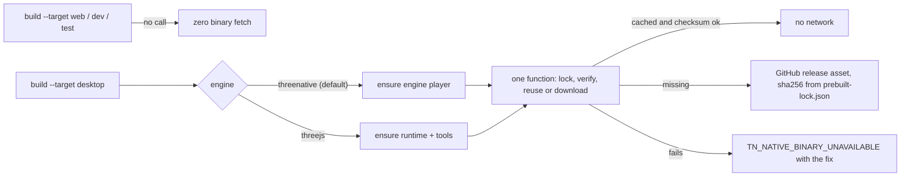

# PRD-783 — Native binaries download on first native use, not on install

**Status:** NOT STARTED
**Priority:** P1 — AC-1 to AC-3 are open: every new user downloads about 385 MiB (measured) of native binaries that a web game does not use, on the primary getting-started path, and the default desktop build has no download path at all (it stops with a `cmake` instruction). Not P0: nothing blocks a release, the runtime, security or data.
**Complexity:** 6 (HIGH) — score: 6 to 10 implementation files +2, lock and concurrency +2, crosses the npm and GitHub-release boundary +2 = 6 (MEDIUM). Risk override to HIGH: the PRD changes when published native binaries reach a consumer and it edits the release-time clean-consumer proofs.
**Owner:** João
**Depends on:** None. It does not edit `scripts/release.ts`, `scripts/release-ship.ts` or `scripts/check-publish-state.ts`, so it does not collide with branch `ci/release-one-board` (#601). It does edit `.github/workflows/native-release.yml`, which #601 does not touch (checked with `git diff origin/develop...origin/ci/release-one-board --stat`).

> Owner request, 2026-11-01: "why linux/windows binary if to get started i just need web wasm? Like if i want the fucking native version, then it should download, right?"

## Context

### The problem in one paragraph

`pnpm install` of any scaffold runs the `install` script of `@threenative/runtime-native`. That script downloads three Linux binaries (385 MiB) from the GitHub release. A web game needs none of them. The web engine (Wasm) already ships inside the npm package. Worse, the default desktop build (`engine: "threenative"`) never asks for the download it needs. It only looks for a file on disk and stops with a message that tells the user to run `cmake`.

### What I measured

All numbers below were measured on this Linux x64 host on 2026-11-01, with the published 0.3.6 cohort, `pnpm` 10.25.0, an isolated store, and `du -sm` (MiB, 1 MiB = 1,048,576 bytes) unless a line says otherwise. The scratch directory was `~/.cache/tmp-tn/prd783` and was deleted at the end.

| # | Finding | Number | How |
| --- | --- | --- | --- |
| M1 | Web-only `node_modules` of the `starter` scaffold, binary download skipped | **488 MiB** (project 491 MiB) | `THREENATIVE_PREBUILT_MANIFEST=/nonexistent/x.json pnpm install`. This uses the existing "release missing" warning path in `install-prebuilt.mjs:~430`. |
| M2 | `@threenative/runtime-native` itself, without binaries | 5 MiB. The Wasm engine is `build/web/tn-native-engine-web.wasm`, 3.6 MB | `du` of the installed package |
| M3 | Web build with no native binary installed | `pnpm build:web` exit 0, "built in 3.15s" | run in the web-only project |
| M4 | Same project, `pnpm build:desktop` | Fails after the full UI build with `TN_ENGINE_PLAYER_MISSING` ... "Build it (cmake --preset tn-linux ...)" | run in the web-only project. The message also has a missing space (`player-v8.Build it`). |
| M5 | Same project, `threenative doctor --text` | Two `✗` lines (`native runtime`, `target desktop`) and "At least one check failed" | run in the web-only project. A user who installed only for the web sees a red doctor. |
| M6 | Fetch only the engine player with the existing `installPrebuilt({ enginePlayer: true, reuse: true })`, then `pnpm build:desktop` | Ensure: **1 s** for 117.5 MiB. Second call (reuse): 0 s. `build:desktop` exit 0, `dist-native` 159 MiB | run in the same project. It proves the mechanism needs no new download code. |
| M7 | A failing install script of an optional dependency | `pnpm install` still exits 0 and prints a `Failed` line | bad JSON in `THREENATIVE_PREBUILT_MANIFEST`. `@threenative/runtime-native` is an `optionalDependencies` entry of the template. |
| M8 | Release 0.3.6 Linux assets | runtime 138,542,864 B, tools 141,906,912 B, engine player 123,234,832 B. Total 403,684,608 B (**385 MiB**) | `gh release view runtime-native-v0.3.6 --json assets` |
| M9 | Release 0.3.6 Windows assets | 47,798,272 + 47,417,344 + 46,426,624 B (135 MiB). Linux is 2.9 times larger. | same |
| M10 | Which binary the default desktop build needs | Only the engine player, 117.5 MiB. The legacy runtime (126 MiB) and the tools helper (135 MiB) serve only `engine: "threejs"` desktop builds. | `build.ts:1599-1630` calls `package-engine-desktop.mjs --player` and never the legacy packager |
| M11 | Is the Linux asset stripped? | **No.** `file`: "dynamically linked, with debug_info, not stripped" | `file threenative-runtime-linux-x64` |
| M12 | Linux runtime sections (`size -A`) | `.text` 52.6 MB, `.dynstr` 13.7 MB, `.debug_info` 12.5 MB, `.eh_frame` 6.1 MB, `.rodata` 5.4 MB, `.debug_*` about 25 MB in total, `.symtab` 4.5 MB, `.strtab` 19.3 MB (from `readelf -S`) | `size -A`, `readelf -S -W` |
| M13 | The runtime exports 106,975 dynamic symbols | `nm -D --defined-only` | `.dynstr` plus `.dynsym` is about 16 MB that `strip` cannot remove |
| M14 | Runtime after `strip` | 87,479,656 B (**-37%**). Tools 89,326,536 B. Engine player 90,034,712 B (it is already partly stripped). | `strip` on copies |
| M15 | Stripped, then compressed (per binary) | `zstd -19`: runtime 22.2 MB, tools 22.8 MB, player 22.7 MB. `gzip -9`: 31.6 MB. **Node-stdlib brotli q9: 24.2 MB, 0.44 s to decompress** (Node 20.19.6, no new dependency). | measured on copies |
| M16 | Do the three Linux binaries share content? | All three embed V8 (about 60,000 V8 dynamic symbols each). `zstd -19 --long=28` of the three together: 41.7 MB, against 67.7 MB for three separate files. About 38% is shared. | measured |
| M17 | How the release builds and stages them | Preset `Release` (`CMakePresets.json:15`). `native-release.yml:553-575` copies the files from the build tree with `copyFileSync`. No `strip` and no compression step exists for Linux or Windows assets. `package-desktop.mjs` strips only the packaged game binary, at game-package time. | read |
| M18 | Duplicate and dead weight in M1 | musl variants on a glibc host: rolldown 21, sharp-libvips 19, lightningcss 10 + 10 MiB. Setting `pnpm.supportedArchitectures.libc: ["current"]` gives **428 MiB** against 488 MiB under the same `--ignore-scripts` (**-60 MiB, -12%**) and installs no musl package. | two installs, same store |

### Waste in the web-only install: what to cut and what to keep

| Item | Size (MiB) | Decision | Reason |
| --- | --- | --- | --- |
| musl native packages on a glibc host (M18) | 60 | **Cut** (AC-5) | One line in each template. Measured -12%. |
| `three` | 25 | Keep | One copy only (`ls node_modules/.pnpm \| grep -c '^three@'` gives 1). The patched copy is by design. |
| TypeScript 6 + TypeScript 7 | 24 + 27 | Keep | By design: `AGENTS.md` says AST scripts use the TS 6 compatibility API while `tsc` is TS 7. Cutting one breaks the other. |
| `ag-psd` | 25 | Keep, follow-up | Pulled by `threenative-asset-mcp` through `@threenative/core`. Cutting it means splitting the MCP from core. That is a package-boundary decision, not an install-size fix. |
| `create-threenative` as devDependency | 23 | Keep | It carries the `threenative` CLI. Its 13 MiB of templates and 7 MiB of template assets are a scaffolder-split question. |
| `playwright-core` 1.62.0 beside 1.62.1 | 14 | Follow-up | `threenative-asset-mcp@0.14.0` pins an old `@threenative/playtest@0.3.2` and `playwright@1.62.0`. A version-skew fix in the asset MCP, not in this repository's templates. |
| `@dimforge/rapier3d-compat` 0.12.0 beside 0.19.3 | 8 | Keep | 0.12.0 comes from `@types/three` (types only). Not ours to change. |
| `@img`, `@esbuild`, `lightningcss` gnu builds | 18 + 11 + 20 | Keep | Needed by the supported Vite and asset pipeline. |

### Every consumer of the prebuilt path (found with `rg`, no `.worktrees/` or `.claude/worktrees/`)

The Integration Ledger below gives each one a decision. The important facts:

- **Only one entry point downloads on demand today:** the legacy desktop packager. `package-desktop.mjs:93` calls `installPrebuilt({ reuse: true })`. Android and iOS download their libraries at package time (`package-android.mjs:727`, `package-ios.mjs:597`) and cache nothing. `runtime-native/README.md` already documents this for Android.
- **The default desktop path does not.** `engineDesktopPlayer` (`build.ts:1584`) returns a path and nobody fetches it.
- **Three readers assume the install hook ran:** `doctor.ts:1367` (reads `install-status.json`), `native-release.yml:1108` and `:1641` (assert `install-status.json` and the binaries right after `pnpm install`).
- **`core/scripts/postinstall.mjs` touches no binary.** It applies the `three` patch and sets up the MCP. No change.
- **`packages/playtest` has no prebuilt path.** `--target desktop` takes an explicit `--executable` that `threenative build` wrote. No change.
- **The capability manifest has nothing for this.** `rg` over `capabilities.json` finds no entry about native binary delivery. No capability to reuse.

### Where the download point goes

## Solution

**The laziest thing that works: keep `install-prebuilt.mjs`, delete its install hook, and call it from the native entry points.** M6 shows the existing function already does the work in one second for the default desktop path.

1. **Remove `"install": "node scripts/install-prebuilt.mjs"`** from `packages/runtime-native/package.json:100`. Keep the file. Running `node node_modules/@threenative/runtime-native/scripts/install-prebuilt.mjs` by hand stays the explicit "fetch now" path (for example to bake an offline image). Remove `@threenative/runtime-native` from `onlyBuiltDependencies` in the 13 template manifests, because it no longer has a script to approve.
2. **Add one exported function** to `install-prebuilt.mjs`: `ensureNativeBinary({ enginePlayer })`. It wraps the current `installPrebuilt({ reuse: true, enginePlayer })` and adds only what is missing:
   - **Lock.** `mkdirSync` on `prebuilt/<key>.lock` is atomic. Losers poll every 250 ms and re-run the verified-install check after the winner leaves. A lock older than 15 minutes is stale. Today two parallel commands race: `beginInstall` (`install-prebuilt.mjs:287`) deletes the output before it downloads. This is from reading, not from a run.
   - **Named errors.** `TN_NATIVE_BINARY_UNAVAILABLE` for a network, HTTP or checksum failure. `TN_NATIVE_BINARY_UNPUBLISHED` when the release or the asset does not exist (the existing `PREBUILT_RELEASE_MISSING` and `PREBUILT_RELEASE_UNPUBLISHED` codes, and every macOS row). Each message names the asset, the version, the URL, the reason, and three fixes: reconnect and rerun the same command, point `THREENATIVE_ENGINE_PLAYER` (or `THREENATIVE_RUNTIME_BINARY` for the legacy host) at a local file, or build from an engine checkout.
3. **Call it from every native entry point, and only from them.**
   - `buildEngineDesktop` (`build.ts:1599`): before the UI build, when no `THREENATIVE_ENGINE_PLAYER` is set and no checkout build exists. A cheap failure comes first (M4 spent a full UI build before it failed).
   - `resolveDesktopRuntime` (`package-desktop.mjs:93`): already calls `installPrebuilt`. It gets the lock and the named errors for free.
   - Web commands never import `install-prebuilt.mjs`. That is the "zero binary calls" rule, and AC-1 proves it.
4. **Cache location stays `node_modules/@threenative/runtime-native/prebuilt/<platform-arch>/`.** The status files, doctor, the CI asserts and `asset-preflight.mjs` already read there. A reinstall that creates a new package directory (the directory name carries a peer-dependency hash, seen in the M-runs path) fetches again. That costs one second at 1 Gbit and is the status quo for every fresh install. A shared per-user cache is a named follow-up (below).
5. **Offline.** A verified cached binary needs no network (M6, reuse in 0 s). Without one, the build fails closed with `TN_NATIVE_BINARY_UNAVAILABLE` and the fixes above. It never falls back to the `cmake` instruction.
6. **Doctor stays offline.** It reports "not downloaded yet, the first `threenative build --target desktop` downloads it (about 118 MiB)" as `ok`. It keeps `✗` for a status file that records a failed download. For the default engine it reads `engine-player-install-status.json`, not the legacy runtime status (M10: the legacy binary is not what that build runs).
7. **`pnpm.supportedArchitectures.libc: ["current"]`** in each template manifest (M18).

### Options considered

| Option | Rating | Verdict |
| --- | --- | --- |
| Lazy ensure at native entry points (this PRD) | ⭐⭐⭐⭐⭐ | Smallest change. Reuses the checksum, status file and tools helper code. Fetches the one binary the build needs. |
| Keep the install hook behind an opt-out flag (`THREENATIVE_SKIP_PREBUILT=1`) | ⭐⭐ | Agents do not know the flag, so the default stays 385 MiB and the default desktop build still has no path. |
| Per-user shared cache (`~/.cache/threenative/...`) | ⭐⭐⭐ | Saves 117.5 MiB per extra project. It moves the path that doctor, CI and the preflight read. Follow-up, not first. |
| Split into a Wasm package and per-platform binary packages | ⭐ | npm would still install the host binary eagerly. It also breaks the rule that a package exists only for a dependency the others must not inherit. |

## Acceptance Criteria

- [ ] AC-1 [local]: A scaffold install and `threenative build --target web` make zero binary requests, and `prebuilt/` holds no binary and no `install-status.json` afterwards. proof: `pnpm exec vitest run packages/create-threenative/__tests__/native-ensure.spec.ts packages/runtime-native/tests/distribution.test.mjs` — a `fetch` stub that fails the test when called, plus an assertion that `packages/runtime-native/package.json` has no `install` script. — Evidence: pending.
- [ ] AC-2 [local]: `ensureNativeBinary` downloads once when two calls run in parallel, returns with no network when the cache verifies, rejects a bad checksum, and fails offline with `TN_NATIVE_BINARY_UNAVAILABLE` naming the URL and the three fixes. proof: `pnpm --filter @threenative/runtime-native exec vitest run tests/ensure-native-binary.test.mjs` (new, loopback fixture server, `THREENATIVE_ALLOW_INSECURE_PREBUILT=1`). Red first: the parallel case fails on today's `installPrebuilt` because `beginInstall` deletes the other call's output. — Evidence: pending.
- [ ] AC-3 [local]: Default-engine `build --target desktop` calls the ensure function once, before the UI build. An explicit `THREENATIVE_ENGINE_PLAYER` or a checkout build makes zero calls. The legacy host (`engine: "threejs"`) ensures runtime and tools. proof: `pnpm exec vitest run packages/create-threenative/__tests__/engine-desktop.spec.ts` — extended cases. — Evidence: pending.
- [ ] AC-4 [local]: `threenative doctor` on a web-only project exits 0 and shows the native entries as `ok: not downloaded yet`. A recorded failed download still shows `✗` with a fix that says to rerun the build. proof: `pnpm exec vitest run packages/create-threenative/__tests__/doctor.spec.ts`. Baseline for red: M5. — Evidence: pending.
- [ ] AC-5 [local]: Each template manifest sets `pnpm.supportedArchitectures.libc` to `["current"]` and no longer lists `@threenative/runtime-native` in `onlyBuiltDependencies`. proof: `pnpm exec vitest run packages/create-threenative/__tests__/build.spec.ts -t "ships the CLI and native runtime pins"` — assertion at `build.spec.ts:1499` flips. — Evidence: pending.
- [ ] AC-6 [shared]: Web-only target: a packed `platformer` consumer on Linux x64 has `node_modules` of 450 MiB or less (measured 428 MiB with the libc setting, 488 MiB without; 450 is the measured value plus about 5% headroom) and no file over 1 MiB in `prebuilt/` after `pnpm install`. Then `build --target desktop` fetches the engine player only (no `threenative-runtime`, no `mystral-tools`), verified against `prebuilt-lock.json`, and the packaged player boots with `TN_PLAYER_V8_GAME_CHECK ... startup=passed`. proof: job `clean-consumer`, step "Verify packed default-engine desktop and web consumer" (`scripts/verify-one-template-desktop.ts platformer --archives`), extended with the pre-build size and `prebuilt/` assertions. Triggered by `native-release.yml` on the release candidate. Linux x64 only. — Evidence: pending.
- [ ] AC-7 [shared]: Windows x64 target: the same install, then `build --target desktop` fetches `tn-native-engine-player-v8.exe`, and the existing assertions of `clean-consumer-windows` (`native-release.yml:1641-1648`) move from "right after install" to "right after the first desktop build". The tools helper assertion applies only to the `threejs` host row. proof: job `clean-consumer-windows`. Windows x64 only. — Evidence: pending.
- [ ] AC-8 [shared]: One `--target desktop` playtest runs through the lazily fetched player: a `racing` scaffold installed from the packed tarballs runs `pnpm test:native`, which is `pnpm build:desktop && threenative-playtest --scenario native-playtests/survives.playtest.json --target desktop --executable dist-native/<name>` (`templates/racing/package.json:13`). proof: new step in job `clean-consumer` after AC-6, with the job's software Vulkan ICD and `TN_PLAYTEST_ALLOW_SOFTWARE=1`. Linux x64 only. — Evidence: pending.
- [ ] AC-9 [local]: The words a cold agent reads match the behavior: the command block of every template `AGENTS.md`, `packages/runtime-native/README.md` and the `TN_` messages name the first-use download (about 118 MiB), the web-never-downloads rule, and the offline override. They name only shipped commands. proof: `pnpm sync:agents && pnpm check:docs && pnpm exec vitest run scripts/__tests__/primary-docs.spec.ts scripts/__tests__/sync-agent-docs.spec.ts`. — Evidence: pending.

## Blocked on

- Windows and Linux numbers in AC-6 to AC-8 need a release candidate whose `runtime-native-v<version>` GitHub release exists. No such release exists for the 0.3.8 version in this checkout yet (the 0.3.8 tag run is in flight on another lane). Local proof for AC-1 to AC-5 and AC-9 does not need it. — unblocked by the release run that publishes the next `runtime-native-v*` tag, started by João or the release lane.

## Integration Ledger

| Capability | Reachable consumer / trigger | Replaces / disposition | Evidence |
| --- | --- | --- | --- |
| Install-time download | `pnpm install` → `runtime-native/package.json:100` `install` script | **Removed.** `install-prebuilt.mjs` stays as a module and as a manual command. | AC-1 |
| Default desktop player | `threenative build --target desktop` → `build.ts:1599` `buildEngineDesktop` → `engineDesktopPlayer` (`:1584`) | **Adds** the ensure call before the UI build. Today it only returns a path. | AC-3, AC-6 |
| Legacy desktop runtime and tools | `engine: "threejs"` → `build.ts:1666` → `package-desktop.mjs:93` `resolveDesktopRuntime` | Already calls `installPrebuilt({ reuse: true })`. **Gains** the lock and the named errors. | AC-2, AC-3 |
| Android libraries | `build --target android` → `package-android.mjs:727` `downloadReleaseArtifact` | **Unchanged.** Already on demand. It downloads about 100 MiB per build and caches nothing. Follow-up. | none (out of scope) |
| iOS simulator zip | `build --target ios` → `package-ios.mjs:597` | **Unchanged.** Already on demand. macOS only. | none |
| Doctor | `doctor.ts:1349` `nativeRuntimeCheck`, `:1817` `targetChecks`, `:2193` `probeNativeHost` | **Changed:** absent status is `ok: not downloaded yet`. It reads the engine-player status for the default engine. A failed-download status keeps `✗`. | AC-4 |
| Playtest `--target desktop` | `packages/playtest` `--executable` (`config.ts:109`) | **Unchanged.** It consumes the build output, not `prebuilt/`. | AC-8 |
| Engine packager | `package-engine-desktop.mjs:35` `TN_ENGINE_PLAYER_MISSING` | **Message rewritten.** It names the ensure failure and the three fixes, and drops the `cmake` advice and the missing space. | AC-3 |
| Asset preflight | `asset-preflight.mjs:76` `prebuiltExecutable` | **Unchanged.** It already returns `undefined` when the binary is absent and never grants support. The legacy path ensures the runtime before it runs. | AC-3 |
| Generated kit scripts | `templates/*/package.json` `test:native` (6 kits) | **Unchanged.** They start with `pnpm build:desktop`, which now fetches. | AC-8 |
| Template manifests | 13 × `templates/*/package.json` `pnpm` block | **Changed:** drop `@threenative/runtime-native` from `onlyBuiltDependencies`, add `supportedArchitectures.libc`. | AC-5 |
| `core/scripts/postinstall.mjs` | `@threenative/core` install | **Unchanged.** It touches no binary. | none |
| Clean-consumer proofs | `native-release.yml:1108-1112` (Linux), `:1641-1648` (Windows) | **Changed:** assertions move after the first desktop build. Add the pre-build "nothing downloaded" assertion. | AC-6, AC-7 |
| Packed consumer gate | `scripts/verify-one-template-desktop.ts:120` `verifyInstalledConsumer` | **Extended** with the pre-build size and `prebuilt/` assertions. | AC-6 |
| Native lanes that install with `--ignore-scripts` | `native-platforms.yml:2289-2302` and the `THREENATIVE_ENGINE_PLAYER` step | **Unchanged.** An explicit player path makes zero calls. | AC-3 |
| Release census | `check-publish-state.ts` `prebuiltReleaseCensus`, `release-ship.ts`, `release.ts` | **Unchanged.** See "Release coupling". | none |
| Registry clean-room | `scripts/verify-registry-install.ts` (reads `releaseManifestUrl` from the installed `install-prebuilt.mjs`) | **Unchanged.** The exports stay. | none |

## Release coupling

What ties npm to the GitHub release today, read from `origin/ci/release-one-board`:

- `release-ship.ts` runs candidate → tag → wait for the `native-release.yml` run and a public release → `pnpm release --yes --skip-gates` (npm publish). The tag run builds and verifies every native row first.
- `check-publish-state.ts` `prebuiltReleaseCensus` fails the npm publish when `runtime-native-v<version>/prebuilt-lock.json` is absent. Commit `f12b204cb` removed `--allow-missing-prebuilt` (owner, 2026-11-01: "Why would we ever ship without native binaries??").

**This PRD changes none of that.** The npm tarball still names its release by version. Only the moment of the fetch moves, from install to first native build.

**What must not weaken:**

1. The release builds and verifies all native binaries before npm publish. This PRD does not touch that order.
2. The census keeps `severity: "fail"` for an absent release. The gate matters more after this PRD, because a missing release now fails the first native build instead of printing a warning during install.
3. Every download keeps its `prebuilt-lock.json` SHA-256 and size check. The ensure function adds a lock and an error name and removes no check.
4. `clean-consumer` and `clean-consumer-windows` still prove that the published assets download and boot. They prove it one step later (AC-6, AC-7).

One sentence in `check-publish-state.ts` becomes stale ("installs will warn and continue"). Fix it after #601 merges, in a follow-up, so this PRD does not collide with that branch.

## Decisions

- 2026-11-01 (PRD author, pending João): Cache stays in the package `prebuilt/` directory. Reason: five readers already use it and M6 shows a fetch costs 1 s here.
- 2026-11-01 (PRD author, pending João): No new CLI command. `AGENTS.md` rule 5 closes a bespoke CLI vocabulary. The existing `threenative build --target desktop` is the trigger, and the manual script stays for offline baking.
- 2026-11-01 (PRD author, pending João): `libc: ["current"]` is in scope because the owner's complaint is about web install weight, and it is the only cut that is one line per template and measured.

## Follow-ups (named, not in this PRD)

1. **Shrink the Linux release assets.** Strip and compress them, and hide the exported V8 and Dawn symbols. Measured per binary: 138.5 MB → 87.5 MB (strip) → 24.2 MB (brotli q9, Node stdlib, 0.44 s to decompress). All three Linux assets together would go from 385 MiB to about 70 MiB. The ensure function would decompress after the SHA-256 check. Open questions: which input carries the DWARF (V8 and Dawn static libraries are my guess, unverified), and where the debug symbols go for `profile:native-cpu`.
2. **Per-user shared cache** (`~/.cache/threenative/`) once two projects on one machine are a measured pain.
3. **Android and iOS download caching.** Each Android build downloads about 100 MiB again.
4. **Asset MCP version skew** (`playwright` 1.62.0 beside 1.62.1, `@threenative/playtest` 0.3.2 nested) and the `ag-psd` weight. Both live in the `threenative-asset-mcp` package.
5. **Stale census text** in `check-publish-state.ts` after #601.

## Not verified

- The parallel-call race in `beginInstall` is from reading the code. AC-2 runs it.
- A failed optional-dependency script exits 0 under pnpm 10.25.0 (M7). I did not run npm or Yarn.
- Whether a pnpm re-link wipes the cached binary is inferred from the package directory name. I did not run a re-link.
- `libc: ["current"]` was run on glibc only. Alpine (musl) behavior is not run.
- Sizes for macOS are unknown: the 0.3.6 release has no `darwin` assets, and the `darwin` rows stay in `UNPUBLISHED_PREBUILT_KEYS`.
- The M1 baseline (488 MiB) is 35 MiB above the 453 MiB implied by the earlier 838 MiB total minus 385 MiB of binaries. I used the number I measured.

## Execution Phases

#### Phase 1: The default desktop build fetches its own player, and an install fetches nothing
**Status:** NOT STARTED
**Files:** `packages/runtime-native/scripts/install-prebuilt.mjs` (ensure function, lock, error names, export), `packages/runtime-native/package.json` (drop the `install` script), `packages/create-threenative/src/build.ts` (call before the UI build), `packages/runtime-native/scripts/package-engine-desktop.mjs` (message), new tests `packages/runtime-native/tests/ensure-native-binary.test.mjs` and `packages/create-threenative/__tests__/native-ensure.spec.ts`, edits to `engine-desktop.spec.ts`.
**Implementation:** Write the failing parallel-call and offline tests first (red on today's `installPrebuilt`). Add `ensureNativeBinary` as a thin wrapper over `installPrebuilt({ reuse: true })`. Make `resolveDesktopRuntime` and `buildEngineDesktop` call it. Delete the `install` script.
- [ ] Phase 1 done when AC-1, AC-2 and AC-3 are ticked. proof: `pnpm exec vitest run packages/create-threenative/__tests__/native-ensure.spec.ts packages/create-threenative/__tests__/engine-desktop.spec.ts && pnpm --filter @threenative/runtime-native exec vitest run tests/ensure-native-binary.test.mjs tests/distribution.test.mjs` — Evidence: pending.
**Verification:** The commands above. Also `pnpm typecheck && pnpm lint` for the touched packages.

#### Phase 2: Every other reader agrees with the new timing
**Status:** NOT STARTED
**Files:** `packages/create-threenative/src/doctor.ts`, `packages/create-threenative/__tests__/doctor.spec.ts`, 13 × `packages/create-threenative/templates/*/package.json`, `packages/create-threenative/__tests__/build.spec.ts`, `.github/workflows/native-release.yml` (`clean-consumer`, `clean-consumer-windows`), `scripts/verify-one-template-desktop.ts`.
**Implementation:** Doctor: absent status is `ok`, the default engine reads the engine-player status. Templates: add `supportedArchitectures.libc`, drop the `onlyBuiltDependencies` entry. Workflow: move the post-install asserts after the first desktop build and add the "nothing downloaded" assert before it. Add the racing `test:native` step (AC-8).
- [ ] Phase 2 done when AC-4 to AC-8 are ticked. proof: `pnpm exec vitest run packages/create-threenative/__tests__/doctor.spec.ts packages/create-threenative/__tests__/build.spec.ts && pnpm exec vitest run scripts/__tests__/ci-structure.spec.ts scripts/__tests__/native-release-proof.spec.ts` for the local boxes, and the `clean-consumer` and `clean-consumer-windows` job results for the shared boxes — Evidence: pending.
**Verification:** The workflow edit follows the repository rule that workflow edits run every workflow spec (`rg -l workflow scripts/__tests__` and run them), because the specs match workflow text literally.

#### Phase 3: A cold agent reads the truth
**Status:** NOT STARTED
**Files:** the command block of the 15 `packages/create-threenative/templates/*/AGENTS.md` files (and their generated `CLAUDE.md` mirrors), `packages/runtime-native/README.md`.
**Implementation:** One short block next to `pnpm build --target desktop`: the first desktop build downloads the engine player (about 118 MiB, checksum-verified) once per install. Web builds never download. Offline: set `THREENATIVE_ENGINE_PLAYER` to a local player. Name no command that does not ship. Run `pnpm sync:agents`.
- [ ] Phase 3 done when AC-9 is ticked. proof: `pnpm sync:agents && pnpm check:docs && pnpm exec vitest run scripts/__tests__/primary-docs.spec.ts scripts/__tests__/sync-agent-docs.spec.ts` — Evidence: pending.
**Verification:** The command above. A prose-only phase needs the doc checks and the mirror regeneration, with no artificial negative control.

## Pull request

One draft PR for this PRD, opened at the first commit, labeled with the `prd:<n>` value that `pnpm prd:progress <this file>` prints. The PR body carries the AC-6 to AC-8 job links and the independent reviewer verdict for the HIGH checkpoint.
