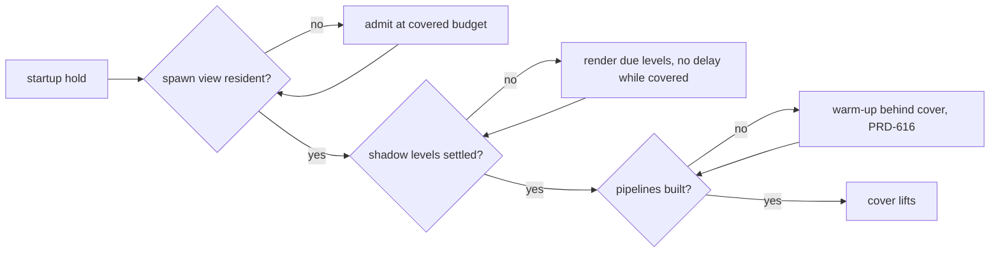

# PRD-618 — The world is complete when the cover lifts, and far trees keep their shape

**Status:** PARTIAL
**Priority:** P1 — AC-1 to AC-9 are open: on the Strata forest, shadows and nearby props appear after the loading bar ends, and far spruces read as noise (owner report, 2026-10-15).
**Complexity:** 4 (MEDIUM) — 6–10 implementation files (`virtual-shadow.ts`, core `game.ts`, `world-cells.ts`, the Strata `loading.ts`, `game.ts`, `propStreaming.ts`, `props.ts`, `prep-fab-temperate.mjs`) (+2); startup readiness state (+2). Risk override: none.
**Owner:** unassigned
**Depends on:** [PRD-616](https://github.com/ThreeNativeHQ/threenative-engine/pull/509) for AC-2 only: until the warm-up builds the pipelines of the real output pass, a warm-up behind the cover cannot remove the pipeline builds after the reveal. Related, not blocking: [PRD-606](../Unreal/open-world/PRD-606-a-fast-travel-destination-is-ready-before-the-cover-lifts.md) (`settle()` after a teleport uses the same readiness), [PRD-537](PRD-537-far-hills-show-the-forest.md) (Machinefall impostors and their shadow regression).

## Context

Owner report (2026-10-15), Strata terrain preview, `?world=forest`: the loading bar finishes, then near content still loads in front of the player. Shadows on the trees appear about one second apart from the reveal, so the first frames are not the finished frame. Far trees look bad. The owner's screenshot of the forest edge shows it: trees past the 60 m switch have blocky, square leaf patches with gaps, a flat dark green, and almost no shadow on the ground below them; the near trees on the right have full crowns and ground shadows.

Layer: both. The cover, the shadow node and the cell admission are engine mechanism (`packages/core/`). The far tree level, the LOD distances and the reveal policy are game source (`examples/strata-terrain-preview/src/render/`, `scripts/`).

### Why content pops in after the reveal (code trace, 2026-10-15)

1. **The cover does not wait for shaders.** `examples/strata-terrain-preview/src/render/loading.ts:513-521` calls `renderer.compileAsync(scene, camera)` and removes the cover in the same tick. The comment says this is deliberate: a full compile held a playtest behind the bar. All pipelines that the warm-up did not build compile in the first visible frames.
2. **The cover waits for a 60 m circle only.** The spawn gate is `props.readinessAt(spawn)` (`src/game.ts:343`, `:964`), and `readinessAt` defaults to `radius = 60` (`src/render/propStreaming.ts:392`). The prop ring covers the whole world (`propStreaming.ts:297-301`). Every cell past 60 m streams in after the reveal, nearest first, at `admissionBudgetMs: 2 / buckets` (`propStreaming.ts:318`). The covered budget (8×, `packages/core/src/world-cells.ts:153`) ends with the cover (`packages/core/src/game.ts:1677-1681`). The 60 m value is a constant that the author must revisit, so the root rule "auto by default" calls it a bug.
3. **Shadows are late by design.** `VirtualShadowNode` renders at most one level per frame (`packages/core/src/render/virtual-shadow.ts:2477-2481`). Each level also waits out an `invalidationDelay` after an invalidation: 0.25 s, 1 s and 3.33 s for the three levels (`virtual-shadow.ts:166-177`). Each admitted cell invalidates the shadows (`src/game.ts:757-760`). So the cells from point 2 pull the shadows of the near levels 0.25–1 s behind the props. The node does not know about the startup cover.
4. **No readiness reads the shadows.** The startup gate has `compileSettled` and cell coverage (`packages/core/src/game.ts:1358`). No signal says "every shadow level holds the casters that are resident now".

### Why far trees look bad (code trace, 2026-10-15)

5. **The far spruce is a triangle decimation of leaf cards.** `scripts/prep-fab-temperate.mjs:350-353` runs meshopt `simplify({ ratio: 0.14, error: 0.012 })` on each cooked spruce. `packages/assets/src/lod/cards.ts:1-20` explains why this fails on foliage: a simplifier collapses cards (wrong silhouette) or drops triangles (holes). The card thinner in that file exists for this case and the game does not call it.
6. **One reduced level from 60 m to the far plane.** Spruce has two levels (`src/render/pack.ts:90-105`). `LOD_BANDS.far = 150` (`src/render/props.ts:119`) is not used for spruce. At several hundred metres, a card mesh is sub-pixel alpha noise. The mip compensation of the cutout is `alphaTest / (1 + mip × 0.25)` (`pack.ts:294-302`), weaker than the impostor's 0.75 scale.
7. **Impostors cannot be used here.** Engine world impostors exist (`packages/core/src/world-impostor.ts`, octahedral, colour and normal baked) but stay opt-in (`?tnImpostors=1`, PRD-473 #505). The game sets `preserveAuthoredParts: true`, and `WorldCells` refuses that with impostors on (`world-cells.ts`, the `preserveAuthoredParts` guard).
8. **Hard pop at the level boundary.** `world-cells.ts:6786`: "ponytail: a hard switch, no crossfade". The two levels differ in silhouette, so the 60 m switch is visible.
9. **Shadows do not match the cutout.** The shadow pass reads the scalar `alphaTest`, not the mip-adjusted `alphaTestNode` (`pack.ts:250`), so a far tree casts a different shape from the one it shows.

### What Unreal does (UE source checkout, read 2026-10-15; clean-room summary, no code copied)

Paths are relative to `Engine/Source/Runtime/` unless stated.

- **The reveal blocks on a query, with two quiet passes.** `UWorld::BlockTillLevelStreamingCompleted` (`Engine/Private/World.cpp:4813-4860`) pumps the streamer and resets its pass count to 2 while any visibility or async request is pending. World Partition calls it before BeginPlay and at match start (`WorldPartition/WorldPartition.cpp:1214-1227`). The completion query uses the grid's own loading range, not a caller radius (`WorldPartitionStreamingPolicy.cpp:1126-1128`).
- **Virtual shadow pages have no delay and no per-frame page budget.** Every requested page renders in the frame its invalidation is processed. A light with no previous render keeps no cached page, so its first frame renders all pages (`Renderer/Private/VirtualShadowMaps/VirtualShadowMapCacheManager.cpp:270`, `:322-335`). A newly unculled primitive invalidates its pages one frame late (`:1281-1305`). The only throttle, `r.Shadow.Virtual.DeferredInvalidationBudget`, defaults to unbounded and carries work over to later frames instead of waiting on a timer (`VirtualShadowMapArray.cpp:119-127`).
- **Late shaders mean "not drawn yet", not "drawn wrong".** With `r.PSOPrecache.ProxyCreationStrategy` 1 (default), a primitive has no scene proxy until its pipelines compile (`Engine/Private/PSOPrecache.cpp:36-42`). The reveal does not wait on them, so this is Unreal's own pop-in source.
- **LOD switches dither, in every pass that clips.** Two LODs draw complementary per-pixel hash masks during the transition, including the shadow depth pass (`Engine/Shaders/Private/MaterialTemplate.ush:4483-4497`, `:2891-2920`). Instanced foliage drives it by distance with a per-instance random range so the switch is not a line (`Engine/Shaders/Private/LocalVertexFactory.ush:932-941`, `foliage.RandomLODRange`). LOD is picked by projected screen size, not metres (`Engine/Private/SceneManagement.cpp:966-1046`).
- **Simplified foliage keeps its area.** After simplification, surviving leaf boundaries grow outward by lost area ÷ perimeter, capped at 4× (`Developer/NaniteBuilder/Private/Cluster.cpp:1065` → `MeshSimplify.cpp:1285-1397`). Cutout textures can rescale mips to hold alpha coverage (`bDoScaleMipsForAlphaCoverage`, `Engine/Classes/Engine/Texture.h:1371-1375`).

## Solution

**Rule:** the cover lifts when the first frame is the finished frame. Every cell that the spawn view draws is resident, every shadow level that covers it has rendered with those casters, and every pipeline it draws is built. The engine measures this. The game sets no radius.

1. **Engine, `WorldCells`:** `readinessAt` accepts the camera. The required set becomes the cells that intersect the camera frustum within each placement's own draw reach, not a circle. The circle form stays for PRD-606 callers. Like Unreal, readiness must hold for 2 consecutive polls before the cover lifts, so a request that starts in the last ready frame cannot slip past.
2. **Engine, `VirtualShadowNode`:** while the startup cover is active, `invalidationDelay` is 0 and every due level renders in one frame. The node exposes `settled` (no level due, no delayed invalidation). Core `game.ts` adds it to the startup readiness beside `compileSettled`. After the reveal, the current delays and the one-level budget stay unchanged for steady-state refresh. Unreal has no such delay at all; replacing the post-reveal delay with a carry-over queue is a follow-up, not this PRD.
3. **Game, Strata:** `loading.ts` stops its own fire-and-forget compile and lifts the cover on the core startup readiness. `game.ts` passes the camera to `readinessAt`. The 60 m default goes.
4. **Game, far spruce:** the prep script builds the far level with the card thinner from `packages/assets/src/lod/cards.ts`, not meshopt. The thinner grows the surviving cards to hold the crown's area, capped at 4× (the Unreal rule). Past `LOD_BANDS.far`, spruce draws an engine impostor. This needs `WorldCells` to allow impostors for assets that have no authored level at that distance while `preserveAuthoredParts` keeps the authored ones. The shadow pass uses the same cutout as the view.
5. **Engine, LOD transition:** the hard switch at `world-cells.ts:6786` becomes a dithered crossfade: across a band at each boundary, both levels draw with complementary per-pixel masks, in the view and the shadow pass, with a per-instance random offset. The mechanism is engine; the band width comes from the game's `lodHysteresis`.

**Risks:**

- **Load time grows.** The cover now waits for the whole visible forest. AC-3 bounds it. If it fails, the next lever is the covered budget and load lanes (the PRD-606 risk), not a smaller required set.
- **A playtest photographs the bar.** That is why `loading.ts` stopped waiting for the compile. The core startup hold already polls once per rendered frame under the playtest clock (`src/game.ts:338-341`), so the new readiness must use the same hold, not a `Promise` that the fixed step never advances.
- **Covered shadow renders cost frames.** They happen behind the cover, so they cost load time only, and AC-3 includes them.

## Acceptance Criteria

The boxes live in the phases below; each names the AC it proves.

- AC-1 [local]: A Strata forest scenario holds the camera still at spawn for 3 s after the reveal and reads the post-reveal counters: cells admitted inside the view frustum, shadow level renders with reason "invalidated", impostor bakes pending. Every counter is 0. Red on the current develop with the numbers recorded here. proof: `node packages/playtest/dist/runner/cli.js examples/strata-terrain-preview/playtests/reveal.playtest.json --url http://127.0.0.1:5173 --server-command "pnpm --filter strata-terrain-preview dev --host 127.0.0.1 --port 5173 --strictPort" --browser-recipe webgpu --headed`.
- AC-2 [local]: The same run reports 0 render pipelines created after the reveal. proof: the AC-1 scenario with the pipeline census assertion from PRD-616.
- AC-3 [local]: Time to ready (`timeToReadyMs`) is at most 1.25× the Phase 1 baseline, median of 3 runs per arm on the same machine. proof: the AC-1 scenario's state readout.
- AC-4 [local]: The AC-1 scenario passes on the native desktop host. proof: the AC-1 command with `--target desktop`.
- AC-5 [local]: A visual judge subagent compares the reveal frame and the +3 s frame, BEFORE and AFTER, two headed runs per arm. Criterion: nothing appears, darkens or changes shape between the two frames. Verdict IMPROVEMENT. proof: root `AGENTS.md` visual judge rule.
- AC-6 [local]: The forest overview and river views draw spruce past `LOD_BANDS.far` as impostors (`stats().impostor.drawn > 0`, `pending = 0` at the reveal). proof: the AC-1 scenario run from the `overview` view.
- AC-7 [local]: A visual judge subagent rates far trees on the `overview` and `river` views, BEFORE and AFTER, two headed runs per arm. Criteria: crowns keep a solid silhouette, no speckle or shimmer, shadows match the visible crown, no visible pop at 60 m and 150 m. Verdict IMPROVEMENT. proof: `capture-strata-worlds` skill, `--worlds forest`.
- AC-9 [local]: Inside a level's transition band, both levels draw and their dither masks are complementary (every pixel covered exactly once), in the view and the shadow pass. proof: `pnpm --filter @threenative/core test -- world-cells` with a new transition spec.
- AC-8 [local]: Steady-state frame time on the `overview` view does not get worse: AFTER p50 at most BEFORE p50 + 5%, paired runs. proof: `measure-steady-state-fps` skill on the forest overview.

## Blocked on

- The licensed Fab spruce bytes are local-only (`examples/strata-terrain-preview/AGENTS.md`). AC-6 to AC-8 run on a machine that has `local-assets/temperate/`; without them the procedural spruce draws and proves nothing about the Fab trees. Unblocked by running Phase 3 on the owner's machine.

## Integration Ledger

| Capability | Reachable consumer/trigger | Replaces / disposition | Evidence |
|---|---|---|---|
| View-based spawn readiness | Strata `game.ts` startup hold → `WorldCells.readinessAt(camera)` | The 60 m default circle in `propStreaming.ts:392` is deleted | AC-1 |
| Shadow settle in startup readiness | core `game.ts` startup readiness → `VirtualShadowNode.settled` | Shadows rendered after the reveal | AC-1, AC-5 |
| Cover lifts on core readiness | Strata `loading.ts` → core startup readiness | The fire-and-forget `compileAsync` in `loading.ts:513-521` is deleted | AC-1, AC-2 |
| Card-thinned far spruce + impostor band | `prep-fab-temperate.mjs` → `pack.ts` levels → `WorldCells` | meshopt `simplify` on spruce is deleted | AC-6, AC-7 |
| Dithered LOD transition | `WorldCells` level switch → view and shadow materials | The hard switch at `world-cells.ts:6786` is deleted | AC-9, AC-7 |

## Decisions

- 2026-10-15 (agent, from the owner's report): one PRD for both symptoms, because both are "the world the player sees is not the finished world". The 1.25× load-time bound in AC-3 is an assumption; the owner can change it after Phase 1 records the baseline.

## Execution Phases

#### Phase 1: Measure the pop-in (red)

**Status:** PARTIAL
**Files:** `examples/strata-terrain-preview/playtests/reveal.playtest.json` (new); a debug readout in `src/game.ts`; `src/render/propStreaming.ts` forwards core draw-publication observations; `packages/core/src/world-cells.ts` and `packages/core/__tests__/world-cells-admission.spec.ts` implement and exercise the optional portable observer.
**Implementation:** Reuse the existing `walk`/`terrain` scenario shape. Hold the camera still for 3 s after `worldReady`. Read `props.stats()`, the shadow node stats (`invalidated`, delayed levels) and the pipeline census. Record the current numbers and `timeToReadyMs` (3 runs) in AC-1 and AC-3.
**Verification:** the AC-1 command fails on current develop, for the counter reasons and not for an environment reason (`adapter.info` names the real GPU).

- [x] Scenario is red on the frozen develop-policy baseline with numbers recorded. proof: headed WebGPU reveal scenario; baseline source `88b988cd7` adds observation only over `1d056cec3`, and sequential paired run 1/2 fail for late shadow invalidation with zero environment errors.
  - 2026-10-15 corrective attempt (base `e57975874`, runtime base `1d056cec3`): removed cumulative `byAdmission` assertions, default-zero impostor fallback and the invented 15,000 ms threshold. The probe starts after the actual canvas cover is absent, measures a 3,000 ms stationary window, differences real `byInvalidation` and device pipeline creation totals, and retains peak impostor pending work. Missing census stays unavailable (`-1`), never zero; AC-2 is not asserted yet. Game-side cell observations currently measure completed cells with in-reach placement bounds intersecting the reveal frustum; partial run publication within an unfinished cell is not covered, so this probe cannot yet qualify the full AC-1 admission claim.
  - Checks: `pnpm --filter strata-terrain-preview exec tsc --noEmit -p tsconfig.json` exit 0; Biome formatting and `git diff --check` passed. Two initial scenario-schema errors were corrected (unsupported component wait, invalid text overlay); neither was a baseline result. The corrected scenario was accepted by the CLI, but its GPU run never started.
  - Attempted command: `DISPLAY=:1 TN_PLAYTEST_HOST_DISPLAY=1 node packages/playtest/dist/runner/cli.js examples/strata-terrain-preview/playtests/reveal.playtest.json --url http://127.0.0.1:16180 --server-command "pnpm --filter strata-terrain-preview dev --host 127.0.0.1 --port 16180 --strictPort" --browser-recipe webgpu --headed --timeout 180000 --artifacts artifacts/playtest/prd618-corrected/baseline-1`. Exit 75: capture lock held by PID 3620521 for the full 120,000 ms queue timeout. Preserved output: `artifacts/playtest/prd618-corrected/baseline-1/run.log`. `node packages/playtest/dist/runner/cli.js doctor --text` exit 0 confirmed installed Chromium/Playwright and display support; the physical RTX 2080 was reported by `nvidia-smi`, but **no browser adapter.info was obtained**, so this is setup evidence only.
  - Baseline counters, three `timeToReadyMs` samples/median, two BEFORE reveal/+3 s capture pairs and overview/river captures: **unverified, none collected**. No baseline red or AC completion claimed. Earlier `/tmp/opensecc/reveal-run` captures remain rejected. Licensed Fab bytes are absent; procedural fallback cannot qualify AC-6–AC-8. Resume after the shared GPU capture lane is available; close the partial-cell observation gap before qualifying AC-1.

  - 2026-10-15 publication correction: core `onPublication(bounds)` now observes nonempty source batches at `#swap`, after shared instance records are written, including noncasters and runs published before the rest of their cell is ready. `#buildOne` only stages entries: no draw or observation there. Strata forwards this callback and counts `publishedBatchesInView` against the stationary reveal frustum using core's existing admitted-placement draw bounds (and hence its actual reach filter). Deleted the `world.process` monkey patch, neighborhood readiness polling and duplicate placement-bound construction. This is a conservative batch count, not a completed-cell count; an unchanged replacement emits nothing.
  - Focused checks: `pnpm exec vitest run packages/core/__tests__/world-cells-admission.spec.ts` exit 0 (16 tests); regression observes live instance records before cell readiness, rejects staging-only notifications and excludes outside-frustum publications. Initial test camera covered every fixture cell (35/35), corrected to 45 degrees; this was a test-setup failure, not baseline evidence. `pnpm --filter @threenative/core exec tsup --config tsup.config.ts` exit 0 rebuilt consumed runtime/types; `pnpm --filter strata-terrain-preview exec tsc --noEmit -p tsconfig.json` exit 0 after rebuild (first attempt saw stale declarations). `pnpm exec biome check --write packages/core/src/world-cells.ts packages/core/__tests__/world-cells-admission.spec.ts examples/strata-terrain-preview/src/game.ts examples/strata-terrain-preview/src/render/propStreaming.ts examples/strata-terrain-preview/playtests/reveal.playtest.json` exit 0 (existing complexity warnings); `git diff --check` exit 0. Full core suite deliberately not run.
  - Baseline freeze: `pnpm --filter strata-terrain-preview build` exit 0; `cp -a examples/strata-terrain-preview/dist/. artifacts/playtest/prd618-publication/baseline-site/` exit 0 preserves the ordinary built site (75 MB, ignored). Source SHA and capture outcome are recorded below after the instrumentation commit. Build/test output is retained at `artifacts/playtest/prd618-publication/prd618-{core-build,example-build,admission-2}.log`. Licensed Fab assets are absent; this frozen procedural baseline is **not** licensed-tree evidence. No readiness, shadow or LOD policy changed.

  - Frozen baseline source: `88b988cd7` (`artifacts/playtest/prd618-publication/baseline-site/SOURCE_SHA.txt`), with the corrected scenario copied to `artifacts/playtest/prd618-publication/reveal.playtest.json`. Future Phase 2 source edits cannot replace these built bytes. Rerun the frozen site with `--server-command "python3 -m http.server 16180 --bind 127.0.0.1 --directory artifacts/playtest/prd618-publication/baseline-site"`, the saved scenario, and the same headed WebGPU/display flags.
  - Corrected baseline attempt: `DISPLAY=:1 TN_PLAYTEST_HOST_DISPLAY=1 node packages/playtest/dist/runner/cli.js examples/strata-terrain-preview/playtests/reveal.playtest.json --url http://127.0.0.1:16180 --server-command "pnpm --filter strata-terrain-preview dev --host 127.0.0.1 --port 16180 --strictPort" --browser-recipe webgpu --headed --timeout 180000 --artifacts artifacts/playtest/prd618-publication/baseline-1` exited **75** after the normal 120,000 ms capture-lock queue timeout. Holder PID **3590445** was running the sailing template headed playtest; no lock bypass or holder termination attempted. Full command/output/exit preserved in `baseline-1/{command.txt,run.log,exit-code.txt}` under that artifact root. **Setup result only:** browser never launched, no `adapter.info`, counters, three time samples or two BEFORE reveal/+3 s pairs collected. AC-4 desktop remains unrun; portable callback qualification still needs the desktop reveal scenario. All AC boxes stay open; return partial until shared capture capacity is available.

  - 2026-10-15 controlled paired startup evidence: BEFORE `88b988cd7`, AFTER `3ccb616b6`; immutable ordinary built sites, same Vite preview server command, port 16181, viewport 1280×720, headed WebGPU on stable desktop `DISPLAY=:0`, physical NVIDIA Turing adapter (desktop RTX 2080). The previous borrowed `:1` display disconnected; its incomplete run is excluded. Python static-server samples are excluded from timing qualification because optional-asset 404 behavior differs from Vite. The zero-publication invariant on the legacy baseline uses the harness’s explained `allowTrivial` option; complete/samples/elapsed independently prove a measured window, and the zero-event comparison is unchanged. AFTER observations use their measured availability state.
  - Sequential alternating BEFORE/AFTER samples (ms): BEFORE **11213.1001, 10831.3999, 10695.3000**; AFTER **12416.8000, 11303.6001, 11572.7000**. Medians **10831.3999 → 11572.7000 ms**, **+741.3000 ms / +6.844%**, ratio **1.06844**, below AC-3’s 1.25 bound. Each run independently has zero console/runtime errors and a physical adapter receipt. BEFORE shadow-invalidated counters **1, 1, 0**; AFTER **0, 0, 0**. All view-publication and pending-impostor counters are **0**. The baseline is RED for actual late shadow work in runs 1/2, not a missing observation/environment failure. AFTER all three reveal scenarios pass. CPU load averages are recorded with each raw sample; no own builds/captures overlapped the paired sequence.
  - Raw existing-harness artifacts: `artifacts/playtest/prd618-paired/{before,after}-{1,2,3}/` contain run output, adapter receipt, reveal/+3 s PNGs and console data. Source sites: `artifacts/playtest/prd618-publication/baseline-site/` and `artifacts/playtest/prd618-paired/candidate-site/`. This qualifies startup behavior with the procedural fallback only; it does **not** qualify licensed-tree AC-6–AC-8. Paired BEFORE/AFTER visual judge and PR screenshot attachment are still pending. Final foliage integration must rerun the reveal and timing gates.

#### Phase 2: The cover lifts on a finished frame

**Status:** PARTIAL
**Files:** `packages/core/src/world-cells.ts` (`readinessAt` with a camera), `packages/core/src/render/virtual-shadow.ts` (`settled`, covered no-delay), `packages/core/src/game.ts` (readiness includes shadow settle), `examples/strata-terrain-preview/src/render/loading.ts`, `src/game.ts`, `src/render/propStreaming.ts`; unit specs in `packages/core/__tests__/`. The existing `packages/core/src/startup-readiness.ts` owns the two final quiet rendered polls; `packages/core/src/render/virtual-shadow-pages.ts` exposes the existing tracker's pending-key count for truthful shadow settlement.
**Implementation:** Solution steps 1–3. A unit spec proves that a covered `VirtualShadowNode` renders all due levels in one frame and reports `settled`, and that an uncovered node keeps the current delays.
**Verification:** `pnpm --filter @threenative/core test -- virtual-shadow world-cells`, then AC-1 to AC-5.

- [x] AC-1, AC-3 final qualification: proof: six unprofiled alternating headed WebGPU runs on NVIDIA Turing, baseline `88b988cd70d5db7266eb0281e5f74bd0e030b3e7` vs candidate `7967fe079eb4fbce1f79a40813bb989c770804b0`; all six pass 8/8 assertions and report zero console, network and runtime diagnostics. The 3 s reveal window has 43–52 samples per run; every AFTER late counter is zero (`publishedBatchesInView`, `shadowInvalidated`, `impostorPendingPeak`). Readiness samples are BEFORE **10155.7, 12558.5, 13466.3 ms** and AFTER **9369.9, 8977.5, 8802.4 ms**; medians **12558.5 → 8977.5 ms**, ratio **0.715**, within 1.25. The original-88 BEFORE arm passes all three runs; no RED baseline is claimed. No CPU profiling. Artifacts: `artifacts/playtest/prd618-procedural-7967fe079/runs/run-six-20261016T090618Z/`.
- [ ] AC-2 remains open on production source `791698079`: native passes 12/12 with zero late counters, but the manifest-complete headed browser run passes 10/12 and observes one late pipeline creation plus one shadow invalidation. Its 3,002.4 ms window has 10 samples, pending impostors 0 and published batches 0; console, network and runtime diagnostics are all zero. Artifacts: `artifacts/playtest/prd618-current-e33f634a5/clean-manifest-run/`. The browser capture reports NVIDIA/Turing but omits the explicit fallback boolean, so that field remains unverified. No clean browser AC-2 acceptance is claimed.
- [x] AC-4 desktop confirmation. proof: two fresh `reveal.playtest.json --target desktop` runs after exact grounding and TRAA input initialization pass **8/8 assertions each**. Readiness is **29526.1 / 29272.4 ms**; observation windows are **3314.4 / 3022.9 ms**, with **10 / 11 samples** and all three late counters **0**. Both report zero console errors, network errors and runtime diagnostics. Artifacts: `examples/strata-terrain-preview/artifacts/playtest/prd618-taa-prime-fixed-1/` and `prd618-taa-prime-fixed-2/`. The unchanged native binary is SHA-256 `9b3a39c689546a82818e4d08d701fc952bbe1026e7f27e4002b249180b01953d`. Warmup reports incomplete; this does not qualify AC-2 pipeline creation, licensed foliage or visual improvement.
- [ ] AC-5 **OPEN**: proof: fresh read-only judge reviewed the latest four-video procedural comparison (BEFORE `88b988cd7`, AFTER `7967fe079`), inspecting all eight labeled actual-first-uncovered/+3 s frames and the transition sheets. Both matched pairs and overall were **NEUTRAL**: procedural stability held in both arms, with no AFTER improvement; the sampled frames cannot rule out changes between them. The exact first fully uncovered frame was selected visually from video. This does not establish the formal licensed-content AC-5 claim; final licensed capture remains pending.

**Current causal checks (2026-10-16):** A caller-instrumented native run traced main-scene `warmUpScene` compile call 2 from **27598.320105 to 36255.723788 ms**, across reveal at **32812.688507 ms**. The held warmup logged a **5056 ms timeout** but its underlying compilation continued **3443.035281 ms after reveal**. This is direct evidence for fixing shared warmup/readiness completion; no duplicate compile or arbitrary timeout increase is justified. Artifacts: `artifacts/playtest/prd618-pipeline-attribution/compile-callers-run/` and `strata-impostor.compile-callers.js` (SHA256 prefix `3dc2a805`). Separately, the actual-world control versus removal of only the CPU LOD mask yielded fresh judge **IMPROVEMENT in both 4 s overview frames**, **NEUTRAL at 19 s**, with substantial 4-to-19 s pop still present. This isolates an early coverage effect but does not qualify the shipping fix, native behavior, performance, or thermal compliance: that capture had only a startup thermal check. [Diagnostic images on PR #510](https://github.com/ThreeNativeHQ/threenative-engine/pull/510#issuecomment-6216069912). The CPU fix must respect published per-instance LOD bounds and complementary adjacent pairs; disabling all masks would double-draw admitted pairs. Its real active-mesh regression currently needs a deterministic held-admission interval before it can verify teleport behavior. The terminal-shadow prewarm suite was rerun on resume and passes **3/3**. No acceptance box changes here.

**Implementation and checks (2026-10-15):**

- 2026-10-16 source-gate repairs: full root units exposed five failures (10718 passed). The compute and sailing fixtures now present the two required quiet polls, with original dispatch assertions retained: 13/13 focused and 242/242 neighboring tests pass. The CI contract permits only the benchmark job's reviewed baseline checkout; candidate worker checkouts remain pinned. Native coverage was regenerated after the command-buffer fix. Those contracts plus core/game/shadow suites pass 257/257. Full source gate session `90275` on `7967fe079` exits 0: `pnpm typecheck`, `pnpm lint` and `pnpm test` pass; the root suite reports 781 files (3 skipped), 10,727 tests passed and 20 skipped (10,747 total) in 364.07 s. Its docs, build and package-test wrapper checks pass too. These are repository source gates only; they do not qualify AC-1/3/5 or any other runtime, native or visual acceptance. Native startup is qualified separately by the two AC-4 desktop runs.
- Native failure localization: the framework reached ready at 11660 ms and all 74 assets settled. The game's eager grounding pass had processed 145545 of 218816 placements at the deadline, before constructing any streamed world. A shadow-identity or camera failure is not established by this run. The next correction targets exact terrain contact queries while retaining physics validation and the full placement workload.
- Exact grounding correction: the game samples the drawn Float32 terrain triangle planes directly, retains restricted visual-ray fallback, physics validation and stone footprint contacts, and does not change placement density or readiness deadlines. Four comparisons against Three.js raycasts pass; example typecheck and focused Biome checks pass. The fresh desktop scenario in `examples/strata-terrain-preview/artifacts/playtest/prd618-exact-ground-current/` exits 2 with a separate finite-camera failure: `projectionMatrix[0]=NaN`, `aspect=NaN`, and null view dimensions. AC-4 remains open; no native pass or visual verdict is claimed.
- Subsequent native correction: the game's TRAA stage converted its AO expression to an automatic RTT with initially null dimensions. TRAA's FRAME update could consume that target before its RENDER update sized it. The game now primes the actual beauty RTT from the renderer's drawing-buffer dimensions; automatic resizing stays enabled. Its real-Three regression fails before priming (`null` instead of 640) and passes afterward, including a later resize. A non-binary Float32-grid regression brings the example suite to **6/6**. The two fixed-source native confirmations above supersede the earlier failures; no temporary probe remains.
- Native screenshots and fresh read-only judge are [posted on PR #510](https://github.com/ThreeNativeHQ/threenative-engine/pull/510#issuecomment-6211539558), with original bytes on `prd-618-screenshots` at `7e0adc536222447994606cdb299e3216e33240db`. The current-source native diagnostic has two runs, each passing 8/8 assertions; the per-run and overall temporal-stability verdict is **NEUTRAL**: scene framing, terrain/prop masses, shadows and exposure remain stable from reveal to +3 seconds. This current-run stability does not satisfy AC-5's required before/after IMPROVEMENT or licensed-foliage AC-7.

- `WorldCells.readinessAt(camera)` now derives required cells from the current camera frustum, admitted-placement authored bounds and the same placement reach/distance rules used by drawing. The position/radius API is unchanged. Chunk/terrain cell coverage stays conservative; required-cell replacement jobs and pending shadow notifications prevent camera readiness. Covered updates flush shadow notifications without the one-second steady-state throttle. Strata supplies its actual render camera, removes the 60 m radius default, and avoids scanning the view after startup settles. The publication callback and reveal assertion remain intact.
- Core discovers the active visible virtual-shadow lights before render-cadence streaming. `startupCovered` removes invalidation delays and grants every due shadow level in the same frame. `settled` requires mapped levels, no delayed/dirty/pending level, no queued region/page keys and no source `needsUpdate`. Uncovered delays and the one-level budget are unchanged. After streaming, render, shadows and held-world warm-up, startup rechecks predicate holds and shadow settlement for **two consecutive rendered polls**; late work resets the count. Fixed simulation steps are not needed to advance this gate. Strata's loading screen removes its fire-and-forget `compileAsync` and continues awaiting core readiness.
- RED: `pnpm exec vitest run packages/core/__tests__/world-cells-admission.spec.ts packages/core/__tests__/virtual-shadow.spec.ts packages/core/__tests__/startup-readiness.spec.ts -t 'requires visible distant|settles all covered|requires two quiet'` exit **1**, all three new behavior tests failed on the old implementation (camera rejected, shadow settlement absent, readiness too early). `artifacts/playtest/prd618-phase2/checks/prd618-phase2-red.log` preserves output. Supplementary test corrections isolated publication-region notifications from prewarm blanket invalidations, kept chunk cells required when prop reach excludes placements, and advanced existing game harnesses through the two added rendered polls; no runtime assertion was weakened.
- GREEN: `pnpm exec vitest run packages/core/__tests__/world-cells-admission.spec.ts packages/core/__tests__/virtual-shadow.spec.ts packages/core/__tests__/startup-readiness.spec.ts packages/core/__tests__/startup-timeline.spec.ts packages/core/__tests__/startup-ready-bound.spec.ts` exit **0**, **166/166** tests. `pnpm exec vitest run packages/core/__tests__/game.spec.ts -t 'startup compute|startup readiness|explicit warm-up|ctx.beforeRender'` exit **0**, **9 passed / 47 deliberately unselected**. These include the real game-loop wiring: work in `beforeRender` resets quiet settlement, covered shadow mode persists until readiness and then turns off. `pnpm --filter @threenative/core build`, `pnpm --filter strata-terrain-preview exec tsc --noEmit -p tsconfig.json`, and `pnpm --filter strata-terrain-preview build` each exited **0** after the final behavior edits. `pnpm exec biome check --write` on the 12 then-changed implementation/test files exited **0** (45 complexity warnings); final focused formatting and `git diff --check` passed. Full core suite and unrelated documentation gates were not run. Full passing check outputs are under `artifacts/playtest/prd618-phase2/checks/`.
- Real headed attempt: `DISPLAY=:1 TN_PLAYTEST_HOST_DISPLAY=1 node packages/playtest/dist/runner/cli.js examples/strata-terrain-preview/playtests/reveal.playtest.json --url http://127.0.0.1:16180 --server-command "pnpm --filter strata-terrain-preview dev --host 127.0.0.1 --port 16180 --strictPort" --browser-recipe webgpu --headed --timeout 180000 --artifacts artifacts/playtest/prd618-phase2/reveal-1` exited **1**. `capture.json` records actual WebGPU adapter info **vendor=nvidia, architecture=turing**; full `run.log`, `console.json`, `reveal.png` and `reveal-plus-3s.png` are retained there. Observation: **publishedBatchesInView=0, shadowInvalidated=0, impostorPendingPeak=0**, elapsed **4167 ms**, **2 samples**, `timeToReadyMs=35797.800048828125`. The only failed assertion was the runner's triviality guard: publication count was 0 before observation as well as after. The final code now reports **-1 (unobserved)** until the stationary reveal window starts and initializes the count to 0 there, matching the other unavailable counters. The scenario and its zero expectations are unchanged. This is **not a green AC-1 result**. Pipeline census remained unavailable (`pipelineCensusAvailable=false`, `pipelinesCreated=-1`); AC-2 stays open pending PRD-616/#509 and a measured zero.
- Final-code rerun: the identical command with `--artifacts artifacts/playtest/prd618-phase2/reveal-2` exited **75**, the normal **120000 ms** capture-lock timeout behind holder **PID 3762138**, queue depth **2**. Full command shape above, `reveal-2/run.log`, `console.json` and `exit-code.txt` preserve the setup outcome; no lock bypass. No final-code adapter/capture result is claimed. Three paired timing samples and the frozen BEFORE baseline rerun remain unavailable, so AC-3 is unverified. AC-4 desktop is unrun, AC-5 has no before/after judge verdict, and these unlabelled captures do not satisfy its visual proof. No licensed Fab assets are present; no tree-quality or Phase 3 claim is made. Frozen `baseline-site` from source **88b988cd7** was not modified. All Phase 2 AC boxes remain open.

- 2026-10-15 scaffold gate repair: actual `createProject({ install: false })` generation at source `919dc0356077c5b7f399338dc3cb0ae79e531af4` versus `f281d95c99191b507a57c1100ce4af87b8f19624` byte-compared all 1,484 files in all 13 templates. The sole differing path per tree is `patches/three@0.185.1.patch` (scheduled previous-instance history upload deduplication); the migration patch is not copied. Temporarily substituting only the two predecessor patch files recovered all 13 prior full-tree fingerprints; guaranteed `finally` restoration asserted both current files byte-identical before fixture edits. Updated only measured fingerprints/comment. Focused equality: 1/1 passed; complete `pnpm exec vitest run packages/create-threenative/__tests__/scaffold.spec.ts`: 66/66 passed (exit 0). Biome, `pnpm check:docs`, six document-contract suites (246/246), and `git diff --check` passed. No product build/install, dependency mutation or runtime qualification; AC-3/AC-5 remain open. Parent owns the pre-push retry and paired startup qualification.

#### Phase 3: Far trees keep their shape

**Status:** PARTIAL
**Files:** `examples/strata-terrain-preview/scripts/prep-fab-temperate.mjs` (card thinner), `src/render/pack.ts` (third level, shadow cutout), `src/render/propStreaming.ts` (impostors on), `packages/core/src/world-cells.ts` (impostors beside authored levels, dithered transition).
**Implementation:** Solution steps 4 and 5. If the judge still sees far speckle, the next lever is coverage-preserving cutout mips in the cook. The game picks the distances and the look. The engine only allows the impostor band beside authored levels.
**Verification:** AC-6 to AC-8 on the owner's machine with the licensed assets.

- [ ] AC-6 impostors drawn past 150 m. proof: AC-1 scenario from the `overview` view.
- [x] AC-9 focused dither contract: both levels submit in view/shadow, shared masks use complementary `<` / `>=` comparisons including equality, and the source retires after the band. proof: `pnpm exec vitest run packages/core/__tests__/world-cells-data.spec.ts packages/core/__tests__/world-impostor-surface.spec.ts` (included in the 130/130 green focused run below). Shader graphs and CPU submission are tested; headed GPU/judge proof remains AC-7.
- [ ] AC-7 judge IMPROVEMENT. proof: judge subagent verdict on the PR.
- [ ] AC-8 frame time holds. proof: `measure-steady-state-fps`.

**Phase 3 implementation and focused checks (2026-10-15):**

- 2026-10-16 licensed-input correction: all seven owned packs are imported; the newer `KiteDemo421` artifact succeeds where the older artifact's metadata scan failed on unrelated textures. Actual spruce model 2 contains a welded 10-triangle component beside 1522 reducible cards, exceeding the existing eight-triangle card limit. The reducer now preserves oversized components unchanged while thinning eligible whole cards; the limit, attribute preservation and edge/area guards remain. Synthetic regressions check paired source triangles, every rung's preserved geometry, terminal budget overhead and rejection when nothing is reducible. Asset suites pass 34/34 and the package builds. At this stage, no real candidate cook or visual verdict was claimed. The original baseline cook reached encoding but lacked the isolated snapshot's transcoder resolution; its dependency link is repaired and its retry was refused by the laptop thermal guard.

- 2026-10-16 isolated conditioning trial: the full 2048-pixel baseline cook failed at 132925956 uncooked / 222295813 total bytes. An isolated 1024-pixel candidate cook completed all **67 prepared models** with the same quality floors, geometry and budget checks: **38589218 uncooked bytes**, **76938275 compiler total bytes**, and **76353413 live manifest bytes**. Existing shipping settings remain unchanged. Copied valid output, cook log, trial configuration and exit-0 receipt are in ignored `artifacts/playtest/prd618-candidate-1024-trial/`; all raw packs are preserved. The matched original-foliage 1024 baseline launcher is prepared but not started at ignored `artifacts/playtest/prd618-baseline-1024-trial/run.sh`. No shipping adoption or visual acceptance is claimed.

- 2026-10-16 lint unblock: Biome excludes the generated native asset staging tree alongside the existing licensed source exclusion. An exact-file naming convention preserves the donor's eight mathematical property names while temporary fixtures still reject other non-camelCase properties and variables. `pnpm lint` exited 0; the arm's full Biome error check covered 3,810 files. No runtime or visual AC is satisfied by this configuration repair.

- The public `thinFoliageCards(document, keepRatio)` extends the existing asset-cook mechanism: `generateCardChain` plus its attribute-copy attachment, with whole-card selection and the existing 2x edge / 4x area cap. The spruce prep uses the game's existing 0.14 ratio, preserves opaque parts, and fails if MASK cards cannot be reduced. It no longer triangle-decimates spruce. Tests retain every semantic, check copied attribute values and opaque indices, whole-card triangle pairs, the existing area cap and invalid ratios. No licensed file was cooked or substituted.
- Strata explicitly enables the existing impostor baker and sets spruce's new per-asset `impostorDistance` to `LOD_BANDS.far` (150 m). The manifest validates this positive gate after every authored rung and includes it in alias identity. On the explicit CPU/preserved-parts path, authored near/mid and their shadow parts stay intact; only the terminal rung is a whole-asset impostor, and the old coarse-wide substitution/far aggregate is bypassed for this path. Other assets without a terminal gate are not baked on this preserved-parts path. Default launch opt-in and unsupported GPU/hysteresis guards remain. Stream readiness waits for queued bakes and their newly owed prewarm draws; stats exposes live terminal instances before fragment masks, not a GPU-submission receipt.
- The existing node-material and instance-matrix machinery supplies a complementary per-pixel view/shadow mask. The game's `lodHysteresis` sets the band; recovered placement roots supply a stable offset, and the live follow eye plus existing LOD bias drive both masks. Both neighboring levels enter existing batches with admission headroom, and added band-edge refilter gates retire the source afterward. Strata's shadow mask reads the exact view `opacityNode` sample and mip-adjusted `alphaTestNode`; a scalar floor preserves shadow classification while original cutoff metadata is retained for the atlas. No appearance preset, dependency, renderer, report or harness was added.
- RED: standalone-card test failed with the missing public mechanism; authored/impostor test failed on the original unsupported-combination guard; the actual view/shadow transition test against `HEAD` world-cells failed with missing masks; the actual Strata loader/cutout test against `HEAD` pack failed with a null shadow mask (all exit 1). GREEN: `pnpm exec vitest run packages/assets/__tests__/foliage-lod.spec.ts packages/core/__tests__/world-cells-data.spec.ts packages/core/__tests__/world-cells-chain-lod.spec.ts packages/core/__tests__/world-impostors.spec.ts packages/core/__tests__/world-impostor-surface.spec.ts packages/core/__tests__/world-cells-admission.spec.ts` exit 0, **130/130**. This includes the real stubbed bake integration past 150 m, exact authored source membership, both view/shadow submissions, pixel comparison complementarity, cutout node identity, source retirement and unsupported guards. One intermediate test run raced a concurrent core rebuild and could not import `@threenative/core/world`; the final sequential run above passed after the build completed. Initial test setup also needed awaiting cutout conversion and unwrapping Three's `VarNode`; these were test failures, not licensed/runtime evidence.
- `pnpm --filter @threenative/core build` (including declarations/publint), `pnpm --filter @threenative/assets exec tsup --config tsup.config.ts`, package core/assets `exec tsc --noEmit`, Strata `exec tsc --noEmit -p tsconfig.json`, Strata `build`, prep-script `node --check`, focused `biome check --write` and `git diff --check` all exit 0 (Biome complexity warnings and existing build chunk warnings remain). **No final headed reveal, startup/timing run, native qualification or visual judgement was run here.** Parent owns the six fresh timing samples, stable-display NVIDIA reveal/captures and fresh visual judge/PR screenshots. AC-6–AC-8 remain open pending real local Fab bytes and runtime/judge/performance proof; AC-2 still depends on PRD-616/#509. Phase 2's paired startup result belongs to source `3ccb616b6` and must be rerun on this foliage revision. Both frozen sites and native build/dependencies were untouched.

**Visual and native follow-up (2026-10-15, partial):** The fresh read-only startup judge compared two runs per arm at reveal and +3 seconds: all four comparisons and the overall verdict were **NEUTRAL**. This does not pass AC-5's IMPROVEMENT requirement. Existing polling screenshots cannot guarantee the actual first visible frame; a continuous capture is being checked, without changing acceptance criteria. The eight large BEFORE/AFTER images and the honest verdict are posted on [PR #510](https://github.com/ThreeNativeHQ/threenative-engine/pull/510#issuecomment-6202515492), from orphan screenshot commit 2d7bf1ee6f387b8316185332f92c8a1d3fc6fcdc.

Native host build and the Strata desktop bundle passed. The first native reveal run on RTX 2080 failed: four already-satisfied assertions and 120 failed asset probes; AC-4 remains open. Its measured window did transition complete false→true, samples 1→7 and elapsed 0.055→3017.306 ms. Diagnostics remain enabled while staging and scenario timing are corrected. Native readiness was 49,874 ms; this unpaired native result is not a browser startup comparison.

The owner's square-leaf check is in progress. Source inspection confirmed procedural leaves are textured cards and that a missing needle atlas selects opaque green fallback cards (propMaterials.ts). The native report contains a failed bare needle-atlas.png request, but not a failure for the staged assets/needle-atlas.png retry; atlas failure and the square-card trigger are therefore **not confirmed**. A close alpha-cutout capture is still required; licensed Fab foliage remains unverified.

**Review repair and native green (2026-10-15):** Review found an unbounded final settlement wait. Commit 42ac0c371 bounds it with the existing stable-window budget, rejects readiness and reports launch failure without lifting the cover; 116 focused tests, core build and types passed. The screen-coordinate dither finding is not accepted: complementary masks apply within each view/shadow pass; replacing this with each LOD's different world fragment coordinate would lose complementarity. The explicit 150 m impostor gate is deliberately unscaled: the CPU selector supplies impostor:false for explicit impostorDistance, matching shader/admission gates.

After native staging emits an actual-files-only manifest, the reveal scenario passes on RTX 2080 with zero diagnostics and a measured three-second window. Exactly four held-invariant triviality reasons are recorded; complete/samples/elapsed remain unwaived. The source atlas passes alpha transparency but both close-up runs show clipped outer leaf edges according to a fresh read-only judge. The atlas boundary fix and fresh visual qualification are in progress; no leaf visual acceptance is claimed yet.

**Square-leaf repair qualified (2026-10-15):** Commit aa545be5e fits complete generated needle strokes inside their atlas cells before rasterization, preserving their full silhouette; the previous generator clipped them at cell boundaries. The existing custom-asset verifier now rejects needle coverage at tile edges. The original atlas failed at dense-cell pixel (40, 0); all three regenerated cells pass, and repeated generation is byte-identical. Atlas, surface relief and provenance hashes were regenerated together. The fixture's first quad has the actual source indices and whole-cell UVs, so it is not a cropped fragment of a larger strip.

Two matched headed WebGPU close-ups per arm verified NVIDIA/Turing, fallback=false. Formal runs leaf-before-hw-1/2 and leaf-after-hw-1/2 under artifacts/playtest/prd618-video produced exactly the same PNG bytes as the original judged pairs. The fresh read-only judge returned **IMPROVEMENT for both pairs and overall**: complete irregular needle tips replace straight clipped edges, while branch detail and alpha holes survive. Fine tips remain jagged and dense bands remain flat-looking. The [PR comment](https://github.com/ThreeNativeHQ/threenative-engine/pull/510#issuecomment-6202942061) includes all four large stamped images from orphan screenshot commit a0facc4d3d123426f2eb5c2ed3b2e3676309a994. This qualifies the square-edge repair only; AC-5 and licensed-foliage AC-7 stay open.

Full typecheck passed after correcting a fixture dictionary spread type. Normal full lint passed with warnings after formatting the generated native manifest. The full test command passed core/assets packages and 1579 native tests, but failed eight native tests because their executables were not built; native prerequisites are being repaired without product changes. This is not a full-suite pass. The full terrain scenario and final code review remain pending.

**Final review repairs (2026-10-15):** Review pass 2 found two P2 issues, now corrected locally. Commit 4c5cc8174 isolates the native manifest under assets/ and runs the native host from that directory, preserving the web root and available prepared/temperate aliases. Its temporary-fixture regression executes the real staging script and Vite configuration, verifies web and native asset resolution, legacy-manifest migration and missing optional handling; static checks pass. Rendering real licensed KTX2 content is still unverified. Commit 7701cd799 cancels readiness timers during game cleanup and ignores late completions after stop; the reproduced post-stop false settlement failure is prevented, while active timeout/error propagation and the two quiet frames remain covered. All 93 focused tests, package typecheck and Biome pass. Core rebuild and final runtime reruns wait for the active full terrain scenario to finish.

**Full terrain run failed (2026-10-15):** The headed NVIDIA/Turing run at 1920×1080 completed with exit 1: startup/view/performance assertions failed and 59 console errors were captured. The first concrete errors are WebGPU vertex inputs at location 16 exceeding the 16-slot limit, in both MeshStandardNodeMaterial and ShadowMaterial. This exposes a new engine dither-path regression that focused graph tests missed; its repair is in progress. The full result is /tmp/prd618-terrain-final.log and captures are under examples/strata-terrain-preview/artifacts/playtest/prd618-terrain-final/. Its 33.997 s showcase startup is not a controlled comparison with the earlier 1280×720 paired sample and does not establish the final-source startup ratio. Final-source AC-1/AC-3 and full terrain qualification remain unverified.

The native legacy-manifest migration also now handles prior-revision byte counts (54890e682), tested against stale atlas sizes while preserving non-equivalent authored manifests. Native unit prerequisites are built for V8 and a QuickJS test configuration with optional Rust overlay/SWC/WebTransport disabled to avoid static-link collisions; these binaries have not yet been executed. This test-only QuickJS configuration is not UI qualification.

**Final-source startup regression (2026-10-15):** Six sequential controlled headed NVIDIA/Turing runs at 1280×720, frozen BEFORE `88b988cd7`, AFTER `18b51b109`: BEFORE **10718.8000, 10599.8999, 10247.6001 ms**; AFTER **26829.5000, 24483.1001, 26130.1001 ms**. Medians **10599.8999 → 26130.1001 ms**, ratio **2.46513**, so AC-3 fails. Diagnostics, actual three-second observation and all AFTER late-work counters pass. No own builds or other captures overlapped these pairs. Raw logs/captures: `artifacts/playtest/prd618-final/{before,after}-{1,2,3}/`; command driver/output: `/tmp/prd618-final-startup.py`, `/tmp/prd618-final-startup.log`. Earlier Phase 2 +6.844% is historical, not final-source acceptance. Profiling attributes repeated readiness visibility scans (7.275 s inclusive in the perturbed candidate profile); commit `35576af61` eliminates duplicate bounds transforms for unchanged exact inputs, with 59 focused tests and package build/typecheck passing. Its paired timing is pending; no startup improvement claimed yet.

**Owner-required CI hardening (2026-10-15):** Add a blocking startup comparison using the real Strata forest workload, three comparable runs per arm and the existing 1.25 median bound; missing timing, mismatched adapter, runtime errors and an incomplete reveal observation must fail. Keep the baseline pinned rather than silently ratcheting it to a slower candidate. CI timing does not replace physical-GPU qualification or the fresh visual judge.
- [ ] CI startup regression gate runs from an existing workflow and rejects the measured 2.46513× regression. proof: required benchmark workflow command, comparator regression test and actual paired run; qualification pending.

**CI hardening implemented, runtime qualification pending (2026-10-15):** Commits `452de2e95` and `c7944ed8d` add the real forest startup comparison to the existing required `benchmark` job. Baseline source is pinned to `88b988cd70d5db7266eb0281e5f74bd0e030b3e7`, built with its own workspace dependencies; the candidate uses the scoped SHA. Six runs alternate pair order and enforce median AFTER ≤ 1.25× BEFORE. Missing/malformed observations, incomplete three-second windows, diagnostics, adapter changes and nonzero AFTER late counters fail closed. Hosted execution is explicitly a software regression contract, not hardware or visual acceptance. The baseline needs a retained ref so squash merging this PR cannot discard its source. **215 focused CI tests pass** (guard, structure, needs); replaying the six actual `18b51b109` logs exits 1 specifically for **2.465127 > 1.25**. This proves rejection of the measured failure, not a successful end-to-end hosted run; the CI box stays open. Whole-package comparison was narrowed to dependency/toolchain fields so native command edits do not falsely invalidate the pair.

**Readiness-cache timing rerun (2026-10-15):** Source `35576af61`, same frozen BEFORE and NVIDIA/Turing 1280×720: BEFORE **10836.8999, 10805.8999, 9696.3999 ms**; AFTER **22172.5000, 26401.6001, 22929.3000 ms**. Medians **10805.8999 → 22929.3000 ms**, ratio **2.12192**: AC-3 still fails. All AFTER diagnostics/counters/window assertions pass; BEFORE run 3 exposes one late shadow invalidation. Raw artifacts: `artifacts/playtest/prd618-perf/{before,after}-{1,2,3}/`; driver/output `/tmp/prd618-perf-startup.py`, `/tmp/prd618-perf-startup.log`. No own builds or other GPU captures overlapped; focused CI CPU checks overlapped part of this diagnostic sequence, so no final acceptance measurement is claimed. The remaining attribution hypothesis is five spruce atlases advancing one view per render cadence with intervening full-world draws; temporary boundary tracing is required before changing scheduling.

**Checkpoint checks and current visual verdict (2026-10-15):** Full `pnpm typecheck` passes after narrowing the guard's indexed accesses and annotating the existing real-WGSL fixture accumulator as `Node<"vec4">`; all four WGSL budget tests pass unchanged. The 215 focused CI tests and actual six-log rejection remain green. Fresh read-only judging of two matched headed NVIDIA/Turing runs per arm at source `35576af61` returns **NEUTRAL in all four paired frames and overall; AC-5 FAILED**: both arms appear stable between reveal and +3 s, with no visible completeness gain. Endpoint captures cannot exclude changes between them. Eight large BEFORE/AFTER-stamped images are retained on screenshot branch commit `3d00c562cbf99161a82151216236a0e53ae7f3a5`; judge output `/tmp/prd618-final355-visual.log`. Licensed AC-7 is not assessed.

**Covered impostor cadence (2026-10-15, bounded follow-up):** Existing trace provenance resolves to source `e64fb16e8`: `/tmp/prd618-bake-trace-build.log` records that HEAD, the temporary patch's original blobs match current `world-cells.ts` (`7001b68dd`) and `warmup.ts` (`19fdc98fb`), and the frozen diagnostic bundle SHA-256 is `751c4195e8603925ceed33f9d6017a7cb9d6278218640f6005ff097564dcf61d`. `artifacts/playtest/prd618-bake-trace/run-1/console.json` records five covered atlases, 80 view starts/ends over **11216.8 ms**, **94.1 ms** summed synchronous capture CPU, median inter-start gap **99.8 ms**; the dominant measured bake cost is render-update cadence, not synchronous capture CPU. GPU execution time and intervening world draw count are not measured by those probes. Initial/held warm-up wall spans are **3798.9/6657.4 ms**, separate from bake CPU.

The engine now drains only the current atlas's remaining views while covered, retains one view per uncovered update, and yields immediately on no view progress. No public API, render quality, pipeline validation or submission-readiness policy changed. Focused regression was observed red (**2 captures, expected 16**) before the fix; impostor/baker specs pass **55/55**, admission/streamed-warmup specs **24/24**, consumed core build and package typecheck exit **0**. Focused Biome exits **0** with existing complexity warnings. No temporary diagnostic source remains.

One current-source AFTER diagnostic: `DISPLAY=:0 XAUTHORITY=/run/user/1000/xauth_zPIAAP TN_PLAYTEST_HOST_DISPLAY=1 CAPTURE_LOCK=1 node packages/playtest/dist/runner/cli.js examples/strata-terrain-preview/playtests/reveal.playtest.json --url http://127.0.0.1:16188 --server-command "pnpm --filter strata-terrain-preview dev --host 127.0.0.1 --port 16188 --strictPort" --browser-recipe webgpu --headed --timeout 180000 --artifacts artifacts/playtest/prd618-resume-trace/after-1` exited **0**, real adapter **nvidia/turing**, **0 console errors**, all scenario assertions pass. `timeToReadyMs=31228.3999`; stationary observation **4597.9 ms**, **2 samples**, late publication/shadow invalidation/impostor pending/pipeline creation counters all **0**. Five completed 16-view atlases are logged. Startup timeline: load **3723.9**, entered **4444.0**, compile settled **13670.7**, framework ready **13823.2**, ready **30911.2 ms**; reported initial/held warm-up elapsed **9160/8097 ms** (reported elapsed is not independent wall-time attribution). Full run output, console and captures remain under `artifacts/playtest/prd618-resume-trace/`. The first attempt exited **2** before launch because DISPLAY lacked Xauthority; retry used the active Xwayland credentials and normal capture lock. This dev-server sample is diagnostic, **not AC-3 proof or a speedup claim**; the parent owns paired built-source measurements and fresh visual judgment. No acceptance box ticked; licensed assets remain absent.

**Covered-cadence paired qualification (2026-10-15):** Six alternating built-source headed NVIDIA/Turing runs compare frozen BEFORE `88b988cd7` with AFTER `b69509f68`. BEFORE **10209.3000, 10013.2000, 9636.1001 ms**; AFTER **15129.8999, 14569.0000, 17295.3999 ms**. Medians **10013.2000 → 15129.8999 ms**, ratio **1.510995**: **AC-3 still fails**. All six scenarios exit 0; the existing comparator accepts diagnostics, adapter identity, stationary observation and AFTER late-work counters, then exits 1 specifically for the startup ratio. All sources remain clean, with no own build or competing capture during this valid sequence. Artifacts and rejection output: `artifacts/playtest/prd618-resume-pairs/retry/`. The earlier incomplete attempt exited 75 waiting for another capture and is excluded. Parent independently reran the impostor spec (**41/41**) and rebuilt both arms. No new acceptance box is ticked; fresh visual and native qualification remain pending.

**Scheduled instance-history reuse (2026-10-15, bounded follow-up):** The actual patched Three hook now caches only the last scheduled immutable VelocityTracker snapshot identity on its per-object history record. Repeated scheduled draws skip the CPU copy and version invalidations; a changed snapshot (including reused A/B/A buffers) uploads again. Unscheduled Three history still copies every draw and clears the cached scheduled identity. The tracker, camera/skinning/wind paths, count/allocation logic and dynamic-buffer upload policy are unchanged. All three active mirrors (`build/three.webgpu.js`, `build/three.webgpu.nodes.js`, `src/nodes/accessors/Instance.js`) agree. The shipped installer actually consumes `three@0.185.1-prd269-upgrade.patch`, so that file gains exact-hash migrations from the preceding installed blobs; it is not an obsolete patch edit. Resolved dependency targets are inside this checkout and each modified file has link count 1; no baseline/dependency/build bytes in another checkout were read or changed. Installer exits 0 (`patched`, then `unchanged`).

The real draw-boundary regression was observed red (3 failures: repeated uploads), then green: `pnpm exec vitest run packages/core/__tests__/instance-velocity-upload.spec.ts packages/core/__tests__/render-velocity.spec.ts packages/core/__tests__/three-patch-upgrade.spec.ts` passes **62/62**, including the new predecessor's LF/CRLF/idempotence/custom-edit-refusal cases. The separate packaging run passes **8/8**. `pnpm --filter @threenative/core typecheck`, focused `pnpm exec biome check`, `pnpm --filter @threenative/core build` and `pnpm --filter strata-terrain-preview build` exit 0. Patch-context whitespace is intentional; `git -c core.whitespace=-blank-at-eol,-space-before-tab diff --check` passes.

One built-source headed WebGPU reveal, dedicated port **16191**, normal capture lock and active Xwayland credentials, exits **0**, adapter **nvidia/turing**, no diagnostics. Observation **4681 ms / 3 samples**: late in-view publication, invalidated shadow render, pending impostor peak and post-reveal pipeline creation are all **0**. `timeToReadyMs=13062.6001` is a single diagnostic sample, not a speedup or AC-3 qualification. Artifacts: `artifacts/playtest/prd618-velocity-reuse/reveal/`. The existing `examples/abyss-framework/playtests/velocity-history.playtest.json` also passes on the same adapter with `velocity.html?instanced`: **25680 moving pixels**, oracle error **0.015625 px**, stationary/outside-footprint/stopped velocity **0**. The same existing scenario also passes with `velocity.html?instanced&dynamic` (same adapter, moving coverage and error bounds; no diagnostics). The prior CPU profile covered only part of startup; neither its writeBuffer time nor this run establishes full-startup attribution. Parent owns fresh alternating timing samples and visual judgment; **AC-3 and AC-5 remain open**, with no acceptance boxes changed.

**b25 paired evidence preparation (2026-10-15):** Existing six alternating runs in `artifacts/playtest/prd618-b25-pairs/{1-before,2-after,3-after,4-before,5-before,6-after}/` were parsed with exported `parseStartupReport` and checked with `verifyStartupRuns`. All source receipts match BEFORE `88b988cd70d5db7266eb0281e5f74bd0e030b3e7` / AFTER `b25bb33b7c97ec104c49abb2b95fa6506a9137f4` (executable change `919dc0356077c5b7f399338dc3cb0ae79e531af4`); recorded configuration is headed X11 WebGPU, NVIDIA/Turing, 1280×720. BEFORE timings **9439.39990234375, 9508.699951171875, 9364.89990234375 ms**; AFTER **13343.5, 13356.10009765625, 12939.10009765625 ms**. Medians **9439.39990234375 → 13343.5 ms**, ratio **1.4135962177730053**, **FAIL against 1.25**; the comparator rejects specifically at that bound. All six scenario statuses are **0**, with empty diagnostics. In run order, measured windows are **3185.2999999970198, 5201.5, 5080.29999999702, 3251.2000000029802, 3063.0999999940395, 5173 ms**, with **2, 3, 3, 2, 2, 3 samples**; observed late in-view publication, shadow invalidation and pending-impostor counters are **0 in every run, including baseline**. These runs establish no baseline red.

Eight authentic figures in `artifacts/playtest/prd618-b25-pairs/judge/{before,after}-{1,2}-{reveal,reveal-plus-3s}.png` use BEFORE runs 1/4 and AFTER runs 2/3 respectively, each with a separate 112 px black top band and 56 px white DejaVuSans BEFORE/AFTER label. Exact pixel equality of the unchanged 1280×720 source region was asserted after PNG round-trip. **Limitation:** the runner treats the scenario's descriptive subject as an unresolved entity and waits 30 frames after each step: these are **DELAYED ENDPOINTS, not exact first-visible frames**, and cannot exclude intervening changes. Fresh visual judge pending; no visual verdict supplied here. **AC-3 and AC-5 remain open.** No code/scenario changes, builds, installs, tests, captures or push/PR changes were performed for this evidence preparation.

**Bounded native camera investigation (2026-10-15, no fix justified):** The fresh desktop rerun fails exit 2 at `WorldCells.readinessAt` finite projection/inverse-transform validation (`packages/core/src/world-cells.ts`). Its `device-response-observations.json` records successful ready request 703 followed by advance request 704 returning that error, immediately after prop-world creation in `console.json`; neither artifact retains an exception stack or the offending matrix values. The emitted desktop bundle preserves the source spread/every(Number.isFinite) check unchanged. This does not prove a cross-runtime array defect or identify which camera input became non-finite. After the eight-read investigation limit, no engine, test or scenario change was justified. `pnpm exec vitest run packages/core/__tests__/world-cells-admission.spec.ts` passes **19/19**, exit 0; this is Node coverage, not browser/native reproduction or red/green proof. Next owner: parent native runtime lane, capture the thrown stack and both matrices plus camera projection/pose at request 704, then compare the same browser lifecycle before assigning a fix. No native host rebuild or GPU capture was run; AC-4 remains open.

2026-10-15 reveal scenario correction: removed the descriptive `subject` because the runner interprets it as an entity ID and otherwise inserts 30-frame settling waits after each step. Four headed NVIDIA/Turing diagnostic captures with the corrected scenario pass (two current-atlas, two baseline-atlas); `artifacts/playtest/prd618-atlas-isolation/` retains commands and receipts. This removes the unintended waits, but does not guarantee the exact first visible frame or qualify AC-5. Original textures and browser build were restored after the atlas-only diagnostic; its fresh judge remains pending.

**Atlas regression rollback (2026-10-15):** The frozen `88b988cd70d5db7266eb0281e5f74bd0e030b3e7` generator diff contains only the unrequested stroke-fitting change; restored that generator and both needle PNGs, preserving parent `68bf3794a` and all engine/LOD/licensed-card work. The existing four-run headed NVIDIA/Turing atlas-only ablation and fresh read-only judge viewed eight images: **IMPROVEMENT in all four paired frames**, no added lighting/shadow regression (`artifacts/playtest/prd618-atlas-isolation/judge/`; primary log `.linchpin/prd618-atlas-judge.log` in the owning checkout). This is diagnostic red/green recovery, **not AC-5 qualification**: broad cards/holes remain; exact first-visible-frame, global temporal stability, AC-3, licensed Fab and full gates remain open. No acceptance boxes changed. Verification: two generator runs reproduce exact frozen baseline bytes deterministically; SHA-256 needle atlas `d2f1fd6eb3f87083a1c72a07add0c485f477b7b5e64e1d9db0108298c75eae50`, needle surface `45d236f6b61f745753fd86b06b0c27d451ae118c9f0164ce44dda51f297ecbf5`. Surface contracts **2/2 pass**; adjacent LOD contracts **27/32 pass**, with five unchanged authored-cutoff failures (`alphaTest=0.0001`, expected `0.33`, `prop-lod.spec.ts:355/430/451`); contracts were not weakened. Focused Biome, documentation links and six documentation/CI contract files (**246/246**) pass. No captures, host builds, installs or push/PR/merge performed.

**Authored cutout cutoff recovery (2026-10-15, bounded follow-up):** Game-owned `src/render/pack.ts` copied the imported scalar cutoff, then overwrote it with `1e-4` in `cutoutSurface`. Removed that overwrite; the authored scalar survives while the existing mip-aware `alphaTestNode`, matching `maskShadowNode`, normals and texture bindings remain intact. Compared the exact function against `88b988cd7`. Unchanged stub-based LOD tests reproduce **27/32 pass, five failures** before and **32/32 pass** after; nearest surface tests **2/2 pass**. Focused Biome exits 0 (four complexity warnings); example TypeScript check exits 0. No licensed bytes, GPU captures, visual judge, playtest, native build or full gates run; view/shadow runtime equivalence remains unverified. No AC-6/7 or other acceptance boxes changed.

**Final-source qualification (2026-10-15, `290bf4c2b`):** Six sequential alternating headed WebGPU runs, same corrected scenario and 1280×720 stationary forest pose, physical NVIDIA/Turing. Frozen BEFORE `88b988cd7`: **9836, 9689.5, 9615.3999 ms**; AFTER: **13555.5, 13756.1001, 13377.3999 ms**. Existing comparator validates source receipts, adapter identity, diagnostics, all observations and AFTER zero counters, then rejects median ratio **1.3989886 > 1.25**. All six scenario exits are 0; windows exceed 3 s with **45, 37, 33, 46, 41, 34 samples** respectively, and all three late counters are 0 in both arms. No new baseline red is claimed. Artifacts: `artifacts/playtest/prd618-final-290-pairs/`; eight labelled figures retain the original screenshot pixels unchanged. Fresh judge: temporal NEUTRAL / AC-5 FAIL; secondary NEUTRAL / PASS. No licensed Fab proof, exact-first-visible-frame guarantee or full-board qualification. PR remains draft and out of the merge queue.

**Covered queue drain (2026-10-15, third bounded performance hypothesis):** `WorldCells.#stepImpostor` returned after adopting one atlas, leaving distinct queued atlases until later updates. A nonrecursive outer loop now captures queue length plus any in-flight job at entry while covered; uncovered updates retain one view. Existing cache, budget, disposal, failure and inner-view/no-progress guards remain. Regression observed red: two distinct assets required 32 captures but only 16 completed. Green covers two queued jobs both with and without an in-flight bake; focused impostor, bake and startup-readiness suites pass **81/81**. Core typecheck, focused Biome (23 warnings, no errors), core build/publint and `git diff --check` pass. Timing, fresh visual judgment, playtest and native qualification remain pending with the parent; this is not a speedup or acceptance claim. No acceptance boxes changed. If the paired startup ratio still exceeds 1.25, stop performance edits and question the cross-atlas update/warmup-gap hypothesis.

**Evidence reset after owner review (2026-10-15):** The owner correctly rejected the visually similar BEFORE/AFTER endpoints as improvement evidence. The covered-queue timing series at source `53eb08e84` was stopped after two samples; the entire partial series is excluded from qualification. PR #510 remains draft, explicitly labels the visual evidence failed, and collapses the existing screenshot comment without deleting it. No acceptance box changes.

A bounded read-only capture audit found that `reveal.png` follows startup readiness polling, a baseline bridge sample, the `world-ready` step/sample, another fixed tick, and the reveal label sample/event drain. It is not synchronized to the first uncovered frame (`packages/playtest/src/runner/runner.ts:455,655,755`; `steps.ts:323`). Existing Playwright tracing starts before page creation (`runner.ts:383`), but does not guarantee every presented frame. One frozen-baseline headed WebGPU diagnostic with `--trace` exited **2**, `TN_PLAYTEST_PAGE_CLOSED`, before producing `trace.zip`; no usable reveal evidence resulted. Runner doctor passes Node, Playwright, Chromium and display prerequisites; this does not diagnose the browser closure. Log: `/tmp/prd618-first-frame-trace.log`; retained console: `artifacts/playtest/prd618-first-frame-trace/console.json`. No automatic retry. Next qualification prerequisite: observe the actual cover-to-world transition and reproduce the baseline defect before another improvement comparison.

**Trace failure investigation (2026-10-15):** Host journal for 18:30–18:34 records repeated NVIDIA **Xid 31 / MMU faults** in Chrome processes, plus KWin page-flip stalls, including 18:32:17 and 18:32:35 during the failed baseline trace. Process ownership has not been established, so these faults are correlated infrastructure evidence, not proof that this capture caused them or that a driver repair is known. Earlyoom reports over 31 GiB available in this interval. Further GPU captures are stopped pending diagnosis. PRD-616/#509 is still open at `cec31f309`, with `ci-required` failed; AC-2 remains dependent and unverified.

A second bounded source audit confirms that core startup phase ready precedes Strata cover removal, and that the existing reveal counter probe starts on the next physics callback. This leaves a cover-removal-to-probe gap in which onPublication events are ignored. A game-local measurement repair now initializes the existing reveal counters synchronously after successful cover removal using the loading controller callback; cleanup and failed startup never initialize the probe. The first counter sample no longer defines the window start. The real loading harness reproduced the missing callback (expected one observation, received none); all **23/23** focused loading tests pass after the fix, including success, early cleanup and failed startup. The adjacent forest startup contracts also pass **3/3**; Strata typecheck, documentation links and targeted Biome pass (seven existing complexity warnings). No GPU runtime rerun, first-frame pixel capture or visual improvement is claimed; all affected acceptance boxes remain open.

**Develop integration and laptop staging (2026-10-15):** Integrated remote PR head `9120caf4e` without conflicts at local merge `ad7310bfc`, preserving the newer local probe fixes. The merge imports the asset MCP pin, tool manifest, CI structure adjustment and lockfile. The focused CI structure suite passes **160/160**. Browser build passes; **235** built files for candidate `ad7310bfc`, frozen baseline `88b988cd7` and the shipped runner/dependencies were copied to the owned laptop lane `/home/joao/offload/threenative-engine/prd618-capture`, with **zero hash mismatches**. This is staging only, not hardware or visual qualification.

Both frozen installs initially rejected the merged lockfile's stale Three.js patch hash. Pnpm regenerated exactly **56** occurrences of `00ce98ec…` to the actual patch hash `cc327847…`, with no dependency version or resolution changes (verified by exact old-file substitution). Local `pnpm install --frozen-lockfile --ignore-scripts` now passes. The no-install scaffold byte-stability test passes (**1 passed, 65 skipped**); loading/forest startup contracts pass **26/26**. Remote install attempts and runner doctor were refused with **exit 75**, laptop package temperature **97–100°C**; no capture or remote build ran. Remote dependencies and doctor remain unverified, and no thermal gate is bypassed. Full qualification, AC-3 and visual acceptance remain open.

**Post-install typecheck repair (2026-10-15):** Full `pnpm typecheck` reproduced TS2532 in the existing A/B/A instance velocity fixture (`instance-velocity-upload.spec.ts:169`): indexed typed-array access may be undefined. An explicit missing-second-matrix guard preserves the original increment and upload expectations, without casts or fallback values. The focused fixture passes **8/8** and full typecheck now passes. This changes only a test fixture; full lint and unit qualification are next, and no runtime/visual acceptance is claimed.

**Full-unit failure and authored far gate repair (2026-10-15):** Full lint passes with warnings, but `pnpm test` exits **1**: terrain reports **3 failed, 234 passed**. The failures concern boundary hysteresis, dense three-level canopy admission, and cutout material UUIDs; they are not waived. Native reports **1587 passed/62 skipped**, **29** parity tests and Rust groups **21+2** passed. Core's package step is publint only, so this run does not establish full core unit coverage. The command also reports temporary-directory growth. The three-level spruce adapter incorrectly specified an impostor at 150 m alongside its authored 150 m gate. It now leaves that authored far gate intact, while two-level spruce retains its existing 150 m impostor. The focused dense-canopy test passes terminal-order validation but still fails on backlog **10, expected 0**; the repair is partial. Biome and diff checks pass; runtime/visual qualification remains open. The identity and hysteresis assertions remain unchanged pending contract reconciliation.

**Laptop startup diagnostic (2026-10-15):** The owner requested a ten-minute fan check; the scheduled reading at **19:14:32 America/Vancouver** was **55°C**, load **0.16**, 20 GB free. This is not sustained-load thermal proof. The first startup attempt failed before browser launch because the install filter omitted workspace dependencies. Including both filtered dependency closures resolved it. The second baseline job `prd618-baseline-first-frame-2` completes **exit 0**, scenario pass and empty diagnostics on actual **intel/gen-12lp WebGPU**, frozen built baseline `88b988cd7`, 1280×720. Its **12,664,811-byte** trace retains **103** frames spanning startup. Frame 63 is covered; frame 64 is the first recorded uncovered world frame; frame 85 is a later stationary view. These samples do not guarantee capture of every presented frame or yet demonstrate the owner's pop-in defect. Raw trace and extracted JPEGs: `artifacts/playtest/prd618-laptop-baseline-trace-2/`. No candidate comparison, timing qualification or visual acceptance is claimed, and no further capture batch has been started.

**Fresh baseline-only visual diagnostic:** A fresh read-only judge opened the covered, first-recorded-uncovered and later JPEGs. It observes no late props or shadow darkening in the sampled pair; outline motion remains uncertain. This does not reproduce the reported loading defect, prove every presented frame, or earn AC-5. Trace JPEG resolution is **800×450**, below the 1280×720 viewport. No AFTER arm was captured. Judge log: `/tmp/prd618-baseline-early-judge.log`. The imported Fab Temperate path is requested for the required licensed-content checks; procedural fallback is not substituted for them.

**Bounded dither contract repair (2026-10-15, incomplete):** Changed only `packages/terrain/__tests__/prop-streaming.spec.ts` and public option comments in `packages/core/src/world-cells.ts`; no executable engine changes. Initial focused file reproduces **7 pass / 3 fail**. Replacement boundary assertions check exact submitted authored geometry, neighboring levels, complementary mask comparisons, live eye/distance-bias uniforms, and return outside the fade; these are CPU submission/graph contracts, not pixel proof. The fixture uses cliff reach (300 m) so its 220 m far-only return remains eligible. Its added eviction assertion remains **failing**: the retained 500 m excursion does not evict this residency ring. A follow-up text replacement intended to add 2000 m did not match the formatted array; stopped after the repeated failure rather than continuing edits.

Dense admission now derives a fresh-mesh ceiling from actual occupied cells, variants and level/role parts (at most 540), at two fresh meshes/update plus eight loading/publication microtask updates per cell, below 1000 updates. With a deterministic clock, admission backlog and failures reach zero; **1250 unique placement/role instances pass** (raw submissions overlap across LODs). Material assertions compare authored geometry, counts, source alphaTest/color/shared opacityNode and distinct surfaces, plus source view/shadow masks composed under AND with the same dither child. The source-value assertion exposes an unresolved executable defect: wrapper `alphaTest=0`, source `0.4`; installed Three.js `NodeMaterial.copy` skips `_alphaTest` and does not copy the inherited accessor. The expectation remains intact; fixing executable code exceeds this brief. Subsequent material assertions remain unverified behind that failure.

Verification: combined full streaming/data/surface run **48 pass / 4 fail** (three streaming assertions then failing, plus existing surface cutoff expectation `0.0001` versus authored `0.42`); final selected boundary/admission run **1 pass / 1 fail / 8 skipped**, with only eviction failing. Focused existing core authored/dither surface contracts **10 pass / 32 skipped**. Biome on both touched TypeScript files exits 0, **23 warnings**, no errors; `git diff --check` passes. No acceptance ticks, native/visual/playtest claims, commits, pushes, GitHub actions or lock edits.

**Cutoff root cause and CPU repair (2026-10-15):** The stronger surface assertions exposed a real engine defect: Three.js `NodeMaterial.copy` omits the inherited `alphaTest` accessor and its private backing field. `cloneLitMaterial` now explicitly restores the source cutoff after cloning; classic and node-material dither tests assert it survives. The existing Strata pack expectation now requires its authored `0.42`, consistent with the earlier removal of the scalar override. Rebuilt core before checking the terrain consumer, which imports built package output. The boundary walk now includes a 2000 m excursion that actually evicts the resident ring, then returns through the authored overlap bands. AND-node assertions unwrap Three.js's VarNode and keep both authored masks and a shared fade child mandatory. **29/29 focused tests, 237/237 terrain tests, repository typecheck, core build, game build, and Biome pass** (Biome retains warnings). The prior incomplete-repair note remains history; these CPU failures are resolved. Public comments describe positive `lodHysteresis` as the explicit opt-in to per-LOD material wrappers; default source identity remains unchanged. No visual, native, startup-ratio or full-CI acceptance is claimed; runtime smoke is pending. AC boxes remain unchanged.

**Cutoff repair runtime smoke:** Source `132affcd2`, rebuilt game bundle copied into the owned laptop lane, passes `reveal.playtest.json` on headed physical Intel WebGPU (`vendor=intel`, `architecture=gen-12lp`), viewport 1280×720, `pass=true`, diagnostics empty. Raw capture and trace are retained under `artifacts/playtest/prd618-cutoff-runtime-1/`; job `prd618-cutoff-runtime-1` exits 0. This is one candidate smoke run, not a before/after visual verdict, native proof, startup-ratio qualification, or AC-5 improvement. No AC box is ticked. The licensed Fab asset path, fresh qualifying visual improvement, final performance ratio and full board remain outstanding.

**Parallel unblock work (2026-10-15):** Cheap read-only arms independently checked startup, current CI and licensed assets; a bounded implementation arm resolved the develop merge. Incoming develop `8e7c96490` conflicted only in game-test imports and scaffold fingerprints. Kept both test imports/blocks, refreshed starter fingerprint from merged source, and preserved the other repaired fingerprints. The automatically merged core changes keep compute running behind the startup cover and compile WebGPU compute with zero workgroups. Full affected startup/game/warmup/surface checks pass **141/141**, repository typecheck passes, the scaffold byte-stability check passes, and both conflict files pass Biome. No full board is claimed.

On source `863a66c0e` the Intel smoke timeline has framework-ready **5842.2 ms**, ready **16451.3 ms**, gap **10609.1 ms**. Its existing `TN_STARTUP_WARMUP_HELD` report measures **6424 ms**, 247 candidates, six newly created pipelines, none failed/pending. This attributes 60.6% of that gap to held warmup, not all of it. Candidate count versus new-pipeline count alone does not prove removable duplicate compilation; no warmup work or required set was removed. A unit test cannot establish the physical GPU timing improvement.

PR #510 draft CI skips rather than qualifies. PR #509's inspected starter smoke fails the movement predicate: POSITION remains **0** after a three-second ArrowRight hold, with no page errors; focus/input/physics cause remains unobserved. No other PR was modified. Licensed Temperate bytes are absent from the explicit configured paths checked in this checkout, the owning checkout, and the owned laptop lane; no matching import was found in the checked Downloads locations. No download/substitute was used. AC-4 is reopened because subsequent reveal/clone changes require final-source native confirmation; historical source `290bf4c2b` proof is retained. No other acceptance box changes.

**Startup CPU attribution and candidate (2026-10-15):** The existing browser `--cpu-prof` started after navigation/startup. Moved its existing CDP start before `openRunnerPage`; the same cleanup remains, and 22 CPU-profile/orchestration tests plus the playtest build pass. A headed Intel/gen-12lp reveal run at source `943a2458a` with this client-side instrumentation passes with no diagnostics and writes `artifacts/playtest/prd618-startup-cpu943-1/startup.cpuprofile`: **17491 samples / 18.463 s**, including startup compilation stacks. Profiling perturbs timing; it is not AC-3 qualification. Weighted child-walk time is **17.13%**; the own warmup reflector-search chain accounts for **15.24% inclusive**, versus **0.14%** for program-key hashing. Exact bundle positions resolve to `nodeHasReflector` / `hasReflector` / `renderWarmPasses`, not a vendor traversal caller.

**Hypothesis:** Deduplicate the pure reflector-presence walk within one search, preserving the shallowest visited depth and resetting between searches. This removes repeated DAG expansion without skipping any material, visible content, render or shadow/reflection pass. A depth-12 shared graph reproduces **16382 child visits** before the fix against a <50 bound; the candidate passes that bound. The map permits a shallower revisit after a deep path, and a strengthened mutation test changes the same node between searches. Cycle termination and existing exception handling remain. **88 focused warmup/startup/profiler/orchestration tests pass; core and game rebuilds pass.** GPU re-profile, physical paired timing, fresh visual preservation and current-source native verification of this candidate remain pending; no performance acceptance box is ticked.

**Native checkpoint before the reflector candidate:** Source `943a2458a` host freshly rebuilt successfully (log `artifacts/gates/prd618-cpu/native943-build.log`), SHA256 `3b96c9a900baf9f1266d6b068f69132f2ad361b67385b4256aaed05cc81aa5bc`. Fresh `build:desktop` bundle and staged assets pass the unchanged reveal scenario once on NVIDIA RTX 2080/Turing Vulkan, 1280×720: **11 samples / 3083.33 ms**, all three late counters zero, no diagnostics. Raw artifacts: `examples/strata-terrain-preview/artifacts/playtest/prd618-native943/`. AC-4 remains open until rerunning with the reflector candidate; no new C++ rebuild is needed because the pending change is shared JavaScript only.

**Licensed content recovery:** A read-only installed assets-MCP `fab_list_owned(query=Temperate, unrealOnly=true)` returns all **seven** owned Temperate packs, including Spruce Forest (`f8044501-17a2-498f-b198-5f1bc71ee87a`, Unreal artifact `interactd68b8eae94a6V4`). Earlier folder lookup did not inspect this installed acquisition route. Existing import/cache recovery is being checked; no asset was purchased, claimed, downloaded, imported, or substituted in these measurements.

### Parallel qualification checkpoint (2026-10-16)

- Candidate `1ca595062` Intel headed WebGPU startup CPU capture `artifacts/playtest/prd618-reflector-cpu-2/startup.cpuprofile` completed with scenario exit 0. Compared with the preceding `943a2458a` profile on the same adapter, sampled reflector-inclusive time fell from 2,812.069 ms (15.23%) to 13.746 ms (0.09%); combined `_getChildren`/`getChildren` self time fell from 3,177.085 ms to 619.663 ms. Profiled reveal timestamps were 13,709.5 ms before and 10,757.6 ms after. Profiling perturbs timing: this does not satisfy AC3's unprofiled three-run comparison or any visual criterion.
- Fresh native candidate execution failed the finite-camera readiness assertion: `projectionMatrix[0]=NaN`, finite position/rotation/near/far, and `aspect=NaN`. Rejecting invalid viewport extents did not fix this; that attempted change was removed. Three's TRAA also writes camera aspect through `PerspectiveCamera.setViewOffset`, so the earlier assumption that `Viewport.resize` was the sole writer was false. Native AC4 remains open while the actual invalid writer is observed.
- The already-cached owned Spruce Forest source converted successfully despite the MCP observer timing out: the completed ignored `local-assets/temperate/spruce-forest/import-report.json` reports eight models exported and zero failed. Material fidelity is degraded and requires actual visual validation. Independent review of the remaining six-pack import plan confirms all 59 model filters and 18 explicit standalone texture filters, including unconditional RockFace003 textures. The user explicitly accepted the Fab EULA for the six owned packs; the Grass Library import has started through the existing Fab tool. No appearance or far-impostor acceptance is claimed from conversion alone.

- Subsequent native camera-write probe built successfully but failed before capturing invalid view-offset arguments: the observed console contained native frame-op replay reporting unfinished GPU objects, then `createView` on undefined and a null native bind-group handle. Startup stayed collapsing for 180 seconds. The temporary viewport instrumentation was removed; built probe artifacts remain diagnostic only. The retained WorldCells finite-camera error now identifies the invalid matrix element, pose, projection settings and view offset without relaxing validation. All 19 admission tests, root typecheck and focused Biome check pass.
- The six-run unprofiled startup qualification produced **zero captures**: existing CI containers held the laptop quiet lock, so only this lane's queued wrapper was cancelled. No timing medians or ratio are claimed, and no other job was stopped. Grass Library (11 models, 3 textures), Ground Foliage (8 models, 3 textures), and Meadow Flowers (8 models, 3 textures) imports completed with zero failures; their conversion reports mark materials degraded, so appearance acceptance remains open.

### Native discard compatibility repair and visible PR evidence

The native replay rejected finished-but-unsubmitted command buffers as unfinished GPU objects. Three’s transient-depth abort finishes and discards failed work without submitting it. Replay now retains rejection of open encoders/passes/owners, accepts closed discarded work, and releases those remaining command buffers before clearing the packet. The native frame-op contract executable passes (1/1 via CTest), recorder/native-profiling checks pass (29/29), and the freshly rebuilt native forest reveal scenario passes (8/8 assertions, zero diagnostics). The earlier camera-aspect failure’s exact writer is not established; no independent camera fix is claimed.

[Current labelled diagnostic images on PR #510](https://github.com/ThreeNativeHQ/threenative-engine/pull/510#issuecomment-6208456415) show reveal and +3 seconds for source 943a2458a versus 1ca595062. A fresh read-only visual judge returned NEUTRAL at each matched timepoint and overall. The CPU-profiled fallback captures preserve appearance in this sample, but are only one run per arm and do not satisfy AC5/7’s required IMPROVEMENT or the repeated final-source visual gate. Image-only evidence is on the existing orphan screenshot branch; no product source was pushed with that upload.

**Licensed visual receipts (2026-10-16):** The first uncovered/+3 s pairs at `artifacts/playtest/prd618-video/licensed-1024-20261016T092402Z-1152513/` received NEUTRAL on both pairs; AC-5 remains unchecked because its criterion requires IMPROVEMENT. The later two-run-per-arm overview and river captures are at `artifacts/playtest/prd618-licensed-1024-comparison/captures-20261016T094942Z-1236680/`. A fresh read-only judge rated both overview runs REGRESSION: trees are missing in the center behind the lake and on the right hillside. The river view was NEUTRAL. Four labelled overview images are published in the [PR #510 comment](https://github.com/ThreeNativeHQ/threenative-engine/pull/510#issuecomment-6213117304). AC-7 remains unchecked; no visual acceptance is claimed.

**Bounded impostor diagnostic (2026-10-16):** On the same 67-model 1024 cook, headed Intel Iris Xe WebGPU runs reached ready with 48 resident/loaded cells, 218,816 streaming instances, 39 successful GLB responses and no errors. With impostors enabled, the bridge reported pending/drawn **0/2435 at 4 s** and **0/2881 at 19 s**; the matched diagnostic build with `propStreaming.impostors=false` reported **0 drawn** at both times. A fresh read-only judge preferred impostors ON at both matched overview times; the canopy still looked poor at 19 s. This is a diagnostic comparison, not the final NVIDIA visual gate, and disabling impostors is not proposed as the final fix. Captures and machine receipts: `artifacts/playtest/prd618-licensed-1024-comparison/laptop-after-diagnostic/` and `artifacts/playtest/prd618-no-impostor-diagnostic/laptop-results/`. Acceptance boxes remain unchanged.

**Corrected-root native reveal and overview receipt (2026-10-16):** With `--project artifacts/playtest/prd618-fixed-native-proof/project/assets`, the freshly rebuilt desktop bundle `09fc5dddb3c253df5383920035172037838c7379b9cefa345493e904d2d9b8f3` passes the reveal plus overview-toggle scenario: **12/12 assertions**, 1,147 fixed-step frames, NVIDIA GeForce RTX 2080/Turing, and zero console, network, or runtime diagnostics. After the overview settle, `streaming.impostor.pending` is 0 and `streaming.impostor.drawn` is 1,637. Captures and result: `artifacts/playtest/prd618-native-ktx-probe/reveal-rooted/results/`; scenario: `artifacts/playtest/prd618-native-ktx-probe/reveal-rooted/strata-impostor.desktop.playtest.json`. The earlier 79 texture errors came from using the staged parent directory as `--project`; correcting the root resolves that fixture invocation error. No native-engine asset-loading fix is claimed. Acceptance boxes remain unchanged.

**Fixed scaled-coverage visual pair (2026-10-16):** Latest matched 1024 captures are at `artifacts/playtest/prd618-final-visual-pair/captures-20261016T103735Z-3695790/` (before source `88b988cd70d5db7266eb0281e5f74bd0e030b3e7`; after source `a3b20b0f77a1534adf4a0bbe43f22e63c6b7ae1e+dirty:4a9aa3c8705f28c37df57a084f1386f478f2ba8000cb0c34ab27d92c1e88baa8`). Fresh judge: overview REGRESSION at 4 s in both runs due to bare foreground, with large tree fill from 4 to 19 s in both; river NEUTRAL. On run 1, admission backlog fell 60→0 before and 53→0 after; cumulative pipeline creations were 67→201 before and 143→239 after. Both arms used Intel gen-12lp and had zero JavaScript errors. All acceptance boxes remain unchanged.

[Latest repeated overview/river captures and corrected native result on PR #510](https://github.com/ThreeNativeHQ/threenative-engine/pull/510#issuecomment-6214036335). The overview verdict remains REGRESSION; no additional acceptance box is checked.

**Preserved-part far fallback regression (2026-10-16):** `WorldCells` now builds its existing whole-map far aggregate for a landed impostor with explicit `impostorDistance`, including when authored parts are preserved; the authored wide-caster path and merged-geometry guard remain unchanged. The focused regression was red before the guard change (no far mesh), then green. `pnpm exec vitest run packages/core/__tests__/world-impostors.spec.ts packages/core/__tests__/world-cells-chain-lod.spec.ts` passed **59/59**; `pnpm --filter @threenative/core typecheck` passed; focused Biome check passed with existing complexity warnings. The regression checks shadow-layer placement, disjoint resident wide-caster/far roots, and the 263/536 to 799 handoff on teleport away and return. The latest far-raster visual judge was NEUTRAL; no AC-6/AC-7 visual acceptance is claimed and all acceptance boxes remain unchanged.

**Fresh native preserved-part candidate (2026-10-16):** Core and the desktop JS bundle were rebuilt from the current worktree (`strata-terrain-native.js` SHA256 `0970f3e4dbe7e9edbdeff1fca2ce817ad2b9da6c3de46fbef2fb3cf25c20f2ef`); `mystral` stayed unchanged (SHA256 `9b3a39c689546a82818e4d08d701fc952bbe1026e7f27e4002b249180b01953d`). Source SHA256s: `world-cells.ts` `5bb4187b7606ebc2e82739a1be8c82fd5ec145bd024f53ff7b7d758cd929f70c`, `world-impostor-surface.ts` `bc29d286eb59d9644da59ec5abe6992ff852a5d801e19266c6cb25a3de6a525a`, `propStreaming.ts` `f097977b5537b302233ea3dd63aef49e03280784a2c3525f53c6824efc4511b9`, and `game.ts` `a74967b280e21ae6ac74f0dd2d9c068c3061f2c2d847d04e18d8203a525a9db2`. The existing corrected-root native scenario passed **12/12**, 1,147 frames on NVIDIA RTX 2080/Turing, with zero console, network, or runtime diagnostics; settled stats were pending **0**, drawn **1,682**. The console also reports all five Strata global far cohorts refused by the existing budget (**3,200 instances requested total**), so this run does not prove a live global aggregate or its visual coverage. Screens and raw result: `artifacts/playtest/prd618-native-preserved-far/run/`; bundle: `artifacts/playtest/prd618-native-preserved-far/strata-terrain-native.js`; scenario: `artifacts/playtest/prd618-native-ktx-probe/reveal-rooted/strata-impostor.desktop.playtest.json`. Acceptance boxes remain unchanged.

**Measured far-buffer budget correction (2026-10-16):** Strata now sizes each prop world's existing hard caps for its measured near placement allowance plus the exact whole-map far-buffer placements for assets with an explicit terminal `impostorDistance`; bytes add the engine's 68-byte far record per eligible placement to the existing 32-byte near record allowance. Assets without explicit terminal impostors retain the previous budget. The finite-boundary regression confirmed 799 near records alone refuses a 799-entry far buffer; at 1,598 instances and 79,900 bytes both coexist with 263 far-live and 536 near-owned entries, zero budget pressure, and no changed engine cap or bypass. The existing refusal/retry case still passes. Focused world-impostor and chain-LOD suites passed **60/60**; core and Strata typechecks passed; Biome exited 0 with existing complexity warnings. No fresh runtime visual proof has run after this game-budget change; AC visual boxes remain unchanged.

**Fresh desktop run after budget correction (2026-10-16):** Rebuilt core and Strata desktop bundle SHA256 `68ca946c791dbaccdf0c243cdd061ac3eff6957ed601068b57fcd5da656c19b5` against the unchanged `mystral` host (`9b3a39c689546a82818e4d08d701fc952bbe1026e7f27e4002b249180b01953d`) and corrected-root licensed fixture. The existing reveal/overview scenario ran 1,147 frames on NVIDIA RTX 2080/Turing; **10/12 assertions passed**. The 2 failures were reveal `pipelinesCreated` (expected 0, observed 5) and `shadowInvalidated` (expected 0, observed 1); console errors, network errors and runtime diagnostics were all zero. In the native console, all five Strata far cohorts are now active with no `reason=budget`: 297, 1,163, 1,151, 285 and 304 instances (3,200 total); final overview stats had impostor pending **0**, drawn **1,656**. Run log and captures: `artifacts/playtest/prd618-native-preserved-far-budget/run/`; bundle: `artifacts/playtest/prd618-native-preserved-far-budget/strata-terrain-native.js`. This proves budget admission on this host run, not visual acceptance or the two failed reveal invariants; acceptance boxes remain unchanged.

**Terminal prewarm candidate (2026-10-16):** The focused `world-cells-shadow-prewarm.spec.ts` suite passes **3/3** and `world-impostors.spec.ts` passes **44/44**; core and Strata typechecks pass. The test confirms that appended impostor main and wide-caster batches are counted by the existing first-draw prewarm before readiness settles. A fresh core build and native bundle (`1141f77525d3193b5007339676892e4c5efa0e8ef03a6c330528ddf965eb4254`) ran the existing corrected-root 12-assertion scenario on the unchanged NVIDIA RTX 2080/Turing host for 1,147 frames. It passed **10/12**: post-reveal `pipelinesCreated=5` and `shadowInvalidated=1` remain failures; console, network and runtime diagnostics were zero. All five far cohorts were active (3,200 total); settled impostor pending was 0 and drawn was 1,682. Artifacts: `artifacts/playtest/prd618-native-warmup-fixed-valid/run/`; scenario: `artifacts/playtest/prd618-native-ktx-probe/reveal-rooted/strata-impostor.desktop.playtest.json`; `world-cells.ts` SHA256 `bb341cac6233a2c018e9bffe9477c433e8f21ea56162e9aba77952848ac18b9f`. This candidate does not satisfy AC-2, and no acceptance box is checked.

**Normal-development owned assets (2026-10-16):** Installed the existing owned 1024 cook as an ignored plain copy at `examples/strata-terrain-preview/local-assets/temperate/`: **204 files, 86,038,320 bytes, 72 GLBs (67 base + 5 far), seven packs**. Raw Fab sources remain untouched. Both existing texture-size defaults in `prep-fab-temperate.mjs` now use 1024, matching the measured budget-compliant cook. `verify-native-staging.mjs` passed and staging resolved all 204 manifest entries. Normal `pnpm --filter strata-terrain-preview dev` now has the licensed asset root available through its existing mount; actual headed visual proof and final acceptance remain pending.

**Held warmup completion repair (2026-10-16):** The bounded warmup report now retains a private handle to the original unfinished compile, without adding a promise to the serializable report. Held startup waits for that operation, propagates its rejection through existing readiness/loading failure handling, and remains bounded by the existing 10-second readiness window; no duplicate compilation or larger timeout was added. The prior readiness-release-on-failure behavior reproduced RED. Deferred-compile tests prove readiness remains false while compilation is pending, resolves once after completion, and rejects on compile failure with one compile call. Focused warmup, startup-readiness and game suites passed **129/129**; final targeted warmup tests passed **2/2**; core typecheck and Biome passed (existing complexity warnings). Fresh native and headed browser proof are pending; AC-2 remains open.

**CPU published-LOD coverage repair (2026-10-16):** CPU-admitted batches now publish their available LOD interval beside each instance matrix, so a retained single level stays whole while its replacement waits; an admitted adjacent pair retains complementary dithering. The default/GPU material graph remains unchanged. Per-mesh geometry views share source buffers and preserve draw ranges, with owned view disposal on replacement and mesh disposal. CPU hysteresis admission reserves the two-level maximum **16 bytes per placement root** under existing byte caps; Strata supplies that exact near allowance plus its unchanged 68-byte far-record allowance. The finite-cap regression proves near/far coexist at the new cap and refusal at the old insufficient cap. The parent reran impostor, surface, chain-LOD and terminal-prewarm suites: **84/84 passed**. Core and Strata typechecks pass; focused Biome exits 0 with 32 complexity warnings. Fresh hardware shader execution, native reveal invariants and visual judging remain pending; no visual acceptance is claimed.

**Fresh merged-candidate runtime proof (2026-10-16):** Source `e33f634a5` integrates current `origin/develop`; the generated native coverage conflict retained the existing receipt only after the merged coverage-input digest matched it exactly (`b71a3030b463e0e2288fa81b1e556ab3fce303d3268ea3fc1786bdb9b8b316eb`). Bundle SHA256 `070317aab47905b6cd585a9a7f44306d327c729fa869971b06873f4b46c28b64` passed the original native **12/12 assertions**, 1,147 frames on unchanged RTX 2080 host. The post-reveal window was **3,048.45 ms / 22 samples**, with all four late counters zero, all five far cohorts active, and zero console/network/runtime diagnostics. [Native screenshots and result on PR #510](https://github.com/ThreeNativeHQ/threenative-engine/pull/510#issuecomment-6219969753). Native artifacts: `artifacts/playtest/prd618-native-e33f634a5/run/`. Browser proof is not green: the custom static output initially omitted licensed assets and root manifest; a later fixed-step run passed 9/12 with late pipeline/shadow deltas 1/1 and six missing-asset HTTP errors. Those failures are retained at `artifacts/playtest/prd618-browser-e33f634a5/staged-default-clock-run/`. Browser assets are being preflighted before another run; the wall-clock runner attempt separately failed to advance a host frame. No runtime or visual acceptance box is newly checked.

**Normal Vite manifest repair (2026-10-16):** The existing asset middleware now serves exactly the root asset manifest with JSON MIME, preserving its filename guard and the existing owned `/temperate` mount. Normal Vite dev returned HTTP 200 for all **273 root + 75 temperate manifest outputs (348/348)**; optional unlisted prepared art makes no requests under the manifest contract. `verify-native-staging.mjs`, focused formatting and `git diff --check` passed. The complete core world test group passed **708 tests across 40 files, with 4 skipped**. The dev server was stopped after verification. Fresh zero-error browser reveal and repeated visual proof remain pending; acceptance boxes are unchanged.

**Current validation checkpoint (2026-10-16):** Full repository `pnpm typecheck`, `pnpm lint` and `pnpm check:docs` pass after correcting seven fixture typing errors in three test files; lint retains existing warnings. Focused warmup tests pass **43/43**, prop streaming **1/1**, and shadow prewarm **3/3**. Fixture changes leave production source/bundles equivalent to frozen `791698079`. Full `pnpm test` is running and is not yet claimed. The historical six-run startup receipt still requires a final-production rerun; fresh repeated visual/FPS proof and full CI remain open.

**Full-suite terrain regression repair (2026-10-16):** The frozen `549af5a95` full suite reached terrain tests and failed four cases. Three compared original geometry object identity against the new CPU per-mesh views; updated checks verify shared source attributes/index/morph data, groups, draw range, bounds, and private range attributes while preserving material/caster assertions. The fourth reproduced a real Strata bug: a mirrored placement scale was rejected when calculating its terminal distance. The game now takes absolute magnitudes before selecting the per-variant minimum and preserves transform signs. Mixed mirrored/unmirrored placement coverage and zero/non-finite rejection are included. Focused terrain **10/10** and Strata **2/2** pass; core and Strata typechecks pass. Full-suite rerun and refreshed final-source runtime proof remain pending.

**Shared geometry GPU-resource lifetime repair (2026-10-16):** CPU LOD geometry views share authored BufferAttributes and indices; disposing one view previously deleted resources still used by another. The Three patch now records renderer-local render-object ownership, normalizes interleaved wrappers to their backing buffer, and deletes each GPU attribute only after its final owner releases it. Attribute/index/geometry replacement and render-object disposal release recorded ownership; unchanged draws use an allocation-free identity check. A fresh read-only critic accepted the revised implementation (PASS), including the removal of retained wrapper handles. Installed regression tests initially reproduced shared-resource deletion; the revised installed lifetime suite passes 20/20, including replacement, real RenderObjects disposal, and 50 same-backing wrapper replacements.

The hand-edited patch was rejected by pnpm despite accepting the custom applier; regenerating a canonical unified diff from pristine Three plus the reviewed source fixes installation. A real pnpm fixture installs all 31 touched files byte-for-byte identical to that reviewed source, and the owned frozen-lockfile offline installation passes. The lockfile changes only the Three patch hash and its references (`a4ed086611c6d02f9e23f889bf693db10eed0a3a8d16b319b77e8827d14e35c8`). Exact predecessor migrations preserve LF/CRLF upgrades, idempotence, and refusal of custom edits; the upgrade suite passes 38/38. Root typecheck and lint pass; core, browser and native bundles build. Final-source visual, reveal-window, performance and full-suite qualification remain open; no acceptance box is newly checked here.

**Frozen-source qualification checkpoint (`70e13e9d1`):** Both unchanged licensed headed browser reveal runs pass 10/12 and reproduce one late pipeline creation and one shadow invalidation, with zero console/network/runtime diagnostics. AC-2 remains open. The full suite reaches a stale animal scene-lifetime fixture: it manually uploaded five storage attributes and invoked only `initGeometry`, bypassing the actual renderer’s `updateForRender` ownership registration. Updating that fixture to use the real registration path preserves assertions for five live storage attributes, final destruction exactly once, zero storage/geometry memory, and idempotent detach; the focused suite passes 5/5 and root TypeScript passes. No animal or engine runtime behavior changed in that fixture repair. Full-suite rerun remains required. Initial matched overview images show stippled foreground trees in the candidate; repeated visual qualification and the required fresh judge remain open.

**Repeated final-runtime visual rejection and fixture integration (`70e13e9d1`, test-only HEAD `d6b4d83fa`):** Sixteen labeled NVIDIA/Turing headed screenshots cover two runs per arm, overview and river at 4 s and 19 s, matched 1600×900 poses, actual fallback=false, all 348 manifested URLs HTTP 200, and zero capture diagnostics. A fresh read-only judge returns REGRESSION overall: all four overview pairs have persistent stippling/canopy holes, river run 1 is NEUTRAL, and river run 2 loses foreground grass. AC-7 remains open. [All labeled proof and the verdict are on PR #510](https://github.com/ThreeNativeHQ/threenative-engine/pull/510#issuecomment-6221937622), image-only commit `ad7fd6d925f78d4ae7962cf142363c5d1847e809`; no product source was pushed with it. Capture receipt validation was corrected to check the actual complete 348-reference preflight rather than its obsolete 72-response schema; raw image and capture observations are unchanged.

The full-suite rerun on `d6b4d83fa` passes 10,725 tests and fails 16 across seven files: thirteen renderer fixtures omit new real geometry-lifecycle methods, one scaffold fingerprint fixture includes the intentionally changed canonical Three patch, and two startup tests time out. The four renderer fixture files now use real Geometries for settled behavior or narrow lifecycle mocks for unrelated cache behavior; all 30 focused tests and root TypeScript pass. The scaffold ablation generates 1,485 files across all thirteen templates: replacing only the copied canonical patch with predecessor bytes recovers every prior fingerprint exactly. Updating the thirteen measured fingerprints preserves the full-tree equality assertion; its focused test passes. The two startup failures, complete-suite qualification, late-shadow cause, and visual regression remain open.

**Startup fixture settlement correction:** Both remaining startup failures reproduce in a two-test focused run. Tracing shows each test awaits readiness while its manually driven frame loop has not drained asynchronous frame work. Sailing now flushes the fake timer/microtask queue without advancing clock time; the auto-scale test flushes each manual frame through Node’s immediate queue. Frame counts, readiness requirements, resolution assertions, and production timeout bounds are unchanged. Both complete specs pass 13/13, root TypeScript and focused formatting pass; temporary trace logging was removed. All sixteen failures from the last full run now have focused green checks, but the complete suite has not been requalified.

**FPS scheduling outcome:** The guarded laptop job never reached capture: an exclusive quiet lock remained queued behind four shared holders. Only this lane’s queued job was stopped (exit 143); no measurements, adapter result, or thermal peak are claimed. The read-only check reports 69 °C and load 0.37. Final FPS qualification must use an available quiet machine after the visible regression is repaired.
