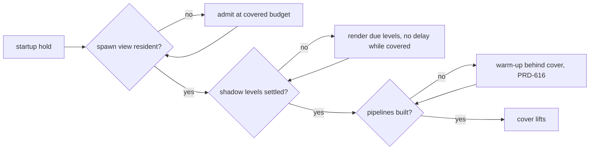

# PRD-618 — The world is complete when the cover lifts, and far trees keep their shape

**Status:** PARTIAL
**Priority:** P1 — AC-1 to AC-9 are open: on the Strata forest, shadows and nearby props appear after the loading bar ends, and far spruces read as noise (owner report, 2026-10-15).
**Complexity:** 4 (MEDIUM) — 6–10 implementation files (`virtual-shadow.ts`, core `game.ts`, `world-cells.ts`, the Strata `loading.ts`, `game.ts`, `propStreaming.ts`, `props.ts`, `prep-fab-temperate.mjs`) (+2); startup readiness state (+2). Risk override: none.
**Owner:** unassigned
**Depends on:** [PRD-616](https://github.com/ThreeNativeHQ/threenative-engine/pull/509) for AC-2 only: until the warm-up builds the pipelines of the real output pass, a warm-up behind the cover cannot remove the pipeline builds after the reveal. Related, not blocking: [PRD-606](../Unreal/open-world/PRD-606-a-fast-travel-destination-is-ready-before-the-cover-lifts.md) (`settle()` after a teleport uses the same readiness), [PRD-537](PRD-537-far-hills-show-the-forest.md) (Machinefall impostors and their shadow regression).

## Context

Owner report (2026-10-15), Strata terrain preview, `?world=forest`: the loading bar finishes, then near content still loads in front of the player. Shadows on the trees appear about one second apart from the reveal, so the first frames are not the finished frame. Far trees look bad. The owner's screenshot of the forest edge shows it: trees past the 60 m switch have blocky, square leaf patches with gaps, a flat dark green, and almost no shadow on the ground below them; the near trees on the right have full crowns and ground shadows.

Layer: both. The cover, the shadow node and the cell admission are engine mechanism (`packages/core/`). The far tree level, the LOD distances and the reveal policy are game source (`examples/strata-terrain-preview/src/render/`, `scripts/`).

### Why content pops in after the reveal (code trace, 2026-10-15)

1. **The cover does not wait for shaders.** `examples/strata-terrain-preview/src/render/loading.ts:513-521` calls `renderer.compileAsync(scene, camera)` and removes the cover in the same tick. The comment says this is deliberate: a full compile held a playtest behind the bar. All pipelines that the warm-up did not build compile in the first visible frames.
2. **The cover waits for a 60 m circle only.** The spawn gate is `props.readinessAt(spawn)` (`src/game.ts:343`, `:964`), and `readinessAt` defaults to `radius = 60` (`src/render/propStreaming.ts:392`). The prop ring covers the whole world (`propStreaming.ts:297-301`). Every cell past 60 m streams in after the reveal, nearest first, at `admissionBudgetMs: 2 / buckets` (`propStreaming.ts:318`). The covered budget (8×, `packages/core/src/world-cells.ts:153`) ends with the cover (`packages/core/src/game.ts:1677-1681`). The 60 m value is a constant that the author must revisit, so the root rule "auto by default" calls it a bug.
3. **Shadows are late by design.** `VirtualShadowNode` renders at most one level per frame (`packages/core/src/render/virtual-shadow.ts:2477-2481`). Each level also waits out an `invalidationDelay` after an invalidation: 0.25 s, 1 s and 3.33 s for the three levels (`virtual-shadow.ts:166-177`). Each admitted cell invalidates the shadows (`src/game.ts:757-760`). So the cells from point 2 pull the shadows of the near levels 0.25–1 s behind the props. The node does not know about the startup cover.
4. **No readiness reads the shadows.** The startup gate has `compileSettled` and cell coverage (`packages/core/src/game.ts:1358`). No signal says "every shadow level holds the casters that are resident now".

### Why far trees look bad (code trace, 2026-10-15)

5. **The far spruce is a triangle decimation of leaf cards.** `scripts/prep-fab-temperate.mjs:350-353` runs meshopt `simplify({ ratio: 0.14, error: 0.012 })` on each cooked spruce. `packages/assets/src/lod/cards.ts:1-20` explains why this fails on foliage: a simplifier collapses cards (wrong silhouette) or drops triangles (holes). The card thinner in that file exists for this case and the game does not call it.
6. **One reduced level from 60 m to the far plane.** Spruce has two levels (`src/render/pack.ts:90-105`). `LOD_BANDS.far = 150` (`src/render/props.ts:119`) is not used for spruce. At several hundred metres, a card mesh is sub-pixel alpha noise. The mip compensation of the cutout is `alphaTest / (1 + mip × 0.25)` (`pack.ts:294-302`), weaker than the impostor's 0.75 scale.
7. **Impostors cannot be used here.** Engine world impostors exist (`packages/core/src/world-impostor.ts`, octahedral, colour and normal baked) but stay opt-in (`?tnImpostors=1`, PRD-473 #505). The game sets `preserveAuthoredParts: true`, and `WorldCells` refuses that with impostors on (`world-cells.ts`, the `preserveAuthoredParts` guard).
8. **Hard pop at the level boundary.** `world-cells.ts:6786`: "ponytail: a hard switch, no crossfade". The two levels differ in silhouette, so the 60 m switch is visible.
9. **Shadows do not match the cutout.** The shadow pass reads the scalar `alphaTest`, not the mip-adjusted `alphaTestNode` (`pack.ts:250`), so a far tree casts a different shape from the one it shows.

### What Unreal does (UE source checkout, read 2026-10-15; clean-room summary, no code copied)

Paths are relative to `Engine/Source/Runtime/` unless stated.

- **The reveal blocks on a query, with two quiet passes.** `UWorld::BlockTillLevelStreamingCompleted` (`Engine/Private/World.cpp:4813-4860`) pumps the streamer and resets its pass count to 2 while any visibility or async request is pending. World Partition calls it before BeginPlay and at match start (`WorldPartition/WorldPartition.cpp:1214-1227`). The completion query uses the grid's own loading range, not a caller radius (`WorldPartitionStreamingPolicy.cpp:1126-1128`).
- **Virtual shadow pages have no delay and no per-frame page budget.** Every requested page renders in the frame its invalidation is processed. A light with no previous render keeps no cached page, so its first frame renders all pages (`Renderer/Private/VirtualShadowMaps/VirtualShadowMapCacheManager.cpp:270`, `:322-335`). A newly unculled primitive invalidates its pages one frame late (`:1281-1305`). The only throttle, `r.Shadow.Virtual.DeferredInvalidationBudget`, defaults to unbounded and carries work over to later frames instead of waiting on a timer (`VirtualShadowMapArray.cpp:119-127`).
- **Late shaders mean "not drawn yet", not "drawn wrong".** With `r.PSOPrecache.ProxyCreationStrategy` 1 (default), a primitive has no scene proxy until its pipelines compile (`Engine/Private/PSOPrecache.cpp:36-42`). The reveal does not wait on them, so this is Unreal's own pop-in source.
- **LOD switches dither, in every pass that clips.** Two LODs draw complementary per-pixel hash masks during the transition, including the shadow depth pass (`Engine/Shaders/Private/MaterialTemplate.ush:4483-4497`, `:2891-2920`). Instanced foliage drives it by distance with a per-instance random range so the switch is not a line (`Engine/Shaders/Private/LocalVertexFactory.ush:932-941`, `foliage.RandomLODRange`). LOD is picked by projected screen size, not metres (`Engine/Private/SceneManagement.cpp:966-1046`).
- **Simplified foliage keeps its area.** After simplification, surviving leaf boundaries grow outward by lost area ÷ perimeter, capped at 4× (`Developer/NaniteBuilder/Private/Cluster.cpp:1065` → `MeshSimplify.cpp:1285-1397`). Cutout textures can rescale mips to hold alpha coverage (`bDoScaleMipsForAlphaCoverage`, `Engine/Classes/Engine/Texture.h:1371-1375`).

## Solution

**Rule:** the cover lifts when the first frame is the finished frame. Every cell that the spawn view draws is resident, every shadow level that covers it has rendered with those casters, and every pipeline it draws is built. The engine measures this. The game sets no radius.

1. **Engine, `WorldCells`:** `readinessAt` accepts the camera. The required set becomes the cells that intersect the camera frustum within each placement's own draw reach, not a circle. The circle form stays for PRD-606 callers. Like Unreal, readiness must hold for 2 consecutive polls before the cover lifts, so a request that starts in the last ready frame cannot slip past.
2. **Engine, `VirtualShadowNode`:** while the startup cover is active, `invalidationDelay` is 0 and every due level renders in one frame. The node exposes `settled` (no level due, no delayed invalidation). Core `game.ts` adds it to the startup readiness beside `compileSettled`. After the reveal, the current delays and the one-level budget stay unchanged for steady-state refresh. Unreal has no such delay at all; replacing the post-reveal delay with a carry-over queue is a follow-up, not this PRD.
3. **Game, Strata:** `loading.ts` stops its own fire-and-forget compile and lifts the cover on the core startup readiness. `game.ts` passes the camera to `readinessAt`. The 60 m default goes.
4. **Game, far spruce:** the prep script builds the far level with the card thinner from `packages/assets/src/lod/cards.ts`, not meshopt. The thinner grows the surviving cards to hold the crown's area, capped at 4× (the Unreal rule). Past `LOD_BANDS.far`, spruce draws an engine impostor. This needs `WorldCells` to allow impostors for assets that have no authored level at that distance while `preserveAuthoredParts` keeps the authored ones. The shadow pass uses the same cutout as the view.
5. **Engine, LOD transition:** the hard switch at `world-cells.ts:6786` becomes a dithered crossfade: across a band at each boundary, both levels draw with complementary per-pixel masks, in the view and the shadow pass, with a per-instance random offset. The mechanism is engine; the band width comes from the game's `lodHysteresis`.

**Risks:**

- **Load time grows.** The cover now waits for the whole visible forest. AC-3 bounds it. If it fails, the next lever is the covered budget and load lanes (the PRD-606 risk), not a smaller required set.
- **A playtest photographs the bar.** That is why `loading.ts` stopped waiting for the compile. The core startup hold already polls once per rendered frame under the playtest clock (`src/game.ts:338-341`), so the new readiness must use the same hold, not a `Promise` that the fixed step never advances.
- **Covered shadow renders cost frames.** They happen behind the cover, so they cost load time only, and AC-3 includes them.

## Acceptance Criteria

The boxes live in the phases below; each names the AC it proves.

- AC-1 [local]: A Strata forest scenario holds the camera still at spawn for 3 s after the reveal and reads the post-reveal counters: cells admitted inside the view frustum, shadow level renders with reason "invalidated", impostor bakes pending. Every counter is 0. Red on the current develop with the numbers recorded here. proof: `node packages/playtest/dist/runner/cli.js examples/strata-terrain-preview/playtests/reveal.playtest.json --url http://127.0.0.1:5173 --server-command "pnpm --filter strata-terrain-preview dev --host 127.0.0.1 --port 5173 --strictPort" --browser-recipe webgpu --headed`.
- AC-2 [local]: The same run reports 0 render pipelines created after the reveal. proof: the AC-1 scenario with the pipeline census assertion from PRD-616.
- AC-3 [local]: Time to ready (`timeToReadyMs`) is at most 1.25× the Phase 1 baseline, median of 3 runs per arm on the same machine. proof: the AC-1 scenario's state readout.
- AC-4 [local]: The AC-1 scenario passes on the native desktop host. proof: the AC-1 command with `--target desktop`.
- AC-5 [local]: A visual judge subagent compares the reveal frame and the +3 s frame, BEFORE and AFTER, two headed runs per arm. Criterion: nothing appears, darkens or changes shape between the two frames. Verdict IMPROVEMENT. proof: root `AGENTS.md` visual judge rule.
- AC-6 [local]: The forest overview and river views draw spruce past `LOD_BANDS.far` as impostors (`stats().impostor.drawn > 0`, `pending = 0` at the reveal). proof: the AC-1 scenario run from the `overview` view.
- AC-7 [local]: A visual judge subagent rates far trees on the `overview` and `river` views, BEFORE and AFTER, two headed runs per arm. Criteria: crowns keep a solid silhouette, no speckle or shimmer, shadows match the visible crown, no visible pop at 60 m and 150 m. Verdict IMPROVEMENT. proof: `capture-strata-worlds` skill, `--worlds forest`.
- AC-9 [local]: Inside a level's transition band, both levels draw and their dither masks are complementary (every pixel covered exactly once), in the view and the shadow pass. proof: `pnpm --filter @threenative/core test -- world-cells` with a new transition spec.
- AC-8 [local]: Steady-state frame time on the `overview` view does not get worse: AFTER p50 at most BEFORE p50 + 5%, paired runs. proof: `measure-steady-state-fps` skill on the forest overview.

## Blocked on

- The licensed Fab spruce bytes are local-only (`examples/strata-terrain-preview/AGENTS.md`). AC-6 to AC-8 run on a machine that has `local-assets/temperate/`; without them the procedural spruce draws and proves nothing about the Fab trees. Unblocked by running Phase 3 on the owner's machine.

## Integration Ledger

| Capability | Reachable consumer/trigger | Replaces / disposition | Evidence |
|---|---|---|---|
| View-based spawn readiness | Strata `game.ts` startup hold → `WorldCells.readinessAt(camera)` | The 60 m default circle in `propStreaming.ts:392` is deleted | AC-1 |
| Shadow settle in startup readiness | core `game.ts` startup readiness → `VirtualShadowNode.settled` | Shadows rendered after the reveal | AC-1, AC-5 |
| Cover lifts on core readiness | Strata `loading.ts` → core startup readiness | The fire-and-forget `compileAsync` in `loading.ts:513-521` is deleted | AC-1, AC-2 |
| Card-thinned far spruce + impostor band | `prep-fab-temperate.mjs` → `pack.ts` levels → `WorldCells` | meshopt `simplify` on spruce is deleted | AC-6, AC-7 |
| Dithered LOD transition | `WorldCells` level switch → view and shadow materials | The hard switch at `world-cells.ts:6786` is deleted | AC-9, AC-7 |

## Decisions

- 2026-10-15 (agent, from the owner's report): one PRD for both symptoms, because both are "the world the player sees is not the finished world". The 1.25× load-time bound in AC-3 is an assumption; the owner can change it after Phase 1 records the baseline.

## Execution Phases

#### Phase 1: Measure the pop-in (red)

**Status:** PARTIAL
**Files:** `examples/strata-terrain-preview/playtests/reveal.playtest.json` (new); a debug readout in `src/game.ts`; `src/render/propStreaming.ts` forwards core draw-publication observations; `packages/core/src/world-cells.ts` and `packages/core/__tests__/world-cells-admission.spec.ts` implement and exercise the optional portable observer.
**Implementation:** Reuse the existing `walk`/`terrain` scenario shape. Hold the camera still for 3 s after `worldReady`. Read `props.stats()`, the shadow node stats (`invalidated`, delayed levels) and the pipeline census. Record the current numbers and `timeToReadyMs` (3 runs) in AC-1 and AC-3.
**Verification:** the AC-1 command fails on current develop, for the counter reasons and not for an environment reason (`adapter.info` names the real GPU).

- [x] Scenario is red on the frozen develop-policy baseline with numbers recorded. proof: headed WebGPU reveal scenario; baseline source `88b988cd7` adds observation only over `1d056cec3`, and sequential paired run 1/2 fail for late shadow invalidation with zero environment errors.
  - 2026-10-15 corrective attempt (base `e57975874`, runtime base `1d056cec3`): removed cumulative `byAdmission` assertions, default-zero impostor fallback and the invented 15,000 ms threshold. The probe starts after the actual canvas cover is absent, measures a 3,000 ms stationary window, differences real `byInvalidation` and device pipeline creation totals, and retains peak impostor pending work. Missing census stays unavailable (`-1`), never zero; AC-2 is not asserted yet. Game-side cell observations currently measure completed cells with in-reach placement bounds intersecting the reveal frustum; partial run publication within an unfinished cell is not covered, so this probe cannot yet qualify the full AC-1 admission claim.
  - Checks: `pnpm --filter strata-terrain-preview exec tsc --noEmit -p tsconfig.json` exit 0; Biome formatting and `git diff --check` passed. Two initial scenario-schema errors were corrected (unsupported component wait, invalid text overlay); neither was a baseline result. The corrected scenario was accepted by the CLI, but its GPU run never started.
  - Attempted command: `DISPLAY=:1 TN_PLAYTEST_HOST_DISPLAY=1 node packages/playtest/dist/runner/cli.js examples/strata-terrain-preview/playtests/reveal.playtest.json --url http://127.0.0.1:16180 --server-command "pnpm --filter strata-terrain-preview dev --host 127.0.0.1 --port 16180 --strictPort" --browser-recipe webgpu --headed --timeout 180000 --artifacts artifacts/playtest/prd618-corrected/baseline-1`. Exit 75: capture lock held by PID 3620521 for the full 120,000 ms queue timeout. Preserved output: `artifacts/playtest/prd618-corrected/baseline-1/run.log`. `node packages/playtest/dist/runner/cli.js doctor --text` exit 0 confirmed installed Chromium/Playwright and display support; the physical RTX 2080 was reported by `nvidia-smi`, but **no browser adapter.info was obtained**, so this is setup evidence only.
  - Baseline counters, three `timeToReadyMs` samples/median, two BEFORE reveal/+3 s capture pairs and overview/river captures: **unverified, none collected**. No baseline red or AC completion claimed. Earlier `/tmp/opensecc/reveal-run` captures remain rejected. Licensed Fab bytes are absent; procedural fallback cannot qualify AC-6–AC-8. Resume after the shared GPU capture lane is available; close the partial-cell observation gap before qualifying AC-1.

  - 2026-10-15 publication correction: core `onPublication(bounds)` now observes nonempty source batches at `#swap`, after shared instance records are written, including noncasters and runs published before the rest of their cell is ready. `#buildOne` only stages entries: no draw or observation there. Strata forwards this callback and counts `publishedBatchesInView` against the stationary reveal frustum using core's existing admitted-placement draw bounds (and hence its actual reach filter). Deleted the `world.process` monkey patch, neighborhood readiness polling and duplicate placement-bound construction. This is a conservative batch count, not a completed-cell count; an unchanged replacement emits nothing.
  - Focused checks: `pnpm exec vitest run packages/core/__tests__/world-cells-admission.spec.ts` exit 0 (16 tests); regression observes live instance records before cell readiness, rejects staging-only notifications and excludes outside-frustum publications. Initial test camera covered every fixture cell (35/35), corrected to 45 degrees; this was a test-setup failure, not baseline evidence. `pnpm --filter @threenative/core exec tsup --config tsup.config.ts` exit 0 rebuilt consumed runtime/types; `pnpm --filter strata-terrain-preview exec tsc --noEmit -p tsconfig.json` exit 0 after rebuild (first attempt saw stale declarations). `pnpm exec biome check --write packages/core/src/world-cells.ts packages/core/__tests__/world-cells-admission.spec.ts examples/strata-terrain-preview/src/game.ts examples/strata-terrain-preview/src/render/propStreaming.ts examples/strata-terrain-preview/playtests/reveal.playtest.json` exit 0 (existing complexity warnings); `git diff --check` exit 0. Full core suite deliberately not run.
  - Baseline freeze: `pnpm --filter strata-terrain-preview build` exit 0; `cp -a examples/strata-terrain-preview/dist/. artifacts/playtest/prd618-publication/baseline-site/` exit 0 preserves the ordinary built site (75 MB, ignored). Source SHA and capture outcome are recorded below after the instrumentation commit. Build/test output is retained at `artifacts/playtest/prd618-publication/prd618-{core-build,example-build,admission-2}.log`. Licensed Fab assets are absent; this frozen procedural baseline is **not** licensed-tree evidence. No readiness, shadow or LOD policy changed.

  - Frozen baseline source: `88b988cd7` (`artifacts/playtest/prd618-publication/baseline-site/SOURCE_SHA.txt`), with the corrected scenario copied to `artifacts/playtest/prd618-publication/reveal.playtest.json`. Future Phase 2 source edits cannot replace these built bytes. Rerun the frozen site with `--server-command "python3 -m http.server 16180 --bind 127.0.0.1 --directory artifacts/playtest/prd618-publication/baseline-site"`, the saved scenario, and the same headed WebGPU/display flags.
  - Corrected baseline attempt: `DISPLAY=:1 TN_PLAYTEST_HOST_DISPLAY=1 node packages/playtest/dist/runner/cli.js examples/strata-terrain-preview/playtests/reveal.playtest.json --url http://127.0.0.1:16180 --server-command "pnpm --filter strata-terrain-preview dev --host 127.0.0.1 --port 16180 --strictPort" --browser-recipe webgpu --headed --timeout 180000 --artifacts artifacts/playtest/prd618-publication/baseline-1` exited **75** after the normal 120,000 ms capture-lock queue timeout. Holder PID **3590445** was running the sailing template headed playtest; no lock bypass or holder termination attempted. Full command/output/exit preserved in `baseline-1/{command.txt,run.log,exit-code.txt}` under that artifact root. **Setup result only:** browser never launched, no `adapter.info`, counters, three time samples or two BEFORE reveal/+3 s pairs collected. AC-4 desktop remains unrun; portable callback qualification still needs the desktop reveal scenario. All AC boxes stay open; return partial until shared capture capacity is available.

  - 2026-10-15 controlled paired startup evidence: BEFORE `88b988cd7`, AFTER `3ccb616b6`; immutable ordinary built sites, same Vite preview server command, port 16181, viewport 1280×720, headed WebGPU on stable desktop `DISPLAY=:0`, physical NVIDIA Turing adapter (desktop RTX 2080). The previous borrowed `:1` display disconnected; its incomplete run is excluded. Python static-server samples are excluded from timing qualification because optional-asset 404 behavior differs from Vite. The zero-publication invariant on the legacy baseline uses the harness’s explained `allowTrivial` option; complete/samples/elapsed independently prove a measured window, and the zero-event comparison is unchanged. AFTER observations use their measured availability state.
  - Sequential alternating BEFORE/AFTER samples (ms): BEFORE **11213.1001, 10831.3999, 10695.3000**; AFTER **12416.8000, 11303.6001, 11572.7000**. Medians **10831.3999 → 11572.7000 ms**, **+741.3000 ms / +6.844%**, ratio **1.06844**, below AC-3’s 1.25 bound. Each run independently has zero console/runtime errors and a physical adapter receipt. BEFORE shadow-invalidated counters **1, 1, 0**; AFTER **0, 0, 0**. All view-publication and pending-impostor counters are **0**. The baseline is RED for actual late shadow work in runs 1/2, not a missing observation/environment failure. AFTER all three reveal scenarios pass. CPU load averages are recorded with each raw sample; no own builds/captures overlapped the paired sequence.
  - Raw existing-harness artifacts: `artifacts/playtest/prd618-paired/{before,after}-{1,2,3}/` contain run output, adapter receipt, reveal/+3 s PNGs and console data. Source sites: `artifacts/playtest/prd618-publication/baseline-site/` and `artifacts/playtest/prd618-paired/candidate-site/`. This qualifies startup behavior with the procedural fallback only; it does **not** qualify licensed-tree AC-6–AC-8. Paired BEFORE/AFTER visual judge and PR screenshot attachment are still pending. Final foliage integration must rerun the reveal and timing gates.

#### Phase 2: The cover lifts on a finished frame

**Status:** PARTIAL
**Files:** `packages/core/src/world-cells.ts` (`readinessAt` with a camera), `packages/core/src/render/virtual-shadow.ts` (`settled`, covered no-delay), `packages/core/src/game.ts` (readiness includes shadow settle), `examples/strata-terrain-preview/src/render/loading.ts`, `src/game.ts`, `src/render/propStreaming.ts`; unit specs in `packages/core/__tests__/`. The existing `packages/core/src/startup-readiness.ts` owns the two final quiet rendered polls; `packages/core/src/render/virtual-shadow-pages.ts` exposes the existing tracker's pending-key count for truthful shadow settlement.
**Implementation:** Solution steps 1–3. A unit spec proves that a covered `VirtualShadowNode` renders all due levels in one frame and reports `settled`, and that an uncovered node keeps the current delays.
**Verification:** `pnpm --filter @threenative/core test -- virtual-shadow world-cells`, then AC-1 to AC-5.

- [x] AC-1, AC-3 green on web at startup implementation `3ccb616b6`. proof: three sequential paired headed WebGPU reveal runs; all AFTER counters zero; median ratio 1.06844. Rerun after Phase 3 changes before final completion.
- [ ] AC-2 green (after PRD-616). proof: AC-1 command with the census assertion.
- [ ] AC-4 green on desktop. proof: AC-1 command `--target desktop`.
- [ ] AC-5 judge IMPROVEMENT. proof: judge subagent verdict on the PR.

**Implementation and checks (2026-10-15):**

- `WorldCells.readinessAt(camera)` now derives required cells from the current camera frustum, admitted-placement authored bounds and the same placement reach/distance rules used by drawing. The position/radius API is unchanged. Chunk/terrain cell coverage stays conservative; required-cell replacement jobs and pending shadow notifications prevent camera readiness. Covered updates flush shadow notifications without the one-second steady-state throttle. Strata supplies its actual render camera, removes the 60 m radius default, and avoids scanning the view after startup settles. The publication callback and reveal assertion remain intact.
- Core discovers the active visible virtual-shadow lights before render-cadence streaming. `startupCovered` removes invalidation delays and grants every due shadow level in the same frame. `settled` requires mapped levels, no delayed/dirty/pending level, no queued region/page keys and no source `needsUpdate`. Uncovered delays and the one-level budget are unchanged. After streaming, render, shadows and held-world warm-up, startup rechecks predicate holds and shadow settlement for **two consecutive rendered polls**; late work resets the count. Fixed simulation steps are not needed to advance this gate. Strata's loading screen removes its fire-and-forget `compileAsync` and continues awaiting core readiness.
- RED: `pnpm exec vitest run packages/core/__tests__/world-cells-admission.spec.ts packages/core/__tests__/virtual-shadow.spec.ts packages/core/__tests__/startup-readiness.spec.ts -t 'requires visible distant|settles all covered|requires two quiet'` exit **1**, all three new behavior tests failed on the old implementation (camera rejected, shadow settlement absent, readiness too early). `artifacts/playtest/prd618-phase2/checks/prd618-phase2-red.log` preserves output. Supplementary test corrections isolated publication-region notifications from prewarm blanket invalidations, kept chunk cells required when prop reach excludes placements, and advanced existing game harnesses through the two added rendered polls; no runtime assertion was weakened.
- GREEN: `pnpm exec vitest run packages/core/__tests__/world-cells-admission.spec.ts packages/core/__tests__/virtual-shadow.spec.ts packages/core/__tests__/startup-readiness.spec.ts packages/core/__tests__/startup-timeline.spec.ts packages/core/__tests__/startup-ready-bound.spec.ts` exit **0**, **166/166** tests. `pnpm exec vitest run packages/core/__tests__/game.spec.ts -t 'startup compute|startup readiness|explicit warm-up|ctx.beforeRender'` exit **0**, **9 passed / 47 deliberately unselected**. These include the real game-loop wiring: work in `beforeRender` resets quiet settlement, covered shadow mode persists until readiness and then turns off. `pnpm --filter @threenative/core build`, `pnpm --filter strata-terrain-preview exec tsc --noEmit -p tsconfig.json`, and `pnpm --filter strata-terrain-preview build` each exited **0** after the final behavior edits. `pnpm exec biome check --write` on the 12 then-changed implementation/test files exited **0** (45 complexity warnings); final focused formatting and `git diff --check` passed. Full core suite and unrelated documentation gates were not run. Full passing check outputs are under `artifacts/playtest/prd618-phase2/checks/`.
- Real headed attempt: `DISPLAY=:1 TN_PLAYTEST_HOST_DISPLAY=1 node packages/playtest/dist/runner/cli.js examples/strata-terrain-preview/playtests/reveal.playtest.json --url http://127.0.0.1:16180 --server-command "pnpm --filter strata-terrain-preview dev --host 127.0.0.1 --port 16180 --strictPort" --browser-recipe webgpu --headed --timeout 180000 --artifacts artifacts/playtest/prd618-phase2/reveal-1` exited **1**. `capture.json` records actual WebGPU adapter info **vendor=nvidia, architecture=turing**; full `run.log`, `console.json`, `reveal.png` and `reveal-plus-3s.png` are retained there. Observation: **publishedBatchesInView=0, shadowInvalidated=0, impostorPendingPeak=0**, elapsed **4167 ms**, **2 samples**, `timeToReadyMs=35797.800048828125`. The only failed assertion was the runner's triviality guard: publication count was 0 before observation as well as after. The final code now reports **-1 (unobserved)** until the stationary reveal window starts and initializes the count to 0 there, matching the other unavailable counters. The scenario and its zero expectations are unchanged. This is **not a green AC-1 result**. Pipeline census remained unavailable (`pipelineCensusAvailable=false`, `pipelinesCreated=-1`); AC-2 stays open pending PRD-616/#509 and a measured zero.
- Final-code rerun: the identical command with `--artifacts artifacts/playtest/prd618-phase2/reveal-2` exited **75**, the normal **120000 ms** capture-lock timeout behind holder **PID 3762138**, queue depth **2**. Full command shape above, `reveal-2/run.log`, `console.json` and `exit-code.txt` preserve the setup outcome; no lock bypass. No final-code adapter/capture result is claimed. Three paired timing samples and the frozen BEFORE baseline rerun remain unavailable, so AC-3 is unverified. AC-4 desktop is unrun, AC-5 has no before/after judge verdict, and these unlabelled captures do not satisfy its visual proof. No licensed Fab assets are present; no tree-quality or Phase 3 claim is made. Frozen `baseline-site` from source **88b988cd7** was not modified. All Phase 2 AC boxes remain open.

#### Phase 3: Far trees keep their shape

**Status:** PARTIAL
**Files:** `examples/strata-terrain-preview/scripts/prep-fab-temperate.mjs` (card thinner), `src/render/pack.ts` (third level, shadow cutout), `src/render/propStreaming.ts` (impostors on), `packages/core/src/world-cells.ts` (impostors beside authored levels, dithered transition).
**Implementation:** Solution steps 4 and 5. If the judge still sees far speckle, the next lever is coverage-preserving cutout mips in the cook. The game picks the distances and the look. The engine only allows the impostor band beside authored levels.
**Verification:** AC-6 to AC-8 on the owner's machine with the licensed assets.

- [ ] AC-6 impostors drawn past 150 m. proof: AC-1 scenario from the `overview` view.
- [x] AC-9 focused dither contract: both levels submit in view/shadow, shared masks use complementary `<` / `>=` comparisons including equality, and the source retires after the band. proof: `pnpm exec vitest run packages/core/__tests__/world-cells-data.spec.ts packages/core/__tests__/world-impostor-surface.spec.ts` (included in the 130/130 green focused run below). Shader graphs and CPU submission are tested; headed GPU/judge proof remains AC-7.
- [ ] AC-7 judge IMPROVEMENT. proof: judge subagent verdict on the PR.
- [ ] AC-8 frame time holds. proof: `measure-steady-state-fps`.

**Phase 3 implementation and focused checks (2026-10-15):**

- The public `thinFoliageCards(document, keepRatio)` extends the existing asset-cook mechanism: `generateCardChain` plus its attribute-copy attachment, with whole-card selection and the existing 2x edge / 4x area cap. The spruce prep uses the game's existing 0.14 ratio, preserves opaque parts, and fails if MASK cards cannot be reduced. It no longer triangle-decimates spruce. Tests retain every semantic, check copied attribute values and opaque indices, whole-card triangle pairs, the existing area cap and invalid ratios. No licensed file was cooked or substituted.
- Strata explicitly enables the existing impostor baker and sets spruce's new per-asset `impostorDistance` to `LOD_BANDS.far` (150 m). The manifest validates this positive gate after every authored rung and includes it in alias identity. On the explicit CPU/preserved-parts path, authored near/mid and their shadow parts stay intact; only the terminal rung is a whole-asset impostor, and the old coarse-wide substitution/far aggregate is bypassed for this path. Other assets without a terminal gate are not baked on this preserved-parts path. Default launch opt-in and unsupported GPU/hysteresis guards remain. Stream readiness waits for queued bakes and their newly owed prewarm draws; stats exposes live terminal instances before fragment masks, not a GPU-submission receipt.
- The existing node-material and instance-matrix machinery supplies a complementary per-pixel view/shadow mask. The game's `lodHysteresis` sets the band; recovered placement roots supply a stable offset, and the live follow eye plus existing LOD bias drive both masks. Both neighboring levels enter existing batches with admission headroom, and added band-edge refilter gates retire the source afterward. Strata's shadow mask reads the exact view `opacityNode` sample and mip-adjusted `alphaTestNode`; a scalar floor preserves shadow classification while original cutoff metadata is retained for the atlas. No appearance preset, dependency, renderer, report or harness was added.
- RED: standalone-card test failed with the missing public mechanism; authored/impostor test failed on the original unsupported-combination guard; the actual view/shadow transition test against `HEAD` world-cells failed with missing masks; the actual Strata loader/cutout test against `HEAD` pack failed with a null shadow mask (all exit 1). GREEN: `pnpm exec vitest run packages/assets/__tests__/foliage-lod.spec.ts packages/core/__tests__/world-cells-data.spec.ts packages/core/__tests__/world-cells-chain-lod.spec.ts packages/core/__tests__/world-impostors.spec.ts packages/core/__tests__/world-impostor-surface.spec.ts packages/core/__tests__/world-cells-admission.spec.ts` exit 0, **130/130**. This includes the real stubbed bake integration past 150 m, exact authored source membership, both view/shadow submissions, pixel comparison complementarity, cutout node identity, source retirement and unsupported guards. One intermediate test run raced a concurrent core rebuild and could not import `@threenative/core/world`; the final sequential run above passed after the build completed. Initial test setup also needed awaiting cutout conversion and unwrapping Three's `VarNode`; these were test failures, not licensed/runtime evidence.
- `pnpm --filter @threenative/core build` (including declarations/publint), `pnpm --filter @threenative/assets exec tsup --config tsup.config.ts`, package core/assets `exec tsc --noEmit`, Strata `exec tsc --noEmit -p tsconfig.json`, Strata `build`, prep-script `node --check`, focused `biome check --write` and `git diff --check` all exit 0 (Biome complexity warnings and existing build chunk warnings remain). **No final headed reveal, startup/timing run, native qualification or visual judgement was run here.** Parent owns the six fresh timing samples, stable-display NVIDIA reveal/captures and fresh visual judge/PR screenshots. AC-6–AC-8 remain open pending real local Fab bytes and runtime/judge/performance proof; AC-2 still depends on PRD-616/#509. Phase 2's paired startup result belongs to source `3ccb616b6` and must be rerun on this foliage revision. Both frozen sites and native build/dependencies were untouched.
