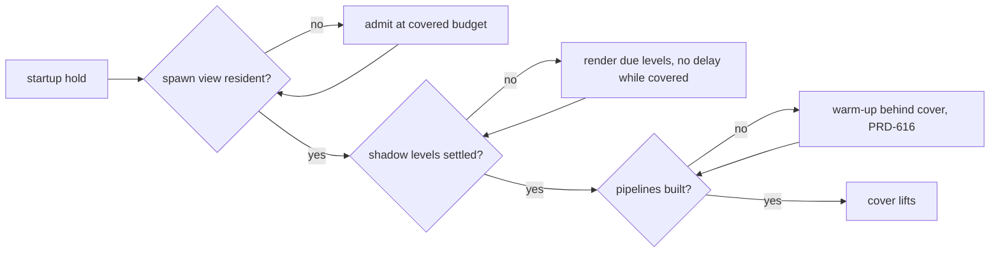

# PRD-618 — The world is complete when the cover lifts, and far trees keep their shape

**Status:** NOT STARTED
**Priority:** P1 — AC-1 to AC-9 are open: on the Strata forest, shadows and nearby props appear after the loading bar ends, and far spruces read as noise (owner report, 2026-10-15).
**Complexity:** 4 (MEDIUM) — 6–10 implementation files (`virtual-shadow.ts`, core `game.ts`, `world-cells.ts`, the Strata `loading.ts`, `game.ts`, `propStreaming.ts`, `props.ts`, `prep-fab-temperate.mjs`) (+2); startup readiness state (+2). Risk override: none.
**Owner:** unassigned
**Depends on:** [PRD-616](../done/PRD-616-the-startup-warm-up-builds-what-the-first-frame-draws.md) for AC-2 only: until the warm-up builds the pipelines of the real output pass, a warm-up behind the cover cannot remove the pipeline builds after the reveal. Related, not blocking: [PRD-606](../Unreal/open-world/PRD-606-a-fast-travel-destination-is-ready-before-the-cover-lifts.md) (`settle()` after a teleport uses the same readiness), [PRD-537](PRD-537-far-hills-show-the-forest.md) (Machinefall impostors and their shadow regression).

## Context

Owner report (2026-10-15), Strata terrain preview, `?world=forest`: the loading bar finishes, then near content still loads in front of the player. Shadows on the trees appear about one second apart from the reveal, so the first frames are not the finished frame. Far trees look bad. The owner's screenshot of the forest edge shows it: trees past the 60 m switch have blocky, square leaf patches with gaps, a flat dark green, and almost no shadow on the ground below them; the near trees on the right have full crowns and ground shadows.

Layer: both. The cover, the shadow node and the cell admission are engine mechanism (`packages/core/`). The far tree level, the LOD distances and the reveal policy are game source (`examples/strata-terrain-preview/src/render/`, `scripts/`).

### Why content pops in after the reveal (code trace, 2026-10-15)

1. **The cover does not wait for shaders.** `examples/strata-terrain-preview/src/render/loading.ts:513-521` calls `renderer.compileAsync(scene, camera)` and removes the cover in the same tick. The comment says this is deliberate: a full compile held a playtest behind the bar. All pipelines that the warm-up did not build compile in the first visible frames.
2. **The cover waits for a 60 m circle only.** The spawn gate is `props.readinessAt(spawn)` (`src/game.ts:343`, `:964`), and `readinessAt` defaults to `radius = 60` (`src/render/propStreaming.ts:392`). The prop ring covers the whole world (`propStreaming.ts:297-301`). Every cell past 60 m streams in after the reveal, nearest first, at `admissionBudgetMs: 2 / buckets` (`propStreaming.ts:318`). The covered budget (8×, `packages/core/src/world-cells.ts:153`) ends with the cover (`packages/core/src/game.ts:1677-1681`). The 60 m value is a constant that the author must revisit, so the root rule "auto by default" calls it a bug.
3. **Shadows are late by design.** `VirtualShadowNode` renders at most one level per frame (`packages/core/src/render/virtual-shadow.ts:2477-2481`). Each level also waits out an `invalidationDelay` after an invalidation: 0.25 s, 1 s and 3.33 s for the three levels (`virtual-shadow.ts:166-177`). Each admitted cell invalidates the shadows (`src/game.ts:757-760`). So the cells from point 2 pull the shadows of the near levels 0.25–1 s behind the props. The node does not know about the startup cover.
4. **No readiness reads the shadows.** The startup gate has `compileSettled` and cell coverage (`packages/core/src/game.ts:1358`). No signal says "every shadow level holds the casters that are resident now".

### Why far trees look bad (code trace, 2026-10-15)

5. **The far spruce is a triangle decimation of leaf cards.** `scripts/prep-fab-temperate.mjs:350-353` runs meshopt `simplify({ ratio: 0.14, error: 0.012 })` on each cooked spruce. `packages/assets/src/lod/cards.ts:1-20` explains why this fails on foliage: a simplifier collapses cards (wrong silhouette) or drops triangles (holes). The card thinner in that file exists for this case and the game does not call it.
6. **One reduced level from 60 m to the far plane.** Spruce has two levels (`src/render/pack.ts:90-105`). `LOD_BANDS.far = 150` (`src/render/props.ts:119`) is not used for spruce. At several hundred metres, a card mesh is sub-pixel alpha noise. The mip compensation of the cutout is `alphaTest / (1 + mip × 0.25)` (`pack.ts:294-302`), weaker than the impostor's 0.75 scale.
7. **Impostors cannot be used here.** Engine world impostors exist (`packages/core/src/world-impostor.ts`, octahedral, colour and normal baked) but stay opt-in (`?tnImpostors=1`, PRD-473 #505). The game sets `preserveAuthoredParts: true`, and `WorldCells` refuses that with impostors on (`world-cells.ts`, the `preserveAuthoredParts` guard).
8. **Hard pop at the level boundary.** `world-cells.ts:6786`: "ponytail: a hard switch, no crossfade". The two levels differ in silhouette, so the 60 m switch is visible.
9. **Shadows do not match the cutout.** The shadow pass reads the scalar `alphaTest`, not the mip-adjusted `alphaTestNode` (`pack.ts:250`), so a far tree casts a different shape from the one it shows.

### What Unreal does (UE source checkout, read 2026-10-15; clean-room summary, no code copied)

Paths are relative to `Engine/Source/Runtime/` unless stated.

- **The reveal blocks on a query, with two quiet passes.** `UWorld::BlockTillLevelStreamingCompleted` (`Engine/Private/World.cpp:4813-4860`) pumps the streamer and resets its pass count to 2 while any visibility or async request is pending. World Partition calls it before BeginPlay and at match start (`WorldPartition/WorldPartition.cpp:1214-1227`). The completion query uses the grid's own loading range, not a caller radius (`WorldPartitionStreamingPolicy.cpp:1126-1128`).
- **Virtual shadow pages have no delay and no per-frame page budget.** Every requested page renders in the frame its invalidation is processed. A light with no previous render keeps no cached page, so its first frame renders all pages (`Renderer/Private/VirtualShadowMaps/VirtualShadowMapCacheManager.cpp:270`, `:322-335`). A newly unculled primitive invalidates its pages one frame late (`:1281-1305`). The only throttle, `r.Shadow.Virtual.DeferredInvalidationBudget`, defaults to unbounded and carries work over to later frames instead of waiting on a timer (`VirtualShadowMapArray.cpp:119-127`).
- **Late shaders mean "not drawn yet", not "drawn wrong".** With `r.PSOPrecache.ProxyCreationStrategy` 1 (default), a primitive has no scene proxy until its pipelines compile (`Engine/Private/PSOPrecache.cpp:36-42`). The reveal does not wait on them, so this is Unreal's own pop-in source.
- **LOD switches dither, in every pass that clips.** Two LODs draw complementary per-pixel hash masks during the transition, including the shadow depth pass (`Engine/Shaders/Private/MaterialTemplate.ush:4483-4497`, `:2891-2920`). Instanced foliage drives it by distance with a per-instance random range so the switch is not a line (`Engine/Shaders/Private/LocalVertexFactory.ush:932-941`, `foliage.RandomLODRange`). LOD is picked by projected screen size, not metres (`Engine/Private/SceneManagement.cpp:966-1046`).
- **Simplified foliage keeps its area.** After simplification, surviving leaf boundaries grow outward by lost area ÷ perimeter, capped at 4× (`Developer/NaniteBuilder/Private/Cluster.cpp:1065` → `MeshSimplify.cpp:1285-1397`). Cutout textures can rescale mips to hold alpha coverage (`bDoScaleMipsForAlphaCoverage`, `Engine/Classes/Engine/Texture.h:1371-1375`).

## Solution

**Rule:** the cover lifts when the first frame is the finished frame. Every cell that the spawn view draws is resident, every shadow level that covers it has rendered with those casters, and every pipeline it draws is built. The engine measures this. The game sets no radius.

1. **Engine, `WorldCells`:** `readinessAt` accepts the camera. The required set becomes the cells that intersect the camera frustum within each placement's own draw reach, not a circle. The circle form stays for PRD-606 callers. Like Unreal, readiness must hold for 2 consecutive polls before the cover lifts, so a request that starts in the last ready frame cannot slip past.
2. **Engine, `VirtualShadowNode`:** while the startup cover is active, `invalidationDelay` is 0 and every due level renders in one frame. The node exposes `settled` (no level due, no delayed invalidation). Core `game.ts` adds it to the startup readiness beside `compileSettled`. After the reveal, the current delays and the one-level budget stay unchanged for steady-state refresh. Unreal has no such delay at all; replacing the post-reveal delay with a carry-over queue is a follow-up, not this PRD.
3. **Game, Strata:** `loading.ts` stops its own fire-and-forget compile and lifts the cover on the core startup readiness. `game.ts` passes the camera to `readinessAt`. The 60 m default goes.
4. **Game, far spruce:** the prep script builds the far level with the card thinner from `packages/assets/src/lod/cards.ts`, not meshopt. The thinner grows the surviving cards to hold the crown's area, capped at 4× (the Unreal rule). Past `LOD_BANDS.far`, spruce draws an engine impostor. This needs `WorldCells` to allow impostors for assets that have no authored level at that distance while `preserveAuthoredParts` keeps the authored ones. The shadow pass uses the same cutout as the view.
5. **Engine, LOD transition:** the hard switch at `world-cells.ts:6786` becomes a dithered crossfade: across a band at each boundary, both levels draw with complementary per-pixel masks, in the view and the shadow pass, with a per-instance random offset. The mechanism is engine; the band width comes from the game's `lodHysteresis`.

**Risks:**

- **Load time grows.** The cover now waits for the whole visible forest. AC-3 bounds it. If it fails, the next lever is the covered budget and load lanes (the PRD-606 risk), not a smaller required set.
- **A playtest photographs the bar.** That is why `loading.ts` stopped waiting for the compile. The core startup hold already polls once per rendered frame under the playtest clock (`src/game.ts:338-341`), so the new readiness must use the same hold, not a `Promise` that the fixed step never advances.
- **Covered shadow renders cost frames.** They happen behind the cover, so they cost load time only, and AC-3 includes them.

## Acceptance Criteria

The boxes live in the phases below; each names the AC it proves.

- AC-1 [local]: A Strata forest scenario holds the camera still at spawn for 3 s after the reveal and reads the post-reveal counters: cells admitted inside the view frustum, shadow level renders with reason "invalidated", impostor bakes pending. Every counter is 0. Red on the current develop with the numbers recorded here. proof: `node packages/playtest/dist/runner/cli.js examples/strata-terrain-preview/playtests/reveal.playtest.json --url http://127.0.0.1:5173 --server-command "pnpm --filter strata-terrain-preview dev --host 127.0.0.1 --port 5173 --strictPort" --browser-recipe webgpu --headed`.
- AC-2 [local]: The same run reports 0 render pipelines created after the reveal. proof: the AC-1 scenario with the pipeline census assertion from PRD-616.
- AC-3 [local]: Time to ready (`timeToReadyMs`) is at most 1.25× the Phase 1 baseline, median of 3 runs per arm on the same machine. proof: the AC-1 scenario's state readout.
- AC-4 [local]: The AC-1 scenario passes on the native desktop host. proof: the AC-1 command with `--target desktop`.
- AC-5 [local]: A visual judge subagent compares the reveal frame and the +3 s frame, BEFORE and AFTER, two headed runs per arm. Criterion: nothing appears, darkens or changes shape between the two frames. Verdict IMPROVEMENT. proof: root `AGENTS.md` visual judge rule.
- AC-6 [local]: The forest overview and river views draw spruce past `LOD_BANDS.far` as impostors (`stats().impostor.drawn > 0`, `pending = 0` at the reveal). proof: the AC-1 scenario run from the `overview` view.
- AC-7 [local]: A visual judge subagent rates far trees on the `overview` and `river` views, BEFORE and AFTER, two headed runs per arm. Criteria: crowns keep a solid silhouette, no speckle or shimmer, shadows match the visible crown, no visible pop at 60 m and 150 m. Verdict IMPROVEMENT. proof: `capture-strata-worlds` skill, `--worlds forest`.
- AC-9 [local]: Inside a level's transition band, both levels draw and their dither masks are complementary (every pixel covered exactly once), in the view and the shadow pass. proof: `pnpm --filter @threenative/core test -- world-cells` with a new transition spec.
- AC-8 [local]: Steady-state frame time on the `overview` view does not get worse: AFTER p50 at most BEFORE p50 + 5%, paired runs. proof: `measure-steady-state-fps` skill on the forest overview.

## Blocked on

- The licensed Fab spruce bytes are local-only (`examples/strata-terrain-preview/AGENTS.md`). AC-6 to AC-8 run on a machine that has `local-assets/temperate/`; without them the procedural spruce draws and proves nothing about the Fab trees. Unblocked by running Phase 3 on the owner's machine.

## Integration Ledger

| Capability | Reachable consumer/trigger | Replaces / disposition | Evidence |
|---|---|---|---|
| View-based spawn readiness | Strata `game.ts` startup hold → `WorldCells.readinessAt(camera)` | The 60 m default circle in `propStreaming.ts:392` is deleted | AC-1 |
| Shadow settle in startup readiness | core `game.ts` startup readiness → `VirtualShadowNode.settled` | Shadows rendered after the reveal | AC-1, AC-5 |
| Cover lifts on core readiness | Strata `loading.ts` → core startup readiness | The fire-and-forget `compileAsync` in `loading.ts:513-521` is deleted | AC-1, AC-2 |
| Card-thinned far spruce + impostor band | `prep-fab-temperate.mjs` → `pack.ts` levels → `WorldCells` | meshopt `simplify` on spruce is deleted | AC-6, AC-7 |
| Dithered LOD transition | `WorldCells` level switch → view and shadow materials | The hard switch at `world-cells.ts:6786` is deleted | AC-9, AC-7 |

## Decisions

- 2026-10-15 (agent, from the owner's report): one PRD for both symptoms, because both are "the world the player sees is not the finished world". The 1.25× load-time bound in AC-3 is an assumption; the owner can change it after Phase 1 records the baseline.

## Execution Phases

#### Phase 1: Measure the pop-in (red)

**Status:** NOT STARTED
**Files:** `examples/strata-terrain-preview/playtests/reveal.playtest.json` (new); a debug readout in `src/game.ts` if a counter is not already in `ctx.entities` debug.
**Implementation:** Reuse the existing `walk`/`terrain` scenario shape. Hold the camera still for 3 s after `worldReady`. Read `props.stats()`, the shadow node stats (`invalidated`, delayed levels) and the pipeline census. Record the current numbers and `timeToReadyMs` (3 runs) in AC-1 and AC-3.
**Verification:** the AC-1 command fails on current develop, for the counter reasons and not for an environment reason (`adapter.info` names the real GPU).

- [ ] Scenario is red on develop with the numbers recorded. proof: AC-1 command.

#### Phase 2: The cover lifts on a finished frame

**Status:** NOT STARTED
**Files:** `packages/core/src/world-cells.ts` (`readinessAt` with a camera), `packages/core/src/render/virtual-shadow.ts` (`settled`, covered no-delay), `packages/core/src/game.ts` (readiness includes shadow settle), `examples/strata-terrain-preview/src/render/loading.ts`, `src/game.ts`, `src/render/propStreaming.ts`; unit specs in `packages/core/__tests__/`.
**Implementation:** Solution steps 1–3. A unit spec proves that a covered `VirtualShadowNode` renders all due levels in one frame and reports `settled`, and that an uncovered node keeps the current delays.
**Verification:** `pnpm --filter @threenative/core test -- virtual-shadow world-cells`, then AC-1 to AC-5.

- [ ] AC-1, AC-3 green on web. proof: AC-1 command, 3 runs.
- [ ] AC-2 green (after PRD-616). proof: AC-1 command with the census assertion.
- [ ] AC-4 green on desktop. proof: AC-1 command `--target desktop`.
- [ ] AC-5 judge IMPROVEMENT. proof: judge subagent verdict on the PR.

#### Phase 3: Far trees keep their shape

**Status:** NOT STARTED
**Files:** `examples/strata-terrain-preview/scripts/prep-fab-temperate.mjs` (card thinner), `src/render/pack.ts` (third level, shadow cutout), `src/render/propStreaming.ts` (impostors on), `packages/core/src/world-cells.ts` (impostors beside authored levels, dithered transition).
**Implementation:** Solution steps 4 and 5. If the judge still sees far speckle, the next lever is coverage-preserving cutout mips in the cook. The game picks the distances and the look. The engine only allows the impostor band beside authored levels.
**Verification:** AC-6 to AC-8 on the owner's machine with the licensed assets.

- [ ] AC-6 impostors drawn past 150 m. proof: AC-1 scenario from the `overview` view.
- [ ] AC-9 dithered transition in view and shadow pass. proof: `pnpm --filter @threenative/core test -- world-cells`.
- [ ] AC-7 judge IMPROVEMENT. proof: judge subagent verdict on the PR.
- [ ] AC-8 frame time holds. proof: `measure-steady-state-fps`.
