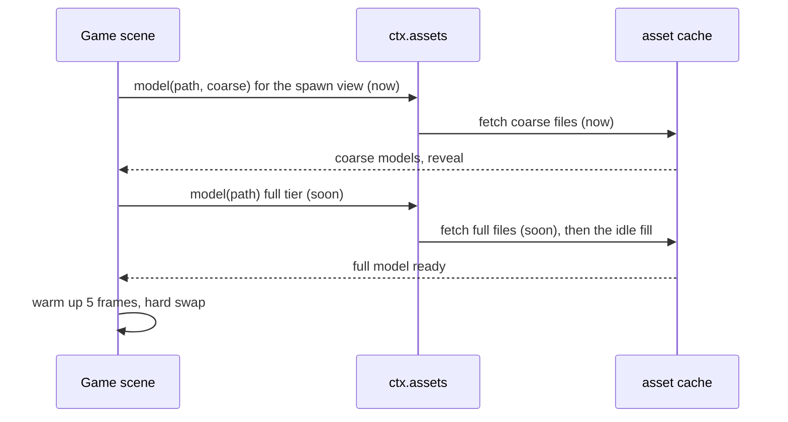

# PRD-745 — A web game is playable in 10 seconds at 20 Mbit/s

**Status:** NOT STARTED
**Priority:** P2 — no box is done: Wildwood reveals at about 38-45 s at 20 Mbit/s, about 4x over the 10 s target, and no gate fails a scene that awaits too many bytes before the reveal.
**Complexity:** 6 (MEDIUM) — 6-10 implementation files (+2), new coarse-tier module (+2), swap timing between two tiers while the fill runs (+2); risk override: none.
**Owner:** unassigned
**Depends on:** PRD-743 (disk cache, `now`/`soon`/`idle` priority, playtest `network` throttle) and PRD-744 (off-screen startup bytes, `assert.startup.maxOffscreenBytes`). Both are on PR #572.

## Context

PRD-743 keeps the bytes on disk and orders the downloads. PRD-744 reports what the reveal waited for. Neither makes the first visit short: a dense forest still downloads its full detail before the curtain lifts, because a reveal without it showed a bare valley and then froze (PRD-743 decision D3).

Measured on Wildwood (`sandbox/prd743-after`, 2026-10-26):

- The reveal moves **50,748,558 B**: the detail tier is 45,646,614 B (115 files, the `TN_VALLEY_DETAIL_PREFETCHED` line) plus 5,101,944 B of critical-only files. Shared KTX2 images are 32,044,820 B of the detail tier. The largest single file is the HDRI, 5,451,493 B.
- At 20 Mbit/s that is about 20.3 s of pure transfer. The critical tier alone (8,973,665 B) is about 3.6 s.
- The reveal (`startup.readyMs`) was 45.4 s with the detail download started after the critical tier (after-24). The detail download now starts at scene entry (after-26/27); its numbers go on PR #572.
- A `TN_FRAME_HITCH` of 2.2-2.6 s happens while the detail tier stages. It is behind the curtain today; a coarse-first reveal would move it into play.
- Runtime fixed cost before any game file, compressed: Wasm engine about 1.36 MB (gzip of 4,182,174 B), core `index.js` about 0.38 MB, Basis transcoder about 0.25 MB. That is about 2.2 MB. The Vite output total is unmeasured: no sandbox `dist/` exists yet.

The research pasted on 2026-10-25 proposes 10/20/50 Mbit/s tiers, a first playable of about 12 MB and a coarse-first reveal. This PRD takes 20 Mbit/s and 10 s as the gate and reports 10 Mbit/s only. A 10 s budget at 20 Mbit/s moves at most 25 MB, and the runtime takes about 2.2 MB of it.

What already ships (inspected 2026-10-26):

- `WorldCells({ impostors: true })` adds an octahedral impostor as the terminal LOD (`packages/core/src/world-cells.ts:700-720`, atlas in `packages/core/src/render/world-impostor.ts:195`, baker `:408`). It is baked **at runtime from the loaded full model**, so it saves draws, not download bytes.
- Cell proxies (`packages/core/src/world-cell-proxy.ts`, cooked by `packages/assets/src/world/proxy.ts`) swap in after the source cell loads (`world-cells.ts:10062-10063`). They point the wrong way for a first visit, and PRD-537 measured them at up to 70 MB each in Machinefall.
- `assets.budget` (`packages/assets/src/budget.ts:29-47`, `TN_ASSETS_BUDGET_EXCEEDED` at `:313-327`) caps the whole project, not the boot set.
- The PRD-744 doctor line estimates the reveal at 20 Mbit/s and gates nothing (`packages/playtest/src/runner/sceneOverview.ts:386-410`).
- PRD-456 (distant world cell proxies) owns far-cell HLOD. This PRD owns the **first-visit** coarse tier and the boot byte budget, and reuses PRD-456's cooked proxy when it lands.

### Unreal reference (UE 5.8.3 source at `~/projects/UnrealEngine`)

- A cell's HLOD is visible while the cell is not: registration sets `SetVisibility(enabled && !cellVisible)`. `UE 5.8.3: Engine/Source/Runtime/Engine/Private/WorldPartition/HLOD/HLODRuntimeSubsystem.cpp:462-466`.
- `OnCellShown` hides the cell's HLODs and `OnCellHidden` shows them again: a hard swap, no cross-fade. `HLODRuntimeSubsystem.cpp:623-638`, `:642-658`.
- The swap waits `wp.Runtime.HLOD.WarmupNumFrames` = 5 frames so the incoming assets are ready. `HLODRuntimeSubsystem.cpp:47-50`.
- HLOD layer types are `Instancing`, `MeshMerge`, `MeshSimplify` and `MeshApproximate`. `UE 5.8.3: Engine/Source/Runtime/Engine/Public/WorldPartition/HLOD/HLODLayer.h:31-38`.
- Load order: streaming-source priority first, then the larger (coarser) cell, then cell priority, then distance. `UE 5.8.3: Engine/Source/Runtime/Engine/Private/WorldPartition/WorldPartitionRuntimeCellData.cpp:109-125`.

Borrowed: coarse before detail, a hard per-object swap after a 5-frame warm-up, and coarse data that is **cooked and downloaded instead of** the full model. Not copied: code.

## Solution

1. **Count the real boot bytes.** The off-screen report counts what `ctx.assets` resolved. Add a transfer-level counter in `asset-cache.ts`: bytes of every `now` and `soon` download that settled before the reveal, including files the fetch bridge serves (the HDRI through `RGBELoader`). A new assertion `assert.startup.maxBootBytes` gates on it. Bytes are deterministic for fixed content, so CI can gate on them; timing is noisy on the shared runner pool and stays a local gate.
2. **Cook a coarse tier.** The asset compile writes, per model, a coarse variant: the existing simplified LOD plus shared images capped at a small size (start at 256 px). Reuse the existing KTX2 and LOD passes; add no new texture format. The manifest lists the variant under the entry, so `ctx.assets.model(path, { tier: "coarse" })` loads it.
3. **Reveal on coarse, swap to full.** A game awaits the coarse tier for what the spawn camera sees, then requests the full tier at `soon`. Each object swaps hard to its full model after 5 rendered frames of warm-up (UE default). The full tier stages in slices so no frame after the reveal exceeds the hitch budget.
4. **Prove it on Wildwood.** 20 Mbit/s reveal at most 10 s, the visual judge NEUTRAL at the spawn pose, and no post-reveal hitch over 100 ms.

Risks: a coarse tier that a judge can see at spawn (then the reveal needs more of the full tier, and the byte budget fails honestly). A swap that hitches during play. Shared images that serve several species, so one coarse image must work for all of them.

## Acceptance Criteria

- [ ] AC-1 [local]: On Wildwood at 20 Mbit/s, `startup.readyMs` is at most 10,000 ms in two runs, and `TN_VALLEY_REVEAL` shows the full spawn view's tree and fern counts. proof: `node packages/playtest/dist/runner/cli.js <wildwood>/playtests/streaming.playtest.json --browser-recipe webgpu` with `network: { downloadKbps: 20000, latencyMs: 40 }` — Evidence: pending.
- [ ] AC-2 [local]: A fresh visual judge returns NEUTRAL for the AFTER spawn pose against the current full-detail reveal, two runs per arm. proof: visual judge on the spawn, settled and walked captures — Evidence: pending.
- [ ] AC-3 [local]: After the reveal, no `TN_FRAME_HITCH` exceeds 100 ms while the full tier swaps in. proof: the AC-1 run's console log — Evidence: pending.
- [ ] AC-4 [shared]: CI fails a scene whose boot bytes exceed `assert.startup.maxBootBytes`, and passes the clean variant. proof: the `test-playtest` job on the fixture scenario — Evidence: pending.

## Blocked on

- Whether the spawn view may reveal on a coarse tier that a fresh judge calls NEUTRAL — unblocked by the owner's decision (asked 2026-10-26; the owner's rule is identical output).

## Integration Ledger

| Capability | Reachable consumer/trigger | Replaces / disposition | Evidence |
|---|---|---|---|
| Boot byte counter and `maxBootBytes` | Reveal in `packages/core/src/game.ts` → playtest bridge `startup` → `packages/playtest/src/evaluators/startup.ts` | Adds to the PRD-744 report, which stays | AC-4 |
| Coarse tier load | `ctx.assets.model(path, { tier: "coarse" })` → manifest variant from the asset compile | New; the full tier stays the default | AC-1, AC-2 |
| Hard swap after warm-up | Game scene (Wildwood `Valley.ts`) → swap helper | New | AC-3 |

## Execution Phases

#### Phase 1: Count the boot bytes and gate on them

**Status:** NOT STARTED
**Files:** `packages/core/src/asset-cache.ts` (transfer counter for `now`/`soon` until the reveal), `packages/core/src/game.ts` (publish it at the reveal), `packages/playtest/src/evaluators/startup.ts` and `src/scenario/schema-accessors.ts` (`maxBootBytes`), `examples/startup-offscreen/` (fixture variant).
**Implementation:** Search `engine_search_capabilities` for "startup bytes" first and extend the PRD-744 report, not a second one. A wrong-typed `maxBootBytes` throws at load. No measurement fails closed.

- [ ] The reveal reports boot bytes that include bridge-served files, and Wildwood's count matches the network transfer. proof: `pnpm exec vitest run packages/core/__tests__/asset-cache.spec.ts packages/core/__tests__/startup-offscreen-bytes.spec.ts` plus one Wildwood run read against the manifest sum.
- [ ] `assert.startup.maxBootBytes` passes under the ceiling, fails over it and fails closed with no measurement. proof: `pnpm exec vitest run packages/playtest/__tests__/` on the startup evaluator specs.
- [ ] The runtime fixed cost of a built Wildwood is recorded: each file over 100 KB with its brotli size. proof: `pnpm build` in the sandbox, then `brotli -c` per file.

#### Phase 2: Cook and load a coarse tier

**Status:** NOT STARTED
**Files:** `packages/assets/src/` (coarse variant pass beside the existing LOD and KTX2 passes), `packages/core/src/assets.ts` (`tier` option, manifest variant lookup).
**Implementation:** Reuse the simplified LOD and the KTX2 encoder at a smaller size; add no format. A missing coarse variant falls back to the full model and says so in the report, never silently.

- [ ] The compile writes a coarse variant per model, and Wildwood's spawn-view coarse set is at most 15 MB. proof: `pnpm exec vitest run packages/assets/__tests__/` plus the manifest sum for the spawn set.
- [ ] `ctx.assets.model(path, { tier: "coarse" })` loads the variant and reports it in `ctx.assets.resolved`. proof: `pnpm exec vitest run packages/core/__tests__/assets*.spec.ts`.

#### Phase 3: Reveal on coarse and swap on Wildwood

**Status:** NOT STARTED
**Files:** Wildwood `src/scenes/Valley.ts` (await coarse, request full at `soon`), a swap helper in `packages/core/src/` if a second game needs it, otherwise game code.
**Implementation:** Hard swap per object after 5 rendered frames of warm-up. Stage the full tier in slices with `addInSlices` so no frame passes the hitch budget.

- [ ] Wildwood reveals on the coarse tier and swaps each object to full with no hitch over 100 ms after the reveal (AC-1, AC-3). proof: the AC-1 scenario, two runs.
- [ ] The 10 Mbit/s reveal time is recorded beside AC-1, with no threshold. proof: the AC-1 scenario with `downloadKbps: 10000`.
