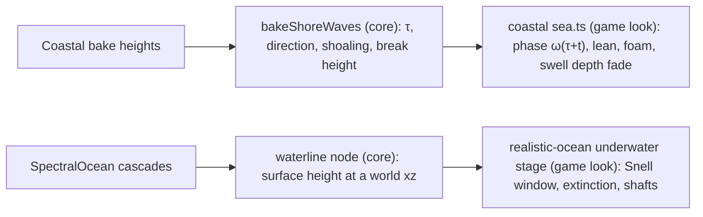

# PRD-766 — Waves break on the shore, and the camera can look from under the water

**Status:** NOT STARTED
**Priority:** P2 — planned look work: the coastal world has no breaking waves (P2.1) and no ocean has an underwater view (P3.2)
**Complexity:** 4 (MEDIUM); risk override: none
**Owner:** João
**Depends on:** None. Phase 3 builds on the `realistic-ocean` bundle from PRD-648 (done).

## Context

The owner asked (2026-10-28) whether [Humpalumps/Ultra-Water](https://github.com/Humpalumps/Ultra-Water)
(MIT, read at `ce9248f`) is worth absorbing, then chose option A: port its shore breakers and its
underwater view, and nothing else.

Ultra-Water as a whole does not fit. It is a WebGL2 app with raw GLSL, its own render loop, post
chain, sky and planar reflection. A wholesale import would be a second renderer (closed by the repo
rules) and could not run on the native engine. About 70% of it duplicates shipped systems:

| Ultra-Water | Shipped equivalent |
| --- | --- |
| 4-cascade FFT, JONSWAP, capillary band | `SpectralOcean` (`energy`, `capillaryWavenumber`), `realistic-ocean` bundle |
| Planar reflection, refraction, Beer-Lambert absorption | `WaterSurface3D` |
| Impact rings | `RippleField` |
| Async GPU height readback | `GPUReadback`, `SpectralOcean.sampleHeight` |
| Hillaire 2020 sky | `AtmosphereLuts`, `SkyCapture` |
| Area-ratio caustics | `clearwater` bundle |

Two parts have no equivalent here:

1. **Shore breakers** (`src/water/shoreMap.js`, `src/water/OceanSurface.js`). A fast-sweeping
   eikonal solve gives each water cell a wave travel time τ from deep water, with speed
   c = √(g·depth). It also gives the front direction, the front curvature and a ray-tube shoaling
   factor. The surface phase is ω(τ + t), so fronts slow down, bunch up and refract around the
   bathymetry. Heights follow Green's law plus ray-tube shoaling and are capped at 0.42 × depth. A
   plunging lean and the Gerstner pinch share one budget, so the heightfield does not fold.
2. **Underwater view** (`src/water/UnderwaterPass.js`, the underside branch of `OceanSurface.js`).
   It covers Snell's window and total internal reflection on the underside of the surface, a
   per-pixel waterline split with a meniscus line, Beer-Lambert extinction toward an in-scatter
   colour, and half-resolution Henyey-Greenstein light shafts.

Today the coastal starter sea (`packages/terrain/starter/coastal/sea.ts:120`) bakes a two-pass
chamfer distance to dry land and a flood-filled "exposed" mask (`sea.ts:123-176`). It draws thin
surf from that mask, with no wave fronts. No ocean in the repo renders a view from below the surface.

### What Unreal does (UE 5.8.3, `~/projects/UnrealEngine` at `396c9f059`)

- **Waves fade with depth; they do not break.** The wave strength is `1 - exp(-depth / (TargetWaveMaskDepth / 2))`.
  UE 5.8.3: Engine/Plugins/Experimental/Water/Shaders/Private/GerstnerWaveFunctions.ush:429.
  The default `TargetWaveMaskDepth` is 2048 cm (20.48 m).
  UE 5.8.3: Engine/Plugins/Experimental/Water/Source/Runtime/Private/WaterBodyComponent.cpp:113.
  Unreal has no shoaling, refraction of fronts or breakers, so the breaker model comes from
  Ultra-Water. The depth fade of the FFT swell borrows Unreal's curve and default.
- **Camera immersion comes from a query at the view position, not from the frame.** A sphere sweep
  at the view finds the water bodies. A second, precise sweep runs when the view is below the
  impact point, and the immersion depth is the maximum over the hits.
  UE 5.8.3: Engine/Plugins/Experimental/Water/Source/Runtime/Private/WaterSubsystem.cpp:901, :912, :987.
- **The water shading flips its sides under water.** The volume depth becomes the surface depth.
  UE 5.8.3: Engine/Shaders/Private/SingleLayerWaterShading.ush:160.
  The sun phase function runs on the refracted ray.
  UE 5.8.3: Engine/Shaders/Private/SingleLayerWaterShading.ush:193-196.
  The Fresnel term moves from the scattered light to the transmittance.
  UE 5.8.3: Engine/Shaders/Private/SingleLayerWaterShading.ush:234-235.

Licence rule (`docs/PRDs/Unreal/README.md`): borrow the algorithm, defaults and guards, and write
our own code. The same rule applies to Ultra-Water. Credit it in the README of each consumer that
uses its algorithm.

## Solution

- **Mechanism in `packages/core/src/ocean/`.** Two pieces, and neither decides a look:
  - `bakeShoreWaves(heights, resolution, size, level, options)` is a pure CPU function. It returns
    the travel time, the front direction, the shoaling factor and the break height per cell. It
    measures the bathymetry, so it needs no tuning constant ("auto by default"). It does not count
    a front that crosses a dry bar, so the old sheltered-lagoon rule survives.
  - A TSL node returns the ocean surface height at a world xz from the cascade buffers, with the
    choppy displacement inverted. The underwater stage uses it per pixel, at the near-plane point,
    for the waterline split. The camera immersion test uses it once per frame.
- **The look stays in game source.** The breaker phase, lean, foam and colours go in
  `packages/terrain/starter/coastal/sea.ts`. The underwater colours, extinction, shafts and Snell
  window go in `packages/create-threenative/template-assets/realistic-ocean/src/render/`.
- **The FFT swell fades with depth by default,** with Unreal's curve and its 20.48 m default.
  `swellFadeDepth` on the sea options is the named override. The breaker field takes over in
  the shallows.
- **Replace, do not add.** `bakeShoreWaves` replaces the chamfer distance and the exposure flood fill
  in `sea.ts:123-176`. Those lines are deleted.

**Risks.** The eikonal solve on a 1024² bake could cost seconds at load. The fallback is to solve
at half resolution and filter up. A per-pixel waterline at grazing views could flicker; the
meniscus band hides one pixel of error. The `realistic-ocean` bundle pins `engine: "threejs"`, so
the desktop proof uses that engine.

## Integration Ledger

| Capability | Reachable consumer/trigger | Replaces / disposition | Evidence |
| --- | --- | --- | --- |
| Shore wave bake | Coastal world load → `createSeaMesh` (`packages/terrain/starter/coastal/sea.ts:120`) → `bakeShoreWaves` | The chamfer distance and exposure flood fill (`sea.ts:123-176`) are deleted | P1.1, P1.2 |
| Shore breakers on screen | Coastal starter world, shore poses | The thin-surf mask term in `sea.ts:278-283` | P2.1, P2.2 |
| Underwater view | `createRealisticOcean` in the opted-in sailing consumer (PRD-648 lane), camera below the surface | New. No earlier path | P3.1, P3.2, P3.3 |

## Decisions

- 2026-10-28 (João): take option A, port the shore breakers and the underwater view. Ultra-Water is
  not adopted as a package, a template asset or a replacement for any shipped system. Its LEAN
  roughness, glints and caustics B-spline fix stay out of this PRD. File them separately when
  wanted.

## Execution Phases

#### Phase 1: The coastal bake measures wave travel time

**Status:** NOT STARTED
**Files:** `packages/core/src/ocean/shore.ts` (new), `packages/core/src/index.ts` (export),
`packages/core/__tests__/shore-waves.spec.ts` (new), `packages/terrain/starter/coastal/sea.ts`
(consume, delete the old bake).
**Implementation:** Fast sweeping (four diagonal orders, repeated until no cell changes) from the
open-sea rim, with c = √(g·depth) and land as a barrier. Then compute the front direction from ∇τ,
the curvature from ∇·(∇τ/|∇τ|), the ray-tube shoaling factor and the break height 0.42 × depth.
Malformed input throws: a non-finite level, a resolution below 2, or a heights length that does not
match.

- [ ] P1.1: On a plane beach, the bake matches the analytic answer. τ is within 2% of ∫dx/√(g·h), the direction points shoreward, the shoaling follows Green's law h^-1/4 within 5%, the height stops at 0.42 × depth, and a lagoon behind a dry bar gets no front. proof: `pnpm exec vitest run packages/core/__tests__/shore-waves.spec.ts`
- [ ] P1.2: The coastal sea reads `bakeShoreWaves`, and the old distance and exposure code is gone. proof: `pnpm exec vitest run packages/terrain/__tests__/coastal-runtime.spec.ts packages/terrain/__tests__/starter-kit.spec.ts`
- [ ] P1.3: An agent finds the bake by its symptom. `engine_search_capabilities` for "waves break on a beach" returns `bakeShoreWaves` first. proof: `pnpm build`, then the capability search spec in `packages/engine-mcp/__tests__/`

#### Phase 2: Waves break on the coastal shore

**Status:** NOT STARTED
**Files:** `packages/terrain/starter/coastal/sea.ts`, `packages/terrain/starter/coastal/README.md`
(Ultra-Water credit).
**Implementation:** The surface phase is ω(τ + t), with two wave trains and a set pattern on coasts
that face the swell. The plunging lean and the Gerstner pinch share one budget. The crests peel
and the foam follows the breaker. Where two fronts meet (a shock in τ), the waves fade. The FFT
swell fades with `1 - exp(-depth / (swellFadeDepth / 2))`. Capture with the `capture-strata-worlds`
lane, headed, `--browser-recipe webgpu`, `adapter.info` checked, two runs per arm, BEFORE and AFTER
burned in.
**Visual acceptance criteria:** wave fronts curve around the headland and bunch up toward the
beach, crests lean and break into foam, the open sea is unchanged, and the surface shows no folds,
seams or flicker.

- [ ] P2.1: A fresh read-only judge returns IMPROVEMENT at three shore poses (low beach view, the headland from above, oblique along the coast) against the criteria above. proof: `capture-strata-worlds` coastal BEFORE and AFTER sheets on the PR, plus the judge verdict
- [ ] P2.2: The breakers cost at most 0.5 ms of presented p95 at the same pose. proof: `TN_FRAME_BUDGET` presented.p95 from the paired capture runs, BEFORE and AFTER

#### Phase 3: The camera can look from under the water

**Status:** NOT STARTED
**Files:** `packages/core/src/ocean/spectral.ts` (surface-height node),
`packages/create-threenative/template-assets/realistic-ocean/src/render/realisticSea.ts` (underside
shading), `.../render/realisticUnderwater.ts` (new stage), `.../realisticOcean.ts` (wire it), the
sailing opt-in playtest from PRD-648 with a new underwater pose.
**Implementation:** The camera immersion depth is the node's surface height at the camera xz minus
the camera height. The stage runs only when the camera is within one metre of the surface or below
it (Unreal: `WaterSubsystem.cpp:901`). Each pixel compares its near-plane point with the surface
height for the waterline, and draws a meniscus band one pixel wide. The underside of the surface
shades Snell's window, with total internal reflection outside it (Unreal: `SingleLayerWaterShading.ush:160`, `:234-235`).
The fog is Beer-Lambert extinction toward the in-scatter colour, and the shafts are 24
Henyey-Greenstein steps at half resolution (Unreal: `SingleLayerWaterShading.ush:193-196`).
**Visual acceptance criteria:** a clear Snell window with a bright sun spot looking up, a clean
waterline across the half-submerged frame, depth fog that hides the far seabed, visible light
shafts, and no change to the above-water frame.

- [ ] P3.1: With the camera half under water, the playtest frame splits at the waterline: the pixels above the line match the above-water render, and the pixels below take the underwater fog. proof: the new underwater pose in the PRD-648 sailing opt-in playtest, `--browser-recipe webgpu`
- [ ] P3.2: A fresh read-only judge returns IMPROVEMENT at three poses (looking up, half under, looking level under water) against the criteria above. proof: BEFORE and AFTER sheets on the PR, plus the judge verdict
- [ ] P3.3: The same opted-in game source renders the underwater pose non-blank on the native desktop host. proof: the same scenario with `--target desktop`
