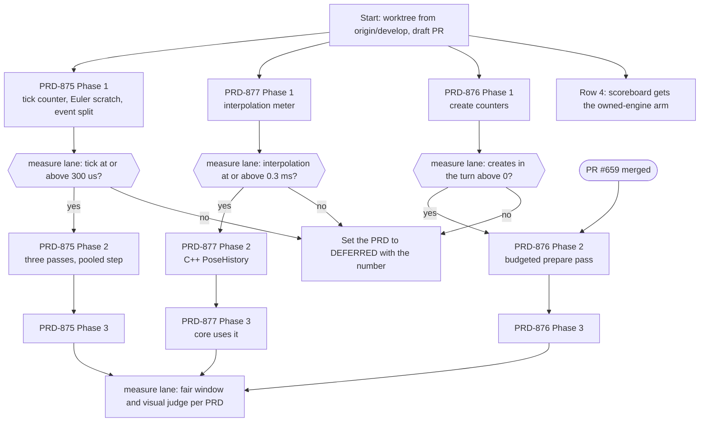

# Performance PRDs — execution order

Updated 2026-11-10. Written for an executor agent that is cheaper than the agent that planned the work. Follow it top to
bottom. When a rule here and a PRD disagree, stop and report: do not choose.

**Goal:** cut the CPU frame of a web game on the owned engine without changing a pixel or a motion.

**Metric (the acceptance reading, use no other):** CPU frame p50 and p95 of the arm named `head` against the arm named
`develop`, on the stress lab `main.html?stress`, 1280x720, uncapped pass, from one `pnpm stress:loop fair` window on a calm
host. Baseline on the RTX 2080, 2026-11-10: 9.84 ms p50 with virtual shadows (ledger rows #334-#337, PRD-871).

**Keep rule:** a change stays only when CPU frame p50 is lower in both ABBA pairs by the margin its PRD names, frame p95 is
no more than 5% worse, and a fresh visual judge reads NEUTRAL or IMPROVEMENT.



## Order

| # | Work | Who | Starts when | Verification that must be green | Stop rule |
|---|---|---|---|---|---|
| 1a | [PRD-875](../done/PRD-875-rigs-evaluate-their-poses-on-every-core.md) Phase 1 | executor | now | `ctest -R native_engine_animation_tick_batch`, `ctest -R native_engine_animation_mixer`, the new race case red then green in the TSan build, then `ctest -L native-engine` | — |
| 1b | PRD-875 sizing gate | measure lane | 1a pushed | `animationTickMicros` p50 on `?stress&tnDebug=1`, written under the PRD's `## Decisions` | below 300 µs: PRD becomes `DEFERRED` |
| 1c | PRD-875 Phases 2 and 3 | executor | 1b says go | the 0-against-3-workers bit-equal case, the pool-not-called case, the revoke case, all in the normal and the TSan build; `animation-tick-batch.playtest.json` | two failures with one cause |
| 2a | [PRD-877](../done/PRD-877-the-engine-blends-and-restores-physics-poses-in-one-call.md) Phase 1 | executor | now, parallel with 1a | `pnpm exec vitest run packages/core/__tests__/loop-interpolation.spec.ts packages/core/__tests__/debug-telemetry.spec.ts` | — |
| 2b | PRD-877 sizing gate | measure lane | 2a pushed | the three `interpolation*` entries and `sharedTransformWrites` on `?stress&tnDebug=1` | below 0.3 ms: PRD becomes `DEFERRED` |
| 2c | PRD-877 Phases 2 and 3 | executor | 2b says go | `ctest -R native_engine_physics_pose_history` (normal and sanitizer build), both-path run of `loop-interpolation.spec.ts`, `ctest -R native_engine_v8_pose_history`, the two playtests | two failures with one cause |
| 3a | [PRD-876](../done/PRD-876-a-draw-is-ready-before-the-frame-that-first-shows-it.md) Phase 1 | executor | now, parallel with 1a | `ctest -R '^native_engine_renderer_pipeline_'` on the host build | — |
| 3b | PRD-876 sizing gate | measure lane | 3a pushed | counters per frame of the Strata forest turn | 0 creates in the turn: PRD becomes `DEFERRED` |
| 3c | PRD-876 Phases 2 and 3 | executor | 3b says go **and** PR #659 is merged | `turn_finds_prepared_draw`, `prepare_budget_bounds_work`, the pixel-equal case, `ctest -L native-engine`, `pnpm parity` | two failures with one cause |
| 4 | [PRD-573](PRD-573-unreal-class-performance-in-release-cycles.md) Phase v1.9, the `godotRatio` box | executor | any time | a red-green case in the engine-load-test specs: `pnpm exec vitest run scripts/__tests__/` filtered to the engine-load-test spec files | — |
| 5 | Fair window, visual judge and `PERFORMANCE-LEARNINGS.md` entry for each finished PRD (its AC-1) | measure lane | the PRD's phases are ticked | the PRD's AC-1 | a void window twice: report the host load |

Rows 1a, 2a, 3a and 4 touch different files and can run at the same time. Rows 1c and 2c both stay out of `renderer/`.
Only row 3c edits `renderer/`.

Row 4 in exact steps: in `scripts/engine-load-test/scoreboard.sh` add `ladder tn-engine <n>` beside each `ladder tn <n>`
line (`:34-36`), because `ladder` appends `-desktop` and the arm `tn-engine-desktop` exists
(`scripts/engine-load-test/cli.ts:405,619`). In `scripts/engine-load-test/monitor.ts` widen the engine type
`"godot" | "tn"` (`:535,566,713`) to include `"tn-engine"`, and print a `godotRatio` column (Godot p50 divided by the arm's
p50) for R2, R3 and R5. Do not run the scoreboard: it needs a real display and a quiet machine, which is the measure lane's.

## Who runs what

- **Executor (the cheaper agent):** code, tests, and every proof that is a `ctest`, a `vitest` or a playtest command.
- **Measure lane (the lead agent, or the stress-lab lane):** every sizing gate, every fair window, every visual judge, and
  the budget and gate constants that a PRD says are set from a measurement. The executor does not run a fair window, does
  not profile and does not judge an image. Reason: a window needs a calm host, a staged Wasm pair and an arm naming rule,
  and a wrong reading costs more than the wait.
- **Hand-off:** when a row needs the measure lane, the executor pushes, writes "waiting for the measure lane: `<row>`" in
  the PR, and starts the next row that is open. It does not wait idle.

## Rules for the executor

1. Read `AGENTS.md` at the repository root and `packages/runtime-native/AGENTS.md` before the first edit.
2. Work in one worktree: `.claude/worktrees/perf-chain`, branch `perf/chain-875-877`, created from `origin/develop`.
   Start every shell command with `cd` into it. Do not edit the main checkout.
3. One draft PR for this chain, opened at the first commit (owner rule: one PR for the related work of a session; PR #643
   is the precedent). Its label is the one `pnpm prd:progress <the PRD in progress>` prints.
4. One box, one commit. Write the failing test first and paste its failing output in the PR. Then make it pass.
5. Tick a box only after you ran its proof. Write the result beside it (command, count, exit code) in the same commit.
   Never tick a `measure lane` box.
6. Before every commit that touches C++: rebuild the test target, then run `ctest -L native-engine` in the core-only tree.
   A test binary that was not rebuilt passes old code.
7. Before every commit that touches TypeScript: `pnpm typecheck && pnpm lint`, and the specs the PRD names.
8. Stage files by path. `git add -A` is forbidden here: other agents share this repository.
9. The pre-commit hook regenerates the capability manifest when a file under `packages/*/src` changes. Commit what it
   stages. If it reports a removed public symbol, stop and report.
10. Re-read every `file:line` in a PRD before you edit it. The lines were read at `d6b1630b8`. When the code there does
    not match the PRD's description, stop and report: do not adapt the plan yourself.
11. Do not touch: `docs/PRDs/performance/PRD-871-*` and the branch `perf/stress-lab-audit`, any other worktree under
    `.worktrees/` or `.claude/worktrees/`, `examples/abyss-vanilla/`, `renderer/renderer_shadow.cpp`, and the shadow passes in
    `renderer/renderer_frame.cpp` (about `:1189-1600`). PRD-871 is changing them.
12. Stop and report after two failures with the same cause, when a proof command does not exist, or when a step needs a
    design choice the PRD does not make. Report: the row, the command, the last 20 lines of output, what you tried.
13. Copy no Unreal code, shader code or comment. The PRDs already carry the design.

## Commands

Run these from `packages/runtime-native` unless a line says otherwise.

```sh
# Engine core tests, no GPU (source: .github/workflows/ci.yml:1576-1581)
for dependency in stb cgltf webp-source meshopt basisu; do node scripts/download-deps.mjs --only "$dependency"; done
cmake -S . -B build/native-engine -G Ninja -DCMAKE_BUILD_TYPE=RelWithDebInfo -DTN_ENGINE_CORE_ONLY=ON
cmake --build build/native-engine --target all tn-native-engine-core-tests --parallel "$(nproc)"
ctest --test-dir build/native-engine -L native-engine --no-tests=error --output-on-failure

# The same tree under ThreadSanitizer, and under ASan and UBSan. The options are in cmake/NativeEngineCore.cmake:11-12.
# No document gives these two lines: they are the core command with one option added.
cmake -S . -B build/native-engine-tsan -G Ninja -DCMAKE_BUILD_TYPE=RelWithDebInfo -DTN_ENGINE_CORE_ONLY=ON -DTN_ENGINE_TSAN=ON
cmake -S . -B build/native-engine-asan -G Ninja -DCMAKE_BUILD_TYPE=RelWithDebInfo -DTN_ENGINE_CORE_ONLY=ON -DTN_ENGINE_SANITIZE=ON

# Renderer tests need the engine-only host build (from packages/runtime-native). `pnpm native:build` alone is NOT
# enough: it configures build/tn-linux, and cmake/NativeEngine.cmake — which defines every native-engine test target —
# is only included under TN_ENGINE_ONLY (CMakeLists.txt:787-790), so build/tn-linux has no tn-native-engine-*-test.
# It still downloads Dawn, and that download is then reused.
pnpm native:build
cmake -S . -B build/tn-engine-only -G Ninja -DCMAKE_BUILD_TYPE=Release -DTN_ENGINE_ONLY=ON -DMYSTRAL_USE_DAWN=ON
cmake --build build/tn-engine-only --target tn-native-engine-renderer-caches-test --parallel "$(nproc)"
ctest --test-dir build/tn-engine-only -R '^native_engine_renderer_pipeline_' --output-on-failure

# The V8 host case row 2c names (`native_engine_v8_pose_history`, target `tn-native-engine-v8-test`) is NOT in this
# directory. cmake/NativeEngineAdapters.cmake defines it, and CMakeLists.txt:1585-1588 includes that file only under
# `TN_ENGINE_ONLY AND TN_ENGINE_PLAYER`, so it needs its own configure and a V8 dependency:
#   node scripts/download-deps.mjs --only v8
#   cmake -S . -B build/tn-engine-player -G Ninja -DCMAKE_BUILD_TYPE=Release -DTN_ENGINE_ONLY=ON \
#         -DTN_ENGINE_PLAYER=ON -DMYSTRAL_USE_V8=ON -DMYSTRAL_USE_QUICKJS=OFF
#   cmake --build build/tn-engine-player --target tn-native-engine-v8-test --parallel "$(nproc)"
# No document gave that sequence; it is read from the two include guards. Nothing here ran it, so treat it as
# unverified until a lane does. Rows 2c and 3c therefore do not share one build.
```

From the repository root:

```sh
pnpm exec vitest run <spec file>...          # one or more spec files
pnpm typecheck && pnpm lint                  # every TypeScript change
pnpm prd:progress <prd file>                 # before a phase and after it

# A playtest (source: AGENTS.md, "prove one game")
pnpm --filter @threenative/playtest build
node packages/playtest/dist/runner/cli.js <scenario>.playtest.json \
  --url http://127.0.0.1:5173 --server-command "<workspace dev command>" --browser-recipe webgpu
# The crowd scenario runs on the owned engine only with TN_BENCH_TARGET=web-engine (examples/skinned-crowd/vite.config.ts:7-11):
#   --server-command "TN_BENCH_TARGET=web-engine pnpm --filter skinned-crowd dev"
```

Use `sh scripts/xvfb.sh <cmd>` when a command needs a display. Never call `xvfb-run`.

## Measure lane runbook

1. The lab is `~/projects/threenative/sandbox/stress-lab` (port 5740). The vanilla arm is
   `~/projects/threenative/sandbox/stress-lab-vanilla` (port 5736). Both are untracked. Work on a copy under
   `~/projects/threenative/sandbox-stress/`, as the PRD-871 lane does, so two lanes never share one `dist`.
2. Build the web Wasm explicitly: `cmake --build packages/runtime-native/build/wasm-browser --target tn-native-engine-web`,
   and the threaded pair. `pnpm build` and `pnpm pack` do not rebuild it. Check the time stamp of
   `packages/runtime-native/build/web/*.wasm` against the commit before any reading.
3. Pack and install as `~/projects/threenative/sandbox/AGENTS.md` ("Lifting and adopting", steps 3 to 5) says: pack into
   `sandbox/.packages`, rename each tarball with a content hash, repoint the `file:` dependencies, `pnpm install`, build.
   The facade and the Wasm must come from the same commit.
4. Name the arms `head` and `develop`. The scoreboard reads no other names.
5. Run: `pnpm stress:loop fair threenative-wasm='<head url>?stress&arm=head' threenative-wasm='<develop url>?stress&arm=develop' --passes vsync,uncapped --tag <prd>-<lever>`.
   The tool waits for a 1-minute load under 12 and voids a run above 18. Do not lower the gate.
6. For a sizing gate add `&tnDebug=1` and read `TN_FRAME_BUDGET.counters.engine`. A debug run is never a timing result.
7. Visual judge: a fresh read-only Opus subagent that did not write the change, same pose, headed, `--browser-recipe webgpu`,
   `adapter.info` checked, two runs per arm, BEFORE and AFTER burned in. Record the verdict in the PRD's AC-1 box.
8. Record the window with `pnpm stress:loop record … --decision keep|reject`, and add one entry to
   `PERFORMANCE-LEARNINGS.md` for each closed lever, kept or rejected.

## Not in this chain

| Work | Why not | Owner |
|---|---|---|
| PRD-871, shadow planning CPU and laptop parity | An active lane holds it (PR #659) | lane `perf/stress-lab-audit` |
| [PRD-774](stress-lab-2026-10-30/PRD-774-render-plan-off-the-main-thread.md) Phase 3, the plan overlaps the next update | Memory safety across live scene pointers. It needs a design review by the lead before any code | lead |
| PRD-573 Phase v3.3, planning on a render thread | Needs a snapshot decision first (no dirty list exists) | owner and lead |
| PRD-763 and PRD-765, 10,000 residents | HIGH complexity. PRD-877 is their first slice | after PRD-877 |
| Godot and Midway readings | Need a real display, a clean packaged build and a quiet machine | measure lane |
