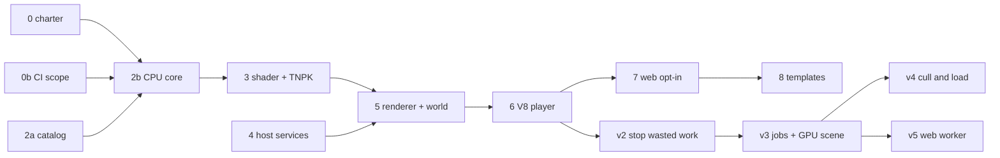

# PRD-573 — Unreal-class performance, in release cycles

**Status:** PARTIAL — slice 0 (charter) landed in this PR; every other slice and cycle is open.
**Priority:** P1 — the owned engine is not on develop, so no game can opt in and no cycle KPI can be measured (v1 slices 0b–8 open).
**Complexity:** 9 (HIGH) — 10+ files across core, the engine, the web host and CI (+3), new engine modules (+2), threads and shared frame data (+2), native and Wasm release artifacts (+2); risk override: none
**Owner:** João
**Depends on:** None. Engine code is extracted from `origin/feat/native-engine` (F), cited at `68f4b1f7b`.
**Estimate:** v1 2–3 wk; v2 3 wk; v3 5–6 wk; v4 4–6 wk; v5 4+ wk.

**Update rule:** this is one PRD with one PR (#493). Each slice or cycle step lands as a commit on
that PR and ticks its box, with the result, in the same commit.

## Goal and route

**Goal:** frame cost and load time of an established engine: first Godot desktop as the measurable
bar, then Unreal-class. **Route:** one owned C++ engine behind the three.js API, native on Dawn or
wgpu and Wasm (`tn-native-engine-web`) on the web; game code on V8 or browser JS. A game opts in
with `engine: "native"` until 2026-10-15. Since then native is the default for web and desktop and
`engine: "legacy"` is the named override (decisions below). The legacy engine is deleted after one
clean release ([PRD-535](../native-engine/PRD-535-n21-the-js-engine-is-deleted.md)).

Midway web when the work opened (native Wasm page against three.js): CPU busy per frame 2.32x
faster, frame p50 0.24x, first frame 0.48–0.62x, `enter` 0.96–1.09x, `ready` 0.73–1.05x. Engine
shares: animation about 13%, cull and project about 11%, `Renderer::render` 21%, transforms about 8%.

## Decisions

- 2026-10-11 (owner): Perry is parked. PRD-579, PRD-581, PRD-582 and `tools/native-typescript`
  stay on F and do not land.
- 2026-10-12 (owner): charter amendment accepted (`docs/architecture/CHARTER.md`,
  `NATIVE-ENGINE-DECISION.md`): opt-in engine, legacy default, default switch at 2x or better and
  stable, then legacy deleted.
- 2026-10-12 (owner): develop's velocity design wins. The engine's `provision` hook is optional, and
  F's velocity patch is not applied.
- 2026-10-12 (owner): one PRD and one PR for the whole epic. Phases are release cycles; v1 phases
  are the slices. This waives the 3-phase limit (R5) for this file.
- 2026-10-13 (owner): two benchmark tiers. **Cheap benchmarks** (the engine-load-test R-ladder) are
  for fast iteration and regression guards only, and never close a KPI. **Final benchmarks** are
  real games, Midway first (`scripts/midway-bench/`, parity gate on): every KPI box, "met" claim
  and dashboard headline is judged there. Why: R5 read native 2.8x and web 1.4x, yet on Midway the
  desktop player felt like 20 FPS with a 138 ms HUD lag while three.js in the browser ran at 51
  FPS, and the web engine was 0.71x.
- 2026-10-15 (owner): release v1 now. [PRD-610](PRD-610-native-engine-wins-on-real-games.md) ships
  PARTIAL and its open boxes stay open. The PR leaves draft and does not merge before the owner says so.
- 2026-10-15 (owner): the C++ engine is the default now. A game that sets no `engine` runs on it
  (Wasm engine on web, V8 engine player on desktop), and `engine: "legacy"` is the named override. This
  supersedes the "switch at 2x" rule above. The legacy engine stays until one clean release has passed.
  Android and iOS still run the legacy host. Measured on release day: the V8 engine bundler refuses seven
  of the 13 templates (`TN_NATIVE_ENGINE_UNBOUND`), four more stop at runtime on the engine player, and
  the web Wasm engine fails the last two on its parameterless TSL `Fn`. All 13 pin `engine: "legacy"` in
  `threenative.config.ts` until slice 8 clears them, so the default changes no template today. The release also
  needs the Wasm engine, the desktop bundler and the engine player in the published packages (open boxes in
  Phase v1.10).
- 2026-10-15 (owner): the native engine stays the default, and there is no legacy fallback. A legacy
  pin (`engine: "legacy"` in `threenative.config.ts`) is temporary debt. Each template loses its pin
  when its web and desktop rows both pass on the engine ([PRD-617](PRD-617-every-template-runs-on-the-native-engine.md)).
  The engine exposes the upstream Three.js API, and a game uses the same source on every back end.
  This refines the previous decision: the default is not reverted while templates remain pinned.
- 2026-10-15 (owner): housekeeping. Delete junk and reduce the file count; keep every behaviour.
- Deferred, filed again only on scorecard evidence: transform compose skip (if
  `updateMatrixWorldSelf` is above 2% of the frame), projection reuse and SIMD world matrices (if
  transforms, cull and project stay at 10% or more), GPU-written indirect arguments (if CPU cull and
  project stay at 8% or more after v3), the `GPUSceneBVH` subpath move (breaking, its own change).

## Rules for every box

- **Same-run ratio.** Subject and control in one command and one load window, load average
  recorded. A counter gate (calls, compiles, evaluations) beats a timing gate under host load.
- **Tails.** A timing box reports p95, p99 and the hitch count beside p50; a worse p99 fails it.
- **Visual judge** for any change that can alter a pixel, per the root `AGENTS.md`.
- **Red-green** for every behaviour change. A public binding change regenerates
  `packages/three-native/api/` in the same commit.
- **Unreal licence.** Read the design, write new code, copy nothing. `UE 5.8.3: <path>` cites a
  design reference (UE `release` `396c9f059`).

**Stability gate S** (closes every cycle): `pnpm test:templates` and `pnpm test:playtest` green on
web; `pnpm native:verify:desktop` green; an 1800+ frame soak with no crash and no RSS growth. Until
2026-10-15 S also required the default build output to match the base commit byte for byte. The default
is now native, so S instead requires that a game with `engine: "legacy"` still builds and plays.
From v2 S adds the Android emulator journey; from v3, a ThreadSanitizer engine run.

## Cycle v1 — land the engine

Each slice is one commit series cut from `origin/develop` with Perry files dropped. Engine targets
stay `EXCLUDE_FROM_ALL` and `engine: "legacy"` stayed the default while the slices landed, so every
slice was inert or opt-in. The default flipped on 2026-10-15 (see Decisions).

#### Phase v1.0: Charter decision (slice 0)
**Status:** DONE
- [x] Charter, `CHARTER-HISTORY.md`, root `AGENTS.md` rule 5 and `NATIVE-ENGINE-DECISION.md` admit one opt-in engine. proof: commit `fc261bbd1` (from PR #494, green: check:docs, `sync:agents --check`, doc-link, primary-docs and ci specs)

#### Phase v1.0b: CI scope for engine paths (slice 0b)
**Status:** IN PROGRESS (classification and wiring landed; runner proof open)
- [x] `scripts/ci-change-scope.mjs` classifies `packages/runtime-native/{src/engine,src/adapters,tests/native-engine,cmake/NativeEngine*}` (the real engine prefixes on `feat/native-engine`) as `native-engine`, and `ci.yml` runs one `native-engine` job with its own ccache key and a cached emsdk. proof: `pnpm exec vitest run scripts/__tests__/ci-structure.spec.ts scripts/__tests__/ci-needs.spec.ts` and the ci-change-scope spec, plus a `pnpm ci:local --affected` plan dump Result 2026-10-11 (commit from agent run, 18 new red-green cases): `ci-structure` + `ci-needs` 223 passed; owner call: engine-only PRs skip `native-platforms`; mixed, main, merge-group and `--full` keep it. `--base HEAD~1` plan dump selects `native-engine`, validates.
- [ ] The `native-engine` job runs green on a runner, and `ci-integration-scope.mjs` stops selecting heavy lanes for an engine-only diff (it matches the `runtime-native` producer family today). proof: a CI run on an engine-only diff

#### Phase v1.1: Core fixes that need no engine (slice 1)
**Status:** IN PROGRESS (5 of 6 boxes; develop gates partial)
Cherry-picks of F `c1ef353ca 2007efe12 3d3695197 3b29482a6 504709d17 726df7f5c dad980723 9400d5872`, each with its spec.
- [x] `posedBounds` reads skinned-mesh envelope invariants once per mesh, not per vertex. proof: `pnpm exec vitest run packages/core/__tests__/posed-bounds.spec.ts`
- [x] Foot-plant stride reads each bone's world matrix once per frame and still reads a moved ancestor above the rig. proof: `pnpm exec vitest run packages/core/__tests__/animation.spec.ts`
- [x] An unsized canvas does not re-scale its drawing buffer when the buffer echoes back. proof: `pnpm exec vitest run packages/core/__tests__/game-pixel-ratio.spec.ts`
- [x] A rejecting scene `load()` or `start()` is reported by name instead of stalling the launch. proof: `pnpm exec vitest run packages/core/__tests__/game.spec.ts`
- [x] A counted step spends the pending freeze settle. proof: `pnpm exec vitest run packages/core/__tests__/loop.spec.ts`
- [ ] Develop's gates stay green. Partial 2026-10-11: `pnpm lint` exit 0; the five specs pass (158 tests); `pnpm typecheck` has no `packages/core` errors, only unbuilt-workspace imports (`procedural-animals`, `terrain`); `generated-shooter-input.spec.ts` (3 tests) fails identically without these commits, so it is pre-existing; `pnpm test` and `pnpm test:playtest` not rerun on this branch. proof: `pnpm typecheck && pnpm lint && pnpm test` and `pnpm test:playtest`

#### Phase v1.2a: API catalog and reference oracle (slice 2a)
**Status:** DONE 2026-10-11 (browser backend, Perry and the native runner excluded; see notes)
- [x] `packages/three-native` catalog, generators, fixtures and goldens land (goldens marked `linguist-generated`). proof: `run-reference.ts --check --no-renders`, catalog specs, `pnpm typecheck` Result: `run-reference.ts --check --no-renders` exit 0 (96 fixtures, 2047 observations, 108 renders skipped); 7 specs / 65 tests green; package typecheck exit 0; `pnpm lint` 0 errors; frozen-lockfile install passes. Excluded: `src/browser-*` and addons (slice 7), `run-native`/`fixture-native` (slice 2b), `native-stubs.spec` and `catalog-capabilities.spec` (need PRD-526/531 text and a `native` capabilities section). Renders (108) not run here.

#### Phase v1.2b: CPU engine core (slice 2b)
**Status:** IN PROGRESS (core landed; legacy-build box open)
- [x] `engine/{foundation,scene,animation}`, `tn_abi.h` and `cmake/NativeEngineCore.cmake` land behind `TN_ENGINE_CORE_ONLY`, fixtures regenerated against develop. proof: `ctest -L native-engine` native, under ASan/UBSan, and as Wasm under node
- [ ] The legacy build and suite are unchanged. Partial: the default configure has zero engine targets and the source-list guard passes; `pnpm --filter @threenative/runtime-native test` fails the same 29 tests as base `ef18c6b14` (unbuilt host binaries); `pnpm native:build` not run. proof: `pnpm native:build` and `pnpm --filter @threenative/runtime-native test`
  Result 2026-10-11: native `-DTN_ENGINE_CORE_ONLY=ON` build + `ctest -L native-engine` 78/78 (rerun by the lead on the epic branch); agent-reported: ASan/UBSan 78/78 plus a 15 s `fuzz_buffers` run with no findings, Wasm under node 53/53 (emsdk 6.0.11). Fixtures regenerated: byte-identical, 108 render goldens not regenerated (need a GPU). Not landed, moves to slice 3: `abi.cpp`, `identity`, `tsl_call` and the `abi_test`/`abi_c11`/`fuzz_abi` tests, `differential.mjs` (they need the shader TSL surface); three animation tests that include renderer or player headers go to slice 5/6. Eight header-only files from later slices ride along so the core links.

#### Phase v1.3: Shader IR, WGSL and TNPK (slice 3)
**Status:** DONE 2026-10-11 (GPU emit tests and naga open, see result)
- [x] `engine/{shader,assets}` and `packages/assets/src/native-package.ts` land; `assets.nativePackage` defaults off. proof: ctest shader, package and fuzz; Tint and naga validation; assets and config specs
  Result 2026-10-11: native `-DTN_ENGINE_CORE_ONLY=ON` `ctest -L native-engine` 126/126 (rerun by the lead on the epic branch; baseline before this slice 78); agent-reported: ASan/UBSan 127/127, Wasm under node 99/99, libFuzzer `fuzz_abi` 272k runs clean, Tint passes 9/9 corpus programs, `packages/assets` 41 files and `create-threenative` config spec 103/103 green, `assets.nativePackage` defaults off. Not run: naga (0.20 rejects the emitted `diagnostic(off, ...)`; test registers for naga >=24), GPU shader-emit tests and the V8 `tsl_js` differential (slice 5/6), `pnpm --filter @threenative/core build` still exits 1 after tsup (cause not investigated; pre-existing status unconfirmed). Excluded: `probe_volume`, `shader_emit_test`, `shader_package_test`, `template_post_packages`, `tsl_js`, browser-backend Wasm tests.

#### Phase v1.4: Shared host services (slice 4)
**Status:** IN PROGRESS (landed; platform proof open)
- [ ] `src/webgpu/context.cpp` and the `presentation.cpp` split land as a behaviour-neutral refactor, with `ui-layer-host-contract` fixed (`pointer.cpp` `g_resetKeyboard`). proof: `pnpm native:verify:desktop`, the `native-platforms` matrix, Android emulator parity, `pnpm test:playtest`
  Partial 2026-10-11 (agent run, not rerun by the lead): `pnpm native:build` 410/410; ctest `build/tn-linux` 49/49 with the NVIDIA per-process ICD shim; `ui-layer-host-contract` 2 tests red-green (stub now defines `g_resetKeyboard`; hit-region check reads `runtime.cpp` and `ui_overlay.cpp`); `pnpm native:verify:desktop` exit 0 (300 frames, 1280x720); runtime-native vitest 1611 passed / 2 failed (`native-sbom` receipts, unconfirmed at base). Lead rerun: `presentation` resize spec 2/2, `ci-structure` + `ci-needs` 223, source-list guard. Not run: Android emulator parity, `native-platforms` matrix, `pnpm test:playtest`, Windows/macOS. Dropped as not neutral for legacy: the Android acquire watchdog (`_Exit(2)` after 2 s, moves to slice 9), `audio_context` playbackRate and interpolation changes, the Dawn timestamp-quantization toggle, `wgpuQueueRelease` in `~Context`, the device-lost handler. Box stays open until the matrix and an Android run pass.

#### Phase v1.5: Renderer and world (slice 5, 2–3 commits)
**Status:** IN PROGRESS (landed in 3 commits; 6 tests red under `tn-known-red`)
- [ ] `engine/renderer` (resources, presentation, device loss, draw core, materials, graph) and `engine/world` land, with stale fixtures regenerated (`world_tiles`, `gpu_scene`, `render_vsm`, `target_graph`, `update_scaling`). proof: ctest on a software GPU, render fixtures against browser frames, the device-loss test
  Result 2026-10-12 (agent run on the NVIDIA lane, not rerun by the lead): `engine/renderer` and `engine/world` landed as 5a/5b/5c; `ctest -L native-engine` 297/297 with the device-loss test and the `render_*` fixtures against browser goldens, ASan/UBSan 297/297, Wasm under node 115/115, `TN_ENGINE_CORE_ONLY` 163/163, default configure has zero engine targets, root specs 298 green. Six tests are red and parked under label `tn-known-red`, so the box stays open: `render_vsm_open` vsm-basic 1.07% and vsm-deformation 2.18% off native against a 1% limit (F recorded those goldens as unverified); `template_post_starter` (develop's starter chain gained a LUT grade and a grain stage the native lowering lacks); `loop_reference_current` (develop's `FixedStepLoop` has no `interpolationAlpha`); `world_tiles_reference_current` (22/625 observations differ since develop changed `world-tiles.ts`); `world_gpu_scene_reference_current` (1/38 steps, develop changed `world-gpu-scene.ts`); `world_cells_reference_current` (generator refuses a new develop spec). Fixing them means porting the engine to develop's newer core, tracked as follow-up boxes below. `update_scaling` 4k to 64k scaling (35.9x against 18x) moved to the `tn-perf` label as an open perf target. Excluded: `world/walk`, skinned-crowd cases, strict-artifact inspect (slice 6); `renderer/chain` (needs `mrtVelocity` from core); PhysicsSync (not built: needs `TN_ENABLE_NATIVE_PHYSICS` and Rapier).
- [ ] The six `tn-known-red` tests go green against develop's current core (tables regenerated, starter LUT and grain stages lowered, VSM within 1%). proof: `ctest -L tn-known-red` all pass and `ctest -L native-engine` stays green

#### Phase v1.6: V8 player and core seams (slice 6)
**Status:** DONE 2026-10-12 (native-only claims; Android, soak and full suites open)
- [x] `adapters/v8`, `engine/player`, the playtest `--executable` lane and the optional core seams (`render/chain.ts` `provision`, `world-cells.ts`, `profiling/Spans.ts`, the cull engine root from `ebcac38ce`) land, with the 8 develop-drift symbols bound. proof: `native_engine_v8_*` ctest, `native-engine-world-*` playtests, the minimal template on the V8 player
  Result 2026-10-12 (agent run on the NVIDIA lane; lead reran the core and root specs: 82 passed): `TN_ENGINE_PLAYER` builds `tn-native-engine-v8`, all targets `EXCLUDE_FROM_ALL`; `ctest -L native-engine` 353/353 (44 `native_engine_v8_*`, `player_imports`, `chain_reference_current`, `strict_artifact_inspect`, Rapier sync x2); `--executable` playtests `world-walk` 510 frames, `world-cycles` 2650, `world-fault` 510 pass; `native-engine-minimal-v8` ran 300 frames, the player moved 3.0 m, frame non-blank (mean tone 133.7, black fraction 0), screenshot `~/Downloads/native-engine-minimal-v8.png`. 16 unbound symbols bound (the 8 named plus `TempNode`, `NodeMaterial`, `RendererUtils`, `fxaa`, `godrays`, `ssgi`, `ssr`, `sharpen` refused by name, `mrt()` accepts `vec4(normalView, 0)`). Web path unchanged: `provision` defaults to `mrtVelocity()`, `render-velocity` 20/20 and `render-camera-cull` 20/20 pass. Three host ctest triangle counts changed from 771/99/771 to 507/87/507 because the renderer culls by default (v8 and cpp agree). `GAME_SPANS` ids shifted +2 to avoid develop's terrain ids, pinned by a new spec.
  Known limits, not silent: `scene.fogNode` ignored on native (prints `TN_NATIVE_FOG_NODE_IGNORED`); blend modes recorded, not applied; `context` and `velocity` throw on native, so TRAA and motion blur are unsupported on the engine path until the velocity design lands (the engine's velocity patch was not applied); `readback` fails by name. Not run: Android, Windows, macOS, `pnpm test`, `test:playtest`, `test:templates`, a 1800-frame soak, root `pnpm lint` (4 errors in `examples/procedural-animals/.../quadruped.js`, untouched, base not compared).

#### Phase v1.7: Web Wasm engine, opt-in (slice 7)
**Status:** PARTIAL
- [ ] `engine/wasm/web_host.cpp`, `three-native/src/browser-*`, `engine: "native"` and `profile:wasm-page` land with `engine: "legacy"` the default. proof: web-engine spec, `wasm-engine-boot` playtests, `pnpm test:templates` unchanged, a web A/B with `--control`
  Partial 2026-10-12: merged in 9ba8a8794 (vitest 241/241 in the worker, root tsc 0). Bridge cuts 1-4 ported to the browser back end, with crossings at 38,308 -> 52 per frame. `wasm-engine-boot` and `pnpm test:templates` not run.
- [x] The web engine page is at least 1.3x cheaper than three.js: tn-web p50 ÷ tn-engine-web p50 on main-thread wall time (performance.now(), not a CPU clock), R5@4096, real GPU, same pair guard. Target set by the owner on 2026-10-12. proof: a 3+3 `bench:engines` pair, `artifacts/engine-load-test/prd-573/web/`
  Result 2026-10-12: **1.41x** (`web-desk-confirm-2` at 1b1926f55, desktop RTX 2080 nvidia/turing, Xvfb, headed Chrome, load 11-12 so the in-run ratio counts): tn-web p50 7.96, p95 14.00, p99 26.01 ms vs engine-web 5.63, 8.39, 16.38 ms. Path: 0.15x baseline, 0.92x after bridge cuts 1-4, 1.01x after collect, 1.41x after own-property members and allocation-free rotation. Cuts 3 and 4 were judged NEUTRAL, and cuts 5-7 change no pixels. Laptop rerun not done.

#### Phase v1.8: Template post-node imports (slice 8)
**Status:** NOT STARTED
- [ ] The 14 templates import post nodes only from the tier that enables them, pixel-neutral. proof: `pnpm test:templates`, template-quality spec, a visual judge on BEFORE/AFTER captures

#### Phase v1.9: The scorecard
**Status:** NOT STARTED
Today: `perf` has p95, p99 and hitches but no memory or host load; `bench:scoreboard` has medians only; the R-ladder runs only on legacy and Godot arms; `run-godot.ts` has no workloads, so Godot ratios exist only on the ladders; `profile:wasm-page --load` means load phases, not host load; no soak command exists.
- [x] `pnpm perf:live` serves a page that re-reads every bench report under `artifacts/engine-load-test` every 2 s and plots p50 per workload and arm, with a red ring for a >30% regression against the series best. proof: `pnpm exec vitest run scripts/__tests__/perf-live.spec.ts` (2 passed) and a browser check against the 505 recorded pilot points, 2026-10-11. Revamped 2026-10-12: cycle tabs v1 to v5, native-vs-legacy KPI tiles against the 2x target, epic progress and gate pills read live from this PRD (`--prd`), `epicOf` spec; the server watches `artifacts/engine-load-test/prd-573` only. Checked in a browser against the 18 first A/B reports.
- [x] `bench:engines` and `bench:scoreboard` rows carry p95, p99, the hitch count, draw calls and pipeline compiles, and fail closed on a missing counter. proof: a red-green case in the engine-load-test report spec Result 2026-10-11: 147 engine-load-test specs green, red first (14 failures); Godot rows are exempt from `pipelineCompiles` only (Godot load test has no counter; `ponytail:` note in `report.ts`), a Godot rung with no draw call still fails. Unverified: the counter has not run in a real three/WebGPU renderer.
- [ ] `perf`, `bench:engines` and `profile:wasm-page` carry `hostLoad` and the core count, and mark absolutes `invalid-absolute` above half the core count. proof: a red-green case per spec with a stubbed load Partial: `bench:engines` and `perf` stamp `hostLoad` and `invalid-absolute` (stubbed-load specs green, 4 red first for `perf`); `profile:wasm-page` is slice 7 and does not exist yet.
- [ ] Memory (partial 2026-10-12, arm run reviewed by the lead: `parseProcStatusMemory` and `parseTotalPssMb` pure parsers fail closed with named errors, `--executable` reads `VmHWM`, 4 specs red then green; the `--logcat` PSS wiring and `profile:wasm-page --memory` are not exercised, no desktop or emulator run yet): `perf --executable` peak RSS (`VmHWM`), `perf --logcat` PSS (`dumpsys meminfo <pid>`), `profile:wasm-page --memory` (Wasm memory, JS heap). proof: red-green cases in `perf.spec.ts` and the profile-wasm-page spec, then one desktop run and one emulator run
  Desktop run 2026-10-13: the same soak printed peak RSS 288.3 MB (VmHWM). The emulator run (`perf --logcat` PSS) is not run, so the box stays open.
- [x] A soak command (`perf --soak`, `soakVerdict`; 7 specs red then green; perf+perf-surface specs 85 pass, `tsc --noEmit` clean; no real 1800-frame run yet) runs 1800+ frames and fails on a crash or RSS growth. proof: a red-green case with a growing stubbed RSS series, then one run on the legacy desktop host
  Result 2026-10-13 at 67510c5ab: `perf --executable build/tn-linux/mystral --host-arg run --host-arg dist/native-smoke.js --soak 1800` on the legacy desktop host (examples/native-smoke, NVIDIA, private Xvfb) exits 0. All 1800 of 1800 frames ran, and RSS went from 272.8 MB after frame 300 to 218.3 MB at the end (-20%, limit +10%).
- [ ] The R-ladder runs on the `native-v8` arm, and the scorecard carries a `godotRatio` column from `bench:scoreboard` R2, R3 and R5 (no Godot row for a workload Godot cannot run). proof: a red-green case in the engine-load-test spec, then the baseline rows in `docs/verification/runtime-perf-state.md`
- [ ] Parity guard and player-side telemetry salvaged from `ne/bench-parity`, `ne/bench-cputime`, `ne/bench-telemetry`, `ne/bench-counters`. Landed: generic `scripts/engine-load-test/parity.ts` (fail-closed facet table, symmetric span families, wall-clock check; 11 specs, no caller yet). Moves to slice 6 because the player files do not exist yet: first-frame hold until the runner attaches (`07c0b6761`), thread CPU time in player frame metrics (`e5d1c9456`), `performance.now` as the player clock (`f7b12972d`), `__tnFrameSpans` (`febc0f9a0`), `--counters` (`9f40997dc`), `runFacets`. Perry wiring dropped. proof: parity spec plus a same-run two-arm bench that passes the guard

#### Phase v1.10: v1 KPI and gate
**Status:** PARTIAL
- [x] Native steady frame CPU is at least 2x legacy on R5 desktop. First A/B 2026-10-12 (3 alternating rounds, parity guard passed, host loaded so read as ratios): native is slower, 0.49x R2, 0.52x R3, 0.79x R5 by CPU per frame. Cause: bridge crossings (`Adapter::unwrap/wrap`, per-frame wrapper scans), see `artifacts/engine-load-test/prd-573/*-pair.md`. KPI open. After three crossing cuts (slot-cached reads, stack-array arguments, native structure stamp; bridge calls per settled R2 frame 98,307 to 41,229) the ratio is 0.72x R2 and 0.91x R5 (host load 6 to 34, alternating pairs). Under Xvfb both arms spin about 32 ms per frame in Dawn `Present`, so the shared floor caps any ratio near 1.1 to 1.2x on this lane; excluding it, the engine adds about 16 ms over legacy's 3 ms at 4096 cubes. Remaining crossings are the game's own setters (about 10 per cube). Breaking the ceiling needs the native scene graph to draw and reconcile objects the game does not touch, or a lane whose present is not shared CPU. Decision owed before more speed work. proof: `pnpm bench:engines` with `tn-desktop` and `native-v8` on R5 in one invocation, tails and load recorded
  Met 2026-10-12: real GPU (RTX 2080, real display) R5 frame p50 2.72x then 2.80x, thread CPU 2.79x then 2.97x; Xvfb thread CPU without present 2.10x. See step 5 under v1.11 and [RESULTS-2026-10-12](../../benchmark/prd573/RESULTS-2026-10-12.md).
  Cheap tier only (decision 2026-10-13): this box no longer closes the v1 KPI. The next box does.
- [ ] Final tier: the native desktop player runs Midway at frame p50 and main-thread CPU per frame at least 2x the legacy desktop host on the same scripted flight, parity PASS, HUD round trip under one frame. 2026-10-13: open and losing. The owner played both and found the player at about 20 FPS with a 138 ms HUD lag, against 51 FPS for three.js in the browser. Engine C++ takes 75% of the main thread (cull, matrix walk, animation, render project). proof: `scripts/midway-bench/flight.sh desktop` timing pairs. Work: [PRD-610](PRD-610-native-engine-wins-on-real-games.md)
- [ ] Native steady frame CPU is at least 2x three.js on Midway web, frame p50 no worse. proof: `pnpm profile:wasm-page -- --url <native> --control <three.js> --cpu-work`
- [ ] Stability gate S is green. proof: the S commands on the release commit. Partial 2026-10-15: `pnpm budgets` exit 0 after a regenerated native coverage record; native ctest 394 of 397 (`native_engine_target_graph` fails only in a build with the web overlay ON, `native_engine_pacing` and `native_engine_player_real_input` pass alone and fail under `-j4` load); `pnpm native:verify:desktop` NOT green here, because the legacy host's screenshot request times out under Xvfb (`startup-stall.png`) and no baseline host exists to prove that environmental.
- [x] The C++ engine is the default for a game that sets no `engine`, and `engine: "legacy"` is the named override (owner decision 2026-10-15). proof: red-green in `packages/create-threenative/__tests__/config.spec.ts` (`validateEngine(undefined)` was "legacy", now "native"), the create-threenative suite 102 files, 1566 tests, `pnpm check:docs`, the prose-lane specs 7 files, 272 tests. Result 2026-10-15: the root and template AGENTS.md name the default and the override, and the build errors name `engine: "legacy"`.
- [x] A scaffolded template builds and plays on the engine player on desktop with the default engine. proof: scaffold `minimal`, `threenative build --target desktop`, then the template's own `play` scenario with `"target": "desktop"`. Result 2026-10-15 (RTX 2080, Xvfb, engine player `tn-native-engine-player-v8` with native physics): pass, 3 of 3 assertions (`components` position changed, `renderChain.tier`, `diagnostics`). Boot runs of the other templates on the same player: `puzzle` passes (180 ticks, no console error); `platformer` and `tower-defense` stop on `MeshStandardMaterial.flatShading` ("not a bound material property"); `racing` stops on `mesh.computeBoundingSphere is not a function`; `rts` logs `TN_V8_FRAME_FAILED: updateRanges.push is not a function` every frame; `starter` fails in the bundler with 18 `TN_NATIVE_ENGINE_UNBOUND`. Two player faults found and fixed on the way: it refused the runner's `--width`, `--height` and `--windowed`, and it reported no `runtime.network` (every desktop playtest on the player failed since develop's network check).
- [ ] No template runs on the native engine yet, so no template changes pixels, and the legacy-versus-native visual judge is not run. All 13 templates pin `engine: "legacy"` with a "PRD-573 slice 8" comment: the web Wasm engine's TSL `Fn` takes no parameters (minimal and puzzle fail every web playtest with `TN_PLAYTEST_BRIDGE_MISSING` and a startup `TypeError`), and the desktop engine refuses or stops on the symbols above. proof: delete a template's pin, then `pnpm test` (web) and a `--target desktop` playtest both pass, then a visual judge on legacy-versus-native captures. A legacy desktop capture is not available on this lane (the legacy host screenshot times out under Xvfb), so the judge needs a lane with a real display. Work: PRD-617, every template runs on the native engine (filed on local `develop`, not yet on `origin/develop`)
- [ ] The release ships the web Wasm engine, the desktop engine bundler and the engine player. proof: `npm pack` of `@threenative/runtime-native` and `@threenative/core` from a clean checkout lists `build/web/tn-native-engine-web.{mjs,wasm}`, the bundler and the player, and a scaffold installed from those tarballs builds with `engine` unset. Today the Wasm files are in the `files` list but no CI job builds them (`TN_WASM_ENGINE_MISSING` names the build command), and the player is a local `THREENATIVE_ENGINE_PLAYER` path.

#### Phase v1.11: Native reconcile (the route to the v1.10 KPI)

Design study 2026-10-12 (read-only). The native renderer already batches the source scene (`RenderDatabase::batch`, `projection::decide` ports `scanProjection`), so core's JS mirror repeats work native does, and every object crosses the bridge to feed it. Estimated crossings per settled R2 frame: game setters 12k, `MatrixWorldPass` 16 to 25k, mirror sync 12k, stability walk 0 to 3 per cube. `Adapter::collect` scans about 25k wrappers per frame (11% of CPU). The KPI metric is fixed here before the next A/B: **thread CPU time per frame excluding Dawn `Present`, measured by the same instrument in both arms (`presentCpuMs`), on the headed real-GPU lane, with the inclusive number published next to it.** Present spins about 32 ms per frame under Xvfb in both arms, so the inclusive ratio there is at most 1.09x whatever the engine does. The 2x target is R5 desktop; R2 is reported and is not the KPI (estimate for R2 excluding present: 1.2 to 1.6x). The target is claimed only if the inclusive real-GPU number agrees. If R5 tops out below 2x, the PRD says so; the metric does not move.

- [x] Step 0: a per-name crossing histogram (flag-gated, `abi.cpp`) and `presentCpuMs` in both arms' frame report; a 1k-cube budget ctest asserts at most 3.5 crossings per cube (red first). proof: `v8_adapter_test.cpp` ctest, `pnpm bench:engines --pair` showing the new column
  Result 2026-10-12: histogram sum equals `crossings()` (ctest `crossing_histogram`); `presentCpuMs` and a thread-CPU-without-present column in the pair table. `native_engine_player_crossing_budget` is red as planned at 10.26 per cube (`tn-known-red`). First no-present ratio on R2@4096: 0.33x (legacy 8.07 ms, engine 24.29 ms), host load 8 to 14.
- [x] Step 1: `Adapter::collect` visits only new or changed wrappers. proof: ctest with 25k wrappers and a steady frame gives 0 visits; the churn test at `v8_adapter_test.cpp:335` stays green
  Result: ctest `collect_visits` red with the full sweep forced (32,145 visits), green with the epoch check; 1k rung visits 2,276,163 to 37,723 over 360 frames; `ctest -L native-engine` 359/359. R2@4096 no-present ratio 0.36x.
- [x] Step 2: native `Object3D.__tnUpdateMatrixWorld(force)` and a `MatrixWorldPass` seam that calls it when the root has it. proof: vitest with a counting stub (red: reads scale with N) and a ctest with constant crossings for 1k and 4k nodes
  Result: ctest `native_matrix_world` equal crossings at 1,001 and 4,001 nodes; 2 vitest cases red with the seam off, `matrix-world.spec.ts` 11/11 with it on. R2 crossings 41,229 to 37,100 per frame (the study estimated 16k to 25k fewer: most remaining crossings are math, `x`, `y`, `copy`, `equals`, which step 4a targets). R2@4096 no-present ratio 0.41x, p50 ratio 0.81x.
- [x] Step 3: a host projection seam in `renderProjection.ts`: when the root has `__tnProjectionReport`, no mirror is built and the native renderer batches the source scene; `renderer.projection: "js"` forces the mirror and the report names which ran. proof: vitest (`root === source`, zero per-object reads), ctest with crossings constant in N, draw-list and pixel parity against the mirror path, a visual judge on BEFORE/AFTER
  Result 2026-10-12 (519793ef8..a38bc61fa): vitest `host-projection.spec.ts` (`root === source`, no mirror, override forces it). `player-host-projection.mjs` shows host and mirror pixels identical (mean delta 0) over instance colours, shadows, transparency, render order, hidden objects, skinned rigs, a sprite, an LOD and a line. `native_engine_player_crossing_budget` is green at 0.01 crossings per cube (10.26 at step 0) and leaves `tn-known-red`. `ctest -L native-engine` 370/370. The fresh judge returned PASS on the R5 frames (BEFORE `"js"` forced, AFTER host, 2 runs each). R5@4096 phases legacy/engine ms: projection 2.36/0.57, render 3.80/2.72, total without present 12.87/7.65. Per-round ratios 1.63, 2.26 and 1.90 at host load 12 to 17. R2@4096: 5.99/4.65 ms, ratios 1.07, 1.68, 1.32. Variation kept: the hierarchy-gated report; stamping every call lost. The guard waives drawCalls and triangles (engine 7 draws and 134,463 triangles, legacy 116 and 155,919). A fairness audit of the 21k-triangle gap is open before the KPI claim.
Route to 2x, 2026-10-12. Steps 1 to 3 remove the crossings that core adds. They do not remove the crossings that the game and core math add, and those set the floor. `native-registry.json` binds `Vector2`, `Vector3`, `Quaternion`, `Euler`, `Matrix4`, `Color` and `Box3` as native classes. So every math operation in game and core code (`tmp.copy(a).sub(b)`, `rotation.x = v`, `matrixWorld.equals`) is a V8 API callback of 40 to 80 ns, where legacy pays about 1 ns per JIT-inlined field. A raw-pointer accessor (the old step 4) makes each crossing cheaper, but each write is still a crossing. The Unreal split puts value types in the script language and systems in C++, and the hot state goes in shared memory. `TransformPage` already keeps transforms as stable paged SoA columns of doubles, so the shared views need no data move. The same split is the only fast design for the web Wasm target (slice 7), where views go over linear memory.
R5 CPU budget, 2026-10-12 (perf plus `/proc` stime, R5@4096 1920x1080, RTX 2080 through Xvfb, one run per arm, host load 11 to 26). Present (`writev` of each frame to the Xvfb socket inside `SwapChain::PresentImpl`, plus the NVIDIA wait spin) is 74 to 77 ms per frame in both arms. That is about 80% of main-thread CPU, so the inclusive Xvfb ratio cannot show the engine. Without Present: legacy about 15 ms (three renderer JS 3.0, core projection JS 2.0, math JS 1.2, V8 runtime 3.5, NVIDIA user driver 3.5, Dawn 0.5). Engine about 21 ms (bridge 11.9: `unwrap`, binding thunks, `collect`, `engineReferences`, `share`; native scene 2.7; V8 runtime 1.7; driver 1.5; native renderer 0.15; native animation 0.34). With the bridge and the projection walks gone, the engine floor is about 5 to 8 ms against 15 ms, so 2x on the declared metric is in reach. The engine arm evaluates clips but never builds a bone palette (`Skeleton::update` 0 calls, `SkinnedPalette::write` 0 calls over a run), so the 50 foxes draw unskinned. That is a correctness bug, fixed before the step 5 A/B. Fixed 2026-10-12: the SkinnedMesh binding kept `skeleton`, `bindMatrix` and `bindMatrixInverse` read-only, so core's projection copy dropped them. ctest `native_engine_v8_skeletal` was red before and is green after, and `Skeleton::update` went from 0 calls to 29.5k in an R5 run. Visual judge: IMPROVEMENT, the foxes now match legacy poses and nothing else changed (screenshots on branch `PRD-573-screenshots`). The player also reports the real drawing-buffer size now (`player-imports.mjs` red-green at 640x360).
- [ ] Step 4a: value types are JS in the engine arm. `Vector2/3/4`, `Quaternion`, `Euler`, `Matrix3/4`, `Color`, `Box3` and `Sphere` resolve to three's own classes, not native wrappers. The adapter reads a value argument from a plain JS object, and writes a value result into one. proof: a ctest where 10k `Vector3` operations in a frame give a `crossings()` delta of 0; `pnpm parity` unchanged; `vitest run packages/three-native`
  Open: ctest `js_math` gives a crossing delta of 0 over 10k `Vector3` ops (it was never seen red: the proof was green on its first run), and `vitest run packages/three-native` passes 94/94. `pnpm parity` has not run.
- [x] Step 4b: transform members are shared views. `position`, `rotation`, `quaternion`, `scale`, `matrix` and `matrixWorld` of a native `Object3D` are three's JS classes with storage over `Float64Array` views of the `TransformPage` columns (stride and field offsets from C++, the page kept alive by the backing store). Euler and Quaternion sync runs in JS, through three's own `_onChange`. Native `updateMatrix` recomposes and compares, and it bumps `revision` on a change, so a direct memory write is seen. proof: a ctest with 3N component writes giving a `crossings()` delta of 0 and the native matrix equal to three's; the existing sync, `revision` and `matrixWorldNeedsUpdate` cases green; a visual judge on R5 BEFORE/AFTER
  Result 2026-10-12 (5ae954d1c..65c00b0e4): ctest `js_math_views` gives a crossing delta of 0 over 3N component writes, with the native matrix bit-equal to `Matrix4.compose` and `revision` +1; `ctest -L native-engine` 367/367. R5 frames with `TN_NATIVE_JS_MATH=0` and `=1` are pixel-identical, and the fresh judge returned PASS on both runs. R2@4096 engine thread CPU without present fell from 21.7 to 12.0 ms (same binary, flag off then on). R2 crossings fell from 37,100 to 16,588 per frame. R5 KPI 0.73x to 0.90x (rounds 0.86, 0.86, 0.97, host load 15 to 41). Known differences from three: a native object that keeps a JS math argument (curve points) holds a copy, so it does not alias the caller's vector, and `Array.isArray(matrix.elements)` is false for views.
- [x] Step 5: the A/B on the declared metric, on the real-GPU lane and on Xvfb, tails and load recorded. proof: `pnpm bench:engines --pair tn-desktop,tn-engine-desktop --rounds 3` on R2, R3 and R5
  Real-GPU lane 2026-10-12, at 2976dad4a. Setup: RTX 2080 on the real KDE display :0 (Xwayland), both arms on one display after fix 14d887e24, and a KWin rule giving both windows the exact requested size. Host load 8 to 12, so trust the ratios.
  | Rung | Frame p50, legacy vs engine (ms) | Ratio | Thread CPU without present | p99 (ms) |
  | --- | --- | --- | --- | --- |
  | R5@4096 1920x1080 | 11.84 vs 4.35 | **2.72x** | 2.79x (rounds 2.76/3.01/2.76) | 19.01 vs 11.50 |
  | R3@4096 1280x720 | 11.96 vs 3.74 | **3.20x** | 3.29x | 18.30 vs 12.33 |
  | R2@4096 1280x720 | 6.98 vs 2.97 | **2.35x** | 2.49x | 12.49 vs 8.18 |
  - Present on a real display is 0.10 to 0.16 ms on both arms. The Xvfb present of about 75 ms was the only thing holding the inclusive number near 1x.
  - Engine hitch counts (5 to 12, against 0 to 1) are relative to each arm's own median, so they are a watch item, not a tail regression. Absolute p95 and p99 are lower on the engine at every rung.
  - Artifacts: `v111/gpu-R5-desktop6-*`, `v111/gpu-R3-desktop-*`, `v111/gpu-R2-desktop-*`. Run `gpu-R5-desktop` is invalid (its engine arm ran on Xvfb) and is not cited.
  All lanes in one place: [RESULTS-2026-10-12](../../benchmark/prd573/RESULTS-2026-10-12.md).
  Cuts after the KPI, merged in 5947a9404:
  - `88d18f1af`: animation hot fields plus prefetch. Animation fell from 0.81–1.18 to 0.47–0.66 ms, every B run below every A run, ctest `track_hot_fields`.
  - `7fe2159fe`: `decide()` casts once per class run. It saves about 0.08 ms in `decide`, with no frame-level claim.
  - Real display R5 (`gpu-R5-cut2`, host load ~21): frame p50 18.02 vs 6.43 ms, **2.80x** (2.97x thread CPU). The engine now beats legacy on animation too (0.42 vs 0.89 ms).
  - The agent stopped because the rest is irreducible: the NVIDIA driver plus `clock_gettime` take 43% of self time; the fdlibm sin/cos parity math 3%; JS that legacy also runs 5%; and cold-object loads in `ProjectedCull::apply` 3%, where prefetch failed its A/B. ctest native-engine passed 373/373 (agent-run).
  Xvfb lane, R5, at 2976dad4a:
  - Fairness fixes (8a913846c..63f391d47): projected cubes are one cull unit on both arms, the engine counts its post passes, and the probe reads the stepped frame. Judge: IMPROVEMENT.
  - Render cuts (8f3451a3d..2976dad4a), each kept only after it won paired A/Bs: rigs-only `decide`, one world sphere per mesh, scene-order record slots, and a skipped sweep.
  - `ctest -L native-engine -LE tn-known-red` 371/371.
  - The R5@4096 1920x1080 pair, 5 rounds, waives drawCalls only. Triangles are 155,919 on both arms.
    - Thread CPU without present: 12.71 vs 6.05 ms, pooled **2.10x**. Per round: 1.73, 2.35, 2.03, 2.12, 2.12 (median 2.12).
    - Inclusive frame p50: 96.35 vs 85.92 ms (1.12x). p95: 122.3 vs 117.0. p99: 137.8 vs 130.9.
    - Engine phases, ms: render 1.53, other 1.64, animation 0.87 (legacy 0.68), game 0.79, matrixWorld 0.54, projection 0.44.
    - Host load 10 to 21. Artifacts: `artifacts/engine-load-test/prd-573/v111/v1-confirm-*`.
  - R3@4096 1280x720, 3 rounds, at 425114540: 13.23 vs 6.38 ms, pooled **2.07x** (rounds 2.15, 2.08, 2.01). Triangles are 155,907 on both arms. Inclusive p50 is 49.86 vs 42.05 ms (1.19x), and p99 is 64.4 vs 52.9 ms.
  - R2@4096 1280x720, 3 rounds: 7.97 vs 4.71 ms, pooled 1.69x (rounds 1.71, 1.68, 1.98). Triangles are 98,307 on both arms. Inclusive p50 1.03x, but p99 is worse on the engine (76.7 vs 58.5 ms, 3 hitches).
  - Engine `other` (the frame minus the five phases) is higher than legacy on every rung: R2 2.17/1.48 ms, R3 2.17/1.81 ms. It is the next target. Host load was 25 to 27 for R2/R3. Artifacts: `v111/v1-confirm-R2-*`, `v111/v1-confirm-R3-*`.
  - The real-GPU lane above agrees, so the 2x claim stands on both lanes.

## Cycle v2 — stop wasted work

#### Phase v2.1: No lock per bone or binding
**Status:** PARTIAL
- [x] `PropertyBinding` applies without a lock; a binding to a released node is a safe no-op. proof: red-green `native_engine_animation_binding_released` (F `e9d4f1f4c`; `ctest -L native-engine` 290/292, reds only the known `render_vsm`, `update_scaling`); lock self share 3.9% to under 0.7%. Lands with slice 2b.
- [ ] `Skeleton::bone` (`animation/skinning/skeleton.h:74`, a lock per bone, twice per bone in the palette build `skeleton.cpp:116-119`) uses a bind-time pointer with an expiry check. proof: red-green `native_engine_skinned_crowd_cpu`, then a `profile:wasm-page` A/B with the `__shared_weak_count::lock` share under 0.7%

#### Phase v2.2: One view block per frame
**Status:** NOT STARTED
Today `renderer.cpp:2095-2101` writes view, projection and a double `normalMatrix(view * model)` into every draw's block.
- [ ] View, projection and camera constants go into one per-view block; a camera-only change writes no draw block. proof: a red-green bytes-per-frame counter in `native_engine_batched_vs_unbatched`
- [ ] Frames match the per-draw path and pass the visual judge; R5 and Midway frame CPU fall with p99 no worse. proof: the same ctest within tolerance, a judge subagent, `bench:engines` and `profile:wasm-page` A/Bs

#### Phase v2.3: Hidden rigs update less, with Unreal's safeguards
**Status:** NOT STARTED
`AnimationMixer::update` (`mixer.cpp:724`) evaluates every rig every frame; games call it directly, so the rule lives there. Reference: URO (`SkinnedMeshComponent.cpp:283-370`, 1.0 s window `:1864`, `ShiftBucket` stagger, forced update `:6066-6100`).
- [ ] Main and shadow passes stamp the drawn frame on the rig root. proof: red-green `native_engine_animation_mixer`
- [ ] Hidden rigs evaluate about 1 frame in 4, staggered (at most ceil(N/4) per frame), with clip time and `finished` equal to rate 1. proof: a red-green counter in `native_engine_skinned_crowd_cpu`
- [ ] A rig entering view evaluates at once, a rig with a non-bone child on a bone evaluates every frame, a skip never exceeds the window (start 8 frames or 0.25 s), and `AnimationMixer.updateRate` overrides it. proof: red-green `native_engine_animation_mixer`
- [ ] Conformance cases opt out with rate 1, and the rate passes the visual judge with p99 no worse. proof: `pnpm parity` unchanged; a judge subagent on rigs entering view

#### Phase v2.4: No draw waits on a compile
**Status:** PARTIAL
Today `getAsync` and a 2-worker pool exist (`pipeline_cache.cpp:191`, `.h:118`), wired through `compileAsync` on native and web; a missed key still compiles in-frame, and the engine reports no synchronous creates.
- [x] On native desktop, `compileAsync` builds missing pipelines on the pool and the next `render` compiles none. proof: red-green `native_engine_renderer_pipeline_compile_async` on Dawn Null, 2026-10-09 (F). Lands with slice 5.
- [ ] On the web, `compileAsync` uses the async entry and the next frame compiles none. proof: `native_engine_wasm_browser_backend` run in a browser (the stubbed case passes)
- [ ] The engine enqueues keys for added content itself, skips a draw whose pipeline is pending, and reports synchronous creates and skipped draws per frame. proof: red-green `native_engine_renderer_pipeline_cache` (synchronous creates after first present = 0) and a `perf.spec.ts` case
- [ ] Skipped draws pass the visual judge, and Midway `ready` beats its base. proof: a judge subagent; `profile:wasm-page --load --gpu-calls` ratio below 1.0

#### Phase v2.5: Pipelines ship and persist
**Status:** NOT STARTED
- [ ] The player writes the used key list, the cook step ships it, and a launch with it compiles nothing in-frame. proof: red-green `native_engine_renderer_pipeline_cache`, then `perf --executable` first-frame synchronous creates 0
- [ ] Dawn's blob cache, hooked in `src/webgpu/context.cpp` and keyed by adapter, driver and generator version, serves a second launch. proof: a fake blob store counting loads and stores, then two launches on a real adapter
- [ ] The engine persists pipelines on wgpu-native through `WGPUPipelineCache`, reusing PRD-368's identity, and a corrupt cache still launches. proof: PRD-368's corrupt-cache contract, then two emulator launches of the Android engine player

#### Phase v2.6: Android engine player (slice 9), v2 KPI and gate
**Status:** NOT STARTED
- [ ] `android/engine-player` and the `native_engine` dispatch input land. proof: android-native-engine spec and an emulator run
- [ ] Native R5 frame p50 is at least Godot desktop's. proof: `pnpm bench:scoreboard` `godotRatio` at least 1.0 with tails
- [ ] Android first-launch pipeline compiles fall against the v1 build. proof: emulator `perf --logcat` compile counter
- [ ] Stability gate S with the emulator journey is green. proof: the S commands

## Cycle v3 — every core and the GPU scene

Six hazards block a render thread: non-atomic `nextObjectId`/`hierarchyRevision` and file-scope scratch (`object3d.cpp:67-77`); a snapshot `shared_ptr` release running a destructor off-thread; renderer state set from JS (`v8_main.cpp:228,575`); `renderReflections` mutating live materials (`render_database.cpp:1405`); single-thread loop glue with no frame-in-flight limit (`run.cpp`); the Android surface-released handshake (`run.cpp:260,525`). A render thread alone caps at 0.68–0.79x of the frame, so jobs come first.

#### Phase v3.1: Jobs on every core
**Status:** NOT STARTED
- [ ] The frame report splits `renderMs` into prepare and `Renderer::render`, and `perf` prints stages that sum to frame CPU within 5%. proof: a red-green `perf.spec.ts` case
- [ ] Mixers and independent transform subtrees run as jobs, bit-equal to one thread, events dispatched after the join, hazard 1 fixed. proof: `native_engine_skinned_crowd_cpu` and `native_engine_static_transform` with 1 and N workers, under ThreadSanitizer

#### Phase v3.2: Recorded passes survive camera motion
**Status:** NOT STARTED
Today the bundle key (`renderer.cpp:2702-2722`) moves with depth order (`sortDraws`), plan-order uniform offsets and visible-count batch stores (`render_database.cpp:893`); shadow, normal and velocity passes encode directly (`renderer.cpp:2693,2784,2813`).
- [ ] Rebuilds by cause and direct encodes by pass are counted, and shadow, normal and velocity passes replay bundles pixel-identically. proof: red-green `native_engine_batched_vs_unbatched`; `profile:wasm-page --gpu-calls` ratio below 1.0
- [ ] State-first opaque order and a persistent uniform slot per record: a camera turn on an opaque scene rebuilds nothing, and the judge passes. proof: red-green `native_engine_batched_vs_unbatched`; a judge subagent; `--gpu-time` ratio at most 1.0
- [ ] Capacity-stable stores and `drawIndexedIndirect` (`firstInstance` 0): a culling turn rebuilds nothing, `info.render` matches, and CPU falls on Chrome. proof: `native_engine_camera_cull`; `profile:wasm-page --cpu-work` ratio below 1.0

#### Phase v3.3: An opt-in render thread
**Status:** NOT STARTED
- [ ] `Renderer::render` reads only a `FrameSnapshot` (owned bones, morphs, instance data; deferred release on the game thread), and JS renderer settings pass through a command queue. proof: `native_engine_batched_vs_unbatched` pixel-identical, a bytes-copied counter
- [ ] `--render-thread` (frame-in-flight limit 1) matches one thread to the pixel and runs 600 frames with resize, device loss and surface loss free of races. proof: the ctest in both modes and under ThreadSanitizer

#### Phase v3.4: v3 KPI and gate
**Status:** NOT STARTED
- [ ] Native R5 beats Godot desktop by the owner's margin. proof: `pnpm bench:scoreboard` `godotRatio`
- [ ] Frame CPU scales sub-linearly with object count. proof: `bench:engines --arms native-v8 --objects <sweep>`, jobs against 1 worker
- [ ] Stability gate S with ThreadSanitizer is green. proof: the S commands

## Cycle v4 — cull and load

#### Phase v4.1: File the v4 work from the candidates
**Status:** NOT STARTED
TN today: HZB declined ([PRD-489](../done/PRD-489-gpu-scene-occlusion-culling.md), would-cull 0.013); distance cull, merged chunks and dynamic resolution in core only ([PRD-564](../done/PRD-564-the-resolution-scale-changes-without-reallocating-a-target.md)); mesh LOD and streaming in core plus engine CPU decisions (`renderer/lod/model_lod`, `world/cells`, `world/tiles`); terrain LOD in [PRD-566](../done/PRD-566-terrain-lod-morphs-on-the-gpu-and-picks-by-screen-error.md); async loading via `package_loads`; texture streaming only proposed ([PRD-VQ-10](../Unreal/performance/PRD-VQ-10-texture-mip-residency.md)); no frame allocator, target pool or async compute.
- [ ] Engine distance culling, LOD gaps, streaming and a frame allocator are measured on the scorecard and the ones that earn it get boxes here. proof: v1.9 scorecard rows for each candidate
- [ ] Bigger scenes hold the frame rate, and `ready` and first frame improve; S is green. proof: scorecard A/B against the v3 build, then the S commands

## Cycle v5 — web worker

The game side reads the DOM directly (23 core files read `document.` or `window.`; audio, pointer lock, gamepads, `localStorage`). A worker keeps frame p50; only Wasm threads can cut it.

#### Phase v5.1: Worker mode
**Status:** NOT STARTED
- [ ] Core reaches the DOM only through one host-capability layer, and the starter plays through a loopback proxy. proof: a red-green core spec that scans `packages/core/src`; `pnpm test:templates` on the starter
- [ ] Behind a flag and without COOP/COEP, the game and engine run in a worker on an `OffscreenCanvas`, the harness captures it, and main-thread busy falls below 0.5x with p50 no worse. proof: `pnpm test:templates` with the flag; `profile:wasm-page` worker against main-thread; a judge subagent

#### Phase v5.2: Wasm threads, v5 KPI and gate
**Status:** NOT STARTED
- [ ] A `TN_WEB_THREADS` build costs at most 2% on one thread, reports `threads: off` without isolation, and the job pool cuts frame CPU with it. proof: `profile:wasm-page` A/Bs; `native_engine_wasm_browser_backend` for both isolation states
- [ ] Stability gate S is green on web with and without isolation headers. proof: the S commands

## Blocked on

- The v3 margin over Godot is an owner number, set before v3 starts.
- Whether engine-only commits may skip `native-platforms` is an owner call (slice 0b).
- `AnimationMixer.updateRate` adds a non-three property; João confirms the name before v2.3.
- The worker HUD contract (state out once per frame) needs João's confirmation before v5.1.
- Android timing rows need the Pixel 8 attached; the emulator holds counter and memory rows.
- Safari rows need a macOS machine.

## Owned elsewhere

PRD-553 on F (JS-to-Wasm calls, upload bytes);
[PRD-519](../native-engine/PRD-519-n12-native-batching-visibility-lod-gpu-scene.md) (batching, LOD, GPU-scene kernel);
[PRD-570](../Unreal/animation/PRD-570-a-character-costs-what-the-camera-sees-of-it.md) (core animation rate);
[PRD-327](./critical/PRD-327-first-use-pipeline-compilation-leaves-the-main-loop.md),
[PRD-540](./critical/PRD-540-the-compile-walk-leaves-the-main-thread.md) and
[PRD-368](../assets/PRD-368-compiled-pipelines-survive-a-relaunch.md) (legacy pipelines);
[PRD-222](./critical/PRD-222-performance-targets-per-platform.md) (frame-rate floors);
[PRD-533](../native-engine/PRD-533-n20-platform-qualification-performance-default-promotion.md) (default promotion).

## PR #493 merge and CI repair — 2026-10-17

Integration repair uses the existing v1 stability gates; later release cycles remain open.

1. Merge current develop, preserving interpolation, retained resolution targets and native capture/frame accounting. Verified locally: core typecheck and build; 258 focused core tests; all thirteen generated scaffold tree fingerprints.
2. Merge develop e16a59274 (PRD-620): retain native-engine lint selection and the build timeout; route native-engine through the shared admission budget. Verified: 181 CI-structure tests, 25 admission tests, and 3 hook tests. Updated the stride-calibration test to inspect the intentional active clip pose; all 60 animation tests pass with production code unchanged. Fetched develop again: e16a59274 remains current, with no further conflicts.
3. Integrate the existing CI repair branch: install workspace dependencies before native-engine tests, retain ARM64 physics configuration, provide zero normals for position-only meshes, normalize action-rpg cone directions, and explicitly select Three.js for abyss-framework's unsupported ClippingGroup. Preserve AnimationMixer.stats identity with live getters in both facades. Verified: 254 CI contract tests, 98 scaffold/MCP tests, all thirteen final scaffold fingerprints, 232 ThreeNative tests, 9 action-rpg/parity tests, all 43 workspace typechecks, root lint (warnings only), and actual Wasm browser-backend CTest (1/1). Fresh native coverage completed: 49,158/60,877 lines (80.75%), all 18 retained floors pass; 42 coverage/evidence checks and budgets pass. ASan was not regenerated. Fixed the link to develop's moved PRD-564; all 3,137 documentation links pass. Full units, template runtime/parity and fresh hosted CI remain pending; the PR stays draft and is not merged by this task.
4. Fix the reproduced RTS startup failure after integration: the native frame pass is surface-owned and has no render target. Its backend now explicitly declines retained-target subrect support; core exposes no controller factory and keeps scaled-surface resizing, reporting `surface.resolutionSubrect=false`. Invalid real targets remain errors. Verified: focused red-green regression and 31 focused tests, all 43 workspace typechecks, seven RTS scenarios and generated boot smoke. The interrupted broad unit run remains unverified; its 18 asset-compilation and 38 template tests pass in isolation. Full units, six-template parity and the fresh visual verdict are pending.
