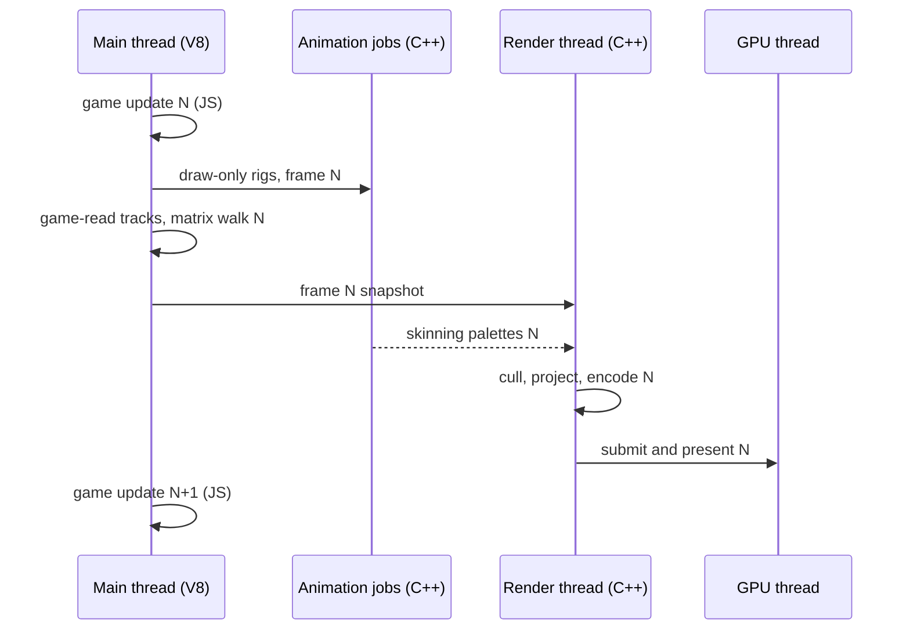

# PRD-610 — The native engine wins on real games

**Status:** PARTIAL
**Priority:** P1 — the owner bar is 2x to 3x faster than three.js on Midway; the provisional matched ratio is 1.18x to 1.49x (AC-15 open) and the levers are open (AC-20, AC-16 to AC-19).
**Complexity:** 8 (HIGH)
**Owner:** João
**Depends on:** PRD-573 (the epic; this PRD closes its final-tier v1.10 box and rides PR #493)

**Release (owner, 2026-10-15):** v1 ships with this PRD PARTIAL. Its open boxes stay open and none is ticked by the release. The bulk-reader experiment (`TN_JS_MATH_BULK_READ`) is reverted: instructions fell 0.77%, timing was inconclusive.

**Current focus (re-plan 2, 2026-10-14):** finish AC-15 (three qualified pairs), then AC-20 first. The matched yardstick shows that the player runs about half of Chromium's instructions per frame at about 60% of its IPC. The stall gap is now the largest lever; the time-share levers (AC-16 to AC-18) follow on top of it.

## Context

On 2026-10-13 the owner played Midway (`midway-open-pacific`) on the native desktop player, on the Wasm engine in Chromium and on three.js in Chromium. The native player felt like about 20 FPS with a laggy HUD. Three.js ran at 51 FPS. Phase 1 removed the main cause: in free-run the player flushed a full core frame on every catch-up tick, up to five per drawn frame.

From 2026-10-13 to 2026-10-14 a Codex lane of about 80 sub-agents worked the old AC-3 to AC-13. The owner warned that its last iterations moved in the wrong direction. Its full evidence log stays in git history (this file at `8cbef6f2a`). This re-plan keeps its results and drops its proxy targets.

### Measured reference

Package `pkg-ac3-calibration-20261014T135316Z-t`, runs `t` and `t2`, 1,000 active frames each, parity PASS, Xvfb:

| Metric | Native desktop player | Three.js in Chromium |
|---|---|---|
| Main-thread CPU per frame | 7.05 ms (JS and the C++ it calls 4.93, render 1.78, other 0.33) | not measured |
| Main-thread instructions per frame | 18.15 M | not measured |
| Active wall per frame | bound by Xvfb presents | 10.65 ms, Vite dev server |
| HUD round trip p95 | 26 ms (target 16.7 ms) | in-page DOM |

### The yardstick is not matched

1. The three.js arm runs on the Vite dev server (`flight.sh`: `pnpm dev`), with the React development build and dev module transforms. The desktop player runs a production bundle.
2. The dashboard ratio divides browser active wall time by native main-thread CPU time.
3. The arms can run different engine commits. `install.sh` packs the browser arms at one time, and the player bundle is built at another.
4. Core's `FixedStepLoop` runs up to five updates per frame. On the wall clock, a slower arm does more simulation per frame.
5. The browser main thread also runs the React HUD. The native HUD runs in a WebKit process that took 2.3 times the player main thread's CPU samples. Main-thread CPU favors native, so process-tree CPU must sit beside it.
6. The player embeds V8 13.1.201.22 (late 2024). The Chromium under test runs a newer V8.

A production build makes the three.js arm faster, so the matched ratio can be lower than 1.51x.

### Matched baseline (provisional, 2026-10-14)

One pair at engine `db22a6230`, private Xvfb, NVIDIA/Turing, lockstep windows of 1,000 frames with one update and one render each, parity PASS. Runs `ac15-db22a6230-{a1-legacy,b1-desktop}` under `~/.cache/tmp-tn/midway-runs/`. The flight post-check refused this pair because of a checker defect (see Decisions), so these numbers are not yet a qualified AC-15 row.

| Pose | three.js main thread | Player main thread | CPU ratio | Instructions per frame (three.js / player) | IPC (three.js / player) | Process-tree CPU per frame (three.js / player) |
|---|---|---|---|---|---|---|
| Takeoff | 8.85 ms | 7.48 ms | 1.18x | 41.3 M / 20.5 M | 1.06 / 0.64 | 64.9 / 102.2 ms |
| Cockpit | 10.20 ms | 7.84 ms | 1.30x | 51.1 M / 22.7 M | 1.11 / 0.67 | 64.0 / 108.0 ms |
| Rear gunner | 14.58 ms | 9.82 ms | 1.49x | 77.2 M / 29.8 M | 1.18 / 0.70 | 69.9 / 105.3 ms |

The player executes 2.0x to 2.6x fewer instructions per frame, but each instruction costs about 1.6x more cycles. At Chromium's IPC the same player work would take about 4.5, 4.8 and 5.9 ms (2.0x, 2.1x and 2.5x). Both arms ran at 4.3 to 4.5 GHz user-mode cycles per CPU-second, so frequency does not explain the gap. The player's process tree burns about 100 ms of CPU per frame, mostly in the two WebKit HUD processes, against 65 ms for the whole Chromium tree.

Known IPC differences: the embedded V8 13.1.201.22 is built with `v8_enable_pointer_compression=false`, `is_official_build=false`, `use_thin_lto=false` and `chrome_pgo_phase=0` (`third_party/v8/gn-args_Linux.txt`); Chromium ships pointer compression, ThinLTO and PGO on a newer V8. The engine C++ is `-O3` Release. Cache and SMT interference from the HUD processes and the GPU thread is not measured yet.

### Where the player's main thread goes

V8 CPU profile of package T: 22,277 samples at 200 µs over 1,010 frames. JS-entered time is about 4.4 ms per frame, so 1% is about 0.044 ms. The independent mixer meter (14.1% of main-thread CPU, about 1.0 ms) agrees with the animation row.

| Owner | Share | About ms per frame | Main items |
|---|---|---|---|
| Core calls into C++ | 38.1% | 1.68 | animation mixer 20.4%, matrix walk 10.1%, projected cull 5.6%, stride and foot plant 2.1% |
| Game JS | 19.1% | 0.84 | Midway code; two per-frame `filter` passes (radio queue, AI group) take 9.9% |
| Game calls into C++ | 9.6% | 0.42 | `updateDamageVisuals` 3.3%, `animateDouglas` 2.3%, three `update` methods 2.8% |
| Engine-owned JS | 12.9% | 0.57 | flight model 3.6%, HUD bridge 2.5%, frame loop 1.8%, audio pose sync 1.6%, player shim 1.5%, animation player 1.3%, playtest hooks 0.6% |
| Shim and harness calls into C++ | 5.2% | 0.23 | `traverse` 1.9%, audio panner and gain 1.0%, playtest observation 0.8%, `parent` 0.7%, uniform `set` 0.6%, attributes 0.3% |
| Root native and the rows below the top 60 | 15.1% | 0.67 | not attributed |

### Can work leave JS for C++?

Most JS-entered time is already C++. The core rows (38%) are C++ work that one JS call starts, so moving the caller into C++ saves only the call. That work must shrink or leave the main thread (AC-16, AC-17).

Engine-owned JS and shim crossings take about 18% (about 0.8 ms). The candidates:

| Piece | Share | Move | Box |
|---|---|---|---|
| Animation player step: fades, `#syncStride`, `footPlantSpeed`, one `mixer.update` per rig | 3.4% | into the C++ mixer, one call per frame for every player | AC-17 |
| Player shim: `traverse` iterator, `parent` getter, attribute `Proxy`, uniform `set` | 4.9% | keep `parent` and children on the JS side, return `traverse` lists in one call, cache attribute names per geometry version | AC-18 |
| Positional audio and listener pose sync | 2.5% | the native audio backend reads the node's world matrix | AC-18 |
| HUD bridge: `JSON.stringify` per publish, `assertSendable` | 2.5% | validate a message shape once, skip unchanged state | AC-18 |
| Flight model `core/src/flight.ts` | 3.6% | stays JS (see Decisions) | — |
| Frame loop; playtest hooks | 1.8%; 1.4% | stay; both arms pay the playtest hooks | — |

Game JS (about 1.3 ms with its C++ calls) cannot move without game edits. Two engine levers reach it: a newer embedded V8, and cheaper C++ behind `updateDamageVisuals` and `animateDouglas`.

### Tried and rejected

Do not retry these without a new reason. Each result is the A/B against its baseline.

| Experiment | Result |
|---|---|
| Shared reflection record cache (two tries) | +2.8% instructions |
| Animation on a worker with per-track jobs (old AC-12) | +78% instructions, +136% CPU, 39,144 jobs per window |
| World-dependency revision | +0.27% |
| Squared-threshold cull | +0.15% |
| Empty-subtree cull skip | +31.8% cull CPU |
| Subtree and manual-root prototypes (O, P) | +2.2% to +2.3% |
| Join batch (N) | +0.72% |
| Cap support (U) | +2.6% |
| Bulk reader | −0.77% instructions, timing inconclusive |
| Copy elision | −0.32%, synthetic only |
| Shared keyframe seek | not repeatable |
| ABI `holdsObject` (EXP3.2) | 0% |
| Lazy pose | stopped: mutable track spans and aliases |
| FIFO against Immediate present | neutral |
| View-argument handles (old AC-11) | neutral at about 1,074 calls per frame |
| WPE HUD backend | p95 32 to 41 ms |
| HUD state snapshot | p50/p95 23/29 ms against 16/27 ms |
| CDP endpoint retries (old AC-6) | rAF crosses the endpoints |
| V8 GC prologue `promote()` skips the full wrapper walk while the ownership epoch is unmoved (2026-10-14) | Flat on the second off/on pair; instructions unchanged. Counter run: 249 GC prologues in 8,400 frames (one per 34 frames) over 26,447 wrappers, so about 0.04 ms per frame. The call-graph profile's 4.9% came from load-time GCs inside its window |
| Crossing path reuses decoded numeric and handle arguments (2026-10-14) | Projected 0.04 to 0.07 ms per frame; A/B flat. Measured 1,725 crossings per frame: `visible` 315, `count` 152, `getX`/`getY`/`getZ` 327, `time` 109, `setEffectiveWeight` 104 |

Kept: one frame per present (AC-1); the GPU thread for submit, blit, acquire and present (main-thread CPU −19%, every B beat every A); Stack 4 (−9.3% instructions); the T calibration (18.15 M instructions per frame); reflection walk reuse (−3.7%).

Lessons: single-run millisecond verdicts on a loaded host misled. Small render trials moved the total by less than the noise. Fine-grained threading cost more than it saved. The profile is flat, so only structural levers can reach 2x.

## Solution

Goal: on matched work, the player's main thread uses at most half the CPU per frame of the three.js renderer main thread (2x). The design budget aims at 3x.

1. **One honest yardstick (Phase 2).** Production builds of one engine commit. A lockstep window: one update and one render per frame on both arms. Per-thread CPU and instruction counters for each arm's main thread, with process-tree CPU beside them.
2. **Structural levers, largest first (Phase 3).** Render prepare and encode leave the main thread. Animation leaves the main critical path. Engine-owned JS moves into C++ or shrinks.

Budget from 7.05 ms. The three.js denominator moves after AC-14, so AC-15 re-baselines it.

| Lever | Main-thread cut | Main thread after |
|---|---|---|
| Render thread: cull, project, encode (AC-16) | −1.3 to −1.7 ms | 5.4 to 5.8 ms |
| Animation off the critical path (AC-17) | about −0.65 ms (1.05 to 0.4) | 4.7 to 5.1 ms |
| Engine JS into C++ or smaller (AC-18) | about −0.25 ms (0.45 to 0.2) | 4.5 to 4.9 ms |

That is 2.2x to 2.4x against 10.65 ms. 3x (3.55 ms or less) needs about 1 ms more: a flat matrix walk (0.44 ms today), a newer V8 for game JS, cheaper game-called C++, and the 15% of samples not yet attributed. A smaller three.js denominator after AC-14 raises the bar for both targets.

Risks:

- A render thread adds a pipeline stage. Keep one frame in flight in total, and measure input latency against today.
- A game read of an animated bone before the job join must see frame N. Tracks the game reads (2.0% of evaluated tracks) evaluate on the main thread before the read.
- Each native fast path keeps the TS path for the web, as `__tnUpdateMatrixWorld` does today. A spec or conformance case proves that both paths give the same result.
- Update-rate optimization (URO) changes what a hidden rig shows when it becomes visible. It needs the PRD-573 v2.3 safeguards and João's name for `AnimationMixer.updateRate`.

## Acceptance Criteria

The boxes are under the execution phases. Phase 1 holds AC-1 and AC-2 (done). Phase 2 holds AC-14 and AC-15. Phase 3 holds AC-20, AC-16, AC-17, AC-18, AC-5 and AC-19. AC-3, AC-4 and AC-6 to AC-13 are retired (see Decisions). New IDs start at AC-14, so dashboard run names stay unique.

## Blocked on

- João plays Midway on the native desktop player on the real display (`:0`) and confirms it feels at least as smooth as three.js in the browser — unblocked by João.

## Integration Ledger

| Capability | Reachable consumer/trigger | Replaces / disposition | Evidence |
|---|---|---|---|
| One frame per present | `tn-native-engine-player-v8` free-run loop: `run.cpp` → `core-host.mjs` `flushFrames` | per-tick flush in free-run removed; paced path kept | AC-1 |
| Matched builds | `scripts/midway-bench/flight.sh` browser arms | `pnpm dev` server replaced by a production build; a dev server or an engine-commit mismatch is refused | AC-14 |
| Matched counters | `flight.sh` → `kpis.ts` → `dashboard.ts` headline | wall-against-CPU ratio removed | AC-15 |
| Render thread | `run.cpp` frame → render thread → GPU thread | `database.render` leaves the main thread | AC-16 |
| Animation off the critical path | `AnimationPlayer.update` → C++ mixer step and jobs | per-rig `mixer.update` calls and JS stride on native | AC-17 |
| Engine JS in C++ | `three-native/src/audio.ts`, `core/src/ui-state.ts`, `core/src/ui-bridge.ts`, player shim `core-three.mjs`, `three-native/src/object-surface.ts` | JS pose sync, per-publish validation, per-read crossings | AC-18 |
| HUD under one frame | WebKit overlay snapshot mailbox → frame blend | — | AC-5 |
| Final-tier result | `pnpm dashboard` hero | R5 hero becomes the cheap-tier row | AC-19 |

## Decisions

- 2026-10-15 (AC-20 thread placement — opt-in for v1): no placement policy passed the campaign keep rule (E1 top-ranked core REJECT, E3 L3-domain split REJECT, E2 last-ranked core pair INCONCLUSIVE: 2 of 3 valid pairs, both faster at every pose, margins 14 / 29 / 33% on a host with other lanes at load 6 to 33). v1 ships `TN_PLAYER_MAIN_CORE` unset = off. Evidence: `PERFORMANCE-LEARNINGS.md` 2026-10-15 entries.

- 2026-10-15 (metric definition): the headline is `median(legacyCPU_i / candidateCPU_i)` over matched pairs, while the detail table independently reports each arm's median CPU, so dividing those medians can legitimately differ; the current eligible cohort is `e3271a19c`, desktop provisional and web collection-qualified with root execution review still pending.

- 2026-10-15 (Wasm symbol provenance — NO-GO): served 4199 Wasm SHA `8e163ed1cbac94f3c9e37b041450f0e69998fa58de86ef35825c0db3e515564b` has no name/custom sections; original profiles retain anonymous function indices. Existing Ninja link plus `--emit-symbol-map` completed in scratch in 10 seconds, exit 0. Served code SHA `0f9141feab6e6347cf210f6f01f7ce923f01f010ae4c09b2e6dd1dafc4002ffb` differs from relink `c953e430bb038c56c3a7c630bbb2fcb7dc6373e2106c8d0f009e4b15ff780d81`; function-index identity is rejected. Receipt: `~/.cache/tmp-tn/ac19-4199-symbol-link/symbol-provenance.json`. No acquisition or acceptance; native 2x/Wasm 1.5x remain unmet. Next: resolve exact symbol provenance; original stop 12:41Z, no further jobs. Distinct unchanged-link recovery reproduced frozen full SHA `8e163…` byte-for-byte in 9 seconds. Matching intermediates are stripped; named intermediates have different indices. Recovery parked after two methods. Proof: `~/.cache/tmp-tn/ac19-4199-retained-link/symbol-provenance.json`. Future cohorts must retain final optimized function maps at build time.

- 2026-10-15 (next experiment, design only): dirty-subtree transform skipping is NO-GO until mutation admission is proven: the local dirty bit does not propagate to ancestors, so a clean parent cannot establish clean descendants. Escaped/untracked transforms and retained raw aliases require conservative eager ancestor traversal. Owned seams would be `scene/object3d.{h,cpp}`, `animation/property_binding.cpp` (already calls `markLocalTransformDirty`) and the existing V8 transform-binding seam; establish complete setter/alias/animation invalidation before admitting skips. Preserve synchronous world queries, forced updates, manual matrices, hierarchy changes, deferred Bones, virtual/after-update callbacks and reflection-camera behavior. Nearest scene, animation and reflection fixtures must prove changed descendant state remains current; promotion requires three qualified alternating CPU pairs at every pose with no instruction regression, plus a fresh independent NEUTRAL-or-better visual judgment of two BEFORE/two AFTER captures per pose. The measured scene-owner exposure is approximately 20–25% of main CPU, not savings, and cannot alone promise 2x; broader mutation interception means reject this bounded trial. No implementation or acceptance box is completed.

- 2026-10-15 (animation direct-buffer trial): REJECT the four-line Float64 quaternion result-buffer optimization. Takeoff / cockpit / rear gunner instructions A→B are 20.557616→20.564595 / 22.826892→22.771194 / 30.068881→30.066894 M/frame (+0.03395% / −0.24400% / −0.00661%): tiny, mixed direction, failing the declared all-pose instruction gate. Both arms pass 3/3 assertions on NVIDIA with three exact 1,000-update/render windows. Raw main-thread CPU is 12.399665→9.115791 / 14.073602→7.868920 / 16.554421→10.094087 ms/frame, but CPU is INCONCLUSIVE: window loads A 15.02/17.38/15.71 and B 16.47/13.57/8.30 violate the load guard. Raw runs remain in `~/.cache/tmp-tn/screens/interp-direct-{base,on}-1/`; the dashboard now contains 191 runs; both trial rows remain excluded from qualification. The exact production/test patch is preserved as original scratchpad `interpolant-direct-rejected.patch`; frozen baseline/candidate binaries and their separate host/game receipts remain intact. Only the two owned interpolation files were restored; baseline player rebuild and nearest interpolant/mixer ctests pass 2/2. Before restoration, 25 pinned reference cases (3,763 values) and 45 exact Float64 output/alias evaluations passed. No second pair, runtime visual acceptance or speed claim; AC-17/19/20 remain open.

- 2026-10-15 (Vector3.x V8 Fast API wrapper — REJECT readiness): exact V8 13.1.201.22 source supports pending-exception propagation and permits allocations by default, but CFunction registration requires a nonconstructible function. Preserve the existing constructible public setter: its characterization passes. A constructible JS wrapper with captured intrinsics preserves the tested descriptor/name/length/prototype, construction/new.target, all-argument forwarding, borrowing, type/error/handle validation, NaN/signed-zero and GC behavior; visible JS source was explicitly accepted. However, the required optimized normal numeric window reports fast0/slow1 both with dynamic argument forwarding and after the distinct constant-arity numeric branch retry. The optimized invalid-handle check does reach CFunction; this does not establish reliable normal dispatch or a runtime win. Stop without further retries; restore owned adapter source/header and prototype tests, retaining only constructor characterization. Rebuilt restored player/test targets and focused test PASS 1/1. Trial patch `/tmp/prd610-fast-wrapper-constant-trial.patch`; logs `/tmp/prd610-fast-wrapper-{red,focused-green,reopt-tests,constant-tests,restored-tests}.log`. No timing, integration or speed/parity claim; AC boxes stay open.

- 2026-10-15 compose rollback complete: restored only `object3d.h/.cpp` and `scene_hierarchy_test.cpp` from `1766f64ac^`; trial source/results preserved on local `perf/prd610-compose-trial` at `09a05e079`. Rebuilt player/test targets; 14 scene + 2 callback/reflection-reuse + 27 V8/player checks PASS, compile-time node-size check returns 440 bytes. Logs `/tmp/prd610-compose-restored-*`; no GPU acquisition or new performance/parity claim.

- 2026-10-15 (compose-cache performance candidate — NO-GO): stop after one pair; no second timing pair or promotion. CPU is INCONCLUSIVE under the predeclared load guard: baseline windows all exceed load1 ≤ 12. The exploratory instruction reduction of only 0.13–0.51% is insufficient to justify +240 bytes per Object3D (440 → 680, +54.5%). Neither the raw CPU improvement nor load/IPC differences establishes a causal performance explanation. Preserve trial source/results on local `perf/prd610-compose-trial` before reverting only the cache implementation; AC boxes remain open.

| Compose pair 1 pose | CPU ms/frame A → B (guard failed) | Instructions M/frame A → B | Instruction change | Cycles M/frame A → B | IPC A → B | Host load1 A → B |
| --- | --- | --- | --- | --- | --- | --- |
| takeoff | 12.500 → 7.895 | 20.470 → 20.442 | −0.13% | 50.020 → 31.749 | 0.409 → 0.644 | 15.44 → 5.79 |
| cockpit | 12.476 → 8.836 | 22.807 → 22.724 | −0.36% | 50.873 → 35.878 | 0.448 → 0.633 | 18.44 → 5.77 |
| rear | 14.545 → 10.897 | 30.202 → 30.049 | −0.51% | 59.882 → 44.520 | 0.504 → 0.675 | 16.00 → 6.11 |

Both wrappers exit 0, actual reports PASS 3/3, 4,398 reported frames, fixed-step, NVIDIA RTX 2080/turing 615.78.08; all governors performance. All six windows contain exactly 1,000 frames/updates/renders and tick difference; corresponding ranges match 1490–2490 / 2492–3492 / 3494–4494. Admission load1 passes 7.11 → 7.68 for baseline and 7.77 → 6.26 for candidate, each 60 seconds apart; later measured load invalidates CPU interpretation as declared. No capture-manager bypass. Tree CPU A → B: 133.98 → 107.76 / 133.69 → 115.38 / 142.64 → 116.36 ms/frame. Raw sources `~/.cache/tmp-tn/screens/compose-load-{base,on}-1/run.log`, original PNGs under `art/`; excluded dashboard rows, API 184 at extraction. Frozen binary SHA256 matches A `219021b7a564b0c58288d59c13b620c6332a43bec66d8f0859343ca0a7c8495d`, B `c2aad5f85f4f299a6bd6f9bbb0c5e9dceed9ef9904192679d0ebd415a9b826ef`; same nine nonbinary files. No qualified parity or visual-judge claim. No existing compose cycle was found in `cycles.jsonl`; do not invent a duplicate ledger entry.

- 2026-10-15 (compose-cache acquisition admission re-plan, before data): original `compose-gated` watch exited 75/PARKED after 20 observations over 19 minutes, with a live capture holder throughout; neither arm launched and no timing row was generated. Requiring an empty capture queue before joining its serializer can starve this lane. Revised one-shot `compose-load-{base,on}-1` admission requires two load1 ≤ 8 observations 60 seconds apart, then joins the unchanged capture manager even when occupied. No bypass or other-owner interruption. Maximum CPU watch 20 minutes per arm and 50 minutes overall including queue/execution; reserve at least four execution minutes and cap capture wait at the remaining budget, at most 900000 ms. CPU interpretation requires every actual window load1 ≤ 12, performance governors and exact 1000 frame/update/render counts; otherwise CPU is INCONCLUSIVE and instructions reported separately. No second pair without a decision, no equivalent retry after a parked gate/timeout/budget stop.

- 2026-10-15 (AC-20 GCC IPO — INCONCLUSIVE CPU): corrected same-source non-IPO and IPO arms (`18839e526`) completed one exploratory pair. Generator ODR repair (`static inline` lookups) is KEEP for correctness independently of performance; SDL remains non-LTO for its existing objcopy rewrite. Standard CMake IPO stays optional, not enabled by default. All three instruction counts improve, but CPU worsens in two poses; no second pair, integration or qualified speed/parity claim.

| IPO pair 1 pose | CPU ms/frame A → B | CPU change | Instructions M/frame A → B | Instruction change | Cycles M/frame A → B | IPC A → B | Host load1 A → B |
| --- | --- | --- | --- | --- | --- | --- | --- |
| takeoff | 9.712 → 13.660 | +40.65% | 20.435 → 19.648 | −3.85% | 38.444 → 54.006 | 0.532 → 0.364 | 8.00 → 10.70 |
| cockpit | 11.108 → 14.020 | +26.22% | 22.731 → 21.952 | −3.43% | 44.210 → 55.455 | 0.514 → 0.396 | 7.18 → 23.61 |
| rear | 13.594 → 12.445 | −8.45% | 29.990 → 29.226 | −2.55% | 54.244 → 49.597 | 0.553 → 0.589 | 7.90 → 24.98 |

Both wrappers exit 0, actual reports PASS 3/3 with 4,398 reported frames, fixed-step, NVIDIA RTX 2080/turing (615.78.08), all recorded governors performance. Every window has exactly 1,000 frames/updates/renders and tick difference. Attachment leaves a one-tick arm offset: baseline starts 1490/2492/3494; candidate 1489/2491/3493. Process-tree CPU A → B is 101.73 → 134.37 / 105.87 → 124.06 / 113.36 → 107.52 ms/frame. Higher load and changed IPC confound CPU attribution; no causal contention explanation is established. The every-candidate-below-every-baseline CPU requirement already fails; instruction reductions are exploratory, not qualified. Explicit `TN_MATERIAL_DIAGNOSTICS=0 TN_RENDER_THREAD=0`; game/assets/UI unchanged. Raw reports: `~/.cache/tmp-tn/screens/ipo-fixed-{base,on}-1/run.log`, excluded dashboard publication; API 182 runs at extraction. Build identity: `packages/runtime-native/build/tn-engine-ui-ipo/trial-fixed-identity.json`; failed original candidate/logs preserved. AC-20 and other existing open boxes remain open.

- 2026-10-15: Web visibility-cache recovery completed two exploratory pairs: four PASS reports on NVIDIA/turing with exact 1,000-frame/update/render windows. Every candidate beats every baseline on instructions at all poses; CPU fails that rule at all poses. Pair 2 candidate has higher host load and lower IPC, leaving CPU attribution unresolved. Dashboard: 179 runs. Cycle closed INCONCLUSIVE; no third retry, integration or qualified parity claim. Detailed table: PRD-612, local result commit `0b4b321ba`.

- 2026-10-15 (AC-20 pointer-compression prototype): a one-line CMake cache path permits an isolated desktop V8 dependency root; shipped dependencies/defaults remain unchanged. The same V8 13.1.201.22 monolith uses pointer compression, shared cage and 31-bit Smi definitions with matching headers, sandbox off. Isolated Release/GCC/Ninja 600-step build, 27 focused adapter/player import/GC checks and startup smoke pass. An initial broad ctest filter also selected four unbuilt fixtures; that failed attempt is retained, not counted green. Candidate binary SHA256 `e4b637dd4966975ff00e6576a4c2e40579525687a05d12a8096924466ed97491`; staged `~/.cache/tmp-tn/player-v8pc` keeps the baseline game/assets/UI unchanged. Build/test/identity logs are in `packages/runtime-native/build/tn-engine-ui-v8pc/`. No timed A/B, valid packaging receipt, parity or speed qualification yet; AC-20 remains open.

- 2026-10-15 (owner requested visible progress): ingested five completed raw screens into the existing dashboard with explicit timing-exclusion markers; their logs remain byte-identical. The page now shows the newest five complete exact-window acquisitions above historical ratio headlines, including acquisition completion time, CPU/instructions by pose and unqualified status; sampled rows display diagnostics without speed numbers. Live API and browser show 172 runs, recent rows and unchanged headline selection; dashboard suite 147/147, Biome and diff checks pass, with no browser console errors. This displays current evidence without promoting exploratory screens or ticking performance ACs.

- 2026-10-15 (steady owner attribution before AC-20 trial): `perf-rt-jit-off-1` passes three runtime assertions and all three exact 1,000-update/render windows with render thread off and `TN_V8_FLAGS=--perf-basic-prof`. The player map is archived beside the recordings. Self-cycle symbol-prefix grouping: engine/host C++ 61.02 / 64.19 / 67.23%, V8 runtime 19.57 / 15.99 / 13.78%, V8 JIT 10.43 / 10.02 / 8.91%, unresolved 1.13 / 1.80 / 1.32% (takeoff / cockpit / rear gunner); zero lost samples. Groups are heuristic because engine and V8 runtime share a monolith. Most cycles remain in engine/host C++; pointer compression is a bounded candidate, not evidence that the whole IPC gap belongs to V8. Diagnostic windows remain excluded from qualification. Raw profiles/map/reports: `~/.cache/tmp-tn/screens/perf-rt-jit-off-1/profiles/`.

- 2026-10-15 (exact-window stack sampling): the existing Linux CPU-window collector accepts `TN_PLAYTEST_CPU_PROFILE_DIR`, starts `perf record` disabled on the owned main TID with a separate FIFO/ACK pair, enables only around the existing 1,000-tick advance, disables independently on failure, and reaps both children. Existing/empty output fails closed. Sampled windows carry `profile`; the dashboard excludes both their CPU windows and the entire run from qualification. Focused red/green is eight new-feature failures followed by 179 passing tests; playtest typecheck, build/declarations/publint, changed-file Biome (17 warnings), diff checks and independent review pass. Real diagnostic `perf-rt-exact-off-1` passes three assertions and all three exact 1,000-update/render windows, with 1,769 / 2,106 / 2,847 samples, zero lost samples and decoded callchains. Current-source qualification also rejects that real report under a non-`perf-` tag. `RenderDatabase::project` contributes 6.10% / 5.41% / 6.06% self cycles; unresolved shares remain 7.11% / 7.96% / 9.25%. This first validation did not enable V8 JIT maps, so unresolved samples are not assigned to JS. Raw recordings/reports are under `~/.cache/tmp-tn/screens/perf-rt-exact-off-1/profiles/`; `--no-inline` avoids expensive inline expansion during decode. AC-15/AC-20 remain open: this is an instrument, not matched acceptance pairs, complete owner attribution or a speed improvement.

- 2026-10-14 (lead, re-plan 2; João: "1.5 to 2x seems close enough ... pretty sure we can beat 3x in a week"): the provisional matched ratio is 1.18x, 1.30x and 1.49x. The Solution budget (−2.2 to −2.6 ms from 7.05 ms) reaches about 1.7x to 1.8x at takeoff against the matched 8.85 ms, so it cannot reach 2x alone. The matched counters show a larger lever: the player runs half of Chromium's instructions at about 60% of its IPC. AC-20 (IPC 1.0 or more) comes before AC-16. With AC-20 at Chromium's IPC (about 4.5 ms at takeoff) and the Phase 3 levers on top, 3x (2.95 ms or less at takeoff) is the design target. Two checker defects were fixed on the way: the player drew one automatic frame after each mailbox poll inside the window (`d790e5cfb`, the runner now holds automatic renders), and the window ticks came from the game clock, which led the host's driven tick by 60 (`e3271a19c`, the host now brackets each window with `TN_PLAYER_RENDER_HOLD` markers and the checker reconciles frames per bracket). A debug repro confirmed one held `advance(1000)` per window with no draw inside.
- 2026-10-14 (AC-15 collector repair, incomplete): the first matched flight rejected multiple Chromium renderers. Page-target tracing now maps the actual root frame to its renderer PID; browser-target trace metadata was empty. The subsequent actual probe exposed an incorrect `/proc/comm == CrRendererMain` requirement: Chromium deliberately keeps the Linux leader process name, while RendererMain runs on that leader ([upstream implementation](https://chromium.googlesource.com/chromium/src/+/main/base/threading/platform_thread_linux.cc)). The collector now uses the verified renderer leader TID and retains process-tree/start-time identity checks. A fresh actual Chromium 151 private-Xvfb probe passes; an independent 1.5-second JS loop adds 1.46 CPU-seconds to that renderer and zero to the spare. Parent focused suites pass 193/193, playtest typecheck passes, and changed-file Biome passes with 14 warnings. Window timestamps and a conserved source-map attribution helper are present; actual calibrated Midway owner rows, matched pairs and parity are still unverified. AC-15 remains open.

- 2026-10-14 (dashboard UI): Sonnet 5.5 High reproduced horizontal page overflow from the wide matched-counter table and intrinsic grid sizing. Reused the existing table scroll container and shrinkable grid tracks; all 135 focused dashboard tests pass. Actual browser checks pass on ports 8765 and 8767 at 1600×900 and 900×900, with clean consoles and pending metrics preserved. Fresh read-only visual judge: IMPROVEMENT at both widths. AC-15 remains open; no speed result is claimed. On 2026-10-15, a fresh nonauthor judge returned IMPROVEMENT for two BEFORE/two AFTER headed NVIDIA/Turing captures at 1440×1000, with no overflow or console errors (`~/.cache/tmp-tn/ac19-dashboard-judge-4bc99e2f2`); new completion diagnostics remain unqualified and CPU headline scores unchanged.

- 2026-10-14 (verification): stable `pnpm typecheck` passes after two behavior-preserving dashboard typing fixes. Two introduced regex lint errors are fixed; changed-file lint passes with warnings, and the final focused Midway/bundler suites pass 120 tests. The earlier full `pnpm lint` reported 213 errors and 1,492 warnings; remaining global diagnostics are not fully attributed. The unit run was interrupted (exit 130) after two `browser-math.spec.ts` failures. Those assertions still required the old eighth-per-frame GC sweep; commit `9ac452167` explicitly shipped fresh-wrapper checks plus a sixty-fourth-per-frame settled sweep. Only the two stale tests were corrected, retaining immediate fresh checks, bounded settled coverage, dropped-wrapper exclusion and release within two passes; the focused math/collect suites pass 20/20 (2026-10-14). Neither full lint nor the full test suite is claimed green.

- 2026-10-14 (AC-15 instrumentation, incomplete): Linux collection brackets exact 1,000-update/render windows with FIFO-controlled thread perf counters, schedstat runtime, process-tree CPU, identity checks, load and governors. A real perf plumbing smoke passed after handling this host's NUL-terminated ACK and intentional SIGINT stop; it is not a game benchmark. Exact start/end ticks reconcile native completed host-render records. The parent rerun passes 151 collector/dashboard tests; the rebuilt player passes all 8 profile tests, including both CLI forms, write failures and SIGTERM output. Updated dashboard preview `/api/midway` on port 8767 shows zero qualified pairs and pending ratios, retaining historical runs. Actual matched Midway pairs, parity, visual review and profile attribution remain unrun; AC-15 stays open. Initial repack stopped at the TypeScript 6 declaration builder: tick guards did not narrow through the inferred never-returning arrow. An explicit return from that failing branch fixes the declaration contract; focused playtest build, DTS and publint pass. No packs were accepted from the failed preparation.

- 2026-10-14 (AC-15 foundation, incomplete): browser bridge driving now places one successful scene update and primary world render inside each measured frame, suppressing queued automatic draws after startup; direct simulation-only driving and native host-owned rendering remain explicit. Parent rerun of source-focused loop/playtest/resource suites passes 68/68. The first native fixture runs launched the older `build/tn-engine` player and failed cull/tick assertions; the already rebuilt `build/tn-engine-ui` player passes the 2,500-driven-frame tick check and the free-run fixture (36 frames, one callback per draw, two projected-cull and mixer calls per frame, CPU instruction records). This is fixture proof, not a repackaged Midway CPU window or visual verdict. OS-counter collection, dashboard ingestion and paired qualification remain open.

- 2026-10-14 (execution): AC-15 discovery found that browser `fixedStep` advances simulation separately from rendering, while the native driven-clock contract already checks one host update/render per tick. Couple browser updates and renders inside the measured frame scope before collecting 1,000-frame pose windows; advancing before `stepFrame` would omit simulation from its budget. Suppress duplicate automatic draws only after startup readiness. Thread-attached `perf` instruction probes succeeded on this host. No lever verdict has been made.

- 2026-10-13 (João): benchmarks have two tiers. Cheap benchmarks (the R-ladder) iterate, and final benchmarks (Midway, then other real games) decide. This PRD's speed ACs are final-tier only.
- 2026-10-13 (lead): out of scope here, for a follow-up PRD if they still matter after AC-6:
  - the 2D canvas `globalCompositeOperation` (Midway's wear scratches paint dark specks)
  - a same-frame press and release on HUD buttons
  - the `captureMouse` relative-motion proof
  - a boot warning listing absent web APIs
  - placard text metrics
  - the playtest runner failing to stop the player (exit 2 after its screenshots)
  - the `--memory` control fix in `profile:wasm-page`
  - Wasm memory of 1.9 GiB
  - web startup of 40 s against 17 s
  - ne-compat's matrix of other games
- 2026-10-14 (lead, re-plan at João's request: "you have to edit the PRD 610, i'll re execute it"; goal: "a path for 2-3x native speed compared to web threejs"):
  - Phase 2 fixes the yardstick before any lever is judged, because the old ratio mixes instruments and builds. The 2026-10-13 out-of-scope list now waits for AC-19, not AC-6.
  - Retired unticked boxes, with their evidence in git history at `8cbef6f2a`. AC-3 (1,500 visits) and AC-4 (cull below 2%) were proxy targets, and AC-16 moves the cull off the main thread. AC-10, AC-11 and AC-12 were tried (see Context). AC-6 and AC-13 become AC-19 on the matched yardstick, and AC-8 folds into AC-15 and AC-19. AC-7 (the web Wasm engine against three.js) leaves this PRD: PRD-573 v1.10 does not need it, and a follow-up PRD owns it.
  - AC-9 landed (GPU thread, −19% main-thread CPU). Its open byte-identity proof moves to the fixed-step capture pair of AC-16.
  - AC-5 stays, because PRD-573 v1.10 needs the HUD round trip under one frame.
  - AC-17 is not a retry of the rejected per-track worker. It cuts work first (URO, unread tracks), then uses per-rig jobs for draw-only tracks.
  - The flight model (`core/src/flight.ts`, about 0.16 ms) stays JS. It is numeric code that V8 compiles well, and a C++ copy doubles the implementation for 0.1 ms or less.
  - Moves land in the existing C++ objects (mixer, audio backend, scene). A new language adds a call boundary, and the boundary is the cost being cut.
  - Measurement ladder: tier 0 is a ctest counter. Tier 1 is one lockstep window, instructions per frame. Tier 2 is three alternating pairs per pose, parity PASS, and the visual judge for any lever that can change pixels. Keep a lever only when every B beats every A. Make no single-run millisecond verdict on a loaded host.
- 2026-10-14 (owner: "my goal is native 2-3x faster than web threejs. WASM ThreeNative 1.5 faster than ThreeJS (regular)"; "we need to optimize both native and wasm web in parallel"): every matched pair also runs the web Wasm arm (C, graded on the same A and ref), and the dashboard shows both arms. [PRD-612](../native-engine/PRD-612-web-wasm-engine-beats-threejs-on-midway.md) owns the web Wasm 1.5x target. Pair 1 at `e3271a19c` (both arms parity PASS) reads native 1.24x / 1.05x / 1.31x and web Wasm 1.02x / 0.95x / 1.26x; it is one pair of three, so AC-15 stays open.
- 2026-10-14 (owner: "we need conventions, keep godot naming style"): URO ships as a convention, on by default, with its override on the same object in Godot vocabulary, camelCase: `AnimationMixer.updateRate` (Godot style `update_rate`). This removes the naming blocker for AC-17.

## Execution Phases

#### Phase 1: One frame per present
**Status:** DONE
**Files:** `packages/runtime-native/src/engine/player/core-host.mjs`, `packages/runtime-native/src/engine/player/run.cpp`, the player metrics emitter, a new `tests/native-engine/player-*.mjs` ctest.
**Implementation:** gate `flushFrames` on present in free-run. Keep fixed-step simulation ticks if gameplay needs them. Log the frame budget every 300 frames.
**Verification:** the AC-1 ctest red then green. The existing paced, real-input and overlay player ctests stay green. A Midway CPU-per-frame before/after on Xvfb (the prelude A/B gave 90.5 to 39.4 ms) covers AC-2.

- [x] AC-1 [local]: in free-run with a slow tick, core rAF, the matrix walk and the cull each run exactly once per presented frame. proof: player ctest (`tests/native-engine/`, red at 5 per frame before the fix) — Evidence: ctest `native_engine_player_frame_per_present` (25 ms frame callback, free-run): red on the old `core-host.mjs` at `…,1,1,2,3,4,5,5,5,5,5` callbacks per drawn frame, green at 1 per frame over 36 frames. The matrix walk and the cull run inside core's frame callback, so they follow it. `ctest -L native-engine -R player` 21/21 pass (2026-10-13).
- [x] AC-2 [local]: the player logs `TN_FRAME_BUDGET` every 300 frames during free-run flight. proof: Midway `flight.sh desktop` log with at least 3 in-flight budget lines — Evidence: 2026-10-13, Xvfb. The AC-1 player's `flight.sh desktop` run logged 24 `TN_FRAME_BUDGET` windows, 8 of them in flight (windows 17 to 24), with parity PASS. A 120 s free run with no runner logged 27 budget lines over 2,065 frames.

#### Phase 2: One honest yardstick
**Status:** IN PROGRESS
**Files:** `scripts/midway-bench/{flight.sh,install.sh,kpis.ts,dashboard.ts,README.md}`, `scripts/__tests__/midway-*.spec.ts`.
**Implementation:**

- Browser arms build with the game's `build:web` script and serve the output statically. The harness refuses a page that loads `/@vite/client`.
- Each arm records the engine commit it runs: the pack manifest for a browser arm, the bundle for the player. The harness refuses a mismatch.
- Timing windows use the existing fixed-step clock (`MIDWAY_BROWSER_CLOCK=fixed-step`, and runner-driven frames on the player). Each frame then runs one update and one render on both arms. The harness counts both per frame and fails closed on any other count.
- For each window the harness reads the main thread's CPU time from `/proc/<pid>/task/<tid>/schedstat` (Chromium: the renderer's `CrRendererMain`; the player: its main thread). It reads instructions with `perf stat -t`, and fails closed without `perf`. It records process-tree CPU, host load and the CPU governor beside them.
- Use the real display when João grants it for the session. Otherwise use Xvfb and report CPU and instructions only, because Xvfb throttles presents.

**Verification:** the AC-14 spec and the AC-15 pairs.

- [x] AC-14 [local]: both Midway browser arms time a production build of the same engine commit as the desktop player, and the harness refuses a dev server or a commit mismatch. proof: a `scripts/__tests__/midway-*.spec.ts` case, red on a page that loads `/@vite/client` and on mismatched commits, plus one legacy `flight.sh` run log that names its build and commit — Evidence (2026-10-14): `ac14-proof-a4c99a39b-legacy/run.log` under `/home/joao/.cache/tmp-tn/prd610-matched-runs/`: production `build:web`, static preview, runner PASS (4 assertions, 1,938 frames), 652 observed requests with no `/@vite/client`; WebGPU adapter NVIDIA/Turing on private Xvfb. Live receipt/hash verification passed for both installs, packed tarballs, desktop bundle/player and legacy web output at `a4c99a39b2b7db7d00d34bc5c5d8adaeec6abe00`. Latest Midway suite: 111 pass, including refusal and strict-exports packing regressions; installed bundler compatibility and acquisition fixture also pass. Fixed-step is not yet frame-coupled: no performance claim (AC-15).
- [ ] AC-15 [local]: the dashboard headline is the main-thread CPU ratio (three.js renderer main thread over the player main thread) on the lockstep window at takeoff, cockpit and rear gunner, with instructions and process-tree CPU beside it. proof: three alternating legacy and desktop pairs per pose with parity PASS, the dashboard API row, and a V8 profile of each arm split into the same owner rows (engine, game, HUD, harness)
  Progress (2026-10-14): one clean pair exists (provisional baseline above); the host-tick reconciliation fix is `e3271a19c`. Left: three qualified pairs, the dashboard API row and the owner-row profiles.

#### Phase 3: Structural levers, then the final benchmark
**Status:** NOT STARTED
**Files:** `packages/runtime-native/src/engine/player/run.cpp`, `packages/runtime-native/src/engine/renderer/{renderer,render_database}.cpp`, `packages/runtime-native/src/engine/animation/mixer.{h,cpp}`, `packages/core/src/animation.ts`, `packages/three-native/src/audio.ts`, `packages/core/src/{ui-state,ui-bridge}.ts`, `packages/runtime-native/src/engine/player/core-three.mjs`, `packages/three-native/src/{object-surface,tsl-uniforms}.ts`, `scripts/midway-bench/*`, `scripts/perf-live.ts`.
**Implementation:** AC-20 first, then one lever per commit, in budget order. Each lever passes tier 0, then a tier 1 instruction A/B, and stacks only when every B beats every A. A native fast path keeps the TS path for the web, and a spec or conformance case proves that both agree.

- IPC (AC-20): attribute the stalls first (`perf record` on the player main thread by DSO and symbol, then cache-miss events on the top rows). Candidate levers, each kept only on the A/B rule: a pointer-compression V8 monolith (and ThinLTO/PGO where the recipe allows), HUD snapshot work bounded to real HUD changes, and thread placement that keeps the HUD processes and the GPU thread off the main thread's core and its SMT sibling.
- Render thread (AC-16): after the matrix walk, the main thread hands a frame snapshot (transforms, visibility, uniforms, skinning palettes) to a render thread. The render thread runs cull, project and encode, then hands submit and present to the GPU thread (old AC-9). Keep one frame in flight in total, and extend the GPU thread's deferred destruction to the snapshot.
- Animation (AC-17): first apply URO to rigs that no camera draws (PRD-573 v2.3: a staggered 1-in-4 rate, an update on visibility gain). Skip tracks that no consumer reads (28.8% of evaluated tracks). Then evaluate draw-only tracks (69.4%) in per-rig jobs, joined before the skinning upload. Move the `AnimationPlayer` frame step (fades, stride, foot plant) into the C++ mixer: one call per frame for all players.
- Engine JS (AC-18): positional audio and the listener read world poses in the native audio backend. The HUD bridge validates a message shape once and skips unchanged state. The player shim keeps `parent` and children on the JS side, returns `traverse` lists in one call, and caches attribute names per geometry version.
- V8: the player embeds V8 13.1.201.22. Try a current V8 as one lever when a prebuilt or the Android V8 recipe gives a desktop monolith within one day. Keep it only on the A/B rule.

**Verification:** the AC-16 to AC-19 proofs. Any lever that can change pixels (render thread, URO) gets the visual judge.

- [ ] AC-20 [local]: the player main thread reaches IPC 1.0 or more on the lockstep window at all three poses, with its instructions per frame no higher than the matched baseline. proof: three alternating pairs per pose with parity PASS, `perf stat` instructions and cycles per window, and a `perf record` DSO split (V8 JIT, V8 runtime, engine C++, driver) before and after
  Partial 2026-10-15 (thread placement campaign `prd610-placement-20261015`): the low IPC is mostly thread placement. On Xvfb the GPU worker busy-waits in the NVIDIA present on cores shared with the game thread. External pinning gave IPC 0.82 / 0.83 / 0.93 (from 0.66 / 0.57 / 0.70) at identical instructions, and 1.37x / 1.58x / 1.87x against three.js. The player now owns `ThreadPlacement` (always on, ctest `native_engine_player_thread_placement`). Top-ranked core and L3-domain split: REJECT. Last-ranked core pair: INCONCLUSIVE (consistent direction, margin not cleared on the shared host). Next: 3 clean pairs on a quiet host, then default `auto`.
  - 2026-10-15 compose-cache prototype readiness only: shared native/Wasm Object3D caches 13 bitwise TRS/pivot inputs plus pivot presence and 16 composed output words, after transform materialization. Published local-matrix bytes are still checked/repaired; flat identity-parent publication, virtual overrides, world revisions/force/queries and traversal remain intact. Full allocation cost is included: `sizeof(Object3D)` 440 → 680 bytes (+240/node); no environment switch or subtree suppression. Existing scene/reflection baseline checks pass 15/15; added edge cases also pass baseline 14/14 (appearance-preserving optimization, no functional RED). Candidate passes 14 scene + 37 math/animation/ABI + 2 render callback/reflection-reuse + 27 V8/player checks, plus warning-free startup. Review follow-up verifies two distinct quiet-NaN payloads against independently composed published bytes, revision increases on payload transitions and stable revision on repeated payloads: scene revision 1/1 PASS. The initial exact +1 assertion was too strict because local and world publication can each increment the revision; `/tmp/prd610-compose-payload-test{,-fixed}.log` retain both results. Logs `/tmp/prd610-compose-{baseline-*,candidate-*}`. Frozen A `player-ipo-base-fixed` (18839e526 non-IPO), B `player-compose`, same nine nonbinary game/assets/wrappers; identity `packages/runtime-native/build/tn-engine-ui/compose-trial-identity.json`. Subsequent one-pair result is NO-GO (Decisions): CPU guard fails and instruction signal is insufficient for the node footprint; no promotion or fresh visual-judge claim, all AC boxes remain open.

  - 2026-10-15 IPO readiness, no timing yet: isolated `build/tn-engine-ui-ipo` uses the existing global `CMAKE_INTERPROCEDURAL_OPTIMIZATION=ON`, Release GCC/default opaque V8/Dawn/Rust, no ISA/fast-math change and existing engine `-ffp-contract=off`. Actual compile/link flags include `-flto=auto -fno-fat-lto-objects`. Initial global IPO failed SDL tray `objcopy`; explicitly disabling IPO on `SDL3-static` preserves its required GObject symbol rewrite. The next build passed 37 CPU/25 adapter checks but failed both audio startup fixtures: generated math/runtime headers had different external-inline `find` bodies. Generator `static inline` fixes that ODR violation; both IPO and rebuilt non-IPO now pass 37 CPU plus 27 V8/player checks, including the two real RED cases, and startup without missing-script warnings. Frozen corrected arms `player-ipo-base-fixed` / `player-ipo-fixed` have identical nine nonbinary game/asset/wrapper files; failed candidate remains preserved. Identities: `packages/runtime-native/build/tn-engine-ui-ipo/trial-fixed-identity.json`; actual build/test/startup logs `/tmp/prd610-{ipo,base}-odr-fixed-*`. No parity, qualification or speed claim; AC-20 stays open.

  - 2026-10-15 diagnostic readiness: temporary default-off `TN_MATERIAL_DIAGNOSTICS=1` emits cumulative opacity unchanged/changed/signed-zero/NaN buckets and record/graph rebuild counts/thread-CPU nanoseconds in existing HOLD markers. All assignments and version increments remain intact; shared-material and main/reflection aggregation are tested. RED: three focused test translation units fail for absent diagnostic members (`/tmp/prd610-opacity-red.log`); GREEN: four focused ctests pass (`/tmp/prd610-opacity-green-tests.log`), player plus three test targets build. Review fixes restrict record timing to its cache-miss body and retain the original uint64 HOLD output when disabled (a >2^53 tick is tested); player rebuild and four focused ctests pass again (`/tmp/prd610-opacity-review-tests.log`). Record and graph timers are not nested. Their measured cache-miss-body CPU is an upper bound on opacity-induced work in those bodies, not complete rebuild cost or opacity attribution. Diagnostic acquisition is recorded below; no qualification claimed. AC-20 remains open.

  - 2026-10-15 decision — REJECT the redundant-opacity invalidation guard budget without implementing a guard. `perf-opacity-window-1` exits 0 and passes 3/3 assertions on RTX 2080, with three exact 1,000-host-tick HOLD intervals and 1,000 frames/updates/renders per pose. Takeoff / cockpit / rear gunner: same-value opacity writes 94,804 / 100,000 / 100,000; record misses 10 / 58 / 12; record cache-miss-body CPU 0.0000426 / 0.0001719 / 0.0000579 ms/frame. Graph misses/CPU are zero and thread timing is supported. Record and graph timers are separate; they exclude later materialization and do not prove opacity attribution or complete rebuild cost. Abundant writes therefore do not establish a useful invalidation-cost ceiling. Raw evidence: `~/.cache/tmp-tn/screens/perf-opacity-window-1/`; dashboard diagnostic row excluded, cycle `native-opacity-invalidation` closed reject. Frozen baseline/game/assets preserved; no qualified parity, AC-20 stays open.

  - 2026-10-15 decision — REJECT the isolated pointer-compressed V8 13.1.201.22 build, not pointer compression generally: compiler/configuration can also differ. `v8pc-resume-base-1` → `v8pc-resume-on-1`, takeoff / cockpit / rear gunner CPU: 8.897 → 12.210 / 8.194 → 10.747 / 12.242 → 12.875 ms/frame; instructions: 20.449 → 20.871 / 22.762 → 23.144 / 29.996 → 30.299 M/frame; IPC: 0.577 → 0.420 / 0.704 → 0.529 / 0.607 → 0.575. Every pose worsened CPU and instructions, so the second pair was stopped. Both exit 0 and pass 3/3 assertions on RTX 2080; all six windows have exactly 1,000 frames/updates/renders; candidate adapter checks pass 27/27. Raw evidence: `~/.cache/tmp-tn/screens/v8pc-resume-{base,on}-1/`; dashboard rows are exploratory and excluded, with no qualified parity. Default baseline and candidate archive remain preserved; AC-20 stays open. Dashboard publication took priority; cycle `native-v8-pointer-compression` closed in 27.56 minutes (05:38:24–06:05:58 UTC), within the 30-minute target.

- [ ] AC-16 [local]: delivered by [PRD-613](../native-engine/PRD-613-native-render-thread.md) (owner, 2026-10-14: separate PRD). Cull, project and encode run on a render thread, and the player main thread's CPU per frame falls by at least 1.0 ms on the lockstep window. proof: a ctest on render-thread ordering (frame N encodes only frame N's snapshot; a mutation goes red), a fixed-step capture pair whose A-against-B difference is no larger than A against A, three alternating pairs per pose, visual judge NEUTRAL or better
- [ ] AC-17 [local]: animation costs the player main thread at most 0.4 ms per frame on the lockstep window (about 1.05 ms today), and an animated value the game reads is current for its frame. proof: a ctest on read-before-join (red when a game-read track evaluates in a job), the mixer meter on three alternating pairs, visual judge NEUTRAL or better at all three poses
- [ ] AC-18 [local]: the HUD bridge, positional audio and the player shim cost the player main thread at most 0.2 ms per frame on the lockstep window (about 0.45 ms today). proof: V8 profile owner rows before and after on the same window, an instruction A/B per moved piece, and a spec or conformance case per native fast path
- [ ] AC-5 [local]: the HUD snapshot round trip is under 16.7 ms p95 in flight. proof: `TN_UI_SNAPSHOT lastRoundTripMs` from `flight.sh desktop` — Evidence so far: p95 168 ms at filing, 26 ms on package T. The WPE backend and a state snapshot were rejected (see Context). Open lead from the 2026-10-13 trace: reading the offscreen window's own surface cost 0.6 ms, against 30 to 49 ms for a full-page snapshot.
- [ ] AC-19 [local]: the native desktop player is at least 2x three.js in Chromium on Midway at takeoff, cockpit and rear gunner, on main-thread CPU per frame (lockstep window) and on frame p50 (free-run, both arms uncapped), with parity PASS and process-tree CPU reported beside both. proof: `scripts/midway-bench/flight.sh` three alternating pairs per pose on the real display, visual judge NEUTRAL or better, and `pnpm exec vitest run scripts/__tests__/midway-dashboard.spec.ts`
  - 2026-10-15 AC-19 native host foundation (incomplete): explicit `_setClockMode` negotiates autonomous wall-clock simulation independently of render hold; mode transitions rebase the accumulator without resetting host ticks, and same-mode polls preserve ticks and cadence. `_presentationCompletions` exposes bounded raw `{sequence, completedAtMs}` observations only after acquired-frame `present()` reports `WGPUStatus_Success` through Context/Presenter, with steady-clock timebase, epoch/reset, dropped and validity metadata; held, skipped and failed frames supply no completion. Hold transitions clear the retained series to exclude held gaps; frame-admission epochs reject old queued GPU jobs after a hold/release. Desktop teardown drains render/GPU workers before the endpoint member is destroyed. Inspect/player targets build; focused inspect protocol/input and existing free-run/frame-per-present ctests pass 4/4; the existing player fixture with `--live-clock` passes autonomous updates, held-render tick progress, headless presentation exclusion, fixed-step restoration, repeated live epochs and active teardown. Red initially reproduced unknown `_setClockMode`; two held fixture failures then exposed non-atomic request publication (empty request consumed before write), fixed in that fixture with `.tmp` + rename, matching the production desktop writer. Raw-series unit checks cover delay intervals, unchanged-mode preservation, hold epochs, stale queued-job rejection (red before the epoch check), failed-present exclusion, nonmonotonic timestamps and bounded truncation; `presentation-test missing_surface` also passes without opening a display. Logs: `/tmp/prd610-live-clock-{red,green,ctest,final-build}.log`, `/tmp/prd610-live-epoch-red.log` and `/tmp/prd610-live-status-{build,ctest,missing-surface,mailbox}.log`. No GPU acceptance or frame-p50 win claimed: Phase 2 still needs browser completion observations, desktop driver/scenario integration, real-display uncapped provenance, matched pose windows and paired visual/performance proof; AC-19 stays open.
  - 2026-10-15 AC-19 browser completion foundation (incomplete): existing opt-in runtimeDiagnosticsSeries now retains raw successful-callback `{sequence, completedAtMs}` boundaries from the existing phase clock; legacy frameMs is unchanged. Completion IDs survive clear, collection gaps and bounded truncation; failed/skipped renders add no completion. Existing observation cloning preserves both fields without a new bridge. RED 5 failed/37 passed; GREEN 42/42 loop tests and core typecheck PASS; changed-file Biome passes with the existing stepFrame complexity warning. Tests distinguish outer-loop delay from callback body, verify ordering, retention, skipped/failed work and raw invalid intervals for later fail-closed consumption. Logs `/tmp/prd610-browser-completion-*`. Consumer validation, independent per-pose replay, uncapped real-display provenance and paired visual/performance proof remain unverified; AC-19 stays open.
  - 2026-10-15 AC-19 browser clock transition (incomplete): the existing core playtest bridge now privately negotiates `_setClockMode` with direct `{mode,tick,epoch}` and `_clockEpoch`. Actual transitions clear retained completion samples, retain monotonic sequence IDs, rebase elapsed time without catch-up and rearm a driven loop once; same-mode calls preserve state. Mode reporting reads mutable bridge options, live `advance` retains its existing wait-wallspan semantics, and idempotent teardown restores fixed-step after the game loop stops. Focused RED reached two missing-seam failures plus one stale completion-field assertion; GREEN 72/72 loop/playtest tests, core typecheck, changed-file Biome (10 complexity warnings) and diff-check pass. Installed-bridge tests cover ready/sample/capability reporting in both modes, invalid modes, autonomous updates, epochs and disposed controls. Frozen Midway core/playtest entry wiring is present, but old frozen packages must be refreshed before acquisition. No GPU run or frame-p50 claim; consumer, uncapped provenance and visual/performance proof remain unverified and AC-19 stays open. Logs `/tmp/prd610-clock-transition-*`.
  - 2026-10-15 AC-19 consumer foundation (incomplete): private `TN_PLAYTEST_COMPLETION_WINDOW_LABEL` selects one final plain WAIT per fresh browser/desktop invocation, following a fixed-step prefix. The runner retains the immediate pre-live setup snapshot, negotiates live mode, polls raw completions every 50 ms, warms for at least 2 seconds and retains at least 100 complete intervals between endpoints covering at least 5 seconds; p50, count, duration, source/timebase, epoch and raw samples are separate from legacy `frameMs`. Missing observations, sequence gaps, changed epochs, invalid/decreasing eviction counters, invalid timestamps, incompatible CPU windows, wrong clocks and bounded timeouts fail closed; bounded-ring eviction of already ingested completions is allowed after initial dropped=0, with minimum/maximum eviction counts retained. The >2,048-sample continuous-poll case passes while a missed-poll gap fails; cleanup restores fixed-step mode and releases input, retaining acquisition and cleanup errors. Opt-in reports say wall-clock and unqualified, record requested display plus effective browser uncapping args or native `TN_PLAYER_VSYNC`, and require headed/session-display admission before launch. Focused steps/CPU-window/desktop suites pass 94/94 (synthetic transport proves only prefix advances, controls restore and cadence is reported separately); full root `pnpm typecheck` exits 0; package typecheck, Biome `--write` (55 warnings, no fixes) and diff-check pass. The installed Three bridge test verifies completion-series passthrough and camera position; setup requests force full scene inclusion in both runner arms. The older batching fixture now checks total requested ticks and supplies its missing page stub. Host foundation committed `2c430db69`; consumer foundation is ready for fresh-cohort freeze. No GPU acquisition: physical display/surface-mode proof, refreshed frozen packages, matched setup comparison and alternating visual/performance acceptance remain open. Logs: `/tmp/prd610-completion-consumer-{tests,types,biome}.log`, `/tmp/prd610-completion-eviction-red.log` and `/tmp/prd610-completion-root-typecheck.log`.
  - 2026-10-15 AC-19 exploratory dashboard consumption (incomplete): successful terminal reports may expose application-completion interval p50, label, count, duration, wall clock and producer source in the existing recent measurements table, separately from CPU windows. Invalid/missing cadence is hidden; every attempted completion window on a successful report is excluded from qualification, including malformed statistics. Three focused feature tests initially failed; dashboard/live suites now pass 176/176, the corrected legacy loop-fixture assertion passes 1/1, root TypeScript check passes, and changed-file Biome/diff-check pass (4 complexity warnings). The earlier seam fixture now projects known legacy fields instead of destructuring fields absent from its protocol type; production types are unchanged. No completed completion acquisition exists yet, no physical-display UI proof or GPU timing was run, and AC-19 stays open. Logs `/tmp/prd610-completion-dashboard-*`.
  - 2026-10-15 AC-19 first takeoff completion diagnostic (incomplete): fresh cohort `~/.cache/tmp-tn/ac19-4199bb663` produced actual child exit 0/report PASS on both arms. Three.js completion p50 **3.500 ms**, 931 intervals over 5002.700 ms (4 assertions); native successful-present-return p50 **46.708539 ms**, 106 intervals over 5017.853 ms (3 assertions). Both retained epoch 1/drop 0 and NVIDIA provenance; browser actual argv contains both uncapping flags, and same-run native console records capability-derived `immediate (vsync=false)`. This is application completion cadence, not physical scanout: the existing owned Xvfb route explicitly records `physicalOutput=false`, unqualified; the active desktop Xwayland `:0` reports 0×0 and all DRM outputs disconnected, so real-display acceptance remains blocked. Both terminal logs are atomically published with exclusion metadata; `/api/midway` contains 186 runs including these two diagnostics. Sources: `~/.cache/tmp-tn/screens/ac19-diag-1-takeoff-{legacy,desktop}/{run.log,art/capture.json,art/console.json,display-provenance.json}`. Shared setup reports flight, altitude 62, IAS 61, throttle 1, airborne; apparent elapsed 1842/1844 ticks from playing-transition witnesses is not exact setup matching: Midway publishes state every six updates, so those transition ticks are publication timestamps. Actual labeled prefix spans are both 1847 ticks (web take-the-deck 60→1907; native deck-taken 542→2389), including the two key-release ticks; camera positions still differ slightly and exact battle-start/player-state equality is unverified. Native interval min/p10/p90/max is 43.538/43.968/49.578/76.457 ms; same-window body timing was not retained because player metrics were not enabled. Next discriminator is existing host-loop/phase attribution of this diagnostic gap, with explicit body metrics only in a separately authorized run; do not infer a cause from p50 alone. No further acquisition or speed acceptance; AC-19 stays open.
  - 2026-10-15 AC-19 native coarse discriminator (incomplete): the one authorized `TN_PLAYER_METRICS=1` takeoff diagnostic `~/.cache/tmp-tn/screens/ac19-metrics-1-takeoff-desktop` exits 0/report PASS (3 assertions); completion p50 is **47.794219 ms**, 105 intervals over 5041.211 ms, +2.32% versus the previous native diagnostic. The predeclared coarse gate is **INSIDE**: frame-wall 47.387 ms is 99.15% of completion p50; main-thread CPU 7.453 ms, game wall 5.827 ms and render wall 3.815 ms leave the existing GPU-worker submit/acquire/blit/present path as the dominant observed CPU owner (previous-frame worker CPU 40.609 ms), without identifying an exact driver stage or proving causality. The retained 146 metric records account for 426 updates: update counts 2/3/4/5 occur 20/121/2/3 times. Host load rises 3.76→9.11; this instrumented single run remains exploratory, owned-Xvfb `physicalOutput=false`/unqualified, with no speed acceptance. Same-run `art/console.json` identifies NVIDIA GeForce RTX 2080, vendor nvidia, Vulkan backend and selected `immediate (vsync=false)`; `art/capture.json` independently records turing/nvidia/RTX 2080 and driver 615.78.08. These identify the selected adapter/backend, not physical scanout or a GPU-worker stage. Labeled post-deck prefix spans 1847 ticks in both arms; the native repeat’s published HUD player/time agrees with the prior native diagnostic, but cross-arm camera positions differ by up to 2.07 cm and exact cross-arm state matching remains unverified. Terminal exclusion-first publication is visible in `/api/midway` (187 runs). No second acquisition; inspect the existing GPU-worker profiler readiness next, without another flight until separately authorized. AC-19 stays open.

  - 2026-10-15 GPU-worker profiler readiness: optional exact-window native recordings now attach only the validated player process (`perf record --no-inherit -p`), while browser recordings and authoritative stat counters retain main-TID scope. New profile `recorderScope` records native-process/main-thread explicitly; existing separate FIFO ACK boundaries and cleanup remain intact. Focused RED 2 failed/32 passed, GREEN 34/34; playtest typecheck and rebuilt driver PASS. Initial root typecheck rejected stale dist declarations; after the focused driver rebuild, actual full `pnpm typecheck` exits 0 (`/tmp/prd610-process-profile-root-typecheck-after-build.log`). No acceptance or live-window attribution claim; AC-19/20 remain open.

  - 2026-10-15 native GPU-worker ownership diagnostic (`perf-gpu-worker-takeoff-1`): driver `703f7aff7`, frozen player/game cohort `4199bb663`; one takeoff window passes 3/3 assertions with 1000 updates and renders (ticks 1490→2490). Process-scoped recording decodes 10,444 samples on 21 threads, all owned player PID 4012651. GPU worker TID 4013091 is identified by GpuThread ancestry; 4456/5007 worker samples (89.0%) contain Surface::APIPresent, with NVIDIA driver/clock-read ancestry beneath Vulkan SwapChain::PresentImpl. Perf reports 23 lost samples and script reports 15 lost chunks; raw data, bounded no-inline decode and worker stack subset remain in `~/.cache/tmp-tn/screens/perf-gpu-worker-takeoff-1/profiles/`. The installed perf uses tgid,pid rather than the unsupported tid sort key. Metrics-on per-driven-tick rendering is necessary for this exact fixed-step diagnostic; no live-window join, speed acceptance, private-driver cause or Xvfb causality is established. API publishes the excluded/profiled row (188 runs). Existing Renderer GPU timestamps are available internally but not enabled/exposed by this V8 player; next discriminator must separate GPU execution from presentation CPU without treating elapsed render-pass time as queue-wait time. AC-19/20 remain open.
  - 2026-10-15 AC-19 Wasm-browser takeoff diagnostic (incomplete): fresh `~/.cache/tmp-tn/ac19-4199bb663/wasm`, receipt engine `4199bb66391cf1004fc55951b818bb49b6e351cf`, serves `dist/assets/index-D1VP5UVs.js`; the one authorized `ac19-wasm-1-takeoff-native` invocation exits 0/report PASS (4 assertions). Actual browser callback-completion p50 is **18.250 ms**, 192 intervals over 5033.400 ms, epoch 1/drop 0; same-run capture records NVIDIA/turing and actual Vulkan recipe plus both uncapping flags. Pre-live fixed-step tick 1907 follows the 1847-tick labeled post-deck prefix; published flight/altitude 62/IAS 61/throttle 1/airborne and recorded camera position/forward equal the prior Three.js browser baseline. Host load rises 10.39→20.13 (5-minute 8.78→12.16), so these different-time, different-load measurements establish neither a cross-arm speed ratio nor a cause. Owned Xvfb explicitly records `physicalOutput=false`/unqualified; physical-display acceptance remains blocked and AC-19 stays open. Actual terminal sources are `~/.cache/tmp-tn/screens/ac19-wasm-1-takeoff-native/{run.log,art/capture.json,display-provenance.json,host-load.txt}`; exclusion-first atomic publication is visible in `/api/midway` (189 runs). No retry or additional acquisition.

  - 2026-10-15 native player GPU-timestamp readiness: default-off `TN_PLAYER_GPU_TIMING=1` with metrics reuses Renderer.setGpuTimer and adds optional enabled/support/sample-count/freshness/elapsed/four-segment fields to TN_PLAYER_FRAME; no resolved sample emits null elapsed/segments. The span excludes queue waiting, final swapchain blit and present. Requested TN_RENDER_THREAD=1 is explicitly rejected because there is no synchronized timing snapshot. With RT0, timestamp readback publishes through GpuResources::readInto event posting and the player main-thread event drain; the GPU worker only polls/posts completion. Fixture RED missing metric field, GREEN enabled/default-off; rejection RED accepted RT1 (exit0), GREEN clear unsupported exit2; final enabled/default-off/rejection fixtures all pass. Existing native GPU opt-in/shadow coverage ctests pass 2/2, player rebuild and fixture Biome pass. Logs `/tmp/prd610-gpu-timing-*`. These establish diagnostic readiness only, not a live GPU/present join, backlog cause or Android acceptance. Any later acquisition requires separately recorded new host revision/hash against unchanged game cohort4199 and the declared quiet gate; AC-19/20 remain open.
  - 2026-10-15 AC-19 GPU-timer admission **PARKED**, exit 75: `ac19-gpu-quiet-1` obtained 20 observations at least 60 seconds apart over 1140.438 seconds, with zero passing quiet points (load1 3.77–18.57; pinned RTX utilization 0–100%). The bounded watch stopped within 20 minutes without holding capture/outer locks, launching a flight or creating an acquisition/dashboard row; `/api/midway` remains at 189 runs. Source: existing scratchpad `ac19-gpu-quiet-1-quiet-watch.jsonl`. Preflight actual host SHA `b80ede4950a618429fea7c7850d4be68d75b4dec2976ec59c01b4f3200dca885` matches diagnostic host revision `49b39a30117682325b7a08a41c8d5f698806f55b`; actual game SHA `2e152479a639bcafa31c41077e24ae3d4b545b6b320b17816fdf6ad8270df51f` matches the unchanged `4199bb66391cf1004fc55951b818bb49b6e351cf` game receipt and its explicit game/assets/UI scope. GPU timing availability/fresh counts/elapsed, completion p50 and window-load interpretation were **not acquired**, not zero. A subsequent read-only ownership audit found no live exact diagnostic/cohort-path match or native-player/orphan-Chrome process; recorded native profiler PID 4012651/starttime 3729859 is absent. The then-busy Chrome PID 186536/starttime 3971314 (100 ticks/second) starts after the watch's final monotonic observation 39622130.435 ms and has no known own-path match, so it does not attribute historical 100% utilization; ownership and that utilization's cause remain unproven. No processes or settings changed; no equivalent watch retry or acceptance claim. AC-19 stays open.
  - 2026-10-15 AC-19 negotiated-epoch correction (incomplete): the collector now requires a nonnegative safe-integer epoch from the private clock negotiation and rejects an epoch mismatch on the first poll as well as later polls. Native `_setClockMode` returns the current epoch under the existing presentation mutex; ordinary clock snapshots/protocol remain unchanged and same-mode calls retain epoch/samples/ticks. The first-poll reset regression fails before the fix and passes afterward; missing/negative/fractional/nonfinite/unsafe negotiated epochs also fail closed with cleanup. Focused consumer/desktop tests pass 67/67, native inspect protocol/input checks 2/2, the actual headless live-mailbox fixture passes, full root `pnpm typecheck` exits 0, and changed-file Biome/diff-check pass (22 lint warnings, no fixes). Logs `/tmp/prd610-epoch-{red,green,native-build,native-tests,live-fixture,root-typecheck,biome}.log`. No GPU acquisition: historical 4199/49b frozen hosts intentionally lack the new reply epoch and fail closed with the corrected collector until a future fresh cohort is built; historical receipts are unchanged. AC-19 remains open.
