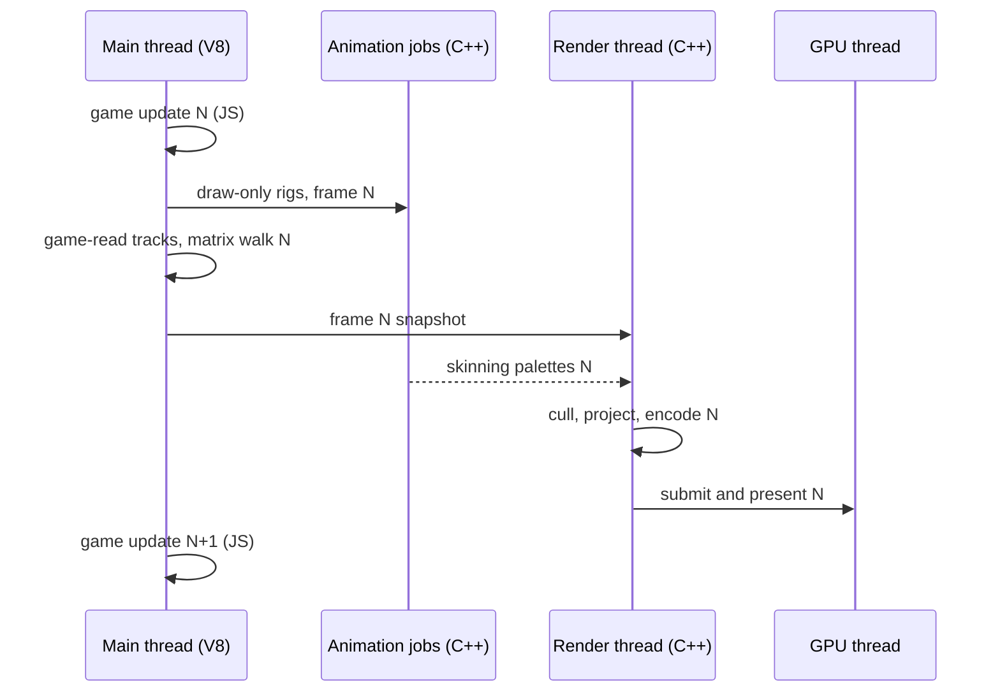

# PRD-610 — The native engine wins on real games

**Status:** PARTIAL
**Priority:** P1 — the owner bar is 2x to 3x faster than three.js on Midway; the provisional matched ratio is 1.18x to 1.49x (AC-15 open) and the levers are open (AC-20, AC-16 to AC-19).
**Complexity:** 8 (HIGH)
**Owner:** João
**Depends on:** PRD-573 (the epic; this PRD closes its final-tier v1.10 box and rides PR #493)

**Current focus (re-plan 2, 2026-10-14):** finish AC-15 (three qualified pairs), then AC-20 first. The matched yardstick shows that the player runs about half of Chromium's instructions per frame at about 60% of its IPC. The stall gap is now the largest lever; the time-share levers (AC-16 to AC-18) follow on top of it.

## Context

On 2026-10-13 the owner played Midway (`midway-open-pacific`) on the native desktop player, on the Wasm engine in Chromium and on three.js in Chromium. The native player felt like about 20 FPS with a laggy HUD. Three.js ran at 51 FPS. Phase 1 removed the main cause: in free-run the player flushed a full core frame on every catch-up tick, up to five per drawn frame.

From 2026-10-13 to 2026-10-14 a Codex lane of about 80 sub-agents worked the old AC-3 to AC-13. The owner warned that its last iterations moved in the wrong direction. Its full evidence log stays in git history (this file at `8cbef6f2a`). This re-plan keeps its results and drops its proxy targets.

### Measured reference

Package `pkg-ac3-calibration-20261014T135316Z-t`, runs `t` and `t2`, 1,000 active frames each, parity PASS, Xvfb:

| Metric | Native desktop player | Three.js in Chromium |
|---|---|---|
| Main-thread CPU per frame | 7.05 ms (JS and the C++ it calls 4.93, render 1.78, other 0.33) | not measured |
| Main-thread instructions per frame | 18.15 M | not measured |
| Active wall per frame | bound by Xvfb presents | 10.65 ms, Vite dev server |
| HUD round trip p95 | 26 ms (target 16.7 ms) | in-page DOM |

### The yardstick is not matched

1. The three.js arm runs on the Vite dev server (`flight.sh`: `pnpm dev`), with the React development build and dev module transforms. The desktop player runs a production bundle.
2. The dashboard ratio divides browser active wall time by native main-thread CPU time.
3. The arms can run different engine commits. `install.sh` packs the browser arms at one time, and the player bundle is built at another.
4. Core's `FixedStepLoop` runs up to five updates per frame. On the wall clock, a slower arm does more simulation per frame.
5. The browser main thread also runs the React HUD. The native HUD runs in a WebKit process that took 2.3 times the player main thread's CPU samples. Main-thread CPU favors native, so process-tree CPU must sit beside it.
6. The player embeds V8 13.1.201.22 (late 2024). The Chromium under test runs a newer V8.

A production build makes the three.js arm faster, so the matched ratio can be lower than 1.51x.

### Matched baseline (provisional, 2026-10-14)

One pair at engine `db22a6230`, private Xvfb, NVIDIA/Turing, lockstep windows of 1,000 frames with one update and one render each, parity PASS. Runs `ac15-db22a6230-{a1-legacy,b1-desktop}` under `~/.cache/tmp-tn/midway-runs/`. The flight post-check refused this pair because of a checker defect (see Decisions), so these numbers are not yet a qualified AC-15 row.

| Pose | three.js main thread | Player main thread | CPU ratio | Instructions per frame (three.js / player) | IPC (three.js / player) | Process-tree CPU per frame (three.js / player) |
|---|---|---|---|---|---|---|
| Takeoff | 8.85 ms | 7.48 ms | 1.18x | 41.3 M / 20.5 M | 1.06 / 0.64 | 64.9 / 102.2 ms |
| Cockpit | 10.20 ms | 7.84 ms | 1.30x | 51.1 M / 22.7 M | 1.11 / 0.67 | 64.0 / 108.0 ms |
| Rear gunner | 14.58 ms | 9.82 ms | 1.49x | 77.2 M / 29.8 M | 1.18 / 0.70 | 69.9 / 105.3 ms |

The player executes 2.0x to 2.6x fewer instructions per frame, but each instruction costs about 1.6x more cycles. At Chromium's IPC the same player work would take about 4.5, 4.8 and 5.9 ms (2.0x, 2.1x and 2.5x). Both arms ran at 4.3 to 4.5 GHz user-mode cycles per CPU-second, so frequency does not explain the gap. The player's process tree burns about 100 ms of CPU per frame, mostly in the two WebKit HUD processes, against 65 ms for the whole Chromium tree.

Known IPC differences: the embedded V8 13.1.201.22 is built with `v8_enable_pointer_compression=false`, `is_official_build=false`, `use_thin_lto=false` and `chrome_pgo_phase=0` (`third_party/v8/gn-args_Linux.txt`); Chromium ships pointer compression, ThinLTO and PGO on a newer V8. The engine C++ is `-O3` Release. Cache and SMT interference from the HUD processes and the GPU thread is not measured yet.

### Where the player's main thread goes

V8 CPU profile of package T: 22,277 samples at 200 µs over 1,010 frames. JS-entered time is about 4.4 ms per frame, so 1% is about 0.044 ms. The independent mixer meter (14.1% of main-thread CPU, about 1.0 ms) agrees with the animation row.

| Owner | Share | About ms per frame | Main items |
|---|---|---|---|
| Core calls into C++ | 38.1% | 1.68 | animation mixer 20.4%, matrix walk 10.1%, projected cull 5.6%, stride and foot plant 2.1% |
| Game JS | 19.1% | 0.84 | Midway code; two per-frame `filter` passes (radio queue, AI group) take 9.9% |
| Game calls into C++ | 9.6% | 0.42 | `updateDamageVisuals` 3.3%, `animateDouglas` 2.3%, three `update` methods 2.8% |
| Engine-owned JS | 12.9% | 0.57 | flight model 3.6%, HUD bridge 2.5%, frame loop 1.8%, audio pose sync 1.6%, player shim 1.5%, animation player 1.3%, playtest hooks 0.6% |
| Shim and harness calls into C++ | 5.2% | 0.23 | `traverse` 1.9%, audio panner and gain 1.0%, playtest observation 0.8%, `parent` 0.7%, uniform `set` 0.6%, attributes 0.3% |
| Root native and the rows below the top 60 | 15.1% | 0.67 | not attributed |

### Can work leave JS for C++?

Most JS-entered time is already C++. The core rows (38%) are C++ work that one JS call starts, so moving the caller into C++ saves only the call. That work must shrink or leave the main thread (AC-16, AC-17).

Engine-owned JS and shim crossings take about 18% (about 0.8 ms). The candidates:

| Piece | Share | Move | Box |
|---|---|---|---|
| Animation player step: fades, `#syncStride`, `footPlantSpeed`, one `mixer.update` per rig | 3.4% | into the C++ mixer, one call per frame for every player | AC-17 |
| Player shim: `traverse` iterator, `parent` getter, attribute `Proxy`, uniform `set` | 4.9% | keep `parent` and children on the JS side, return `traverse` lists in one call, cache attribute names per geometry version | AC-18 |
| Positional audio and listener pose sync | 2.5% | the native audio backend reads the node's world matrix | AC-18 |
| HUD bridge: `JSON.stringify` per publish, `assertSendable` | 2.5% | validate a message shape once, skip unchanged state | AC-18 |
| Flight model `core/src/flight.ts` | 3.6% | stays JS (see Decisions) | — |
| Frame loop; playtest hooks | 1.8%; 1.4% | stay; both arms pay the playtest hooks | — |

Game JS (about 1.3 ms with its C++ calls) cannot move without game edits. Two engine levers reach it: a newer embedded V8, and cheaper C++ behind `updateDamageVisuals` and `animateDouglas`.

### Tried and rejected

Do not retry these without a new reason. Each result is the A/B against its baseline.

| Experiment | Result |
|---|---|
| Shared reflection record cache (two tries) | +2.8% instructions |
| Animation on a worker with per-track jobs (old AC-12) | +78% instructions, +136% CPU, 39,144 jobs per window |
| World-dependency revision | +0.27% |
| Squared-threshold cull | +0.15% |
| Empty-subtree cull skip | +31.8% cull CPU |
| Subtree and manual-root prototypes (O, P) | +2.2% to +2.3% |
| Join batch (N) | +0.72% |
| Cap support (U) | +2.6% |
| Bulk reader | −0.77% instructions, timing inconclusive |
| Copy elision | −0.32%, synthetic only |
| Shared keyframe seek | not repeatable |
| ABI `holdsObject` (EXP3.2) | 0% |
| Lazy pose | stopped: mutable track spans and aliases |
| FIFO against Immediate present | neutral |
| View-argument handles (old AC-11) | neutral at about 1,074 calls per frame |
| WPE HUD backend | p95 32 to 41 ms |
| HUD state snapshot | p50/p95 23/29 ms against 16/27 ms |
| CDP endpoint retries (old AC-6) | rAF crosses the endpoints |
| V8 GC prologue `promote()` skips the full wrapper walk while the ownership epoch is unmoved (2026-10-14) | Flat on the second off/on pair; instructions unchanged. Counter run: 249 GC prologues in 8,400 frames (one per 34 frames) over 26,447 wrappers, so about 0.04 ms per frame. The call-graph profile's 4.9% came from load-time GCs inside its window |
| Crossing path reuses decoded numeric and handle arguments (2026-10-14) | Projected 0.04 to 0.07 ms per frame; A/B flat. Measured 1,725 crossings per frame: `visible` 315, `count` 152, `getX`/`getY`/`getZ` 327, `time` 109, `setEffectiveWeight` 104 |

Kept: one frame per present (AC-1); the GPU thread for submit, blit, acquire and present (main-thread CPU −19%, every B beat every A); Stack 4 (−9.3% instructions); the T calibration (18.15 M instructions per frame); reflection walk reuse (−3.7%).

Lessons: single-run millisecond verdicts on a loaded host misled. Small render trials moved the total by less than the noise. Fine-grained threading cost more than it saved. The profile is flat, so only structural levers can reach 2x.

## Solution

Goal: on matched work, the player's main thread uses at most half the CPU per frame of the three.js renderer main thread (2x). The design budget aims at 3x.

1. **One honest yardstick (Phase 2).** Production builds of one engine commit. A lockstep window: one update and one render per frame on both arms. Per-thread CPU and instruction counters for each arm's main thread, with process-tree CPU beside them.
2. **Structural levers, largest first (Phase 3).** Render prepare and encode leave the main thread. Animation leaves the main critical path. Engine-owned JS moves into C++ or shrinks.

Budget from 7.05 ms. The three.js denominator moves after AC-14, so AC-15 re-baselines it.

| Lever | Main-thread cut | Main thread after |
|---|---|---|
| Render thread: cull, project, encode (AC-16) | −1.3 to −1.7 ms | 5.4 to 5.8 ms |
| Animation off the critical path (AC-17) | about −0.65 ms (1.05 to 0.4) | 4.7 to 5.1 ms |
| Engine JS into C++ or smaller (AC-18) | about −0.25 ms (0.45 to 0.2) | 4.5 to 4.9 ms |

That is 2.2x to 2.4x against 10.65 ms. 3x (3.55 ms or less) needs about 1 ms more: a flat matrix walk (0.44 ms today), a newer V8 for game JS, cheaper game-called C++, and the 15% of samples not yet attributed. A smaller three.js denominator after AC-14 raises the bar for both targets.

Risks:

- A render thread adds a pipeline stage. Keep one frame in flight in total, and measure input latency against today.
- A game read of an animated bone before the job join must see frame N. Tracks the game reads (2.0% of evaluated tracks) evaluate on the main thread before the read.
- Each native fast path keeps the TS path for the web, as `__tnUpdateMatrixWorld` does today. A spec or conformance case proves that both paths give the same result.
- Update-rate optimization (URO) changes what a hidden rig shows when it becomes visible. It needs the PRD-573 v2.3 safeguards and João's name for `AnimationMixer.updateRate`.

## Acceptance Criteria

The boxes are under the execution phases. Phase 1 holds AC-1 and AC-2 (done). Phase 2 holds AC-14 and AC-15. Phase 3 holds AC-20, AC-16, AC-17, AC-18, AC-5 and AC-19. AC-3, AC-4 and AC-6 to AC-13 are retired (see Decisions). New IDs start at AC-14, so dashboard run names stay unique.

## Blocked on

- João plays Midway on the native desktop player on the real display (`:0`) and confirms it feels at least as smooth as three.js in the browser — unblocked by João.

## Integration Ledger

| Capability | Reachable consumer/trigger | Replaces / disposition | Evidence |
|---|---|---|---|
| One frame per present | `tn-native-engine-player-v8` free-run loop: `run.cpp` → `core-host.mjs` `flushFrames` | per-tick flush in free-run removed; paced path kept | AC-1 |
| Matched builds | `scripts/midway-bench/flight.sh` browser arms | `pnpm dev` server replaced by a production build; a dev server or an engine-commit mismatch is refused | AC-14 |
| Matched counters | `flight.sh` → `kpis.ts` → `dashboard.ts` headline | wall-against-CPU ratio removed | AC-15 |
| Render thread | `run.cpp` frame → render thread → GPU thread | `database.render` leaves the main thread | AC-16 |
| Animation off the critical path | `AnimationPlayer.update` → C++ mixer step and jobs | per-rig `mixer.update` calls and JS stride on native | AC-17 |
| Engine JS in C++ | `three-native/src/audio.ts`, `core/src/ui-state.ts`, `core/src/ui-bridge.ts`, player shim `core-three.mjs`, `three-native/src/object-surface.ts` | JS pose sync, per-publish validation, per-read crossings | AC-18 |
| HUD under one frame | WebKit overlay snapshot mailbox → frame blend | — | AC-5 |
| Final-tier result | `pnpm perf:live` hero | R5 hero becomes the cheap-tier row | AC-19 |

## Decisions

- 2026-10-15 (exact-window stack sampling): the existing Linux CPU-window collector accepts `TN_PLAYTEST_CPU_PROFILE_DIR`, starts `perf record` disabled on the owned main TID with a separate FIFO/ACK pair, enables only around the existing 1,000-tick advance, disables independently on failure, and reaps both children. Existing/empty output fails closed. Sampled windows carry `profile`; the dashboard excludes both their CPU windows and the entire run from qualification. Focused red/green is eight new-feature failures followed by 179 passing tests; playtest typecheck, build/declarations/publint, changed-file Biome (17 warnings), diff checks and independent review pass. Real diagnostic `perf-rt-exact-off-1` passes three assertions and all three exact 1,000-update/render windows, with 1,769 / 2,106 / 2,847 samples, zero lost samples and decoded callchains. Current-source qualification also rejects that real report under a non-`perf-` tag. `RenderDatabase::project` contributes 6.10% / 5.41% / 6.06% self cycles; unresolved shares remain 7.11% / 7.96% / 9.25%. This first validation did not enable V8 JIT maps, so unresolved samples are not assigned to JS. Raw recordings/reports are under `~/.cache/tmp-tn/screens/perf-rt-exact-off-1/profiles/`; `--no-inline` avoids expensive inline expansion during decode. AC-15/AC-20 remain open: this is an instrument, not matched acceptance pairs, complete owner attribution or a speed improvement.

- 2026-10-14 (lead, re-plan 2; João: "1.5 to 2x seems close enough ... pretty sure we can beat 3x in a week"): the provisional matched ratio is 1.18x, 1.30x and 1.49x. The Solution budget (−2.2 to −2.6 ms from 7.05 ms) reaches about 1.7x to 1.8x at takeoff against the matched 8.85 ms, so it cannot reach 2x alone. The matched counters show a larger lever: the player runs half of Chromium's instructions at about 60% of its IPC. AC-20 (IPC 1.0 or more) comes before AC-16. With AC-20 at Chromium's IPC (about 4.5 ms at takeoff) and the Phase 3 levers on top, 3x (2.95 ms or less at takeoff) is the design target. Two checker defects were fixed on the way: the player drew one automatic frame after each mailbox poll inside the window (`d790e5cfb`, the runner now holds automatic renders), and the window ticks came from the game clock, which led the host's driven tick by 60 (`e3271a19c`, the host now brackets each window with `TN_PLAYER_RENDER_HOLD` markers and the checker reconciles frames per bracket). A debug repro confirmed one held `advance(1000)` per window with no draw inside.
- 2026-10-14 (AC-15 collector repair, incomplete): the first matched flight rejected multiple Chromium renderers. Page-target tracing now maps the actual root frame to its renderer PID; browser-target trace metadata was empty. The subsequent actual probe exposed an incorrect `/proc/comm == CrRendererMain` requirement: Chromium deliberately keeps the Linux leader process name, while RendererMain runs on that leader ([upstream implementation](https://chromium.googlesource.com/chromium/src/+/main/base/threading/platform_thread_linux.cc)). The collector now uses the verified renderer leader TID and retains process-tree/start-time identity checks. A fresh actual Chromium 151 private-Xvfb probe passes; an independent 1.5-second JS loop adds 1.46 CPU-seconds to that renderer and zero to the spare. Parent focused suites pass 193/193, playtest typecheck passes, and changed-file Biome passes with 14 warnings. Window timestamps and a conserved source-map attribution helper are present; actual calibrated Midway owner rows, matched pairs and parity are still unverified. AC-15 remains open.

- 2026-10-14 (dashboard UI): Sonnet 5.5 High reproduced horizontal page overflow from the wide matched-counter table and intrinsic grid sizing. Reused the existing table scroll container and shrinkable grid tracks; all 135 focused dashboard tests pass. Actual browser checks pass on ports 8765 and 8767 at 1600×900 and 900×900, with clean consoles and pending metrics preserved. Fresh read-only visual judge: IMPROVEMENT at both widths. AC-15 remains open; no speed result is claimed.

- 2026-10-14 (verification): stable `pnpm typecheck` passes after two behavior-preserving dashboard typing fixes. Two introduced regex lint errors are fixed; changed-file lint passes with warnings, and the final focused Midway/bundler suites pass 120 tests. The earlier full `pnpm lint` reported 213 errors and 1,492 warnings; remaining global diagnostics are not fully attributed. The unit run was interrupted (exit 130) after two `browser-math.spec.ts` failures. Those assertions still required the old eighth-per-frame GC sweep; commit `9ac452167` explicitly shipped fresh-wrapper checks plus a sixty-fourth-per-frame settled sweep. Only the two stale tests were corrected, retaining immediate fresh checks, bounded settled coverage, dropped-wrapper exclusion and release within two passes; the focused math/collect suites pass 20/20 (2026-10-14). Neither full lint nor the full test suite is claimed green.

- 2026-10-14 (AC-15 instrumentation, incomplete): Linux collection brackets exact 1,000-update/render windows with FIFO-controlled thread perf counters, schedstat runtime, process-tree CPU, identity checks, load and governors. A real perf plumbing smoke passed after handling this host's NUL-terminated ACK and intentional SIGINT stop; it is not a game benchmark. Exact start/end ticks reconcile native completed host-render records. The parent rerun passes 151 collector/dashboard tests; the rebuilt player passes all 8 profile tests, including both CLI forms, write failures and SIGTERM output. Updated dashboard preview `/api/midway` on port 8767 shows zero qualified pairs and pending ratios, retaining historical runs. Actual matched Midway pairs, parity, visual review and profile attribution remain unrun; AC-15 stays open. Initial repack stopped at the TypeScript 6 declaration builder: tick guards did not narrow through the inferred never-returning arrow. An explicit return from that failing branch fixes the declaration contract; focused playtest build, DTS and publint pass. No packs were accepted from the failed preparation.

- 2026-10-14 (AC-15 foundation, incomplete): browser bridge driving now places one successful scene update and primary world render inside each measured frame, suppressing queued automatic draws after startup; direct simulation-only driving and native host-owned rendering remain explicit. Parent rerun of source-focused loop/playtest/resource suites passes 68/68. The first native fixture runs launched the older `build/tn-engine` player and failed cull/tick assertions; the already rebuilt `build/tn-engine-ui` player passes the 2,500-driven-frame tick check and the free-run fixture (36 frames, one callback per draw, two projected-cull and mixer calls per frame, CPU instruction records). This is fixture proof, not a repackaged Midway CPU window or visual verdict. OS-counter collection, dashboard ingestion and paired qualification remain open.

- 2026-10-14 (execution): AC-15 discovery found that browser `fixedStep` advances simulation separately from rendering, while the native driven-clock contract already checks one host update/render per tick. Couple browser updates and renders inside the measured frame scope before collecting 1,000-frame pose windows; advancing before `stepFrame` would omit simulation from its budget. Suppress duplicate automatic draws only after startup readiness. Thread-attached `perf` instruction probes succeeded on this host. No lever verdict has been made.

- 2026-10-13 (João): benchmarks have two tiers. Cheap benchmarks (the R-ladder) iterate, and final benchmarks (Midway, then other real games) decide. This PRD's speed ACs are final-tier only.
- 2026-10-13 (lead): out of scope here, for a follow-up PRD if they still matter after AC-6:
  - the 2D canvas `globalCompositeOperation` (Midway's wear scratches paint dark specks)
  - a same-frame press and release on HUD buttons
  - the `captureMouse` relative-motion proof
  - a boot warning listing absent web APIs
  - placard text metrics
  - the playtest runner failing to stop the player (exit 2 after its screenshots)
  - the `--memory` control fix in `profile:wasm-page`
  - Wasm memory of 1.9 GiB
  - web startup of 40 s against 17 s
  - ne-compat's matrix of other games
- 2026-10-14 (lead, re-plan at João's request: "you have to edit the PRD 610, i'll re execute it"; goal: "a path for 2-3x native speed compared to web threejs"):
  - Phase 2 fixes the yardstick before any lever is judged, because the old ratio mixes instruments and builds. The 2026-10-13 out-of-scope list now waits for AC-19, not AC-6.
  - Retired unticked boxes, with their evidence in git history at `8cbef6f2a`. AC-3 (1,500 visits) and AC-4 (cull below 2%) were proxy targets, and AC-16 moves the cull off the main thread. AC-10, AC-11 and AC-12 were tried (see Context). AC-6 and AC-13 become AC-19 on the matched yardstick, and AC-8 folds into AC-15 and AC-19. AC-7 (the web Wasm engine against three.js) leaves this PRD: PRD-573 v1.10 does not need it, and a follow-up PRD owns it.
  - AC-9 landed (GPU thread, −19% main-thread CPU). Its open byte-identity proof moves to the fixed-step capture pair of AC-16.
  - AC-5 stays, because PRD-573 v1.10 needs the HUD round trip under one frame.
  - AC-17 is not a retry of the rejected per-track worker. It cuts work first (URO, unread tracks), then uses per-rig jobs for draw-only tracks.
  - The flight model (`core/src/flight.ts`, about 0.16 ms) stays JS. It is numeric code that V8 compiles well, and a C++ copy doubles the implementation for 0.1 ms or less.
  - Moves land in the existing C++ objects (mixer, audio backend, scene). A new language adds a call boundary, and the boundary is the cost being cut.
  - Measurement ladder: tier 0 is a ctest counter. Tier 1 is one lockstep window, instructions per frame. Tier 2 is three alternating pairs per pose, parity PASS, and the visual judge for any lever that can change pixels. Keep a lever only when every B beats every A. Make no single-run millisecond verdict on a loaded host.
- 2026-10-14 (owner: "my goal is native 2-3x faster than web threejs. WASM ThreeNative 1.5 faster than ThreeJS (regular)"; "we need to optimize both native and wasm web in parallel"): every matched pair also runs the web Wasm arm (C, graded on the same A and ref), and the dashboard shows both arms. [PRD-612](../native-engine/PRD-612-web-wasm-engine-beats-threejs-on-midway.md) owns the web Wasm 1.5x target. Pair 1 at `e3271a19c` (both arms parity PASS) reads native 1.24x / 1.05x / 1.31x and web Wasm 1.02x / 0.95x / 1.26x; it is one pair of three, so AC-15 stays open.
- 2026-10-14 (owner: "we need conventions, keep godot naming style"): URO ships as a convention, on by default, with its override on the same object in Godot vocabulary, camelCase: `AnimationMixer.updateRate` (Godot style `update_rate`). This removes the naming blocker for AC-17.

## Execution Phases

#### Phase 1: One frame per present
**Status:** DONE
**Files:** `packages/runtime-native/src/engine/player/core-host.mjs`, `packages/runtime-native/src/engine/player/run.cpp`, the player metrics emitter, a new `tests/native-engine/player-*.mjs` ctest.
**Implementation:** gate `flushFrames` on present in free-run. Keep fixed-step simulation ticks if gameplay needs them. Log the frame budget every 300 frames.
**Verification:** the AC-1 ctest red then green. The existing paced, real-input and overlay player ctests stay green. A Midway CPU-per-frame before/after on Xvfb (the prelude A/B gave 90.5 to 39.4 ms) covers AC-2.

- [x] AC-1 [local]: in free-run with a slow tick, core rAF, the matrix walk and the cull each run exactly once per presented frame. proof: player ctest (`tests/native-engine/`, red at 5 per frame before the fix) — Evidence: ctest `native_engine_player_frame_per_present` (25 ms frame callback, free-run): red on the old `core-host.mjs` at `…,1,1,2,3,4,5,5,5,5,5` callbacks per drawn frame, green at 1 per frame over 36 frames. The matrix walk and the cull run inside core's frame callback, so they follow it. `ctest -L native-engine -R player` 21/21 pass (2026-10-13).
- [x] AC-2 [local]: the player logs `TN_FRAME_BUDGET` every 300 frames during free-run flight. proof: Midway `flight.sh desktop` log with at least 3 in-flight budget lines — Evidence: 2026-10-13, Xvfb. The AC-1 player's `flight.sh desktop` run logged 24 `TN_FRAME_BUDGET` windows, 8 of them in flight (windows 17 to 24), with parity PASS. A 120 s free run with no runner logged 27 budget lines over 2,065 frames.

#### Phase 2: One honest yardstick
**Status:** IN PROGRESS
**Files:** `scripts/midway-bench/{flight.sh,install.sh,kpis.ts,dashboard.ts,README.md}`, `scripts/__tests__/midway-*.spec.ts`.
**Implementation:**

- Browser arms build with the game's `build:web` script and serve the output statically. The harness refuses a page that loads `/@vite/client`.
- Each arm records the engine commit it runs: the pack manifest for a browser arm, the bundle for the player. The harness refuses a mismatch.
- Timing windows use the existing fixed-step clock (`MIDWAY_BROWSER_CLOCK=fixed-step`, and runner-driven frames on the player). Each frame then runs one update and one render on both arms. The harness counts both per frame and fails closed on any other count.
- For each window the harness reads the main thread's CPU time from `/proc/<pid>/task/<tid>/schedstat` (Chromium: the renderer's `CrRendererMain`; the player: its main thread). It reads instructions with `perf stat -t`, and fails closed without `perf`. It records process-tree CPU, host load and the CPU governor beside them.
- Use the real display when João grants it for the session. Otherwise use Xvfb and report CPU and instructions only, because Xvfb throttles presents.

**Verification:** the AC-14 spec and the AC-15 pairs.

- [x] AC-14 [local]: both Midway browser arms time a production build of the same engine commit as the desktop player, and the harness refuses a dev server or a commit mismatch. proof: a `scripts/__tests__/midway-*.spec.ts` case, red on a page that loads `/@vite/client` and on mismatched commits, plus one legacy `flight.sh` run log that names its build and commit — Evidence (2026-10-14): `ac14-proof-a4c99a39b-legacy/run.log` under `/home/joao/.cache/tmp-tn/prd610-matched-runs/`: production `build:web`, static preview, runner PASS (4 assertions, 1,938 frames), 652 observed requests with no `/@vite/client`; WebGPU adapter NVIDIA/Turing on private Xvfb. Live receipt/hash verification passed for both installs, packed tarballs, desktop bundle/player and legacy web output at `a4c99a39b2b7db7d00d34bc5c5d8adaeec6abe00`. Latest Midway suite: 111 pass, including refusal and strict-exports packing regressions; installed bundler compatibility and acquisition fixture also pass. Fixed-step is not yet frame-coupled: no performance claim (AC-15).
- [ ] AC-15 [local]: the dashboard headline is the main-thread CPU ratio (three.js renderer main thread over the player main thread) on the lockstep window at takeoff, cockpit and rear gunner, with instructions and process-tree CPU beside it. proof: three alternating legacy and desktop pairs per pose with parity PASS, the dashboard API row, and a V8 profile of each arm split into the same owner rows (engine, game, HUD, harness)
  Progress (2026-10-14): one clean pair exists (provisional baseline above); the host-tick reconciliation fix is `e3271a19c`. Left: three qualified pairs, the dashboard API row and the owner-row profiles.

#### Phase 3: Structural levers, then the final benchmark
**Status:** NOT STARTED
**Files:** `packages/runtime-native/src/engine/player/run.cpp`, `packages/runtime-native/src/engine/renderer/{renderer,render_database}.cpp`, `packages/runtime-native/src/engine/animation/mixer.{h,cpp}`, `packages/core/src/animation.ts`, `packages/three-native/src/audio.ts`, `packages/core/src/{ui-state,ui-bridge}.ts`, `packages/runtime-native/src/engine/player/core-three.mjs`, `packages/three-native/src/{object-surface,tsl-uniforms}.ts`, `scripts/midway-bench/*`, `scripts/perf-live.ts`.
**Implementation:** AC-20 first, then one lever per commit, in budget order. Each lever passes tier 0, then a tier 1 instruction A/B, and stacks only when every B beats every A. A native fast path keeps the TS path for the web, and a spec or conformance case proves that both agree.

- IPC (AC-20): attribute the stalls first (`perf record` on the player main thread by DSO and symbol, then cache-miss events on the top rows). Candidate levers, each kept only on the A/B rule: a pointer-compression V8 monolith (and ThinLTO/PGO where the recipe allows), HUD snapshot work bounded to real HUD changes, and thread placement that keeps the HUD processes and the GPU thread off the main thread's core and its SMT sibling.
- Render thread (AC-16): after the matrix walk, the main thread hands a frame snapshot (transforms, visibility, uniforms, skinning palettes) to a render thread. The render thread runs cull, project and encode, then hands submit and present to the GPU thread (old AC-9). Keep one frame in flight in total, and extend the GPU thread's deferred destruction to the snapshot.
- Animation (AC-17): first apply URO to rigs that no camera draws (PRD-573 v2.3: a staggered 1-in-4 rate, an update on visibility gain). Skip tracks that no consumer reads (28.8% of evaluated tracks). Then evaluate draw-only tracks (69.4%) in per-rig jobs, joined before the skinning upload. Move the `AnimationPlayer` frame step (fades, stride, foot plant) into the C++ mixer: one call per frame for all players.
- Engine JS (AC-18): positional audio and the listener read world poses in the native audio backend. The HUD bridge validates a message shape once and skips unchanged state. The player shim keeps `parent` and children on the JS side, returns `traverse` lists in one call, and caches attribute names per geometry version.
- V8: the player embeds V8 13.1.201.22. Try a current V8 as one lever when a prebuilt or the Android V8 recipe gives a desktop monolith within one day. Keep it only on the A/B rule.

**Verification:** the AC-16 to AC-19 proofs. Any lever that can change pixels (render thread, URO) gets the visual judge.

- [ ] AC-20 [local]: the player main thread reaches IPC 1.0 or more on the lockstep window at all three poses, with its instructions per frame no higher than the matched baseline. proof: three alternating pairs per pose with parity PASS, `perf stat` instructions and cycles per window, and a `perf record` DSO split (V8 JIT, V8 runtime, engine C++, driver) before and after
- [ ] AC-16 [local]: delivered by [PRD-613](../native-engine/PRD-613-native-render-thread.md) (owner, 2026-10-14: separate PRD). Cull, project and encode run on a render thread, and the player main thread's CPU per frame falls by at least 1.0 ms on the lockstep window. proof: a ctest on render-thread ordering (frame N encodes only frame N's snapshot; a mutation goes red), a fixed-step capture pair whose A-against-B difference is no larger than A against A, three alternating pairs per pose, visual judge NEUTRAL or better
- [ ] AC-17 [local]: animation costs the player main thread at most 0.4 ms per frame on the lockstep window (about 1.05 ms today), and an animated value the game reads is current for its frame. proof: a ctest on read-before-join (red when a game-read track evaluates in a job), the mixer meter on three alternating pairs, visual judge NEUTRAL or better at all three poses
- [ ] AC-18 [local]: the HUD bridge, positional audio and the player shim cost the player main thread at most 0.2 ms per frame on the lockstep window (about 0.45 ms today). proof: V8 profile owner rows before and after on the same window, an instruction A/B per moved piece, and a spec or conformance case per native fast path
- [ ] AC-5 [local]: the HUD snapshot round trip is under 16.7 ms p95 in flight. proof: `TN_UI_SNAPSHOT lastRoundTripMs` from `flight.sh desktop` — Evidence so far: p95 168 ms at filing, 26 ms on package T. The WPE backend and a state snapshot were rejected (see Context). Open lead from the 2026-10-13 trace: reading the offscreen window's own surface cost 0.6 ms, against 30 to 49 ms for a full-page snapshot.
- [ ] AC-19 [local]: the native desktop player is at least 2x three.js in Chromium on Midway at takeoff, cockpit and rear gunner, on main-thread CPU per frame (lockstep window) and on frame p50 (free-run, both arms uncapped), with parity PASS and process-tree CPU reported beside both. proof: `scripts/midway-bench/flight.sh` three alternating pairs per pose on the real display, visual judge NEUTRAL or better, and `pnpm exec vitest run scripts/__tests__/midway-dashboard.spec.ts`
