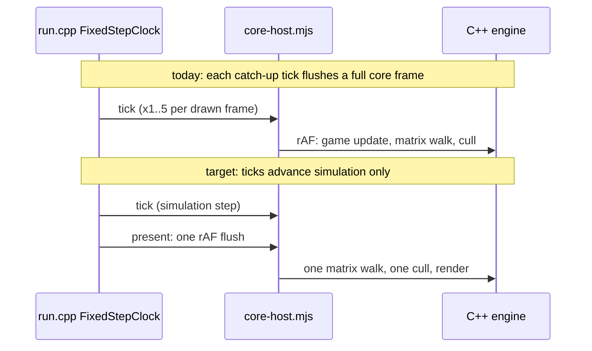

# PRD-610 — The native engine wins on real games

**Status:** PARTIAL
**Priority:** P1 — the C++ engine is the epic's value proposition, and on Midway it is slower than three.js on both desktop and web (AC-6 and AC-7 open).
**Complexity:** 6 (MEDIUM)
**Owner:** João
**Depends on:** PRD-573 (the epic; this PRD closes its final-tier v1.10 box and rides PR #493)

**Current focus (owner decision, 2026-10-14):** “we can revisit it later, just update dashboard and move to ac4.” Latest owner clarification permits AC-3 to continue in a token-conscious background lane without blocking AC-4–13: measured 3,083 visits (two runs: 3,211/2,955), with ≤1,500 still an unmet deferred stretch target. Latest owner direction runs AC-4 (cull share ≤2% of the main thread) and AC-5 (HUD) in parallel, with AC-6–13 qualification, toward the overall 2–3× native goal. No acceptance box, winner or pin changes.

**Dashboard measured reference (2026-10-14):** The explicitly retained `pkg-ac3-calibration-20261014T135316Z-t` pair (`ac3-calibration-20261014T135316Z-t-desktop` and `ac3-calibration-20261014T135316Z-t2-desktop`, source `afdb0fc719e06a4cdc0581ed4c85d68a35a43d80`) now pins the measured reference: 1,000 complete active frames per run, original parity PASS for both; medians 3,083 visits, HUD p95 26 ms, CPU 7.04531 ms and 18.15275M instructions/frame. This is an experimental reference, not a qualified winner; an accepted winner lock takes precedence, historical baselines/targets/history remain, and qualification stays 2/13. Both exact retained repeats must stay valid or the dashboard falls back to the prior reference (or pending). Dashboard tests: 83 passed; focused Biome check passed.

## Context

On 2026-10-13 the owner played Midway (`midway-open-pacific`) on three arms: the native C++ engine player on desktop, the engine as Wasm in Chromium, and three.js in Chromium. The cheap benchmark (R5, 4,096 cubes) read native desktop 2.8x and web 1.4x. On the real game the native player felt like about 20 FPS with a laggy HUD, while three.js in the browser ran at 51 FPS (p50 16.7 ms, p95 33 ms). The owner then split the benchmarks into a cheap tier and a final tier (PRD-573 Decisions, 2026-10-13).

Root causes, measured in flight under Xvfb (host load 35 to 48, so read the ratios). The data came from `TN_PLAYER_METRICS`, perf, gdb counts and a prelude on a copy of `game.js`:

1. **The whole core frame runs once per 60 Hz host tick, not once per drawn frame.** In free-run, `packages/runtime-native/src/engine/player/core-host.mjs` (`else if (!framePaced()) flushFrames(time)`) flushes core's rAF on every tick, and `run.cpp` `FixedStepClock{kTickStep, 5}` catches up to 5 ticks per drawn frame. All 5 ticks in a frame make the same 1,046 bridge calls and cost 13 to 19 ms each. Each tick runs one `__tnUpdateMatrixWorld` and one `__cullProjected`; cull ran 109 times against 44 `RenderDatabase::render` calls. Frame cost is about N×t + r, so it falls into a spiral once one tick nears 16.7 ms: every drawn frame ran the cap of 5. Prepending `globalThis.__tnFramePaced = true` cut CPU per frame (present excluded) from 90.5 to 39.4 ms, and game JS from 69 to 24 ms.
2. **The C++ matrix walk visits every node and then walks them all again to count them.** `__tnUpdateMatrixWorld` costs 3.2 to 5.2 ms of a 13 to 17 ms tick. It walks all 9,903 nodes with no pruning of hidden or `markStatic` subtrees, where the JS pruned pass visits 779. `bindings_scene.cpp` `subtreeSize()` walks the tree a second time only to count it (5.0% flat). The cost is 320 to 520 ns per node, mostly pointer-chasing cache misses. The web lane already recounts once per hierarchy change (`eba8ad1e5`, ctest `matrix_walk_count`), but the desktop walk is still unpruned.
3. **`ProjectedCull::apply` costs 1.65 to 1.95 ms per tick (7.7% flat).** For each of the about 9.9k nodes it does a string `type()` compare, a `dynamic_cast` and a geometry hash lookup.
4. **The HUD snapshot round trip is 138 ms p50 and 168 ms p95** (`TN_UI_SNAPSHOT lastRoundTripMs`), so the HUD trails the game by about 8 frames.

Ruled out: animation (60 mixer updates per tick, the same as on web), vsync, sleeps, and the HUD mailbox blocking the frame (the snapshot is async).

On web (the Wasm engine, before the web cuts), Midway air cruise ran p50 21.0 ms against 14.5 ms for three.js, CPU per frame 24.2 against 17.9 ms, and startup 40 against 17 s. Wasm memory was 1.93 GiB plus a 320 to 480 MiB JS heap, against a 620 MiB heap for three.js. In the named Wasm profile (21.7 ms per frame), RenderDatabase::render took 22% (project 8, renderPrepared 11), AnimationMixer 9%, updateMatrixWorld 9% and ProjectedCull 4%. The web cuts `collect()` (`9ac452167`) and the once-per-change subtree recount (`eba8ad1e5`) landed red-green but are untimed. Bridge cost per crossing: a set costs 0.5 to 0.8 µs, `getWorldPosition` 3.1 µs.

Correctness fixed on the way (merged on the epic): the player's keyboard and mouse input (`9372eb0e8`, real-X-event check `scripts/midway-bench/real-input.mjs`), the HUD overlay and its startup crash (`1741b4441`, `627881eed`), the 2D canvas (`c062adb08`; the white rear guns), and canvas `drawImage` (`99e885f1a`; the missing decals). The visual judge rated the rear-gun fixes IMPROVEMENT, near parity. The Midway parity gate covers takeoff, cockpit and rear-gunner poses on web and desktop.

Files inspected: `core-host.mjs`, `run.cpp`, `render_database.cpp` (`project`, `render`), `object3d.cpp` (`updateMatrixWorld`, `updateWorldMatrix`), `projected_cull.cpp`, `bindings_scene.cpp`, `scripts/midway-bench/*`, `scripts/perf-live.ts`.

## Solution

Fix the frame loop first, because it multiplies every other cost by up to 5. Then cut the per-tick engine work it multiplies, then measure only on the final tier.

- **Frame loop (cause 1):** in free-run, flush rAF once per presented frame. Catch-up ticks advance only fixed-step simulation, and never trigger a render pass. Paced and runner-attached behaviour stays as it is (playtests and benches use it).
- **Matrix walk (cause 2):** the walk returns its node count, which removes the second `subtreeSize` walk. It prunes hidden and frozen-leaf subtrees, mirroring the JS pruned pass.
- **Cull (cause 3):** iterate a cached flat list of renderable objects, invalidated on hierarchy or type change, instead of type strings and `dynamic_cast` per node.
- **HUD (cause 4):** find where the 130 ms goes (WebKit snapshot, copy, upload) and cut it below one frame.
- **Telemetry:** the player logs `TN_FRAME_BUDGET` every 300 frames in free-run, not only at startup, so in-flight FPS is measurable.

Risks: the frame-loop change touches timing that every desktop playtest and bench relies on, so the paced path keeps its ctests. Pruning must not skip a hidden node whose world matrix a game reads (`getWorldPosition` on hidden bone holders): keep lazy parent-chain updates on read.

## Acceptance Criteria

AC-1 to AC-8 are the boxes under the execution phases, one phase each: Phase 1 holds AC-1 and AC-2, Phase 2 holds AC-3 to AC-5, and Phase 3 holds AC-6 to AC-8.

## Blocked on

- João plays Midway on the native desktop player on the real display (`:0`) and confirms it feels at least as smooth as three.js in the browser — unblocked by João.

## Integration Ledger

| Capability | Reachable consumer/trigger | Replaces / disposition | Evidence |
|---|---|---|---|
| One frame per present | `tn-native-engine-player-v8` free-run loop: `run.cpp` → `core-host.mjs` `flushFrames` | per-tick flush in free-run removed; paced path kept | AC-1, AC-6 |
| Pruned matrix walk | core render → `__tnUpdateMatrixWorld` → `Object3D::updateMatrixWorld` | `subtreeSize` counting walk deleted | AC-3 |
| Cached cull list | core `__cullProjected` → `bindings_scene.cpp` → `ProjectedCull::apply` | per-node type strings and `dynamic_cast` removed | AC-4 |
| HUD under one frame | WebKit overlay snapshot mailbox → frame blend | — | AC-5 |
| Final-tier headline | `pnpm perf:live` hero | R5 hero becomes the cheap-tier row | AC-8 |

## Decisions

- 2026-10-13 (João): benchmarks have two tiers. Cheap benchmarks (the R-ladder) iterate, and final benchmarks (Midway, then other real games) decide. This PRD's speed ACs are final-tier only.
- 2026-10-13 (lead): out of scope here, for a follow-up PRD if they still matter after AC-6:
  - the 2D canvas `globalCompositeOperation` (Midway's wear scratches paint dark specks)
  - a same-frame press and release on HUD buttons
  - the `captureMouse` relative-motion proof
  - a boot warning listing absent web APIs
  - placard text metrics
  - the playtest runner failing to stop the player (exit 2 after its screenshots)
  - the `--memory` control fix in `profile:wasm-page`
  - Wasm memory of 1.9 GiB
  - web startup of 40 s against 17 s
  - ne-compat's matrix of other games

## Execution Phases

#### Phase 1: One frame per present
**Status:** PARTIAL
**Files:** `packages/runtime-native/src/engine/player/core-host.mjs`, `packages/runtime-native/src/engine/player/run.cpp`, the player metrics emitter, a new `tests/native-engine/player-*.mjs` ctest.
**Implementation:** gate `flushFrames` on present in free-run. Keep fixed-step simulation ticks if gameplay needs them. Log the frame budget every 300 frames.
**Verification:** the AC-1 ctest red then green. The existing paced, real-input and overlay player ctests stay green. A Midway CPU-per-frame before/after on Xvfb (the prelude A/B gave 90.5 to 39.4 ms) covers AC-2.

- [x] AC-1 [local]: in free-run with a slow tick, core rAF, the matrix walk and the cull each run exactly once per presented frame. proof: player ctest (`tests/native-engine/`, red at 5 per frame before the fix) — Evidence: ctest `native_engine_player_frame_per_present` (25 ms frame callback, free-run): red on the old `core-host.mjs` at `…,1,1,2,3,4,5,5,5,5,5` callbacks per drawn frame, green at 1 per frame over 36 frames. The matrix walk and the cull run inside core's frame callback, so they follow it. `ctest -L native-engine -R player` 21/21 pass (2026-10-13).
- [x] AC-2 [local]: the player logs `TN_FRAME_BUDGET` every 300 frames during free-run flight. proof: Midway `flight.sh desktop` log with at least 3 in-flight budget lines — Evidence: 2026-10-13, Xvfb. The AC-1 player's `flight.sh desktop` run logged 24 `TN_FRAME_BUDGET` windows, 8 of them in flight (windows 17 to 24), with parity PASS. A 120 s free run with no runner logged 27 budget lines over 2,065 frames.

#### Phase 2: Cut the per-frame engine passes
**Status:** PARTIAL
**Files:** `packages/runtime-native/src/engine/scene/object3d.cpp`, `packages/runtime-native/src/engine/abi/bindings_scene.cpp`, `packages/runtime-native/src/engine/scene/projected_cull.cpp`, the overlay snapshot path.
**Implementation:** the walk returns its count and prunes hidden and frozen subtrees, with lazy parent-chain updates on read. Cull iterates the cached renderable list. Profile the HUD round trip and cut it. One cut per commit, each with its guard, kept only when an alternating Midway A/B shows every B beating every A and parity passes. The visual judge reviews any cut that can change pixels.
**Verification:** the AC-3, AC-4 and AC-5 proofs. `ctest -L native-engine` stays green with the NVIDIA ICD env.

- [ ] AC-3 [local]: on Midway the C++ matrix walk visits at most 1,500 nodes per frame (9,903 today) and makes no second counting walk. proof: ctest `matrix_walk_count` extended with a hidden and frozen subtree, plus the Midway node probe — Evidence: open, the node target is not met. 2026-10-13: the walk returns its own count (the `subtreeSize` counting walk is deleted), skips hidden subtrees without bones (a moved hidden parent is caught up when shown) and stops at a frozen root (`static` with `matrixWorldAutoUpdate` off, now bound). The ctest `matrix_walk_count` covers each case and went red against the old walk. In flight the walk visits at most 5,816 nodes against 9,584 before (−39%). Midway calls no `markStatic`, so 1,500 needs frozen subtrees or another cut. Instruction A/B (3 rotations, `cpuFrameKInstructions`, parity PASS on every run): 26.51 to 26.56 M per frame before, 25.34 to 25.38 M after (−4.4%); every after run beats every before run. CPU ms on this shared host (load 13) spread 11.5 to 16.4 ms within one build, so the keep rule reads instructions.
  AC-3 priority audit (2026-10-13): owner prioritizes AC-3, then AC-4/AC-5, toward native 2–3× three.js on matched work; refresh the dashboard when a better result is proven. Fresh unchanged-package `resume-trs-a1-desktop` exited 0, parity PASS, final/max 5,963 visits; no accepted speedup. Diagnostic-only `resume-ac3-census2-desktop` matches native accounting exactly: 5,226 actual/model visits during warmup, 4,448 with ordinary hidden pruning, 9,065 total nodes and 2,990 bones. Hidden-bone pruning alone cannot establish ≤1,500. Historical 779 is not a same-package control: the JS counter counts an overridden recursive walk as one node. Revision-only clean-subtree pruning is unsafe because raw leased transforms and public C++ fields bypass notifications. Composition and partial hidden-rig experiments were parked; neither is an accepted change. Native change census now falsifies dirty pruning as the complete solution: across the final 1,000 player frames, 945 counted updates visited median 5,579 nodes (5,365–5,963), changed median 2,033 local matrices (1,928–2,148), and changed median 5,455 world matrices (5,246–5,834); 55 frames had no update and were excluded. Every counted late frame changed more than 1,500 world matrices. This was diagnostic evidence only: airborne/altitude assertions and manual capture parity passed, but the runner exited 1 because temporary diagnostic stderr was classified as an error. Instrumentation was removed and the ordinary player rebuilt. Next structural investigation: share rig-relative transforms and resolve world matrices at actual consumers, with eager fallback for exposed raw storage and unsupported C++ writes. AC-3 remains open.
  Structural prerequisite (2026-10-13, implemented; not a performance win): V8 JS-math constructors and fresh native clone returns now admit tracked transforms. Private TRS views mark local writes dirty; raw arrays, matrix views and numeric address getters set irreversible eager fallback before storage escapes. Native animation, skeleton pose, physics, inspect and ABI writers mark dirty. Public C++/Wasm objects remain eager. Engine-only `objectOf` and the player-to-renderer scene handoff are not public borrows; no blanket renderer deoptimization was added. Rebuilt focused checks: five V8 math/matrix/GC cases PASS; native writer checks 11/11 PASS; numeric-address checks 6/6 PASS. Final reflection refinements reran math views and native matrix walk, both PASS. Raw `_a`/Euler `_o` assignment and array aliases remain supported; descriptor replacement/deletion now reject to prevent detached tracking. Physics syntax check PASS; its optional runtime target is absent. No cache consumes the metadata yet, and no new-player flight or speedup is claimed. The separate unmeasured copy guard was parked and baseline copies restored. Retained-stack qualification4 A1 exited 0, parity PASS, 1,000 frames: 22.9605 M instructions, 9.2507 ms CPU, HUD p95 55 ms, 5,960 visits; B1 stopped before launch on a foreign GPU playtest. No winner promoted. Next: correct shader skin/instance order for rig-relative palettes, then GPU joint evaluation; identical-pose reuse is insufficient for per-crew phase/rate variation. AC-3 stays open.
  Rig-relative prototype review (2026-10-14): tracking checkpoint `360533272` is committed. The shader-order blocker is fixed: palette variants now skin before instance placement, including normals; ordinary instancing retains its existing order. Generated-WGSL operand-order and numerical tests cover noncommuting transforms and mixed legacy slots. Five focused skinned/palette tests passed; a fresh read-only critic found no further blocker. Worlds remain eager; rendered parity, visual acceptance, actual matrix-visit reduction and performance remain unverified. Midway crew have per-index phase and rate (`game.js:33748–33750`), so whole-pose sharing cannot be the primary cut.
  GPU hierarchy kernel (2026-10-14, internal prototype): `JointComputePass` composes packed local TRS, resolves parent-before-child worlds and writes the existing bone-matrix storage format. The locked native compute readback test exited 0 on NVIDIA GeForce RTX 2080 / Vulkan: two animated dispatches matched an independent double reference; untouched ranges and malformed-input rejection passed. Fresh read-only review found no standalone-kernel blocker. No production activation, flight, visit-count reduction or speedup is claimed. Deferred animation publication and consumer integration remain in progress; AC-3 stays open.
  Deferred publication prerequisite (2026-10-14, internal prototype): Bone owns final mixer doubles and writes a stable shared packed-TRS stream directly. Unsupported writes, escaped views, destruction and stream relocation revoke eligibility. CPU readers join required worlds using parent identity/revision dependencies; regression tests cover joined-parent/unchanged-child worlds, non-Bone attachments, dotted ABI matrix reads and mixer restore. Locked Node 20 build and 21 focused animation/skeleton/ABI/inspect/V8 checks passed; fresh review cleared both reader blockers. Production admission has zero callers. Physics runtime, dedicated deferred additive/weighted mixing and skinned raycast/bounds cases, flight parity, visual acceptance and performance remain unverified. This is not an AC-3 visit-count improvement.
  Integration census (2026-10-14): all 29 GLB entries in `pkg-ac3-native-census-20261013/native/assets.tnpk` were parsed and their SHA-256 verified. The three skinned assets each have 65 joints with original parent-before-child order, no inter-joint non-Bone bridge and an identity Armature placement. Runtime game code adds Head cap bands to nine crew rigs (585 bones); the first restricted integration retains those rigs eagerly. The 29 unique assets contain 276 helper nodes (267 not animation targets), but these asset counts are not runtime visit savings. Live bind-matrix aliases bypass transform tracking and require sticky admission refusal; bind/skeleton/mode/inverse changes and explicit CPU bone-matrix reads require invalidation or joining. Restricted GPU production integration is underway; no measured improvement is claimed.
  Measurement-window correction (2026-10-14): the canonical desktop reducer now selects the last 1,000 complete active frames (`updates > 0`, positive finite CPU time/instructions/frame time), excluding zero-update captures and incomplete/unavailable counters. Both frozen arms use this same reducer; raw logs remain intact. Winner qualification rejects either arm with fewer than 1,000 eligible frames. Regression tests include the observed 1,245,880 K-instruction capture spike, zero counters and 999-frame arms; dashboard/parity checks passed 55/55. The UI exposes used/eligible/excluded counts. HUD still uses all snapshots and matrix visits the last projection observation; those windows are explicitly unaligned. Recomputed historical numbers are measurement corrections, not engine improvements.
  Restricted GPU consumer integration (2026-10-14, experimental): GPU resources are validated before Bone boundaries skip CPU traversal; main/reflection consumers bulk-upload the final mixer stream and preserve GPU palette ranges across CPU uploads and growth. Locked renderer/ABI/compute builds and 12 focused checks passed. The real RTX 2080 / Vulkan fixture covers mixed eager/GPU rigs, second-frame animation, moving ancestor and placement, reflection, output growth and immediate inverse calculation after revocation; 310/448 covered pixels in the two frames, with zero pixels differing by more than two channel units versus eager rendering. Counter tests cover actual world updates and deferred query dependency inspections. Fresh source review found no further screen-correctness blocker. Version 2 native totals now include executed projection boundaries, plan validation and admission/revocation maintenance; the 12 focused checks passed again, including zero steady-frame maintenance scans. Full revocation with a pending pose now compares absolute worlds/inverses and immediate CPU skinning against an independently updated eager rig; the existing publication-count implementation passes. At this checkpoint admitted rigs drew individually; the batching qualification follows below. No Midway flight, visual judge, same-counter baseline, ≤1,500 result or 2–3× speedup is claimed; AC-3 remains open.
  GPU crowd batching (2026-10-14, verified mechanism): admitted rigs now share existing exact-key batches, with renderer-owned output ranges matching instance order; changed mappings upload rig headers without repacking Bones. Locked focused checks passed 10/10, including `tn-native-engine-render-database-test gpu_joint_production` and `tn-native-engine-compute-test readback`; `tn-native-engine-player-v8` rebuilt successfully. Across four RTX 2080 / Vulkan fixture frames, main draws/instances were 1/3, 2/3, 2/2, 1/3; reflection was 1/3, 2/3, 1/1, 1/3; shadow batches were 1, 2, 0, 0. Each frame had zero pixels differing by more than two channel units from independent eager rendering. The fixture covers phased shared assets, ordering, hidden subsets, reflection layers, shadows, eager fallback and output growth. No real-Midway flight, fresh visual-judge verdict, ≤1,500 result or performance improvement is established; AC-3 and real-Midway performance acceptance remain open.
  Ancestor-filter tier-0 proof (2026-10-14): the per-candidate ancestor filter passes the red/green mixed eager/GPU RTX fixture across four frames, with zero pixel differences; the fresh read-only source review found no blocker in the nine-line filter or its fixture. The combined player build completed successfully with SHA `e4325b8ab10eb6184fef8ca983002830c4868295902061072b5a885fffeb9584`. This establishes the fixture mechanism only; real-Midway admission, the ≤1,500 target, fresh visual judging and any game performance win remain unverified. AC-3 stays open.
  Ancestor-filter real-Midway diagnostic (2026-10-14): frozen E player `e4325b8ab10eb6184fef8ca983002830c4868295902061072b5a885fffeb9584`, run `ac3-ancestor-filter-20261014T091042Z-e-desktop`, exited 0 with all four parity poses passing. The first matrix alias is `Douglas front pilot crew`, `matrixWorld` column 5, `beforeEscaped=0`; its stack is `#uniformWorldScale → #sharedStride → #measureOf → #syncStride → update → animateDouglas → spinParked → warmAnimators`. Admission then rejects `carrier-aircraft-pilot` with `gate=admission-ancestor-ineligible`, `escaped=1`. Both GPU boundary counters have median/max zero across the canonical tail and whole-log maximum zero. Canonical reduction used 1,000 of 2,424 eligible active frames (97 excluded, zero malformed lines): valid version-2 whole-frame world work median 5,881, maximum 38,122; legacy projection last/max 5,960 has a different scope. Diagnostic main-thread CPU median is 8.894167 ms, instructions 21.7665 M per active frame, wall frame median 49.843155 ms; HUD p95 is 40 ms over all 136 snapshots. Load rose 4.41 → 9.20, and `timing-exclusion.txt` was present before launch. Captures remain with that run; package payload hashes matched D before and after and the E player SHA stayed unchanged. No accepted win or ≤1,500 result is claimed; AC-3 remains open.
  Stride-snapshot diagnostic F (2026-10-14): rebuilt only the game bundle using the shipped native bundler, with the same 64 author files (before/after tree fingerprint `1820f56a9830555c9ceb790a8caf5e6c69ad4ff0b3737aaff9a1f5b8cc713357`). Aside from generated source-path labels, E/F bundle differences are only the animation Matrix4 import marker, four-line `__tnCopyMatrixWorld` branch and scratch Matrix4 allocation; the full compiled authored tail is byte-identical (SHA `3484710b62aebd1574c2c94788c2581a856746f398af2877699b4549ac990c59`). F and unrun G share host SHA `8343ec60b23662e2a33ed9f8d4d2e921daa04f93f24c6dcb1d9a297a2edfceec`; F game SHA is `b0c07ee47b276c7ea572573314389be0efad6d741de639e4e0c44a9ea84e137c`, while G retains E game SHA `4084369712933da6a505ff80727d98809b287c4d82c5e806f206bc3356cfbb12`. All assets/UI and remaining payloads matched before/after, and E stayed unchanged. The one timing-excluded shipped flight `ac3-stride-scale-20261014T092000Z-f-desktop` exited 2: startup emitted `gate=admission-ancestor-ineligible` for `carrier-aircraft-pilot`, then `gate=hierarchy`, then aborted with `TN_GPU_JOINTS: invalidated before submission`; the runner reported `TN_PLAYTEST_HOST_EXITED` after its 240000 ms mailbox timeout. No matrix-alias stack was emitted. There are no canonical player samples, parity results or captures; GPU-boundary/world-work counts are unavailable. Legacy projection reports last/max 1 during incomplete startup and does not establish a scene result. No retry or G flight ran, and no improvement is claimed; AC-3 remains open.
  Cold-sky hierarchy fix, tier-0 proof (2026-10-14): the renderer now computes its six cold-sky face orientations with `Matrix4.lookAt` instead of constructing six temporary PerspectiveCameras, avoiding a global hierarchy-epoch change between GPU admission and submission. The actual failing fixture exited 134 before the fix; afterward the mixed RTX fixture passed all four frames with zero pixel differences, all six face transforms matched within `1e-12`, and the hierarchy epoch stayed unchanged. The rebuilt host SHA is `161004e702ad4311da5ed31b808a8239307db555295e351b6fe3f174a70cd827`. This proves the fixture correction only; real-game admission/counts, visual acceptance and performance remain open.
  Cold-sky H-b diagnostic (2026-10-14): the one shipped flight `ac3-coldsky-20261014T093720Z-h-b-desktop` exited 0 with parity PASS at takeoff/cockpit/reargun/after and all four captures retained in that run directory. H-a old game and H-b snapshot game share host SHA `161004e702ad4311da5ed31b808a8239307db555295e351b6fe3f174a70cd827`; all assets/UI/author fingerprints matched before/after, and E/F/G stayed unchanged. Canonical reduction used 1,000 of 2,423 eligible active frames (86 excluded, zero malformed lines), with valid v2 whole-frame work median 30,682, max 252,446. Component median/max pairs are world updates 5,881/16,028; join dependencies 24,778/217,800; GPU boundaries 0/0; GPU projection boundaries 0/0; GPU plan validation 0/0; GPU maintenance 0/19,948. Whole-log maxima for GPU boundaries/projection/validation are 15/21/876, proving brief GPU work outside the tail, followed by hierarchy invalidation/revocation; no matrix-alias stack was emitted. The first diagnostics are admission-ancestor-ineligible for carrier-aircraft-pilot, hierarchy, then revoked. Legacy projection last/max 5,579/5,600 has a different scope. HUD p95 is 29 ms over all 155 snapshots; active-tail main-thread CPU/instructions/wall medians are 9.525602 ms/22.561 M/42.410466 ms. Manual preflight was clear at 09:39:41 UTC after bounded waiting, but foreign WebGPU playtest PID 238027 arrived during the flight (observed 09:40:32 UTC); timing-exclusion.txt records contamination and host load rose 3.11 to 5.89. H-a was not flown, no retry ran, and no accepted performance win is claimed. The startup crash is resolved in this diagnostic; sustained admission and the ≤1,500 target remain unmet, so AC-3 stays open.
  Re-admission real-game check J (2026-10-14): the preceding I attempt was invalid because the supplied `tn-native-engine-player` binary was the C++ fixture host, which exited with `TN_PLAYER_UNKNOWN_GAME` for game.js; its runner was gracefully stopped, with no measurement, and its package/run remain excluded and unchanged. Correct V8 target J SHA `59cf0bb9e237d34bbbea472e1d3dfc737a47e9ba8a33fe9686c249a017a889ad` (104,195,816 bytes, source HEAD `9fbee07de`) completed the shipped flight `ac3-readmit-v8-20261014T100238Z-j-desktop` with exit 0, parity PASS at all four poses and four retained captures. All eight non-player payloads and the 64-file author fingerprint matched H-b before/after. Canonical reduction used 1,000 of 2,424 eligible active frames (97 excluded, zero malformed lines): v2 total median/max 30,682/252,446; component median/max pairs world updates 5,881/16,028, join dependencies 24,778/217,800, GPU boundaries 0/0, GPU projection boundaries 0/0, GPU validation 0/0, GPU maintenance 0/19,948. Whole-log GPU boundary/projection/validation maxima are 30/21/876; the first active tick has 15/18/876, but tick 2 and the measured tail have zero GPU work, so sustained re-admission is not established. Legacy projection last/max is 5,579/5,600, a different scope. Diagnostic CPU/instruction/wall medians are 9.721718 ms/22.570 M/45.018632 ms; HUD p95 is 29 ms over all 260 snapshots. Foreign PRD-473 WebGPU PIDs 299866/299913 were active at launch, timing exclusion was written before launch, and host load rose 4.92 to 6.81. No comparative timing win, pin promotion or ≤1,500 result is claimed; AC-3 remains open.
  Native-bounds real-game check M (2026-10-14): the clean V8 host `5004b4866787dbdb8e32322d6473b2e1298dc4759c637cd2a20ed729a5415e20` (104,199,912 bytes; temporary diagnostics absent) completed the full shipped flight `ac3-native-box-20261014T104225Z-m-desktop`, exit 0, with parity PASS at takeoff/cockpit/reargun/after and four captures retained. All eight non-player payloads and the 64-file author fingerprint stayed unchanged before/after. Canonical reduction used 1,000 of 2,424 eligible active frames (92 excluded, zero malformed lines): v2 total median/max 24,973/252,649; component median/max world updates 4,646/24,611, join dependencies 18,317/209,403, GPU boundaries 19/19, GPU projection boundaries 12/43, GPU validation 1,056/1,056, GPU maintenance 0/17,548. Whole-log GPU boundary/projection/validation maxima are 38/117/5,694. Unlike J, GPU work remains present in the measured tail and at final tick 2423; sustained admission is established, but join dependency work still dominates and the ≤1,500 target remains unmet. Legacy projection last/max 4,363/4,384 has a different scope from whole-frame work. Diagnostic instruction/main-thread CPU/wall medians are 20.9815 M/9.227693 ms/42.165615 ms; HUD p95 is 40 ms over all 169 snapshots. Foreign PRD-473 playtest/GPU PIDs 408164/408265 were active at preflight, timing-exclusion.txt was written before launch, and load rose 3.89 to 7.05. No accepted timing win or pin promotion is claimed; AC-3 remains open.
  Join-batch experiment N (2026-10-14): frozen V8 `00b09e79a2fd3f93cb9a803154e28443a849fc770a4a352f1a8a8de9047b2fff` (104,204,976 bytes; eight non-player payload hashes unchanged) ran `ac3-join-batch-20261014T105937Z-n-desktop` but exited 2: request 10, advance(420), exceeded 125,000 ms. It recorded only 425 active frames, no captures/parity, and is excluded; M stays the latest completed structural candidate (live API checked). Partial v2 whole work/join medians are 6,148/2,290, but these cannot be compared to the full M tail. Matching the same ticks 1–425, M→N instruction medians are 16.498→16.617 M (+0.72%), world-work medians 20,329→6,148, join medians 16,471→2,290. The unit fixture reduced 561 to 65 visits, but the matched real-game instructions regressed; this cache experiment is rejected and its source changes are being reverted. N wall-frame p95 was 1,153.6 ms with 59 frames over one second, against M 325.0 ms/one frame, while render wall p95 was only 7.91 ms and the host emitted no JavaScript/native error; foreign PRD-473 GPU contention is a plausible cause of deadline failure, not a proven or reproduced diagnosis. No retry, pin promotion or performance qualification; AC-3 remains open.
  Observed lifecycle/alias fixes (2026-10-14): bounded K/L traces resolved native offsets against their frozen V8 hosts. K showed `pollCompilations -> compileAsync -> prepare -> Skeleton::updateAfterWorldWalk` revoking the shared plan; compilation now borrows an already-current plan, while an unrelated callback-only compile drops its borrowed pointer without revoking the main scene. L's first newly watched escape was SkinnedMesh `flight-deck-director`: `observeSceneResources -> Box3.setFromObject -> expandByObject -> matrixWorld` leased the live transform. V8's two scene-aware Box3 methods now reuse the existing native bounds bindings and copy the returned bounds into owned JS storage; non-native objects retain Three.js behavior. The old resource-bounds path reproduced correct numeric bounds but changed source tracking from 100 to 101; the fixed V8 test passes exact bounds and unchanged flags, hidden/precise traversal, union/chaining/min-max identity, instanced/skinned/morph cases and the non-native fallback. Skinned flags are compared to their post-bind baseline; that fixture is already escaped before the query. `js_math_views` and the four-frame production GPU fixture pass (zero pixels differ by more than 2 from eager CPU, including main/reflection/shadow and both compile regressions); `git diff --check` passes. All temporary diagnostics were removed before rebuilding the exact V8 host, SHA `5004b4866787dbdb8e32322d6473b2e1298dc4759c637cd2a20ed729a5415e20` (104,199,912 bytes). The completed M flight above establishes sustained GPU work; accepted timing and AC-3 completion remain unproven.
  AC-3 subtree experiment (2026-10-14, focused proof): the 75-node unchanged CPU fixture now uses 3 visits (1 evaluation, 2 skip checks, 0 propagation); a deep write plus separate moving branch uses 25 (5/14/6). Clean-to-dirty callbacks fix stale JS children; first escape is independent and owner-lease-safe. Eager-barrier notification preserves the dirty bit for numeric-address writes. Public/eager/raw-alias, visibility, reparent, query and force controls PASS; fresh read-only review cleared. V8 math/address checks PASS; native checks PASS (28+5+4). Four GPU fixture frames have zero pixels differing by more than two levels. Frozen V8 player SHA `351942b8c0b916109fda658dc2ef1417cbd1609cbd1e4fa619ec0911c84d79fc` (104,204,752 bytes). Full Midway O (`ac3-subtrees-20261014T113410Z-o-desktop`) exited 0, parity 4/4, 1,000 canonical frames: instructions 21.461 M versus M 20.9815 M (+2.285%), projection last 4,744, world updates 4,646 and joins 18,317 unchanged, zero subtree skips. Version 3 adds 8,480 dirty-propagation visits (median total 33,424); the comparable six-part version-2 scope remains 24,973. Rejected as a performance candidate; the fixture missed a production condition. Active ABI diagnostic `ac3-abi-root-trace-20261014T120037Z-desktop` observed 732 eligible intervals: tracked/unescaped manual-world Scene root enters dirty and exits clean while revision 58 stays unchanged. The prototype incorrectly treated that local notification as a world change. A follow-up removes only that manual-world guard term; the matching three-frame fixture changes from 75 visits/frame to 3 visits plus 1 propagation, with changed-world/TRS, escaped and forced controls passing. Fresh read-only review cleared this correction; its real-game result is pending. No pin promotion or fresh visual verdict; AC-3 remains open.
  Versioned counter display (2026-10-14): the dashboard now summarizes version 2 whole-frame world work over the same active-frame tail as CPU/instructions, displaying median/max/sample count beside the original projection count. Every used frame must have version 2, safe nonnegative integer components and an exact total; mixed, missing or malformed versioned observations block winner qualification without hiding CPU data. Historical runs without these counters retain their original metrics; the broader count does not replace historical progress percentages or headline targets. Dashboard/parity checks passed 68/68, including malformed-counter cases. No new engine improvement is inferred from this display change.
  Native subtree prototype REVERTED (2026-10-14): the exact nine-file native patch from `214e63602` was reversed; the retained M native base is restored. Historical version-3 parser/UI support and the rejected O proof remain. Locked Node 20 V8 rebuild restored exact M SHA `5004b4866787dbdb8e32322d6473b2e1298dc4759c637cd2a20ed729a5415e20` (104,199,912 bytes); focused `static_transform`, `matrix_walk_count` and `js_math_views` PASS 3/3. No GPU, full-suite or flight rerun; no performance acceptance is claimed.
  Experimental version-3 telemetry (2026-10-14): totals retain six v2 components plus `worldDirtyPropagationVisits` and `worldSubtreeSkipVisits`; `transformTrackingNotifications` stays separate from node work. Dashboard/parity checks PASS 81/81: complete homogeneous tails require safe integer components and exact sums; strict v2 rejects v3 fields, and mixed tails fail closed. Frozen player built; runtime emission awaits the pending Midway flight. AC-3 remains open.

  Whole-frame structural diagnostic (2026-10-14): frozen player `7131b627124f6d252adfd17ceebd9da4af06b1ba8fd14cbdf84c6b555130f013`, run `ac3v2-structural-20261014T084636Z-b1-desktop`, exited 0 with parity PASS at takeoff, cockpit, reargun and after. Canonical reducer used 1,000 of 2,424 eligible active frames (95 excluded, zero malformed lines). Valid version-2 whole-frame world work is median 5,881, maximum 54,642; component medians are `worldUpdateVisits=5881` and zero for `joinDependencyVisits`, `gpuBoundaryVisits`, `gpuProjectionBoundaryVisits`, `gpuPlanValidationVisits` and `gpuPlanMaintenanceVisits`. Zero medians do not mean no work: those five components' tail maxima are respectively 2,146, 0, 0, 6 and 36,462; whole-log maxima are 19,620, 0, 0, 12 and 36,462. Legacy projection walk last/max is 5,963 and has a different scope, so it is not compared to the version-2 total. Diagnostic CPU is 9.135088 ms, instructions 21.7925 M per active frame and wall frame time 44.802256 ms; HUD p95 is 34 ms across all 137 snapshots. Foreign playtest PID 47767 arrived after launch and load rose 2.39 → 7.32: `timing-exclusion.txt` records contamination; neither timings nor instructions establish a comparative win or qualification. All frozen package payload hashes matched before and after. Captures and parity remain in `~/.cache/tmp-tn/midway-runs/ac3v2-structural-20261014T084636Z-b1-desktop/`. GPU rejection diagnostic (2026-10-14): frozen D player `98f584d2d501502eb6431cc11115cde20e8e3878712f6a980036c7bcb8aecccf`, run `ac3-gpu-reject-20261014T085629Z-desktop`, completed the full scenario with exit 0 and parity PASS. Its exact first rejection was `TN_GPU_JOINT_DIAGNOSTIC: gate=ancestor-escaped type=Group name=Douglas front pilot crew tracked=1 dirty=1 escaped=1 callback=0 detail=`. Both GPU boundary counters have whole-log maximum zero; validation/maintenance work remains nonzero, so this is a proven ancestor-escape admission refusal, not evidence that admission was never attempted. All eight non-player payloads match frozen B and all package hashes remained unchanged; timing stays excluded. Open investigation: identify which access escaped this crew Group and whether it requires eager fallback. The ≤1,500 target is not met and AC-3 remains open.

  Snapshot prerequisite verification (2026-10-14): the owned native world-matrix copy preserves all 16 values and deferred-world reads without escaping the source; core stride validation retains the existing yaw/scale rules. Core animation-family tests 95/95 and core typecheck PASS. Final native checks `js_math_views`, `js_math`, `js_math_members`, and ABI `matrix_walk_count` PASS 4/4. An extra live-target rejection assertion was corrected: V8 Matrix4 arguments use stand-in/copy-back, so existing live-target write compatibility is retained; malformed targets still reject. This prerequisite does not establish a performance win; H remains a regression and AC-3 stays open.

  Revocation and re-admission correction (2026-10-14, focused proof only): authored warmHiddenPasses adds, renders and removes representative aircraft; later rear-station construction also changes hierarchy. Admission previously required identity placement TRS even though active plans accepted moving similarity placements, so an unrelated hierarchy change could permanently drop a moved rig. Admission now retains the final similarity guard without the identity-only restriction. An executed-world evaluation stamp lets palette preparation skip parent-chain joins only for bones actually evaluated in this prepare's completed world walk, before callbacks; public queries and external bones retain joins, and reflection reuse receives no freshness shortcut. GPU production regression passed on RTX 2080/Vulkan: four frames, zero pixels differing by more than two levels, moving-rig re-admission after unrelated hierarchy mutation, unchanged main/reflection/shadow batching, zero redundant joins on the final revoked eager render, exact CPU palettes, and a detached-bone join control. Existing immediate stale-world queries still pass; skeleton/property-track checks passed 4/4 and diff whitespace checks passed. The clean player rebuilt; the next real Midway run must verify sustained admission and whole-frame work. H remains a regression; no speedup or AC-3 completion is claimed.

  Escaped-ancestor candidate S (2026-10-14, focused proof only): actual admission trace `ac3-admission-20261014-diag-desktop` explains the remaining tick-1300 population exactly: nine sailor rigs ×65 bones reject a visible cap-band Mesh attached to Head, and eight pilot rigs ×65 bones reject escaped non-Bone aircraft/ship ancestors. The cap-band guard remains strict. The candidate forces canonical world composition only for tracked escaped auto-local/auto-world nodes, matching automatic matrix ownership after raw aliases; a shared admission/live-validation predicate allows such escaped exact Object3D/Group/Mesh ancestors strictly above placement. Escaped rig/placement/Bone/Scene/custom subclasses, manual matrices, disabled auto flags, callbacks, similarity and attachment restrictions remain. Existing unescaped admission is unchanged. Native revision and production GPU checks PASS on RTX 2080/Vulkan: four frames have zero pixels differing by more than two channel units, with main/reflection/shadow and twelve guard variants passing. A redundant test assumption about a repurposed aggregate instance buffer was removed; unchanged instance-copy wiring is exercised by the GPU image checks instead. Independent read-only diff review CLEAR; diff check PASS. V8 player build, actual eight-rig eligibility, full-flight speed and visual acceptance are pending. AC-3 remains open; no winner or 520-Bone saving is claimed.
  Calibration follow-up attribution (2026-10-14): reused frozen diagnostic players with the R game bundle; production source/player remained unchanged. First-escape replay `ac3-next-escape-fixedcore-desktop` observed zero Bone escape callbacks through native tick 1512 (startup, briefing, deck acceleration/pull-back); later phases were not sampled. Matched census `ac3-census-r-20261014T125337Z-desktop` at tick 1300 shows Bone evaluations 1,755→1,105, Bone escapes 1,365→0 and local changes 1,536→992. Mesh evaluations remain 1,358, Group 415 and Object3D 430. Main evaluations 4,015→3,365, world changes 3,826→3,176; unchanged evaluations remain 189. GPU walker boundaries 19→29. All remaining 1,105 join origins are Bone with no deferred publication, yet perform 16,471 ancestor inspections. The remaining Bone GPU-refusal reason is unmeasured; escape no longer explains it. These are matched earlier-flight diagnostic populations, not the canonical 1,000-frame tail. Both diagnostic runs were deliberately interrupted after 90 seconds, timing excluded. Original flight visual pairs received fresh NEUTRAL verdict: no visible scene regression, but affected rigs are not inspectable and HUD timing differs. Under the visual rule this is not acceptance; matched visible-gunner captures are being collected before rejudging.
  Calibration candidate R (2026-10-14, measured improvement; acceptance pending): immutable package `pkg-ac3-calibration-20261014T124240Z-r` uses the exact retained M player `5004b4866787dbdb8e32322d6473b2e1298dc4759c637cd2a20ed729a5415e20` and game bundle `aa935d266f143ab7939fea096c6d9d96a090088a105726f34355d4daef6018e7`. Player and seven other payloads match M; old/new bundle diff contains only the three intended calibration hunks, no authored-code or source-path changes. The historical author64 fingerprint recipe was unavailable, so that hash was not independently reverified. Full shipped flights `ac3-calibration-20261014T124240Z-r1-desktop` and `r2-desktop` both completed with parity 4/4 and four captures. Canonical tails each contain 1,000 of 2,424 eligible frames (85/88 excluded); projection last is 3,469/3,467, max 3,488 both, versus M 4,363/4,384. Instructions are 19.2115/19.2075 M, about 8.5% below M 20.9815 M. V2 whole-world median/max is 13,697/367,424 in both runs, versus M median 24,973; component medians update 3,736, joins 8,164, GPU boundaries 33, GPU projection boundaries 38, validation 1,728, maintenance 0. Diagnostic CPU medians are 7.424987/7.223842 ms and HUD p95 27/26 ms. R1 retained a conservative timing exclusion for desktop Brave/VS Code GPU processes; later inspection found long-lived GUI processes and no active foreign benchmark, so contention is not established. Matched isolated timing qualification remains unrun. Final numeric cameras match both before runs; R1/R2 final sample is 456 draws and 1,905,214 triangles versus before 472 draws. The dashboard/API were refreshed with both complete measurements. Two annotated before/after capture sets are under fresh visual review; no pin or winner promotion, no 2–3× claim, and AC-3 remains open above 1,500.
  Display correction and S diagnostic context (2026-10-14): best measured experimental AC-3 now groups complete 1,000-active-frame, parity-passing runs by package and shows the lowest package median of the original projection-last metric. When no winner is accepted, the AC-3 progress bar uses this best measured experimental package and labels it “experimental · not accepted”; its historical baseline stays frozen, the pinned reference stays visible, other KPI selections stay pinned, and an accepted winner keeps headline precedence. Timing exclusions do not suppress this structural measurement; profiled, malformed, incomplete, parity-failing and unidentified-package runs remain excluded. R's 3,469/3,467 visits yield 3,468 median, 40.4% fewer than the separately retained 5,816 pinned reference; the target remains ≤1,500 and AC-3 remains open. Latest S measured 18.994 M instructions, 7.308372 ms native thread CPU, v2 whole-world median 11,823 and projection last 3,592, higher than both R observations. These last world-walk observations occur at different ticks: R 2,279/2,221, S 2,331; S cull candidates are 1,073 versus R 913/912. This is a higher observed metric, not matched-tick proof of a structural regression. Instrumented S diagnostic last tick 2,243 measured 3,339 visits; it is diagnostic evidence, not a promotion candidate. The existing profiled classification now recognizes its actual TN_AC3_RIG/WALK/ROOT log markers and keeps those raw runs visible but outside all scores; no fake profiler artifact or blanket timing exclusion is used. All three markers have complete-tail, passing-parity regression controls. All six rejected rigs report ancestor localAuto=0, worldAuto=1, tracked=1 and callback=0 on ancestors 989/893/1806. At matched terminal tick 2,423, R→S world updates are 4,002→3,872 and GPU boundaries 35→37. New T tests manual-local, automatic-world updates; its measurements and acceptance remain pending. Fresh browser legacy windows 10.6/10.7 ms yield 10.65 ms median; against R's roughly 7.3244 ms median this is about 1.45× diagnostically. Browser active wall time and native thread CPU are different instruments; this is not matched alternating qualification or a 2–3× result. No winner lock, pin or acceptance tick changed. Focused dashboard/perf-live tests PASS 104/104, touched-file Biome and diff checks PASS; refreshed live API and full dashboard-render assertions confirm R 3,468, target 1,500, pinned 5,816 and unqualified winner.
  Candidate T mechanism and first flight (2026-10-14, acceptance pending): escaped strict ancestors with manual local matrices and automatic world updates are supported; their authored local matrix remains authoritative, and canonical world refresh is separate from ordinary propagation. Scene-revision regression reproduced before the fix and passes afterward. RTX 2080 / Vulkan `gpu_joint_production` passes all four frames with zero pixels differing by more than two channel units. Strict refusals remain for manual-world updates, custom transforms, Bone ancestors, placement, callbacks, attachment and similarity failures. Fresh read-only source critic: CLEAR, no concrete counterexample. Source `afdb0fc719e06a4cdc0581ed4c85d68a35a43d80`, V8 SHA-256 `6033ee2b3087125d1b05d18724116a588254790a847cb66b263a47f623a9c982`, immutable package `/home/joao/.cache/tmp-tn/pkg-ac3-calibration-20261014T135316Z-t`; game and seven other payloads match R. Full flight `ac3-calibration-20261014T135316Z-t-desktop` completed with parity 4/4 and four captures: canonical tail 1,000/2,423 eligible active frames, 82 excluded; instructions 18.154 M, diagnostic native thread CPU 6.8815515 ms, HUD p50/p95 14/26 ms. V2 whole-world median/max is 5,493/362,366; component medians are world updates 3,216, joins 0, GPU boundaries 41 (max 43), validation 2,184 (max 2,280), GPU projection boundaries 52 (max 60), maintenance 0. Original world-walk last/max is 3,211/3,211 at tick 2,422 with 1,072 considered, versus R last 3,469/3,467 at ticks 2,279/2,221: sampling differs, so these last observations are not a matched-tick comparison. At matched terminal tick 2,422, both R runs have 4,002 world updates and 35 GPU boundaries; T has 3,482 and 43, respectively: 520 fewer world updates and eight more GPU roots. Exact repeat `ac3-calibration-20261014T135316Z-t2-desktop` used the same immutable T package and completed with parity 4/4: tail 1,000/2,423 eligible frames, 85 excluded; instructions 18.1515 M, diagnostic native thread CPU 7.209072 ms, HUD p50/p95 12/26 ms. V2 whole-world median/max repeats 5,493/362,366; all component medians match T1, including updates 3,216, joins 0, GPU boundaries 41 (max 43), validation 2,184, GPU projection boundaries 52 and maintenance 0. T1/T2 instructions 18.154/18.1515 M both beat R 19.2115/19.2075 M; CPU 6.8815515/7.209072 ms both beat R 7.424987/7.223842 ms. T2 original world-walk last/max is 2,955/2,976 at tick 2,233 with 912 considered; together with T1's 3,211 at tick 2,422, the package median is 3,083 on the dashboard, with sampling differences explicit. At matched terminal tick 2,422, both T runs repeat 3,482 updates/43 GPU boundaries against both R runs' 4,002/35. Pair CPU median 7.04531175 ms gives about 1.51× against fresh legacy 10.65 ms, below 2×; browser active wall time and native thread CPU remain different instruments, not qualified matched timing. Capture ticks differ: R 2,390/2,422/2,484 versus T 2,389/2,421/2,483. Only the final camera is recorded and bit-identical across all four runs; this does not establish four-pose equivalence, and visual qualification remains open. The second flight is complete. Fresh read-only visual judge, two runs per arm, final-pose labeled comparisons: NEUTRAL for both pairs and overall; no visible cockpit, guns, ammo, canopy, ships, sky, lighting or camera regression. Final camera matches, with the one-tick phase gap retained; no exposed articulated character is visible, so these images do not prove skeletal deformation, and the other three poses have no recorded cameras. Images are `/home/joao/.cache/agent-dumps/prd610-t-final-visuals/{BEFORE-R1,BEFORE-R2,AFTER-T1,AFTER-T2}.png`. Owner clarification resolved: João explicitly authorized “Yes—unchanged visuals pass” for performance-only changes. The final-pose NEUTRAL verdict is therefore accepted as unchanged appearance for these two runs per arm and recorded final cameras only; the other three capture poses remain unrecorded by camera, and articulated skeletal deformation remains unproven. AC-3 remains open above 1,500; this visual authorization changes no acceptance box, winner or pin. No AC tick, qualified winner or promotion is claimed.
  Candidate U cap mechanism and rejected flight (2026-10-14): exact Mesh leaf attachments on GPU rigs use weak lifetime tracking and raw child edges with a guard before the boundary; main, shadow and reflection rendering, head following, ancestor visibility and layer fallback are covered. Regression reproduced before the fix; final RTX `gpu_joint_production` and 11 mutation/lifetime/manual/callback controls PASS. Projection and maintenance inspection counters include the complete work, and the legacy returned count includes actual internal ancestor walks through the evaluation delta, without a second walk. Fresh read-only source critic CLEAR after both counter blockers were fixed. A representative 65-Bone cap fixture measures eight visits versus 66 eager; this is fixture evidence only. V8 SHA-256 `25528129efd86730a93e06ccce6f7533304892e78e75105b021fbd1e683d1ea5`. Full Midway flight `ac3-cap-20261014T141314Z-u-desktop` completed with parity 4/4: tail 1,000/2,424 eligible active frames, 85 excluded; all nine rigs admitted, GPU boundaries median/max 50/52. Instructions 18.624 M regress about 2.6% against retained T 18.154/18.1515 M; native thread CPU 7.297801 ms is slower than both T runs. V2 whole-world median 14,151 and validation 11,310 exceed T 5,493/2,184, exposing counter/validation overhead. Original world-walk last 2,596 is lower than T package median 3,083, but sample timing differs and this does not pass the instruction keep rule. U is explicitly rejected through the workflow-consumed `rejected.txt` in its raw run directory; the dashboard keeps the raw run and reason visible while excluding it from all scored selections and winner qualification. Experiment flags were explicit for U, with other flags unset; extra T flag state is unknown. All six native cap files were restored to exact T source from `0e0c877a5`; the rejected 433-line patch is retained at `/home/joao/.cache/agent-dumps/prd610-cap-support-rejected.patch`. Correct V8 rebuild SHA-256 `6033ee2b3087125d1b05d18724116a588254790a847cb66b263a47f623a9c982` matches T; scene revision and ordinary `gpu_joint_production` PASS, logs `/tmp/tn-ac3-restored-t-{build,scene,gpu}.log`. A smaller duplicate-ancestor check is safe but does not justify retrying the 2.6% regression; no V candidate or full retry was run. Dashboard retains T 3,083 with rejected U raw evidence visible. No qualified speed claim, AC tick or promotion is made.
  AC-3 replan censuses (2026-10-14, excluded diagnostics): existing run directories `perf-ac3-static-root-census-20261014T-diag-desktop` and `perf-ac3-auto-root-census-20261014T-diag-desktop` retain the raw logs from 120-second diagnostics at active ticks 1,463/1,465; strict manual-local roots yield 131 maximal active branches/296 nodes, savings 165 with at most 454 including repeats, while unchanged automatic TRS/matrix roots yield 285 branches/1,062 evaluated nodes out of 2,888 evaluations/3,177 world calls, savings 777 after charging boundaries and hard upper bound 1,351 even removing all 1,062 nodes plus 289 repeats—below the 1,583 needed for T 3,083→1,500. Rejections overlap: unsupported 637 (585 Bone, 48 skinned), escaped 352, changed local 70, transparent 133, other overlaps; 336 individually eligible roots have rejected children, hybrid root assignment is unknown and does not prove 1,500, no static root-relative prototype was built, source/player were restored to exact T `6033ee2b3087125d1b05d18724116a588254790a847cb66b263a47f623a9c982` after each run, and no HUD/qualification/AC claim is made; before a larger change, the current T CPU profile through the shipped harness is assigned to attribute actual matrix, batch, cull, animation and binding costs.
  Bone escape origin (2026-10-14, diagnostic only): the first 12 actual Bone escape transitions in `ac3-bone-escape-20261014-desktop` occurred during startup, before ready. V8 stacks identify frozen `game.js:19540:25`, `footPlantSpeed → #measureOf → #syncStride → AnimationPlayer.update → crew.update → warmAnimators`; shared source is `packages/core/src/animation.ts:139`, `object.position.clone()` in the traversal-wide restore snapshot. All sampled transitions were position column 0 through `prepareTransformView/exposeLocalTransform`; Bone exposure materializes pending state, disables deferred transforms, invalidates the GPU stream and permanently marks escaped. This establishes the first cause for the sampled sailor rig, not every escaped Bone. The sampling loop also directly leases world matrices. One diagnostic flight completed with exit 1 solely from deliberate stderr trace records, excluded from performance qualification. Temporary source was removed and the exact retained M executable restored; native animation binding, V8 skeletal and V8 math-view checks PASS 3/3. The core calibration candidate removes redundant manual TRS snapshots/restoration, relying on the isolated mixer stop contract shared by Three.js and native; world sampling uses the existing owned-matrix copy with a Three.js fallback. Its regression verifies numeric stride, original animated position/quaternion/scale values and alias identities, and no transform clones. Focused animation checks PASS 96/96, core typecheck and Biome PASS (existing complexity warnings); independent read-only diff review CLEAR. Full real-game measurement and visual judgment are pending; no performance gain is claimed yet.
  Remaining-work census (2026-10-14, diagnostic only): `ac3-census-20261014T122840Z-desktop` captured 744 later-flight samples at ticks 600–1344; active flight was observed from resource tick 543. At tick 1300, main world work was 4,015 evaluations: 3,826 changed world matrices, 189 unchanged, zero authored-static nodes. Bone/Mesh/SkinnedMesh/Group/Object3D/Camera/Scene/other evaluations were 1,755/1,358/46/415/430/7/1/3; Bone escape flags were set on 1,365 of 1,755 evaluations, with 1,536 Bone local-matrix changes. Recursive entries were 4,034 including 19 GPU boundaries. All 1,690 join origins were Bone, producing 24,778 ancestor inspections; only 130 origins observed deferred publication. These earlier-flight counts are not the canonical full-flight tail and do not prove GPU-refusal causality. The static-subtree hypothesis is unsupported; next attribution is the actual first Bone escape callsite. The one diagnostic flight was gracefully stopped, exit 2, timing excluded. Temporary source was removed; retained M player SHA `5004b4866787dbdb8e32322d6473b2e1298dc4759c637cd2a20ed729a5415e20` and 104,199,912 bytes restored, focused static-transform/matrix-walk/math checks PASS 3/3. AC-3 remains open.
  Corrected tracked-subtree experiment P (2026-10-14, rejected): frozen V8 SHA-256 `8286ece7ddf427e6204a45e31fb4b70a55e07501ef424598176435b2d57dfc87` (104,204,752 bytes), from source base `f5197072b8e1be9a5290dffe3a020c5dfbec3ad6` plus the corrected working-tree prototype, ran immutable package `/home/joao/.cache/tmp-tn/pkg-ac3-manual-root-20261014T121751Z-p`; all eight other payload hashes match M. Focused qualification passed 37 CTests, five GPU controls and four RTX 2080 / Vulkan production frames with zero pixels differing by more than two channel units. The experimental registered `native_engine_static_transform` selector also executed `trackedSubtrees`; its targeted rebuild and CTest passed (unchanged default Scene 3 visits + 0 propagation, core manual Scene 3 + 1). No full suite was run. Full shipped flight `ac3-manual-root-20261014T121751Z-p-desktop` exited 0, parity 4/4 PASS. Canonical tail: 1,000/2,424 eligible frames, 85 excluded, zero malformed; projection last/max 4,274/4,347 versus M 4,363/4,384. V3 whole-frame median/max 33,374.5/291,807 includes world updates 4,603/24,611, joins 18,317/209,403, GPU boundaries 19/19, GPU projection boundaries 12/43, validation 1,056/1,056, maintenance 0/17,548, dirty propagation 8,482/39,158 and subtree skips 4/4 (component median/max); tracking notifications 125/286 are reported separately. V3 adds dirty/skip work absent from M v2 24,973, so totals are different scopes. Instructions 21.446 M exceed M 20.9815 M by 2.21%; diagnostic CPU 10.066332 ms, wall frame 43.605942 ms and HUD p95 31 ms/383 snapshots. Foreign Playwright GPU PID 648641 was active at preflight; timing is explicitly excluded. Final camera and complete scene census equal both `resume-seek-a1/a2`; state and GameState snapshots equal both at capture ticks 2390/2422/2484, on RTX 2080 at 1280×720. Per-capture camera/draw-count equivalence was not available in these observations. Raw logs/captures remain in the run directory; the dashboard at `http://127.0.0.1:8765/midway` and its API were refreshed and checked to expose P with its timing exclusion. The real-game pruning gain is insufficient and instructions regress; the nine native prototype files, including the experimental test hook, were restored to the retained M source. Its rejected patch is preserved outside the checkout. No winner or ≤1,500 claim, AC-3 remains open.
- [ ] AC-4 [local]: `ProjectedCull::apply` makes no type-string compare or `dynamic_cast` per node, and its share of the Midway main thread is below 2%. proof: ctest on the cached renderable list plus a perf of the player in flight — Evidence: open, the share is not yet measured on the final cut. 2026-10-13: the cull reads a flat list of the tree, rebuilt only when `Object3D::hierarchyVersion()`, the root or the camera changes, so a frame reads no type string and casts nothing. Each node also caches its geometry's position attribute per geometry revision, which removed the `attributes.find("position")` map lookup (44% of the cull in `perf annotate`). The ctest `native_engine_abi_projected_cull_list` checks one rebuild over six frames, the hidden-subtree skip, a rebuild on `add`, and a swapped position attribute; forcing a rebuild every frame and ignoring the geometry revision each turn it red. A perf flight of the first version (list only) put the cull at 2.83% of the main thread in flight, from 7.7%. Instruction A/B, 3 rotations, parity PASS on every run: 25.34 to 25.38 M instructions per frame before, 25.00 to 25.03 M after (−1.4%); every after run beats every before run.
  REJECTED squared-threshold shortcut (2026-10-14): isolated cheap lane `e57e196c9`/`c02b0c552` changed 24 production lines; 20173 reference comparisons and registered held-restore checks pass. CPU-only actual-cull triage improved 5–11%, but the frozen real-game pair `prd610-ac34-squared-tier1-{baseline,candidate}-desktop` did not: instructions 18.329→18.3565M (+0.150%), main CPU medians 8.153806→8.246747 ms, cull CPU medians 0.327450→0.338595 ms and aggregate share 4.06957→4.08949%. Both original scenarios and four-pose automatic parity pass; final 1000 active-frame tick arrays and all six world-visit categories match exactly. Host load A 5.26–5.89 and B 5.89–5.38/24 cores; HUD p95 30 ms both. Stop this candidate; no promotion, reference pin, independent visual verdict or AC completion. Source and test remained isolated from the main lane; patch and immutable players are preserved.
  Measured display follow-through (2026-10-14): with no accepted winner and no pinned AC-4 measurement, the dashboard falls back to the latest complete 1,000-active-frame, parity-passing eligible cull measurement; profiled, rejected, timing-excluded, malformed and unidentified runs cannot supply it, and a later run without cull data cannot blank it. The existing reducer retains the first actual measured baseline rather than inventing historical cull data. Live browser/API check PASS: `ac4-meter-baseline-20261014-desktop` displays 3.98% (raw 3.977027234242827), target 2.00%, FAIL, “measured experimental · not accepted”, unticked; pinned package and unqualified winner stay unchanged. Focused dashboard/perf-live tests PASS 106/106, including pinned/accepted precedence and exact rendered precision; Biome and diff checks PASS. AC-4 remains open.
  Experiment chart decisions (2026-10-14): explicit `retained.txt` reasons color points green only for authorized retained measured references (T1/T2 and the AC-4 meter baseline); `rejected.txt` colors rejected history red, and unknown or mixed build decisions stay gray with per-run reasons. Runtime line colors remain separate. Green does not mean a qualified winner or an optimization win; the instrumentation baseline is a reference only. Rejected points remain visible but cannot affect scored improvement badges, headline/best selections or acceptance. Focused dashboard/perf-live tests PASS 107/107, including mixed outcomes, numeric A/B KEEP staying pending without metadata, marker reload and rejected timing-excluded history. Live API plus actual-data DOM render checks PASS: T and meter baseline green; U, AC-5 snapshot trial and AC-4 empty-subtree trial red; other decisions gray; winner remains unqualified. No gameplay/browser/GPU run was used for this chart update.
  Bounded cross-frame cull audit (2026-10-14): no existing persistent renderer-only visibility mask was found. ProjectedCull hides/restores through public `Object3D::visible`, whose setter bumps the render revision; RenderDatabase has per-prepare `mainPass`/shadow masks, but they do not feed projected culling or hidden-subtree matrix pruning. Keeping hides across frames would expose renderer state to game reads or require a new visibility/matrix-consumer architecture. No candidate was implemented; AC-4 remains open.
  AC-4 current profile and candidate (2026-10-14): one timing-excluded diagnostic `perf-active-native-attribution-20261014T173046Z-desktop` exited 0 with legacy parity PASS on RTX 2080, frozen player `e48e494e468f4cb1fe10aa9955ca72b41deb25d3f593f4a46ff8335015afba9e`. CLOCK_MONOTONIC arrival anchoring isolates active ticks 1,460–2,320 (861 frames, 43.772 seconds), excluding startup/PNG stalls: 8,512 main-thread-only `cpu-clock:u` samples at 997 Hz, zero lost. Named self leaves: Project 6.24%, Interpolant 3.82%, updateMatrixWorldVisible 3.79%, ProjectedCull 3.55%, AnimationAction 3.45%; the 24.15% scene/world group includes Project and must not be added to it. Raw attribution remains at `~/.cache/tmp-tn/midway-runs/perf-active-native-attribution-20261014T173046Z-desktop/perf-self.txt`; this diagnostic is not a win. REJECTED / NOT RETAINED — `worldDependencyRevision`: the private counter mirrored legacy bumps except 11 pure-render setters while preserving public revision. Manual/automatic prepublished-world counterexamples went red→green; metadata fixture recomputes fell 24→0, focused checks PASS 14/14, critic CLEAR. That mechanism proof yielded no real-game win: one `world-dependency-20261014-{a,b}-desktop` pair has 1,000 canonical frames/arm, runtime exit 0/assertions PASS 3/3, but both flights exit 3 on legacy parity. Same-engine four-capture SSIM 1 is not a visual verdict. Instructions **18.138→18.187M (+0.27%) fail the keep rule**; diagnostic CPU 8.1071→7.4589 ms (−8%), frame wall 44.6774→48.8069 ms (+9.24%), HUD p95 29→27 ms. Loads A 3.06→5.88/B 5.88→4.45 on 24 cores; world-v2 median/max unchanged at 5,493/362,366, last matrix counts 2,957→3,211 lack matched poses. No further trial. Rollback is complete: all three owned source files have empty diffs, and the working player exactly matches baseline `e48e494e468f4cb1fe10aa9955ca72b41deb25d3f593f4a46ff8335015afba9e` with mode 0755; foreign PRD/compute edits are preserved. B `rejected.txt` and both timing-exclusion markers are written. Candidate player `057e9f…`, raw packages/runs and `~/.cache/tmp-tn/world-dependency-20261014/source.patch` (SHA `bd22e97ca2127a308f5ada2b65fe2af6c1f5ec5408670f64da14abd37db9f0a0`) remain preserved; no gain, promotion or visual acceptance.
- [ ] AC-5 [local]: the HUD snapshot round trip is under 16.7 ms p95 in flight. proof: `TN_UI_SNAPSHOT lastRoundTripMs` from `flight.sh desktop` — Evidence: open, not met. 2026-10-13, Xvfb, `TN_UI_SNAPSHOT_TRACE`: in flight the WebKit `get_snapshot` call takes p50 54 ms and p95 68 ms, and the copy and compare take 0 to 1 ms. The WebKit web process takes 61.6% of all CPU samples of the run, about 2.3 times the game's main thread. Each snapshot is a full-page CPU raster of the HUD. A probe page with the same full-screen layers takes 30 to 49 ms per snapshot, with or without a transparent background and with either snapshot option. Reading the offscreen window's own surface instead costs 0.6 ms, but it does not hold the page: full-screen layers are missing and semi-transparent pixels accumulate. The cut that can meet this target is a damage-driven backend (WPE `buffer-rendered`, see `native/ui-overlay/src/bin/probe-wpe.c`), which is not installed on this host. That is a follow-up PRD, not a Phase 2 cut.
  WPE feasibility foundation (2026-10-14): isolated `wpewebkit 2.54.1-2.1` (SHA `b7a413…`) has resolved host dependencies; no system install. Artifacts: `~/.cache/tmp-tn/ac5-wpe-probe-nNjNZgw8/`; libraries in `prefix/`. Existing probe compiles with Cairo pkg-config. FD-body inspection proved padded helper relocation caused bwrap empty arguments; exact 23-byte `/tmp/9zf/wpe-webkit-2.0` fixes launch, sandbox ON. One SHM smoke exits 0: 296 frames, 1280×720, stride 5120, correct four synthetic quadrants/alpha 255. GIR transfer-none exposes wrong GBytes unref/294 warnings. Final isolated real-HUD diagnostic: 154/154 correlated genuine native HUD-state samples across two fresh sandboxed processes, zero timeouts/JS/GLib errors. At 1280×720, n=120: p50 28.80 ms, p95 41.50 ms, max 101.05 ms; at 1152×648, n=34: p95 37.26 ms. Scope is Post→visible DOM change→matching SHM buffer→complete copy, not the original `TN_UI_SNAPSHOT` capture-request RTT; this neither qualifies nor directly fails the exact AC-5 KPI. Software SHM production port lacks demonstrated headroom and was not implemented. Raw results: `~/.cache/tmp-tn/ac5-wpe-probe-nNjNZgw8/hud-latency-final-results.json`. AC-5 remains open, no tick or performance win. Fresh snapshot follow-up: two fresh sandboxed processes produced 308/308 fresh-marker snapshots with zero errors/stale results. At 1280×720, n=120 per scope, production-order Post queued→immediate capture p50/p95 is 27.65/31.81 ms; after completed paint it is 22.77/25.92 ms, excluding preceding paint wait. Both include complete copy. This diagnostic uses supported `webkit_web_view_get_snapshot`, with no React commit barrier. No headroom against 16.7 ms is demonstrated; no production port or AC-5 tick. Keep GTK. Raw: `~/.cache/tmp-tn/ac5-wpe-probe-nNjNZgw8/snapshot-latency-results.json`.
  AC-5 focused release proof (2026-10-14, rejected candidate): built Rust release overlay and relinked the V8 player using the existing final Ninja command, preserving all 29 AC-4 C++ object/library link inputs byte-for-byte (aggregate SHA-256 `fc105e449c8c840722c1b9b40852a8bd4f0ab7943078ed77d0047eb5f1c8fdad`). Source `offscreen.rs` SHA-256 `e9e838355ed067c6cb618431a8c41b035e5f6b988cf314ecdc2148b7750bfbcb`; release archive `228fbbd5df12a020f2f3113bfc1124ffca9d5bf9977a070dac5e68195f046d36`; player `0487e84b8904e8c5a8a1c6eb13d5da604f2a2158fb5c43f302281f2aab4457af`. Fresh package `~/.cache/tmp-tn/pkg-ac5-state-snapshot-20261014-a` has exactly nine files; all eight nonplayer payloads match frozen AC-4 baseline, whose player remains `ff9986663965a4332e9c067b6d2aaaf60d5bc73ed91b2feb016b8f70921b4d82`. OLD overlay archive remains preserved at `~/.cache/agent-dumps/prd610-ac5-original-ui-overlay-37a3a776.a` (SHA-256 `37a3a776ead41334754164d7abbd7e58a8d6db42accbb5c2381689b91f9570d2`). Actual private-display WebKit focus/editing fixture passed 1/1; packaged-player presented HUD/button reaction, island input/held keys and game-state/UI-intent bridge fixtures passed 3/3 under heavy→UI locks. Existing Rust scheduler/edge checks were previously 29/29 green. Focused preflight evidence only; the rejected real-game trial is recorded below.
  AC-5 first-trial result (2026-10-14): **REJECTED; latency is worse, no further flight authorized.** `ac5-state-snapshot-20261014-a-desktop` exited 0 with parity PASS 4/4 on RTX 2080, using the same frozen payloads/scenario and serial heavy lock, metrics and snapshot trace enabled, no JS profile. Existing canonical selectors retain 1,000 active frames in each arm: baseline ticks 1,425–2,423 (2,424 eligible / 88 excluded), candidate 1,424–2,422 (2,423 / 87). Within those complete timeline bounds, settled-capture RTT p50/p95 is baseline 16/27 ms (1,065 captures) versus candidate 23/29 ms (1,262); copy p50/p95 stays 1/1 ms. No captures were dropped: whole-run request/settled/changed counts are 2,916/2,915/2,548 versus 3,180/3,179/2,865; tail request/settled/changed counts are 1,065/1,065/1,058 versus 1,262/1,262/1,257. Literal dashboard all-periodic-snapshot HUD p95 is 25 ms (134 samples) versus 27 ms (135), both above 16.7 ms; live API values were checked. Main-thread CPU median is 7.155587→7.666382 ms (+7.14%), instructions 18.1485→18.1180 M (−0.168%), wall-frame median 46.484649→45.529143 ms, wall p95 55.809148→59.692181 ms. Whole-run trace RTT p50/p95 is 15/27→19/28 ms. Snapshot count growth does not rescue the latency failure. No promotion or fresh visual acceptance verdict; raw artifacts are preserved and AC-5 remains open. Rollback completed after confirming the measured process inactive: `offscreen.rs` matches HEAD; rejected 59-line Rust diff is preserved at `~/.cache/agent-dumps/prd610-rejected-ac5-state-snapshot.patch`; release overlay archive SHA-256 `37a3a776ead41334754164d7abbd7e58a8d6db42accbb5c2381689b91f9570d2` and working V8 player `ff9986663965a4332e9c067b6d2aaaf60d5bc73ed91b2feb016b8f70921b4d82` were restored exactly from preserved/frozen controls. Immutable candidate package and raw run remain; run-local `rejected.txt` excludes the experiment from scoring/structural selection while retaining its raw listing. No rebuild or extra flight was run.
  Measurement correction (2026-10-13): `cache1-a1` and `cache1-b1` ran two Midway instances concurrently and recorded whole-run HUD p95 of 105/107 ms. The dashboard selected the baseline arm (`pkg-ac10-cache-a1`), so this was not an isolated candidate-regression measurement. Stopped the remaining parallel jobs; raw runs remain visible with `timing-exclusion.txt` and are excluded from headline scores. Fixed the regression percentage: 105 vs 68 ms is 54%, while 72% was distance away from the target. Dashboard checks 33/33 pass; live API verifies the exclusions and selects the prior comparable `pkg-b1` median of 59 ms (still above the 16.7 ms target). A fresh isolated A/B is running; no new HUD improvement claimed. Created the global `threenative-engine-benchmarking` skill to require isolated measurements and preserve provenance.

  Retained-T sampled CPU attribution (2026-10-14): `perf-ac3-t-v8-origin-20261014-desktop/console.json` under `~/.cache/tmp-tn/midway-runs/` retains 22,277 V8 samples after drawn frame 1,500 (tick 1,462), followed by 1,010 frame markers through tick 2,423; the shipped flight passed parity on RTX 2080. This is an instrumented active tail, not the canonical timing window. Exact native-call self samples credit AnimationPlayer.update 20.3663%, matrix-world apply 10.0507% and camera-cull apply 5.6336%; animation plus uniquely named stride/foot-plant functions totals at least 23.7510%. Root/native-unresolved is 3.1019%; the unlisted tail is 12.0034%. Generic JS names merge within a file, so `update` and anonymous self samples cannot be assigned to their printed line; no precise gameplay share, idle split, C++ render/batch/upload share or CPU-ms conversion is claimed. Reused the existing default-off profiler hooks, named the owned bundle with ScriptOrigin, and retained shutdown console after bounded stdio close. Focused frame-10/profile-name/flush checks, 42 desktop tests, playtest build/typecheck and profiler-disabled translation-unit compile passed. Diagnostic player `1e68b9a7c0c2e2040116c1d1b181140391612da4b0a4f760957b920735d517bf` is packaged separately; retained T and its game/assets remain unchanged. AC-3 stays open; no benchmark acceptance claim.

  AC-4 current measurement (2026-10-14): `ac4-meter-baseline-20261014-desktop` passed the shipped flight and parity. The existing active-tail selector retains 1,000 of 2,424 eligible frames (88 excluded), ticks 1,425–2,423; every selected frame has one cull call and finite paired thread-CPU measurements. `ProjectedCull::apply` totals 319.831453 ms against 8,041.972915 ms main-frame CPU: **3.977027%**, above the 2% target. Per-frame ratios have median 3.969092% and p95 5.927193%; median apply CPU is 0.287360 ms. Scope includes apply's internal restore and excludes deferred after-draw restore and renderer projection/frustum work. The measured, dashboard-consumed `cull.json` records this ratio and provenance. Meter-only player `ff9986663965a4332e9c067b6d2aaaf60d5bc73ed91b2feb016b8f70921b4d82` retains the original overlay archive `37a3a776ead41334754164d7abbd7e58a8d6db42accbb5c2381689b91f9570d2`; game/assets are unchanged. Focused cached-list/held-restore ctests passed 2/2; deterministic default-off/accumulation/reset/unavailable-clock checks and the real-clock frame fixture passed. AC-4 remains open; this establishes the baseline, not an optimization or promotion.

  AC-4 bounded trial (2026-10-14, rejected): the cached cull list now records whether each subtree contains a renderable type and skips empty Bone/Group branches. Membership ignores visibility and geometry presence, and reuses the existing root/camera/hierarchy-version rebuild boundary; raw public hierarchy edits alone still do not invalidate that list. The existing cached-list fixture adds an empty Bone branch, normal and raw mesh attachment at a rebuild boundary, null-to-present geometry and parent visibility checks. Release ABI build and cached-list/held-restore ctests passed 2/2, including the added attachment/detachment, geometry and visibility cases; the V8 player build passed. Immutable candidate `pkg-ac4-empty-subtrees-20261014` has player SHA `447db80fb3ff468b014aba94597899e6fc8d0b08dcd48a453493ec194decd4e5`, the original overlay SHA `37a3a776ead41334754164d7abbd7e58a8d6db42accbb5c2381689b91f9570d2`, and all eight nonplayer payloads identical to meter baseline `ff9986663965a4332e9c067b6d2aaaf60d5bc73ed91b2feb016b8f70921b4d82`. One candidate flight `ac4-empty-subtrees-20261014-desktop` passed harness/parity with 1,000 complete paired samples, one call/frame: cull mean 0.421467 ms versus baseline 0.319831 ms (+31.78%), cull median 0.347470 ms versus 0.287375 ms, main CPU mean 10.837038 ms versus 8.041973 ms and median 8.976968 ms versus 7.155587 ms. Cull share is 3.889131% versus 3.977027%; the smaller ratio accompanies greater CPU cost and remains above 2%. Median instructions change 18.1485M → 18.137M (−0.0634%); HUD p95 25 → 31 ms. The measured `cull.json` passes the existing loader. Host load rose 5.08 → 10.63 versus baseline 1.44 → 4.18, so this single comparison does not establish causality. Owner rejected the trial: higher cull CPU, main CPU and HUD latency; the smaller cull ratio is a denominator effect, and the instruction change does not meet the goal. The three trial source/test files and working player were restored to the meter baseline; the immutable candidate, raw run, rejection marker and `/home/joao/.cache/agent-dumps/prd610-rejected-ac4-empty-subtrees.patch` are retained. No visual acceptance, performance win or acceptance change is claimed.

#### Phase 2b: Structural levers (owner bar: 2x to 3x faster than three.js)
**Status:** PARTIAL
**Why:** after the Phase 2 cuts the main-thread profile is flat; no symbol is above 3%. A DWARF capture in flight (dwarf2, pkg-i-ac4, 310 samples, 2026-10-13) splits the main thread as follows: render 36% (the reflection pass alone 13.5%, the Dawn submit 8%), JS with its glue and GC 30%, and engine work called from JS 15% (animation 6.5%, matrix walk 4.2%, cull 2.6%, skeletons 1.6%). The present path is 9% under Xvfb. Function-level cuts give 1% to 4% each, so this phase moves whole blocks off the main thread or removes them. In Chromium the GPU process already submits off the main thread, so the native player must do at least that much.
**Files:** `packages/runtime-native/src/engine/player/run.cpp`, `packages/runtime-native/src/engine/renderer/{renderer,render_database,gpu_resources}.cpp`, `packages/runtime-native/src/engine/animation/*`, `packages/runtime-native/src/adapters/v8adapter/{adapter,math_bridge}.cpp`.
**Implementation:** one lever per commit, each kept only on an instruction A/B (every B beats every A) with parity PASS, in this order of payoff. Pixel-changing levers get the visual judge.
**Verification:** the AC-9 to AC-13 proofs.

- [ ] AC-9 [local]: GPU submit, blit, surface acquire, present and GPU event polling run on a present thread; the main thread only encodes. proof: ctest on the present thread's ordering (blit N never samples frame N+1) plus a Midway instruction A/B and a byte-identical screenshot pair — Evidence: pending.
  Landed, box open: ctest `native_engine_gpu_thread_ordering` green (mutation: a write that skips the queue goes red at `readFirst == first`), `ctest -L native-engine` 384/384. Midway A/B (`TN_GPU_THREAD=0` A vs `=1` B, same package, 3 rounds, Xvfb, 2026-10-13): main-thread CPU A 14.56/14.86/14.98 ms, B 11.77/12.16/12.18 ms (-19%, every B beats every A); instructions A 25.06-25.19 M, B 23.79-23.81 M (-5%); frame A 51.2-54.9 ms, B 46.0-48.5 ms; parity PASS 6/6 with identical SSIM. Open: byte identity fails even A vs A (animated frames: A1/A2 differ in 6-3,131 px); A1/B1 differ in 5-3,064 px, inside that noise. Needs an owner call on the proof wording, or a frozen-animation capture.
- [ ] AC-10 [local]: the reflection pass reuses the main pass's frame work (no second matrix walk, one record cache), and its share of the main thread falls from 13.5% to at most 7%. proof: ctest on the reflection database sharing records, plus a DWARF flight — Evidence: pending.
  Partial (2026-10-13): reflection passes skip the second scene matrix walk unless render callbacks ran, omit shadow casters for lights outside the mirror camera's layers, and skip geometry-cache sweeps when no store was released. Fresh focused ctests `native_engine_renderer_reflection_reuse` and `native_engine_renderer_geometry_cache`: 2/2 pass (including same-frame pixel equality, mirror-only geometry and callback fallback). Existing three-round Midway A/B (`b1-a*` vs `b1-b*`, Xvfb): 23.807–23.850 M -> 22.917–22.983 M main-thread instructions per frame (−3.7%, every B beats every A); parity reported PASS 6/6. Fresh fixed-package flight `codex-ac10-reflection-desktop`: parity PASS at all poses. DWARF main-thread cycle capture after 82 s, 250 Hz for 5 s, 413 samples (`~/.cache/tmp-tn/midway-runs/codex-ac10-reflection-cycles.perf.data`): reflection share 8.0%, above 7%. `perf record -m 64` fixes the default-buffer mmap failure without changing OS settings. Fresh read-only visual judge on two runs per arm at takeoff/cockpit/reargun: NEUTRAL in all six pairs, appearance preserved; accepted by João for this performance-only change: unchanged appearance passes, visual regression fails. Still open: reflection share target and a shared record cache; each reflection database still owns its own records, and the ctest proves walk reuse, not shared records.
  Winner protection (2026-10-13): dashboard pins the measured `isolated-cache-a1-desktop` reference independently of qualification, keeps the original `pkg-ac1` progress baselines, and lists newest experimental results separately. Explicit reviewed winner promotion requires three alternating SHA-pinned pairs, passing parity and the instruction keep rule with CPU/HUD nonregression; absent evidence stays unqualified without hiding measured charts. Focused dashboard checks 39/39 pass. Retained renderer rebuilt with current Rust HUD; binary compositor/pacing markers verified. Diagnostic `winner-hud-v1-desktop`: parity PASS, 22.9295 M instructions/frame, 15.83 ms main thread; not a controlled speed comparison and not promoted.
  Rejected shared-record candidate (2026-10-13): isolated sequential `isolated-cache-a1-desktop` / `isolated-cache-b1-desktop`, both exited 0, last 1,000 frames: baseline 22.9095 M instructions / 9.25 ms main thread / 2.97 ms render; candidate 23.543 M / 13.03 ms / 4.41 ms. Instructions increased 2.8%, failing the keep rule; candidate reverted and patch preserved outside the repository. Both packages still link the older HUD library, so these runs do not qualify the newer HUD commits. Earlier committed matrix-walk optimization retained; AC-10 remains open.
  Rejected shared-record retry (2026-10-13): preserved separate per-pass DrawCaches; focused reflection ctest 1/1 PASS, frozen game/assets/HUD identical. First isolated pair both exited 0: A 22.937 M instructions / 17.17 ms main thread / 5.86 ms render; B 23.585 M / 21.52 ms / 7.01 ms. Instructions increased 2.8%, failing the keep rule. Stopped remaining pairs and verified no owned player remained; reverted candidate source, retained immutable packages and external patch. After two shared-record regressions, stop this approach: the assumption that borrowing records removes more work than it adds is doubtful. Reattribute game-update/bridge cost; user requested independent Gemini 4 Argon batch steering. No winner promoted.
  Remaining implementation boundary: `Record::Draw::params` is mutable and `DrawCache` carries renderer-owned program/pipeline/bind-group handles; sharing complete records must preserve main-pass snapshots when a reflection callback edits material or geometry. Converted attribute buffers also need shared lifetime (currently owned by each database). In the same 413-sample profile, reflection projection accounts for 1.7% of the main thread, reflection geometry synchronization 2.2%, and reflection render-pass creation 1.2%; a shared scene-record cache must keep per-pass rendering state valid.
  AC-10 Project audit (2026-10-14): geometry/material records and GPU draw caching already exist. No safe ≥5% cut was validated; this audit starts no new AC-10 implementation or acceptance claim.
  Stack 4 (2026-10-13, commits 71e6a5a0f, 6d9e0fa30): the projected cull is held through the C++ draw (core restored it inside `beforeRender`, before `database.render`, so the native cull culled nothing); the record cache is indexed by object id with targeted invalidation; a mesh outside every frustum only refreshes its record; constant animation tracks skip the keyframe seek; the HUD overlay uploads from its own buffer on the GPU thread (a full-screen copy on the main thread, 4.1% of its cycles). Tier 2, three alternating SHA-pinned pairs against the pinned winner `pkg-ac10-winner-hud-v1`, parity PASS 6/6: A 22.92/22.98/22.96 M instructions, 9.11/10.70/12.67 ms main thread; B 20.82/20.78/20.85 M, 8.50/9.42/10.17 ms. Every B beats every A on instructions (−9.3%) and wins its pair on CPU (−12% median). Visual judge (fresh Sonnet subagent, takeoff/cockpit/rear gunner, 2 runs per arm): NEUTRAL. Not yet promoted: the dashboard rule "slowest B CPU ≤ fastest A CPU" fails (10.17 ms against 9.11 ms) because host load rose from 5 to 18.7 during pair 3; the tier 2 reruns on a quiet host. Engine ctests with every test binary rebuilt: 389/397; the 8 reds are 7 labeled `tn-known-red` or `tn-perf` and `target_graph` (its CMake graph "reaches scripting", present before this work). The reflection share is not yet re-measured, so AC-10 stays open.
- [ ] AC-11 [local]: a binding call whose arguments are engine-backed math views passes their addresses directly, with no `Stand`, property `Get` or copy-back; binding glue plus `LoadIC_Megamorphic` fall by half. proof: adapter ctest counting `Get` calls per crossing, plus a DWARF flight — Evidence: pending.
  Tried, not kept (2026-10-13): view arguments pass their native handle (builder commit a00abec50, branch-local). Adapter microbench 600k view-argument calls 510 -> 140 ms, but Midway A/B (3 rounds, AC-9 package vs AC-9+AC-11) is neutral: main-thread CPU A 11.30/14.10/10.97 ms, B 11.44/13.99/10.82 ms, instructions -0.1%, parity PASS 6/6. At 1,074 bridge calls per frame the boundary cost cannot reach the halving this box asks for; the JS share is the game's own JS, not the glue.
  Bounded bulk-reader candidate (2026-10-14): default-off `TN_JS_MATH_BULK_READ=1` batches Vector3/Quaternion component Gets and numeric coercions into one cached private JS call, with owned reusable scratch per reentry depth; native tag checks, stand-ins and copy-back remain. The existing `jsMathViews` fixture freezes current swallowed getter/coercion exceptions, continued read order, NaN publication, return identity and cross-kind/same-kind reentry. Rebuilt focused `fast_paths`, `js_math`, `js_math_views` and `js_math_members` pass 4/4 with the switch off and 4/4 on. Source paths reduce conversion's V8 API operations from four/five Gets to one tag Get plus one Call; no API-Get instrumentation, glue-halving measurement, qualified Midway comparison or acceptance completion is claimed. AC-11 remains open.
  Bulk-reader OFF/ON diagnostic stopped at its first failure (2026-10-14): source `3c9da42331a8ac78e6e9df17053439edd1d68076`, player SHA `2748f4c45bcf9fbda064c0c7d67383a4abaf94892a91ecaed31e10c5855dbe79`, immutable `/home/joao/.cache/tmp-tn/pkg-ac11-bulk-read-20261014`; all eight nonplayer payloads exactly match `pkg-ac4-meter-baseline-20261014`, including game SHA `aa935d266f143ab7939fea096c6d9d96a090088a105726f34355d4daef6018e7`. Frozen harness `/home/joao/.cache/tmp-tn/ac11-bulk-read-20261014-harness` copies HEAD flight/scenarios/parity and the pre-prototype compiled runner (CLI SHA `6318f543962892fb024fefd90c5b6126a01e3a55c96bda68096a0c0ec23ea98f`), preserving both arms' inputs independently of dirty parity-fence sources. Only `ac11-bulk-read-20261014-a-off-desktop` ran: actual player environment confirmed bulk flag `0`, metrics and HUD trace `1`; harness exit 0, parity exit 3 against `unique-ac3-live-ref-1-legacy`/`unique-ac3-live-ref-2-legacy`. Cockpit passed; takeoff mean 0.8735/worst tile 0.552, rear-gunner mean 0.887, final mean 0.8775/worst tile 0.694 failed. Raw active-tail medians are 18.1965M instructions and 9.223197 ms thread CPU (1,000/2,423 eligible, 91 excluded), HUD p50/p95 22/37 ms across 149 snapshots, world-v2 median 5,493; host load 6.85→13.79. These are inadmissible diagnostic readings, not comparable performance evidence. ON was not launched; no automatic rerun, helper keep/reject verdict, visual acceptance or winner promotion occurred.
  Owner subsequently authorized the ON arm as a same-engine diagnostic (2026-10-14): `ac11-bulk-read-20261014-b-on-desktop` used the same immutable player/workload/harness, with actual player environment confirming bulk flag `1`. Harness exit 0; comparison against the single OFF capture set (supplied twice solely for the frozen checker's reference arity) passed all four frames at reported mean/worst SSIM 1.0. The exact report is preserved as `same-engine-parity.json`; no legacy-qualification `parity.json` remains for ON, and OFF's original legacy failure report is unchanged. Both run-local timing-exclusion markers retain source/flag provenance; runner logs retain terminal JSON. ON has 1,000/2,423 active-tail samples, 86 excluded: **18.0565M instructions versus OFF 18.1965M (−140k/frame, −0.7694%)**, CPU 10.7147285 versus 9.223197 ms, HUD p50/p95 44/51 versus 22/37 ms (160/149 snapshots); world-v2 median 5,493 and bridge calls 1,075 in both. ON host load 5.64→29.52 makes milliseconds diagnostic; the existing loaded-host filter omits this ON run from the dashboard's loaded run set. Takeoff/cockpit/rear-gunner capture files are byte-identical OFF/ON; final PNG differs despite rounded SSIM 1.0. Both arms and retained T1/T2 record the capture-associated sample ticks 2,389/2,421/2,483 and the same final camera; the other three capture-camera poses were not recorded. No repeat, fresh visual verdict, native/legacy qualification, retained marker, rejection, winner promotion or acceptance tick follows from this single pair.
  Current campaign focus (2026-10-14): the live dashboard now names AC-11/AC-12 as active, AC-4/AC-5's last trials rejected, AC-7 parity unqualified and AC-9/AC-10/AC-13 queued. AC-3 remains a non-blocking background stretch at approximately 3k visits, with the 1,500 target deferred and exact measurements still shown in its metric cards; no selector, numeric target or acceptance state changed. Focused dashboard/perf-live tests pass 107/107; actual live HTML/API render verified the new focus and an unqualified winner. Quiet-host laptop readiness is blocked for this exact frozen binary: the laptop is idle (load 0.27, 46°C, AC), has real Intel Iris Xe Mesa Vulkan on Xwayland `:1`, WebKitGTK 4.1 and the existing harness, but provides glibc 2.41 while the player requires GLIBC 2.43/2.44 symbols (`sinh`/`cosh` at 2.44). No package transfer, SDK install, infrastructure build or further local timing run was performed. Owner notification preference: invoke `$attention-ping` only after a substantial verified measured gain appears on the refreshed dashboard, including its URL and numbers; routine probes do not trigger a ping. This explicit gain trigger overrides the skill’s generic blocked-only trigger while preserving bundled-script quiet hours. `ping_attention.py` dry-run PASS; no actual ping sent.
- [ ] AC-12 [local]: animation mixers and skeletons evaluate on worker threads, and a read of an animated property before the join still sees the updated value. proof: ctest (read-after-update on a deferred mixer) plus a DWARF flight with the mixer share of the main thread at most 2% — Evidence: worker prototype rejected and rolled back; criterion remains open; AC-4 visibility/world-revision and JS blend-skip leads are rejected; next focus is AC-5 compositor feasibility.
  Rejected shared-keyframe seek (2026-10-13): source-proven player A `1041bcda07d1…`, B `da20c54fdd0c…`, identical game/assets/HUD; rebuilt focused animation tests 3/3 PASS. Isolated A1/B1/A2/B2 flights (`resume-seek-*` in `/home/joao/.cache/tmp-tn/midway-runs`) exited 0 with parity PASS 4/4, last 1,000 frames: A 20.8235/20.826 M instructions, B 20.7425/20.8465 M. Baseline noise 0.012%; the first −0.39% gain did not repeat, and B2 loses to both As, failing the keep rule. CPU/HUD timing excluded for host load 20.75–49.57. Fresh read-only visual judge: takeoff/cockpit/rear gun NEUTRAL across two runs per arm; no visible regression, but this does not override the instruction failure. Reverted exactly the six candidate source/test/CMake files; retained patch `/home/joao/.cache/agent-dumps/prd610-ac12-seek/rejected-shared-seek-20261013.patch`. No winner promoted; restored player rebuilt successfully and SHA matches A `1041bcda07d1146bc9bc6502d85ec4292f1e9a7d86753907c0ad5ee4781cdd5a`, focused baseline animation ctests 2/2 PASS. AC-12 worker-thread implementation remains open.
  Native mixer CPU meter (2026-10-14): the default-off, owning-thread meter measures `AnimationMixer::update` through property publication and excludes event-listener callbacks; overlapping native updates are counted without double-counting CPU, and unwinding or an invalid clock makes timing unavailable. The player emits `animationMixerCalls` and `animationMixerCpuMs` in the same accumulated tick-plus-frame window as `cpuFrameCpuMs`, uses null when unavailable, and resets counters per frame/session. Locked focused build PASS; mixer/events/hot-field ctests PASS 3/3, including deterministic disabled/reset/reentry/listener-exclusion/invalid-clock cases. The existing `native_engine_player_frame_per_present` fixture now advances a real mixer twice per frame and checks emitted calls, finite-or-null timing and the paired CPU bound (0.01 ms tolerance); PASS 1/1 in 1.90 seconds. Workspace meter player SHA `23927848a00113407b0dde77f3d1d843db821b9fd7769518769c4033cd61cbfa`; frozen baseline packages unchanged. No Midway flight, mixer-share result, worker execution, read-before-join qualification, total animation CPU claim or acceptance completion is established; AC-12 remains open.
  Mixer-only baseline flight (2026-10-14): one canonical `ac12-meter-baseline-20261014-desktop` flight completed with harness and parity PASS, with `TN_PLAYER_METRICS=1` and `TN_UI_SNAPSHOT_TRACE=1` under Node 20. Immutable `pkg-ac12-meter-baseline-20261014` copies all eight nonplayer payloads exactly from `pkg-ac4-meter-baseline-20261014` (game SHA `aa935d266f143ab7939fea096c6d9d96a090088a105726f34355d4daef6018e7`) and replaces only the executable with meter source commit `f9a5174ff`, player SHA `23927848a00113407b0dde77f3d1d843db821b9fd7769518769c4033cd61cbfa`; unrelated dirty dashboard/compute changes are not part of that binary. The canonical active tail contains 1,000 of 2,424 eligible frames, 95 excluded, ticks 1,425–2,423; every selected frame has finite paired mixer/main-thread CPU and call observations. Sum native mixer CPU **1,450.313515 ms** / sum main-thread CPU **10,257.200553 ms** = **14.139467%**, above 2%; this measures native mixer work through property publication and excludes event-listener callbacks, not total animation CPU. Mixer calls total 53,454 (48–192 per selected frame), mixer median 1.3490705 ms, main CPU median 8.972082 ms, instructions median 18.1425M/frame. All 142 HUD snapshots give p50 16 ms/p95 41 ms. Host load rose 4.69→12.82. This instrumented, loaded-host baseline is diagnostic and must not headline as an optimization win. Its existing `timing-exclusion.txt` excludes the instrumented, loaded-host run from scored timing references and winning trends; the paired 14.139467% mixer share remains diagnostic. Raw console/run/parity artifacts remain in the named run; no repeat, optimized candidate, qualified winner, promotion, worker execution or read-before-join proof is claimed. AC-12 remains open.
  REJECTED / ROLLED BACK — owned numeric worker (2026-10-14): one frozen OFF/ON pair, `ac12-worker-20261014-a-off-desktop` / `ac12-worker-20261014-b-on-desktop`, used `pkg-ac12-worker-20261014`, source `a1a173879316f0a1c7aa20992315277e082b741e` and the same player SHA `d6720f86608880d471d2fa8cbca2251e93f32481296c1921cf8c06749839bcf2`; eight nonplayer payloads matched the AC-4 meter baseline, with bulk reader OFF in both arms. Canonical 1,000-frame tails show **18.278M→32.607M instructions (+78.39%)**, diagnostic main CPU **8.064371→19.045485 ms (+136.17%)**, **39,144 completed worker jobs** and HUD p95 **28→31 ms**. Both harness runs PASS; OFF legacy parity FAIL, ON same-engine-only parity PASS 4/4 against the single OFF capture set supplied twice for checker arity. Raw ON `rejected.txt`, timing exclusions, immutable package and both runs remain; no qualified winner or visual acceptance. Scoped rollback `963f8569f` restored all 13 worker files exactly to pre-worker `6889ea978`, preserving the mixer meter (14.139467% diagnostic), default-off bulk reader, stack-array writer, dashboard 7.045 ms reference and foreign edits. Complete rejected patch: `/home/joao/.cache/agent-dumps/prd610-ac12-rejected-numeric-worker-final.patch`, SHA `58f02d3db1a081e1d743de3de052fd7f86e4979afb7e46a65d4cfdb06d360620`. Restored player SHA `e48e494e468f4cb1fe10aa9955ca72b41deb25d3f593f4a46ff8335015afba9e`; focused mixer/events/hot-fields, GPU joint production and player frame-per-present checks PASS 5/5. This restored binary is not a qualified benchmark package. AC-12 remains open; no further worker retry is authorized; current direction is recorded below.
  Draw-use diagnostic (2026-10-14): default-OFF `TN_GPU_JOINT_DRAW_USE=1` unions distinct GPU rig IDs across completed main/shadow plans and shared reflection renders, including batching and bundle replay; it does not change uploads, dispatch, remapping or animation. Fresh locked `tn-native-engine-render-database-test gpu_joint_production` PASS with flag ON and unset, including reset, reflection-only, shadow-only and steady bundle cases. One frozen Node-20 flight, `ac12-gpu-draw-use-20261014-desktop`, has harness PASS / legacy parity FAIL (cockpit passes; takeoff, rear gun and final fail); timing exclusion was written before launch. Immutable `/home/joao/.cache/tmp-tn/pkg-ac12-gpu-draw-use-20261014` matches all eight nonplayer files in `pkg-active-native-attribution-20261014T173046Z`; diagnostic player SHA `46c04bfe18974e8b025c35326963fa8d7855b1dc3cc1eedf9587bd68069003d8`. Canonical tail: 1,000/2,424 eligible frames, 87 excluded, ticks 1,425–2,423, exactly one counter sample per frame. Eligible/drawn/unused medians **41/26/15**, ranges **37–43 / 9–30 / 9–34**; **14,062/40,366 rig-frame memberships (34.836%)** were unused by every draw pass. This is a draw-demand ceiling, not mixer-weighted or public-CPU-query observability, an animation saving, visual acceptance or a winner. Raw console/run/parity artifacts remain in the named run; pinned working player restored to `e48e494e468f4cb1fe10aa9955ca72b41deb25d3f593f4a46ff8335015afba9e`. No rerun; AC-12 remains open.
  Mixer/query observation counter (2026-10-14): process-start, default-OFF `TN_ANIMATION_POSE_OBSERVATION=1` counts evaluated tracks/applied bindings over intervals ending at the next mixer update; CPU materialization and completed main/shadow/reflection skin plans observe targets. Shared mixers, non-bone/component bindings, expired/rebuilt GPU leases, destruction and retained native pose references are conservative; monotonic object IDs and weak leases retain no scene objects. The retained-reference defect reproduced with one failing assertion, then the persistent escape fix passed focused ON/OFF tests. Locked fresh mixer/binding/render-database builds PASS; focused cases PASS 12/12, including cold pre-mixer borrowing, early local/world queries, hidden poses, shared mixers, destruction, shadow/reflection-only use and bundle replay. Raw `/home/joao/.cache/tmp-tn/ac12-pose-observation-tests.log`; final diff check PASS. No evaluation, action/event, upload, dispatch or accepted KPI changes. One frozen diagnostic flight PASS, fixed-step diagnostic-reference parity PASS; candidate `a8882258ed735d4ecaad2efcb7e561af68165dbc35e002f2ecc00d75b61cbe7f`, all eight nonplayer payloads match baseline, working player restored to `e48e494e468f4cb1fe10aa9955ca72b41deb25d3f593f4a46ff8335015afba9e`. Raw `/home/joao/.cache/tmp-tn/midway-runs/ac12-pose-observation-20261014-desktop/console.json`; upfront timing exclusion applies and historical nativebundle/source linkage for the fixed-step references remains unverified. Last 1000 complete eligible frames (ticks 1425–2423), using per-frame cumulative-counter deltas: 7,397,914 evaluated tracks; 2,131,155 unused tracks, all in wholly unused mixer intervals (28.8075% track weight); 10,929/53,445 wholly unused mixer intervals (20.4491%). Query/draw/conservative track weights are 150,930 (2.0402%)/5,134,155 (69.4000%)/226,594 (3.0629%); these weights can overlap. Total 2509 frames, 2424 eligible, 85 excluded; every tail frame has one monotonic pose report. This establishes diagnostic observation counts only, without a lazy-evaluation feasibility or performance claim; AC-12 stays open.
  Same-thread lazy-pose feasibility (2026-10-14): STOPPED before implementation. Fresh review found interpolants retain spans into public mutable track vectors: changing a key after `update(.25)` but before a world query would change the deferred result from 2.5 to 25. ABI constructors copy inputs, but member aliases and native Store/object escapes prevent a small immutable-input admission proof; provenance, persistent escape revocation and copy/move handling exceed the bounded guard budget. The 28.8075% unused-track observation remains diagnostic; no animation saving, winner or AC-12 completion is claimed. AC-3/AC-4 now have a separate bounded cheap background lane. AC-6 next tests a copied, identical 1001-tick steady segment in both runtimes, measuring 1000 complete renders outside screenshots; fixed-step CPU results remain diagnostic and do not satisfy matched wall-clock qualification.
  Main-thread DWARF caller profile (2026-10-14): one frozen exact-e48e diagnostic flight; `cpu-clock:u`997Hz, monotonic clock,32768-byte DWARF stack,64 mmap pages,10 seconds, verified player/main TID2114886. Requested active ticks1450–1650, before2390; perf PASS, scenario PASS, original live-clock-reference parity FAIL, upfront timing exclusion. Raw `/home/joao/.cache/tmp-tn/midway-runs/perf-dwarf-e48e-20261014T193623Z-desktop/`;1811 samples,0 lost,1659 nonempty stacks,1436 multi-frame,1295 depth>=5,78 unknown leaves. Reports decode physical chains without inline expansion. Sample-count attribution: allocation-family union40/1811(2.2087%) is fragmented; Dawn-chain union71(3.9205%), including ComputePass construction18(0.9939%); GeometryCache::sync41 inclusive(2.2640%)/37 self(2.0431%); wrapper ownership reconciliation60 inclusive(3.3131%)/engineReferences36 self(1.9879%). Inclusive scopes overlap and are not recoverable-cost claims. No proven safe >2% allocation/backend cut selected; ownership reconciliation is measured only, no rewrite selected, and the unsafe empty-container shortcut is rejected. No code/build/shared-player changes or accepted KPI changes.
  GPU/presentation caller profile (2026-10-14): one exact-e48e frozen flight, NVIDIA RTX2080/Vulkan/X11/FIFO; scenario PASS, original live-clock-reference parity FAIL, upfront timing exclusion. Raw `/home/joao/.cache/tmp-tn/midway-runs/perf-gpu-e48e-20261014T195953Z-desktop/`:4627 user-only samples,0 lost; active sample arrivals1456–1652 (all updates>0), attach/stop1450/1666. GpuThread constructor/run physical root identifies worker2241237 in all1857 worker samples; all have multiframe stacks,1856 depth>=5,808 unknown leaves. Context::present inclusive1561/1857(84.0603% worker user samples), acquire8,blit encode4,QueueBase::APISubmit119,ProcessEvents27; scopes may overlap. Worker /proc snapshots span10.824269s: user1.93s/system7.52s; main2239840 user2.13s/system0.05s. Worker VDSO clock_gettime self927/1857(49.9192%) has NVIDIA→Dawn Vulkan SwapChain::PresentImpl→Context::present callers. Kernel stacks unavailable under paranoid2; system CPU is measured but its call sites and residual off-CPU time are unassigned. Presentation busy-polling is the leading hypothesis; software copying and a safe production cut remain unproven. Existing TN_PLAYER_VSYNC=0 selects supported Immediate then Mailbox and refuses FIFO fallback; the terminal causal A/B below checks actual startup mode, surface and hardware and finds no gain. Current build cache is Release/O3/NDEBUG without LTO flags; an immutable historical e48e compile receipt is unavailable. No new code, surface changes or accepted KPI claims.
  Presentation causal probe acquisition correction (2026-10-14): `ac12-present-control-20261014T201216Z-a-desktop` finished scenario/parity PASS, but its live observer parsed an unterminated appended JSONL line and released pair locks early; all 15,632 completed arrival records subsequently parsed. B never launched, continuous isolation afterward is unproven, and this incomplete pair is timing-excluded diagnostic only. The authorized fresh pair removes live JSONL parsing entirely, awaits each flight terminal, then validates complete output, actual surface/mode/hardware and parity before the next arm; no product change or KPI claim.
  Presentation causal A/B (2026-10-14, diagnostic only): corrected pair `ac12-present-control-fresh-20261014T202736Z-{a,b}-desktop` waited 0.511 seconds and held capture/heavy locks continuously across both arms; terminal-only parsing passed, then both locks released. Exact e48e and all eight nonplayer payload hashes match; actual NVIDIA RTX 2080/Vulkan/X11 surface modes were FIFO (`TN_PLAYER_VSYNC=1`) and Immediate (`=0`), both scenario/parity PASS. The matched last 1,000 complete active frame tick/update arrays span 1,425–2,423 (all updates=1; both duplicate tick 2,360, so 999 distinct tick values). Median instructions were 18,157→18,138.5 K (−0.102%), main CPU 8.491→8.406 ms (−1.00%), GPU-thread CPU 43.828→43.694 ms (−0.304%), wall frame 51.587→51.605 ms (+0.035%); wall p95 64.411→61.826 ms. Projected-cull CPU 0.355→0.350 ms, world-work median 5,493 and bridge median 1,075 unchanged. Whole-periodic HUD p95 30→30 ms (150/147 samples); active-tail settled p95 31→32 ms (1,076/1,096 samples). Host load was 6.93/6.90 versus 6.90/7.43 on 24 logical CPUs. Existing vsync-toggle hypothesis is neutral and stopped without retry; presentation remains costly, but FIFO selection alone does not explain it. Immediate can tear, fixed-reference historical bundle/source linkage is unverified, and neither single pair nor automatic parity is visual qualification. Raw complete arrivals, console, parity, flags/hashes and matched arrays remain in the run directories; timing exclusion prevents promotion. Receipt timing labels distinguish the common 0.511-second queue wait from per-arm elapsed time since queue start. No product change or accepted KPI claim.
  Existing physical-display control feasibility (2026-10-14, read-only): logind identifies an active Wayland session; its existing Xwayland server PID 4,430 serves DISPLAY `:0`. `xdpyinfo` access passes using that server’s existing session authority (no credentials printed). The frozen runner’s existing `TN_PLAYTEST_HOST_DISPLAY=1` path verifies access and selects the existing display, refusing private-Xvfb fallback; the native player consumes Xlib handles, so this tests session Xwayland versus private Xvfb, not native Wayland. Native mailbox parity screenshots read the renderer’s presented/UI-composited target, rather than the desktop compositor framebuffer. A fresh controlled pair and subsequent qualification would still be required; no physical-display flight, environment change, GPU launch or software-copy claim was made.
  Display-only causal pair (2026-10-14, incomplete diagnostic): `ac12-display-control-20261014T203951Z-{a,b}-desktop` held global capture/heavy locks across private-Xvfb A and session-Xwayland B, then released on first failure. Queue wait was 0.489 seconds; both used exact e48e plus matching eight nonplayer payloads, NVIDIA RTX 2080/Vulkan/FIFO and 1,280×720. A scenario/parity PASS. B used verified DISPLAY `:0`; its owned native window was IsViewable at 1,280×720. B host shut down at cold-start 54.865 seconds with last active tick 2,333; subsequent state-sample mailbox request 42 exceeded 240,000 ms, producing TN_PLAYTEST_HOST_EXITED/exit 2. Request 41 returned a successful 900-tick advance to 2,333; request 42 was the following state sample. Last stdout shows Context destroyed, ui_overlay_detached and V8 Destroying engine; the native exit code/signal and any SDL quit event are not recorded, so runner exit 2 must not be called the native exit code. No B pose captures or parity, no retry, and no accepted comparison. The user attempted physical input and reported good apparent performance but unresponsive controls; neither cause of shutdown nor input neutrality is proven. Unmatched last-1,000 active tails (A ticks 1,425–2,423; B 1,334–2,333) show median GPU-thread CPU 42.845→0.672 ms and wall 49.574→16.982 ms, but main CPU 8.201→14.184 ms, instructions 18,141.5→76,579 K and world work 5,493→5,675. These are different work/windows, not gains or regressions against the primary KPI. Host load was 3.75/7.13 versus 7.13/8.38 on 24 logical CPUs. The strong display-associated presentation signal remains a hypothesis; software-copy mediation is unproven. Complete terminal logs, arrival records, payload hashes, window metadata and excluded diagnostic tails remain in each run’s existing control-boundaries.json. No credentials were printed/copied, product changes, promotion, next acquisition or AC9 handoff occurred.
  Current direction after Opus 5.5 High audit (2026-10-14): JS steady-state blend skip is REJECTED as a Midway lead; frozen T game has no `.playWeighted` call, and changing repeated `isScheduled`/`setEffectiveWeight` risks external action-weight/fade ownership semantics. The native visibility/world-revision pair is REJECTED (AC-4 note), with no further retry. The existing-control FIFO/uncapped presentation causal probe was neutral and is stopped; no production presentation policy is selected. AC-5 remains open after exhausted WPE feasibility; AC-10 audit found no justified cut, and AC-6 matched-work qualification remains open. Worker lazy/skip evaluation depends on the rolled-back worker and is not selected; AC-12 remains open. Cost ceilings and mixed-instrument estimates remain hypotheses, 2–3× is unestablished, and AC-5/AC-7 acceptance/status is unchanged.
- [ ] AC-13 [local]: Midway native main-thread CPU per frame in flight is at most half of three.js's on matched wall-clock work (at least 2× faster; owner goal 2–3×), and at most 5.65 ms as the retained absolute budget, with parity PASS. Historical three.js 11.3 ms excluded counted game updates and cannot prove the matched-work ratio. proof: alternating `flight.sh desktop` and `flight.sh legacy` pairs, at least 3 per arm — Evidence: pending.

#### Phase 3: Final benchmark
**Status:** NOT STARTED
**Files:** `scripts/midway-bench/*` (timing pairs), `scripts/perf-live.ts`, `scripts/perf-live.html`, `docs/benchmark/prd573/RESULTS-2026-10-12.md`.
**Implementation:** alternating Midway timing pairs on desktop and web at three poses, with parity on. Update the dashboard headline and the results doc. Tick PRD-573's final-tier box only from these numbers.
**Verification:** the AC-6, AC-7 and AC-8 proofs. Then João plays (see Blocked on).

- [ ] AC-6 [local]: the native desktop player beats three.js in Chromium on Midway: lower frame p50 and lower main-thread CPU per frame at takeoff, cockpit and rear-gunner, with parity PASS on all three. proof: alternating `flight.sh desktop` and `flight.sh legacy` timing pairs, at least 3 per arm — Evidence: pending.
  Copied steady-window diagnostic (2026-10-14): native `ac6-steady-contract-20261014-desktop` completed the scenario, but the acquisition contract FAILED before the browser arm launched. Frames 1469–2469 contain 1000 consecutive complete renders and 1000 updates, with zero zero-update frames; reported ticks 1430–2429 advance only 999, including a duplicate tick at frame 2400. Raw `native-window.json` retains endpoints and 10930.253386 ms cumulative main-thread CPU (10.930253386 ms/render, diagnostic only); host load 4.91–13.88/24 cores. Root cause: driven `host.step` calls the elapsed-time accumulator clock, ignores its returned update count, then always executes one game update. Explicit driven ticks now feed host, resource and frame metrics; free-running accumulator semantics are unchanged. The existing real-player mailbox fixture reproduced 2499 ticks for 2500 updates before the fix and passes all 2500 host/sample/resource/frame ticks afterward; free-running checks pass with cumulative CPU endpoints ON and OFF. Fresh player build PASS, SHA `db54df87774d3e2e8ed31c2ebfd41f223eafa6c8758c227196693279cf991d60`; shared player restored to exact `e48e`. Raw red/green/build logs remain in `ac6-steady-contract-20261014` and `ac6-driven-clock-20261014`. Corrected copied pair `ac6-steady-clockfix-20261014-{desktop,legacy}` stopped at the first browser contract failure: native scenario PASS, 1000 renders/updates/ticks (frames 1470–2470, ticks 1431–2431), cumulative CPU 9193.893255 ms; browser recorded 1000 advances/pairs and ticks 1008–2008, but endpoint render bounds are 1001–1003 because unsolicited RAF draws crossed CDP sampling endpoints (CPU delta 9606.279 ms). Browser exited before pose screenshots, so no paired parity is available. Native load 23.86–9.50/24 cores and browser load 5.77–5.96 are recorded; CPU scopes differ and both runs remain diagnostic/timing-excluded. No further endpoint retry, CPU ratio, headline or acceptance claim.
  Measurement correction (2026-10-13): counted browser `advance()` updates were excluded from `frame.p50`, unlike desktop `cpuFrameCpuMs`; historical 11.3 ms is not a matched-work reference. Browser flights now use the shipped `--live-clock` flag; dashboard CPU targets/ratios require a successful terminal runner report with wall-clock acquisition, preserving historical raw budgets. Focused dashboard/perf-live tests 74/74 PASS, including executable shell invocation and malformed/failed/clock-mismatch regressions. Real `resume-liveclock-legacy` flight exited 0 and parses as wall-clock; its two windows show update p50 1.6/2.3 ms, confirming updates are included. Timing excluded for host load; at least three in-flight windows and alternating quiet-host qualification remain open. The active dashboard directory `/home/joao/.cache/tmp-tn/midway-runs` still has no `winner-lock.json`: package names containing "winner" are references, not formal promotion.
  AC-6/AC-7 qualification scope (2026-10-14): [Chromium ThreadTime](https://raw.githubusercontent.com/chromium/chromium/main/third_party/blink/renderer/core/inspector/inspector_performance_agent.cc) uses current-render-thread ThreadTicks CPU. Existing `cpuProfile.ts:21`/`runner.ts:706` CDP sessions collect V8 samples, no `Performance.getMetrics`. Proposed threadTicks enable/getMetrics must reject unsupported/error, empty, nonfinite or nonmonotonic results. Isolated probe below; no harness change. Browser whole-window CPU includes UI/layout/instrumentation; native `cpuFrameCpuMs` excludes present/UI/screenshots. Matching clocks alone cannot prove matched work or qualify 2×; acceptance remains open, 2/13 boxes complete.
  AC-6 isolated clock diagnostic (2026-10-14): `Performance.enable` with `threadTicks` succeeds on Chromium 151.0.7922.34, headed Midway legacy playing on real NVIDIA/Turing WebGPU. Monotonic ThreadTime increases 3.783583 CPU seconds over 10.063301 wall seconds, simulation ticks 329→934. CDP `Frames=2` counts documents, not rendered frames; no per-frame ratio follows. Qualification still requires a matching rendered-frame count and native whole-main-thread scope. Raw: `~/.cache/tmp-tn/ac6-threadticks-20261014/raw.json`. No acceptance tick. Work mismatch: the exact native 1,000-render interval contains 967 updates (0.967/render), while browser bridge ticks 436→1,013 alongside 176 renders imply approximately 3.28 ticks/render with endpoint uncertainty; CPU/render cannot establish speedup without matching update work.
  AC-6 completed-render endpoint diagnostic (2026-10-14): default-off `TN_PLAYER_MAIN_THREAD_CPU=1` with `TN_PLAYER_METRICS=1` adds cumulative main-thread CPU and the existing completed-frame count; focused player test reproduced red, then passed enabled/default after a fresh correct-player build. Immutable `pkg-ac6-main-thread-cpu-20261014` preserves all eight nonplayer attribution payloads; player SHA `a3a403e4cbbbaa3dd4244b09b0996aca540fdcf12a4c2b38897a0148006fd80a`. One frozen native flight passed assertions but failed parity (cockpit passes; takeoff/reargun/after fail), with upfront timing exclusion and no retry. Endpoints after frames 1,493→2,493 cover exactly 1,000 complete intervals, including 33 zero-update frames: cumulative CPU delta 9,209.562398 ms, diagnostic 9.209562398 ms/world render. Native run: `~/.cache/tmp-tn/midway-runs/ac6-main-thread-cpu-20261014-desktop/`. Independent Chromium/NVIDIA-Turing probe counted 176–176 completed world renders over 10.204617 seconds, ThreadTime delta 3.140264 seconds, CPU bounds 17.842409091–17.842409091 ms/render; raw endpoints: `~/.cache/tmp-tn/ac6-mainthread-endpoints-20261014/native-window.json` and `~/.cache/tmp-tn/ac6-mainthread-endpoints-20261014/raw.json`. These are different workload windows, not qualification or a ratio: browser DOM/UI is included, native UI/GPU helper threads excluded. Working player restored and SHA verified `e48e494e468f4cb1fe10aa9955ca72b41deb25d3f593f4a46ff8335015afba9e`; no acceptance tick.
  AC-6 visual-reference clock diagnosis (2026-10-14): fresh `ac6-fixed-reference-r1-legacy` / `ac6-fixed-reference-r2-legacy` both passed the frozen scenario with fixed-step clocks and NVIDIA/Turing adapters. Current 64 author files match cached native source; all 230 served assets match frozen TNPK bytes or decoded RGBA, but the historical author-source-to-native-bundle link remains unverified. The unchanged comparator (tile ≥0.7, mean ≥0.93) passes all four captures for both `ac6-main-thread-cpu-20261014-desktop` and `ac12-gpu-draw-use-20261014-desktop`; fresh reference worst-tile spread is 0.988/1/1/1. New diagnostic outputs: `~/.cache/tmp-tn/ac6-mainthread-endpoints-20261014/regrade-fresh-fixed-ac6.json` and `regrade-fresh-fixed-ac12.json`; original parity files remain untouched. `flight.sh` now accepts explicit `MIDWAY_BROWSER_CLOCK=fixed-step` for visual references, defaults to wall-clock, and rejects unknown values; desktop flags are unchanged. Existing argv regression reproduced both selector defects before the fix; all 86 dashboard tests, shell syntax and Biome pass afterward, including retained mixed-clock timing-ratio rejection. These references are excluded from timing/CPU ratios; acceptance remains open; no promotion.
- [ ] AC-7 [local]: the web Wasm engine is no slower than three.js on Midway CPU per frame (ratio at least 1.0) at the same three poses, with parity PASS. proof: alternating `flight.sh native` and `flight.sh legacy` pairs — Evidence: pending.
  Web/Wasm diagnostic (2026-10-14): `flight.sh native ac7-webwasm-baseline-20261014` exited 2 before assertions. Installed Wasm SHA `f8b887b132046162735049f9735bfe08c58566ef506d16dfe8cd82668aa9322f` is unchanged; its identity against current T remains unproven. Startup failed at `src/render/cockpit-detail.ts:2540` when the installed engine rejected `MeshStandardMaterial.uuid` (`TN_ABI_6: get uuid: TN_NATIVE_UNSUPPORTED`). Raw `run.log` and `console.json` remain in `~/.cache/tmp-tn/midway-runs/ac7-webwasm-baseline-20261014-native/`. No frame-budget windows, complete timing samples or adapter identity were captured; parity did not run. AC-7 remains open, with no CPU ratio or current-T claim. No build, install, source change or retry was performed.
  Current-source Wasm diagnostic (2026-10-14): rebuilt committed runtime `aa443497d5ce61aa0b79a5396968b38ec54aeb16` with `cmake --build packages/runtime-native/build/wasm --target tn-native-engine-web -j4`, packed runtime-native, and reinstalled using `pnpm install --no-lockfile --force --ignore-scripts`. Build, tarball and installed Wasm SHA match `387321c17b5c7c671dcf98005c2f01ef5320f0d9c5baac40dc0044264191b771`; matched `.mjs` SHA `b52e56bc7ba86244790e3889f344a7760ea51e1ed8a6920e42b8d70de0b56361`. App manifest, lockfile and author-source hashes remained unchanged. Original shared rollback tar SHA `30ae73d999230dee86d2465150ca9195a222ef99c682bf24c1c7756ac902bc5d` was not recovered; backup preservation is unproven. Immutable desktop baselines were untouched. One `flight.sh native ac7-current-aa443497d-20261014` reached ready and passed gameplay/diagnostic assertions on NVIDIA Turing WebGPU (runner exit 0, wall-clock, 1,938 frames), then exited 3 on parity: takeoff mean SSIM 0.925/0.929 and worst tile 0.660; after worst tile 0.698, below the 0.700 floor. Cockpit and rear-gun passed. Console has two 300-frame budget windows, the first marked compiling; no complete 1,000-frame active tail was established. Raw artifacts: `~/.cache/tmp-tn/midway-runs/ac7-current-aa443497d-20261014-native/`. No CPU ratio, acceptance tick or retry; AC-7 stays open. Diagnostic image triage only (one candidate): re-evaluating the shipped SSIM calculation in memory located takeoff failures at zero-based tiles (2,5), (3,5), (4,5), (5,5) against reference 1 and (4,5), (5,5) against reference 2; after failed only against reference 2 at (7,3). These tiles predominantly cover animated ocean, rather than the aircraft or gun assemblies. Existing live-clock metadata does not establish identical capture poses: released-stick-climb ticks are 2039/2130/2175 (candidate/ref1/ref2), with altitudes 64/65/64; final camera positions and directions also differ. Visible ocean phase/detail and minor pose/HUD differences therefore confound attribution to a rendering defect; no engine defect or formal visual verdict is established. Author-source digest remains `85b57cf458607cd6ab9408edf53410962a20f9db0177ebdc0e38527b2a9f44cd`. No new capture or report file.
  Fixed-step Web/Wasm visual-reference probe (2026-10-14): `ac7-fixed-reference-probe-20261014-native` completed runner/scenario PASS and automatic parity PASS at all four poses against the fresh fixed-step references. Installed aa443497d Wasm/author/asset receipts are reused; historical native bundle/source linkage remains unverified. This single visual diagnostic is timing-excluded and supplies no CPU ratio, fresh visual-judge verdict or AC-7 acceptance tick.
  Deferred parity fence (owner direction, 2026-10-14): post-activation tick/draw acknowledgement passed focused tests 192/192, both package typechecks, touched-file Biome, shell syntax and diff checks; bootstrap pose determinism remained unresolved. Saved all 19 owned source/test/script files plus three generated mirrors to `~/.cache/agent-dumps/prd610-deferred-ac7-parity-fence.patch` (40,084 bytes, SHA-256 `bb2bdab05b778be38999d6c6b2c761a068e9c4ac0205ce902a3fc26a695c65d4`), verified the patch, then restored those 22 files to HEAD; their diff is empty. PRD notes and foreign native edits remain. No build, headed proof, flight, acceptance tick or retained implementation.
- [ ] AC-8 [local]: the perf dashboard's headline shows the Midway final-tier ratios, with R5 labelled as the cheap tier. proof: `pnpm exec vitest run scripts/__tests__/perf-live.spec.ts` — Evidence: pending.
  Headline implementation (2026-10-14): the epic dashboard now reads the existing `/api/midway` endpoint for its first headline and keeps the unchanged R5 data in a separate “Cheap tier · R5 synthetic workload” card. Midway desktop/Wasm ratios are computed from eligible API timings and labelled experimental/unqualified; missing or nonpositive timings stay PENDING, and desktop thread CPU versus browser active wall time is explicitly diagnostic, not matched-work speedup. Focused dashboard/perf-live tests PASS 105/105, including absent-arm/zero-input and escaped-build cases; actual live browser/API check PASS: latest eligible `pkg-ac4-meter-baseline-20261014` shows 1.49× diagnostically, Wasm PENDING, historical R5 2.59× retained and labelled stale. The display implementation is ready; AC-8 remains open because the required complete final-tier ratios and timing qualification are not yet available.
  Resume gates (2026-10-13): focused dashboard/perf-live 74/74 PASS and real live-clock flight exit 0. The laptop frozen install exposed a pre-existing missing `examples/wasm-engine-boot` lock importer (manifest and lock exactly matched HEAD); regenerated only its 28-line importer. Workspace build and `pnpm typecheck` then passed; lint found one pre-existing formatting error in `browser-backend-gc.ts` (file SHA matched HEAD), corrected without behavior changes. Laptop care refused the full unit suite at 100°C (exit 75). The subsequent local full suite exited 1: runtime-native reported 134/140 files and 1,582 tests passed, 12 failed, 63 skipped, including missing unbuilt native executables; the full board is not green and remaining failures are not yet fully classified. Local whole-tree lint also encounters existing generated minified `examples/engine-load-test/dist-engine` bundles; touched-file Biome checks pass with one nonfatal complexity warning. Those generated artifacts were preserved. Updated dashboard preview `http://127.0.0.1:18765` reports no qualified winner and no unsupported historical CPU gap; the existing 8765 server was left running.

DEFERRED / NOT RETAINED — parallel animation copy-elision probe (2026-10-14): the first normal contribution interpolates directly into the current accumulator; later normal/additive contributions retain their existing paths. The new mixed constant/linear normal-normal-additive deferred-Bone stream/world-query/restoration check and existing six-clip reference replay, fades/warps and events pass before and after; focused mixer/events/hot-fields ctests pass 3/3. Release `engine-core-verify` mixer-case `perf stat -r 7 -e instructions:u`, under `~/.cache/tmp-tn/heavy.lock`, measures 15,067,280 → 15,018,614 user instructions (−48,666, −0.323%). This is the existing CPU-only semantic replay, not an isolated hot-loop or real-game performance qualification. User steering moved work to AC-4; the two animation source/test changes were restored to HEAD and their patch preserved at `~/.cache/agent-dumps/prd610-deferred-animation-copy.patch`. No production player build, flight, visual gate, original-world-walk reduction or AC-3 completion is claimed. PRD progress remains 1/4 phases, 2/13 boxes (`prd:25%`).

AC-5 compositor IPC probe (2026-10-14, uncommitted candidate): retained T/T2 already use compositor capture exclusively (134/133 reports, no snapshot fallback). Existing request traces during their last 1,000 active-frame interval contain 1,095/1,067 completions with round-trip p50/p95 16/27 ms and read/copy p95 1 ms; these diagnostic trace populations differ from the dashboard whole-flight report samples. A Linux-only `offscreen.rs` candidate keeps a trailing Post and private coverage nudge in one WebKit evaluation task, flushing each earlier Post before the next command and preserving request timing, coverage checks, mailbox, input/resize and snapshot fallback. Existing Rust lib checks pass 29/29, one headed-input check remains ignored; the new JSC semantic test verifies state then nudge before microtasks, payload escaping, standalone posts and nudge/error preservation when the page handler throws. The first compile required an explicit `Option<String>` annotation. Only debug test artifacts were built; the release overlay archive remains SHA-256 `37a3a776ead41334754164d7abbd7e58a8d6db42accbb5c2381689b91f9570d2`. No candidate player/package, headed UI proof, flight, visual judgment or latency improvement is claimed; AC-5 remains open pending review and coordinated qualification.
