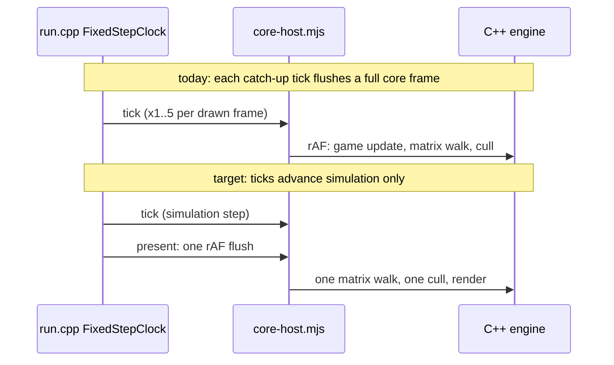

# PRD-610 — The native engine wins on real games

**Status:** PARTIAL
**Priority:** P1 — the C++ engine is the epic's value proposition, and on Midway it is slower than three.js on both desktop and web (AC-6 and AC-7 open).
**Complexity:** 6 (MEDIUM)
**Owner:** João
**Depends on:** PRD-573 (the epic; this PRD closes its final-tier v1.10 box and rides PR #493)

## Context

On 2026-10-13 the owner played Midway (`midway-open-pacific`) on three arms: the native C++ engine player on desktop, the engine as Wasm in Chromium, and three.js in Chromium. The cheap benchmark (R5, 4,096 cubes) read native desktop 2.8x and web 1.4x. On the real game the native player felt like about 20 FPS with a laggy HUD, while three.js in the browser ran at 51 FPS (p50 16.7 ms, p95 33 ms). The owner then split the benchmarks into a cheap tier and a final tier (PRD-573 Decisions, 2026-10-13).

Root causes, measured in flight under Xvfb (host load 35 to 48, so read the ratios). The data came from `TN_PLAYER_METRICS`, perf, gdb counts and a prelude on a copy of `game.js`:

1. **The whole core frame runs once per 60 Hz host tick, not once per drawn frame.** In free-run, `packages/runtime-native/src/engine/player/core-host.mjs` (`else if (!framePaced()) flushFrames(time)`) flushes core's rAF on every tick, and `run.cpp` `FixedStepClock{kTickStep, 5}` catches up to 5 ticks per drawn frame. All 5 ticks in a frame make the same 1,046 bridge calls and cost 13 to 19 ms each. Each tick runs one `__tnUpdateMatrixWorld` and one `__cullProjected`; cull ran 109 times against 44 `RenderDatabase::render` calls. Frame cost is about N×t + r, so it falls into a spiral once one tick nears 16.7 ms: every drawn frame ran the cap of 5. Prepending `globalThis.__tnFramePaced = true` cut CPU per frame (present excluded) from 90.5 to 39.4 ms, and game JS from 69 to 24 ms.
2. **The C++ matrix walk visits every node and then walks them all again to count them.** `__tnUpdateMatrixWorld` costs 3.2 to 5.2 ms of a 13 to 17 ms tick. It walks all 9,903 nodes with no pruning of hidden or `markStatic` subtrees, where the JS pruned pass visits 779. `bindings_scene.cpp` `subtreeSize()` walks the tree a second time only to count it (5.0% flat). The cost is 320 to 520 ns per node, mostly pointer-chasing cache misses. The web lane already recounts once per hierarchy change (`eba8ad1e5`, ctest `matrix_walk_count`), but the desktop walk is still unpruned.
3. **`ProjectedCull::apply` costs 1.65 to 1.95 ms per tick (7.7% flat).** For each of the about 9.9k nodes it does a string `type()` compare, a `dynamic_cast` and a geometry hash lookup.
4. **The HUD snapshot round trip is 138 ms p50 and 168 ms p95** (`TN_UI_SNAPSHOT lastRoundTripMs`), so the HUD trails the game by about 8 frames.

Ruled out: animation (60 mixer updates per tick, the same as on web), vsync, sleeps, and the HUD mailbox blocking the frame (the snapshot is async).

On web (the Wasm engine, before the web cuts), Midway air cruise ran p50 21.0 ms against 14.5 ms for three.js, CPU per frame 24.2 against 17.9 ms, and startup 40 against 17 s. Wasm memory was 1.93 GiB plus a 320 to 480 MiB JS heap, against a 620 MiB heap for three.js. In the named Wasm profile (21.7 ms per frame), RenderDatabase::render took 22% (project 8, renderPrepared 11), AnimationMixer 9%, updateMatrixWorld 9% and ProjectedCull 4%. The web cuts `collect()` (`9ac452167`) and the once-per-change subtree recount (`eba8ad1e5`) landed red-green but are untimed. Bridge cost per crossing: a set costs 0.5 to 0.8 µs, `getWorldPosition` 3.1 µs.

Correctness fixed on the way (merged on the epic): the player's keyboard and mouse input (`9372eb0e8`, real-X-event check `scripts/midway-bench/real-input.mjs`), the HUD overlay and its startup crash (`1741b4441`, `627881eed`), the 2D canvas (`c062adb08`; the white rear guns), and canvas `drawImage` (`99e885f1a`; the missing decals). The visual judge rated the rear-gun fixes IMPROVEMENT, near parity. The Midway parity gate covers takeoff, cockpit and rear-gunner poses on web and desktop.

Files inspected: `core-host.mjs`, `run.cpp`, `render_database.cpp` (`project`, `render`), `object3d.cpp` (`updateMatrixWorld`, `updateWorldMatrix`), `projected_cull.cpp`, `bindings_scene.cpp`, `scripts/midway-bench/*`, `scripts/perf-live.ts`.

## Solution

Fix the frame loop first, because it multiplies every other cost by up to 5. Then cut the per-tick engine work it multiplies, then measure only on the final tier.

- **Frame loop (cause 1):** in free-run, flush rAF once per presented frame. Catch-up ticks advance only fixed-step simulation, and never trigger a render pass. Paced and runner-attached behaviour stays as it is (playtests and benches use it).
- **Matrix walk (cause 2):** the walk returns its node count, which removes the second `subtreeSize` walk. It prunes hidden and frozen-leaf subtrees, mirroring the JS pruned pass.
- **Cull (cause 3):** iterate a cached flat list of renderable objects, invalidated on hierarchy or type change, instead of type strings and `dynamic_cast` per node.
- **HUD (cause 4):** find where the 130 ms goes (WebKit snapshot, copy, upload) and cut it below one frame.
- **Telemetry:** the player logs `TN_FRAME_BUDGET` every 300 frames in free-run, not only at startup, so in-flight FPS is measurable.

Risks: the frame-loop change touches timing that every desktop playtest and bench relies on, so the paced path keeps its ctests. Pruning must not skip a hidden node whose world matrix a game reads (`getWorldPosition` on hidden bone holders): keep lazy parent-chain updates on read.

## Acceptance Criteria

AC-1 to AC-8 are the boxes under the execution phases, one phase each: Phase 1 holds AC-1 and AC-2, Phase 2 holds AC-3 to AC-5, and Phase 3 holds AC-6 to AC-8.

## Blocked on

- João plays Midway on the native desktop player on the real display (`:0`) and confirms it feels at least as smooth as three.js in the browser — unblocked by João.

## Integration Ledger

| Capability | Reachable consumer/trigger | Replaces / disposition | Evidence |
|---|---|---|---|
| One frame per present | `tn-native-engine-player-v8` free-run loop: `run.cpp` → `core-host.mjs` `flushFrames` | per-tick flush in free-run removed; paced path kept | AC-1, AC-6 |
| Pruned matrix walk | core render → `__tnUpdateMatrixWorld` → `Object3D::updateMatrixWorld` | `subtreeSize` counting walk deleted | AC-3 |
| Cached cull list | core `__cullProjected` → `bindings_scene.cpp` → `ProjectedCull::apply` | per-node type strings and `dynamic_cast` removed | AC-4 |
| HUD under one frame | WebKit overlay snapshot mailbox → frame blend | — | AC-5 |
| Final-tier headline | `pnpm perf:live` hero | R5 hero becomes the cheap-tier row | AC-8 |

## Decisions

- 2026-10-13 (João): benchmarks have two tiers. Cheap benchmarks (the R-ladder) iterate, and final benchmarks (Midway, then other real games) decide. This PRD's speed ACs are final-tier only.
- 2026-10-13 (lead): out of scope here, for a follow-up PRD if they still matter after AC-6:
  - the 2D canvas `globalCompositeOperation` (Midway's wear scratches paint dark specks)
  - a same-frame press and release on HUD buttons
  - the `captureMouse` relative-motion proof
  - a boot warning listing absent web APIs
  - placard text metrics
  - the playtest runner failing to stop the player (exit 2 after its screenshots)
  - the `--memory` control fix in `profile:wasm-page`
  - Wasm memory of 1.9 GiB
  - web startup of 40 s against 17 s
  - ne-compat's matrix of other games

## Execution Phases

#### Phase 1: One frame per present
**Status:** PARTIAL
**Files:** `packages/runtime-native/src/engine/player/core-host.mjs`, `packages/runtime-native/src/engine/player/run.cpp`, the player metrics emitter, a new `tests/native-engine/player-*.mjs` ctest.
**Implementation:** gate `flushFrames` on present in free-run. Keep fixed-step simulation ticks if gameplay needs them. Log the frame budget every 300 frames.
**Verification:** the AC-1 ctest red then green. The existing paced, real-input and overlay player ctests stay green. A Midway CPU-per-frame before/after on Xvfb (the prelude A/B gave 90.5 to 39.4 ms) covers AC-2.

- [x] AC-1 [local]: in free-run with a slow tick, core rAF, the matrix walk and the cull each run exactly once per presented frame. proof: player ctest (`tests/native-engine/`, red at 5 per frame before the fix) — Evidence: ctest `native_engine_player_frame_per_present` (25 ms frame callback, free-run): red on the old `core-host.mjs` at `…,1,1,2,3,4,5,5,5,5,5` callbacks per drawn frame, green at 1 per frame over 36 frames. The matrix walk and the cull run inside core's frame callback, so they follow it. `ctest -L native-engine -R player` 21/21 pass (2026-10-13).
- [x] AC-2 [local]: the player logs `TN_FRAME_BUDGET` every 300 frames during free-run flight. proof: Midway `flight.sh desktop` log with at least 3 in-flight budget lines — Evidence: 2026-10-13, Xvfb. The AC-1 player's `flight.sh desktop` run logged 24 `TN_FRAME_BUDGET` windows, 8 of them in flight (windows 17 to 24), with parity PASS. A 120 s free run with no runner logged 27 budget lines over 2,065 frames.

#### Phase 2: Cut the per-frame engine passes
**Status:** PARTIAL
**Files:** `packages/runtime-native/src/engine/scene/object3d.cpp`, `packages/runtime-native/src/engine/abi/bindings_scene.cpp`, `packages/runtime-native/src/engine/scene/projected_cull.cpp`, the overlay snapshot path.
**Implementation:** the walk returns its count and prunes hidden and frozen subtrees, with lazy parent-chain updates on read. Cull iterates the cached renderable list. Profile the HUD round trip and cut it. One cut per commit, each with its guard, kept only when an alternating Midway A/B shows every B beating every A and parity passes. The visual judge reviews any cut that can change pixels.
**Verification:** the AC-3, AC-4 and AC-5 proofs. `ctest -L native-engine` stays green with the NVIDIA ICD env.

- [ ] AC-3 [local]: on Midway the C++ matrix walk visits at most 1,500 nodes per frame (9,903 today) and makes no second counting walk. proof: ctest `matrix_walk_count` extended with a hidden and frozen subtree, plus the Midway node probe — Evidence: open, the node target is not met. 2026-10-13: the walk returns its own count (the `subtreeSize` counting walk is deleted), skips hidden subtrees without bones (a moved hidden parent is caught up when shown) and stops at a frozen root (`static` with `matrixWorldAutoUpdate` off, now bound). The ctest `matrix_walk_count` covers each case and went red against the old walk. In flight the walk visits at most 5,816 nodes against 9,584 before (−39%). Midway calls no `markStatic`, so 1,500 needs frozen subtrees or another cut. Instruction A/B (3 rotations, `cpuFrameKInstructions`, parity PASS on every run): 26.51 to 26.56 M per frame before, 25.34 to 25.38 M after (−4.4%); every after run beats every before run. CPU ms on this shared host (load 13) spread 11.5 to 16.4 ms within one build, so the keep rule reads instructions.
  AC-3 priority audit (2026-10-13): owner prioritizes AC-3, then AC-4/AC-5, toward native 2–3× three.js on matched work; refresh the dashboard when a better result is proven. Fresh unchanged-package `resume-trs-a1-desktop` exited 0, parity PASS, final/max 5,963 visits; no accepted speedup. Diagnostic-only `resume-ac3-census2-desktop` matches native accounting exactly: 5,226 actual/model visits during warmup, 4,448 with ordinary hidden pruning, 9,065 total nodes and 2,990 bones. Hidden-bone pruning alone cannot establish ≤1,500. Historical 779 is not a same-package control: the JS counter counts an overridden recursive walk as one node. Revision-only clean-subtree pruning is unsafe because raw leased transforms and public C++ fields bypass notifications. Composition and partial hidden-rig experiments were parked; neither is an accepted change. Native change census now falsifies dirty pruning as the complete solution: across the final 1,000 player frames, 945 counted updates visited median 5,579 nodes (5,365–5,963), changed median 2,033 local matrices (1,928–2,148), and changed median 5,455 world matrices (5,246–5,834); 55 frames had no update and were excluded. Every counted late frame changed more than 1,500 world matrices. This was diagnostic evidence only: airborne/altitude assertions and manual capture parity passed, but the runner exited 1 because temporary diagnostic stderr was classified as an error. Instrumentation was removed and the ordinary player rebuilt. Next structural investigation: share rig-relative transforms and resolve world matrices at actual consumers, with eager fallback for exposed raw storage and unsupported C++ writes. AC-3 remains open.
  Structural prerequisite (2026-10-13, implemented; not a performance win): V8 JS-math constructors and fresh native clone returns now admit tracked transforms. Private TRS views mark local writes dirty; raw arrays, matrix views and numeric address getters set irreversible eager fallback before storage escapes. Native animation, skeleton pose, physics, inspect and ABI writers mark dirty. Public C++/Wasm objects remain eager. Engine-only `objectOf` and the player-to-renderer scene handoff are not public borrows; no blanket renderer deoptimization was added. Rebuilt focused checks: five V8 math/matrix/GC cases PASS; native writer checks 11/11 PASS; numeric-address checks 6/6 PASS. Final reflection refinements reran math views and native matrix walk, both PASS. Raw `_a`/Euler `_o` assignment and array aliases remain supported; descriptor replacement/deletion now reject to prevent detached tracking. Physics syntax check PASS; its optional runtime target is absent. No cache consumes the metadata yet, and no new-player flight or speedup is claimed. The separate unmeasured copy guard was parked and baseline copies restored. Retained-stack qualification4 A1 exited 0, parity PASS, 1,000 frames: 22.9605 M instructions, 9.2507 ms CPU, HUD p95 55 ms, 5,960 visits; B1 stopped before launch on a foreign GPU playtest. No winner promoted. Next: correct shader skin/instance order for rig-relative palettes, then GPU joint evaluation; identical-pose reuse is insufficient for per-crew phase/rate variation. AC-3 stays open.
  Rig-relative prototype review (2026-10-14): tracking checkpoint `360533272` is committed. The shader-order blocker is fixed: palette variants now skin before instance placement, including normals; ordinary instancing retains its existing order. Generated-WGSL operand-order and numerical tests cover noncommuting transforms and mixed legacy slots. Five focused skinned/palette tests passed; a fresh read-only critic found no further blocker. Worlds remain eager; rendered parity, visual acceptance, actual matrix-visit reduction and performance remain unverified. Midway crew have per-index phase and rate (`game.js:33748–33750`), so whole-pose sharing cannot be the primary cut.
  GPU hierarchy kernel (2026-10-14, internal prototype): `JointComputePass` composes packed local TRS, resolves parent-before-child worlds and writes the existing bone-matrix storage format. The locked native compute readback test exited 0 on NVIDIA GeForce RTX 2080 / Vulkan: two animated dispatches matched an independent double reference; untouched ranges and malformed-input rejection passed. Fresh read-only review found no standalone-kernel blocker. No production activation, flight, visit-count reduction or speedup is claimed. Deferred animation publication and consumer integration remain in progress; AC-3 stays open.
  Deferred publication prerequisite (2026-10-14, internal prototype): Bone owns final mixer doubles and writes a stable shared packed-TRS stream directly. Unsupported writes, escaped views, destruction and stream relocation revoke eligibility. CPU readers join required worlds using parent identity/revision dependencies; regression tests cover joined-parent/unchanged-child worlds, non-Bone attachments, dotted ABI matrix reads and mixer restore. Locked Node 20 build and 21 focused animation/skeleton/ABI/inspect/V8 checks passed; fresh review cleared both reader blockers. Production admission has zero callers. Physics runtime, dedicated deferred additive/weighted mixing and skinned raycast/bounds cases, flight parity, visual acceptance and performance remain unverified. This is not an AC-3 visit-count improvement.
  Integration census (2026-10-14): all 29 GLB entries in `pkg-ac3-native-census-20261013/native/assets.tnpk` were parsed and their SHA-256 verified. The three skinned assets each have 65 joints with original parent-before-child order, no inter-joint non-Bone bridge and an identity Armature placement. Runtime game code adds Head cap bands to nine crew rigs (585 bones); the first restricted integration retains those rigs eagerly. The 29 unique assets contain 276 helper nodes (267 not animation targets), but these asset counts are not runtime visit savings. Live bind-matrix aliases bypass transform tracking and require sticky admission refusal; bind/skeleton/mode/inverse changes and explicit CPU bone-matrix reads require invalidation or joining. Restricted GPU production integration is underway; no measured improvement is claimed.
  Measurement-window correction (2026-10-14): the canonical desktop reducer now selects the last 1,000 complete active frames (`updates > 0`, positive finite CPU time/instructions/frame time), excluding zero-update captures and incomplete/unavailable counters. Both frozen arms use this same reducer; raw logs remain intact. Winner qualification rejects either arm with fewer than 1,000 eligible frames. Regression tests include the observed 1,245,880 K-instruction capture spike, zero counters and 999-frame arms; dashboard/parity checks passed 55/55. The UI exposes used/eligible/excluded counts. HUD still uses all snapshots and matrix visits the last projection observation; those windows are explicitly unaligned. Recomputed historical numbers are measurement corrections, not engine improvements.
  Restricted GPU consumer integration (2026-10-14, experimental): GPU resources are validated before Bone boundaries skip CPU traversal; main/reflection consumers bulk-upload the final mixer stream and preserve GPU palette ranges across CPU uploads and growth. Locked renderer/ABI/compute builds and 12 focused checks passed. The real RTX 2080 / Vulkan fixture covers mixed eager/GPU rigs, second-frame animation, moving ancestor and placement, reflection, output growth and immediate inverse calculation after revocation; 310/448 covered pixels in the two frames, with zero pixels differing by more than two channel units versus eager rendering. Counter tests cover actual world updates and deferred query dependency inspections. Fresh source review found no further screen-correctness blocker. Version 2 native totals now include executed projection boundaries, plan validation and admission/revocation maintenance; the 12 focused checks passed again, including zero steady-frame maintenance scans. Full revocation with a pending pose now compares absolute worlds/inverses and immediate CPU skinning against an independently updated eager rig; the existing publication-count implementation passes. At this checkpoint admitted rigs drew individually; the batching qualification follows below. No Midway flight, visual judge, same-counter baseline, ≤1,500 result or 2–3× speedup is claimed; AC-3 remains open.
  GPU crowd batching (2026-10-14, verified mechanism): admitted rigs now share existing exact-key batches, with renderer-owned output ranges matching instance order; changed mappings upload rig headers without repacking Bones. Locked focused checks passed 10/10, including `tn-native-engine-render-database-test gpu_joint_production` and `tn-native-engine-compute-test readback`; `tn-native-engine-player-v8` rebuilt successfully. Across four RTX 2080 / Vulkan fixture frames, main draws/instances were 1/3, 2/3, 2/2, 1/3; reflection was 1/3, 2/3, 1/1, 1/3; shadow batches were 1, 2, 0, 0. Each frame had zero pixels differing by more than two channel units from independent eager rendering. The fixture covers phased shared assets, ordering, hidden subsets, reflection layers, shadows, eager fallback and output growth. No real-Midway flight, fresh visual-judge verdict, ≤1,500 result or performance improvement is established; AC-3 and real-Midway performance acceptance remain open.
  Versioned counter display (2026-10-14): the dashboard now summarizes version 2 whole-frame world work over the same active-frame tail as CPU/instructions, displaying median/max/sample count beside the original projection count. Every used frame must have version 2, safe nonnegative integer components and an exact total; mixed, missing or malformed versioned observations block winner qualification without hiding CPU data. Historical runs without these counters retain their original metrics; the broader count does not replace historical progress percentages or headline targets. Dashboard/parity checks passed 68/68, including malformed-counter cases. No new engine improvement is inferred from this display change.

- [ ] AC-4 [local]: `ProjectedCull::apply` makes no type-string compare or `dynamic_cast` per node, and its share of the Midway main thread is below 2%. proof: ctest on the cached renderable list plus a perf of the player in flight — Evidence: open, the share is not yet measured on the final cut. 2026-10-13: the cull reads a flat list of the tree, rebuilt only when `Object3D::hierarchyVersion()`, the root or the camera changes, so a frame reads no type string and casts nothing. Each node also caches its geometry's position attribute per geometry revision, which removed the `attributes.find("position")` map lookup (44% of the cull in `perf annotate`). The ctest `native_engine_abi_projected_cull_list` checks one rebuild over six frames, the hidden-subtree skip, a rebuild on `add`, and a swapped position attribute; forcing a rebuild every frame and ignoring the geometry revision each turn it red. A perf flight of the first version (list only) put the cull at 2.83% of the main thread in flight, from 7.7%. Instruction A/B, 3 rotations, parity PASS on every run: 25.34 to 25.38 M instructions per frame before, 25.00 to 25.03 M after (−1.4%); every after run beats every before run.
- [ ] AC-5 [local]: the HUD snapshot round trip is under 16.7 ms p95 in flight. proof: `TN_UI_SNAPSHOT lastRoundTripMs` from `flight.sh desktop` — Evidence: open, not met. 2026-10-13, Xvfb, `TN_UI_SNAPSHOT_TRACE`: in flight the WebKit `get_snapshot` call takes p50 54 ms and p95 68 ms, and the copy and compare take 0 to 1 ms. The WebKit web process takes 61.6% of all CPU samples of the run, about 2.3 times the game's main thread. Each snapshot is a full-page CPU raster of the HUD. A probe page with the same full-screen layers takes 30 to 49 ms per snapshot, with or without a transparent background and with either snapshot option. Reading the offscreen window's own surface instead costs 0.6 ms, but it does not hold the page: full-screen layers are missing and semi-transparent pixels accumulate. The cut that can meet this target is a damage-driven backend (WPE `buffer-rendered`, see `native/ui-overlay/src/bin/probe-wpe.c`), which is not installed on this host. That is a follow-up PRD, not a Phase 2 cut.
  Measurement correction (2026-10-13): `cache1-a1` and `cache1-b1` ran two Midway instances concurrently and recorded whole-run HUD p95 of 105/107 ms. The dashboard selected the baseline arm (`pkg-ac10-cache-a1`), so this was not an isolated candidate-regression measurement. Stopped the remaining parallel jobs; raw runs remain visible with `timing-exclusion.txt` and are excluded from headline scores. Fixed the regression percentage: 105 vs 68 ms is 54%, while 72% was distance away from the target. Dashboard checks 33/33 pass; live API verifies the exclusions and selects the prior comparable `pkg-b1` median of 59 ms (still above the 16.7 ms target). A fresh isolated A/B is running; no new HUD improvement claimed. Created the global `threenative-engine-benchmarking` skill to require isolated measurements and preserve provenance.

#### Phase 2b: Structural levers (owner bar: 2x to 3x faster than three.js)
**Status:** PARTIAL
**Why:** after the Phase 2 cuts the main-thread profile is flat; no symbol is above 3%. A DWARF capture in flight (dwarf2, pkg-i-ac4, 310 samples, 2026-10-13) splits the main thread as follows: render 36% (the reflection pass alone 13.5%, the Dawn submit 8%), JS with its glue and GC 30%, and engine work called from JS 15% (animation 6.5%, matrix walk 4.2%, cull 2.6%, skeletons 1.6%). The present path is 9% under Xvfb. Function-level cuts give 1% to 4% each, so this phase moves whole blocks off the main thread or removes them. In Chromium the GPU process already submits off the main thread, so the native player must do at least that much.
**Files:** `packages/runtime-native/src/engine/player/run.cpp`, `packages/runtime-native/src/engine/renderer/{renderer,render_database,gpu_resources}.cpp`, `packages/runtime-native/src/engine/animation/*`, `packages/runtime-native/src/adapters/v8adapter/{adapter,math_bridge}.cpp`.
**Implementation:** one lever per commit, each kept only on an instruction A/B (every B beats every A) with parity PASS, in this order of payoff. Pixel-changing levers get the visual judge.
**Verification:** the AC-9 to AC-13 proofs.

- [ ] AC-9 [local]: GPU submit, blit, surface acquire, present and GPU event polling run on a present thread; the main thread only encodes. proof: ctest on the present thread's ordering (blit N never samples frame N+1) plus a Midway instruction A/B and a byte-identical screenshot pair — Evidence: pending.
  Landed, box open: ctest `native_engine_gpu_thread_ordering` green (mutation: a write that skips the queue goes red at `readFirst == first`), `ctest -L native-engine` 384/384. Midway A/B (`TN_GPU_THREAD=0` A vs `=1` B, same package, 3 rounds, Xvfb, 2026-10-13): main-thread CPU A 14.56/14.86/14.98 ms, B 11.77/12.16/12.18 ms (-19%, every B beats every A); instructions A 25.06-25.19 M, B 23.79-23.81 M (-5%); frame A 51.2-54.9 ms, B 46.0-48.5 ms; parity PASS 6/6 with identical SSIM. Open: byte identity fails even A vs A (animated frames: A1/A2 differ in 6-3,131 px); A1/B1 differ in 5-3,064 px, inside that noise. Needs an owner call on the proof wording, or a frozen-animation capture.
- [ ] AC-10 [local]: the reflection pass reuses the main pass's frame work (no second matrix walk, one record cache), and its share of the main thread falls from 13.5% to at most 7%. proof: ctest on the reflection database sharing records, plus a DWARF flight — Evidence: pending.
  Partial (2026-10-13): reflection passes skip the second scene matrix walk unless render callbacks ran, omit shadow casters for lights outside the mirror camera's layers, and skip geometry-cache sweeps when no store was released. Fresh focused ctests `native_engine_renderer_reflection_reuse` and `native_engine_renderer_geometry_cache`: 2/2 pass (including same-frame pixel equality, mirror-only geometry and callback fallback). Existing three-round Midway A/B (`b1-a*` vs `b1-b*`, Xvfb): 23.807–23.850 M -> 22.917–22.983 M main-thread instructions per frame (−3.7%, every B beats every A); parity reported PASS 6/6. Fresh fixed-package flight `codex-ac10-reflection-desktop`: parity PASS at all poses. DWARF main-thread cycle capture after 82 s, 250 Hz for 5 s, 413 samples (`~/.cache/tmp-tn/midway-runs/codex-ac10-reflection-cycles.perf.data`): reflection share 8.0%, above 7%. `perf record -m 64` fixes the default-buffer mmap failure without changing OS settings. Fresh read-only visual judge on two runs per arm at takeoff/cockpit/reargun: NEUTRAL in all six pairs, appearance preserved; accepted by João for this performance-only change: unchanged appearance passes, visual regression fails. Still open: reflection share target and a shared record cache; each reflection database still owns its own records, and the ctest proves walk reuse, not shared records.
  Winner protection (2026-10-13): dashboard pins the measured `isolated-cache-a1-desktop` reference independently of qualification, keeps the original `pkg-ac1` progress baselines, and lists newest experimental results separately. Explicit reviewed winner promotion requires three alternating SHA-pinned pairs, passing parity and the instruction keep rule with CPU/HUD nonregression; absent evidence stays unqualified without hiding measured charts. Focused dashboard checks 39/39 pass. Retained renderer rebuilt with current Rust HUD; binary compositor/pacing markers verified. Diagnostic `winner-hud-v1-desktop`: parity PASS, 22.9295 M instructions/frame, 15.83 ms main thread; not a controlled speed comparison and not promoted.
  Rejected shared-record candidate (2026-10-13): isolated sequential `isolated-cache-a1-desktop` / `isolated-cache-b1-desktop`, both exited 0, last 1,000 frames: baseline 22.9095 M instructions / 9.25 ms main thread / 2.97 ms render; candidate 23.543 M / 13.03 ms / 4.41 ms. Instructions increased 2.8%, failing the keep rule; candidate reverted and patch preserved outside the repository. Both packages still link the older HUD library, so these runs do not qualify the newer HUD commits. Earlier committed matrix-walk optimization retained; AC-10 remains open.
  Rejected shared-record retry (2026-10-13): preserved separate per-pass DrawCaches; focused reflection ctest 1/1 PASS, frozen game/assets/HUD identical. First isolated pair both exited 0: A 22.937 M instructions / 17.17 ms main thread / 5.86 ms render; B 23.585 M / 21.52 ms / 7.01 ms. Instructions increased 2.8%, failing the keep rule. Stopped remaining pairs and verified no owned player remained; reverted candidate source, retained immutable packages and external patch. After two shared-record regressions, stop this approach: the assumption that borrowing records removes more work than it adds is doubtful. Reattribute game-update/bridge cost; user requested independent Gemini 4 Argon batch steering. No winner promoted.
  Remaining implementation boundary: `Record::Draw::params` is mutable and `DrawCache` carries renderer-owned program/pipeline/bind-group handles; sharing complete records must preserve main-pass snapshots when a reflection callback edits material or geometry. Converted attribute buffers also need shared lifetime (currently owned by each database). In the same 413-sample profile, reflection projection accounts for 1.7% of the main thread, reflection geometry synchronization 2.2%, and reflection render-pass creation 1.2%; a shared scene-record cache must keep per-pass rendering state valid.
  Stack 4 (2026-10-13, commits 71e6a5a0f, 6d9e0fa30): the projected cull is held through the C++ draw (core restored it inside `beforeRender`, before `database.render`, so the native cull culled nothing); the record cache is indexed by object id with targeted invalidation; a mesh outside every frustum only refreshes its record; constant animation tracks skip the keyframe seek; the HUD overlay uploads from its own buffer on the GPU thread (a full-screen copy on the main thread, 4.1% of its cycles). Tier 2, three alternating SHA-pinned pairs against the pinned winner `pkg-ac10-winner-hud-v1`, parity PASS 6/6: A 22.92/22.98/22.96 M instructions, 9.11/10.70/12.67 ms main thread; B 20.82/20.78/20.85 M, 8.50/9.42/10.17 ms. Every B beats every A on instructions (−9.3%) and wins its pair on CPU (−12% median). Visual judge (fresh Sonnet subagent, takeoff/cockpit/rear gunner, 2 runs per arm): NEUTRAL. Not yet promoted: the dashboard rule "slowest B CPU ≤ fastest A CPU" fails (10.17 ms against 9.11 ms) because host load rose from 5 to 18.7 during pair 3; the tier 2 reruns on a quiet host. Engine ctests with every test binary rebuilt: 389/397; the 8 reds are 7 labeled `tn-known-red` or `tn-perf` and `target_graph` (its CMake graph "reaches scripting", present before this work). The reflection share is not yet re-measured, so AC-10 stays open.
- [ ] AC-11 [local]: a binding call whose arguments are engine-backed math views passes their addresses directly, with no `Stand`, property `Get` or copy-back; binding glue plus `LoadIC_Megamorphic` fall by half. proof: adapter ctest counting `Get` calls per crossing, plus a DWARF flight — Evidence: pending.
  Tried, not kept (2026-10-13): view arguments pass their native handle (builder commit a00abec50, branch-local). Adapter microbench 600k view-argument calls 510 -> 140 ms, but Midway A/B (3 rounds, AC-9 package vs AC-9+AC-11) is neutral: main-thread CPU A 11.30/14.10/10.97 ms, B 11.44/13.99/10.82 ms, instructions -0.1%, parity PASS 6/6. At 1,074 bridge calls per frame the boundary cost cannot reach the halving this box asks for; the JS share is the game's own JS, not the glue.
- [ ] AC-12 [local]: animation mixers and skeletons evaluate on worker threads, and a read of an animated property before the join still sees the updated value. proof: ctest (read-after-update on a deferred mixer) plus a DWARF flight with the mixer share of the main thread at most 2% — Evidence: pending.
  Rejected shared-keyframe seek (2026-10-13): source-proven player A `1041bcda07d1…`, B `da20c54fdd0c…`, identical game/assets/HUD; rebuilt focused animation tests 3/3 PASS. Isolated A1/B1/A2/B2 flights (`resume-seek-*` in `/home/joao/.cache/tmp-tn/midway-runs`) exited 0 with parity PASS 4/4, last 1,000 frames: A 20.8235/20.826 M instructions, B 20.7425/20.8465 M. Baseline noise 0.012%; the first −0.39% gain did not repeat, and B2 loses to both As, failing the keep rule. CPU/HUD timing excluded for host load 20.75–49.57. Fresh read-only visual judge: takeoff/cockpit/rear gun NEUTRAL across two runs per arm; no visible regression, but this does not override the instruction failure. Reverted exactly the six candidate source/test/CMake files; retained patch `/home/joao/.cache/agent-dumps/prd610-ac12-seek/rejected-shared-seek-20261013.patch`. No winner promoted; restored player rebuilt successfully and SHA matches A `1041bcda07d1146bc9bc6502d85ec4292f1e9a7d86753907c0ad5ee4781cdd5a`, focused baseline animation ctests 2/2 PASS. AC-12 worker-thread implementation remains open.
- [ ] AC-13 [local]: Midway native main-thread CPU per frame in flight is at most half of three.js's on matched wall-clock work (at least 2× faster; owner goal 2–3×), and at most 5.65 ms as the retained absolute budget, with parity PASS. Historical three.js 11.3 ms excluded counted game updates and cannot prove the matched-work ratio. proof: alternating `flight.sh desktop` and `flight.sh legacy` pairs, at least 3 per arm — Evidence: pending.

#### Phase 3: Final benchmark
**Status:** NOT STARTED
**Files:** `scripts/midway-bench/*` (timing pairs), `scripts/perf-live.ts`, `scripts/perf-live.html`, `docs/benchmark/prd573/RESULTS-2026-10-12.md`.
**Implementation:** alternating Midway timing pairs on desktop and web at three poses, with parity on. Update the dashboard headline and the results doc. Tick PRD-573's final-tier box only from these numbers.
**Verification:** the AC-6, AC-7 and AC-8 proofs. Then João plays (see Blocked on).

- [ ] AC-6 [local]: the native desktop player beats three.js in Chromium on Midway: lower frame p50 and lower main-thread CPU per frame at takeoff, cockpit and rear-gunner, with parity PASS on all three. proof: alternating `flight.sh desktop` and `flight.sh legacy` timing pairs, at least 3 per arm — Evidence: pending.
  Measurement correction (2026-10-13): counted browser `advance()` updates were excluded from `frame.p50`, unlike desktop `cpuFrameCpuMs`; historical 11.3 ms is not a matched-work reference. Browser flights now use the shipped `--live-clock` flag; dashboard CPU targets/ratios require a successful terminal runner report with wall-clock acquisition, preserving historical raw budgets. Focused dashboard/perf-live tests 74/74 PASS, including executable shell invocation and malformed/failed/clock-mismatch regressions. Real `resume-liveclock-legacy` flight exited 0 and parses as wall-clock; its two windows show update p50 1.6/2.3 ms, confirming updates are included. Timing excluded for host load; at least three in-flight windows and alternating quiet-host qualification remain open. The active dashboard directory `/home/joao/.cache/tmp-tn/midway-runs` still has no `winner-lock.json`: package names containing "winner" are references, not formal promotion.
- [ ] AC-7 [local]: the web Wasm engine is no slower than three.js on Midway CPU per frame (ratio at least 1.0) at the same three poses, with parity PASS. proof: alternating `flight.sh native` and `flight.sh legacy` pairs — Evidence: pending.
- [ ] AC-8 [local]: the perf dashboard's headline shows the Midway final-tier ratios, with R5 labelled as the cheap tier. proof: `pnpm exec vitest run scripts/__tests__/perf-live.spec.ts` — Evidence: pending.
  Resume gates (2026-10-13): focused dashboard/perf-live 74/74 PASS and real live-clock flight exit 0. The laptop frozen install exposed a pre-existing missing `examples/wasm-engine-boot` lock importer (manifest and lock exactly matched HEAD); regenerated only its 28-line importer. Workspace build and `pnpm typecheck` then passed; lint found one pre-existing formatting error in `browser-backend-gc.ts` (file SHA matched HEAD), corrected without behavior changes. Laptop care refused the full unit suite at 100°C (exit 75). The subsequent local full suite exited 1: runtime-native reported 134/140 files and 1,582 tests passed, 12 failed, 63 skipped, including missing unbuilt native executables; the full board is not green and remaining failures are not yet fully classified. Local whole-tree lint also encounters existing generated minified `examples/engine-load-test/dist-engine` bundles; touched-file Biome checks pass with one nonfatal complexity warning. Those generated artifacts were preserved. Updated dashboard preview `http://127.0.0.1:18765` reports no qualified winner and no unsupported historical CPU gap; the existing 8765 server was left running.
