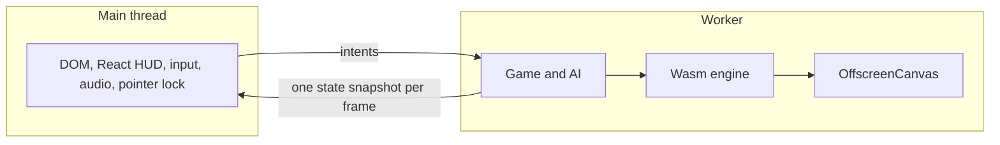

# PRD-752 — Web games run in a worker, so the page cannot stall them

**Status:** PARTIAL — phases 1 and 2 done; phase 3 next.
**Priority:** P1 — on a loaded host every web game collapses (shooter kit: frame p50 33 ms, p95 100 ms, main thread 100% busy); worker mode (phase 3) and Wasm threads (phase 4) are open.
**Complexity:** 8 (HIGH) — 10+ files across core, the web host, the Wasm engine and the harness (+3), a new host-capability layer (+2), worker and `OffscreenCanvas` boot (+2), Wasm threads and isolation headers (+1); risk override: none
**Owner:** João
**Parent:** [PRD-573](./PRD-573-unreal-class-performance-in-release-cycles.md), Cycle v5 (v5.1 worker mode, v5.2 Wasm threads). This PRD carries the v5 boxes; PRD-573 points here.
**Depends on:** None. The waste cuts on the main thread are PR #574 and are not part of this PRD.

**Update rule:** one PRD, one PR. Each phase lands as commits on that PR. Each box is ticked, with its result, in the commit that proves it.

## Goal and route

**Goal:** a web game keeps its frame time when the page, the browser or the host is busy. The game, its AI, the JS-to-Wasm glue and render submission leave the browser main thread.

**Route:**

1. Core reaches the DOM only through one **host-capability layer**. PRD-573 counted 23 files by text search; most hits are local variables named `window`. A type check against the worker lib found 19 real reads in 5 files (`audio`, `game`, `hot`, `renderer`, `viewport`). The layer is `packages/core/src/platform.ts`.
2. Behind a flag, and without COOP/COEP, the game and engine boot in a worker on an `OffscreenCanvas`.
3. With cross-origin isolation, the engine adds Wasm threads (`TN_WEB_THREADS`) for its job pool. Without isolation it reports `threads: off`.

## Evidence

Clean CPU profile of the shooter kit (NVIDIA, no DevTools, 2026-10-26): frame median 33 ms, p95 100 ms, main thread 100% busy. The game, AI, React HUD, JS-to-Wasm glue and render submission all share the one main thread.

## Honest expectation

- A worker moves the game and its cost off the main thread. React, the DOM, extensions and GC stay behind: about 5-10% of the frame in a production build.
- Wasm threads help the C++ side only: about 15-20%.
- Neither fixes the fragility when every core is busy. PR #574 cuts waste separately.
- So the KPIs are **measured** main-thread busy and p95 under a **stated** CPU load, set from the phase 1 baseline. They are not guesses. The numbers in the boxes below are targets to confirm or revise against that baseline, in a `## Decisions` entry.

## Decisions

- 2026-10-26 (owner): the worker HUD contract is confirmed: the HUD gets one state snapshot per frame from the worker and sends intents back. "Yes, and v5.2 threads too." This clears the last v5.1 line under PRD-573 "Blocked on" and adds v5.2.
- 2026-10-26 (owner, "ok go 1"): scope stays web-only. Native has no browser main thread; its render thread and job pool stay in PRD-573 Cycle v3. Native is a regression gate here only (`pnpm native:verify:desktop` in phase 2).
- 2026-10-26 (lead): this PRD has 4 phases and 14 boxes, above R5, because it carries the parent's v5.1 and v5.2 boxes plus the measurement phase. PRD-573 waived R5 for the same epic. Splitting it would cut the baseline from the KPI it sets.
- 2026-10-26 (lead): **baseline** (phase 1). Desktop, RTX 2080 (`adapter.info` "nvidia turing"), Xvfb, production `vite preview` builds of the scaffolded kits, `--seconds 10 --warmup-ms 8000 --cpu-work`, 3 runs per arm, medians. Load 24 = 24 busy-loop processes on 24 logical cores (`--load 24`).

  | Kit | `--load` | load1 | p50 | p95 | main thread busy |
  |---|---|---|---|---|---|
  | shooter | 0 | 8.3 | 11.3 ms | 17.6 ms | 69% (7.9 ms/frame) |
  | shooter | 24 | 31.1 | 18.6 ms | 116.3 ms | 97% |
  | starter | 0 | 31.2 | 17.0 ms | 17.9 ms | 33% (5.1 ms/frame) |
  | starter | 24 | 34.1 | 17.6 ms | 35.4 ms | 55% |

  The starter load-0 runs followed the shooter load-24 runs, so their load1 is the lagging one-minute average, not live load. The loaded shooter reproduces the reported collapse.
- 2026-10-26 (lead): **v5 KPIs**, set from that baseline, measured on the same lane at `--load 24`. Shooter: main thread busy at or below 48% (0.5x of 97%), p50 no worse than 18.6 ms, p95 at or below 116.3 ms with 58 ms (0.5x) as the target. Starter: main thread busy at or below 28% (0.5x of 55%), p50 no worse than 17.6 ms. A worker run that is not on this lane re-measures its own main-thread arm.
- 2026-10-26 (owner): scale-down rule. Bounded implementation slices go to a cheaper arm (`opencode-go/deepseek-v4.1-flash`, variant `max`, at most 2 arms). The lead designs, writes the red tests and reviews every diff.

### Phase 1: Loaded-host baseline
**Status:** DONE

Sets the KPI baseline. Shooter kit and starter kit, same machine, same stated load.

- [x] A repeatable loaded-host profile exists: it starts N busy-loop processes (N and load recorded), runs the shooter and the starter, and prints main-thread busy %, frame p50 and p95. proof: `sh scripts/xvfb.sh pnpm profile:wasm-page -- --url <url> --seconds 10 --warmup-ms 8000 --cpu-work --load 24 --json`. Result: `--load` and `busyPercent` added, `scripts/__tests__/profile-wasm-page.spec.ts` 15/15 green, 12 runs recorded in Decisions
- [x] The baseline for the shooter and the starter is recorded in this PRD under `## Decisions`, with load, adapter name (not SwiftShader) and three runs per arm. The v5 KPI numbers are set from it. proof: the `## Decisions` entry, `adapter.info` captured in the run. Result: baseline and KPI entries above, adapter "nvidia turing" in all 12 runs

### Phase 2: Host-capability layer
**Status:** DONE

- [x] A red-green spec scans `packages/core/src` and fails on any read of a global a dedicated worker lacks (type check against the `webworker` lib, value positions only) outside the host-capability layer `packages/core/src/platform.ts`. It is red on the current reads and green after the move. proof: `pnpm exec vitest run scripts/__tests__/check-core-boundary.spec.ts`. Result: red with 19 reads in 5 files, green 32/32 after the move to `hostWindow`/`hostDocument`/`hostResizeObserver`; `pnpm exec tsx scripts/check-core-boundary.ts` passes; 11 related core and boundary spec files 248/248; core typecheck exit 0
- [x] The native host runs core unmodified through the same layer, with no dynamic `import()` in core. proof: `pnpm exec vitest run scripts/__tests__/check-core-boundary.spec.ts`; `pnpm native:verify:desktop`. Result: 32/32; `native:verify:desktop` exit 0 ("desktop core gate passed: 300 frames, 1280x720", UI frame gate passed) after `pnpm native:build` in this worktree
- [x] The starter plays through a loopback proxy (main thread talks to the layer over a message channel in the same thread) with unchanged behaviour. proof: `packages/core/__tests__/ui-bridge-inbound.spec.ts`; a pause round-trip scenario (click `button[aria-pressed]`, `hud` asserts `pause` -> `resume`) on a scaffolded starter at `/` and at `/?tnUiLoopback=1`; the starter's own `pnpm test` (`test:templates` skips the starter: it runs in the golden-path lane). Result: spec 6/6; round trip exit 0 on both URLs; a Playwright probe reads `__tnUiLoopback` false at `/` and true with the flag; kit `movement`, `survives`, `production-readiness` pass. `play` fails `performance.maxFrameMsP95` on GPU time on this host, and the scaffold from before this change fails it too (before 2/2 runs at GPU p95 20.3/17.3 ms, after 1/2 at 18.1 ms; CPU about 7.5 ms in both)

### Phase 3: Worker mode and v5 KPI
**Status:** NOT STARTED

- [ ] Behind a flag, without COOP/COEP, the starter boots in a worker on an `OffscreenCanvas`; input, pointer lock and audio forward from the main thread, and the HUD takes one state snapshot per frame and sends intents back. proof: `pnpm test:templates` with the flag, starter scenario green
- [ ] The playtest harness captures the worker canvas (screenshot not blank, frame counter advances). proof: `pnpm test:templates` with the flag; `node packages/playtest/dist/runner/cli.js doctor --url <url> --text`
- [ ] Main-thread busy falls below the target set in phase 1 (first target: below 0.5x of the main-thread arm) and p50 is no worse, under the same stated load. proof: `profile:wasm-page` worker URL against the main-thread `--control` URL, three runs per arm
- [ ] A fresh visual judge subagent returns IMPROVEMENT or NEUTRAL on worker against main-thread frames, at least two runs per arm, `--browser-recipe webgpu`, `adapter.info` checked. proof: the verdict in this box and the images on the PR
- [ ] The shooter kit plays through the worker with the same checks. proof: `pnpm test:templates` with the flag on the shooter scenario

### Phase 4: Wasm threads and gate
**Status:** NOT STARTED

- [ ] A `TN_WEB_THREADS` build costs at most 2% on one thread against the non-threaded build. proof: `profile:wasm-page` A/B, three runs per arm
- [ ] Without cross-origin isolation the engine reports `threads: off` and runs unchanged; with isolation (COOP/COEP) it reports the pool size. proof: `native_engine_wasm_browser_backend` for both isolation states
- [ ] The job pool cuts engine frame CPU on the threaded build. proof: `profile:wasm-page` A/B on the shooter, threaded against not
- [ ] Stability gate S is green on web with and without isolation headers. proof: the S commands in [PRD-573](./PRD-573-unreal-class-performance-in-release-cycles.md)

## Blocked on

- None. The platform proof rule applies: a helper admitted for being unportable ships native proof in the same commit (`packages/runtime-native/AGENTS.md`).
