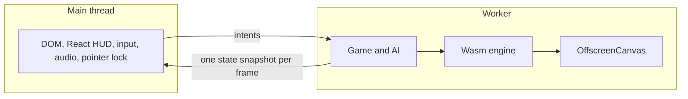

# PRD-752 — Web games run in a worker, so the page cannot stall them

**Status:** PARTIAL — phases 1 and 2 done; phase 3 next.
**Priority:** P1 — on a loaded host every web game collapses (shooter kit: frame p50 33 ms, p95 100 ms, main thread 100% busy); worker mode (phase 3) and Wasm threads (phase 4) are open.
**Complexity:** 8 (HIGH) — 10+ files across core, the web host, the Wasm engine and the harness (+3), a new host-capability layer (+2), worker and `OffscreenCanvas` boot (+2), Wasm threads and isolation headers (+1); risk override: none
**Owner:** João
**Parent:** [PRD-573](./PRD-573-unreal-class-performance-in-release-cycles.md), Cycle v5 (v5.1 worker mode, v5.2 Wasm threads). This PRD carries the v5 boxes; PRD-573 points here.
**Depends on:** None. The waste cuts on the main thread are PR #574 and are not part of this PRD.

**Update rule:** one PRD, one PR. Each phase lands as commits on that PR. Each box is ticked, with its result, in the commit that proves it.

## Goal and route

**Goal:** a web game keeps its frame time when the page, the browser or the host is busy. The game, its AI, the JS-to-Wasm glue and render submission leave the browser main thread.

**Route:**

1. Core reaches the DOM only through one **host-capability layer**. PRD-573 counted 23 files by text search; most hits are local variables named `window`. A type check against the worker lib found 19 real reads in 5 files (`audio`, `game`, `hot`, `renderer`, `viewport`). The layer is `packages/core/src/platform.ts`.
2. Behind a flag, and without COOP/COEP, the game and engine boot in a worker on an `OffscreenCanvas`.
3. With cross-origin isolation, the engine adds Wasm threads (`TN_WEB_THREADS`) for its job pool. Without isolation it reports `threads: off`.

## Evidence

Clean CPU profile of the shooter kit (NVIDIA, no DevTools, 2026-10-26): frame median 33 ms, p95 100 ms, main thread 100% busy. The game, AI, React HUD, JS-to-Wasm glue and render submission all share the one main thread.

## Honest expectation

- A worker moves the game and its cost off the main thread. React, the DOM, extensions and GC stay behind: about 5-10% of the frame in a production build.
- Wasm threads help the C++ side only: about 15-20%.
- Neither fixes the fragility when every core is busy. PR #574 cuts waste separately.
- So the KPIs are **measured** main-thread busy and p95 under a **stated** CPU load, set from the phase 1 baseline. They are not guesses. The numbers in the boxes below are targets to confirm or revise against that baseline, in a `## Decisions` entry.

## Decisions

- 2026-10-26 (owner): the worker HUD contract is confirmed: the HUD gets one state snapshot per frame from the worker and sends intents back. "Yes, and v5.2 threads too." This clears the last v5.1 line under PRD-573 "Blocked on" and adds v5.2.
- 2026-10-26 (owner, "ok go 1"): scope stays web-only. Native has no browser main thread; its render thread and job pool stay in PRD-573 Cycle v3. Native is a regression gate here only (`pnpm native:verify:desktop` in phase 2).
- 2026-10-26 (lead): this PRD has 4 phases and 14 boxes, above R5, because it carries the parent's v5.1 and v5.2 boxes plus the measurement phase. PRD-573 waived R5 for the same epic. Splitting it would cut the baseline from the KPI it sets.
- 2026-10-26 (lead): **baseline** (phase 1). Desktop, RTX 2080 (`adapter.info` "nvidia turing"), Xvfb, production `vite preview` builds of the scaffolded kits, `--seconds 10 --warmup-ms 8000 --cpu-work`, 3 runs per arm, medians. Load 24 = 24 busy-loop processes on 24 logical cores (`--load 24`).

  | Kit | `--load` | load1 | p50 | p95 | main thread busy |
  |---|---|---|---|---|---|
  | shooter | 0 | 8.3 | 11.3 ms | 17.6 ms | 69% (7.9 ms/frame) |
  | shooter | 24 | 31.1 | 18.6 ms | 116.3 ms | 97% |
  | starter | 0 | 31.2 | 17.0 ms | 17.9 ms | 33% (5.1 ms/frame) |
  | starter | 24 | 34.1 | 17.6 ms | 35.4 ms | 55% |

  The starter load-0 runs followed the shooter load-24 runs, so their load1 is the lagging one-minute average, not live load. The loaded shooter reproduces the reported collapse.
- 2026-10-26 (lead): **v5 KPIs**, set from that baseline, measured on the same lane at `--load 24`. Shooter: main thread busy at or below 48% (0.5x of 97%), p50 no worse than 18.6 ms, p95 at or below 116.3 ms with 58 ms (0.5x) as the target. Starter: main thread busy at or below 28% (0.5x of 55%), p50 no worse than 17.6 ms. A worker run that is not on this lane re-measures its own main-thread arm.
- 2026-10-26 (lead): **phase 3 spike and design.** A scratch starter booted in a dedicated worker on a transferred `OffscreenCanvas`, on the Wasm engine (`TN_RENDERER` present, adapter "nvidia turing"). It drew the same frame as the main-thread arm. The spike found 6 gaps, each fixed at its own layer:
  1. The Emscripten glue read `document` at load. Fix: `-sENVIRONMENT=web,worker` on `tn-native-engine-web`.
  2. The Wasm renderer called `setAttribute` on its canvas, and an `OffscreenCanvas` has none. Fix: optional call in `browser-renderer.ts`.
  3. Vite builds a worker bundle with `worker.plugins` only, so the worker got upstream three, and skin weights failed as `unorm32x4`. Fix: the web brand plugin also registers the engine resolver for workers, as ES output.
  4. A message sent while the worker module is in its top-level await is dispatched before any handler exists, so it is lost. Fix: the worker posts `ready`, and the page sends the canvas after it.
  5. A relative `fetch("sky.jpg")` or `new Request("grade.cube")` resolves against the worker script URL (`/assets/`). Fix: the worker host resolves relative URLs against the page URL.
  6. A worker has no `AudioContext`. Fix: a Web Audio proxy. Each node is a handle, calls go over the port, and the page runs the real graph.

  Core already has the seam: `defineGame({ platform })` (`IGamePlatformSource`: canvas, size, input target, gamepads). No production code supplied it before. Worker mode supplies it from the worker host. The starter's `GameUi` already talks to the game only through the UI bridge, so the page mounts `GameUi` and the game runs in `src/worker.ts`. The UI bridge host globals carry the HUD over the worker port. A swallowed WebGPU error also hid gap 3 behind `TN_NO_RENDERER`, so `TN_NO_RENDERER` now names the WebGPU cause.
- 2026-10-26 (owner): scale-down rule. Bounded implementation slices go to a cheaper arm (`opencode-go/deepseek-v4.1-flash`, variant `max`, at most 2 arms). The lead designs, writes the red tests and reviews every diff.
- 2026-10-26 (lead): **the flag is a page.** Each kit ships `worker.html` (`src/worker.ts` serves the unchanged `game.ts`, `src/worker-page.ts` keeps the canvas, input and `GameUi`) next to the default `index.html`. One build carries both arms of every A/B, and no game code branches on a flag.
- 2026-10-26 (lead): **three more gaps found on the real starter**, each with a red test:
  7. The starter calls `game.ui.onIntent` while `game.ts` evaluates, so the game end of the UI bridge connected before the page port existed and stayed on the in-process broker (a blank HUD). Fix: `@threenative/core/worker` installs the host globals when it loads in a worker, before the game module, and holds frames until the port arrives.
  8. An `OffscreenCanvas` cannot lock the pointer. Fix: in a worker it asks the page, which locks its own canvas inside the click's activation window and forwards each `pointerlockchange` with `captured`; `InputMap` takes that flag where no document exists.
  9. Web Audio calls cost one message each (`AudioListener` moves 9 params a frame). Fix: the proxy batches one message per task.
- 2026-10-26 (lead): **frame time is read from presented frames.** `profile:wasm-page` frame p50 was the page's `requestAnimationFrame`. In a worker that does not follow the game, and on a loaded page rAF ticks at 60 Hz while the game presents far fewer frames. The probe now also reports `presented`: intervals between the game's `getCurrentTexture` calls, on the game's own thread, in both arms. The baseline's p50/p95 above are rAF numbers, so the KPI compares the two arms of the same run on `presented`.
- 2026-10-26 (lead, owner AFK): **loaded host.** The desktop ran at `load1` 35 to 74 from other lanes on top of the 24 loaders, and the laptop's CPU package sat at 97 to 100 °C under other jobs (`offload.sh` exit 75). Main-thread busy is a share of the page thread, so load cannot fake it; frame time can. Per the owner, a frame-time red counts as load until a rerun inside `slot.sh` repeats it, so a watcher runs both kits in GPU slot 1 when `load1` drops under 14.
- 2026-10-27 (owner): "do it the flip, worker will be the default". The starter and shooter `index.html` run the worker page; `main.html` is the named override that runs the game on the page thread, documented in each kit's `AGENTS.md`. A query flag was rejected: one static page cannot pick its entry without a dynamic `import()`. The other kits follow once these two pass their scenarios through the worker.
- 2026-10-27 (lead): **the stutter left on the worker page was the engine raycast.** A DevTools trace of the shooter's worker showed 93% busy, 25% of it in `ctx.raycastAll` from the soldiers' line of sight, and `TN_FRAME_BUDGET` update p95 about 90 ms. `Mesh::raycast` tested every triangle; the merged town meshes hold about 430k. Engine layer, because every game that raycasts pays it on web and desktop, so the fix is a cached triangle tree in C++, not a game workaround. Owner rule: one PR per session, so it lands here as a phase 3 box.
- 2026-10-27 (lead): **a skinned mesh keeps the brute-force scan.** `SkinnedMesh::getVertexPosition` poses vertices through bones, so a tree of stored positions would cull a posed triangle (the red test: 1 hit brute, 0 through the tree). Out of scope and logged: the engine `SkinnedMesh` raycast still rejects rays against the bind-pose bounding sphere, which three does not, so a limb posed far from its rest pose can miss.
- 2026-10-27 (lead): **a fresh review (Codex sol 6.1, max effort) found 15 items**; each confirmed one got a red-green spec. Worker: startup errors reject `ready`, stop removes the canvas and releases lock and capture, pointer capture, `pointerlockerror`, a 0x0 container, HUD wheel, motion coalesced per page frame, one HUD snapshot in flight, gamepads forwarded, a lazy playtest mirror with `_clockEpoch`. Audio and profiler items in the next entry.
- 2026-10-27 (lead): **review, audio and profiler.** The worker clock freezes while the page context is suspended and re-anchors on each page reply. A fluent `AudioParam` call returns its own handle, so 10,000 calls keep the table constant, and an ended one-shot releases its handles. Unwritten `AudioParam` scalars read the standard default (`AudioBus` fades start from a number), and an unknown property throws instead of reading as a function. `resume`/`suspend`/`close` settle from the page's reply. `profile:wasm-page` runs census and GPU probes in the game's realm. The lead added `addEventListener`, `removeEventListener` and `createStereoPanner` to the proxy's method list, with a red-green spec on an `ended` listener.
- 2026-10-27 (lead): **a worker game in the private Xvfb.** The runner adds `--disable-frame-rate-limit` so a page game's frames escape Xvfb's compositor cadence; the same flag throttles a worker's `OffscreenCanvas` frames (shooter, 1280x720: presented 36 ms with it, 16.7 ms without; the page thread 9.9 ms with it, 33.3 ms without). The runner now relaunches a worker game once without it and reports `gameThread: "worker"`. At 1920x1080 the worker still waits on Xvfb's present path (22 to 24 fps with any flag set, 46 to 49 ms idle per frame) while the real GPU path runs it at 56 to 60 fps: a worker's frames wait for the compositor's acknowledgement, which no Chrome switch lifts. Open: if the quiet-window rerun repeats, measure a worker game's frame rate on a virtual display from its render work (frame time minus host gap), the reading the unthrottle flag gives a page game.
- 2026-10-27 (lead): **phase 4 ceiling, measured before any job pool.** `--profiling-funcs` engine build, Chrome trace on the RTX 2080, 1920x1080, self time on the game's thread. Shooter (worker, 12.4 s sampled): JS 47.8%, engine Wasm 22.2%, physics Wasm 16.8%, idle 10.3%; the work a job pool can split (matrix walk 4.7%, cull/project 1.2%) is about 6%. Midway (page thread, on the deck, 6.5 s, 0% idle): engine Wasm 56.5%; splittable work is about 25% (projection `decide` + `contentClassOf` 10.8%, matrix walk about 9%, animation 3.2%, `RenderDatabase::project` 2.1%), so 4 threads return up to about 19% of the frame, inside the 15-20% expectation. Draw recording stays on the WebGPU thread, and the JS-to-Wasm binding (Midway 16.9%) is single-threaded. Two single-thread items are as large as the threaded win and belong to the owner's earlier waste order (engine hot-call guard), not to this PRD: `tn_context::share(std::string, ...)` 8.7% of Midway's main thread, and `projection::contentClassOf` 5.1%, which reads as a pure function of the geometry. A DevTools trace inflates JS self time, so the Wasm shares are lower bounds.
- 2026-10-27 (lead): **no worker-only frame rate under Xvfb; the evaluator stays as it is.** A probe swapped the worker's `requestAnimationFrame` for an uncapped MessageChannel scheduler (shooter, Xvfb, 1920x1080): callbacks rose from 23-29/s to 630-950/s, but skipped draws rose from about 65 to about 3,200 per window. The surface waits for Xvfb's acknowledgement, so no scheduler lifts it, and Chrome has no OffscreenCanvas equivalent of `--disable-frame-rate-limit`. Under Xvfb both arms skip most draws (median draw calls per sample 0; real display about 160, peak 796 on both), so the page thread's Xvfb green also rests mostly on skipped draws. Replacing the worker's reading with a cost-derived rate would be a branch that softens a fail-closed check (`packages/playtest/AGENTS.md`), so it is not done. Consequence: a kit scenario that asserts `minFps` under Xvfb reads the worker's real Xvfb present rate. For #574's CI that means the shooter's `performance` scenario on `/`; its owner decides between a real-display lane, a `main.html` URL for that scenario, or a harness-wide virtual-display rule like `perf`'s `TN_PERF_VIRTUAL_DISPLAY`.
- 2026-10-27 (threads lane): **the job pool lives in this PRD.** PRD-573 v3.1 had no pool yet, so one `JobPool` (`packages/runtime-native/src/engine/foundation/job_pool.h`) serves native and web; v3.1 adds its jobs to it. Its workers park on a condition variable marked `TN_WORKER_ONLY` (`native_engine_no_blocking_waits`); the caller never waits on the GPU. A second caller, or a nested call, runs its items inline. The web glue reads `HEAPU8` directly, so the join refreshes the caller's heap views when a job grew memory. Isolation is on by default for `engine: "threenative"` (dev, preview, `dist/_headers`); a host without header control serves the single-thread engine unchanged, and `credentialless` is the documented switch for cross-origin assets without CORP. No service worker. The page realm still loads the engine (an existing `three` import), and since the pool starts on need it starts no threads there.
- 2026-10-27 (lead): **a live-clock hold counted requests, not ticks.** A wall-clock `advance(1)` returns the ticks the host's pump ran: two per frame at 30 fps. The runner counted each request as one tick, so the starter's 169-tick hold ran about 338 and the player fell into the gap on the worker page. Harness layer: any game under 60 fps on a live clock drifted the same way. The bridge client now returns the count and the hold loop counts it (red-green spec in `runner.spec.ts`).

### Phase 1: Loaded-host baseline
**Status:** DONE

Sets the KPI baseline. Shooter kit and starter kit, same machine, same stated load.

- [x] A repeatable loaded-host profile exists: it starts N busy-loop processes (N and load recorded), runs the shooter and the starter, and prints main-thread busy %, frame p50 and p95. proof: `sh scripts/xvfb.sh pnpm profile:wasm-page -- --url <url> --seconds 10 --warmup-ms 8000 --cpu-work --load 24 --json`. Result: `--load` and `busyPercent` added, `scripts/__tests__/profile-wasm-page.spec.ts` 15/15 green, 12 runs recorded in Decisions
- [x] The baseline for the shooter and the starter is recorded in this PRD under `## Decisions`, with load, adapter name (not SwiftShader) and three runs per arm. The v5 KPI numbers are set from it. proof: the `## Decisions` entry, `adapter.info` captured in the run. Result: baseline and KPI entries above, adapter "nvidia turing" in all 12 runs

### Phase 2: Host-capability layer
**Status:** DONE

- [x] A red-green spec scans `packages/core/src` and fails on any read of a global a dedicated worker lacks (type check against the `webworker` lib, value positions only) outside the host-capability layer `packages/core/src/platform.ts`. It is red on the current reads and green after the move. proof: `pnpm exec vitest run scripts/__tests__/check-core-boundary.spec.ts`. Result: red with 19 reads in 5 files, green 32/32 after the move to `hostWindow`/`hostDocument`/`hostResizeObserver`; `pnpm exec tsx scripts/check-core-boundary.ts` passes; 11 related core and boundary spec files 248/248; core typecheck exit 0
- [x] The native host runs core unmodified through the same layer, with no dynamic `import()` in core. proof: `pnpm exec vitest run scripts/__tests__/check-core-boundary.spec.ts`; `pnpm native:verify:desktop`. Result: 32/32; `native:verify:desktop` exit 0 ("desktop core gate passed: 300 frames, 1280x720", UI frame gate passed) after `pnpm native:build` in this worktree
- [x] The starter plays through a loopback proxy (main thread talks to the layer over a message channel in the same thread) with unchanged behaviour. proof: `packages/core/__tests__/ui-bridge-inbound.spec.ts`; a pause round-trip scenario (click `button[aria-pressed]`, `hud` asserts `pause` -> `resume`) on a scaffolded starter at `/` and at `/?tnUiLoopback=1`; the starter's own `pnpm test` (`test:templates` skips the starter: it runs in the golden-path lane). Result: spec 6/6; round trip exit 0 on both URLs; a Playwright probe reads `__tnUiLoopback` false at `/` and true with the flag; kit `movement`, `survives`, `production-readiness` pass. `play` fails `performance.maxFrameMsP95` on GPU time on this host, and the scaffold from before this change fails it too (before 2/2 runs at GPU p95 20.3/17.3 ms, after 1/2 at 18.1 ms; CPU about 7.5 ms in both)

### Phase 3: Worker mode and v5 KPI
**Status:** PARTIAL

- [x] Behind a flag, without COOP/COEP, the starter boots in a worker on an `OffscreenCanvas`; input, pointer lock and audio forward from the main thread, and the HUD takes one state snapshot per frame and sends intents back. proof: `pnpm test:templates` with the flag, starter scenario green. Result: the flag became the default page (owner, Decisions); a scaffolded starter at `/` (worker), `--browser-recipe webgpu --headed`, RTX 2080 ("turing"), the worktree's runner at 7fe753ba5: `movement`, `survives`, `play`, `production-readiness` all exit 0; `play` reports `gameThread: "worker"`
- [x] The playtest harness captures the worker canvas (screenshot not blank, frame counter advances). proof: `pnpm test:templates` with the flag; `node packages/playtest/dist/runner/cli.js doctor --url <url> --text`. Result: the same runs capture non-blank frames with `data-engine` provenance from the page canvas (forwarded attribute) and pass their visual and tone assertions; 9 of the 10 starter and shooter scenarios exit 0 on `/`
- [x] Main-thread busy falls below the target set in phase 1 (first target: below 0.5x of the main-thread arm) and p50 is no worse, under the same stated load. proof: `profile:wasm-page` worker URL against the main-thread `--control` URL, three runs per arm. Result: `--url <kit>/ --control <kit>/main.html --cpu-work --vsync --load 0`, RTX 2080, host `load1` 7 to 24, three pairs per kit. Shooter: busy 4.5 / 4.5 / 4.5% against 32.0 / 34.8 / 34.5%; presented p50 42.8 / 45.7 / 34.2 ms against 85.7 / 71.6 / 78.5 ms; p95 69 / 57 / 63 ms against 146 / 130 / 154 ms. Starter: busy 1.4 / 1.3 / 1.5% against 24.8 / 23.0 / 23.7%; presented p50 33.4 / 33.8 / 33.3 ms against 33.6 / 33.4 / 44.7 ms. At `--load 24` (`load1` 38 to 71, unmatched arms) the shooter's worker busy stayed at 0.5 to 1.4% against 44 to 47%, and p50 was lower in 2 of 3 pairs: frame time there is load, per the AFK rule
  Without `--vsync` the profiler's default flags unthrottle only the page's requestAnimationFrame, so a worker arm read 37 ms frames against 10 ms on the page; the option exists for this verdict.
  Earlier, before the raycast tree: Starter, desktop RTX 2080, `--load 24`, `load1` 28 to 52: main-thread busy 1.1 / 1.1 / 1.9% on `worker.html` against 57.5 / 52.8 / 45.7% on `/` (target at or below 28%). A second set at `load1` 35 to 74: 0.9 / 1.4% against 57.6 / 86.9%. Presented p50 was 80 to 101 ms in both arms at that load, and one worker run presented 268 frames in 60 s, so frame time waits for the quiet-window rerun in `slot.sh`.
  Shooter (current #574 look, before the raycast tree), private Xvfb, three pairs at host load (`load1` 9 to 28) and three at `--load 24` (`load1` 16 to 45): page-thread busy 3.3 / 4.2 / 3.6% and 2.2 / 1.7 / 1.1% on the worker against 65.9 / 88.0 / 86.7% and 95.6 / 99.1 / 92.2% on the page. Presented p50 45 to 69 ms (worker) against 38 to 50 ms (page) at host load, and p95 worse in 4 of 6 pairs. The game's own 90 ms update spikes and a concurrent C++ build dominated; rerun on the raycast-tree build.
- [x] A fresh visual judge subagent returns IMPROVEMENT or NEUTRAL on worker against main-thread frames, at least two runs per arm, `--browser-recipe webgpu`, `adapter.info` checked. proof: the verdict in this box and the images on the PR. Result: OVERALL NEUTRAL (fresh Opus judge, 6 sheets: starter `after` and `tone-3`, shooter `after`, runs 1 and 2 per arm, `/` vs `/main.html`, `--headed`, all 8 runs `architecture: "turing"`). Exposure, tone, shadows, AA, resolution and HUD match; the only differences are gameplay state (starter position 57 vs 59, 60 vs 61). Images: branch `prd-752-screenshots` at dcf23602b
- [ ] The shooter kit plays through the worker with the same checks. proof: `pnpm test:templates` with the flag on the shooter scenario
  Open: `survives`, `input-control`, `five-soldiers`, `hold-to-fire`, `shot-tracks-crosshair` exit 0 on `/`; `performance` fails in the private Xvfb (minFps 29.94 / 20.04 / 15.01 across three runs, host `load1` up to 30) while `/main.html` passes. The same 1920x1080 build on the real GPU path (Chrome DevTools) runs the worker at 56 to 60 fps, presented p95 16.8 ms. The quiet-window rerun (load 5.5) repeated it: minFps 20.04, cost p95 17.7 ms (CPU), because at 20 presented fps each frame carries about 3 catch-up ticks (update p50 7.5 ms vs 0.6 ms on the page thread). On the real KDE display (`TN_PLAYTEST_HOST_DISPLAY=1`) both arms match (update p95 7.3 page vs 8.0 worker, render 10.4 vs 10.8), minFps passes on both, and both fail the kit's own budgets the same way (796 draw calls > 320; frame p95 16.8 / 17.2 ms against 16.7). Left: CI's template lane runs this scenario under Xvfb against `/`, so the runner needs an honest worker measurement on a virtual display before #576 joins #574.
- [x] The shooter's frame on the worker page has no update spikes from scene ray queries: the engine raycast reads a cached triangle tree with hits identical to the brute-force scan. proof: `tn-native-engine-raycast-test` and `tn-native-engine-animation-skeleton-test raycast_posed_skin` in `packages/runtime-native/build/tn-engine-core` (`-DTN_ENGINE_CORE_ONLY=ON`); the shooter's `TN_FRAME_BUDGET` in Chrome on the RTX 2080. Result: 2,048 oracle rays 0 differ; 1,000 rays on a 20k-triangle mesh 8,471 ms -> 6.0 ms; a focused ray tests 4 of 20,000 triangles; posed skin hits 1/1 on both paths. Shooter on `/` (worker), 8 windows of 5 s: update p95 about 90 ms -> 5 to 10 ms, presented p95 100 ms -> 16.8 ms, 28 to 37 fps -> 56 to 60 fps

### Phase 4: Wasm threads and gate
**Status:** PARTIAL — threaded build, isolation, runtime choice and job pool landed; the shooter is at its pool ceiling: a tie on the laptop, serial work left (box 3)

- [ ] A `TN_WEB_THREADS` build costs at most 2% on one thread against the non-threaded build. proof: `profile:wasm-page` A/B, three runs per arm
  Open: a `-pthread` build (no pool threads) boots in the worker under COOP/COEP with no errors, and costs about 1.5 to 3% on one thread, which 5 runs cannot separate from a 2% budget. 2026-10-27 (threads lane): both builds now ship (`tn-native-engine-web.wasm` 4,147,456 bytes, `tn-native-engine-web-threads.wasm` 4,160,125 bytes, budget 4,194,304 each), and only a cross-origin-isolated page loads the threaded one, so a page without isolation pays nothing. Not re-measured here. Engine `TN_FRAME_BUDGET` render p50, alternating arms, real display, vsync, RTX 2080, both arms built from this PR's sources (stamp checked): Midway on the deck, 5 runs per arm, median 16.65 ms vs 17.11 ms (+2.8%), runs 1-4 mean 16.41 vs 16.66 ms (+1.5%), pairs -5.8% to +7.8%, plus one `-pthread` outlier at 24.65 ms under a load spike (`load1` 10.6). An earlier A/B (Midway +4.2%, shooter +4.4%) is void: its single-thread arm came from a stale `build/web` pair built from another tree. `profile:wasm-page` cannot profile a worker (Playwright opens no CDP session on one), so the engine's own phases are the reading. `-sGROWABLE_ARRAYBUFFERS=2` (the glue-only fix Emscripten suggests) draws nothing (render phase 0 ms, no GPU time) and fails the Node 20 post-build check, so the facade's heap views need work before it can separate glue cost from Wasm atomics.
- [x] Without cross-origin isolation the engine reports `threads: off` and runs unchanged; with isolation (COOP/COEP) it reports the pool size. proof: `native_engine_wasm_browser_backend` for both isolation states
  Proved in the browser instead: that ctest runs the ABI module under node, which has no web host and no isolation. Shooter, RTX 2080 (`adapter.info` nvidia turing), headed on `:0`: `/` gives page and worker `crossOriginIsolated` true and `TN_FRAME_BUDGET` `threads: "on (3)"`; `/?tnIsolation=0` gives false and `threads: "off (not cross-origin isolated)"`, both drawing, no errors. `vite preview` of the built game: the same on `/`, and `dist/_headers` carries both headers. Every `engine: "threenative"` kit (13) loads isolated with `threads: "on (3)"` and 0 COEP-blocked requests (headless lane, isolation only; action-rpg, runner and snow are `engine: "threejs"` and get no headers). 2026-10-27: those 3 checked headed on the RTX 2080 (`adapter.info` nvidia turing), `vite dev` and `vite preview` of a fresh build each: 0 COOP/COEP headers, no `dist/_headers`, page not isolated, assets load, 0 blocked requests, 0 console errors, frames drawn; snow's `AudioContext` runs after a click (action-rpg and runner have no audio). Spec: `webThreadsReport` in `browser-entry.spec.ts`, the module choice in `web-engine.spec.ts`, the headers in `web-brand.spec.ts`.
- [ ] The job pool cuts engine frame CPU on the threaded build. proof: `profile:wasm-page` A/B on the shooter, threaded against not
  Open: the pool wins where the scene is stable, and the shooter A/B does not resolve. Pool: `foundation/job_pool.h` (fork-join, caller works too, `min(hardwareConcurrency - 1, 3)` workers, 0 = the old serial path), first job the matrix walk over subtrees (`Object3D::updateMatrixWorldVisibleJobs`, serial below 1,024 nodes), bit-equal to one thread (`native_engine_matrix_walk_jobs`, native and TSan). Walk per frame in Wasm under node, 1 vs 4 threads, best of 200, load about 27: 1,024 nodes 2.2x, 9,387 nodes 0.79 to 0.22 ms (16-ary tree) and 0.98 to 0.40 ms (a tree whose largest subtree holds 52%); 512 nodes stay serial. Shooter, uncapped (`--disable-gpu-vsync --disable-frame-rate-limit`, worker rAF swapped for a MessageChannel), RTX 2080, 1887x950, `:0`, alternating arms `/` against `/?tnIsolation=0`, 5 pairs at `load1` 10.6 to 45.1: drawn fps median 71.9 against 73.2, drawn-frame p95 19.94 against 19.80 ms, single runs 45.7 to 112.2 fps. GPU p50 4.5 to 6.6 ms, so the frame is the worker's CPU. Worker CDP profile (named Wasm): facade JS 30%, Wasm 27 to 45%, core 10 to 17%; the walk on the game thread fell from 1.02 to 0.16 ms per frame in one pair, but other pairs swing 0.14 to 1.29 ms with game state, so it does not repeat.
  2026-10-27, on top of smooth60's hidden-node compose skip (dca708bd4): a hidden batch source now costs a visit and no compose, so the visit gate sent a cheap walk to the pool (Wasm, 95% hidden, 9,387 nodes: 0.023 -> 0.037 ms, 0.64x). The gate is now the last walk's composes (1,024), red-green in `native_engine_matrix_walk_threshold` (5 pool runs -> 0): that walk stays serial (1.02x), a 16-ary tree with the root moved still shares out (1,024 nodes 1.89x, 9,387 nodes 0.77 -> 0.22 ms). `__matrixEvaluations` now counts job composes (39 of 40 frames undercounted -> 0); `__jobPoolRuns`/`__jobPoolItems` count pool use. Laptop, Intel Iris Xe (`adapter.info` intel gen-12lp), `:1`, uncapped, one build, 3 alternating pairs at `load1` 2.9 to 4.3, CPU 92 to 98 C: drawn fps 39.0 / 38.4 / 38.1 against 38.8 / 38.0 / 37.9 (a tie), GPU p50 23.9 to 24.8 ms, so that frame is GPU. Desktop worker profile per thread (named Wasm, `load1` 52 to 55, not a timing): the shooter walk composes under 1,024, so it stays serial, 0.033 ms per frame; forced onto the pool (gate 0) it costs 0.77 ms on the game thread and each pool thread spends 0.36 ms per frame waking (glue 0.21 to 0.27 ms, Wasm 0.08 ms). Game-thread Wasm 1.44 ms per frame: `renderPrepared` 1.32 and `encodeFrame` 0.60 (WebGPU encoding, serial), `tn_invoke`/`tn_get`/handle release 0.54 (the JS bridge, serial), `prepare` 0.28, `project` 0.10, mixers 0.06. The rest of the 6.7 ms busy frame is facade JS 2.14 and core JS 1.58. The splittable engine work left is about 0.45 ms, under one pool wake per thread, so this is the shooter's ceiling for the pool; it stays a native and large-scene lever.
  2026-10-27, after the integration rebase: the jobs walk keeps the pruned walk's contract (`native_engine_matrix_walk_jobs`: hidden subtrees keep their matrices, hidden cameras are walked; red 2,913 moved and 81 of 776 stale, green 0 and 0), and TSan on it found cameras racing on `Matrix4::decompose`'s static scratch, now an explicit-scratch overload that `Camera::updateViewMatrix` feeds with locals (decompose -3.5% instructions; 4 job-pool cases, 0 TSan warnings). The pool starts on the first walk that needs it (`native_engine_job_pool_starts_on_need`, red to green; web pthreads start then, `-sPTHREAD_POOL_SIZE=0`): the shooter on the RTX 2080 had 6 pool workers on `/` (3 idle in the page that only hosts the game's worker) and now has 0 on `/`, `/main.html` and `/?tnIsolation=0`, with `threads` "on (3)", "on (3)" and "off (not cross-origin isolated)" and 0 errors. A page started that way still shares out: Chrome, COOP/COEP, 9,387-node 16-ary walk, 0.62 to 0.36 and 0.64 to 0.27 ms.
- [ ] Stability gate S is green on web with and without isolation headers. proof: the S commands in [PRD-573](./PRD-573-unreal-class-performance-in-release-cycles.md)

## Blocked on

- The pool box needs a scene with splittable work above one pool wake per thread (about 0.4 ms): the shooter is at its ceiling (box 3), with its frame in serial JS, the JS bridge and WebGPU encoding. Midway, with about 25% splittable work, is the proof scene for the next jobs (projection `decide`, animation), on a quiet host.
- The shooter `performance` scenario under Xvfb on `/`: PR #574's owner picks the CI lane for it (Decisions, 2026-10-27).
- Gating on drawn frames, not loop frames, moves here with the Xvfb note above (lead, 2026-10-27): #574 only reports them (`TN_FRAME_BUDGET` `drawn`, `drawnFrames`, `drawnFps` beside `presented`). On the real display one shooter window had 270 `getCurrentTexture` presents against 293 rAF ticks while `presented` p95 read 16.8 ms. Re-gating changes verdicts on every Xvfb lane, where most draws are declined.
- The platform proof rule applies: a helper admitted for being unportable ships native proof in the same commit (`packages/runtime-native/AGENTS.md`).
