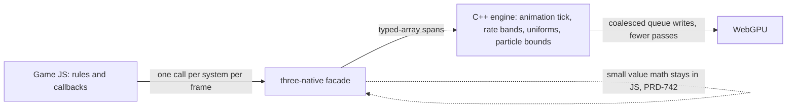

# PRD-828 — JS keeps only game logic: engine work moves into C++

**Status:** IN PROGRESS — Phase 1 (the benchmark and the census) is done and reviewed; Phases 2 and 3 are open.
**Priority:** P1 — on the stress lab about 30% of the busy main thread is JS (2026-11-02 profile). The animation tick (about 2.2 ms a frame) and the per-pass uniform sync have no owning PRD.
**Complexity:** 8 (HIGH) — 11+ implementation files (3), crosses the C++/Wasm ABI and the JS package release boundary (+2), animation listener and wrapper lifetime state (+2), new ABI exports on web and native (+1 compatibility). Risk override: none.
**Owner:** João
**Depends on:** PRD-770 (the fair window, `pnpm stress:loop fair`) and PRD-771 (the stage meter). Both tools ship. Coordinates with PRD-772 (C++ skeleton update and GPU joints), PRD-765 (bulk physics interpolation), PRD-768 (uniform scan scope), PRD-773 and PRD-774 (C++ plan). None of their scope moves here.

## Context

Owner, 2026-11-03: "whatever you can move to C++/gpu you move, reduce js<>wasm bridge crossings".
Owner, 2026-11-06: move code execution out of JS into C++ so that as little as possible runs in JS, for significant performance gains. Measure it on the stress benchmark against three.js, and use the benchmark artifacts to pick what moves.

### What one crossing costs

- A **facade crossing** (`browser-backend.ts` `invoke`: alloc, `toEngine`, `wrap`, `countCall`) costs about 0.8 µs. `Color.lerp` measured 796-939 ms per 1 M calls, against 4 ms in three.js (PRD-742).
- A **direct Emscripten export** (`module._tnw_web_frame(n)`) costs tens of nanoseconds.
- Rule of this PRD: **one crossing does the work of many objects.** That is a typed-array span, a whole loop in C++, or a GPU pass. Tiny per-call math stays in JS (PRD-742).

### Evidence 1: the stress-lab CPU profile (measured)

Artifact: `~/.cache/tmp-tn/stress-loop/hunt/js1102.cpuprofile` and `js1102.json`, 2026-11-02, `?stress`, 15 s, 1,013 frames at 67.5 fps. Main thread busy 14.6 s, so 1% of samples is about 0.144 ms a frame. Report: frame p50 14.09 ms, update p50 2.16 ms, 734 crossings p50, 2,304 KB GPU upload p50. Counts: 4,000 trees, 6,000 rocks, 120 houses, 600 props, 120 crowd, 300 bodies, 18,000 particles, 16 lights. Self time by owner: Wasm 52.8%, facade `web-engine-runtime.js` 14.9%, `core` 9.2%, Emscripten glue 2.8%, three math about 2%.

Clues ranked by JS time that a move removes:

| # | Clue (inclusive share, ms a frame) | Call chain in the profile | Where it lives | Owner |
| --- | --- | --- | --- | --- |
| P1 | Animation tick 8.1% (1.17 ms) | `Stress.ts:384` → anim `update` → `#evaluate` 3.5%, `#syncStride` 3.1%, both mostly facade `value`→`invoke` | `packages/core/src/animation.ts:1180-1267,922-988,1498` | **this PRD** |
| P2 | Animation rate bands 7.0% (1.01 ms) | `onRender` → `prepareAnimation` → `#visitAnimation` → `#observeAnimation` (3.3% self JS) | `packages/core/src/render-camera-cull.ts:408-448,622-720` | **this PRD** |
| P3 | Facade value-class crossings 12.4% (1.79 ms), across P1, P5 and P6 | `value` → `invoke` 9.4% | `packages/three-native/src/browser-backend.ts` | PRD-742 for the classes; the loops that call them move here |
| P4 | WebGPU calls from Wasm into JS 10.2% (1.47 ms) | `wasm-to-js` → `writeBuffer` 4.2%, `beginRenderPass` 1.9%, `createCommandEncoder`, `submit`, `executeBundles` | the C++ renderer's per-call `wgpu*` use | **this PRD** (coalesce) |
| P5 | Uniform sync 4.6% (0.66 ms), once per nested render and per compute | `Renderer` → `sync` (3.0%), `compute` → `sync` (1.4%), under core `updateBefore` pass renders (6.0%) | `packages/three-native/src/tsl-uniforms.ts:223-296,430-460` | **this PRD** (write once a frame); PRD-768 keeps the scan scope |
| P6 | Compute-driven systems 5.9% (0.85 ms) | `processRender` → `process` → `compute` 3.1%, `Box3.applyMatrix4` 0.8%, `multiplyMatrices` 0.4% | `packages/core/src/fluid-particles.ts:1181-1215`, `particles.ts:477-582` | **this PRD** |
| P7 | Physics interpolation apply 3.3% (0.48 ms) | `onRender` → `apply` → `value` | `packages/core/src/game-frame-loop.ts` interpolation | PRD-765 |

PRD-771's stage split agrees (2026-10-30, 14.7 ms frame): jsBefore 2.65, update 2.26, engineJs 0.81 (735 host calls), residual 0.41. That is about 6 ms of JS.

### Evidence 2: code survey and scouts (counted from code, not measured)

Three Sonnet surveys and four DeepSeek v4.1 flash max scouts read the code on 2026-11-06. Their reports are in `~/.cache/tmp-tn/prd828/out/{A,B,C,D}.md`. Findings that match a profile clue join the phases below. The scout briefs are DeepSeek output: each one needs a full code review before it is implemented.

- Scout B confirms P1. A starter rig with 6 clips pays about 52 ABI calls a frame, and a crowd rig pays 2 (`animation.ts:1180-1267`). The C++ mixer already owns actions, weights and time scales (`packages/runtime-native/src/engine/animation/mixer.cpp:317,352,850`).
- Scout D confirms P6. A fluid step issues 25 `renderer.compute()` calls, and each opens its own compute pass (`compute.cpp:126-135`).
- Down-ranked: the 55 `_tnw_web_frame` telemetry reads (`browser-renderer.ts:650-760`) are direct exports, about 3 µs a frame. They are not a lever.

## Benchmark: the stress lab against three.js

Every lever is kept or rejected on the stress benchmark that exists. This PRD adds no new meter.

- **Scene:** `sandbox/stress-lab` (`main.html?stress`). `?load=N` scales density.
- **Arms:** `threenative-wasm` (the default owned engine) against `three-vanilla` (the same scene in plain three.js). `threenative-threejs` (the `engine: "threejs"` override) is an optional third arm.
- **Tool:** `pnpm stress:loop fair threenative-wasm=<url>?stress&arm=<label> three-vanilla=<url>?stress&arm=vanilla --passes vsync,uncapped --tag prd828-<lever>`. It runs ABBA in one clean browser at 1280x720, DPR 1, 80 s per run, on a quiet host. It records rows in `docs/stress-loop/ledger.json`, and `pnpm dashboard` shows them on its Stress lab tab.
- **Metrics per row:** `frameP50Ms`, `frameP95Ms` (CPU), `updateP50Ms`, `presentedP95Ms`, `fps`, `bridgeCrossingsP50`, `hostCallsP50`, `gpuUploadKbP50`, and the PRD-771 stages from `TN_FRAME_BUDGET` (`jsBefore`, `update`, `engineJs`, `residual`). The vanilla arm has no crossings. Compare it on frame, update, presented time and fps.
- **Attribution:** each lever also takes one CPU profile through the hunt lane (`measure.sh`, a `--profiling-funcs` Wasm build), compared with `js1102.cpuprofile` on the P1-P7 chains.
- **Last rows before this PRD** (2026-11-03, uncapped, RTX 2080):

| Row | Arm | frame p50 / p95 ms | update p50 ms | fps | crossings p50 |
| --- | --- | --- | --- | --- | --- |
| #285 | threenative-wasm (core@0.3.8) | 14.63 / 21.09 | 2.95 | 63.1 | 732 |
| #286 | three-vanilla (three@0.185.1) | 19.95 / 27.60 | 2.95 | 48.3 | n/a |

  These rows predate later develop commits, so Phase 1 takes a fresh baseline at the start commit.
- **Keep rule:** keep a lever only when its paired window shows a CPU frame p50 drop above run noise, with frame p95 no more than 5% worse and no new `TN_BRIDGE_WARNING`. Record it with `--decision keep` or `--decision reject`.
- **Gap:** the vanilla arm folder (`sandbox/stress-lab-vanilla`, port 5736 in PRD-770) is no longer on disk and was never tracked in git. Phase 1 rebuilds it.

## Solution

1. **Measure first.** Rebuild the vanilla arm, take the baseline, and run the `TN_BRIDGE_CENSUS` census (`__THREENATIVE_ENGINE_COST__`) plus one profile at the start commit. Confirm P1-P7 still hold.
2. **The animation tick moves into C++** (P1, P2, scout B F1-F3).
   - JS keeps the clip-name to id map and the blend-space choice.
   - One `_tnw_anim_tick_batch` call per frame carries, per rig: clip ids, target weights, transition time, moved metres and dt. C++ runs the weight ramp, the stride rate and `AnimationMixer::update`, and returns one status word per rig (`finished`, `changed`).
   - The screen-size rate bands (`#observeAnimation`) are computed in C++ from engine bounds in the same call.
   - JS fires `finished` and `loop` listeners from the status words, in rig order.
3. **Render-side JS crosses once** (P4, P5, P6).
   - Changed uniforms are written once a frame as one span (`tn_tsl_set_uniforms(ctx, ids, laneCounts, lanes, n)`). Nested pass renders and compute dispatches do not run the sync again.
   - Compute-driven systems fold their bounds in C++, and the C++ `ComputeQueue` records consecutive dispatches into one compute pass (`compute.cpp:443-458`).
   - The C++ renderer coalesces queue writes into one staging upload a frame where the WebGPU spec allows it, which cuts the `wasm-to-js` `writeBuffer` calls.

Each new ABI call ships on the web Wasm engine and the native V8 host in the same commit (CHARTER: web-only is unfinished). The JS paths stay only behind the named `engine: "threejs"` override.

Risks: animation listener order and the loop-seam time adjustment (`animation.ts:1470-1493`); monkey-patched action methods (`animation-packet-state.ts`); stride overrides that must keep reporting `overridden`; user `onRenderUpdate` callbacks that must still run before the uniform flush; a queued readback that must end a compute pass; and pixels, which need a visual judge for every render-side change.

## Acceptance Criteria

- [ ] AC-1 [local]: On the **uncapped pass** of a fair window, the JS stages (`jsBefore` + `update` + `engineJs` + `residual`, pooled across the window's runs in `report.stages`) drop by at least 2 ms p50 against the Phase 1 baseline of 5.57-5.75 ms, and `bridgeCrossingsP50` drops by at least 50%, from 723 to at most 361. The pass is named because both numbers move with the frame rate: the same build measured 723 crossings and 2.34 ms of `update` uncapped, 1,320 and 4.93 ms vsync. proof: the window's pooled `report.stages` plus ledger rows — Evidence: pending.
- [ ] AC-2 [local]: In the same window, the `threenative-wasm` rows stay below `three-vanilla` on CPU frame p50 and p95 — read against the **plain-shadow** row (#295), which is the only pair whose shadow mode matches (#300 is reported beside it), because the virtual and plain rows differ by a shadow technique, not only by engine — `presentedP95Ms` stays within 5% of the baseline (two runs of one build measured 22.29 and 17.92 ms, so "no worse" with no tolerance is decided by noise), and a fresh visual judge reads NEUTRAL or IMPROVEMENT on the stress-lab pose. proof: ledger rows plus the judge verdict — Evidence: pending.

The AC-1 bars are proposed. P1 + P2 + P5 + P6 sum to about 3.7 ms of measured JS, so 2 ms leaves room for the parts that must stay in JS. Phase 1 confirms the bars against the fresh census, and any change to a bar goes under `## Decisions` with its reason.

## Integration Ledger

| Capability | Reachable consumer/trigger | Replaces / disposition | Evidence |
| --- | --- | --- | --- |
| Batched animation tick | Game `playWeighted`/`play` → `animation.ts` player update in `game-frame-loop.ts` → `_tnw_anim_tick_batch` | Per-rig `setEffectiveWeight`, `isScheduled`, `getWorldPosition`, `mixer.update` calls kept only under `engine: "threejs"` | Phase 2 |
| C++ rate bands | `render-camera-cull.ts` `prepareAnimation` → same batch call | `#visitAnimation` / `#observeAnimation` JS walk under `engine: "threejs"` only | Phase 2 |
| One uniform write a frame | `uniform().onRenderUpdate` → `tsl-uniforms.ts` sync → `tn_tsl_set_uniforms` | Per-uniform `tn_tsl_set_uniform` kept for one-off sets | Phase 3 |
| Batched compute and bounds | `computeDriven.processRender` → `renderer.compute([...])` → `ComputeQueue::flush` | One pass per kernel removed | Phase 3 |
| Coalesced queue writes | C++ renderer upload path → `wgpuQueueWriteBuffer` | Per-buffer writes merged where the buffers allow it | Phase 3 |

## Execution Phases

#### Phase 1: The benchmark and the census
**Status:** DONE
**Files:** `sandbox/stress-lab-vanilla/` (rebuilt, untracked like the other sandboxes), this PRD's tables.
**Implementation:** Rebuild the vanilla three.js arm of `sandbox/stress-lab`. It reads the same `?load=N` layer list as `src/scenes/Stress.ts:77`. Take the baseline window, one census frame and one profile at the start commit.
- [x] The vanilla arm renders the same layers and counts as the Wasm arm, and the fair tool accepts both arms, with no "not comparable" mark against the plain-shadow Wasm row. proof: `pnpm stress:loop fair` window with both arms valid and no "not comparable" mark. Done 2026-11-06: window `prd828-baseline` and `prd828-baseline-v2` recorded rows #291-#298 in `docs/stress-loop/ledger.json`. The vanilla rows #297 (vsync) and #298 (uncapped) carry `counts` identical to the Wasm rows #299/#300 (`trees 4000, rocks 6000, houses 120, props 600, crowd 120, bodies 300, particles 18000, lights 16`) and `mainTrianglesM` 2.08 against 2.11 — 1.4%, inside `scripts/stress-loop.mjs`' `TRIANGLE_TOLERANCE` 0.02 — so `mismatchOf` finds nothing to flag against the plain-shadow Wasm rows #292/#295. Both arms are in the same window, ABBA ordered, in one clean browser.
- [x] The baseline (vsync and uncapped passes), the census (top 10 crossing classes with callers and counts per frame) and the P1-P7 shares from a fresh profile are recorded in this PRD. proof: ledger row ids, `TN_BRIDGE_CENSUS` output, profile path. Done 2026-11-06: rows #291-#300 below, census below, profile `~/.cache/tmp-tn/prd828/out/js1106.json` and `.cpuprofile`.

**Baseline at the start commit (`d85dff125`, packages 0.3.12, Wasm engine rebuilt from source, `build.sha256 ab170771d784`), one window with all three arms (tag `prd828-baseline-v3`, ABBA, uncapped pass):**

| Row | Arm | frame p50 / p95 ms | presented p50 / p95 ms | update p50 | render p50 | fps | crossings p50 | draws | tris M |
| --- | --- | --- | --- | --- | --- | --- | --- | --- | --- |
| #304 | threenative-wasm, virtual shadows | 14.85 / 22.87 | 15.88 / 25.14 | 2.85 | 11.90 | 63.4 | 725 | 57 | 2.11 |
| #305 | threenative-wasm, `?plainShadow` | 8.77 / 11.73 | 10.37 / 17.44 | 2.13 | 6.84 | 92.3 | 717 | 70 | 2.11 |
| #306 | three-vanilla | 16.50 / 20.50 | 16.10 / 23.60 | 1.30 | 15.10 | 60.2 | n/a | 1109 | 2.08 |

Vsync rows, same window: #301 wasm 17.12 / 21.58 ms at 28.5 fps; #302 wasm `?plainShadow` 13.91 / 17.12 ms at 29.6 fps; #303 vanilla 17.75 / 21.80 ms at 29.7 fps. Load peaks across the six runs were 9.13-17.73, all under `LOAD_VOID` 18.

An earlier window on the same build (tag `prd828-baseline`, rows #291-#298) read the uncapped wasm arm at 13.00 / 16.38 ms with a 5.57 ms JS stage sum; this window's same arm pools 6.58 ms of stages, because its runs carried a 17.3 load peak against 11.1. **Read AC-1 against this window (#304), and read the compare window's own load peaks beside it** — the stage sum moves about 1 ms with host load, which is why the 2 ms bar is a floor and not a precise one.

**AC-1's baseline, from the PRD-771 stages the arm now publishes (`report.stages`, pooled across the window's two valid runs by `stress-fair`, uncapped pass of #304):**

| Stage | p50 ms |
| --- | --- |
| `jsBefore` | 2.06 |
| `update` | 2.34 |
| `engineJs` | 0.78 |
| `residual` | 0.39 |
| **sum the AC-1 bar measures** | **6.58** |

So AC-1 asks that 6.58 ms becomes at most 4.58 ms, with crossings 725 -> at most 362. The animation crossings in the census below are 1,398 of 1,911 in a census frame (73%), which puts the 50% crossing bar within reach of Phase 2 alone and the 2 ms stage bar roughly at the sum of P1+P2 — both bars stay as filed.

**Census at the start commit (`__THREENATIVE_ENGINE_COST__`, 120 rigs, artifact `~/.cache/tmp-tn/prd828/out/census-1106.json`, 21 windows):** 1,911 crossings in the first census frame and 1,313 in the last, 0.545 us each, 0.51-1.04 ms of the frame (1.5-2.3%), 22 redundant reads. The rows below are what the built arm printed; the meter now names **ten** classes per window (`CENSUS_TOP` in `packages/three-native/src/bridge-meter.ts`, with its own spec), and this arm's five animation classes are so far ahead of everything else that the sixth-ranked class is below one crossing a frame:

| # | Crossing | Per frame | Caller |
| --- | --- | --- | --- |
| 1 | `call AnimationAction.setEffectiveTimeScale` | 525 | `#syncStride` < `SkeletalMesh3D.update` < `Stress.ts:398` |
| 2 | `call Group.getWorldPosition` | 360 | `#syncStride` < `SkeletalMesh3D.update` < `Stress.ts:398` |
| 3 | `call AnimationAction.isScheduled` | 341 | `SkeletalMesh3D.update` < `Stress.ts:398` |
| 4 | `set AnimationMixer.timeScale` | 172 | `#evaluate` < `SkeletalMesh3D.update` < `Stress.ts:398` |
| 5 | `call AnimationMixer.update` | 104 | `LoopAwareAnimationMixer.update` < `#evaluate` |

**Fresh profile** (`~/.cache/tmp-tn/prd828/out/js1106.json`, 15 s, 386 frames, 25.7 fps on a host at load 26 — the shares are the evidence, not the absolute ms): inclusive per frame — `#evaluate` 2.455 ms, `#syncStride` 1.950 ms (P1's tick, 4.4 ms together), `prepareAnimation` 0.548 ms (P2's rate bands), `updateBefore` 2.721 ms (P5's nested pass renders), `processRender` 1.157 ms (P6). Self — `value web-engine-runtime.js` 1.399 ms (P3's facade reads), `invoke` 0.538, `writeBuffer` 0.515 and `beginRenderPass` 0.324 (P4's wasm-to-JS WebGPU calls), `sync web-engine-runtime.js` 0.410 (P5's uniform sync). `(idle)` read 11.4 ms, so the loaded host left the frame GPU-bound; a second profile on a quiet host is worth taking with the Phase 2 window rather than re-running the baseline.

**Work log (2026-11-06):**
- The vanilla arm is rebuilt at `sandbox/stress-lab-vanilla` (vite, `three@0.185.1`, `three/webgpu`, port 5736): `src/main.js` builds `Stress.ts`'s world (same presets, `?load=N`, `?no<Layer>`, `?still`, `?freezeAt`) with instanced trees/rocks/houses/props, 120 JS `AnimationMixer` rigs, 300 gravity bodies, 12 GPU-animated fire emitters and 16 point lights; `src/report.js` publishes the same `stress-lab-report/1` shape in `globalThis.__TN_STRESS__`, with `demo()` pinning the window pooling.
- Two of the arm's own counters had to be derived rather than read: `info.render.calls` is cumulative, so the first window recorded 4339 and 7831 "draws"; the arm now reads `info.render.drawCalls` (the per-frame counter, 1109) and sums its shadow casters once so `mainTrianglesM` is main-only like the Wasm arm's (2.08 against 2.11). Rows #293/#296 carry the broken counter and are superseded by #297/#298, themselves superseded by the three-arm window #301-#306.
- The Wasm arm now publishes `__TN_STRESS__` (`sandbox/stress-lab/src/stressReport.ts`), which the fair tool reads and the rebuilt sandbox had dropped, and it now publishes the PRD-771 `stages` p50s, which is what AC-1 measures.
- The sandbox was reinstalled at this commit's packages: `pnpm wasm:build` from source, then `packWorkspacePackages` into `sandbox/.packages` and a relinked manifest. Two environment repairs, outside this PRD's scope: a stale `@types/three@0.185.3` link broke `@threenative/core`'s dts build (`pnpm install --frozen-lockfile` restored `0.187.0`), and this session's Brave opens no CDP port on Wayland and throttles rAF to 1 Hz when headed, so every measurement runs under `sh scripts/xvfb.sh` with the x11 wrapper (`~/.cache/tmp-tn/stress-loop/brave-x11`).
- The crossing count at this commit is 723 a frame against the 732 of row #285, and the animation calls dominate it; P1-P7 all still hold, with P3 and P4 visible in the profile's self column.

#### Phase 2: The animation tick runs in C++
**Status:** NOT STARTED
**Files:** `packages/core/src/animation.ts`, `render-camera-cull.ts`, `packages/runtime-native/src/engine/animation/mixer.{h,cpp}`, `packages/runtime-native/src/engine/abi/bindings_scene.cpp` (web and native exports), `packages/three-native/src/browser-backend.ts` (the binding).
**Implementation:** As in Solution 2. The existing stride report (`animation.ts:800-820`) is the parity oracle for stride rates.
- [ ] One call per frame advances every rig: weights, stride rate and the mixer step. Per-rig animation crossings fall to 0, and the poses match the JS path on a fixed seed. proof: core spec red-green plus a playtest scenario with an `engineCost` bound on the stress crowd.
- [ ] The rate bands come from C++ in the same call, and `#observeAnimation` is gone from the stress-lab profile. proof: stress-lab profile plus the paired stress window, ledger rows.

#### Phase 3: Render-side JS crosses once a frame
**Status:** NOT STARTED
**Files:** `packages/three-native/src/tsl-uniforms.ts`, `browser-renderer.ts`, `packages/runtime-native/src/engine/abi/abi.cpp`, `packages/runtime-native/src/engine/renderer/compute.cpp`, the C++ upload path, `packages/core/src/fluid-particles.ts`, `particles.ts`.
**Implementation:** As in Solution 3. Each lever is one commit with its red-green spec and its paired stress window.
- [ ] Changed uniforms cross in one span a frame, and nested pass renders do not sync again. proof: `packages/three-native/__tests__/` spec red-green plus a census count.
- [ ] Consecutive compute dispatches share one compute pass, and compute-driven bounds fold in C++. proof: native engine test plus a census `compute` row on `examples/spell-lab/playtests/inferno.playtest.json`.
- [ ] Queue writes coalesce, and the `wasm-to-js` `writeBuffer` share drops in the stress-lab profile with the same `gpuUploadKbP50`. proof: stress-lab profile plus the paired stress window, ledger rows.

## Follow-up candidates (not in this PRD's scope)

These findings are real but are not on the stress-lab frame, or they are a different lane. File each group as its own PRD, with its own benchmark scene, when this PRD's Phase 1 census is in.

1. **Facade bulk paths:** element setters (`setMatrixAt`, `setXYZ`) write the JS shadow and flush once (`browser-backend.ts:733-743,944-980`). Bind the C++ instanced and model LOD (`instanced-batch-lod.ts:187-250` → `instanced_batch.cpp`, `model_lod.cpp`). Other items: `children` cache misses, the `shadow-node.ts:51-86` walk, movers in `virtual-shadow.ts:1029-1110` and `static-transform.ts:243`, and the per-mesh `__tnVisibleInWorld`.
2. **Native V8 host (scout A):** the audio pose push per voice per tick (`audio.ts:499-563`), the frame recorder diff (`frame-op-stream.js`), the held-key poll, cached V8 names, and a clock slot instead of `__tnWallMs`.
3. **Kit patterns and lint (scout C):** instance spans for the rts, tower-defense and shooter kits, the camera obstruction raycast through the C++ raycaster, terrain `sampleMany`, dirty-key state publishing, and lint rules for `getObjectByName`, material writes and per-texel loops in hot code.
4. **VFX (scout D):** the `ReactionField` decay on the GPU (393k cells a frame), the idle skip for the spell world pack, and the `GroundField` probe readback gate.
5. **Load-time bakes:** the kit sky bakes (2.1 M texels in collectathon, 7.7 s in Hop Garden), the `noiseVolume` bake, and the Strata per-texel and per-vertex loops.
6. **Animation extras (scout B):** root motion and composition through the same tick call, and batched Detour crowd reads.

## Decisions

- 2026-11-06 (Claude, from code): the 55 `_tnw_web_frame` telemetry reads are not a lever. They are direct exports at about 3 µs a frame in total, and the survey had ranked them first.
- 2026-11-06 (owner): the stress lab against three.js is this PRD's benchmark, and the benchmark artifacts pick what moves.
- 2026-11-06 (Claude, from the profile): this PRD keeps the measured stress-lab clues (P1, P2, P4, P5, P6) and lists the rest as follow-ups, to stay within the 3-phase, about-8-box cap. PRD-772 covers only the C++ skeleton update and GPU joints, so the JS animation policy belongs here.
- 2026-11-06 (Opus 5.5 review of Phase 1): the `three-vanilla` arm is a **floor, not an equal-work twin**, and AC-2 is read that way. It runs no post stack (the Wasm arm's high tier is TAA, volumetric fog, godrays, grade and exposure), no Rapier contacts (gravity and a floor clamp against 300 dynamic bodies with interpolation), GPU-side fire instead of a compute dispatch per emitter, and it hand-instances props and houses that the Wasm scene draws as 600 unique materials and 240 meshes. Every one of those is work the Wasm arm does and the control does not, so a Wasm win there is conservative. The equal-work comparison is the threenative arm against itself, before and after a lever.
- 2026-11-06 (Opus 5.5 review of Phase 1, fixed): the vanilla arm's `frame` metric now starts at the rAF callback's entry, not at the rAF timestamp, which is `FrameBudget`'s `frameStart` with the host gap excluded. Measured from the timestamp it billed the browser's pre-callback delay to the game — row #298 read 29.0 ms of `frame` against a 16.65 ms presented interval, which cannot both be true.
- 2026-11-06 (Opus 5.5 review of Phase 1, fixed): `stress-fair` pools `report.stages` across a window's valid runs (spec `scripts/__tests__/stress-fair.spec.ts`), so AC-1's number is not whatever run happened to be first in the wrapper file.
- 2026-11-06 (this PRD's Phase 1): the bridge census now names ten crossing classes per window (`CENSUS_TOP` in `packages/three-native/src/bridge-meter.ts`), not five, so a lever that moves the sixth class is visible; the list's builder is `topCrossings` with its own spec.
- 2026-11-06 (this PRD's Phase 1): two of the control arm's counters are derived, not read, and are labelled as such: `mainDraws` comes from `info.render.drawCalls` (the per-frame counter; `info.render.calls` is cumulative), and `mainTrianglesM` is the frame total minus the shadow casters' triangles summed once at build time, because three's WebGPU backend publishes no main/shadow split.
