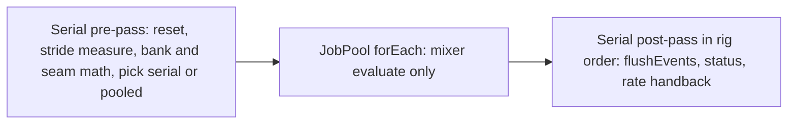

# PRD-875 — Rigs evaluate their poses on every core

**Status:** PARTIAL — Phase 1 is DONE (counter, H1, H2, all three boxes green). Phases 2 and 3 wait on the measure lane's sizing gate.
**Priority:** P1 — `TickBatch::run` advances every rig of a frame in one serial loop while up to 8 pool workers idle, so every game with a crowd pays the whole animation tick on one thread (Phases 1-3 open).
**Complexity:** 6 (MEDIUM) — 6-10 implementation files (2), concurrency (+2), one build boundary: the C++ engine serves native and web Wasm (+2). Risk override: none.
**Owner:** João
**Depends on:** None. It takes over the open half of [PRD-573](./PRD-573-unreal-class-performance-in-release-cycles.md) Phase v3.1 box 2 (mixers as jobs).

Executor: read [EXECUTION-ORDER.md](./EXECUTION-ORDER.md) first. Its rules and commands apply to every box here.
All code paths below are under `packages/runtime-native/src/engine/` unless they start with `packages/`.

## Context

One JS call a frame, `tn_anim_tick`, advances every batched rig in C++ ([PRD-828](../done/PRD-828-js-keeps-only-game-logic.md), done 2026-11-07).
`TickBatch::run` (`animation/tick_batch.cpp:21-119`) then runs one serial loop over the rigs (`:25`). For each rig it does:

1. reset (`:31-35`) and the stride measure through `strideRoot->getWorldPosition` (`:56-63`);
2. bank and seam math (`:79-92`);
3. `mixer->update` (`:96`, or `:41` when the rig has no action);
4. status (`:100-105`) and the rate handback through `setEffectiveTimeScale` (`:113-116`).

`AnimationMixer::update` (`animation/mixer.cpp:850-885`) updates each action, applies each binding (`:874-877`) and then
dispatches the queued events (`:879-883`). The bone palette is not built in the tick: `RenderDatabase::project` builds it
later (`renderer/render_database.cpp:986-989`).

Unreal evaluates poses on worker tasks by default (`a.ParallelAnimEvaluation` 1,
`UE 5.8.3: Engine/Source/Runtime/Engine/Private/Components/SkeletalMeshComponent.cpp:76`). It uses a result only when the
mesh, the anim instance and the bone count did not change during the task (`SkeletalMeshComponent.cpp:4980-4993`), and it
dispatches events after the pose is final. This PRD follows that shape. It copies no Unreal code.

An earlier lane (TA1, 2026-10-30, named in PRD-772) built a pooled crowd batch. It was never committed. Do not look for it.

### What two rigs can both touch (read on 2026-11-10; re-check each line before you edit)

| # | Site | Race | Fix in this PRD |
| --- | --- | --- | --- |
| H1 | `Euler::setFromQuaternion` holds a `static Matrix4` (`foundation/math/Euler.cpp:104`). Every quaternion write to a node that is not a deferred bone reaches it through `Quaternion::fromArray` and `onQuaternionChange` (`scene/object3d.cpp:310-314`). | Yes | Make the matrix a local variable (Phase 1). |
| H2 | `AnimationMixer::update` calls listeners on the thread that runs it (`animation/mixer.cpp:879-883`). A JS `finished` listener is always installed (`packages/core/src/animation.ts:531`). | Yes: JS would run off the main thread | Split `update` into an evaluate step and `flushEvents()`. Flush after the join, in rig order (Phase 1). |
| H3 | The stride measure calls `getWorldPosition`, which runs `updateWorldMatrix(true, false)` and writes parent matrices and the plain static `matrixEvaluations_` (`scene/object3d.cpp:637-639,880`). | Yes | Keep the stride measure in the serial pre-pass (Phase 2). |
| H4 | `Material::needsUpdate` does `++version_` (`material.h:165`), and clones share materials. | Yes, for a rig with a material track | A rig with a material track runs in the serial pass (Phase 2). |
| H5 | `*streamValid_` is one `bool` shared by every GPU-joint rig of a stream (`animation/skinning/skeleton.h:67`, read at `skeleton.cpp:51`, written at `:80`). | Yes, on a revoke | Make it `std::atomic<bool>` (Phase 2). |
| H6 | The same mixer twice in one batch, or one mixer root inside another (bindings resolve under the root). | Yes | A serial pre-check sends the whole batch to the serial path (Phase 2). |
| H7 | `cpuTiming` and the pose-observation registry are `thread_local` (`animation/mixer.cpp:13-14,29,72`). | No race, but the meter reads zero off-thread | When either is on, the batch runs serially (Phase 2). |

Checked and safe: `nextObjectId` and `hierarchyRevision` are atomic and not written in `update`. Clip and track data are
read-only. Interpolants and their cached index are per action. `parseTrackName`'s cache is `thread_local`. The palette is
not built in the tick. `waste::counters()` are relaxed atomics.

### The job pool (`foundation/job_pool.h`, `job_pool.cpp`)

- `JobPool::shared().forEach(uint32_t count, F&& body)` (`job_pool.h:66-70`). The caller works too. It runs inline when the
  pool has 0 workers, `count == 1`, the caller is already in a job, or another job is running (`job_pool.cpp:118`).
- The first exception is kept and rethrown after the join (`job_pool.cpp:106-111,157-162`).
- `JobPool::resetShared(unsigned)` (`job_pool.h:48`) sets the worker count in a test.
- A web page without cross-origin isolation has 0 workers, so `forEach` is a plain loop there. That is the correct fallback.
- Gates elsewhere: `kParallelWalkComposes = 1024` (`scene/object3d.h:452`), `kShadowPageJobPairs = 16384`
  (`renderer/renderer_internal.h:243`). No animation gate exists yet.

### Coverage, stated plainly

- Only a web Wasm rig in `"loop"` mode with no fade, blend, warp, pause, banked time or public listener takes the batch
  (`packages/core/src/animation.ts:1374-1391`). Every other rig keeps the JS loop and gains nothing here.
- The native V8 player installs no `tn_anim_tick` executor, so a desktop rig keeps the JS loop. The C++ change is still
  proved on native through `ctest`, which calls `TickBatch` directly. The native executor is a follow-up, not this PRD.

## Solution

`TickBatch::run` becomes three passes over the same rig list:

- The pooled pass calls only the new `AnimationMixer::evaluate(delta)`. It touches one rig's actions, bindings and bones.
- A rig goes to the serial list when H4 applies to it. The whole batch stays serial when H6 or H7 applies, when the pool
  has 0 workers, or when fewer than `kParallelTickRigs` rigs step this frame.
- `AnimationMixer::update(delta)` stays, as `evaluate(delta)` followed by `flushEvents()`. No other caller changes.
- Results must be bit-equal to the serial path: same bone values, same status words, same event order.

## Validation scene

- **Consumer and scene:** the stress lab crowd (120 rigs), `~/projects/threenative/sandbox/stress-lab`, `main.html?stress`.
- **Benefit workload:** `?stress`, threaded page (cross-origin isolated), RTX 2080, 1280x720, uncapped.
- **Small control:** a batch below `kParallelTickRigs` must not call the pool. A native test proves it with `JobPool::runs()`.
- **Worst case:** a batch where every rig has a material track. It must run serially, and its cost must stay within noise
  of develop. The pre-check is the only added work.
- **Pass:** AC-1 below. Fewer loop iterations or a faster isolated function do not qualify.

## Acceptance Criteria

- [ ] AC-1 [local, measure lane]: On the stress lab, uncapped pass of one fair window, `head` against `develop`, CPU frame p50 is lower by more than 3% in both ABBA pairs, frame p95 is no more than 5% worse, and a fresh visual judge reads NEUTRAL or IMPROVEMENT on `?stress&closeup` with two runs per arm. proof: `pnpm stress:loop fair` ledger rows plus the judge verdict — Evidence: pending.
- [x] AC-2 [local]: The whole `native-engine` label is green in a ThreadSanitizer build with the new cases in it. proof: the TSan commands in EXECUTION-ORDER.md, `ctest -L native-engine` — Evidence (2026-11-10): `cmake -S . -B build/native-engine-tsan -G Ninja -DCMAKE_BUILD_TYPE=RelWithDebInfo -DTN_ENGINE_CORE_ONLY=ON -DTN_ENGINE_TSAN=ON`, built with `--target all tn-native-engine-core-tests`, then `ctest --test-dir build/native-engine-tsan -L native-engine --no-tests=error --output-on-failure`: **292 of 292 passed, exit 0, zero `data race` reports in the log**. The label carries both of Phase 1's new cases, `native_engine_concurrent_quaternion_writes` and `native_engine_animation_evaluate_then_flush_events`, plus `native_engine_animation_tick_micros_counted`. The same 292 pass in the normal RelWithDebInfo build. This is the AC that made H1 and H2 worth splitting out: before H1 the label reports the `Euler::setFromQuaternion` race immediately.

## Blocked on

- Nothing outside the repository. AC-1 needs a calm host and the measure lane (see EXECUTION-ORDER.md, "Who runs what").

## Integration Ledger

| Capability | Reachable consumer/trigger | Replaces / disposition | Evidence |
| --- | --- | --- | --- |
| Pooled pose evaluation | Game `AnimationPlayer.update` → `flushAnimationTicks` (`packages/core/src/game-frame-loop.ts:882`) → `tn_anim_tick` (`abi/abi.cpp:1330-1384`) → `TickBatch::run` → `JobPool::forEach` | The serial loop stays as the fallback path inside the same function | AC-1, AC-2 |

## Execution Phases

#### Phase 1: Measure the ceiling and make one rig safe to evaluate alone
**Status:** DONE
**Files:** `foundation/waste_counters.h`, `abi/abi.cpp`, `foundation/math/Euler.cpp`, `animation/mixer.h`, `animation/mixer.cpp`, `packages/runtime-native/tests/native-engine/animation/tick_batch_test.cpp`, `packages/runtime-native/tests/native-engine/animation/mixer_test.cpp`.
**Implementation:**
1. Counter. Add `X(animationTickMicros)` to the `TN_DEBUG_COUNTERS` list (`foundation/waste_counters.h:31-38`), beside `pipelineCreateMicros`. Around `context->animBatch.run(...)` (`abi/abi.cpp:1375`) measure elapsed microseconds with `std::chrono::steady_clock` and add them with `waste::debugAdd`. The list publishes itself: with `?tnDebug=1` the value appears in `TN_FRAME_BUDGET.counters.engine`.
2. H1. In `Euler::setFromQuaternion` replace `static Matrix4 matrix;` (`foundation/math/Euler.cpp:104`) with a local `Matrix4 matrix;`.
3. H2. In `animation/mixer.h` and `mixer.cpp`, add `void evaluate(double delta)` holding the current body of `update` up to and including the bindings loop (`mixer.cpp:850-877`), and `void flushEvents()` holding the event dispatch loop (`:879-883`). `update(delta)` becomes `evaluate(delta); flushEvents();`.
- [x] `animationTickMicros` is published, and a native case shows it grows by more than 0 after one `tn_anim_tick` call with debug counters on, and by 0 with them off. proof: a new case in `tick_batch_test.cpp`, `ctest -R native_engine_animation_tick_batch`. — Result (2026-11-10): the new case `animation_tick_micros_counted`, registered as `native_engine_animation_tick_micros_counted`. It drives the real `tn_anim_tick` over 256 action-less rigs (a null action still steps its mixer), built through `tn_construct` on a live context, so the measured region is the one `abi/abi.cpp` wraps around `animBatch.run`. One call with debug on adds 8 to 9 µs; the next call with debug off adds 0 and the counter is unchanged. Red first: with the `waste::debugAdd` line removed it reads 0 and `CHECK(counted > countedBefore)` fails; restored, `PASS animation_tick_micros_counted`. The case needed `tn_engine_abi` added to `tn-native-engine-animation-tick-batch-test`'s link libraries, because `tn_anim_tick` lives there and the target linked only `tn_engine_animation` before. `ctest -R native_engine_animation_tick`: 2 of 2 passed, exit 0. Whole label: 292 of 292 passed in the normal build and 292 of 292 under `TN_ENGINE_TSAN`.
- [x] Two threads that each write quaternions to their own non-bone `Object3D` 100,000 times report no data race. Write the test first: it must fail under TSan before step 2 and pass after. proof: a new case in `packages/runtime-native/tests/native-engine/scene/job_pool_test.cpp`, TSan build, `ctest -R native_engine_matrix_walk_jobs` (or the new case's own name). — Result (2026-11-10): the new case `concurrent_quaternion_writes`, registered as `native_engine_concurrent_quaternion_writes`. TSan build at `-DTN_ENGINE_TSAN=ON`: red with `static Matrix4 matrix` in place — `WARNING: ThreadSanitizer: data race`, 1/1 failed, `Location is global 'tn::engine::Euler::setFromQuaternion(...)::matrix' of size 128`, frames `Euler.cpp:105` and `Matrix.cpp:568`. Green after it is a local: `ctest -R 'native_engine_concurrent_quaternion_writes|native_engine_matrix_walk_jobs'` 2/2 passed, exit 0.
- [x] After `evaluate()` a `finished` listener has not run, and after `flushEvents()` it has run once with the state the old `update()` gave it. `native_engine_animation_mixer_events` still passes unchanged. proof: a new case in `mixer_test.cpp`, `ctest -R native_engine_animation_mixer`. — Result (2026-11-10): the new case `evaluate_then_flush_events`, registered as `native_engine_animation_evaluate_then_flush_events`. It runs the same one-shot clip both ways and compares: after `evaluate(2)` the listener has run 0 times, after `flushEvents()` once, with the same `direction` and the same already-disabled action `update(2)` gave it; a second flush dispatches nothing and `updateCount()` is 1. `ctest -R 'native_engine_animation_mixer|native_engine_animation_events|native_engine_animation_evaluate_then_flush_events'` 3/3 passed. The events case is named `native_engine_animation_events`, not `native_engine_animation_mixer_events` as the box says. Whole `native-engine` label: 291 of 291 passed, exit 0.

**Sizing gate (measure lane, before Phase 2):** read `animationTickMicros` p50 on `?stress&tnDebug=1`. Record it under `## Decisions`. Below 300 µs a frame, set this PRD to `DEFERRED` with the number and stop: the pool cannot return more than the tick costs. The 300 µs floor is a proposal (2026-11-10), not a measurement.

#### Phase 2: Three passes, pooled in the middle
**Status:** NOT STARTED
**Files:** `animation/tick_batch.h`, `animation/tick_batch.cpp`, `animation/skinning/skeleton.h`, `animation/skinning/skeleton.cpp`, `packages/runtime-native/tests/native-engine/animation/tick_batch_test.cpp`.
**Implementation:**
1. In `tick_batch.h` add `constexpr std::size_t kParallelTickRigs = 16;` with a comment that the value is proposed and Phase 3 measures it.
2. Split the loop body of `TickBatch::run` (`tick_batch.cpp:25-118`) into three functions on the same per-rig scratch record: `prepare(i)` (everything before `mixer->update`, lines `:31-92`), `step(i)` (only `mixer->evaluate(delta)` in place of `mixer->update` at `:96` and `:41`), and `finish(i)` (`mixer->flushEvents()`, then status and rate handback, `:100-116`).
3. Run `prepare` for every rig in order. Then decide: pooled only when the pool has workers (`JobPool::shared().workers() > 0`), `!JobPool::inJob()`, the count of stepping rigs is at least `kParallelTickRigs`, pose observation and `cpuTiming` are off (H7), and the pre-check finds no duplicate mixer and no mixer root that is an ancestor of another (H6). Otherwise call `step` in a plain loop.
4. When pooled: rigs with a material track (H4) go to a serial list. Call `JobPool::shared().forEach(count, step)` for the others, then `step` for the serial list.
5. Run `finish` for every rig in order.
6. H5. Change `std::shared_ptr<bool> streamValid_` (`skeleton.h:67`) to `std::shared_ptr<std::atomic<bool>>`, and read and write it with `load` and `store` (`skeleton.cpp:32,35,51,80` and every other use that `rg -n streamValid` finds).
- [ ] With 0 workers and with 3 workers, 64 rigs over 40 frames give bit-equal bone values, bit-equal status words and the same event order. Model the case on `native_engine_matrix_walk_jobs` (`tests/native-engine/scene/job_pool_test.cpp:141`), and use `JobPool::resetShared`. The case fails first when `step` is given a deliberate per-thread difference, then passes. proof: a new case in `tick_batch_test.cpp`, normal and TSan builds, `ctest -R native_engine_animation_tick_batch`.
- [ ] A batch of 8 rigs, a batch with a duplicate mixer, a batch with a nested root and a batch with pose observation on each leave `JobPool::shared().runs()` unchanged. A batch of 64 plain rigs raises it by 1. proof: a new case in `tick_batch_test.cpp`.
- [ ] GPU-joint rigs revoked while a pooled step runs report no data race. proof: a new case in `tick_batch_test.cpp` or `skinned_crowd_test.cpp`, TSan build.

#### Phase 3: Prove it on the game path
**Status:** NOT STARTED
**Files:** `animation/tick_batch.h` (the gate value only), this PRD.
**Implementation:** The measure lane runs the window. The executor runs the scenario and the TSan label.
- [ ] `examples/skinned-crowd/playtests/animation-tick-batch.playtest.json` passes on a threaded page built from the head, with `animationTickBatches` p50 still 1. proof: the playtest command in EXECUTION-ORDER.md.
- [ ] `kParallelTickRigs` is the measured crossover: the smallest rig count where the pooled batch is faster than the serial one on the lab host, from a 3-run sweep of 8, 16, 32, 64 and 120 rigs. The value and the sweep are written in the constant's comment. proof: `animationTickMicros` p50 per count, recorded under `## Decisions`.

## Decisions

- 2026-11-10 (Claude, from a read of `UE 5.8.3` and of develop at `d6b1630b8`): the stride measure and the events stay serial, and only `evaluate` is pooled. The stride measure walks parent matrices that two rigs can share, and events reach JS.
- 2026-11-10 (Claude): the palette build is out of scope. It runs in `RenderDatabase::project`, not in the tick, and GPU-joint rigs skip it.
