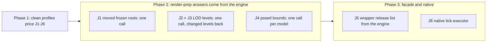

# PRD-898 — The engine's own frame work leaves JavaScript

**Status:** NOT STARTED
**Priority:** P1 — engine-owned JavaScript still runs on every frame of the default engine (AC-1 open): about 1.6 ms of a 5.2 ms stress-lab frame with no crowd. The native player runs the JavaScript animation loop for every rig (AC-2 open).
**Complexity:** 7 (HIGH) — 11+ implementation files (3), crosses the C++/Wasm ABI and the JS package release boundary (+2), wrapper lifetime and frozen-root invalidation state (+2). Risk override: none.
**Owner:** João
**Depends on:** None. Coordinates with [PRD-881](./PRD-881-the-crowds-engine-stages-fit-2-5-ms.md) (post-pass sequence, `AnimationPlayer` batch) and [PRD-882](./PRD-882-the-world-drain-and-the-desktop-forest-run-in-the-engine.md) (world drain). None of their scope moves here.

Executor: read [EXECUTION-ORDER.md](./EXECUTION-ORDER.md) and `PERFORMANCE-LEARNINGS.md` first.
C++ paths are under `packages/runtime-native/src/engine/`; JS paths under `packages/`.

## Context

Owner, 2026-11-11 ([PRD-878](../done/PRD-878-the-walking-crowd-costs-2-5-ms.md) Decisions): "whatever else is on JS tahts not game scripting should move to C++". The 0.3 ms floor does not apply to these moves.

[PRD-828](../done/PRD-828-js-keeps-only-game-logic.md) moved the animation tick, the rate bands, the uniform sync and the compute passes. PRD-877 moved the physics pose blend. PRD-879 moved the world cell frame. This PRD is the survey of what is left, and the plan for the part that no open PRD owns.

### What was measured

All numbers are from 2026-11-11, RTX 2080, web Wasm engine. Develop moved after that date, so Phase 1 takes them again.

| Scene | Reading | Source |
| --- | --- | --- |
| Stress lab, `?stress&noCrowd` | `jsBefore` 0.58 + `engineJs` 0.54 + `residual` 0.52 = **1.64 ms of a 5.21 ms frame** | `~/.cache/tmp-tn/prd878-handoff/out/crowd-attribution.md` (`?tnDebug=1`) |
| Stress lab, `?stress` | `jsBefore` 1.33 + `engineJs` 0.63 + `residual` 0.63 = 2.59 ms of 9.74 ms, plus `update` 1.42 (game script) | same file |
| Forest walk, play window | JS self time is **53% of the busy main thread**, Wasm is 25% | `~/.cache/tmp-tn/fw-forest/runs/head1/cpu.cpuprofile`, seconds 13 to 27.5 |
| Forest walk, load window | JS self time is **69% of the busy main thread** (7.9 s of 11.4 s). Rapier's JS glue is 14.6%, and 13.6% sits under `intersectRay` (ray queries). The physics package's own JS adds 3.3% | same profile, seconds 1 to 12.5 |

The forest profile ran under the playtest harness with `?tnDebug=1`. In the play window the harness (`bridge.sample`, 14.8% inclusive) and the debug meters (`measureDebug`, 11.0%) are not production cost. `refreshStaticTransforms` read 3.7% inclusive, before PRD-887 narrowed it. The profile ranks suspects. It does not price them.

Summary scripts and the eight scout reports: `~/.cache/tmp-tn/prd898/` (`jsprof.py`, `jsincl.py`, `scouts/out/*.md`).

### Survey method

The lead read the frame loop, the profile and the related PRDs. Eight DeepSeek v4.1 flash max scouts read one area each (update, render, facade, physics, world, VFX, native host and UI, load). The lead then opened each cited line. A row below marked **checked** was read in source on 2026-11-16 at `60fb51c4d`. A row marked *scout only* was not opened again and needs that before work starts.

### Rows this PRD takes (default engine, every frame, no owning PRD)

| # | Where (checked) | What the JavaScript does | Scales with | C++ twin |
| --- | --- | --- | --- | --- |
| J1 | `packages/core/src/static-transform.ts:282-303`, called at `game-frame-loop.ts:481` | Visits every frozen root each frame. A root the game froze (`markStatic`) costs a 42-double compare. A root the engine froze costs a parent read and a map lookup | Frozen roots (a cooked region froze 2,077 batches) | None. The engine owns the transforms and can stamp writes |
| J2 | `packages/core/src/model-lod.ts:1419-1452`, `:427-440`, called at `game-frame-loop.ts:563` | Selects a LOD level for every managed mesh, and allocates one object and one array per mesh per frame | LOD-managed meshes | `renderer/lod/model_lod.cpp:88,170` (`selectLodLevel`), not bound to the facade |
| J3 | `packages/core/src/instanced-batch-lod.ts:187-203` | Reads each instance matrix, builds a world sphere and selects a level, per instance, on each update | Instances of each LOD batch | `renderer/projection/instanced_batch.h:273` (`updateInstancedLods`), not bound |
| J4 | `packages/core/src/grounding.ts:50,65` → `pose-measure.ts:417-419` | `GroundSnap.apply` runs `posedBounds` two times. Each run walks the whole subtree with `updateWorldMatrix(true, true)` | Grounded characters × nodes below each | None. The engine holds every bone world matrix |
| J5 | `packages/three-native/src/browser-backend.ts:1863-1917` | `collect()` copies the new wrappers and one sixty-fourth of the settled wrappers into an array each frame, then asks the engine about each | Live wrappers (Midway: about 50,000, so about 780 a frame) | The engine knows when its last reference to a wrapper goes |
| J6 | `packages/core/src/animation-batch.ts:53`; only installer `packages/three-native/src/browser-backend.ts:1761` | The native V8 player installs no `__tnAnimationTick` executor, so each rig keeps the JavaScript loop on desktop and mobile | Rigs | `animation/tick_batch.cpp` (`tn_anim_tick`, exported on both hosts) |

### Rows another open PRD owns (hand the row over, do not duplicate)

| Row (checked) | Owner |
| --- | --- |
| `world-tiles.ts:926-935`: a new `Map` and a LOD target per resident tile on each update. `world-cell-render-main-cull.ts:234`: the shared-batch map copied to an array each frame | [PRD-882](./PRD-882-the-world-drain-and-the-desktop-forest-run-in-the-engine.md) |
| `browser-backend.ts:1222-1225`: an indexed array property (`morphTargetInfluences`) crosses one time per element. Its caller is the tile LOD blend (`world-tile-lod.ts:211`) | PRD-882 |
| `physics/src/simulation.ts:969-970`: two Rapier wrapper records per body per step. `:1457-1462`: two calls per dynamic body per step | [PRD-763](../engine-performance-architecture-2026-10-28/PRD-763-physics-publishes-only-changed-poses.md), [PRD-762](../engine-performance-architecture-2026-10-28/PRD-762-only-actuated-bodies-clear-forces.md) |
| `pointer-events.ts:236`: a JavaScript scene raycast per tick for each hovering pointer, when the game has pointer targets | [PRD-764](../engine-performance-architecture-2026-10-28/PRD-764-scene-ray-queries-skip-irrelevant-objects.md) |
| `interpolation.ts:214`: `JSON.stringify` on every rendered frame for a report that prints on change. `physics/src/plugin.ts:329-331`: a string key per contact event, read only by the debug snapshot. `bridge-meter.ts:246-252`: a census frame one frame in 120 with no debug flag | [PRD-769](../PRD-769-bounded-telemetry-and-debug-overhead.md) |
| Post-pass sequence and the `AnimationPlayer` batch | [PRD-881](./PRD-881-the-crowds-engine-stages-fit-2-5-ms.md) |
| Single-value math (`Vector3`, `Color`, `Matrix4`) | [PRD-742](../native-engine/PRD-742-web-value-math-stays-in-js.md): it stays in JavaScript on purpose |

### Follow-up PRD candidates (not filed, ranked by measured or counted cost)

1. **Web physics steps inside the engine module.** Checked: `packages/physics/src/simulation.ts:1501-1523` allocates a `Ray`, a `Set` and a closure per ray query, and Rapier's glue creates and frees wrapper objects per call. Measured: 13.6% of the busy main thread in the forest load window (about 1.5 s) is that glue under `intersectRay`. The native engine already links the Rust Rapier library and syncs bodies in C++ (`packages/runtime-native/cmake/NativeEngine.cmake:778-782`). The web engine does not. First box of that PRD: a feasibility build of the same library inside the Wasm module.
2. **Load-time loops leave the main thread.** Checked: `world-noise.ts:115-121` bakes 64³ × 4 = 1,048,576 values on the main thread. `assets.ts:824-828` copies positions one vertex at a time. `three-native/src/addons/hdr.ts:123-127` converts RGBE one texel at a time. `terrain-jobs.ts:325` runs inline when the host gives no module worker. *Scout only:* `gpu-scene-bvh.ts:208`, `merge-parts.ts:247`, `render/probe-volume.ts:1987`, `addons/merge-geometries.ts:296`.
3. **VFX fields step on the GPU.** Checked: `ripple-field.ts:303-304` solves a wave equation cell by cell, up to 8 substeps a frame. `spells/reaction-field.ts:256,339` sweeps six channels while a reaction is live (default 96² cells). *Scout only:* `snow-field.ts:680`, `spells/ultra/vfx/common.ts:975`, `GroundField.ts:1368` (a readback each frame), `Shockwaves.ts:255`.
4. **Native host shim and audio poses.** Checked: `runtime-native/src/engine/player/core-host.mjs:113-141` builds a `Set` of held keys, copies it and scans every timer on each tick. `three-native/src/audio.ts:499-516,544-561` recomputes and decomposes a world matrix per voice per frame, then makes six parameter calls.
5. **The cluster cut.** Checked: `clustered-batch.ts:333-334` measures the distance to every placement each frame, before the settled test. No C++ port of the cut exists.

### Scout findings rejected after the check

- `render/virtual-shadow.ts:1041,1182,1290,2427` (caster passes): the engine does not run the node's `updateBefore` (`three-native/src/shadow-node.ts:56`). These run only under `engine: "threejs"`.
- `render/velocity.ts:165` and `projection-*.ts`: off on the owned engine (`game-startup.ts:282`, `renderProjection.ts:425`).
- `runtime-scripts/frame-op-stream.js`: the engine player does not load it (`packages/runtime-native/src/engine/player/v8_main.cpp:100` lists four polyfills). It belongs to the legacy `mystral` host.
- "`ReactionField` has no early-out": it has one (`reaction-field.ts:254`).
- The identity key string in `keyOf`: a closed lever (`PERFORMANCE-LEARNINGS.md`, 2026-10-27, REJECT).
- The 47 `_tnw_web_frame` reads: direct exports, about 3 µs a frame (PRD-828 Decisions).

## Solution

Rule from PRD-828, kept: **one crossing does the work of many objects.** The engine holds the data for each row, so the engine answers, and JavaScript touches only the objects whose answer changed.

1. **Measure first.** Take clean profiles (no `?tnDebug`, harness rows subtracted) and the stage baseline. A row that reads zero on every scene leaves by a Decision.
2. **J1.** The engine stamps a root when its local transform or an ancestor world matrix changes. `refreshStaticTransforms` makes one call that returns the roots that moved, and re-arms only those. `invalidateStatic` and the divergence oracle (`TN_RENDERLIST_VALIDATE=1`) keep their contracts.
3. **J2 and J3.** Bind `ModelLod` and `updateInstancedLods`. One call selects every chain against the frame's camera and returns the meshes whose level changed. JavaScript swaps geometry for those only. The streaming exemption (`model-lod.ts:1441-1444`) and the joined-rung count stay correct.
4. **J4.** One engine call returns the posed bounds of a model from the bone world matrices. `GroundSnap.apply` calls it one time before the correction and adjusts the result by the correction it applied.
5. **J5.** The engine records each wrapper whose last engine reference went. `collect()` reads that list and does no work on a frame where the list is empty. The release delay bound of two passes (`packages/three-native/tests/browser-backend-gc.ts`) holds or improves.
6. **J6.** The V8 adapter installs the `__tnAnimationTick` executor over `tn_anim_tick`. A parity spec lists every `globalThis.__tn*` executor the web back end installs and fails when the native player lacks one.

Each new ABI call ships on the web Wasm engine and the native V8 player in the same commit (CHARTER: web-only is unfinished). The JavaScript paths stay only behind the named `engine: "threejs"` override.

Risks: a frozen root that moves without a stamp draws at a stale pose (J1), a LOD level that differs from the JavaScript choice changes pixels (J2, J3), a wrapper released early breaks a live game object (J5), and animation listener order on native (J6, the same risks PRD-828 recorded for the web).

## Validation scene

- **Benefit workloads:** the Strata forest walk (`examples/strata-terrain-preview/playtests/loop.playtest.json`: about 2,000 frozen batches, LOD chains, streaming) and the stress lab `?stress` (`~/projects/threenative/sandbox-stress/stress-lab`: 120 rigs, 300 bodies).
- **Controls that charge the bookkeeping:** `?stress&noCrowd`, `?stress&still`, and the starter kit scene (no frozen roots, no LOD chain, a few wrappers).
- **Native:** `examples/skinned-crowd/playtests/animation-tick-batch.playtest.json` with `--target desktop`.
- **Comparison:** `pnpm stress:loop fair`, ABBA, head against the start commit, two runs per arm, uncapped pass, RTX 2080, quiet host. The stage split comes from `TN_FRAME_BUDGET.stages`, which is on by default. Spans (`?tnFrameSpans=1`: `lod`, `clustered`) price J2 and J3.
- **Keep rule:** a move stays when frame p50 is not higher in both ABBA pairs and p95 is no more than 5% worse. A move does not need to clear the 0.3 ms floor (owner, 2026-11-11).

## Non-Goals

- Rows that another open PRD owns (table above).
- The five follow-up candidates. Each becomes its own PRD with its own scene.
- Game scripting, and any call into a browser API.

## Acceptance Criteria

- [ ] AC-1 [local, measure lane]: on the forest walk, the engine JavaScript stages (`jsBefore + engineJs + residual`, p50, no debug flag) fall at least 25% against the Phase 1 baseline, and on `?stress&noCrowd` the same sum is not higher. proof: `TN_FRAME_BUDGET.stages` from two ABBA runs per scene, ledger rows — Evidence: pending.
- [ ] AC-2 [local]: on the desktop player, `animationTickBatches` reads p50 1 a frame on the 128-rig crowd, and frame p50 is lower than the start commit in both pairs. proof: `animation-tick-batch.playtest.json --target desktop` and `playtest perf --executable` — Evidence: pending.
- [ ] AC-3 [local]: head frame p50 is not higher than the start commit in both ABBA pairs on the forest walk and on `?stress`, p95 is no more than 5% worse, and a fresh visual judge reads NEUTRAL on the forest overview and walk poses. proof: ledger rows and the verdict — Evidence: pending.

The AC-1 bar is proposed. Phase 1 confirms it against the clean baseline, and a change to the bar goes under `## Decisions` with its reason.

## Integration Ledger

| Capability | Reachable consumer/trigger | Replaces / disposition | Evidence |
| --- | --- | --- | --- |
| Moved frozen roots in one call | `game-frame-loop.ts:481` → `refreshStaticTransforms` → new engine call | The per-root loop stays for `engine: "threejs"` | Phase 2, box 1 |
| LOD selection in the engine | `game-frame-loop.ts:563` → `updateModelLods` → `ModelLod`, `updateInstancedLods` | The per-mesh and per-instance loops stay for `engine: "threejs"` | Phase 2, box 2 |
| Posed bounds in one call | Game `GroundSnap.apply` → `posedBounds` → new engine call | The subtree walk stays for `engine: "threejs"` | Phase 2, box 3 |
| Wrapper release list | `browser-entry.ts` safe point → `collect()` → engine list | The round-robin poll is deleted on the owned engine | Phase 3, box 1 |
| Native animation executor | `AnimationPlayer.update` → `animation-batch.ts` → V8 adapter → `tn_anim_tick` | The native JavaScript loop stays for shapes the batch does not express | Phase 3, box 2 |

## Execution Phases

#### Phase 1: A clean profile prices what is left
**Status:** NOT STARTED
**Files:** this PRD's tables; `docs/stress-loop/ledger.json` (rows).
**Implementation:** Build the start commit (`pnpm build`, both Wasm modules, check the served threads hash). Profile `?stress`, `?stress&noCrowd` and the forest walk with no `?tnDebug`. Subtract rows under `bridge.sample` and `playtest.js`.
- [ ] Rows J1-J6 carry a measured ms-per-frame figure on each scene, and the AC-1 baseline is a ledger row. A row that reads zero on every scene is removed under `## Decisions`. proof: profile paths, `python3 ~/.cache/tmp-tn/prd898/jsincl.py <profile> <t0> <t1>` output and the ledger row ids, written in this PRD.

#### Phase 2: Render-prep answers come from the engine
**Status:** NOT STARTED
**Files:** `packages/core/src/static-transform.ts`, `model-lod.ts`, `instanced-batch-lod.ts`, `grounding.ts`, `pose-measure.ts`; `packages/runtime-native/src/engine/abi/bindings_scene.cpp`, `renderer/lod/model_lod.{h,cpp}`, `renderer/projection/instanced_batch.{h,cpp}`; the facade registry.
**Implementation:** As in Solution 2 to 4. One commit per row, each with its red-green spec and a paired window.
- [ ] J1: with N frozen roots and none moved, `refreshStaticTransforms` makes one engine call and visits zero roots in JavaScript; a moved root re-arms in the same frame. proof: `packages/core/__tests__/static-transform.spec.ts` (red on the per-root loop), a native-engine ctest for the stamp, and the forest `jsBefore` A/B.
- [ ] J2 and J3: one engine call selects every LOD chain, and the levels match the JavaScript selection on a fixed camera path. proof: `packages/core/__tests__/model-lod-runtime.spec.ts` (one call, level parity), `ctest -L native-engine`, the `lod` span A/B, and `examples/strata-terrain-preview/playtests/lod.playtest.json`.
- [ ] J4: `GroundSnap.apply` makes one bounds call per model and no subtree walk, and the clearance matches the JavaScript path to 1e-6. proof: `packages/core/__tests__/grounding-skinned-rig.spec.ts` (red on two walks) and the `update` stage A/B on `?stress`.

#### Phase 3: The facade and the native player
**Status:** NOT STARTED
**Files:** `packages/three-native/src/browser-backend.ts`, `browser-wasm-runtime.ts`; `packages/runtime-native/src/adapters/v8/adapter.cpp`; `packages/core/src/animation-batch.ts`.
**Implementation:** As in Solution 5 and 6.
- [ ] J5: on a frame where the engine released no wrapper, `collect()` allocates nothing and asks nothing; a released wrapper is let go within two safe points. proof: `packages/three-native/__tests__/browser-collect.spec.ts` (red on the round-robin poll) and `packages/three-native/tests/browser-backend-gc.ts`.
- [ ] J6: the desktop player advances the 128-rig crowd with one `tn_anim_tick` call a frame, and the parity spec lists no web-only executor. proof: a `v8_adapter_test.cpp` case, the parity spec red then green, and `animation-tick-batch.playtest.json --target desktop`.

## Decisions

- 2026-11-16 (Claude, from the source check): three scout clusters are rejected because they do not run on the default engine (virtual-shadow caster passes, the JavaScript projection and velocity tracker, the frame-op stream). They are listed above so the next survey does not report them again.
- 2026-11-16 (Claude): physics, load-time loops, VFX fields, the native host shim and the cluster cut are follow-up candidates, not phases, to stay inside the 3-phase cap. The physics candidate has the largest measured share and is the first to file.
- 2026-11-16 (Claude, owner rule of 2026-11-11 applied): the keep rule is "not worse", not "clears 0.3 ms". AC-1 still asks for a net drop over the whole PRD.
