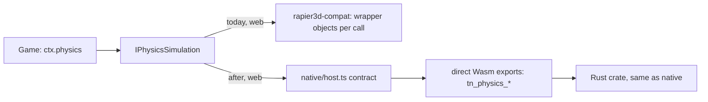

# PRD-899 — Web physics calls Rapier without JavaScript glue

**Status:** PARTIAL — Phase 1 box 1 is green on option B and box 2's stop rule is now **answered: the 3% bar is not met on the forest**, so Phases 2 and 3 stand. Box 2 stays open only because two of its four scenes are not yet profiled.
**Priority:** P2 — on web, each physics query and each body pose goes through JavaScript wrapper objects (AC-1 and AC-2 open). The largest measured share, 25% of the forest load, also has a two-line game fix, so the tier stays P2 until Phase 1 prices what is left.
**Complexity:** 6 (HIGH by override) — 6 to 10 implementation files (2), crosses the Rust, Wasm and npm release boundaries (+2), new web binding layer (+2). Risk override: every web game changes its physics implementation.
**Owner:** João
**Depends on:** [PRD-898](./PRD-898-engine-frame-work-leaves-javascript.md) Phase 1, first box (the `rays` layer of the stress scene). [PR #681](https://github.com/ThreeNativeHQ/threenative-engine/pull/681) merges first, because it edits the same physics files.

Executor: read [EXECUTION-ORDER.md](./EXECUTION-ORDER.md) and `PERFORMANCE-LEARNINGS.md` first.

## Context

Web and native run two physics implementations. All facts below were read in source on 2026-11-16 at `062bb14a7`.

| | Web | Native |
| --- | --- | --- |
| Library | `@dimforge/rapier3d-compat` 0.19.3 (`pnpm-workspace.yaml:23`), a 2.24 MB JavaScript file with its own Wasm inside | The Rust crate `packages/runtime-native/native/physics/` (`rapier3d` 0.30.0, static library, 31 C functions) |
| Back end | `packages/physics/src/web.ts:46` | `packages/physics/src/native.ts:17` over `packages/physics/src/native/host.ts` |
| One ray | A new `Ray`, a new `Set`, a closure and Rapier's wrapper objects (`simulation.ts:1501-1523`) | One call that writes into one reused `Float32Array(8)` (`native/host.ts:390,733`) |
| Body poses after a step | Two wrapper records per body (`simulation.ts:969-970`, loop at `:1472`) | One call for all visible bodies (`native/host.ts:691`, `tn_physics_read_visible_transforms`) |

### What was measured

Forest walk profile of 2026-11-11 (`~/.cache/tmp-tn/fw-forest/runs/head1/cpu.cpuprofile`, RTX 2080, `?tnDebug=1`, so it ranks and does not price):

| Window | Main-thread time under physics frames | Largest caller |
| --- | --- | --- |
| Load, seconds 1 to 12.5 | **26.7%** of 11.35 s busy (JavaScript 18.5%, Rapier Wasm 8.2%) | 24.9%: `intersectRay` from the forest's `groundAt`, one ray for each prop placement |
| Play, seconds 13 to 27.5 | 4.9% of 8.52 s busy (JavaScript 1.4%, Wasm 3.5%) | 4.1%: the fixed step |

Two layers share the load cost:

1. **Game.** `groundAt` casts the physics ray for every placement, and uses it only when the height sample gave no answer (`examples/strata-terrain-preview/src/sceneProps.ts:215-229`). The fix is to cast the ray only in that case. The file is in PR #681's lane (same code at `sceneProps.ts:224` on its branch), so the fix goes there, not here.
2. **Engine.** A ray that the game does need still spends about two thirds of its time in JavaScript (18.5 of 26.7 points). This PRD removes that part.

### Why not only trim the TypeScript

[PRD-762](../engine-performance-architecture-2026-10-28/PRD-762-only-actuated-bodies-clear-forces.md) and [PRD-763](../engine-performance-architecture-2026-10-28/PRD-763-physics-publishes-only-changed-poses.md) cut calls around the compat library. The wrapper objects are inside that library (`__destroy_into_raw` and `WA` in the profile), so no change in our TypeScript removes them.

## Solution

Use the Rust crate on web. It already has the call shape that web needs: one call for a step, one for all poses, one for a ray, with caller-owned buffers.

| Option | Rating | Trade-off |
| --- | --- | --- |
| A. Link the crate into the engine Wasm module | ⭐⭐⭐⭐⭐ | One module, and C++ can later write poses with no JavaScript ([PRD-528](../native-engine/PRD-528-n15-framework-loop-rapier-sync-input-services.md) box 53). Risk: Rust for Emscripten, with `-fwasm-exceptions` and the `-pthread` module (`cmake/NativeEngineCore.cmake:15-19,78`) |
| B. Build the crate as its own Wasm module with direct C exports | ⭐⭐⭐⭐ | Lower build risk: the target `wasm32-unknown-unknown` is installed here. Two modules stay, and poses pass through one typed-array copy |
| C. Keep compat, land PRD-762 and PRD-763 | ⭐⭐ | No build risk. The wrapper objects stay |

Plan: Phase 1 tries A on the two web modules. If the threads module does not link with the stable toolchain, the PRD continues with B and records the linker error under `## Decisions`. Phase 2 is the same work for A and B.

- The crate has no web target today. `packages/runtime-native/scripts/build-native-physics.mjs` takes `--android`, `--desktop`, `--ios-device`, `--ios-simulator` and `--ps4`. This PRD adds `--web`.
- The web back end gives `native/host.ts` the host object that it reads today from `globalThis.__THREENATIVE_NATIVE__.physics` (`native/host.ts:213`), built over the Wasm exports.
- The `engine: "threejs"` override keeps compat, loaded with a dynamic import, so a default-engine game does not download it.

Risks: Rust objects without atomics do not link into the shared-memory module (expected, not verified), a different Rapier build changes contact results in a shipped game, and physics start time grows if the module instantiates later than compat does today.

## Validation scene

- **Benefit workloads:** the Strata forest load (`examples/strata-terrain-preview/playtests/loop.playtest.json`, load window) and the stress scene with the `rays` layer (`?stress&systems`, 120 ground rays per tick, from PRD-898 Phase 1).
- **Controls that charge the change:** `?stress&noBodies` (no physics load, so it shows module size and start cost only), and the starter kit time to ready.
- **Step workload:** `?stress` (300 dynamic bodies) and the shooter kit.
- **Comparison:** `pnpm stress:loop fair`, ABBA, head against the start commit, two runs per arm, RTX 2080, quiet host. Load windows compare clean profiles (no `?tnDebug`) with `python3 ~/.cache/tmp-tn/prd898/jsincl.py`.
- **Keep rule:** frame p50 not higher in both ABBA pairs, p95 no more than 5% worse, and a real-game holdout on each keep (`--holdout`).

## Non-Goals

- Native physics and the C++ pose sync (PRD-528).
- Sensors ([PRD-767](../engine-performance-architecture-2026-10-28/PRD-767-native-sensors-reuse-membership-storage.md)) and render-scene ray queries ([PRD-764](../engine-performance-architecture-2026-10-28/PRD-764-scene-ray-queries-skip-irrelevant-objects.md)).
- A batch ray call. Add it when a profile after Phase 2 shows cost in the single call.
- The `groundAt` fix in the forest kit.

## Acceptance Criteria

- [ ] AC-1 [local, measure lane]: in the forest load window, main-thread time under physics frames falls at least 50% against the Phase 1 baseline. proof: two clean profiles per arm and the `jsincl.py` output — Evidence: pending.
- [ ] AC-2 [local, measure lane]: on `?stress` and `?stress&systems`, frame p50 is not higher than the start commit in both ABBA pairs and p95 is no more than 5% worse. proof: ledger rows from `pnpm stress:loop fair` — Evidence: pending.
- [ ] AC-3 [local]: the web run of the shared parity scenario gives the transforms of the committed native table, inside the tolerance the test has today. proof: `pnpm exec vitest run packages/physics/__tests__/parity.spec.ts` on the new back end — Evidence: pending.

## Integration Ledger

| Capability | Reachable consumer/trigger | Replaces / disposition | Evidence |
| --- | --- | --- | --- |
| Web physics over the Rust crate | Game `ctx.physics` → `IPhysicsSimulation` → `packages/physics/src/web.ts` back end → Wasm exports | `rapier3d-compat` stays only behind `engine: "threejs"` | Phase 2, box 1 |
| Web build of the crate | `build-native-physics.mjs --web` → web engine build | New target | Phase 1, box 1 |

## Execution Phases

#### Phase 1: The crate runs as Wasm, and the baseline is priced
**Status:** NOT STARTED
**Files:** `packages/runtime-native/scripts/build-native-physics.mjs`, `packages/runtime-native/cmake/NativeEngineCore.cmake`, `packages/runtime-native/native/physics/Cargo.toml`.
**Implementation:** Add the Rust target `wasm32-unknown-emscripten` (not installed on the desktop today; `rustc` is 1.96.0). Link the static library into both web modules. Record the module size change against the 2.24 MB file that leaves.
- [x] The crate builds for web and steps the shared parity scenario in Node, on option A for both modules, or on option B with the linker error recorded. proof: `node packages/runtime-native/scripts/build-native-physics.mjs --web` and a Node test that loads the module and matches the committed transform table. — ✅ 2026-11-16, 3a84bcae2, option B: `build-native-physics.mjs --web` writes a wasm32-unknown-unknown cdylib with 0 imports (1,201,008 B, 438,751 B gzip, against compat's 2,238,719 / 834,345). `pnpm native:physics:web-parity` (node:test) steps the parity scenario and matches the new committed table `physics-parity.native-transforms.json` with a max delta of 5.2e-8 over 7 checkpoints; an edited table value fails at "step 1 body 1 field 2". Option A: the single-thread emscripten link works, the `-pthread` link fails (Decisions).
- [ ] Clean profiles give the physics JavaScript share on the forest load, `?stress`, `?stress&systems` and the shooter kit. If the share is under 3% of busy main-thread time on every scene, this PRD closes by a Decision. proof: profile paths and `jsincl.py` output written in this PRD. — ⚠️ The stop rule is **answered negative**: the forest load is already above 3%, so this PRD does not close and Phases 2–3 stand. Four clean profiles of the forest walk, one per ABBA arm at host load 1.96–6.10 (`~/.cache/agent-dumps/prd898/raw/forest/{base,head}{1,2}/cpu.cpuprofile`, read with `python3 ~/.cache/tmp-tn/prd898/physshare.py`): Rapier **JavaScript glue self time** 7.44% / 5.99% / 7.40% / 7.84% of busy main-thread time (base mean 7.64%, head mean 6.70%), and 12.73% / 10.31% / 12.54% / 13.35% under Rapier frames. Busy main-thread time 76.15 / 40.60 / 37.44 / 30.90 s. Still open: `?stress`, `?stress&systems` and the shooter kit were not profiled (the GPU was held by another session's playtest when the remaining windows were attempted), so the box's four-scene census is incomplete even though its decision is settled.

#### Phase 2: The web back end calls the crate directly
**Status:** NOT STARTED
**Files:** `packages/physics/src/web.ts`, `packages/physics/src/native/host.ts`, a new web host file in `packages/physics/src/native/`, `packages/three-native/src/browser-wasm-runtime.ts`.
**Implementation:** Build the host object over the exports. Keep every validation and error code of `native/host.ts`.
- [ ] On the default web engine, `@threenative/physics` runs on the crate and the physics suites pass. proof: `pnpm exec vitest run packages/physics/__tests__` (with `parity.spec.ts`, `spatial-query.spec.ts`, `native-contract.spec.ts`) on the web back end.
- [ ] One ray query makes one Wasm call and creates no wrapper object. proof: a spec that counts export calls for 1,000 rays (red on compat) and the `rays` layer A/B.
- [ ] One fixed step reads every visible body pose with one call. proof: a spec that counts calls for 300 bodies (red on compat) and the `?stress` A/B.

#### Phase 3: Compat leaves the default build
**Status:** NOT STARTED
**Files:** `packages/physics/package.json`, `packages/physics/src/web.ts`, the kit build report.
**Implementation:** Move compat behind a dynamic import for `engine: "threejs"`.
- [ ] A default-engine build of the shooter kit does not contain `rapier3d-compat`, and its total download is not larger than before. proof: the kit build report, bytes before and after.
- [ ] Each kit that uses physics passes its playtests on web. proof: `pnpm test:templates`.

## Decisions

- 2026-11-16 (Claude, from the profile): the forest `groundAt` fix is game code in PR #681's lane. It is named here because it changes the size of AC-1's baseline. Phase 1 takes the baseline after that fix when it has landed.
- 2026-11-16 (Claude): Phase 1 carries a stop rule (3% of busy main-thread time). A move with no measured ceiling does not start.
- 2026-11-16 (Claude): PRD-762 and PRD-763 stay open. When Phase 2 lands, check each again: one pose call for all bodies can make PRD-763 moot on web.
- 2026-11-16 (Claude, Phase 1 result): option B. The threads link of option A fails with `wasm-ld: error: --shared-memory is disallowed by compiler_builtins-…rcgu.o because it was not compiled with 'atomics' or 'bulk-memory' features.`, with or without `-C target-feature=+atomics,+bulk-memory`. The fix needs nightly `-Zbuild-std`, which this PRD rules out. The standalone module needs no imports, so one module serves both engine builds.
- 2026-11-16 (Claude, Phase 1 box 2 measurement): the 3% stop rule is answered **negative**. Rapier's JavaScript glue is 6.0–7.8% of the forest's busy main-thread time in four clean profiles (two per arm), and 10.3–13.4% of it runs under Rapier frames. One scene above the bar settles the rule ("under 3% ... on every scene" is already false), so Phases 2 and 3 stand and this PRD does not close by a Decision. Note the share is the *engine* glue only: the forest's `groundAt` ray per prop placement (the 24.9% caller in the 2026-11-11 load profile) is game code in PR #681's lane and is excluded here, as the Decisions above require.
