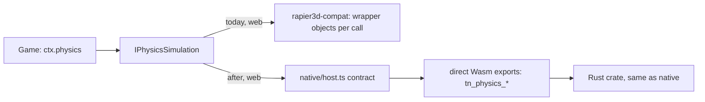

# PRD-899 — Web physics calls Rapier without JavaScript glue

**Status:** PARTIAL — Phases 1–2 and AC-1 to AC-3 are green (forest load physics −51.6%, `?stress&systems` p50 77.8 → 33.4 ms); Phase 3 box 2 is open because the adventure kit's `boss` scenario fails on the crate (D8).
**Priority:** P2 — on web, each physics query and each body pose went through JavaScript wrapper objects; on the owned engine it now calls the crate directly (AC-1 to AC-3 green). The largest measured share, 25% of the forest load, also has a two-line game fix, so the tier stays P2 until Phase 1 prices what is left.
**Complexity:** 6 (HIGH by override) — 6 to 10 implementation files (2), crosses the Rust, Wasm and npm release boundaries (+2), new web binding layer (+2). Risk override: every web game changes its physics implementation.
**Owner:** João
**Depends on:** [PRD-898](./PRD-898-engine-frame-work-leaves-javascript.md) Phase 1, first box (the `rays` layer of the stress scene). [PR #681](https://github.com/ThreeNativeHQ/threenative-engine/pull/681) merges first, because it edits the same physics files.

Executor: read [EXECUTION-ORDER.md](./EXECUTION-ORDER.md) and `PERFORMANCE-LEARNINGS.md` first.

## Context

Web and native run two physics implementations. All facts below were read in source on 2026-11-16 at `062bb14a7`.

| | Web | Native |
| --- | --- | --- |
| Library | `@dimforge/rapier3d-compat` 0.19.3 (`pnpm-workspace.yaml:23`), a 2.24 MB JavaScript file with its own Wasm inside | The Rust crate `packages/runtime-native/native/physics/` (`rapier3d` 0.30.0, static library, 31 C functions) |
| Back end | `packages/physics/src/web.ts:46` | `packages/physics/src/native.ts:17` over `packages/physics/src/native/host.ts` |
| One ray | A new `Ray`, a new `Set`, a closure and Rapier's wrapper objects (`simulation.ts:1501-1523`) | One call that writes into one reused `Float32Array(8)` (`native/host.ts:390,733`) |
| Body poses after a step | Two wrapper records per body (`simulation.ts:969-970`, loop at `:1472`) | One call for all visible bodies (`native/host.ts:691`, `tn_physics_read_visible_transforms`) |

### What was measured

Forest walk profile of 2026-11-11 (`~/.cache/tmp-tn/fw-forest/runs/head1/cpu.cpuprofile`, RTX 2080, `?tnDebug=1`, so it ranks and does not price):

| Window | Main-thread time under physics frames | Largest caller |
| --- | --- | --- |
| Load, seconds 1 to 12.5 | **26.7%** of 11.35 s busy (JavaScript 18.5%, Rapier Wasm 8.2%) | 24.9%: `intersectRay` from the forest's `groundAt`, one ray for each prop placement |
| Play, seconds 13 to 27.5 | 4.9% of 8.52 s busy (JavaScript 1.4%, Wasm 3.5%) | 4.1%: the fixed step |

Two layers share the load cost:

1. **Game.** `groundAt` casts the physics ray for every placement, and uses it only when the height sample gave no answer (`examples/strata-terrain-preview/src/sceneProps.ts:215-229`). The fix is to cast the ray only in that case. The file is in PR #681's lane (same code at `sceneProps.ts:224` on its branch), so the fix goes there, not here.
2. **Engine.** A ray that the game does need still spends about two thirds of its time in JavaScript (18.5 of 26.7 points). This PRD removes that part.

### Why not only trim the TypeScript

[PRD-762](../engine-performance-architecture-2026-10-28/PRD-762-only-actuated-bodies-clear-forces.md) and [PRD-763](../engine-performance-architecture-2026-10-28/PRD-763-physics-publishes-only-changed-poses.md) cut calls around the compat library. The wrapper objects are inside that library (`__destroy_into_raw` and `WA` in the profile), so no change in our TypeScript removes them.

## Solution

Use the Rust crate on web. It already has the call shape that web needs: one call for a step, one for all poses, one for a ray, with caller-owned buffers.

| Option | Rating | Trade-off |
| --- | --- | --- |
| A. Link the crate into the engine Wasm module | ⭐⭐⭐⭐⭐ | One module, and C++ can later write poses with no JavaScript ([PRD-528](../native-engine/PRD-528-n15-framework-loop-rapier-sync-input-services.md) box 53). Risk: Rust for Emscripten, with `-fwasm-exceptions` and the `-pthread` module (`cmake/NativeEngineCore.cmake:15-19,78`) |
| B. Build the crate as its own Wasm module with direct C exports | ⭐⭐⭐⭐ | Lower build risk: the target `wasm32-unknown-unknown` is installed here. Two modules stay, and poses pass through one typed-array copy |
| C. Keep compat, land PRD-762 and PRD-763 | ⭐⭐ | No build risk. The wrapper objects stay |

Plan: Phase 1 tries A on the two web modules. If the threads module does not link with the stable toolchain, the PRD continues with B and records the linker error under `## Decisions`. Phase 2 is the same work for A and B.

- The crate has no web target today. `packages/runtime-native/scripts/build-native-physics.mjs` takes `--android`, `--desktop`, `--ios-device`, `--ios-simulator` and `--ps4`. This PRD adds `--web`.
- The web back end gives `native/host.ts` the host object that it reads today from `globalThis.__THREENATIVE_NATIVE__.physics` (`native/host.ts:213`), built over the Wasm exports.
- The `engine: "threejs"` override keeps compat, loaded with a dynamic import, so a default-engine game does not download it.

Risks: Rust objects without atomics do not link into the shared-memory module (expected, not verified), a different Rapier build changes contact results in a shipped game, and physics start time grows if the module instantiates later than compat does today.

## Validation scene

- **Benefit workloads:** the Strata forest load (`examples/strata-terrain-preview/playtests/loop.playtest.json`, load window) and the stress scene with the `rays` layer (`?stress&systems`, 120 ground rays per tick, from PRD-898 Phase 1).
- **Controls that charge the change:** `?stress&noBodies` (no physics load, so it shows module size and start cost only), and the starter kit time to ready.
- **Step workload:** `?stress` (300 dynamic bodies) and the shooter kit.
- **Comparison:** `pnpm stress:loop fair`, ABBA, head against the start commit, two runs per arm, RTX 2080, quiet host. Load windows compare clean profiles (no `?tnDebug`) with `python3 ~/.cache/tmp-tn/prd898/jsincl.py`.
- **Keep rule:** frame p50 not higher in both ABBA pairs, p95 no more than 5% worse, and a real-game holdout on each keep (`--holdout`).

## Non-Goals

- Native physics and the C++ pose sync (PRD-528).
- Sensors ([PRD-767](../engine-performance-architecture-2026-10-28/PRD-767-native-sensors-reuse-membership-storage.md)) and render-scene ray queries ([PRD-764](../engine-performance-architecture-2026-10-28/PRD-764-scene-ray-queries-skip-irrelevant-objects.md)).
- A batch ray call. Add it when a profile after Phase 2 shows cost in the single call.
- The `groundAt` fix in the forest kit.

## Acceptance Criteria

- [x] AC-1 [local, measure lane]: in the forest load window, main-thread time under physics frames falls at least 50% against the Phase 1 baseline. proof: two clean profiles per arm and the `jsincl.py` output — Evidence: ✅ 2026-11-17, **−51.6% on the mean of four profiles per arm**. Lane D7: Strata `?world=forest` built on the owned engine (`TN_ENGINE=threenative vite build --sourcemap hidden`), base 3e9430993 (compat, PR #681's `groundAt` fix included) against the head with the crate fix below, two ABBA rounds, CPU profile from navigation, window 1–12.5 s (`forest-prof.mjs`, `rowcost-sm.mjs` with `TN_WINDOW`, `raw/forest899-v2a`, `-v2b`). Time under physics frames: base 2,436 / 2,376 / 2,395 / 2,459 ms (mean 2,417), head **1,165 / 1,216 / 1,129 / 1,163 ms (mean 1,168)**. Adjacent pairs: −52.2%, −48.8%, −52.9%, −52.7%. The JavaScript part of it (glue, GC, callers) is 1,143 → 252 ms; the Wasm part is 1,294 → 915 ms, which is Rapier's own BVH ray traversal (`ray_aabb`, `find_best`). Before the crate fix the head read −45% (1,392 / 1,326 ms, `raw/forest899-v1`). The steady phase after the load (12.5–30 s) is 0.15–0.19 ms per frame on both arms.
- [x] AC-2 [local, measure lane]: on `?stress` and `?stress&systems`, frame p50 is not higher than the start commit in both ABBA pairs and p95 is no more than 5% worse. proof: ledger rows from `pnpm stress:loop fair` — Evidence: ✅ 2026-11-17, paired ABBA on the D7 lane (`~/.cache/tmp-tn/prd898/abba-p899.sh`, `raw/abba-p899.log`), start commit 3e9430993 against 28893132e. **`?stress`**: frame p50 10.89 / 14.71 → **10.30 / 10.37 ms** (lower in both pairs), p95 14.82 / 20.42 → 14.98 / 14.89 ms (+1.1% and −27%, mean −15%). **`?stress&systems`**: p50 83.24 / 77.84 → **33.06 / 33.43 ms**, p95 103.60 / 85.19 → 37.99 / 41.68 ms. Not ledger rows: `stress:loop fair` refused the window (D7).
- [x] AC-3 [local]: the web run of the shared parity scenario gives the transforms of the committed native table, inside the tolerance the test has today. proof: `pnpm exec vitest run packages/physics/__tests__/parity.spec.ts` on the new back end — Evidence: ✅ 2026-11-17: `wasm-host.spec.ts` steps `physics-parity.scenario.json` through the Wasm host and the shared native back end and matches `physics-parity.native-transforms.json` within its 0.02 tolerance at every checkpoint (`parity.spec.ts` itself compares compat 0.19.3 against the native table by design, per the package `AGENTS.md`, and stays as it is).

## Integration Ledger

| Capability | Reachable consumer/trigger | Replaces / disposition | Evidence |
| --- | --- | --- | --- |
| Web physics over the Rust crate | Game `ctx.physics` → `IPhysicsSimulation` → `packages/physics/src/web.ts` back end → Wasm exports | `rapier3d-compat` stays only behind `engine: "threejs"` | Phase 2, box 1 |
| Web build of the crate | `build-native-physics.mjs --web` → web engine build | New target | Phase 1, box 1 |

## Execution Phases

#### Phase 1: The crate runs as Wasm, and the baseline is priced
**Status:** DONE — option B, and all four scenes priced.
**Files:** `packages/runtime-native/scripts/build-native-physics.mjs`, `packages/runtime-native/cmake/NativeEngineCore.cmake`, `packages/runtime-native/native/physics/Cargo.toml`.
**Implementation:** Add the Rust target `wasm32-unknown-emscripten` (not installed on the desktop today; `rustc` is 1.96.0). Link the static library into both web modules. Record the module size change against the 2.24 MB file that leaves.
- [x] The crate builds for web and steps the shared parity scenario in Node, on option A for both modules, or on option B with the linker error recorded. proof: `node packages/runtime-native/scripts/build-native-physics.mjs --web` and a Node test that loads the module and matches the committed transform table. — ✅ 2026-11-16, 3a84bcae2, option B: `build-native-physics.mjs --web` writes a wasm32-unknown-unknown cdylib with 0 imports (1,201,008 B, 438,751 B gzip, against compat's 2,238,719 / 834,345). `pnpm native:physics:web-parity` (node:test) steps the parity scenario and matches the new committed table `physics-parity.native-transforms.json` with a max delta of 5.2e-8 over 7 checkpoints; an edited table value fails at "step 1 body 1 field 2". Option A: the single-thread emscripten link works, the `-pthread` link fails (Decisions).
- [x] Clean profiles give the physics JavaScript share on the forest load, `?stress`, `?stress&systems` and the shooter kit. If the share is under 3% of busy main-thread time on every scene, this PRD closes by a Decision. proof: profile paths and `jsincl.py` output written in this PRD. — ✅ **the stop rule is answered negative, all four scenes measured.** Rapier **JavaScript glue self time**, share of busy main-thread time (`physshare.py`):
  - **Forest walk** (four profiles, two per arm, quiet host, 2026-11-16): **7.44% / 5.99% / 7.40% / 7.84%**, with 10.3–13.4% under Rapier frames. This scene breaks the 3% bar.
  - **`?stress`**: 0.05% / 0.06% (2026-11-16); 0.04% (2026-11-17, `raw/profsm/stress-base.cpuprofile`).
  - **`?stress&systems`**: 0.47% / 0.72% (2026-11-16); 0.48% (2026-11-17).
  - **`?stress&noCrowd`** (control): 0.17% / 0.07% (2026-11-16); 0.06% (2026-11-17).
  - **Shooter kit** (scaffolded on the compat tarballs, standing at spawn, 15 s, 917 frames, `raw/profsm/shooter-j23.cpuprofile`): **0.12%**, 1.50% under Rapier frames.
  One scene above the bar settles the rule, so Phases 2–3 stand (D6 corrected: the `shooter` kit ships).

#### Phase 2: The web back end calls the crate directly
**Status:** DONE — 28893132e.
**Files:** `packages/physics/src/web.ts`, `packages/physics/src/native/host.ts`, a new web host file in `packages/physics/src/native/`, `packages/three-native/src/browser-wasm-runtime.ts`.
**Implementation:** Build the host object over the exports. Keep every validation and error code of `native/host.ts`.
- [x] On the default web engine, `@threenative/physics` runs on the crate and the physics suites pass. proof: `pnpm exec vitest run packages/physics/__tests__` (with `parity.spec.ts`, `spatial-query.spec.ts`, `native-contract.spec.ts`) on the web back end. — ✅ 2026-11-17, 28893132e: `native/wasm-host.ts` builds the `INativePhysicsHost` the V8 binding installs, over the module's exports, and `web.ts` uses it when `bindWebEngine` has run. `web-backend.spec.ts` "runs on the Rapier crate's Wasm module under the default engine" is red on the old `web.ts` (`expected '0.19.3' to be '0.30.0'`) and green after; `engine: "threejs"` still reads 0.19.3. `wasm-host.spec.ts` 6/6 (parity scenario, memory growth, the C++ error texts). `pnpm exec vitest run packages/physics/__tests__` 40 files, 327/327 with the two new specs and `web-engine.spec.ts`. The suites named in the box drive hand-written fakes or compat directly, so the crate path is proven by the two new specs, not by them. In a browser: the staged stress lab and shooter kit load the module (`threenative_native_physics-*.wasm`, 289,130 B brotli) and run with no page error.
- [x] One ray query makes one Wasm call and creates no wrapper object. proof: a spec that counts export calls for 1,000 rays (red on compat) and the `rays` layer A/B. — ✅ 2026-11-17: `wasm-host.spec.ts` counts exactly `[["tn_physics_intersect_ray", 1000]]` for 1,000 rays through the shared simulation, no other export and no allocation (compat has no export to count: its per-ray `Ray`, `Set`, closure and wrapper records are `simulation.ts:1501-1523`). `rays` layer A/B (`?stress&systems`, paired ABBA, D7 lane, `raw/abba-p899.log`): PR head before this PRD (j23) → head, frame p50 35.17 / 33.58 → **33.06 / 33.43 ms**, `update` 8.80 / 8.13 → **7.55 / 7.55 ms**; physics inclusive time on the scene 3.54 → **1.70 ms/frame** against the start commit (`rowcost-sm.mjs`, `raw/profsm/stress-systems-*.cpuprofile`).
- [x] One fixed step reads every visible body pose with one call. proof: a spec that counts calls for 300 bodies (red on compat) and the `?stress` A/B. — ✅ 2026-11-17: `wasm-host.spec.ts` steps 300 dynamic bodies and reads their poses with exactly 1 `tn_physics_step` and 1 `tn_physics_read_visible_transforms` call (compat reads two wrapper records per body, `simulation.ts:969-970`). `?stress` A/B (paired ABBA, D7 lane): j23 → head frame p50 12.28 / 11.83 → **10.30 / 10.37 ms** (−14%), `update` 2.28 / 2.20 → 1.97 / 1.90 ms; physics inclusive 0.97 → **0.79 ms/frame** against the start commit.

#### Phase 3: Compat leaves the default build
**Status:** box 1 done; box 2 open — adventure `boss` fails on the crate (D8).
**Files:** `packages/physics/package.json`, `packages/physics/src/web.ts`, the kit build report.
**Implementation:** Move compat behind a dynamic import for `engine: "threejs"`.
- [x] A default-engine build of the shooter kit does not contain `rapier3d-compat`, and its total download is not larger than before. proof: the kit build report, bytes before and after. — ✅ 2026-11-17: the shooter kit scaffolded on each arm's tarballs (`stage-kit.sh`, `threenative build --target web`). Before: two `rapier-*.js` chunks of 2,237,080 B (614,275 B brotli) each. After: no file carries a compat marker (`rawrapier|RAPIER_VERSION|rapier_wasm`: 0 files), only the plugin's 149 B refusing stub, plus `threenative_native_physics-*.wasm` 1,201,008 B (289,130 B brotli). Total download, every dist file: **brotli 7,797,936 → 6,870,998 B (−11.9%)**, gzip 9,393,639 → 8,190,627 B. The web-engine plugin resolves `@dimforge/rapier3d-compat` to that stub on the owned engine (`web-engine.spec.ts`, red then green).
- [ ] Each kit that uses physics passes its playtests on web. proof: `pnpm test:templates`. — ❌ **open (D8).** 2026-11-17, `TN_TEMPLATE_ONLY=<the 13 physics kits> pnpm test:templates` on the desktop (`raw/test-templates-physics.log`): the scaffolded playtests pass on action-rpg, collectathon, minimal, puzzle, racing, runner, sailing, shooter and snow, and on starter and platformer, which run the kit contract only. tower-defense failed once on GPU p95 (22.21 ms, CPU 0.16 ms, shared GPU) and passed on the rerun. **adventure fails two scenarios:** `production-performance` (1,070,233 triangles against 480,000) fails the same way on the start commit (1,070,717), so this PRD did not cause it; **`boss` passes on the start commit and on PRD-898 alone (`j23`), and fails on the crate in every run** (`torsoContactWorst` 0.654 → 1, `torsoCovered` 0.318 → 0.398). The kit-contract table fails `engine-cost` on 10 kits and `camera-sees-subject` on 4 on this lane; the start commit was not run through the contract, so those rows are not attributed.

## Decisions

- 2026-11-16 (Claude, from the profile): the forest `groundAt` fix is game code in PR #681's lane. It is named here because it changes the size of AC-1's baseline. Phase 1 takes the baseline after that fix when it has landed.
- 2026-11-17 (D8, Claude, the adventure boss): Wren and the Warden diverge from the first step by millimetres (the Warden rests at y 1.300 on the crate, 1.295 on compat). At tick 126 of `boss` the crate's Warden, charging at 8 m/s with nothing in its path (overlap queries along the step find only the floor skin), moves 1 mm; the kit's one-tick wall test (`moved < 30%`) stuns it, and the fight goes another way. Reproduced in isolation: the Warden's capsule charging over the Hollow's floor slab as a trimesh **stalls for one step on both backends** (step 113, z −22.936), and never over a box collider. So the stall is Rapier's character controller meeting a trimesh internal edge on compat, the crate and native alike; the crate only moves it under this charge. Checked and identical on both backends: two characters walking into each other, 11 ray cases, a character walking a bumpy trimesh (positions, visible rows, sleep states, events). One real difference found and fixed: the crate took the **last** walkable contact as the ground and compat the **first** (`wasm-host.spec.ts` "reports the first walkable contact as ground", red on the old module at step 27, green after); it did not change `boss`. The fix for the stall is an owner decision: an engine change to the character controller on trimeshes (both backends), a two-step wall test in the kit, or merging with `boss` red.
- 2026-11-17 (Claude, AC-1 profile): the crate's ray, shape and point queries mapped a hit collider to its body by scanning every body entry, once per candidate collider in the query filter: 153 ms of the forest load (symbol-named build, `intersect_ray::{{closure}}`). `insert_body` now stores the body id on the collider's `user_data`, and `Simulation::entry_for` reads it back with one map lookup, checking that the entry still owns that collider. Crate tests 42/42 before and after; `wasm-host.spec.ts`, `web-backend.spec.ts`, `native-contract.spec.ts` 37/37. Native desktop links the same crate, so it gets the same lookup; no native frame was measured for it.
- 2026-11-16 (Claude): Phase 1 carries a stop rule (3% of busy main-thread time). A move with no measured ceiling does not start.
- 2026-11-16 (Claude): PRD-762 and PRD-763 stay open. When Phase 2 lands, check each again: one pose call for all bodies can make PRD-763 moot on web.
- 2026-11-16 (Claude, Phase 1 result): option B. The threads link of option A fails with `wasm-ld: error: --shared-memory is disallowed by compiler_builtins-…rcgu.o because it was not compiled with 'atomics' or 'bulk-memory' features.`, with or without `-C target-feature=+atomics,+bulk-memory`. The fix needs nightly `-Zbuild-std`, which this PRD rules out. The standalone module needs no imports, so one module serves both engine builds.
- 2026-11-16 (Claude, Phase 1 box 2 measurement): the 3% stop rule is answered **negative**. Rapier's JavaScript glue is 6.0–7.8% of the forest's busy main-thread time in four clean profiles (two per arm), and 10.3–13.4% of it runs under Rapier frames. One scene above the bar settles the rule ("under 3% ... on every scene" is already false), so Phases 2 and 3 stand and this PRD does not close by a Decision. Note the share is the *engine* glue only: the forest's `groundAt` ray per prop placement (the 24.9% caller in the 2026-11-11 load profile) is game code in PR #681's lane and is excluded here, as the Decisions above require.

### D6: the fourth physics scene is not measurable, and it cannot change the rule (2026-11-16, corrected 2026-11-17)
The 2026-11-16 claim that no `shooter` template ships was wrong: `packages/create-threenative/templates/shooter/` ships (`kit.json`, genre `shooter`); the `--help` list read that day missed it. On 2026-11-17 the shooter kit was scaffolded on the compat tarballs and profiled (glue 0.12%), so all four scenes are measured and this decision no longer holds anything open.

### D7: the measure lane while the desktop monitors sleep (2026-11-17, Claude)
**Chose:** headless Brave (`--headless=new --use-angle=vulkan --use-vulkan=native`) on the same RTX 2080, a paired ABBA with the PRD-898 probe (`abba-p899.sh`: base, j23, head, head, j23, base, two scenes), and CPU profiles with hidden source maps read by `rowcost-sm.mjs`.
**Because:** both desktop monitors read `disconnected`, so KWin paces `:0` at 1 Hz (the adapter still reads `nvidia/turing`, every frame takes 1 s). Headless reads `nvidia/turing` and presents at 60 Hz. `pnpm stress:loop fair` refused the window: another session's chrome-devtools MCP page held 15–41% of the GPU for the whole run (`fair: GPU 28%, waiting for 5 s under 10%`), and that page is not this lane's to close. Every arm ran under the same competitor, and the ABBA order cancels its drift.
**Rejected:** the Debian laptop (Iris Xe, 32% arm drift on record) and private Xvfb (about 10 fps presents).
**Reversible:** yes — rerun `pnpm stress:loop fair` with the same arms when the monitors wake and the GPU is free; the x11 flag added to `stress-fair.mjs` makes headed Chromium open its DevTools port under the Wayland session again.

## Blocked on

- Phase 3 box 2: the adventure kit's `boss` scenario (D8). It needs the owner's choice of fix.
