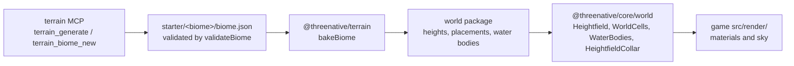

# Refactoring

**Status:** NOT STARTED — filed 2026-11-04 at the owner's request.

Owner, 2026-11-04: "should we have a dedicated terrain packages just for terrain abstractions? I feel
we have a lot of 'hardcode' on the stata terrain preview and its not scalable", then "also plan for
other refactoring like on packages/core/src/world-cell-render.ts 'God files'", "propose tests before
anyting thats not covered, before touching it, to avoid regressions", and "our goal is to have all
abstractions and architecture needed to make strata terrain MCP respond to any terrain generation
command and be able to bake a new biome quickly".

| Batch | Goal | PRDs |
|---|---|---|
| [strata-refactoring](../../../packages/terrain/docs/PRDs/done/strata-refactoring/README.md) | The terrain MCP answers any terrain request and bakes a new biome from one data file. | PRD-791 to PRD-799 |
| [god-files](../done/god-files/README.md) | No source file is a god file, and none can grow back into one. | PRD-800 to PRD-804 |
| [untangle-2026-11-06](untangle-2026-11-06/README.md) | Each value has one owner: a change lands in one place and drift goes red. | PRD-832 to PRD-842 |

## Decision: no new terrain package

The terrain already has two packages with one job each. A third package carries no dependency the
others must not inherit, so root `AGENTS.md` rule 4 rejects it. The fix is to move code to the owner
that already exists:

| Layer | Owner | Holds |
|---|---|---|
| Authoring and bake | `@threenative/terrain` | Biome schema and validation, landform, erosion, scatter stages, the world-package bake, the MCP tools |
| Runtime mechanism | `@threenative/core/world` | Heightfield storage and queries, tile and cell residency, LOD, far ring, water-body queries |
| Appearance and data | Game `src/render/` and `starter/<biome>/` copy-out files | Materials, TSL, colours, sky, and each biome's `biome.json` values |

## Rules for every PRD here

1. **Pin first.** Phase 1 of each PRD adds the tests that the moved code lacks, and runs them green on
   today's code before any line moves. A split that starts without its pins is out of process.
2. **Move, do not change.** A split keeps behaviour and the public API. Old modules re-export moved
   symbols until no consumer imports them. A bug found while moving gets its own red-green commit.
3. **One owner per value.** A constant that two files hold by hand becomes one export first.
