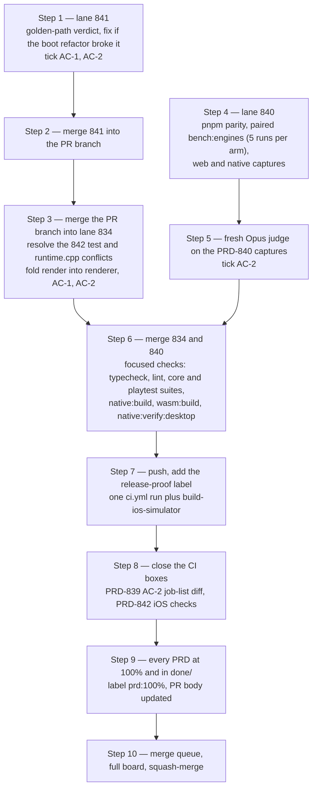

# Untangle batch — what is left before PR #632 merges

**Written:** 2026-11-08, on `refactor/untangle-832-842` (PR #632).
**Purpose:** one ordered list of the open work, so that any session can continue it. Update the tables when a step lands.

## Rules this chain follows

- One PR for the whole batch, as the owner asked. Lanes work on local `lane/untangle-<n>` branches in `.worktrees/untangle-<n>/`, open no PR and do not push. The lead merges each lane into `refactor/untangle-832-842`.
- A PRD box ticks only when its proof ran and passed, with the result written in the box.
- A box that can change pixels ticks only with a fresh visual-judge verdict: headed, `--browser-recipe webgpu`, `adapter.info` checked, at least two runs per arm.
- The commit that finishes a PRD moves it to `docs/PRDs/done/` and fixes the README links.

## State

| PRD | Label | State | What is left |
| --- | --- | --- | --- |
| [PRD-832](../../done/PRD-832-urgent-single-sources.md) | `prd:100%` | ✅ done | nothing |
| [PRD-833](../../done/PRD-833-template-mechanism-lives-once.md) | `prd:100%` | ✅ done | nothing (judge NEUTRAL on starter, racing and snow) |
| [PRD-835](../../done/PRD-835-one-registry-entry-per-assertion.md) | `prd:100%` | ✅ done | nothing |
| [PRD-836](../../done/PRD-836-one-committed-capability-manifest.md) | `prd:100%` | ✅ done | nothing |
| [PRD-837](../../done/PRD-837-core-owns-each-shared-fact-once.md) | `prd:100%` | ✅ done | nothing (judge NEUTRAL on Strata forest and abyss) |
| [PRD-838](../../done/PRD-838-scripts-share-one-runtime-layer.md) | `prd:100%` | ✅ done | nothing (`pnpm visuals` needs owner scores, see below) |
| [PRD-839](../../done/PRD-839-ci-contract-is-a-model-not-text.md) | `prd:100%` | ✅ done | nothing: AC-2 measured, 25 of 25 job names identical to the last comparable run |
| [PRD-842](PRD-842-native-tests-check-behaviour-not-source-text.md) | `prd:50%` | ⚠️ merged | Phase 2 box 2 and AC-2 wait on the macOS `build-ios-simulator` job; the variant fix (`simctl uninstall` before each install) is on the PR. The seven `ui-layer-host-contract` slice tests moved to [PRD-862](PRD-862-untangle-native-leftovers.md) |
| [PRD-841](../../done/PRD-841-game-ts-stops-being-the-hub.md) | `prd:100%` | ✅ done, in `done/` | nothing: AC-1 93 core tests, AC-2 the starter golden path in its CI configuration exit 0 |
| [PRD-834](../../done/PRD-834-cross-language-contracts-are-generated.md) | `prd:100%` | ✅ done, in `done/` | nothing: the `render` → `renderer` fold is wired, `pnpm native:verify:desktop` exit 0 and the starter perf lane read two frame-budget windows |
| [PRD-840](../../done/PRD-840-platform-difference-is-a-value.md) | `prd:100%` | ✅ done | AC-1 measured (identical conformance outcomes before/after); AC-2 web judge **NEUTRAL**. The native capture and the frame-time A/B moved to [PRD-862](PRD-862-untangle-native-leftovers.md) (owner, 2026-11-09) |

Landed 2026-11-08: `lane/untangle-841`, `lane/untangle-834` and `lane/untangle-840` are merged into `refactor/untangle-832-842`, and `origin/develop` is merged into it (the PR could not build its merge ref before that, so CI reported no checks). Three defects found on the way, each fixed with its own check: the native bundler's core-subpath resolver broke every kit that imports `@threenative/core/render/environment` (PRD-833 moved the file); the shooter kit set two `renderer` keys after the fold; and PRD-842's five new contract targets were neither claimed by `build-matrix.json` nor registered for the two extra shim-bootstrap modes, which made the coverage evidence unregenerable and `pnpm budgets` red.

The PR label is `prd:50%` until the merged phase boxes reach 75% of the batch.

## Sequence

## Step details

| Step | Proof that closes it | Risk |
| --- | --- | --- |
| 1 | `TN_GOLDEN_PATH_SCENARIOS=1 TN_GOLDEN_PATH_TEMPLATES=starter pnpm verify:golden-path` → EXIT=0 on a real GPU; `npx vitest run packages/core/__tests__/game.spec.ts packages/core/__tests__/game-stop-order.spec.ts` | ⚠️ the first run gave 0 frames; the cause can be a boot exception or a slow software adapter |
| 3 | `pnpm --filter @threenative/core exec vitest run __tests__/game.spec.ts`, `pnpm scaffold:pin --check`, `pnpm native:verify:desktop`, playtest `perf` on the starter with windows > 0 | ⚠️ the fold changes a public config key; the old key must throw `TN_GAME_RENDER_KEY_RENAMED` |
| 4 | `pnpm parity` before and after; `pnpm bench:engines` medians and spread on web and native | ⚠️ the largest change: `renderer.cpp` split into files under 3 000 lines; each host keeps its current render choices, so no picture or cost should move |
| 7 | the `ci.yml` run and `native-release.yml` `build-ios-simulator` on the PR head | ❌ the iOS checks never ran: Objective-C++ cannot compile on Linux, so a first red is likely a harness mistake |
| 8 | `diff` of `gh run view <id> --json jobs` against run `42452768709` | ✅ low |

## Items for the owner

- **`pnpm visuals` cannot exit 0 on any branch.** `docs/verification/visuals/scores.json` dates from 2026-08-21, misses 10 kits and names the renamed `defense` kit. The gate also fails any kit below `VISUAL_SCORE_FLOOR = 4` (`scripts/visual-gate.ts:344`), and the existing model scores hold racing 2 and four kits at 3. Only the owner can re-score the kits or change the floor.
- **Android canvas text is a stub in the shipped APK.** `packages/runtime-native/android/app/build.gradle.kts:380` sets `-DTN_ENABLE_CANVAS2D=OFF`, so `canvas2d.cpp` builds without Skia. On the emulator `measureText` returns `length × size × 0.6`, and `getImageData` returns no ink. Recorded as a Finding in PRD-842, not fixed here.
- **The Android V8 build needs `third_party/v8-android/build-receipt.json`**, which no checkout has. The emulator proofs in this batch used the QuickJS build.
