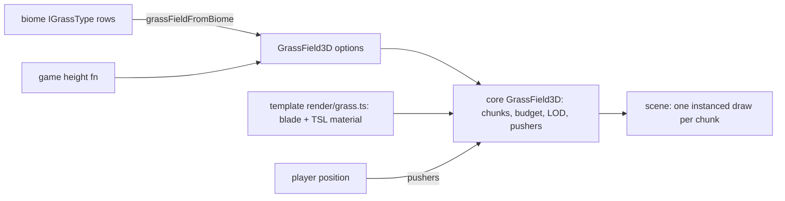

# PRD-883 — Grass grows, sways and parts around the player on every engine

**Status:** NOT STARTED
**Priority:** P2 — no box is ticked: the engine has no streamed grass system (AC-1), and the adventure kit's grass is static tufts (AC-2).
**Complexity:** 6 (MEDIUM) — 6 to 10 implementation files (2), a new core system (2), chunk streaming under a per-frame build budget (2); risk override: none. The visual judge and the native run follow the owner rules, not the score.
**Owner:** João
**Depends on:** None. Related: [PRD-855](../strata-terrain-hardening/PRD-855-the-ground-vegetation-reads-like-a-real-forest-floor.md) (Strata ground cover, can adopt this after it lands), [PRD-884](../assets/PRD-884-an-agent-asks-for-a-tree-and-gets-a-baked-arbor-glb.md) (Arbor trees, its sibling).

## Context

Owner, 2026-11-13: "whats the best way to integrate these generator in our engine? … very useful for the terrain or as engine_capabilities search … i want to make it really discoverably". The owner wrote `GrassSystem` and holds its licence. It ships to the engine under the repository's MIT licence.

Source: `/home/joao/Downloads/GRASS.zip` → `GrassSystem.js` (1 048 lines) and `GrassSystem.d.ts` (218 lines). Phase 1 copies it into the repository before work starts, because the Downloads folder is not durable.

What it does (read 2026-11-13):

- Square chunks around the camera. Each chunk is one instanced draw, built on demand inside a per-frame time budget (`buildBudgetMs`).
- Each blade bends along a quadratic Bezier (lean, wind, up to 4 pushers). The normals come from the curve.
- Two-part LOD. Geometry drops segments with distance through a draw-range switch. Density gives each blade a priority, so low-priority blades shrink away continuously while the survivors widen (`thinStart`, `thinEnd`, `farDensity`, `farWidth`). The CPU trims only the instances that the shader already hid.
- Placement hooks: `getHeight(x, z)`, `getDensity(x, z, h, ny)`, `bounds`, slope and altitude limits, clumps, a seed.
- Look: wrapped diffuse, hemisphere ambient, root occlusion, back-lit translucency, sheen, cloud shadows, colour patches and a dry tint. There are about 60 parameters in `GRASS_DEFAULTS`.

Why it cannot drop in:

- ❌ It builds `new THREE.ShaderMaterial` with GLSL (`GrassSystem.js:591`, `:727`). The default engine is the owned engine (`docs/architecture/NATIVE-ENGINE-DECISION.md`), and the `threejs` override runs WebGPURenderer. Both need TSL node materials. This conclusion comes from reading the code. It has not been run.
- ❌ It owns the look: shading, colours and blade shape sit inside the package. The repository rule says that whatever decides the look ships as generated source in `templates/*/src/render/`.

The current engine:

- Grass tufts in the adventure kit are one `InstancedMesh` in `packages/create-threenative/templates/adventure/src/render/foliage.ts`, over the height function in `level/Vale.ts`. They do not stream, thin or part around the player.
- Terrain biomes carry `IGrassType` placement rows (`packages/terrain/src/core/biome.ts:63`). Nothing in core turns them into a streamed runtime field.
- `engine_search_capabilities "grass"` returns no grass system today. The manifest holds only `addFoliageBackLight`, `thinFoliageCards` and the `procedural-vegetation` tree recipe.

Unreal reference (Landscape grass, clone `/home/joao/projects/UnrealEngine` at `396c9f059`, lines re-read 2026-11-13):

- The density unit is instances per 10 m². UE 5.8.3: Engine/Source/Runtime/Landscape/Classes/LandscapeGrassType.h:43
- A start cull distance fades each instance through `PerInstanceFadeAmount`, and the end distance culls the instance. UE 5.8.3: Engine/Source/Runtime/Landscape/Classes/LandscapeGrassType.h:55, Engine/Source/Runtime/Landscape/Private/LandscapeGrass.cpp:3227
- `grass.densityScale` and `grass.CullDistanceScale` scale every variety at once, both 1 by default, as scalability knobs. UE 5.8.3: Engine/Source/Runtime/Landscape/Private/LandscapeGrass.cpp:130, :139
- A chunk is created inside 1.3 × the cull distance and discarded only past 1.4 ×, so a camera on the edge does not thrash. UE 5.8.3: Engine/Source/Runtime/Landscape/Private/LandscapeGrass.cpp:88, :94
- At most 1 grass component is created per frame (`grass.MaxCreatePerFrame`), and 4 async build tasks run (`grass.MaxAsyncTasks`). UE 5.8.3: Engine/Source/Runtime/Landscape/Private/LandscapeGrass.cpp:124, :180

From Unreal this port takes the guard-band hysteresis and the two global scale knobs. Our own time budget replaces the fixed per-frame count. No code is copied.

## Solution

Split the system along the repository's own line:

- **Mechanism → `packages/core/src/grass-field.ts`, the `GrassField3D` node.** It is shaped like `GPUParticles3D`: the game passes the blade geometry and the material.
  - The node owns chunk streaming around the camera with the 1.3/1.4 guard band, the per-frame `buildBudgetMs`, and the seeded scatter with clumps.
  - It also owns the slope, altitude, `getHeight`, `getDensity` and `bounds` limits, the per-blade priority, the segment draw-range LOD, CPU trimming of hidden instances, and up to 4 pushers.
  - It exposes `densityScale` and `cullDistanceScale` on the node.
  - It writes instance attributes (offset plus priority, clump and random, ground normal) and a `fieldNodes` object of TSL uniforms (time, pushers, camera position, thin and fade ranges) that the game's material reads.
  - The node creates no colour, shading or blade shape.
- **Look → `templates/adventure/src/render/grass.ts`, generated source.**
  - It builds the blade geometry (width, taper, curve, segments).
  - It holds the TSL material: Bezier bend, wind gusts and flutter, push flattening, distance thinning and widening, view thickening, wrapped diffuse, translucency, sheen, root occlusion, cloud shadow, colour patches and dry tint.
  - It carries the `GRASS_DEFAULTS` look values as named constants that the game edits.
  - It replaces the adventure grass tufts in `render/foliage.ts`.
- **Terrain link → `@threenative/terrain` exports `grassFieldFromBiome(biome, field)`.** The function turns a biome's `IGrassType` rows and its height field into the `getHeight`, `getDensity`, slope and altitude options that `GrassField3D` takes. A cooked or MCP-generated world then grows streamed grass with one call.

Risks:

- The TSL bend runs in the vertex stage on both engines. The owned engine's TSL coverage for instance attributes and uniform arrays is not verified, so Phase 3 runs it natively.
- Grass on screen changes the kit look, so it needs the visual judge.
- A new draw per chunk could regress the frame. Phase 2 reads `TN_FRAME_BUDGET` against the current kit.

## Acceptance Criteria

- [ ] AC-1 [local]: `engine_search_capabilities "grass that sways and parts around the player"` returns `GrassField3D` in its first three rows, with an example that names `render/grass.ts`. proof: a new row in `scripts/fixtures/capability-recall/corpus.json`, then `pnpm caps:recall`
- [ ] AC-2 [local]: The adventure kit walks through streamed, swaying grass that flattens around Wren. The judge returns IMPROVEMENT against the criteria in Phase 2, and the `explore` scenario passes on web WebGPU and on desktop native. proof: Phase 2 and Phase 3 boxes

## Integration Ledger

| Capability | Reachable consumer/trigger | Replaces / disposition | Evidence |
|---|---|---|---|
| Streamed grass mechanism | `templates/adventure/src/render/foliage.ts` → `new GrassField3D(...)` (fill `file:line` in Phase 2) | Adventure static grass tufts deleted | Phase 2 playtest |
| Grass look | `templates/adventure/src/render/grass.ts` material passed to `GrassField3D` | GLSL `ShaderMaterial` from the zip is not shipped | Phase 2 judge |
| Biome → grass options | `@threenative/terrain` `grassFieldFromBiome` → `GrassField3D` | New; Strata preview adoption stays in PRD-855 | Phase 3 spec |
| Discovery | `engine_search_capabilities` manifest rows from `pnpm build` | New rows | AC-1 |

## Decisions

- 2026-11-13 (João): port GrassSystem to TSL with the mechanism in core and the shading in template `src/render/`. Option 1 of the integration review.
- 2026-11-13 (agent): the adventure kit is the first consumer, because it already has a height function and grass tufts. Strata adopts the field under PRD-855, not here, so that this PRD stays within 3 phases.

## Execution Phases

#### Phase 1: `GrassField3D` streams seeded chunks under a budget

**Status:** NOT STARTED
**Files:**
- `packages/core/src/grass-field.ts` (new): the node and its chunk streaming.
- `packages/core/src/index.ts`: the export.
- `packages/core/__tests__/grass-field.spec.ts` (new).
- `docs/PRDs/Unreal/research/unreal-visuals-and-performance-feature-map.md`: a Landscape grass row.

**Implementation:**
1. Copy `GrassSystem.js` into the worktree as the port reference.
2. Port the chunk grid, the scatter, the priority, the trim and the pushers to TypeScript, with no material.
3. Make the guard band 1.3 × to add a chunk and 1.4 × to drop one.
4. Count `buildBudgetMs` against `performance.now()`.
5. Throw on a malformed `bounds` or on a `chunkSize` of zero or less, naming the field.
6. Add the JSDoc situations that the manifest reads.

- [ ] A spec moves a stub camera across a 4 × 4 chunk field and asserts three things: the same seed gives the same instance buffers, no chunk is built past the budget in one frame, and a camera that oscillates on the edge rebuilds no chunk. proof: `pnpm exec vitest run packages/core/__tests__/grass-field.spec.ts`
- [ ] AC-1 is green: the manifest carries `GrassField3D` and the recall query finds it. proof: `pnpm build && pnpm caps:recall`

**Verification:** the two boxes above. Also run `pnpm typecheck && pnpm lint` on the core package.

#### Phase 2: The adventure kit grows swaying grass that parts around Wren

**Status:** NOT STARTED
**Files:**
- `templates/adventure/src/render/grass.ts` (new): blade geometry plus the TSL material.
- `templates/adventure/src/render/foliage.ts`: swap the tufts for the field.
- `templates/adventure/src/render/palette.ts`: the grass colours.
- `templates/adventure/playtests/explore.playtest.json`: grass assertions.

**Implementation:**
1. Port the GLSL bend, the lighting and the colour to TSL.
2. Feed `level/Vale.ts` heights to `getHeight`. Keep the path and the stream bare through `getDensity`.
3. Drive pusher 0 from Wren's position.
4. Visual acceptance criteria, set before judging:
   - grass covers the walk floor with no bare chunk seams;
   - the blades sway with visible gusts;
   - the grass flattens under Wren;
   - nothing pops when the camera moves;
   - the grass value stays within the kit's exposure, with no white or black blades.

- [ ] The `explore` scenario asserts three things: visible grass chunks are greater than 0 at spawn, blade height inside 1 m of Wren is lower than at 3 m, and `TN_SCENE_WARNING` is empty. proof: `node packages/playtest/dist/runner/cli.js packages/create-threenative/templates/adventure/playtests/explore.playtest.json --browser-recipe webgpu` (via `pnpm test:templates` for the kit)
- [ ] The visual judge returns IMPROVEMENT. The frames come from the spawn pose and a walk pose, headed WebGPU, with `adapter.info` checked and two runs per arm. proof: the judge verdict on BEFORE and AFTER sheets posted to the PR (`prd-883-screenshots`)
- [ ] `TN_FRAME_BUDGET` at the spawn pose is not slower than the current kit by more than run noise, in paired runs. proof: the `measure-steady-state-fps` skill on the adventure kit, BEFORE and AFTER

**Verification:** the three boxes above.

#### Phase 3: Native runs it, and terrain worlds reach it

**Status:** NOT STARTED
**Files:**
- `packages/terrain/src/core/grass-field.ts` (new): `grassFieldFromBiome`.
- `packages/terrain/src/index.ts`: the export.
- `packages/terrain/__tests__/grass-field.spec.ts` (new).
- `templates/adventure/native-playtests/survives.playtest.json`: a grass assertion.

**Implementation:**
1. Map `IGrassType` density, slope, height band and falloffs to `GrassField3D` options.
2. A biome with no grass rows returns null, and the game draws no field.

- [ ] The adventure native scenario runs with grass chunks visible on desktop native. proof: `node packages/playtest/dist/runner/cli.js packages/create-threenative/templates/adventure/native-playtests/survives.playtest.json --target desktop`
- [ ] A spec cooks a biome with `grass` rows through `grassFieldFromBiome`. It asserts that no blade stands past the row's `slope[1] + slopeFalloff` or above its `height` ceiling. proof: `pnpm exec vitest run packages/terrain/__tests__/grass-field.spec.ts`

**Verification:** the two boxes above. Then run `pnpm ci:local --affected --base origin/develop --target develop` once before the PR leaves draft.
