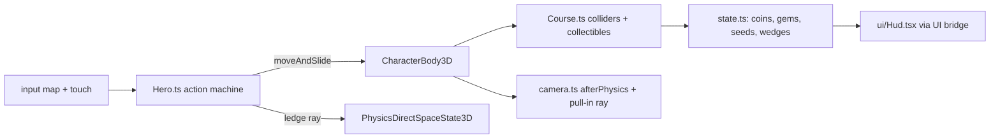

# PRD-732 — Hop Garden: a 3D collectathon starter kit with an SM64-style moveset

**Status:** NOT STARTED
**Priority:** P2 — new genre kit: no box below is ticked, and no shipped kit has a free-roam 3D moveset (triple jump, long jump, wall kick, ledge grab).
**Complexity:** 5 (MEDIUM) — 11+ kit source files (+3), new kit system (+2); risk override: none. The kit is game code in one template; no `packages/` API changes.
**Owner:** João
**Depends on:** [PRD-723](../Unreal/look/PRD-723-every-template-game-looks-like-unreal-on-the-engine-defaults.md) (aligned, not gating: the kit is born on the core Unreal defaults, so it pins no tone curve or fixed exposure and needs no PRD-723 migration). Owner order, 2026-10-23: "use unreal defaults for these new starter kits".

## Context

The owner asked for a starter kit that borrows the mechanics of Super Mario 64, with the
[n64decomp/sm64](https://github.com/n64decomp/sm64) decompilation as the reference. The kit uses only
what the `minimal` template ships plus procedurally generated content.

**What exists.** `packages/create-threenative/templates/` has 13 kits. The nearest is `platformer`
(Fox Dash): a linear 97 m route with a double jump, a dash and `strafeScale: 0.75` ("the route is a
line, not a field", `templates/platformer/src/entities/Fox.ts:46`). Nothing ships camera-relative
free-roam movement, a jump chain, crouch jumps, wall kicks or ledge grabs. `minimal` tracks zero
asset files (no GLB, texture or audio): every model is code. Fox Dash proves the procedural pattern:
`src/render/fox.ts` builds a chibi rig from primitives, `src/level/Stage.ts` builds and tags the
walkable meshes.

**What the reference does** (read 2026-10-23 at `n64decomp/sm64` master through `gh api`). SM64 runs
its logic at 30 Hz. Mario's hitbox is 160 units tall (`src/game/mario.c:1652`), so this PRD takes
1 unit = 1 cm: velocity in units/frame × 0.3 = m/s, acceleration in units/frame² × 9 = m/s².

| Mechanic | Reference rule | Kit value (m, s) |
| --- | --- | --- |
| Run | target speed = stick magnitude, capped 32; accel `+1.1 − v/43` per frame, −1 above target (`src/game/mario_actions_moving.c:434-460`) | cap 9.6 m/s, hard cap 14.4 m/s, accel `9.9 − 0.70·v` m/s² |
| Turn | face yaw approaches stick yaw by 0x800 per frame (`mario_actions_moving.c:462`) | 337.5 °/s |
| Gravity | −4 per frame, terminal −75 (`src/game/mario_step.c:535-548`) | 36 m/s², 22.5 m/s |
| Variable jump | A released while `vy > 20` divides `vy` by 4 (`mario_step.c:519-531`, `:557`) | release above 6 m/s cuts rise to ¼ |
| Jump | `vy = 42 + 0.25·fwd`, `fwd ×= 0.8` (`src/game/mario.c:821-825`, `:763-766`) | 12.6 m/s + 0.25·fwd (≈2.2 m apex) |
| Double jump | `vy = 52 + 0.25·fwd`, needs a jump landing inside the 5-frame chain window (`mario.c:785-787`, `:1028-1063`, `mario_actions_moving.c:26-28`) | 15.6 m/s, window 0.167 s |
| Triple jump | `vy = 69`, needs a double-jump landing and `fwd > 20` (`mario.c:796-798`, `:1046-1056`) | 20.7 m/s, needs fwd > 6 m/s |
| Backflip | crouch + A: `vy = 62`, `fwd = −16` (`mario.c:790-794`, `src/game/mario_actions_stationary.c:528-535`) | 18.6 m/s up, 4.8 m/s back |
| Side flip | A during a turn-around: `vy = 62`, `fwd = 8`, face the stick (`mario.c:837-841`, `mario_actions_moving.c:962-969`) | 18.6 m/s up, 2.4 m/s |
| Long jump | crouch-slide + A inside 30 frames with `fwd > 10`: `vy = 30`, `fwd ×1.5` capped 48, gravity −2 (`mario_actions_moving.c:1459-1465`, `mario.c:863-873`, `mario_step.c:543-547`) | 9 m/s up, ×1.5 capped 14.4 m/s, 18 m/s² gravity |
| Wall kick | A within 2 frames of a wall hit, or within the 5-frame `wallKickTimer`: `vy = 62`, `fwd ≥ 24`, face away (`src/game/mario_actions_airborne.c:1309-1332`, `:1148-1150`, `mario.c:828-834`) | 18.6 m/s up, ≥ 7.2 m/s, window 0.167 s |
| Dive | B in the air at speed: `fwd + 15` capped 48 (`mario.c:856-860`, `mario_actions_airborne.c:110`) | +4.5 m/s, cap 14.4 m/s |
| Ground pound | Z in the air: hang, then fall at −50 (`mario_actions_airborne.c:446-453`, `:918-944`) | 15 m/s fall |
| Ledge grab | probe 60 units past the wall from 160 units up; grab when the ledge is ≤ 100 units above (`mario_step.c:348-377`) | probe 0.6 m, grab ≤ 1.0 m |

### Capability lookups actually run (2026-10-23, `threenative-engine` MCP)

| Query (scope) | Result |
| --- | --- |
| the whole 3D platformer: analog run, triple/long jump, backflip, side flip, wall kick, ground pound, dive, ledge grab, coins, stars, health, orbit camera, moving platforms, procedural meshes (`request`) | `defineGame` (input, "frame a camera behind the player"), `CharacterBody3D`, `VirtualShadowNode`, `SkyCapture`, `PhysicsDirectSpaceState3D`, `NavigationAgent3D`, `UiLayer` bridge (`subscribeUiState`) |
| wall hit in the air, ledge in front to grab (`mechanic`) | `CharacterBody3D`, `RigidBody3D` — no ledge-grab capability |
| orbit camera that pulls in when a wall blocks the view (`mechanic`) | `defineGame` input only — **no camera-collision capability** |
| ride a moving platform and inherit its velocity (`mechanic`) | `CharacterBody3D`, `TerrainTiles` — **no platform-carry capability** |
| camera-relative analog move from gamepad, keyboard, touch (`mechanic`) | `CharacterBody3D`, `defineGame` input |
| procedural jump/coin/stomp sound without audio files (`mechanic`) | `AudioBus` (plays buffers), `audioPass` (file passes) — **no synthesis capability** |

`CharacterBody3D` detail: "use moveAndSlide inside the physics update"; its aliases include
"platformer double jump". `PhysicsDirectSpaceState3D`: "query results are bounded by the configured
result limit". The verdicts that name no capability (ledge probe, camera pull-in, platform carry)
become kit-owned code in `src/`, built on `PhysicsDirectSpaceState3D` rays.

## Solution

A new kit `collectathon`, titled **Hop Garden**: an original round hero runs one free-roam island
course and collects three Sunseeds. The kit is game code only.

- **Hero and moveset.** `src/entities/Hero.ts` is one action state machine on `CharacterBody3D`
  (`moveAndSlide` in the physics update). One `HERO_FEEL` table holds every value from the table
  above, in metres and seconds, so a reader sees the whole feel in one place. Inputs: a `move` vector
  read relative to the camera yaw, plus `jump`, `crouch` and `attack` buttons, through the input map
  and the existing touch-controls pattern (`render/touch-controls.ts` and `touch-layout.ts`, cloned
  from Fox Dash).
- **Ledge and wall.** A wall contact from `moveAndSlide` opens the wall-kick window. The ledge grab
  casts one `PhysicsDirectSpaceState3D` ray down at 0.6 m past the wall normal from 1.6 m up.
- **Course.** `src/level/Course.ts` builds the island from primitives and tags walkable meshes for
  `buildStaticColliders` (the Fox Dash pattern). It holds a summit, a wall-kick shaft, one rotating
  platform (the kit adds the platform's per-tick displacement to the hero, since no carry capability
  exists), 8 red gems, about 40 coins and stompable walkers.
- **Loop and HUD.** Three Sunseeds: reach the summit, collect the 8 red gems, clear the wall-kick
  shaft. A health meter of 8 wedges: a walker touch costs 1, a coin heals 1, a fall below the kill
  plane respawns the hero at the last checkpoint. Walkers die to a stomp, a ground pound or a dive.
  `src/ui/Hud.tsx` reads the bridge state.
- **Camera.** `src/render/camera.ts` is an orbit follow camera written in `afterPhysics`: it lags
  behind the hero's travel yaw, and a ray from the hero to the camera pulls the camera in front of
  any blocking wall.
- **Look.** Everything procedural: hero, walkers, gems, coins, Sunseeds, rocks, grass. The kit takes
  the look from `@threenative/core` (#541), not from `minimal`'s `src/render/` set: that set is the
  vendored pre-#541 chain, and its `quality.ts` pins `tonemapMode: "aces"`, `autoExposureEnabled:
  false` and `exposure: 0.62`, so cloning it would give the kit the old look. Instead
  `src/render/postprocessing.ts` calls `new WorldEnvironment({ ...qualityPreset(tier), ...overrides })`
  with `WorldEnvironment`, `qualityPreset` and `qualityTiers` imported from `@threenative/core`.
  `quality.ts` lists only overrides with a reason, and starts empty of look pins: no `tonemapMode`,
  no `autoExposureEnabled`, no `exposure`. The kit carries none of the 9 vendored chain files
  (`worldEnvironment.ts`, `autoExposure.ts`, `tonemap.ts` and the rest of `SHARED_RENDER_SOURCES`),
  so the restamp step skips it and any gate that demands those files gets a named exemption for
  this kit. The kit's own lights, sky and materials stay game-owned in `src/render/` and are tuned
  toward the harness L9 frame (`scripts/unreal-look/scaffold/Reference.ts.in`). A budget breach
  drops `renderChainTier` and `quality.ts` says why; it never drops the curve or the meter.

**Registration** (from the PRD-473 kit list): `kit.json`, the render-layer files that
`scripts/visual-gate.ts` checks, `quality.ts` and its doc (`scripts/check-template-quality.ts`), the
conventions applicability row, the `collectathon` rows in `scripts/capability-recall.ts`, the CI
template matrices, the README kit row, `playtests/survives.playtest.json`, a bounded
`playtests/performance.playtest.json` and `native-playtests/*.playtest.json`.

**Risks.** (1) A 6 m triple jump and a 14.4 m/s long jump need a course scaled to them, so the
course is laid out from the feel table, not tuned the other way round. (2) The 0.167 s windows are 10
ticks at 60 Hz: the playtests must press on exact ticks. (3) `moveAndSlide` reports a wall contact
only if the body moves into it, so the wall-kick window opens from the contact on that tick.

## Acceptance criteria

The boxes in each phase are the acceptance criteria, all `local`. There are 10, two over the R5 guide of about 8: the moveset needs three boxes (AC-2..AC-4) and Phase 3 carries the three gates every kit must pass, so a split would leave a kit PRD with no gates.
Each playtest runs on a project scaffolded from `--template collectathon`:
`node packages/playtest/dist/runner/cli.js <project>/playtests/<name>.playtest.json --url http://127.0.0.1:5173 --server-command "<project dev command>" --browser-recipe webgpu`.

## Blocked on

- The owner's taste call on the kit's look and feel (does it read as a polished 3D collectathon?) — unblocked by João after the judge pass in Phase 3.

## Integration Ledger

| Capability | Reachable consumer/trigger | Replaces / disposition | Evidence |
| --- | --- | --- | --- |
| `collectathon` kit | `npm create threenative -- --template collectathon` → `packages/create-threenative/src/index.ts` kit discovery through `kit.json` | new kit, nothing replaced | AC-1, AC-8 |

## Decisions

- 2026-10-23 (agent, on the owner's request): borrow mechanics, numbers and algorithms only. The
  hero, world, names, art and story are original; no Nintendo name, character, music, course layout
  or code. Decompiled code is read for its rules, never copied.
- 2026-10-23 (agent): assets are the `minimal` template's (zero files) plus procedural geometry built
  in code. No GLB, texture, HDR or audio file enters the kit.
- 2026-10-23 (agent): audio is deferred. Revisit when an engine capability generates audio buffers
  in code on every target, or when the owner allows audio files in this kit. Reason: no asset files
  are allowed, and the capability search found no synthesis route.
- 2026-10-23 (agent): deferred until a user asks — swimming, slides, pole and tree climbing,
  punch and kick combos, carry and throw, power-up caps, a hub with several courses, a boss. One
  course with three Sunseeds carries the genre loop.

## Execution Phases

#### Phase 1: The hero moves like the reference

**Status:** NOT STARTED
**Files:** `templates/collectathon/` cloned from `minimal`; new `src/entities/Hero.ts`,
`src/render/hero.ts`, `src/render/camera.ts`, a flat test yard in `src/level/Course.ts`, `kit.json`,
`playtests/{survives,jump-chain,acrobatics,ledge}.playtest.json`.
**Implementation:** the action state machine and `HERO_FEEL`, the camera-relative move vector, the
orbit camera without pull-in, the procedural hero rig (feet on the floor: the capsule origin is the
waist, as Fox Dash documents).
**Verification:** the four playtests below on WebGPU, `adapter.info` checked.

- [ ] AC-1: the scaffolded kit boots on the core Unreal defaults (`TN_RENDER_CHAIN` names `filmic` and auto exposure, `rg 'tonemapMode|autoExposureEnabled|exposure:' src/` finds no pin), the hero lands on the floor and runs for 600 frames with no console error. proof: `playtests/survives.playtest.json` — Evidence: pending.
- [ ] AC-2: three jumps landed inside the chain window at full run reach three rising apexes (single < double < triple), and the same chain at walk speed (below 6 m/s) yields no triple. proof: `playtests/jump-chain.playtest.json` — Evidence: pending.
- [ ] AC-3: the long jump travels farther than a running jump, the backflip lands behind its start, the side flip leaves facing the stick, and a wall kick inside its window gains height while one after the window does not. proof: `playtests/acrobatics.playtest.json` — Evidence: pending.
- [ ] AC-4: a jump into a wall whose top is ≤ 1.0 m above the hands ends with the hero standing on top after a forward press, and a wall 1.5 m higher gives no grab. proof: `playtests/ledge.playtest.json` — Evidence: pending.

#### Phase 2: The course is a game

**Status:** NOT STARTED
**Files:** `src/level/Course.ts` (island, shaft, rotating platform, checkpoints),
`src/entities/{Walker,Pickup}.ts`, `src/state.ts`, `src/ui/Hud.tsx`, `src/render/camera.ts`
(pull-in ray), `playtests/{collect,combat,camera}.playtest.json`.
**Implementation:** collectibles, the wedge meter, the three Sunseed rules, walker damage and
defeat, the rotating-platform carry, the camera pull-in.
**Verification:** the three playtests below, plus a rerun of Phase 1's four.

- [ ] AC-5: a scripted route collects the 8 red gems and the summit Sunseed, and the HUD state shows `seeds: 2`, and coins heal a damaged meter by one wedge each. proof: `playtests/collect.playtest.json` — Evidence: pending.
- [ ] AC-6: a walker touch costs one wedge, while a stomp, a ground pound or a dive each defeat a walker with no wedge lost. proof: `playtests/combat.playtest.json` — Evidence: pending.
- [ ] AC-7: with a wall between the hero and the default camera spot, the hero stays inside the frame and the camera-to-hero ray hits nothing. proof: `playtests/camera.playtest.json` — Evidence: pending.

#### Phase 3: Registered, native and judged

**Status:** NOT STARTED
**Files:** the registration list above, `native-playtests/survives.playtest.json`,
`playtests/performance.playtest.json`.
**Implementation:** register the kit in every gate. Capture the course at three fixed poses, headed,
two runs each. Give the captures and the visual criteria to a fresh read-only judge subagent:
the hero reads as one character with feet on the ground, the course reads as one island under the
Unreal default look, and no frame is blank or white.
**Verification:** the commands on each box. The judge verdict and the PR screenshots go on the PR
(orphan `prd-732-screenshots` branch).

- [ ] AC-8: the kit passes every registration gate and the template lane. proof: `pnpm budgets && pnpm exec vitest run scripts/__tests__/ci-structure.spec.ts scripts/__tests__/primary-docs.spec.ts scripts/__tests__/check-template-conventions.spec.ts && pnpm test:templates` — Evidence: pending.
- [ ] AC-9: the kit runs 300 frames on the native desktop engine player with a non-blank capture. proof: `node packages/playtest/dist/runner/cli.js <project>/native-playtests/survives.playtest.json --target desktop` — Evidence: pending.
- [ ] AC-10: the visual judge returns pass on every criterion above for all three poses. proof: the judge report linked from the PR — Evidence: pending.
