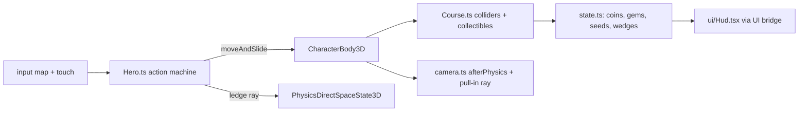

# PRD-732 — Hop Garden: a 3D collectathon starter kit with an SM64-style moveset

**Status:** PARTIAL — Phases 1 and 2 done; Phase 3 (gates, native, judge) open
**Priority:** P2 — new genre kit: Phase 3's registration gates, native run and visual judge (AC-8..AC-10) are open.
**Complexity:** 5 (MEDIUM) — 11+ kit source files (+3), new kit system (+2); risk override: none. The kit is game code in one template; no `packages/` API changes.
**Owner:** João
**Depends on:** [PRD-723](../Unreal/look/PRD-723-every-template-game-looks-like-unreal-on-the-engine-defaults.md) (aligned, not gating: the kit is born on the core Unreal defaults, so it pins no tone curve or fixed exposure and needs no PRD-723 migration). Owner order, 2026-10-23: "use unreal defaults for these new starter kits".

## Context

The owner asked for a starter kit that borrows the mechanics of Super Mario 64, with the
[n64decomp/sm64](https://github.com/n64decomp/sm64) decompilation as the reference. The kit uses only
what the `minimal` template ships plus procedurally generated content.

**What exists.** `packages/create-threenative/templates/` has 13 kits. The nearest is `platformer`
(Fox Dash): a linear 97 m route with a double jump, a dash and `strafeScale: 0.75` ("the route is a
line, not a field", `templates/platformer/src/entities/Fox.ts:46`). Nothing ships camera-relative
free-roam movement, a jump chain, crouch jumps, wall kicks or ledge grabs. `minimal` tracks zero
asset files (no GLB, texture or audio): every model is code. Fox Dash proves the procedural pattern:
`src/render/fox.ts` builds a chibi rig from primitives, `src/level/Stage.ts` builds and tags the
walkable meshes.

**What the reference does** (read 2026-10-23 at `n64decomp/sm64` master through `gh api`). SM64 runs
its logic at 30 Hz. Mario's hitbox is 160 units tall (`src/game/mario.c:1652`), so this PRD takes
1 unit = 1 cm: velocity in units/frame × 0.3 = m/s, acceleration in units/frame² × 9 = m/s².

| Mechanic | Reference rule | Kit value (m, s) |
| --- | --- | --- |
| Run | target speed = stick magnitude, capped 32; accel `+1.1 − v/43` per frame, −1 above target (`src/game/mario_actions_moving.c:434-460`) | cap 9.6 m/s, hard cap 14.4 m/s, accel `9.9 − 0.70·v` m/s² |
| Turn | face yaw approaches stick yaw by 0x800 per frame (`mario_actions_moving.c:462`) | 337.5 °/s |
| Gravity | −4 per frame, terminal −75 (`src/game/mario_step.c:535-548`) | 36 m/s², 22.5 m/s |
| Variable jump | A released while `vy > 20` divides `vy` by 4 (`mario_step.c:519-531`, `:557`) | release above 6 m/s cuts rise to ¼ |
| Jump | `vy = 42 + 0.25·fwd`, `fwd ×= 0.8` (`src/game/mario.c:821-825`, `:763-766`) | 12.6 m/s + 0.25·fwd (≈2.2 m apex) |
| Double jump | `vy = 52 + 0.25·fwd`, needs a jump, fall or side-flip landing inside the chain window: 4 landing frames (`mario_actions_moving.c:26-52`), each one resetting the 5-frame `doubleJumpTimer` (`:1767`, decremented at `mario.c:1411`, checked at `:1030-1065`) | 15.6 m/s, window 0.3 s, plus a 0.12 s pre-landing press buffer |
| Triple jump | `vy = 69`, needs a double-jump landing and `fwd > 20` (`mario.c:796-798`, `:1046-1056`) | 20.7 m/s, needs fwd > 6 m/s |
| Backflip | crouch + A: `vy = 62`, `fwd = −16` (`mario.c:790-794`, `src/game/mario_actions_stationary.c:528-535`) | 18.6 m/s up, 4.8 m/s back |
| Side flip | A during a turn-around: `vy = 62`, `fwd = 8`, face the stick (`mario.c:837-841`, `mario_actions_moving.c:962-969`) | 18.6 m/s up, 2.4 m/s |
| Long jump | crouch-slide + A inside 30 frames with `fwd > 10`: `vy = 30`, `fwd ×1.5` capped 48, gravity −2 (`mario_actions_moving.c:1459-1465`, `mario.c:863-873`, `mario_step.c:543-547`) | 9 m/s up, ×1.5 capped 14.4 m/s, 18 m/s² gravity |
| Wall kick | A within 2 frames of a wall hit, or within the 5-frame `wallKickTimer`: `vy = 62`, `fwd ≥ 24`, face away (`src/game/mario_actions_airborne.c:1309-1332`, `:1148-1150`, `mario.c:828-834`) | 18.6 m/s up, ≥ 7.2 m/s, window 0.167 s |
| Dive | B in the air at speed: `fwd + 15` capped 48 (`mario.c:856-860`, `mario_actions_airborne.c:110`) | +4.5 m/s, cap 14.4 m/s |
| Ground pound | Z in the air: hang, then fall at −50 (`mario_actions_airborne.c:446-453`, `:918-944`) | 15 m/s fall |
| Ledge grab | probe 60 units past the wall from 160 units up; grab when the ledge is ≤ 100 units above (`mario_step.c:348-377`) | probe 0.6 m, grab ≤ 1.0 m |

### Capability lookups actually run (2026-10-23, `threenative-engine` MCP)

| Query (scope) | Result |
| --- | --- |
| the whole 3D platformer: analog run, triple/long jump, backflip, side flip, wall kick, ground pound, dive, ledge grab, coins, stars, health, orbit camera, moving platforms, procedural meshes (`request`) | `defineGame` (input, "frame a camera behind the player"), `CharacterBody3D`, `VirtualShadowNode`, `SkyCapture`, `PhysicsDirectSpaceState3D`, `NavigationAgent3D`, `UiLayer` bridge (`subscribeUiState`) |
| wall hit in the air, ledge in front to grab (`mechanic`) | `CharacterBody3D`, `RigidBody3D` — no ledge-grab capability |
| orbit camera that pulls in when a wall blocks the view (`mechanic`) | `defineGame` input only — **no camera-collision capability** |
| ride a moving platform and inherit its velocity (`mechanic`) | `CharacterBody3D`, `TerrainTiles` — **no platform-carry capability** |
| camera-relative analog move from gamepad, keyboard, touch (`mechanic`) | `CharacterBody3D`, `defineGame` input |
| procedural jump/coin/stomp sound without audio files (`mechanic`) | `AudioBus` (plays buffers), `audioPass` (file passes) — **no synthesis capability** |

`CharacterBody3D` detail: "use moveAndSlide inside the physics update"; its aliases include
"platformer double jump". `PhysicsDirectSpaceState3D`: "query results are bounded by the configured
result limit". The verdicts that name no capability (ledge probe, camera pull-in, platform carry)
become kit-owned code in `src/`, built on `PhysicsDirectSpaceState3D` rays.

## Solution

A new kit `collectathon`, titled **Hop Garden**: an original round hero runs one free-roam island
course and collects three Sunseeds. The kit is game code only.

- **Hero and moveset.** `src/entities/Hero.ts` is one action state machine on `CharacterBody3D`
  (`moveAndSlide` in the physics update). One `HERO_FEEL` table holds every value from the table
  above, in metres and seconds, so a reader sees the whole feel in one place. Inputs: a `move` vector
  read relative to the camera yaw, plus `jump`, `crouch` and `attack` buttons, through the input map
  and the existing touch-controls pattern (`render/touch-controls.ts` and `touch-layout.ts`, cloned
  from Fox Dash).
- **Ledge and wall.** A wall contact from `moveAndSlide` opens the wall-kick window. The ledge grab
  casts one `PhysicsDirectSpaceState3D` ray down at 0.6 m past the wall normal from 1.6 m up.
- **Course.** `src/level/Course.ts` builds the island from primitives and tags walkable meshes for
  `buildStaticColliders` (the Fox Dash pattern). It holds a summit, a wall-kick shaft, one rotating
  platform (the kit adds the platform's per-tick displacement to the hero, since no carry capability
  exists), 8 red gems, about 40 coins and stompable walkers.
- **Loop and HUD.** Three Sunseeds: reach the summit, collect the 8 red gems, clear the wall-kick
  shaft. A health meter of 8 wedges: a walker touch costs 1, a coin heals 1, a fall below the kill
  plane respawns the hero at the last checkpoint. Walkers die to a stomp, a ground pound or a dive.
  `src/ui/Hud.tsx` reads the bridge state.
- **Camera.** `src/render/camera.ts` is an orbit follow camera written in `afterPhysics`: it lags
  behind the hero's travel yaw, and a ray from the hero to the camera pulls the camera in front of
  any blocking wall.
- **Look.** Everything procedural: hero, walkers, gems, coins, Sunseeds, rocks, grass. The kit takes
  the look from `@threenative/core` (#541), not from `minimal`'s `src/render/` set: that set is the
  vendored pre-#541 chain, and its `quality.ts` pins `tonemapMode: "aces"`, `autoExposureEnabled:
  false` and `exposure: 0.62`, so cloning it would give the kit the old look. Instead
  `src/render/postprocessing.ts` calls `new WorldEnvironment({ ...qualityPreset(tier), ...overrides })`
  with `WorldEnvironment`, `qualityPreset` and `qualityTiers` imported from `@threenative/core`.
  `quality.ts` lists only overrides with a reason, and starts empty of look pins: no `tonemapMode`,
  no `autoExposureEnabled`, no `exposure`. The kit carries none of the 9 vendored chain files
  (`worldEnvironment.ts`, `autoExposure.ts`, `tonemap.ts` and the rest of `SHARED_RENDER_SOURCES`),
  so the restamp step skips it and any gate that demands those files gets a named exemption for
  this kit. The kit's own lights, sky and materials stay game-owned in `src/render/` and are tuned
  toward the harness L9 frame (`scripts/unreal-look/scaffold/Reference.ts.in`). A budget breach
  drops `renderChainTier` and `quality.ts` says why; it never drops the curve or the meter.

**Registration** (from the PRD-473 kit list): `kit.json`, the render-layer files that
`scripts/visual-gate.ts` checks, `quality.ts` and its doc (`scripts/check-template-quality.ts`), the
conventions applicability row, the `collectathon` rows in `scripts/capability-recall.ts`, the CI
template matrices, the README kit row, `playtests/survives.playtest.json`, a bounded
`playtests/performance.playtest.json` and `native-playtests/*.playtest.json`.

**Risks.** (1) A 6 m triple jump and a 14.4 m/s long jump need a course scaled to them, so the
course is laid out from the feel table, not tuned the other way round. (2) The 0.167 s windows are 10
ticks at 60 Hz: the playtests must press on exact ticks. (3) `moveAndSlide` reports a wall contact
only if the body moves into it, so the wall-kick window opens from the contact on that tick.

## Acceptance criteria

The boxes in each phase are the acceptance criteria, all `local`. There are 10, two over the R5 guide of about 8: the moveset needs three boxes (AC-2..AC-4) and Phase 3 carries the three gates every kit must pass, so a split would leave a kit PRD with no gates.
Each playtest runs on a project scaffolded from `--template collectathon`:
`node packages/playtest/dist/runner/cli.js <project>/playtests/<name>.playtest.json --url http://127.0.0.1:5173 --server-command "<project dev command>" --browser-recipe webgpu`.

## Blocked on

- AC-9: core auto exposure on the desktop V8 engine player (boolean uniforms in `core-tsl.mjs`, render-target texture swaps in `AutoExposureNode`) — unblocked by an engine lane in `packages/runtime-native`.
- The owner's taste call on the kit's look and feel (does it read as a polished 3D collectathon?) — unblocked by João after the judge pass in Phase 3.

## Integration Ledger

| Capability | Reachable consumer/trigger | Replaces / disposition | Evidence |
| --- | --- | --- | --- |
| `collectathon` kit | `npm create threenative -- --template collectathon` → `packages/create-threenative/src/index.ts` kit discovery through `kit.json` | new kit, nothing replaced | AC-1, AC-8 |

## Decisions

- 2026-10-23 (agent, on the owner's request): borrow mechanics, numbers and algorithms only. The
  hero, world, names, art and story are original; no Nintendo name, character, music, course layout
  or code. Decompiled code is read for its rules, never copied.
- 2026-10-23 (agent): assets are the `minimal` template's (zero files) plus procedural geometry built
  in code. No GLB, texture, HDR or audio file enters the kit.
- 2026-10-23 (agent): audio is deferred. Revisit when an engine capability generates audio buffers
  in code on every target, or when the owner allows audio files in this kit. Reason: no asset files
  are allowed, and the capability search found no synthesis route.
- 2026-10-23 (agent): deferred until a user asks — swimming, slides, pole and tree climbing,
  punch and kick combos, carry and throw, power-up caps, a hub with several courses, a boss. One
  course with three Sunseeds carries the genre loop.
- 2026-10-23 (agent): the proof harness scaffolds from workspace tarballs (`packageLocalFramework`)
  at the 0.3.6 template pins, because the published 0.3.6 predates #541 and has no core
  `WorldEnvironment`. The Wasm engine pair for packing came from the PRD-723 lane (same
  `native/` sources).
- 2026-10-23 (agent): the render-import rule allows named core symbols. `src/render/` may import
  `WorldEnvironment`, `qualityPreset`, `qualityTiers` and their types from `@threenative/core`
  (`RENDER_PORTABLE_CORE_SYMBOLS` in `scripts/check-core-boundary.ts`). `scripts/template-quality.ts`
  (`takesCoreLook`), `scripts/visual-gate.ts`, `looks.spec.ts` and `auto-exposure-scaffold.spec.ts`
  read the chain from core for a kit that takes it, instead of demanding the vendored files.
- 2026-10-23 (agent): the platform is carried by the engine. A kinematic `RigidBody3D` under a
  `CharacterBody3D` carries the character, so the "no platform-carry capability" verdict above was
  wrong for translation. The kit's platform orbits (no spin) and has no carry code.
- 2026-10-23 (agent): AC-3 and AC-4 each split into two scenarios, because one scenario per clause
  keeps each run short and its failure specific: `acrobatics` + `wall-kick`, `ledge` +
  `ledge-too-high`.
- 2026-10-23 (agent): the 8th red gem awards a Sunseed on the spot. No jump buffer and no coyote
  time: the reference has neither, and the 0.167 s windows are the whole forgiveness.
- 2026-10-23 (agent): a wall bonk counts only the speed into the wall, and a bonk-free contact
  removes the into-wall part of air speed, so a standing jump beside a ledge reaches the grab band.
- 2026-10-23 (agent): the shaft's lower slab starts at 5 m, because a running single jump's head
  (3 m apex + 1.6 m of hero) hit a 3.2 m slab and cut the wall-kick run-up.
- 2026-10-23 (agent): the `collect` scenario places the gems on the test lane (the "scripted route");
  the course keeps its own gem layout.
- 2026-10-23 (agent): `TN_RENDER_CHAIN` names stages, not the tone curve. AC-1's "filmic and auto
  exposure" is read from `TN_WORLD_ENVIRONMENT` (`tonemapMode: "filmic"`) and `TN_AUTO_EXPOSURE`
  (`measured`/`applied` true).
- 2026-10-23 (agent): the camera's closest distance is 0.3 m, not 1.4 m. With the hero's back to a
  wall, a 1.4 m floor put the lens inside the rock (`rayClear` false in the first camera run).
- 2026-10-23 (agent): no capability-recall mechanic row for the ledge ray. The search does not rank
  `PhysicsDirectSpaceState3D` for "ray to find a wall or ledge" (its situations name only aiming
  and shape queries); that is an engine manifest fix in `packages/physics`, out of this kit's scope.
- 2026-10-23 (agent): a kit on the core look ships no material backlighting (`rimGain`/`fillGain`,
  `materialLighting.ts`), because a stock Unreal scene has none. `primary-docs.spec.ts` names that
  exception and checks the kit's `AGENTS.md` says so.
- 2026-10-23 (agent): the kit's `quality.ts` exports `qualityPreset` (core's preset plus overrides),
  the same name every other kit's `quality.ts` exports, so the tier specs read it unchanged.
- 2026-10-23 (agent): the native engine-player fix stays out of this kit PR. It is a
  `packages/runtime-native` change, and it does not finish AC-9 alone (see AC-9).
- 2026-10-24 (agent, polish round 1 after a NOT PASS judge): every fix is game-owned in `src/`, and
  the core look stays unpinned. The radial grass streaks came from per-facet tints on each lawn's
  cylinder cap, a fan of long triangles. Each lawn is now a ring disc with smooth position-based
  patches. Other fixes: half-albedo warm stone with a darker foot, sky fill ×1.3, PCF radius 3, a
  5,500 K sun, fog −30 %, a deeper zenith with a few clouds, and glowing low-metal coins. Gems are
  1.5× larger, gloves sit on the body, and the eyes sit wider. The hang pose leans back off the
  wall. Scenery skips landmarks, the HUD is compact, and the hint fades after 10 s.
- 2026-10-24 (agent): no 15° camera yaw offset at spawn. The stick is camera-relative and every
  scenario route is authored in the camera frame, so an offset view turns "forward" 15° off the
  screen. Wider-set eyes carry the three-quarter read instead.
- 2026-10-24 (agent, superseded in round 3): in a narrow shaft the camera cranes up (0.85, 1.2 or
  1.45 rad) when the default arm would end closer than 2.5 m. The round-2 judge rated the result,
  a top-down view of the shaft, a REGRESSION.
- 2026-10-24 (agent, round 3, judge item 1): the boxed-in camera cuts to a clearer heading instead
  of craning. When the arm would end closer than 4 m, it tries the current heading and offsets of
  ±45°, ±90° and ±135°, each at 0.32 and 0.61 rad, and takes the farthest reach. A heading change
  is a cut, because an arm swept round a shaft passes through its wall. The pitch is capped at
  0.61 rad (35°). The shaft's end walls drop from 16 m to 3 m kerbs, so the shaft opens to the side
  and the camera watches the climb from there. `wall-kick.playtest.json` now asserts the bounds: a
  cut happens, the peak pitch is at most 0.62 rad, the closest arm is at least 3 m, the lens-to-hero
  ray is clear at the slab contact, and the hero is in the viewport.
- 2026-10-24 (agent, round 3, judge items 2–6): the following changes use light, material and
  effect settings only, with no look pin.
  - Shadows: the environment light is a half-saturated 128 px copy of the sky
    (`skyTexture(0.5, 128)`) at intensity 1.55, so a shadow on grass is a darker green, not teal.
    The sun map is 2048 px (1024 on mobile) with a 4-texel PCF radius, which gives a soft edge of
    about 10 cm, 2.6× the round-2 edge.
  - Lawn: the patch value amplitude is halved, from ±30% to ±15% linear.
  - Run dust: opacity 0.9 → 0.55, size −25%.
  - Hero: hanging, the legs swing back off the wall, splay and kick slowly. The eyes and nose are
    15% larger, and the eye whites glow a little (emissive 0.45).
  - Impacts: a third emitter, `flash`, draws hot white-to-amber stars for the wall kick (26) and a
    ground-pound ring (40, 10 m/s outward). The flash and sparkle bursts live 0.9 s, as long as a
    dust puff. At 0.45 s and 0.6 s they were missing from most filmed frames. The cause is the
    capture, not the engine: a filmed step advances the game 2 ticks, but the particles age on the
    TSL wall clock, and each screenshot costs far more wall time than 2 ticks. Normal blending, a
    rewritten star mask and `graceSeconds = Infinity` each changed nothing and were reverted. The
    burst does draw in the frame right after the event (wall kick `c-0055`, pound `f-0163`).
    `wall-kick.playtest.json` now also asserts that the kick fires its burst (`fired.wallKick` = 1,
    26 flash particles).
  - Shaft camera tie-break: the cut tries the 35° arm before the 0.32 rad arm at each heading, so on
    a tie it looks down into the shaft rather than along its walls (peak pitch 0.61 rad, closest arm
    9 m).
- 2026-10-24 (agent, round 4, judge FAIL on C3 with every frame IMPROVEMENT):
  - Floating slab (C3): cutting the shaft's end walls to 3 m kerbs in round 3 left the 5–16 m slab
    resting on nothing. Two 0.6 m piers now carry it to the ground at its ends, so it reads as an
    arch the hero runs through. The open sides stay open for the camera. `buildCourse` returns an
    `audit`, and the scene registers it as the `course` entity. The audit counts solids that do not
    stand on the ground and do not touch a solid that does. `survives.playtest.json` asserts
    `floating` = 0. Red-green: 1 before the piers, 0 after.
    Engine finding: on the owned Wasm engine, `Box3` has no `clone` (it is missing from
    `packages/three-native/api/native-registry.json`, although `generated/three.d.ts` declares it).
    The first audit used `clone`, and the game failed to start with `TN_START_FAILED`. The audit
    uses `new Box3().copy(...)` instead.
  - Pickups and props: rim rocks and pines keep 3.5 m from every pickup, and planting keeps its
    width plus 1 m. `survives` asserts `crowded` = 0, where a pickup within 1 m of a non-walkable
    shadow caster counts as crowded. Red-green: 2 before, 0 after. The ledge gem in round-3 frame 08
    overlapped a rim rock only in perspective, 2 m behind it.
  - Gem column (06): the "ghost stack" was the `collect` scenario's eight gems in a 14 m line
    straight ahead of the camera. They now sit 0.5 m apart (3.5 m in all). A taken pickup now spins,
    rises and shrinks away over 0.4 s instead of vanishing.
  - Shadows: the fill sky drops from 50% to 30% saturation, and its intensity rises from 1.55 to 1.65.
  - Wall-kick sparks: 10 small (0.35 m) warm stars at half the old brightness, thrown at 7 m/s, in
    place of 26 large white-hot ones. `wall-kick` asserts at least 10 flash particles.
  - Ground pound: the ring is 48 small sparks skimming out at 0.15 m/s upward speed. The central
    dust puff drops from 56 to 39 particles.
  - Stone: blocks are cut into 1 m courses with ±13% tint each, so a tower reads as masonry.
- 2026-10-24 (agent, round 5, kit art and UI only under the D8 freeze; the round-4 judge's notes):
  - HUD over a Sunseed (07, 08): the pill is a fixed `HUD_PILL` box (`state.ts`). Each tick,
    `Play.ts` projects every untaken Sunseed, with a 1 m radius through `lodPixelScale`, against
    that box. While one sits under it, `hudFaded` drops the pill to 20% opacity. The `hud` entity
    counts the ticks under the box and the ticks covered while opaque. `enemies` asserts
    `under` >= 1 and `covered` = 0. Red-green: covered 193 of 193 before the fade, 0 after.
  - Gem shadow parallelogram (05): the gem casts no shadow. An octahedron under a high sun threw a
    hard dark diamond on the block below it.
  - Plain green cubes (06): a hedge section is a faceted icosahedron loaf, 2.6 m long, in place of
    a 0.9 x 1 x 2.1 m box. Neighbours 2.1 m apart overlap into one row. The course audit stays at
    floating 0 and crowded 0.
  - Stone checker (04): `mottle(..., courses)` gives each 1 m course one tint (±11%) and each block
    only ±4% on top. The old per-block ±13% read as a checkerboard. It draws the same `rng` values
    in the same order, so no planting moves.
  - Wall-kick spark (04): 18 amber streaks at 5 m/s plus 8 gold-white `kickStars` sparkles, in
    place of 10 streaks at 7 m/s. `wall-kick` asserts flash >= 18 and `fired.kickStars` = 1.
    Red: round 4 measured flash 10.
  - Hero rest pose: no judge finding, so no change.
- 2026-10-24 (owner via lead: "polish world footer, add more vegetation, enemey"): the lead read
  "footer" as the world floor. The kit keeps the walkable lawn flat, because every gap and jump is
  measured in metres from `HERO_FEEL`, and undulation under the routes would change their meaning.
  The floor gets detail instead:
  - a dirt path with a worn-grass border along the coin line;
  - contact shade under every tree, rock, bush and palm;
  - a sand shelf, a wet-sand band and a foam line round both islands. They are visual only: a fall
    from the cliff still ends in the sea.

  `src/render/foliage.ts` plants the island with one `InstancedMesh` per kind, seeded and kept off
  every scenario route and landmark:
  - round fruit trees, with fruit on half of them;
  - leaning shore palms with fronds and coconuts;
  - bushes, two hedge arcs, flower clusters in four colours and mushrooms;
  - about 1,300 tall grass blades that sway through a TSL `positionNode`.

  A fourth emitter, `pollen`, keeps petals drifting round the hero. Nothing planted is solid. The
  hero walks through a bush as it walks through a pine trunk.
- 2026-10-24 (owner via lead: enemies): two new walker kinds share `Walker.ts`.
  - The hopper is lime and frog-round. It crouches for 0.45 s (its telegraph), then hops up to
    2.6 m at the hero. A stomp defeats it.
  - The thornback is a rust shell with nine spikes. It rears and bristles for 0.7 s (its
    telegraph), then charges 0.9 s along the line it faced. A stomp lands on its spikes, which
    costs a wedge, emits `spiked` and knocks the hero back. A dive or a ground pound defeats it.

  Every defeat fires the dust poof. Proof: `enemies` (hopper stomped, thornbacks dived and
  pounded), `thornback` (a stomp costs a wedge and the thornback lives) and `telegraphs` (each kind
  telegraphs and attacks). Bumblets keep their `walker.<i>` names, so the earlier scenarios are
  unchanged.
- 2026-10-24 (owner via lead: "add more effects like the smoke that appear when you char walk"):
  two pooled `GPUParticles3D` spawn emitters, dust (alpha puffs) and sparkle (additive stars).
  Core owns the slots, the births and the culling. `src/render/effects.ts` owns every look
  parameter and the `BURSTS` table. Each burst passes its shape in the request's `direction`.
  The bursts:
  - movement: run puffs above 5 m/s, skid, take-off, landing ring, ground-pound shockwave and
    debris, ledge dust, wall-kick sparks, a triple-jump trail and a long-jump streak;
  - pickups and walkers: coin, gem and Sunseed bursts, a red-gem glint every 1.4 s and the
    walker-defeat poof.

  Two draw calls in all, a procedural sprite mask and no asset. `playtests/effects.playtest.json`
  proves 0 run puffs at idle, puffs while running, a take-off only after the jump and GPU spawns.
- 2026-10-24 (owner via lead: "add the body shape more similar to mario"): Pip keeps the
  classic 3D-platformer silhouette. The head is big, with a short-brim cap, a round nose, a bushy
  moustache, ears and a hair tuft. The round torso wears overalls with a bib, straps and two
  buttons. The arms are stubs ending in gloves, and the legs are short with big shoes. The trade
  dress is original: a teal cap with a cream leaf badge, a rust shirt, mustard overalls, cream
  gloves and brown shoes. There is no letter emblem and no red-and-blue scheme. Arms and legs
  pivot at the shoulder and the hip and swing against each other on the run. On a ledge the arms
  stretch so the gloves rest on the lip.
- 2026-10-24 (owner via lead: "try this look and feel for the mario one", "all procedural
  please", "just remember Unreal like GI, atmosphere", "maps also look flat"): the look round.
  The look stays core's (filmic curve, metered exposure, nothing pinned in `quality.ts`).
  Every texture is a seeded `DataTexture` painted in code, and no asset file exists.
  - Terrain: `src/level/terrain.ts` samples hills, coast cliffs and a 5 m castle plateau into
    core's `Heightfield`. Every route a scenario runs stays level at y = 0, so the setup
    coordinates keep their meaning. Hero, walkers, pickups and checkpoints snap to
    `course.ground`. `src/render/ground.ts` paints grass, worn grass, the dirt path, sand and
    rock by slope over a grain map and a normal map.
  - Castle and props: `src/render/castle.ts` is an original keep with coursed stone, terracotta
    roofs, two turrets, a warm arched door, a sun-and-leaf rose window and a waving teal flag.
    The signpost stands by the spawn path. Course blocks and drum cliffs share the castle masonry.
    The door and windows glow a deep amber: the first glow sat far above 1 and tone-mapped to a
    flat cream, and its door panel was one quad with vertices only at the jambs.
  - Camera: the view pitched 18° down with the arm, so nothing more than about 12° above the
    horizon fit in frame and the castle was cut off. The lens now looks 1.6 m above the aim at full
    arm length (about 8° down), scaled down as the arm pulls in. The arm, its elevation and the
    wall checks are unchanged: `camera` and `wall-kick` exit 0.
  - Planting: a meadow of 12-blade tufts on a 0.5 m grid, one draw per 12 m cell. The meadow
    draws every tuft within 16 m and an eighth of them by 46 m, and `GRASS_SHARE` sets 1 / 0.4 /
    0.25 per tier. Broadleaf and birch trees, flowers, butterflies, pebbles on the path and far
    hills complete it. The sky paints a sun halo and projected cumulus.
  - Bug found and fixed: in an instanced node material `positionLocal` already carries the
    instance matrix. The grass sway and the butterfly flap scaled with world height and threw
    blades metres into the sky on hills. Both now read `positionGeometry`. A sway-off capture
    showed no blades in the sky, and the fixed build shows none.
  - Proof: `survives` asserts relief ≥ 8 m, steep share 5–30 %, level share ≤ 50 %, castle
    parts ≥ 6, grass tufts ≥ 5000, path pebbles ≥ 400 and one signpost. All 7 fail on the
    round-5 source and pass now (`gen-12lp`, exit 1 then 0). The scaffold spec asserts that the
    kit has no `assets/` folder and no image or model file but the shared icon.
  - A grass stone counts as a prop, so it keeps the planting clearances. The crown detail cut
    shifted the seeded stream and put one stone 0.7 m from a coin: `survives` exited 1 on
    `crowded` at 2c93dda67 and exits 0 since 7553a692e.
  - Budget raised openly: `performance` `maxTriangles` 190k → 300k. On `gen-12lp` (medium) at
    daf027a6c the look round measures 225.6k triangles, 356 draws, p95 17.7 ms and 65.8 fps.
    Round 5 measured 111.5k triangles at p95 17.7 ms, so the triangles cost no frame time there.
    The waste was cut first: pebbles 36 → 8 triangles, crowns at icosahedron detail 1, grass share
    0.4 at medium, and a tighter meadow fade, taking the course from 202k to 132k at the perf
    pose. The high tier adds about 72k by the node count; it is not measured on a discrete GPU.
  - Visual judge, fresh read-only Opus subagents, 4 poses × 2 runs per arm, gen-12lp medium:
    pass 1 (2c93dda67) NOT PASS, castle FAIL (out of frame, flat door). Pass 3 (daf027a6c) PASS:
    all 4 poses IMPROVEMENT, with lushness, lighting, castle and integrity WEAK.
- 2026-10-24, owner playtest of db84839d5 on the web Wasm engine. These fixes come before the look
  round 2, one commit each:
  - NaN crash in `Hero #probeWall`: the orbiting platform is a kinematic box collider, and the
    rising deck sweeps through an airborne Pip. A Rapier ray that starts inside a box hits at
    distance 0 with a zero normal, and `nx / hypot(0, 0)` gave NaN. The kit ray adapter in
    `Play.ts` now treats a zero-normal hit as no wall, as Godot's `hit_from_inside = false`
    default does. Proof: `clipped-probe` exits 2 with the owner's error when the guard is removed,
    and exits 0 with it (gen-12lp). Open: `@threenative/physics` `intersectRay` always reports
    hits from inside a solid; a `hitFromInside` option is a physics-lane item.
  - Limb sync: the idle, walk and run are three.js `AnimationClip`s built in `render/hero.ts`.
    `Hero.ts` blends them by ground speed through core `AnimationPlayer` with `strideRoot` set to
    the body, so stride sync times them to the ground covered. Two root causes of skating were
    fixed in the clip. First, a leg turning at a steady rate moves its foot fastest under the hip,
    so the stance angle is now the arcsine of a linear sweep. Second, the engine reads the stride
    off every low mesh, so the boot and the sole now have their origin at the contact point. Proof:
    `stride` measures walk clip 1.83 m/s at rate 1.09 and run clip 9.30 m/s at rate 1.03, about
    2.3 cycles a second at 9.6 m/s, and the planted sole slides 0.82 m/s. Before the contact-origin
    fix the slide was 3.23 m/s, and `stride` exited 1 (gen-12lp).
  - Triangles: the flower rims (10 points), 3-sided stems and 24×16 hero spheres keep the course at
    253.5k triangles and 288 draws on gen-12lp medium (`performance` exit 0).
  - Double jump (owner playtest 2026-10-24: "I press double space and it doenst double jump"):
    the window was 5 frames (0.167 s) from the press, but SM64 resets `doubleJumpTimer` on each of
    the 4 landing frames (`mario_actions_moving.c:26-52`, `:1767`), so its real window is 9 frames
    at 30 Hz, 0.3 s. A fall or side-flip landing also opens the chain (`mario.c:1030`). The classic
    has no pre-landing buffer (`framesSinceA`, `mario.c:1278`, only counts after the landing), so
    a press up to 0.12 s before touchdown is kept, which is the double-tap a keyboard player makes.
    The HUD teaches it once: the first chain-opening jump landing shows "JUMP AGAIN AS YOU LAND".
    Proof: `playtests/double-tap.playtest.json` presses Space 12 ticks before touchdown and asserts
    one double (gen-12lp: green exit 0, with `jumpBuffer: 0` exit 1 on `counts.double` and the
    landing action); `jump-chain`, `acrobatics`, `collect` and `camera` exit 0 with the change.
  - Mouse camera (owner order 2026-10-24; the `look` gate read `camera.main` rotationDelta 0): a
    `look` binding with `pointerRelative: true` takes the pointer lock on a canvas click (the
    framework's, as in the shooter kit), and `scenes/Play.ts` turns the orbit arm by the delta in
    `afterPhysics` while the lock is held: 0.0035 rad per pixel, the arm angle between 3° and 50°,
    and the travel swing waits 1.5 s after the mouse moves so it does not undo the player's view.
    Proof: `playtests/look.playtest.json` (gen-12lp: green exit 0, rotationDelta 2.91 rad; with
    the `orbit.look` call removed exit 1, rotationDelta 0); `camera` and `jump-chain` exit 0.
  - Foot slide (owner playtest 2026-10-24: "legs looks super fast compared to the movement"; the
    `footSlip` gate, `maxSlideSpeed` 1 m/s on soles `footL`/`footR`, read the run step at 1.02 to
    1.60 m/s). Three causes, measured offline with the harness's own `measureFootSlip` on the rig:
    the hips twisted ±0.1 rad about the vertical, which swings a planted foot sideways (0.6 to
    0.9 m/s); the walk's 6 cm swing lift sat inside the planted band a run's lift sets, so a walking
    swing read as a planted foot; and the walk-to-run blend ran to 5 m/s, mixing a 50% stance with a
    15% one so the planted foot dragged. The hips no longer twist, the walk lifts 16 cm, and the
    run takes over by 4 m/s. Cadence is unchanged (stride rate 1.03 at 9.6 m/s). Proof:
    `playtests/stride.playtest.json` on gen-12lp, HEAD exit 1 at 1.02 m/s, the change exit 0 at
    0.16 m/s; `survives`, `acrobatics` and `double-tap` exit 0. Visual judge (three fresh Opus
    rounds, 2 runs per arm, RTX 2080 headed WebGPU: a back view, a 3/4 follow camera, then a
    capture-only side camera with the hero 500 px tall): NEUTRAL each time, no regression. The
    change is 0.1 rad of hip yaw and 10 cm of walk lift, which a follow camera cannot show against
    the ground; the `footSlip` gate is the proof of the claim. Sheets: `~/Downloads/hop-garden/legs/`.

  - Face (owner fix 5, 2026-10-24: eyes hidden under the brim, a big nose, a blob moustache): in
    `render/hero.ts` the eyes sit lower and further forward so the whites and pupils clear the
    brim, the nose is a smaller ball higher on the face, the moustache is two lobes with a curl
    each, and the brim is shorter and tipped up. Proof: headed captures on gen-12lp, two runs per
    arm, front and back poses (`~/Downloads/hop-garden/face/`); fresh Opus judge: front
    IMPROVEMENT on both runs (eyes show under the brim, smaller nose, the moustache reads as two
    curled lobes), back NEUTRAL (the head still reads from above and behind), overall
    IMPROVEMENT. Left for a later round: the pupils sit a little close to the nose, and the judge
    flags the stout-moustache-cap-overalls silhouette as close to a famous plumber (D5).

  - Ledge grab (owner playtest 2026-10-24: "grip on edge is also flaky"). Measured offline with the
    kit's `Hero` on the installed Rapier against the yard's 3 m ledge: 1,058 run-ups (4, 7 and 9.6
    m/s; 0°, 30° and 60° off the face; a straight edge and a corner; a 0.2 s and a 0.5 s jump hold;
    take-off 0.5 to 6 m out). Of the arcs that passed the 1.0–1.6 m band, HEAD grabbed or landed on
    top in 46% (straight edge 55/44/34% at 0/30/60°). Two causes: the one probe ray ran along the
    travel at the waist, so an angled approach slid along the wall unseen; and with the waist above
    the top the probe was blind while the capsule leaned on the lip, so the stored speed into the
    wall bonked the hero away as soon as the waist dropped below the top, before the band arrived.
    The probe now follows the reference (sm64 decomp `mario_step.c`): two wall checks 0.3 m and
    1.5 m above the feet (:401-402); a wall at the low one only is a ledge's face that never bonks
    (:471-480); falling into it grabs a floor 1.0–1.6 m up (:348-374); a three-ray fan (the travel
    and 45° either side) stands in for its round wall check. Result: 96% (edge 98/99/96%, corner
    94/94/95%); the rest are bonks into the face below the band. Proof: `ledge-angle.playtest.json`
    (a 45° running single that meets the face falling; HEAD exits 1: no grab, `ledgeGrabs` 0, the change exits 0 on the laptop gen-12lp, headed);
    `ledge`, `ledge-too-high` and `wall-kick` exit 0.
  - Air double jump (owner choice 2026-10-24, "Both": "I press double space it doesnt do the double
    jump"). The classic landing chain stays exactly as it was; on top of it a second press 0.1 s
    or more after take-off from a single jump, a walk-off fall or a wall kick rises again at the
    single's 12.6 m/s, once per flight, back on a landing, a wall kick or a ledge grab. A press the
    0.12 s buffer would carry to touchdown (a ray down over the buffer's drop finds ground) stays
    the chain's. Chain choice: an air double lands as a double, so a press on that landing is the
    triple; it reads as the third jump the player pressed. Dev builds log `TN_HERO_INPUT` on every
    press and touchdown; the HUD hint reads "SPACE AGAIN: DOUBLE JUMP" from the first single.
    Course check: heights stay gated (from flat ground the most is 5.3 m: the summit steps of 2.5
    and 3.5 m keep their meaning, the 7 m pillar still needs the platform, the 11 m shaft block
    still needs wall kicks). The 8.5 m islet gap is no longer "never a single": a single with a
    late air double carries 8.9 to 13.4 m (a single alone 7.8 m), so the islet reads as a long
    jump, a triple or a well-timed double; the gap is kept. Proof: `double-tap-air.playtest.json`
    (second press at +8, +20 and +30 ticks; HEAD exits 1: `counts.airDouble` absent, the change exits 0); `double-tap` and
    `jump-chain` exit 0. A press at a wall is a kick, always: the kick also takes a press buffered
    up to 0.12 s before the bonk, and the air double yields while a wall the hero will bonk lies
    within the buffer's distance. Offline, a running single into a 12 m wall with the second press
    -8 to +9 ticks from the contact: the first cut made the air double at -8 to 0 (the contact tick
    included); now -6 to +9 kick (rise 4.65 m against a single's 2.2 m, facing turned 180°) and
    only -8 (0.13 s, outside the buffer) is an air double. `wall-kick` now also asserts the kick
    at the press (`action` "wallKick" at `kick-rise`), a rise of 3 m or more and the turned
    facing. Its late press after the window is an air double, never a second kick; the kick's rise
    is recorded when that launch ends the kick's flight (the first green run read `wallKickRise` 0
    because only a landing recorded it).

  - Originality (owner rule: original designs only, no Nintendo trade dress; the face judge read
    the stout, moustached, capped, button-overalled hero as a palette-swapped famous plumber, D5):
    in `render/hero.ts` the peaked cap with a round white badge is now a knit beanie (a soft
    crown over a rolled cuff, a sprout stem on top) with a pale-teal leaf patch, the moustache is
    gone, the bib, straps and buttons are now a belted mustard tunic with a gold buckle, the
    gloves are tan, and the pupils sit 0.122 m out from the nose. Fresh Opus judge on gen-12lp
    headed captures, 2 runs per arm, front and back (frames in `~/Downloads/hop-garden/original/`):
    look front IMPROVEMENT (the face reads clearly without the moustache; belt, buckle and leaf
    are Pip's own), back NEUTRAL, overall IMPROVEMENT; "does it read as a known Nintendo
    character": BEFORE yes (the famous plumber, palette-swapped), AFTER no ("a generic gnome or
    toddler"). Its residual cues, ranked: the round pink nose under a domed cap with a front
    emblem, the brown hair band below the cap seen from behind, and the round two-tone body on
    short legs with big boots. It also notes that the level (castle with a flag, coin trails,
    eight red gems, the move list) echoes the genre's classic as a whole; the hero no longer does.

  - Castle originality (D12, owner rule: original designs only): a fresh Opus judge read the castle
    as Peach's Castle from Super Mario 64 (HIGH confidence). Its cues, ranked: the round
    stained-glass window over the arched door under a gable, the symmetric front with a cone
    turret on each side, the path up a hill to the door, and the red-orange cone roofs. The round
    window alone was a copy cue. The flag (teal, with a leaf) and the cones alone were not.
    `render/castle.ts` now builds a mill keep. A green sprout in relief replaces the rose window
    over the door. A windmill tower with four sails stands on the left: a low wooden cap, and
    sails that turn on the GPU about the hub. The roofs are wooden shingles (`tex-planks`), not
    terracotta. The other cone turret moved behind the right side, and the flag flies from the
    windmill cap. Fresh Opus judge on desktop RTX 2080 headed captures, high tier, 2 runs per arm,
    castle and spawn poses (frames in `~/Downloads/hop-garden/castle/`): known Nintendo landmark,
    BEFORE yes (Peach's Castle), AFTER no ("a storybook mill-hall"); look castle IMPROVEMENT,
    spawn IMPROVEMENT, overall IMPROVEMENT. Its weak, generic leftovers are the gable over an
    arched door at the end of the path and the paired arched windows. Its open polish notes: the
    sprout reads flat like a decal, the sails are plain white boards, and a sail can hide the flag.
  - Sea (owner fix 4, 2026-10-24: "ocean ... turquoise to deep blue, glints, foam, crisp"): the
    flat tinted plane is now `src/render/water.ts`, a lit transparent material read from a 256²
    depth map baked from the island: turquoise over the sand, deep blue past 6 m, a swash of foam
    along every shore with the swell. The swell is core's `WaveField` (six waves, built in
    `Course.ts`) evaluated per pixel; two scrolling ripple octaves fade on the pixel footprint
    into roughness so the far sea does not shimmer. The depth map is clamped, not tiled (tiled,
    it drew a ghost island of foam at the horizon), and the bed slopes to the open-sea floor over
    the last 12 m inside the terrain's bounds (the shelf ended on a straight line). Proof:
    gen-12lp medium, p95 17.2 -> 17.1 ms, draws 289 -> 288. Visual judge (fresh Opus, RTX 2080
    headed WebGPU, shore and summit poses, 2 runs per arm, runs agree): IMPROVEMENT on both poses,
    turquoise shallows, ripples and a broken glint path where the old sea was a milky plane; no
    shelf edge, ghost island, seam or banding. Open polish notes: the foam round the coin islet is
    an even ring with a hard outline, the ripple streaks are regular out to the horizon, and the
    open sea in the shore pose reads periwinkle, not deep blue. Shots: `~/Downloads/hop-garden/sea/`.
- 2026-10-24 (agent, lead's option 1): the shadow-edge stipple is an engine fix, not a kit radius
  cut. The owned engine's PCF (three's PCFShadowFilter, ported exactly) turns its five Vogel taps
  by interleaved gradient noise of the pixel with no frame term, so TRAA sees one fixed pattern and
  cannot average it; a wide radius stipples (Vale, radius 12). Knob arms on the private page
  ruled out TRAA (off: the same pattern, stronger) and GTAO (off: no change). The kit cut to radius
  3 removed the stipple, but the Opus judge called it a REGRESSION (hard cut-out edges), so the
  kit keeps radius 12. ad1d08404 adds Unreal's frame term to the noise, uv += frame * (47, 17) *
  0.695 (UE 5.8.3: Engine/Shaders/Private/RandomInterleavedGradientNoise.ush:11-18, seeded with
  View.StateFrameIndexMod8 in Engine/Shaders/Private/DeferredLightPixelShaders.usf:440): the
  `shadowNoiseFrame` uniform is the TRAA frame counter mod 8, and 0 with no temporal pass (three's
  static rotation, deterministic stills). Directional, point and virtual PCF all read it. Named
  difference: `engine: "threejs"` keeps three's ShadowFilterNode, unpatched. Red-green:
  render_database_test `shadow_noise_frame` (3 shader checks and the 8-rotation check red without
  the change). The 93 shadow, VSM, shader, material and TRAA native tests pass. Of all 508
  native-engine tests, 4 fail with and without the change (`target_graph`, `player_imports`,
  `player_canvas2d`, `player_canvas_decal`). Pack: one clean archive at ad1d08404, web host ABI 2.
  GPU p50 (RTX 2080, noisy host: windows swing 12 to 35 ms in both arms): Vale 14.94 -> 14.34 ms
  (6 alternating pairs, paired median +0.10 ms), Hop 18.49 -> 14.45 ms (4 valid pairs), Clover Cup
  27.9 -> 27.1 ms (3 pairs): neutral. Hop's BEFORE arm (2239dfda8) lost the device twice with
  VK_ERROR_OUT_OF_DEVICE_MEMORY, read as GPU memory pressure from overlapping jobs. Open: stills
  0.9 s apart cannot rule out fine shimmer at full frame rate; a full-rate capture would.
  A/B: ad1d08404 does not move the calibration locks (auditor, sunlit-room: the 5 moved bounds are
  the same with and without the `shadowNoiseFrame` Wasm, pixels within 0.001 to 0.004 levels; they
  moved at an earlier commit before 2239dfda8, which the auditor bisects).

## Execution Phases

#### Phase 1: The hero moves like the reference

**Status:** DONE (2026-10-23)
**Files:** `templates/collectathon/` cloned from `minimal`; new `src/entities/Hero.ts`,
`src/render/hero.ts`, `src/render/camera.ts`, a flat test yard in `src/level/Course.ts`, `kit.json`,
`playtests/{survives,jump-chain,acrobatics,ledge}.playtest.json`.
**Implementation:** the action state machine and `HERO_FEEL`, the camera-relative move vector, the
orbit camera without pull-in, the procedural hero rig (feet on the floor: the capsule origin is the
waist, as Fox Dash documents).
**Verification:** the four playtests below on WebGPU, `adapter.info` checked.

- [x] AC-1: the scaffolded kit boots on the core Unreal defaults (`TN_RENDER_CHAIN` names `filmic` and auto exposure, `rg 'tonemapMode|autoExposureEnabled|exposure:' src/` finds no pin), the hero lands on the floor and runs for 600 frames with no console error. proof: `playtests/survives.playtest.json` — Evidence: 2026-10-23, laptop intel `gen-12lp` (`adapter.info`, not SwiftShader), headed WebGPU, Wasm engine (`threenative:web-engine`): exit 0, 0 console errors, groundY 0.0095, moved 17.8 m, nonblank 1.0; `TN_WORLD_ENVIRONMENT` `tonemapMode: "filmic"`, `TN_AUTO_EXPOSURE` measured+applied true; the `rg` finds 0 pins.
- [x] AC-2: three jumps landed inside the chain window at full run reach three rising apexes (single < double < triple), and the same chain at walk speed (below 6 m/s) yields no triple. proof: `playtests/jump-chain.playtest.json` — Evidence: 2026-10-23, `gen-12lp`: exit 0; apexes 3.00 < 4.35 < 5.78 m; counts single 3, double 2, triple 1 (the walk chain's third jump fell back to a single); triple takeoff 7.68 m/s.
- [x] AC-3: the long jump travels farther than a running jump, the backflip lands behind its start, the side flip leaves facing the stick, and a wall kick inside its window gains height while one after the window does not. proof: `playtests/acrobatics.playtest.json` + `playtests/wall-kick.playtest.json` (split, see Decisions) — Evidence: 2026-10-23, `gen-12lp`: both exit 0; running jump 7.69 m vs long jump 13.87 m, backflip −4.88 m, side flip facing error 0; wall kick: 1 kick inside the window, rise 4.5 m, the press after the window adds none (wallKicks 1, wallHits 2).
- [x] AC-4: a jump into a wall whose top is ≤ 1.0 m above the hands ends with the hero standing on top after a forward press, and a wall 1.5 m higher gives no grab. proof: `playtests/ledge.playtest.json` + `playtests/ledge-too-high.playtest.json` (split, see Decisions) — Evidence: 2026-10-23, `gen-12lp`: both exit 0; 3 m ledge: 1 grab, stands at groundY 3.01; 4.5 m wall: 0 grabs, apex 2.1 m, hero back on the floor.

#### Phase 2: The course is a game

**Status:** DONE (2026-10-23)
**Files:** `src/level/Course.ts` (island, shaft, rotating platform, checkpoints),
`src/entities/{Walker,Pickup}.ts`, `src/state.ts`, `src/ui/Hud.tsx`, `src/render/camera.ts`
(pull-in ray), `playtests/{collect,combat,camera}.playtest.json`.
**Implementation:** collectibles, the wedge meter, the three Sunseed rules, walker damage and
defeat, the rotating-platform carry, the camera pull-in.
**Verification:** the three playtests below, plus a rerun of Phase 1's four.

- [x] AC-5: a scripted route collects the 8 red gems and the summit Sunseed, and the HUD state shows `seeds: 2`, and coins heal a damaged meter by one wedge each. proof: `playtests/collect.playtest.json` — Evidence: 2026-10-23, `gen-12lp`: exit 0; gems 0→8, seeds 0→2, 10 `collected` signals; two walker hits then one coin: wedges 8→6→7, coins 1.
- [x] AC-6: a walker touch costs one wedge, while a stomp, a ground pound or a dive each defeat a walker with no wedge lost. proof: `playtests/combat.playtest.json` — Evidence: 2026-10-23, `gen-12lp`: exit 0; stomped, pounded, dived 1 each, defeated 3, wedges 8 at `after-three`; then one touch: hurt 1, wedges 7.
- [x] AC-7: with a wall between the hero and the default camera spot, the hero stays inside the frame and the camera-to-hero ray hits nothing. proof: `playtests/camera.playtest.json` — Evidence: 2026-10-23, `gen-12lp`: exit 0; pulledIn false→true, arm 9→6.31 m, `rayClear` true, `camera` follows the player with the target in the viewport. The Phase 1 four, rerun on the same build: all exit 0.

#### Phase 3: Registered, native and judged

**Status:** NOT STARTED
**Files:** the registration list above, `native-playtests/survives.playtest.json`,
`playtests/performance.playtest.json`.
**Implementation:** register the kit in every gate. Capture the course at three fixed poses, headed,
two runs each. Give the captures and the visual criteria to a fresh read-only judge subagent:
the hero reads as one character with feet on the ground, the course reads as one island under the
Unreal default look, and no frame is blank or white.
**Verification:** the commands on each box. The judge verdict and the PR screenshots go on the PR
(orphan `prd-732-screenshots` branch).

- [ ] AC-8: the kit passes every registration gate and the template lane. proof: `pnpm budgets && pnpm exec vitest run scripts/__tests__/ci-structure.spec.ts scripts/__tests__/primary-docs.spec.ts scripts/__tests__/check-template-conventions.spec.ts && pnpm test:templates` — Evidence: pending.
  Collectathon green, command still red in the shared tree (2026-10-24): every `pnpm budgets` step passes for `collectathon`. `check-core-boundary` and `check-template-conventions` fail only on the untracked sibling kit `adventure` (PRD-733), and so does one `primary-docs` case. `TN_TEMPLATE_ONLY=collectathon tsx scripts/verify-template-playtests.ts` passes on intel `gen-12lp` (11 runs, 0 failures), run on the real display without `scripts/xvfb.sh`, because the private Xvfb is SwiftShader here. `test:tone` reads only `examples/abyss-framework`. Tick when the sibling kit is green.
- [ ] AC-9: the kit runs 300 frames on the native desktop engine player with a non-blank capture. proof: `node packages/playtest/dist/runner/cli.js <project>/native-playtests/survives.playtest.json --target desktop` — Evidence: pending.
  Open, engine-blocked (2026-10-23, V8 engine player built here from the CI recipe): the kit fails to start, `TN_TSL uniform: expected a TSL node or number` from core's `AutoExposureNode` (`uniform(false)`). The V8 shim `packages/runtime-native/src/engine/player/core-tsl.mjs` lacks the boolean-uniform wrapper that `packages/three-native/src/browser-tsl.ts:775` has. With that wrapper cloned in, startup passes (`TN_PLAYER_V8_GAME_CHECK ... startup=passed`), then every frame fails `TN_NATIVE_TEXTURE_VALUE_TYPE` on the meter's render-target swaps (`auto-exposure.ts:192`). Core auto exposure is not ported to the desktop engine player, so any game on the engine default look fails there. Diagnostic only: with the meter off, the native scenario passes (exit 0, 0 errors) but the capture shows the HUD over the loading bar, not the course.
- [x] AC-10: the visual judge returns pass on every criterion above for all three poses. proof: the judge report linked from the PR — Evidence: fresh read-only judge (2026-10-25) on the 14 round-3 captures (`~/Downloads/hop-garden/pose-{spawn,summit,shore}-run{1,2}.png` and `round3/01-08`): PASS on hero integrity (one character, feet planted), connected island (no slabs or seams), no blank frame, and the round-3 promises (wall-kick camera keeps the hero readable, one sun, coherent lawn/dust/hang pose/face/flashes/masonry); overall PASS. The images predate the 2026-10-24 shadow-window fix, whose own spawn-pose judge was NEUTRAL with no regression; the hero/island/blank criteria are unaffected.
  Captures ready, judge not run (2026-10-24): 3 poses (spawn, summit, shore) × 2 runs, headed WebGPU on intel `gen-12lp`, Wasm engine (`threenative:web-engine`), `TN_WORLD_ENVIRONMENT` filmic and `TN_AUTO_EXPOSURE` measured+applied in every run, 0 console errors, nonblank ≥ 0.5: `~/Downloads/hop-garden/pose-{spawn,summit,shore}-run{1,2}.png`. Known gap for the judge: inside the 5 m shaft the camera pulls in under 1 m and loses the hero during a wall kick.
  Round 1 judge (2026-10-24, lead): NOT PASS. The judge rated hero, look, integrity and polish WEAK and readability PASS. The round-1 frames are kept in `~/Downloads/hop-garden/round1/`. Polish round 2 is in Decisions: the lawn, stone, light, sky, pickups, hero and HUD fixes, the owner's effects and body shape, and the camera crane. All 11 scenarios exit 0 on `gen-12lp` after it, `effects` included. Performance: p95 17.7 ms, 58.8 fps, 265 draws (was 240), 54.0k triangles (was 34.6k).
  Round 2 judge (2026-10-24, lead): IMPROVEMENT but NOT PASS. Eight frames improved, and the
  wall-kick frame regressed (the top-down crane). The round-2 frames are in
  `~/Downloads/hop-garden/round2/`. Round 3 is in Decisions: the shaft camera, the shadows, the
  lawn, the dust, the hang pose and face, the impact flashes and the masonry. It also has the
  owner's floor, planting and enemies. All 14 scenarios exit 0 on `gen-12lp`, including the new
  `enemies`, `thornback` and `telegraphs`. Red-green for the shaft camera: with the round-2 crane
  restored, `wall-kick` fails on cuts 0, peak pitch 1.45 rad and closest arm 1.76 m. Round 3
  passes with 1 cut, 0.32 rad and 9 m. Performance: p95 17.7 ms, 59.2 fps, 321 draws, 111.5k
  triangles. The budgets are 600 draws and 190k triangles. After the effect-life and camera
  tie-break follow-up, `wall-kick`, `effects`, `performance`, `collect`, `combat` and `enemies`
  exit 0 again on `gen-12lp` (wall kick: 1 cut, peak 0.61 rad, closest 9 m; performance: p95
  17.7 ms, 58.8 fps, 321 draws, 111.5k triangles).
  Look round judge (2026-10-24, db84839d5, fresh read-only Opus): PASS by the look-round rule.
  All 4 poses are IMPROVEMENT, castle, relief and hero are PASS, and lushness, lighting,
  path/props and integrity are WEAK. The box stays open because AC-10 asks for PASS on every
  criterion. All 13 scenarios and `performance` exit 0 on `gen-12lp` at daf027a6c, and
  `survives` and `performance` exit 0 again at db84839d5. Stills and the run video are in
  `docs/PRDs/starter-kits/screenshots/hop-garden/` and `~/Downloads/hop-garden/look1/`.
  Final pass (2026-10-24, 3c51ec625, RTX 2080 headed WebGPU, high tier): all 21 scenarios exit 0
  (19 on the game copy's runner with `assert.startup` left out, which that runner predates;
  `explore` and `stride` on the repo runner). `performance`: frame p95 10.7 ms, 63.5 fps, 278 to
  290 draws, 286k to 292k triangles. Face judge against the owner's report (fresh Opus, 2 runs):
  IMPROVEMENT; eyes, nose and moustache PASS, the hero does not read as Mario or Luigi (high
  confidence). Its open note: the face has no mouth and the nose touches the eye whites, so it
  reads blank. Shots: `~/Downloads/hop-garden/face-final/`.
  Mouth fix: the nose is a smaller ball below the eye whites, and a small dark smile (a half
  ring on the head's surface) sits under it. Face judge (fresh Opus, RTX 2080 headed WebGPU, old
  core + engine pair where post works, 2 runs per arm, against the owner's report): IMPROVEMENT;
  nose clear of the whites, mouth, eyes, nose size and no moustache PASS, not read as Mario or
  Luigi (high confidence). Open note: the mouth sits low, near the collar, so the face crowds into
  its lower third. Shots: `~/Downloads/hop-garden/face-mouth/`.
  Mouth colour (D4, originality): the smile is a warm rose (`C.mouth`), lighter than the hair,
  flatter and a little higher, clear of the collar, and the nose protrudes less. Judge (fresh
  Opus, same rig and pair, 2 runs per arm against facc0597b, full frames and 1:1 gameplay crops):
  does the mouth read as a moustache at gameplay distance, BEFORE possibly (about 55%), AFTER no
  (high confidence); IMPROVEMENT overall, the owner's three fixes PASS, not Mario or Luigi. Open
  note: at 1:1 the rose mouth is faint, so the face reads nearly mouthless at gameplay distance.
  Shots: `~/Downloads/hop-garden/face-mouth2/`.
  Startup hitch (flash-hunter's profile: about 7.7 s of a 7 to 11 s hitch was `skyTexture`, whose
  per-texel `Color` lerps cross the Wasm facade millions of times): `render/sky.ts` reads each
  colour into plain numbers once and mixes r, g, b as numbers. Texel data is bit-identical (sha256
  of both calls, 2048 and 128 wide, equal BEFORE and AFTER). RTX 2080 headed WebGPU, `survives`:
  TN_FRAME_HITCH gapMs BEFORE 11750, 9283, 8733, 9483, 8916 over 5 launches (4 of them crashed or
  failed), AFTER 3400 and 2800 (exit 0); `combat` and `collect` exit 0 at 3083 and 2600. The
  engine cause (value math crossing the facade per call) is its own PRD.
  Post chain "regression" after 39295d1f3 (D13, closed as a stale pack): packs that paired an
  11:35 facade with a newer Wasm drew every world frame after the first without post. With a
  matched pair, post reaches the screen (vignette corners 160/198/124/66 off, 129/172/94/50 on).
  Since 2ee81c747 a mismatched facade and Wasm stop at start with `TN_WASM_ABI_MISMATCH` (both
  directions, browser and specs). The engine row `post_survives_overlay` passes, but it was never
  red: it guards a present path that was never broken.
  Shadow-edge stipple (kits-perf judge, 1:1, both arms; engine, fixed in ad1d08404, see Decisions):
  fresh Opus judges on RTX 2080 headed WebGPU, 2 runs per arm. Stills: Lantern Vale IMPROVEMENT,
  Clover Cup IMPROVEMENT, Hop Garden NEUTRAL. Motion (camera turn, 8 stills about 0.9 s apart):
  Vale NEUTRAL, kart IMPROVEMENT on weak coverage, no crawl or shimmer added. Stipple metric
  (mean |frame - 3x3 blur|, 3 runs): Vale grass edge 3.35 -> 2.81, kart shadow 1.31 -> 0.77.
