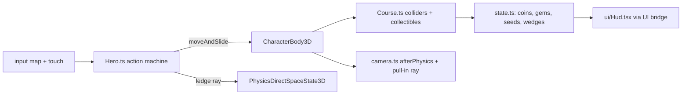

# PRD-732 — Hop Garden: a 3D collectathon starter kit with an SM64-style moveset

**Status:** PARTIAL — Phases 1 and 2 done; Phase 3 (gates, native, judge) open
**Priority:** P2 — new genre kit: Phase 3's registration gates, native run and visual judge (AC-8..AC-10) are open.
**Complexity:** 5 (MEDIUM) — 11+ kit source files (+3), new kit system (+2); risk override: none. The kit is game code in one template; no `packages/` API changes.
**Owner:** João
**Depends on:** [PRD-723](../Unreal/look/PRD-723-every-template-game-looks-like-unreal-on-the-engine-defaults.md) (aligned, not gating: the kit is born on the core Unreal defaults, so it pins no tone curve or fixed exposure and needs no PRD-723 migration). Owner order, 2026-10-23: "use unreal defaults for these new starter kits".

## Context

The owner asked for a starter kit that borrows the mechanics of Super Mario 64, with the
[n64decomp/sm64](https://github.com/n64decomp/sm64) decompilation as the reference. The kit uses only
what the `minimal` template ships plus procedurally generated content.

**What exists.** `packages/create-threenative/templates/` has 13 kits. The nearest is `platformer`
(Fox Dash): a linear 97 m route with a double jump, a dash and `strafeScale: 0.75` ("the route is a
line, not a field", `templates/platformer/src/entities/Fox.ts:46`). Nothing ships camera-relative
free-roam movement, a jump chain, crouch jumps, wall kicks or ledge grabs. `minimal` tracks zero
asset files (no GLB, texture or audio): every model is code. Fox Dash proves the procedural pattern:
`src/render/fox.ts` builds a chibi rig from primitives, `src/level/Stage.ts` builds and tags the
walkable meshes.

**What the reference does** (read 2026-10-23 at `n64decomp/sm64` master through `gh api`). SM64 runs
its logic at 30 Hz. Mario's hitbox is 160 units tall (`src/game/mario.c:1652`), so this PRD takes
1 unit = 1 cm: velocity in units/frame × 0.3 = m/s, acceleration in units/frame² × 9 = m/s².

| Mechanic | Reference rule | Kit value (m, s) |
| --- | --- | --- |
| Run | target speed = stick magnitude, capped 32; accel `+1.1 − v/43` per frame, −1 above target (`src/game/mario_actions_moving.c:434-460`) | cap 9.6 m/s, hard cap 14.4 m/s, accel `9.9 − 0.70·v` m/s² |
| Turn | face yaw approaches stick yaw by 0x800 per frame (`mario_actions_moving.c:462`) | 337.5 °/s |
| Gravity | −4 per frame, terminal −75 (`src/game/mario_step.c:535-548`) | 36 m/s², 22.5 m/s |
| Variable jump | A released while `vy > 20` divides `vy` by 4 (`mario_step.c:519-531`, `:557`) | release above 6 m/s cuts rise to ¼ |
| Jump | `vy = 42 + 0.25·fwd`, `fwd ×= 0.8` (`src/game/mario.c:821-825`, `:763-766`) | 12.6 m/s + 0.25·fwd (≈2.2 m apex) |
| Double jump | `vy = 52 + 0.25·fwd`, needs a jump landing inside the 5-frame chain window (`mario.c:785-787`, `:1028-1063`, `mario_actions_moving.c:26-28`) | 15.6 m/s, window 0.167 s |
| Triple jump | `vy = 69`, needs a double-jump landing and `fwd > 20` (`mario.c:796-798`, `:1046-1056`) | 20.7 m/s, needs fwd > 6 m/s |
| Backflip | crouch + A: `vy = 62`, `fwd = −16` (`mario.c:790-794`, `src/game/mario_actions_stationary.c:528-535`) | 18.6 m/s up, 4.8 m/s back |
| Side flip | A during a turn-around: `vy = 62`, `fwd = 8`, face the stick (`mario.c:837-841`, `mario_actions_moving.c:962-969`) | 18.6 m/s up, 2.4 m/s |
| Long jump | crouch-slide + A inside 30 frames with `fwd > 10`: `vy = 30`, `fwd ×1.5` capped 48, gravity −2 (`mario_actions_moving.c:1459-1465`, `mario.c:863-873`, `mario_step.c:543-547`) | 9 m/s up, ×1.5 capped 14.4 m/s, 18 m/s² gravity |
| Wall kick | A within 2 frames of a wall hit, or within the 5-frame `wallKickTimer`: `vy = 62`, `fwd ≥ 24`, face away (`src/game/mario_actions_airborne.c:1309-1332`, `:1148-1150`, `mario.c:828-834`) | 18.6 m/s up, ≥ 7.2 m/s, window 0.167 s |
| Dive | B in the air at speed: `fwd + 15` capped 48 (`mario.c:856-860`, `mario_actions_airborne.c:110`) | +4.5 m/s, cap 14.4 m/s |
| Ground pound | Z in the air: hang, then fall at −50 (`mario_actions_airborne.c:446-453`, `:918-944`) | 15 m/s fall |
| Ledge grab | probe 60 units past the wall from 160 units up; grab when the ledge is ≤ 100 units above (`mario_step.c:348-377`) | probe 0.6 m, grab ≤ 1.0 m |

### Capability lookups actually run (2026-10-23, `threenative-engine` MCP)

| Query (scope) | Result |
| --- | --- |
| the whole 3D platformer: analog run, triple/long jump, backflip, side flip, wall kick, ground pound, dive, ledge grab, coins, stars, health, orbit camera, moving platforms, procedural meshes (`request`) | `defineGame` (input, "frame a camera behind the player"), `CharacterBody3D`, `VirtualShadowNode`, `SkyCapture`, `PhysicsDirectSpaceState3D`, `NavigationAgent3D`, `UiLayer` bridge (`subscribeUiState`) |
| wall hit in the air, ledge in front to grab (`mechanic`) | `CharacterBody3D`, `RigidBody3D` — no ledge-grab capability |
| orbit camera that pulls in when a wall blocks the view (`mechanic`) | `defineGame` input only — **no camera-collision capability** |
| ride a moving platform and inherit its velocity (`mechanic`) | `CharacterBody3D`, `TerrainTiles` — **no platform-carry capability** |
| camera-relative analog move from gamepad, keyboard, touch (`mechanic`) | `CharacterBody3D`, `defineGame` input |
| procedural jump/coin/stomp sound without audio files (`mechanic`) | `AudioBus` (plays buffers), `audioPass` (file passes) — **no synthesis capability** |

`CharacterBody3D` detail: "use moveAndSlide inside the physics update"; its aliases include
"platformer double jump". `PhysicsDirectSpaceState3D`: "query results are bounded by the configured
result limit". The verdicts that name no capability (ledge probe, camera pull-in, platform carry)
become kit-owned code in `src/`, built on `PhysicsDirectSpaceState3D` rays.

## Solution

A new kit `collectathon`, titled **Hop Garden**: an original round hero runs one free-roam island
course and collects three Sunseeds. The kit is game code only.

- **Hero and moveset.** `src/entities/Hero.ts` is one action state machine on `CharacterBody3D`
  (`moveAndSlide` in the physics update). One `HERO_FEEL` table holds every value from the table
  above, in metres and seconds, so a reader sees the whole feel in one place. Inputs: a `move` vector
  read relative to the camera yaw, plus `jump`, `crouch` and `attack` buttons, through the input map
  and the existing touch-controls pattern (`render/touch-controls.ts` and `touch-layout.ts`, cloned
  from Fox Dash).
- **Ledge and wall.** A wall contact from `moveAndSlide` opens the wall-kick window. The ledge grab
  casts one `PhysicsDirectSpaceState3D` ray down at 0.6 m past the wall normal from 1.6 m up.
- **Course.** `src/level/Course.ts` builds the island from primitives and tags walkable meshes for
  `buildStaticColliders` (the Fox Dash pattern). It holds a summit, a wall-kick shaft, one rotating
  platform (the kit adds the platform's per-tick displacement to the hero, since no carry capability
  exists), 8 red gems, about 40 coins and stompable walkers.
- **Loop and HUD.** Three Sunseeds: reach the summit, collect the 8 red gems, clear the wall-kick
  shaft. A health meter of 8 wedges: a walker touch costs 1, a coin heals 1, a fall below the kill
  plane respawns the hero at the last checkpoint. Walkers die to a stomp, a ground pound or a dive.
  `src/ui/Hud.tsx` reads the bridge state.
- **Camera.** `src/render/camera.ts` is an orbit follow camera written in `afterPhysics`: it lags
  behind the hero's travel yaw, and a ray from the hero to the camera pulls the camera in front of
  any blocking wall.
- **Look.** Everything procedural: hero, walkers, gems, coins, Sunseeds, rocks, grass. The kit takes
  the look from `@threenative/core` (#541), not from `minimal`'s `src/render/` set: that set is the
  vendored pre-#541 chain, and its `quality.ts` pins `tonemapMode: "aces"`, `autoExposureEnabled:
  false` and `exposure: 0.62`, so cloning it would give the kit the old look. Instead
  `src/render/postprocessing.ts` calls `new WorldEnvironment({ ...qualityPreset(tier), ...overrides })`
  with `WorldEnvironment`, `qualityPreset` and `qualityTiers` imported from `@threenative/core`.
  `quality.ts` lists only overrides with a reason, and starts empty of look pins: no `tonemapMode`,
  no `autoExposureEnabled`, no `exposure`. The kit carries none of the 9 vendored chain files
  (`worldEnvironment.ts`, `autoExposure.ts`, `tonemap.ts` and the rest of `SHARED_RENDER_SOURCES`),
  so the restamp step skips it and any gate that demands those files gets a named exemption for
  this kit. The kit's own lights, sky and materials stay game-owned in `src/render/` and are tuned
  toward the harness L9 frame (`scripts/unreal-look/scaffold/Reference.ts.in`). A budget breach
  drops `renderChainTier` and `quality.ts` says why; it never drops the curve or the meter.

**Registration** (from the PRD-473 kit list): `kit.json`, the render-layer files that
`scripts/visual-gate.ts` checks, `quality.ts` and its doc (`scripts/check-template-quality.ts`), the
conventions applicability row, the `collectathon` rows in `scripts/capability-recall.ts`, the CI
template matrices, the README kit row, `playtests/survives.playtest.json`, a bounded
`playtests/performance.playtest.json` and `native-playtests/*.playtest.json`.

**Risks.** (1) A 6 m triple jump and a 14.4 m/s long jump need a course scaled to them, so the
course is laid out from the feel table, not tuned the other way round. (2) The 0.167 s windows are 10
ticks at 60 Hz: the playtests must press on exact ticks. (3) `moveAndSlide` reports a wall contact
only if the body moves into it, so the wall-kick window opens from the contact on that tick.

## Acceptance criteria

The boxes in each phase are the acceptance criteria, all `local`. There are 10, two over the R5 guide of about 8: the moveset needs three boxes (AC-2..AC-4) and Phase 3 carries the three gates every kit must pass, so a split would leave a kit PRD with no gates.
Each playtest runs on a project scaffolded from `--template collectathon`:
`node packages/playtest/dist/runner/cli.js <project>/playtests/<name>.playtest.json --url http://127.0.0.1:5173 --server-command "<project dev command>" --browser-recipe webgpu`.

## Blocked on

- AC-9: core auto exposure on the desktop V8 engine player (boolean uniforms in `core-tsl.mjs`, render-target texture swaps in `AutoExposureNode`) — unblocked by an engine lane in `packages/runtime-native`.
- The owner's taste call on the kit's look and feel (does it read as a polished 3D collectathon?) — unblocked by João after the judge pass in Phase 3.

## Integration Ledger

| Capability | Reachable consumer/trigger | Replaces / disposition | Evidence |
| --- | --- | --- | --- |
| `collectathon` kit | `npm create threenative -- --template collectathon` → `packages/create-threenative/src/index.ts` kit discovery through `kit.json` | new kit, nothing replaced | AC-1, AC-8 |

## Decisions

- 2026-10-23 (agent, on the owner's request): borrow mechanics, numbers and algorithms only. The
  hero, world, names, art and story are original; no Nintendo name, character, music, course layout
  or code. Decompiled code is read for its rules, never copied.
- 2026-10-23 (agent): assets are the `minimal` template's (zero files) plus procedural geometry built
  in code. No GLB, texture, HDR or audio file enters the kit.
- 2026-10-23 (agent): audio is deferred. Revisit when an engine capability generates audio buffers
  in code on every target, or when the owner allows audio files in this kit. Reason: no asset files
  are allowed, and the capability search found no synthesis route.
- 2026-10-23 (agent): deferred until a user asks — swimming, slides, pole and tree climbing,
  punch and kick combos, carry and throw, power-up caps, a hub with several courses, a boss. One
  course with three Sunseeds carries the genre loop.
- 2026-10-23 (agent): the proof harness scaffolds from workspace tarballs (`packageLocalFramework`)
  at the 0.3.6 template pins, because the published 0.3.6 predates #541 and has no core
  `WorldEnvironment`. The Wasm engine pair for packing came from the PRD-723 lane (same
  `native/` sources).
- 2026-10-23 (agent): the render-import rule allows named core symbols. `src/render/` may import
  `WorldEnvironment`, `qualityPreset`, `qualityTiers` and their types from `@threenative/core`
  (`RENDER_PORTABLE_CORE_SYMBOLS` in `scripts/check-core-boundary.ts`). `scripts/template-quality.ts`
  (`takesCoreLook`), `scripts/visual-gate.ts`, `looks.spec.ts` and `auto-exposure-scaffold.spec.ts`
  read the chain from core for a kit that takes it, instead of demanding the vendored files.
- 2026-10-23 (agent): the platform is carried by the engine. A kinematic `RigidBody3D` under a
  `CharacterBody3D` carries the character, so the "no platform-carry capability" verdict above was
  wrong for translation. The kit's platform orbits (no spin) and has no carry code.
- 2026-10-23 (agent): AC-3 and AC-4 each split into two scenarios, because one scenario per clause
  keeps each run short and its failure specific: `acrobatics` + `wall-kick`, `ledge` +
  `ledge-too-high`.
- 2026-10-23 (agent): the 8th red gem awards a Sunseed on the spot. No jump buffer and no coyote
  time: the reference has neither, and the 0.167 s windows are the whole forgiveness.
- 2026-10-23 (agent): a wall bonk counts only the speed into the wall, and a bonk-free contact
  removes the into-wall part of air speed, so a standing jump beside a ledge reaches the grab band.
- 2026-10-23 (agent): the shaft's lower slab starts at 5 m, because a running single jump's head
  (3 m apex + 1.6 m of hero) hit a 3.2 m slab and cut the wall-kick run-up.
- 2026-10-23 (agent): the `collect` scenario places the gems on the test lane (the "scripted route");
  the course keeps its own gem layout.
- 2026-10-23 (agent): `TN_RENDER_CHAIN` names stages, not the tone curve. AC-1's "filmic and auto
  exposure" is read from `TN_WORLD_ENVIRONMENT` (`tonemapMode: "filmic"`) and `TN_AUTO_EXPOSURE`
  (`measured`/`applied` true).
- 2026-10-23 (agent): the camera's closest distance is 0.3 m, not 1.4 m. With the hero's back to a
  wall, a 1.4 m floor put the lens inside the rock (`rayClear` false in the first camera run).
- 2026-10-23 (agent): no capability-recall mechanic row for the ledge ray. The search does not rank
  `PhysicsDirectSpaceState3D` for "ray to find a wall or ledge" (its situations name only aiming
  and shape queries); that is an engine manifest fix in `packages/physics`, out of this kit's scope.
- 2026-10-23 (agent): a kit on the core look ships no material backlighting (`rimGain`/`fillGain`,
  `materialLighting.ts`), because a stock Unreal scene has none. `primary-docs.spec.ts` names that
  exception and checks the kit's `AGENTS.md` says so.
- 2026-10-23 (agent): the kit's `quality.ts` exports `qualityPreset` (core's preset plus overrides),
  the same name every other kit's `quality.ts` exports, so the tier specs read it unchanged.
- 2026-10-23 (agent): the native engine-player fix stays out of this kit PR. It is a
  `packages/runtime-native` change, and it does not finish AC-9 alone (see AC-9).
- 2026-10-24 (agent, polish round 1 after a NOT PASS judge): every fix is game-owned in `src/`, and
  the core look stays unpinned. The radial grass streaks came from per-facet tints on each lawn's
  cylinder cap, a fan of long triangles. Each lawn is now a ring disc with smooth position-based
  patches. Other fixes: half-albedo warm stone with a darker foot, sky fill ×1.3, PCF radius 3, a
  5,500 K sun, fog −30 %, a deeper zenith with a few clouds, and glowing low-metal coins. Gems are
  1.5× larger, gloves sit on the body, and the eyes sit wider. The hang pose leans back off the
  wall. Scenery skips landmarks, the HUD is compact, and the hint fades after 10 s.
- 2026-10-24 (agent): no 15° camera yaw offset at spawn. The stick is camera-relative and every
  scenario route is authored in the camera frame, so an offset view turns "forward" 15° off the
  screen. Wider-set eyes carry the three-quarter read instead.
- 2026-10-24 (agent, superseded in round 3): in a narrow shaft the camera cranes up (0.85, 1.2 or
  1.45 rad) when the default arm would end closer than 2.5 m. The round-2 judge rated the result,
  a top-down view of the shaft, a REGRESSION.
- 2026-10-24 (agent, round 3, judge item 1): the boxed-in camera cuts to a clearer heading instead
  of craning. When the arm would end closer than 4 m, it tries the current heading and offsets of
  ±45°, ±90° and ±135°, each at 0.32 and 0.61 rad, and takes the farthest reach. A heading change
  is a cut, because an arm swept round a shaft passes through its wall. The pitch is capped at
  0.61 rad (35°). The shaft's end walls drop from 16 m to 3 m kerbs, so the shaft opens to the side
  and the camera watches the climb from there. `wall-kick.playtest.json` now asserts the bounds: a
  cut happens, the peak pitch is at most 0.62 rad, the closest arm is at least 3 m, the lens-to-hero
  ray is clear at the slab contact, and the hero is in the viewport.
- 2026-10-24 (agent, round 3, judge items 2–6): the following changes use light, material and
  effect settings only, with no look pin.
  - Shadows: the environment light is a half-saturated 128 px copy of the sky
    (`skyTexture(0.5, 128)`) at intensity 1.55, so a shadow on grass is a darker green, not teal.
    The sun map is 2048 px (1024 on mobile) with a 4-texel PCF radius, which gives a soft edge of
    about 10 cm, 2.6× the round-2 edge.
  - Lawn: the patch value amplitude is halved, from ±30% to ±15% linear.
  - Run dust: opacity 0.9 → 0.55, size −25%.
  - Hero: hanging, the legs swing back off the wall, splay and kick slowly. The eyes and nose are
    15% larger, and the eye whites glow a little (emissive 0.45).
  - Impacts: a third emitter, `flash`, draws hot white-to-amber stars for the wall kick (26) and a
    ground-pound ring (40, 10 m/s outward).
  - Stone: blocks are cut into 1 m courses with ±13% tint each, so a tower reads as masonry.
- 2026-10-24 (owner via lead: "polish world footer, add more vegetation, enemey"): the lead read
  "footer" as the world floor. The kit keeps the walkable lawn flat, because every gap and jump is
  measured in metres from `HERO_FEEL`, and undulation under the routes would change their meaning.
  The floor gets detail instead:
  - a dirt path with a worn-grass border along the coin line;
  - contact shade under every tree, rock, bush and palm;
  - a sand shelf, a wet-sand band and a foam line round both islands. They are visual only: a fall
    from the cliff still ends in the sea.

  `src/render/foliage.ts` plants the island with one `InstancedMesh` per kind, seeded and kept off
  every scenario route and landmark:
  - round fruit trees, with fruit on half of them;
  - leaning shore palms with fronds and coconuts;
  - bushes, two hedge arcs, flower clusters in four colours and mushrooms;
  - about 1,300 tall grass blades that sway through a TSL `positionNode`.

  A fourth emitter, `pollen`, keeps petals drifting round the hero. Nothing planted is solid. The
  hero walks through a bush as it walks through a pine trunk.
- 2026-10-24 (owner via lead: enemies): two new walker kinds share `Walker.ts`.
  - The hopper is lime and frog-round. It crouches for 0.45 s (its telegraph), then hops up to
    2.6 m at the hero. A stomp defeats it.
  - The thornback is a rust shell with nine spikes. It rears and bristles for 0.7 s (its
    telegraph), then charges 0.9 s along the line it faced. A stomp lands on its spikes, which
    costs a wedge, emits `spiked` and knocks the hero back. A dive or a ground pound defeats it.

  Every defeat fires the dust poof. Proof: `enemies` (hopper stomped, thornbacks dived and
  pounded), `thornback` (a stomp costs a wedge and the thornback lives) and `telegraphs` (each kind
  telegraphs and attacks). Bumblets keep their `walker.<i>` names, so the earlier scenarios are
  unchanged.
- 2026-10-24 (owner via lead: "add more effects like the smoke that appear when you char walk"):
  two pooled `GPUParticles3D` spawn emitters, dust (alpha puffs) and sparkle (additive stars).
  Core owns the slots, the births and the culling. `src/render/effects.ts` owns every look
  parameter and the `BURSTS` table. Each burst passes its shape in the request's `direction`.
  The bursts:
  - movement: run puffs above 5 m/s, skid, take-off, landing ring, ground-pound shockwave and
    debris, ledge dust, wall-kick sparks, a triple-jump trail and a long-jump streak;
  - pickups and walkers: coin, gem and Sunseed bursts, a red-gem glint every 1.4 s and the
    walker-defeat poof.

  Two draw calls in all, a procedural sprite mask and no asset. `playtests/effects.playtest.json`
  proves 0 run puffs at idle, puffs while running, a take-off only after the jump and GPU spawns.
- 2026-10-24 (owner via lead: "add the body shape more similar to mario"): Pip keeps the
  classic 3D-platformer silhouette. The head is big, with a short-brim cap, a round nose, a bushy
  moustache, ears and a hair tuft. The round torso wears overalls with a bib, straps and two
  buttons. The arms are stubs ending in gloves, and the legs are short with big shoes. The trade
  dress is original: a teal cap with a cream leaf badge, a rust shirt, mustard overalls, cream
  gloves and brown shoes. There is no letter emblem and no red-and-blue scheme. Arms and legs
  pivot at the shoulder and the hip and swing against each other on the run. On a ledge the arms
  stretch so the gloves rest on the lip.

## Execution Phases

#### Phase 1: The hero moves like the reference

**Status:** DONE (2026-10-23)
**Files:** `templates/collectathon/` cloned from `minimal`; new `src/entities/Hero.ts`,
`src/render/hero.ts`, `src/render/camera.ts`, a flat test yard in `src/level/Course.ts`, `kit.json`,
`playtests/{survives,jump-chain,acrobatics,ledge}.playtest.json`.
**Implementation:** the action state machine and `HERO_FEEL`, the camera-relative move vector, the
orbit camera without pull-in, the procedural hero rig (feet on the floor: the capsule origin is the
waist, as Fox Dash documents).
**Verification:** the four playtests below on WebGPU, `adapter.info` checked.

- [x] AC-1: the scaffolded kit boots on the core Unreal defaults (`TN_RENDER_CHAIN` names `filmic` and auto exposure, `rg 'tonemapMode|autoExposureEnabled|exposure:' src/` finds no pin), the hero lands on the floor and runs for 600 frames with no console error. proof: `playtests/survives.playtest.json` — Evidence: 2026-10-23, laptop intel `gen-12lp` (`adapter.info`, not SwiftShader), headed WebGPU, Wasm engine (`threenative:web-engine`): exit 0, 0 console errors, groundY 0.0095, moved 17.8 m, nonblank 1.0; `TN_WORLD_ENVIRONMENT` `tonemapMode: "filmic"`, `TN_AUTO_EXPOSURE` measured+applied true; the `rg` finds 0 pins.
- [x] AC-2: three jumps landed inside the chain window at full run reach three rising apexes (single < double < triple), and the same chain at walk speed (below 6 m/s) yields no triple. proof: `playtests/jump-chain.playtest.json` — Evidence: 2026-10-23, `gen-12lp`: exit 0; apexes 3.00 < 4.35 < 5.78 m; counts single 3, double 2, triple 1 (the walk chain's third jump fell back to a single); triple takeoff 7.68 m/s.
- [x] AC-3: the long jump travels farther than a running jump, the backflip lands behind its start, the side flip leaves facing the stick, and a wall kick inside its window gains height while one after the window does not. proof: `playtests/acrobatics.playtest.json` + `playtests/wall-kick.playtest.json` (split, see Decisions) — Evidence: 2026-10-23, `gen-12lp`: both exit 0; running jump 7.69 m vs long jump 13.87 m, backflip −4.88 m, side flip facing error 0; wall kick: 1 kick inside the window, rise 4.5 m, the press after the window adds none (wallKicks 1, wallHits 2).
- [x] AC-4: a jump into a wall whose top is ≤ 1.0 m above the hands ends with the hero standing on top after a forward press, and a wall 1.5 m higher gives no grab. proof: `playtests/ledge.playtest.json` + `playtests/ledge-too-high.playtest.json` (split, see Decisions) — Evidence: 2026-10-23, `gen-12lp`: both exit 0; 3 m ledge: 1 grab, stands at groundY 3.01; 4.5 m wall: 0 grabs, apex 2.1 m, hero back on the floor.

#### Phase 2: The course is a game

**Status:** DONE (2026-10-23)
**Files:** `src/level/Course.ts` (island, shaft, rotating platform, checkpoints),
`src/entities/{Walker,Pickup}.ts`, `src/state.ts`, `src/ui/Hud.tsx`, `src/render/camera.ts`
(pull-in ray), `playtests/{collect,combat,camera}.playtest.json`.
**Implementation:** collectibles, the wedge meter, the three Sunseed rules, walker damage and
defeat, the rotating-platform carry, the camera pull-in.
**Verification:** the three playtests below, plus a rerun of Phase 1's four.

- [x] AC-5: a scripted route collects the 8 red gems and the summit Sunseed, and the HUD state shows `seeds: 2`, and coins heal a damaged meter by one wedge each. proof: `playtests/collect.playtest.json` — Evidence: 2026-10-23, `gen-12lp`: exit 0; gems 0→8, seeds 0→2, 10 `collected` signals; two walker hits then one coin: wedges 8→6→7, coins 1.
- [x] AC-6: a walker touch costs one wedge, while a stomp, a ground pound or a dive each defeat a walker with no wedge lost. proof: `playtests/combat.playtest.json` — Evidence: 2026-10-23, `gen-12lp`: exit 0; stomped, pounded, dived 1 each, defeated 3, wedges 8 at `after-three`; then one touch: hurt 1, wedges 7.
- [x] AC-7: with a wall between the hero and the default camera spot, the hero stays inside the frame and the camera-to-hero ray hits nothing. proof: `playtests/camera.playtest.json` — Evidence: 2026-10-23, `gen-12lp`: exit 0; pulledIn false→true, arm 9→6.31 m, `rayClear` true, `camera` follows the player with the target in the viewport. The Phase 1 four, rerun on the same build: all exit 0.

#### Phase 3: Registered, native and judged

**Status:** NOT STARTED
**Files:** the registration list above, `native-playtests/survives.playtest.json`,
`playtests/performance.playtest.json`.
**Implementation:** register the kit in every gate. Capture the course at three fixed poses, headed,
two runs each. Give the captures and the visual criteria to a fresh read-only judge subagent:
the hero reads as one character with feet on the ground, the course reads as one island under the
Unreal default look, and no frame is blank or white.
**Verification:** the commands on each box. The judge verdict and the PR screenshots go on the PR
(orphan `prd-732-screenshots` branch).

- [ ] AC-8: the kit passes every registration gate and the template lane. proof: `pnpm budgets && pnpm exec vitest run scripts/__tests__/ci-structure.spec.ts scripts/__tests__/primary-docs.spec.ts scripts/__tests__/check-template-conventions.spec.ts && pnpm test:templates` — Evidence: pending.
  Collectathon green, command still red in the shared tree (2026-10-24): every `pnpm budgets` step passes for `collectathon`. `check-core-boundary` and `check-template-conventions` fail only on the untracked sibling kit `adventure` (PRD-733), and so does one `primary-docs` case. `TN_TEMPLATE_ONLY=collectathon tsx scripts/verify-template-playtests.ts` passes on intel `gen-12lp` (11 runs, 0 failures), run on the real display without `scripts/xvfb.sh`, because the private Xvfb is SwiftShader here. `test:tone` reads only `examples/abyss-framework`. Tick when the sibling kit is green.
- [ ] AC-9: the kit runs 300 frames on the native desktop engine player with a non-blank capture. proof: `node packages/playtest/dist/runner/cli.js <project>/native-playtests/survives.playtest.json --target desktop` — Evidence: pending.
  Open, engine-blocked (2026-10-23, V8 engine player built here from the CI recipe): the kit fails to start, `TN_TSL uniform: expected a TSL node or number` from core's `AutoExposureNode` (`uniform(false)`). The V8 shim `packages/runtime-native/src/engine/player/core-tsl.mjs` lacks the boolean-uniform wrapper that `packages/three-native/src/browser-tsl.ts:775` has. With that wrapper cloned in, startup passes (`TN_PLAYER_V8_GAME_CHECK ... startup=passed`), then every frame fails `TN_NATIVE_TEXTURE_VALUE_TYPE` on the meter's render-target swaps (`auto-exposure.ts:192`). Core auto exposure is not ported to the desktop engine player, so any game on the engine default look fails there. Diagnostic only: with the meter off, the native scenario passes (exit 0, 0 errors) but the capture shows the HUD over the loading bar, not the course.
- [ ] AC-10: the visual judge returns pass on every criterion above for all three poses. proof: the judge report linked from the PR — Evidence: pending.
  Captures ready, judge not run (2026-10-24): 3 poses (spawn, summit, shore) × 2 runs, headed WebGPU on intel `gen-12lp`, Wasm engine (`threenative:web-engine`), `TN_WORLD_ENVIRONMENT` filmic and `TN_AUTO_EXPOSURE` measured+applied in every run, 0 console errors, nonblank ≥ 0.5: `~/Downloads/hop-garden/pose-{spawn,summit,shore}-run{1,2}.png`. Known gap for the judge: inside the 5 m shaft the camera pulls in under 1 m and loses the hero during a wall kick.
  Round 1 judge (2026-10-24, lead): NOT PASS. The judge rated hero, look, integrity and polish WEAK and readability PASS. The round-1 frames are kept in `~/Downloads/hop-garden/round1/`. Polish round 2 is in Decisions: the lawn, stone, light, sky, pickups, hero and HUD fixes, the owner's effects and body shape, and the camera crane. All 11 scenarios exit 0 on `gen-12lp` after it, `effects` included. Performance: p95 17.7 ms, 58.8 fps, 265 draws (was 240), 54.0k triangles (was 34.6k).
  Round 2 judge (2026-10-24, lead): IMPROVEMENT but NOT PASS. Eight frames improved, and the
  wall-kick frame regressed (the top-down crane). The round-2 frames are in
  `~/Downloads/hop-garden/round2/`. Round 3 is in Decisions: the shaft camera, the shadows, the
  lawn, the dust, the hang pose and face, the impact flashes and the masonry. It also has the
  owner's floor, planting and enemies. All 14 scenarios exit 0 on `gen-12lp`, including the new
  `enemies`, `thornback` and `telegraphs`. Red-green for the shaft camera: with the round-2 crane
  restored, `wall-kick` fails on cuts 0, peak pitch 1.45 rad and closest arm 1.76 m. Round 3
  passes with 1 cut, 0.32 rad and 9 m. Performance: p95 17.7 ms, 59.2 fps, 321 draws, 111.5k
  triangles. The budgets are 600 draws and 190k triangles.
