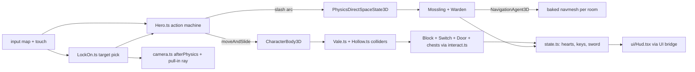

# PRD-733 — Lantern Vale: a 3D action-adventure starter kit with lock-on combat and a dungeon puzzle

**Status:** PARTIAL — Phases 1 and 2 done, Phase 3 AC-8 done (AC-9 engine-blocked, AC-10 at the judge)
**Priority:** P2 — new genre kit: the dungeon loop (Phase 2) and the registration, native and judge gates (Phase 3) are open, and no shipped kit has lock-on targeting, a shield, a pushable-block puzzle or a key-and-door dungeon loop.
**Complexity:** 5 (MEDIUM) — 11+ kit source files (+3), new kit system (+2). Risk override: none. The kit is game code in one template. No `packages/` API changes.
**Owner:** João
**Depends on:** [PRD-723](../Unreal/look/PRD-723-every-template-game-looks-like-unreal-on-the-engine-defaults.md) (aligned, not gating: the kit is born on the core Unreal defaults, so it pins no tone curve or fixed exposure and needs no PRD-723 migration). Owner order, 2026-10-23: "use unreal defaults for these new starter kits". Sibling of [PRD-732](PRD-732-hop-garden-3d-platformer-starter-kit.md): both kits ship in one PR (owner order, 2026-10-23).

## Context

The owner asked for a starter kit in the style of Ocarina of Time and Breath of the Wild. The
reference for mechanics is the [zeldaret/oot](https://github.com/zeldaret/oot) decompilation. The kit
uses only what the `minimal` template ships plus procedurally generated content.

**What exists.** `packages/create-threenative/templates/` has 13 kits. The nearest is `action-rpg`:
a three-room grid dungeon of mannequin fighters with melee, a spell, loot and persistence. It
fights with a `.glb` rig and a free camera (`templates/action-rpg/src/entities/Fighter.ts`). It has no
lock-on, no shield, no keys, no doors and no puzzle. `minimal` tracks zero asset files. Fox Dash
(`platformer`) proves the procedural pattern: `src/render/fox.ts` builds a rig from primitives and
`src/level/Stage.ts` tags the walkable meshes.

**What the reference does** (read 2026-10-23 at `zeldaret/oot` master through `gh api`). The game
logic runs at 20 Hz, so this PRD takes 1 unit = 2.5 cm: the 68-unit adult height
(`src/code/z_actor.c:1130-1136`) reads 1.7 m. Velocity in units/frame × 0.5 = m/s. Acceleration in
units/frame² × 10 = m/s².

| Mechanic | Reference rule | Kit value (m, s) |
| --- | --- | --- |
| Run | speed limit 600 outdoors, 500 indoors, set per boots and room type (`src/code/z_player_lib.c:36-45`, `:584-620`) | 3.0 m/s outdoors, 2.5 m/s in the dungeon |
| Run accel | approach the target speed by `REG(19)/100` = 2.0 units/frame² (`src/overlays/actors/ovl_player_actor/z_player.c:7168`) | 20 m/s² |
| Turn | yaw steps toward the stick yaw by `REG(27)` = 2000 binang per frame (`z_player.c:7169`, `z_player_lib.c:584`) | 220 °/s |
| Roll | A rolls only when no hostile is locked on (`z_player.c:6489-6492`) | roll on the action button when unlocked, a hop when locked (kit value) |
| Lock-on | a hostile `focusActor` drives the Z-targeting state and the facing (`z_player.c:2553-2566`, `:3948`) | acquire the nearest hostile in a cone, face it, strafe around it |
| Heart container | capacity and health each gain `0x10`, which is one heart (`src/code/z_parameter.c:1757-1758`) | +1 heart of capacity, refilled |

The sword, shield, enemy and mini-boss numbers are the kit's own design values. They are tuned to
feel right and are not extracted from the decompilation. They live in one `ADVENTURE_FEEL` table:
slash windup 0.2 s, active 0.15 s, recovery 0.25 s, arc 120° at 1.4 m, shield cone 100°, start
health 3 hearts counted in half-hearts, a basic enemy has 2 hit points.

### Capability lookups actually run (2026-10-23, `threenative-engine` MCP)

| Query (scope) | Result |
| --- | --- |
| the whole adventure: lock-on camera, sword hitbox, shield, bow, keys and doors, pushable blocks and switch, hearts, NPC dialog, enemy chase, mini-boss (`request`) | `NavigationAgent3D` and `recast` (`@threenative/physics/navigation`), `afterPhysics`, `PhysicsDirectSpaceState3D`, `CharacterBody3D`, `defineGame`, `GroundSnap` |
| lock onto the nearest enemy and keep the camera and movement facing it (`mechanic`) | only `Billboard3D` and `defineGame` input, **no lock-on or target-camera capability** |
| sword swing hitbox hits enemies in an arc (`mechanic`) | `NavigationAgent3D`, `CharacterBody3D`, `buildStaticColliders`, `interactionGroups` — no melee capability. The arc is one `PhysicsDirectSpaceState3D` `intersectShape` query, the pattern `action-rpg` uses in `src/entities/Enemy.ts:99` |
| pushable block slides and presses a switch that opens a door (`mechanic`) | `GroundSnap`, `ao`, `TracedReflections` — **no match**, so a game-owned grid push |
| press a button near a chest, key, locked door or NPC (`mechanic`) | `Area3D` (overlap detection), `buildStaticColliders`, `PointerEvents3D` (pointer only) — **no interactable or dialog capability** |
| enemy chases the player around walls and attacks (`mechanic`) | `NavigationAgent3D` + `recast`, `CharacterBody3D`, `attachToBone`, `interactionGroups` |
| aim and fire a bow arrow (`mechanic`) | `TracerPool3D` (hitscan streaks), `GPUParticles3D`, `RigidBody3D` — **no bow or arrow capability** |
| day and night cycle (`mechanic`) | `solarPosition`, `SkyCapture` |

`NavigationAgent3D` detail: "requires recast() after rapier(), plus a baked NavigationRegion3D".
`packages/physics/AGENTS.md` says solo navmeshes are static and obstacles affect local avoidance
only. `CharacterBody3D` detail: "use moveAndSlide inside the physics update". The verdicts that
name no capability (lock-on, interaction, key and door state, pushable block, switch, shield,
mini-boss) become kit-owned code in `src/`, built on `PhysicsDirectSpaceState3D`, `Area3D` and
`CharacterBody3D`.

## Solution

A new kit `adventure`, titled **Lantern Vale**: Wren, an original lamp-bearing wanderer, crosses one
small clearing and one small three-room dungeon, the Moss Hollow. The kit is game code only.

- **Hero.** `src/entities/Hero.ts` is a small action state machine on `CharacterBody3D`
  (`moveAndSlide` in the physics update): idle, run, roll, slash, block, hurt, dead. One
  `ADVENTURE_FEEL` table holds every value in metres and seconds. Inputs: `move`, plus `action`,
  `block`, `target` and `interact` through the input map, and the touch-controls pattern cloned from
  Fox Dash (`render/touch-controls.ts`).
- **Lock-on.** `src/entities/LockOn.ts` picks the nearest living hostile inside a 12 m range and a 60°
  cone of the camera. While held, the hero faces the target, strafes at a constant distance and
  rolls become hops. The target moves to the next hostile on a press and drops when it dies, leaves
  range or the button is released. A billboarded reticle marks the target.
- **Combat.** A slash runs one `intersectShape` query over the arc on the active frames. Block raises
  the shield: a hit inside the 100° front cone costs nothing, a hit from behind costs a half-heart.
  Health is a row of hearts counted in half-hearts. A heart container adds one heart of capacity.
- **Enemies.** `src/entities/Mossling.ts` is a hopping chaser steered by `NavigationAgent3D` on a
  navmesh baked per room. It stays in its room (a leash), because a baked navmesh is static. The
  Stone Warden mini-boss (`src/entities/Warden.ts`) charges in a line, stuns itself on a wall, and
  takes damage only while stunned. Three stuns defeat it.
- **Overworld and dungeon.** `src/level/Vale.ts` builds the clearing: the sword chest, a signpost
  that shows its text on `interact`, two Mosslings and the cave mouth. `src/level/Hollow.ts` builds
  the room chain: a guard room, a block room (a pushable block, a floor switch, a grate door and a
  chest with the small key) and the Warden room behind a locked door. Both tag walkable meshes for
  `buildStaticColliders`, the Fox Dash pattern.
- **Puzzle and doors.** `src/entities/Block.ts` moves a 1 m block in grid steps: the hero pushes
  for 0.4 s, the block slides 1 m at 1.2 m/s, and one ray check stops it at a wall. `src/entities/Switch.ts`
  is an `Area3D` that opens the grate while the block rests on it. `src/entities/Door.ts` holds the
  locked state and spends the small key. A shared `src/interact.ts` picks the nearest `Area3D`
  prompt and runs its action.
- **Loop and HUD.** Find the Ember Blade in the clearing chest, defeat the Mosslings, enter the
  Hollow, push the block onto the switch, take the small key, unlock the door, defeat the Warden,
  take the heart vessel. `src/state.ts` publishes hearts, capacity, keys, sword and the prompt text.
  `src/ui/Hud.tsx` reads the bridge. A fall or zero hearts respawns the hero at the last door.
- **Camera.** `src/render/camera.ts` is a third-person follow camera written in `afterPhysics`. In
  lock-on it eases its yaw toward the line from the target to the hero. A ray from the hero to the
  camera pulls the camera in front of any blocking wall.
- **Look.** Everything procedural: Wren, Mosslings, the Warden, chests, doors, the block, trees,
  stones and grass. The kit takes the look from `@threenative/core` (#541), not from `minimal`'s
  `src/render/` set: that set is the vendored pre-#541 chain, and its `quality.ts` pins
  `tonemapMode: "aces"`, `autoExposureEnabled: false` and `exposure: 0.62`, so cloning it would give
  the kit the old look. Instead `src/render/postprocessing.ts` calls
  `new WorldEnvironment({ ...qualityPreset(tier), ...overrides })` with `WorldEnvironment`,
  `qualityPreset` and `qualityTiers` imported from `@threenative/core`. `quality.ts` lists only
  overrides with a reason, and starts empty of look pins: no `tonemapMode`, no `autoExposureEnabled`,
  no `exposure`. The kit carries none of the 9 vendored chain files (`worldEnvironment.ts`,
  `autoExposure.ts`, `tonemap.ts` and the rest of `SHARED_RENDER_SOURCES`), so the restamp step skips
  it and any gate that demands those files gets a named exemption for this kit. The kit's own
  lights, sky and materials stay game-owned in `src/render/` and are tuned toward the harness L9
  frame (`scripts/unreal-look/scaffold/Reference.ts.in`). A budget breach drops `renderChainTier` and
  `quality.ts` says why. It does not drop the curve or the meter.

**Registration** (from the PRD-473 kit list): `kit.json`, the render-layer files that
`scripts/visual-gate.ts` checks, `quality.ts` and its doc (`scripts/check-template-quality.ts`), the
conventions applicability row, the `adventure` rows in `scripts/capability-recall.ts`, the CI
template matrices, the README kit row, `playtests/survives.playtest.json`, a bounded
`playtests/performance.playtest.json` and `native-playtests/*.playtest.json`.

**One PR with PRD-732.** PRD-732 (`collectathon`) and PRD-733 (`adventure`) ship in one pull request
(owner order, 2026-10-23). The two kits are independent directories under
`packages/create-threenative/templates/` and import nothing from each other. The shared
registration files (kit rows, CI matrices, README, capability recall, conventions) are edited by
both PRDs, so each PRD adds its own row and the second to land merges develop in.

**Risks.** (1) A baked navmesh is static, so a door that opens changes the geometry. Each room bakes
alone, enemies keep a leash inside their room and the pushable block is a `NavigationObstacle3D`.
(2) `action-rpg` calls `@threenative/physics/navigation` a browser-only WASM boundary on native.
Phase 1 runs the native player once and reads `TN_NATIVE_ENGINE_UNBOUND`. If navigation is unbound,
the Mossling falls back to a ray-checked direct steer in the same file, and the PRD records the
result. (3) Lock-on and camera yaw must not fight each other, so the camera reads the lock state
and owns no target logic. (4) The 0.4 s push and the 0.15 s slash window are 24 and 9 ticks at 60
Hz, so the playtests press on exact ticks.

## Acceptance criteria

The boxes in each phase are the acceptance criteria, all `local`. There are 10, two over the R5 guide of about 8: the loop needs three boxes in Phase 1 (movement, lock-on, boot) and four in Phase 2 (combat, hearts, puzzle, boss), and Phase 3 carries the three gates every kit must pass, so a split would leave a kit PRD with no gates.
Each playtest runs on a project scaffolded from `--template adventure`:
`node packages/playtest/dist/runner/cli.js <project>/playtests/<name>.playtest.json --url http://127.0.0.1:5173 --server-command "<project dev command>" --browser-recipe webgpu`.

## Blocked on

- The owner's taste call on the kit's look and feel (does it read as a polished 3D adventure?) — unblocked by João after the judge pass in Phase 3.
- AC-9, the native desktop run: the core auto exposure does not compile on the desktop V8 engine
  player. Layer `packages/runtime-native` (the `core-tsl.mjs` shim takes no boolean `uniform(false)`
  from `AutoExposureNode`). PRD-732 records the same blocker for `collectathon`. Unblocked by an
  engine lane that makes the core look run on the engine player.

## Integration Ledger

| Capability | Reachable consumer/trigger | Replaces / disposition | Evidence |
| --- | --- | --- | --- |
| `adventure` kit | `npm create threenative -- --template adventure` → `packages/create-threenative/src/index.ts` kit discovery through `kit.json` | new kit, nothing replaced | AC-1, AC-8 |

## Decisions

- 2026-10-23 (agent, on the owner's request): borrow mechanics, numbers and algorithms only. The
  hero, world, names, art and story are original. The kit uses no Nintendo name, character, music,
  dungeon layout or code. Decompiled code is read for its rules and is not copied.
- 2026-10-23 (agent): assets are the `minimal` template's (zero files) plus procedural geometry
  built in code. No GLB, texture, HDR or audio file enters the kit.
- 2026-10-23 (agent): audio is deferred. Revisit when an engine capability generates audio buffers
  in code on every target, or when the owner allows audio files in this kit. Reason: no asset files
  are allowed, and no capability search found a synthesis route.
- 2026-10-23 (agent): the sword, shield, enemy and boss numbers are kit design values. Only run
  speed, acceleration, turn rate and the heart unit come from the decompilation. Revisit when the
  owner wants frame-exact parity with the reference.
- 2026-10-23 (agent): deferred until a user asks — bow and arrows, NPC dialog trees, day and night
  (`solarPosition` and `SkyCapture` fit it), a save slot, more than one dungeon, an item menu,
  fishing and shops, a horse, weather. Revisit each when a second kit or an owner request needs it.
  One clearing and one three-room dungeon carry the genre loop.
- 2026-10-23 (agent): Navigation is the engine capability for chasing. A hand-written A* is not
  allowed. A direct-steer fallback exists only if Phase 1 shows navigation unbound on native.
- 2026-10-23 (agent, superseding the line above without a native run): the kit does not import
  `@threenative/physics/navigation`. Its Recast WASM is refused on Android and iOS
  (`TN_NATIVE_WASM_ON_MOBILE`), `packages/create-threenative/AGENTS.md` states that no template
  imports it, and every kit must run on all four targets. The Mossling uses the PRD's own fallback:
  a ray to Wren, and a slide along the wall that ray hits (`src/entities/Mossling.ts`). No A* is
  written. Revisit when navigation runs on Android and iOS.
- 2026-10-23 (agent): `@threenative/core` stays pinned at `0.3.6`, the workspace version, as every
  template pins it. `pnpm test:templates` does not install that pin from npm:
  `packageLocalFramework` packs `packages/core` from this tree and the scaffold installs the
  tarball (`file:.../threenative-core-0.3.6.tgz`). The npm `0.3.6` (published 2026-10-21) does not
  export `qualityTiers` or `WorldEnvironment` (checked with `npm pack @threenative/core@0.3.6`), so a
  registry install of this kit, or of `collectathon`, needs the next core release. The release
  cohort (`pnpm release:prepare`) bumps the pin with the other templates.
- 2026-10-23 (agent): the render-import rule follows the PRD-732 mechanism, with no second one.
  `scripts/check-core-boundary.ts` lists the core look in `RENDER_PORTABLE_CORE_SYMBOLS`, and
  `template-quality.ts` and `visual-gate.ts` detect a kit that takes the core look from its
  `postprocessing.ts` and `quality.ts` imports. This kit has the same file shapes, so no list
  names it. `Billboard3D` and `attachToBone` are not in that set, so they are used in
  `src/entities/`, not in `src/render/`.
- 2026-10-23 (agent): the input map adds an `attack` input (KeyJ, pad button 2) for the slash. The
  PRD's five inputs (move, action, block, target, interact) have no slash input. `action` is the roll,
  or a hop while locked on.
- 2026-10-23 (agent): the unlocked camera holds its yaw and starts behind Wren. A target press with
  nothing in range recentres it behind her, and a lock swings it onto the target line. This keeps
  "up" on the stick fixed until the player asks for a new direction, and keeps the move playtests
  deterministic. A release and a new press inside 0.3 s moves the lock to the next target.
- 2026-10-23 (agent): the sword chest stands beside Wren's start, at (-1.6, 0, 8.4), so opening it is
  the first thing she does and every combat playtest can take the sword in one press.
- 2026-10-23 (agent): the Warden stuns on a wall or on Wren's raised shield. A charge she blocks
  dazes it, so a fight can be won without baiting it into a wall. The door to its room shuts behind
  Wren and opens again when it falls. The checkpoint before that door is named `warden-door`.
- 2026-10-23 (agent): a fresh lock takes any hostile within 3 m even outside the 60° cone, so a
  Mossling at Wren's side can be targeted. Unlocked, her speed scales with the cosine of the turn
  still to make, so she pivots on the spot instead of running a wide arc.
- 2026-10-23 (agent): both chests are built in `load()` as `chest.sword` and `chest.key`, so a
  scenario can place them.
- 2026-10-23 (agent): the block checks the cell ahead with one ray from its centre, 1.25 m up,
  above its own top. A ray that starts inside the block hits the block. A ray that starts inside a
  wall's trimesh sees no face, which let the block slide through the north wall. Anything that
  stops a block must stand taller than 1.25 m. Every wall, door and grate in the Hollow does.
- 2026-10-23 (agent, engine bug, layer `packages/physics`): a character on a floor that pressed a
  wall with an off-centre contact read `grounded: false` on most steps. Rapier recorded only the
  wall contact, and the "only walls, so not grounded" guard overrode Rapier's answer. A push block
  never got a full 0.4 s lean. Fix in both backends (`packages/physics/src/simulation.ts`,
  `packages/runtime-native/native/physics/src/lib.rs`): a step that asked to move down and was held
  in place keeps Rapier's grounded answer. Red-green: `character.spec.ts` "stays grounded on a
  floor while it presses into a vertical wall" failed at tick 77, now passes. The Rust test
  `character_stays_grounded_while_it_presses_a_push_block` was airborne on ticks 102-129, now
  passes. All 230 physics unit tests pass, the existing wall-fall tests included. The web and Rust
  parity arms pass. This is a behaviour fix, not an API change.
- 2026-10-24 (agent): the captures showed Wren's boots detached under her legs. The leg capsule now
  runs from the hip into the boot top (`src/render/hero.ts`).
- 2026-10-24 (agent): the live recordings showed the camera inside Wren's head when a wall stood
  behind her. A pulled-in camera arm now climbs up to 1.6 m and looks down over her, and a second
  ray keeps the climb under the ceiling (`src/render/camera.ts`).
- 2026-10-24 (agent): the render-file comments say "the engine core", not the package name.
  `check-core-boundary` matches the package name in comment text too.
- 2026-10-24 (agent): the sibling commit `811734b54` (PRD-732) carried this kit's README row and its
  first scaffold hash. `packages/create-threenative/README.md` lists no `collectathon`, so this kit
  is not added there alone: the kit order puts `collectathon` first. Registration rows added here:
  the PRD-289 conventions table, `TEMPLATE_NAMES` in `scripts/capability-recall.ts`, and the
  `request.adventure-lock-on` recall row (budget `rowCount` 102).

## Execution Phases

#### Phase 1: Wren moves, targets and boots on the Unreal look

**Status:** DONE (2026-10-23), web on WebGPU (nvidia turing adapter, not SwiftShader)
**Files:** `templates/adventure/` cloned from `minimal`, with new `src/entities/{Hero,LockOn}.ts`,
`src/render/{hero,camera,postprocessing,quality}.ts`, a flat test yard in `src/level/Vale.ts`, one
dummy target, `kit.json`, `playtests/{survives,move,lockon}.playtest.json`.
**Implementation:** the hero state machine and `ADVENTURE_FEEL`, the camera-relative move vector,
the follow camera with the lock-on yaw ease, the target pick and reticle, the procedural hero rig
(feet on the floor: the capsule origin is the waist, as Fox Dash documents), the core look wiring.
**Verification:** the three playtests below on WebGPU, `adapter.info` checked.

- [x] AC-1: the scaffolded kit boots on the core Unreal defaults (`TN_RENDER_CHAIN` names `filmic` and auto exposure, `rg 'tonemapMode|autoExposureEnabled|exposure:' src/` finds no pin), the hero stands on the floor and runs for 600 frames with no console error. proof: `playtests/survives.playtest.json` — Evidence: exit 0, 600 frames, `feetY` 0.010 m, grounded, moved 14.6 m, 0 console errors. `TN_WORLD_ENVIRONMENT` reports `tonemapMode: "filmic"` and `TN_AUTO_EXPOSURE` reports `applied: true, settled: true` (`TN_RENDER_CHAIN` lists the post stages only: ambientOcclusion, ssgi, ssr, traa, motionBlur, bloom, vignette, tier high). The `rg` finds nothing (exit 1).
- [x] AC-2: full stick reaches 3.0 m/s outdoors (±5%) and 2.5 m/s in the dungeon yard, the hero stops within 0.3 s of release, and a turn of 180° takes 0.8 s to 0.9 s. proof: `playtests/move.playtest.json` — Evidence: `move` exit 0: top speed 3.000 m/s, stop 0.150 s, 180° turn 0.833 s. The dungeon half is `playtests/move-hollow.playtest.json` (spawned in the Hollow): exit 0, top speed 2.500 m/s, stop 0.133 s.
- [x] AC-3: with two dummy targets in range, the target press locks the nearest, the hero faces it while strafing and keeps its distance within ±0.3 m, a second press moves the lock to the other target, release unlocks, and a defeated target drops the lock. proof: `playtests/lockon.playtest.json` — Evidence: exit 0, 16 checks pass. The lock goes `dummy.1` (nearest), `""` on release, `dummy.0` on the quick re-press, `""` after 0.5 s, and `""` when the second cut fells the locked dummy. Strafe 1.50 s with 0.03 m worst drift, worst facing error 0.0°, 2 slash hits, 1 defeated.

#### Phase 2: The vale and the Hollow are a game

**Status:** DONE (2026-10-23), web on WebGPU (nvidia adapter)
**Files:** `src/level/{Vale,Hollow}.ts`, `src/entities/{Mossling,Warden,Block,Switch,Door,Chest}.ts`,
`src/interact.ts`, `src/state.ts`, `src/ui/Hud.tsx`, `src/render/camera.ts` (pull-in ray),
`playtests/{combat,hearts,puzzle,boss}.playtest.json`.
**Implementation:** the sword and shield, hearts, the Mossling chase on per-room navmeshes, the
interact prompt, the chest, key, door, block and switch rules, the Warden, the heart vessel. Phase 1
runs the native player once to record whether navigation is bound.
**Verification:** the four playtests below, plus a rerun of Phase 1's three.

- [x] AC-4: a Mossling chases the hero around a wall to reach it. The sword is absent before the clearing chest and a slash defeats a Mossling in two hits only inside the 1.4 m arc. proof: `playtests/combat.playtest.json` — Evidence: exit 0. KeyJ before the chest: 0 slashes. A slash at a dummy 90° off the arc: 0 hits; the dummy falls on the 2nd cut. `mossling.0` wall-follows 6.86 m around the ruin wall, bites Wren (2.5 hearts), and falls on the 2nd cut. Red: with the wall-follow off, the wait for the bite timed out after 30 s (exit 2).
- [x] AC-5: a Mossling hit costs a half-heart, a hit into the raised shield front costs none, a hit from behind the shield costs a half-heart, and zero hearts respawns the hero at the last door with full hearts. proof: `playtests/hearts.playtest.json` — Evidence: exit 0. A bite behind the raised shield: 3 → 2.5 hearts. A bite into the shield front: 2.5 hearts, `shieldBlocks` 1. After 6 hits Wren falls and respawns at `hollow-entry` with 3 hearts, `respawns` 1.
- [x] AC-6: pushing the block 1 m per step onto the floor switch opens the grate, the chest then gives the small key (HUD `keys: 1`), a block pushed into a wall stops, and the locked door opens only with the key. proof: `playtests/puzzle.playtest.json` — Evidence: exit 0. The door reads `Locked` and stays shut before the key. Two pushes move the block exactly 2 m onto the switch (`blockSteps` 2) and the grate opens. Pushes into the north wall are refused (`refused` 3, block still at z -25). The chest gives `keys` 1, the door opens and spends it (`keys` 0). Red: before the engine fix below, Wren read airborne against the stopped block and never made the 2nd push (`blockSteps` 1). Before the ray fix, the block slid through the wall to z -27.
- [x] AC-7: the Warden takes damage only while stunned, three stuns defeat it, and the heart vessel then raises capacity from 3 to 4 hearts and refills them. proof: `playtests/boss.playtest.json` — Evidence: exit 0. The first charge costs a heart (2 hearts). A wall stun, then two shield stuns (`shieldBlocks` 2): 3 stuns. A cut during the wind-up clanks (`clanks` 1, health stays 2). Health 3 → 2 → 1 → 0 on the three stunned cuts, then capacity 3 → 4 and hearts 4, `cleared` true.
- Phase 1 rerun after the Phase 2 changes and the physics fix: `survives`, `move`, `move-hollow` and `lockon` exit 0 (the first `survives` try died on `net::ERR_NETWORK_CHANGED` before the bridge loaded, a host network event; the rerun passed).

#### Phase 3: Registered, native and judged

**Status:** PARTIAL (2026-10-24): AC-8 done, AC-9 engine-blocked, AC-10 waits for the judge
**Files:** the registration list above, `native-playtests/survives.playtest.json`,
`playtests/performance.playtest.json`.
**Implementation:** register the kit in every gate. Capture the clearing, the block room and the
Warden room at three fixed poses, headed, two runs each. Give the captures and the visual criteria
to a fresh read-only judge subagent: Wren reads as one character with feet on the ground, the vale
and the Hollow read as two connected places under the Unreal default look, the lock-on reticle is
visible, and no frame is blank or white.
**Verification:** the commands on each box. The judge verdict and the PR screenshots go on the PR
(orphan `prd-733-screenshots` branch, with the PRD-732 images on the same PR).

- [x] AC-8: the kit passes every registration gate and the template lane. proof: `pnpm budgets && pnpm exec vitest run scripts/__tests__/ci-structure.spec.ts scripts/__tests__/primary-docs.spec.ts scripts/__tests__/check-template-conventions.spec.ts && pnpm test:templates` — Evidence: `pnpm budgets` exit 0. The registration specs (scaffold, looks, auto-exposure-scaffold, ci-structure, primary-docs, check-template-conventions, playtest) pass 370/370 on the kit's own tree, with the adventure scaffold hash re-pinned after the hero and camera edits. `pnpm check:docs` passes. `TN_TEMPLATE_ONLY=adventure` template lane: 9 scenarios plus the boot smoke pass ("adventure: scaffolded playtests passed"). After the hero and camera edits, all 9 scenarios rerun green on the nvidia adapter (`performance`: p95 18.5 ms, 275 draws, 34,477 triangles, tier high). `pnpm test:tone` has no adventure case, so it did not run.
- [ ] AC-9: the kit runs 300 frames on the native desktop engine player with a non-blank capture. proof: `node packages/playtest/dist/runner/cli.js <project>/native-playtests/survives.playtest.json --target desktop` — Evidence: open, engine-blocked (see `## Blocked on`). `pnpm build --target desktop` with the worktree's `tn-native-engine-player-v8` builds `dist-native/adventure/adventure`. The run exits 2 with `TN_INSPECT_GAME_BRIDGE: TypeError: TN_TSL uniform: expected a TSL node or number`, the core auto exposure blocker PRD-732 also records.
- [ ] AC-10: the visual judge returns pass on every criterion above for all three poses. proof: the judge report linked from the PR — Evidence: open, for the lead's judge. Captures, headed WebGPU on the nvidia adapter, two runs per pose: `~/Downloads/lantern-vale/01-vale-run1.png` to `06-warden-run2.png`. All six report `TN_WORLD_ENVIRONMENT` `tonemapMode: "filmic"` and `TN_AUTO_EXPOSURE` measured and applied (settled in the vale and the block room, still settling at the Warden pose). Gameplay video: `~/Downloads/lantern-vale/lantern-vale-gameplay.mp4` (31 s: lock-on and slash, shield block, block push and grate, key and door, the Warden stun).
