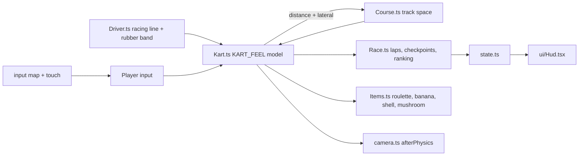

# PRD-734 — Clover Cup: a kart racer starter kit with MK64-style drifting, items and CPU drivers

**Status:** PARTIAL — Phases 1 and 2 done, Phase 3 holds AC-9 open
**Priority:** P2 — the kart kit is registered and judged; AC-9's 16.7 ms frame budget is not yet held on either tier.
**Complexity:** 5 (MEDIUM) — 11+ kit source files (+3), new kit system (+2). Risk override: none. The kit is game code in one template; the only `packages/` change is the engine-mcp kit router (one function, one test).
**Owner:** João
**Depends on:** [PRD-723](../Unreal/look/PRD-723-every-template-game-looks-like-unreal-on-the-engine-defaults.md) (aligned, not gating: the kit is born on the core Unreal defaults, so it pins no tone curve or fixed exposure). Sibling of [PRD-732](PRD-732-hop-garden-3d-platformer-starter-kit.md) and [PRD-733](PRD-733-lantern-vale-3d-action-adventure-starter-kit.md): the three kits ship in one PR (#563).

## Context

The owner asked for a third kit (2026-10-24, via the lead): "spawn another one to clone this
mechanic https://www.youtube.com/watch?v=r-G6jR5ZwL4 - https://github.com/n64decomp/mk64". The video
is a longplay of a Mario Kart 64 remake. It is the reference for feel, camera, course look and
effects. The [n64decomp/mk64](https://github.com/n64decomp/mk64) decompilation is the reference for
mechanics. Both were read on 2026-10-24 into scratch folders outside the repository; no frame, video
or decompiled code enters it.

**What exists.** `templates/racing` (Circuit racing) drives a `VehicleBody3D` on ray-cast
suspension: grip, weight transfer and understeer come from the physics backend. That is a sim car,
not an arcade kart: it has no hop, no power-slide, no mini-turbo, no items and one rival. A request
for "a game like Mario Kart" today routes to `collectathon`, because its `mario` alias matches the
first word.

**What the reference does.** MK64 runs kart logic at 60 Hz (`gTickSpeed` 2 at 30 fps,
`mk64: src/main.c:597`). It has no metre: its unit is a course unit. The kit keeps every ratio, time
and threshold in the table below and sets one absolute scale, a 150cc top speed of 24 m/s on a 1.7 m
kart (Decisions). "Tick" below is 1/60 s.

| Mechanic | Reference rule | Kit value (m, s) |
| --- | --- | --- |
| Top speed per class | throttle `topSpeed` 290 / 310 / 320 at 50 / 100 / 150cc (`mk64: src/data/kart_attributes.c:65-75`); force `F = throttle²/25` (`mk64: src/player_controller.c:2216`), terminal speed `F/696` | terminal speed ∝ throttle²: 20.5 / 22.5 / 24 m/s |
| Speed response | `v += (F − v·0.12·5800)/6000` per tick (`mk64: src/player_controller.c:2413`): a first-order lag of 8.6 ticks | speed follows its target with τ = 0.144 s |
| Acceleration curve | throttle gain per tick by tenth of top: 2.0, 2.0, 2.0, 1.6, 1.4, 1.2, 1.0, 0.8, 0.6, 0.4 (medium weight, `mk64: src/data/kart_attributes.c:248`) | same table ×60 per second; 0→top in 5.4 s |
| Coast and brake | throttle −1 per tick off the pedal (`mk64: src/player_controller.c:4688`), −1.2 to −5 braking (`:3563`) | −60/s coasting, −180/s braking |
| Steering | yaw per tick `∝ steer·|steer| / (8 + throttle/50)`, handling 1.25, +0.15 at ≥ 45/53 lock (`mk64: src/player_controller.c:4137-4173`, `src/data/kart_attributes.c:386`) | 94 °/s at full lock and top speed, faster when slow; fades to 0 below 3 m/s (kit guard) |
| Slip | the velocity heading follows the kart heading at 1/12 per tick, clamped to ±40° (`mk64: src/player_controller.c:1300`, `:1348`) | same |
| Hop | `hopVel` 0.93, jerk −0.03 per tick, a rise of about 8 ticks (`mk64: src/data/kart_attributes.c:401`, `src/player_controller.c:1192-1241`) | 0.35 m in 0.13 s |
| Power-slide entry | the hop sets the drift above 20 display km/h, 28% of top (`mk64: src/player_controller.c:4327`); cancelled by releasing the button, by speed or by a wall (`:3926`, `src/code_8003DC40.c:277`) | hop with the stick held left or right above 6.8 m/s locks that side |
| Drift turn | `mapped·(v2 + 3.0)·0.65` with the stick remapped to a narrow band (`mk64: src/player_controller.c:4197-4228`) | 36 °/s stick neutral, 90 °/s full inside, 15 °/s full outside |
| Mini-turbo charge | stick held against the drift ≥ 18 ticks, then released: stage +1, max 3; the counter keeps 10, so later stages need 8 ticks; ≥ 100 ticks stalls and resets (`mk64: src/player_controller.c:1145-1190`) | ≥ 0.30 s, then ≥ 0.133 s per stage; stalls at 1.67 s |
| Spark colour | stage 0 white, 1 yellow, ≥ 2 orange (`mk64: src/code_80057C60.c:2865`) | same |
| Mini-turbo | drift released at stage ≥ 2: 31 ticks, force → +580/4096 at 20% per tick, then bleeds 1% per tick (`mk64: src/player_controller.c:1123-1140`, `:3094`) | +14% speed for 0.52 s |
| Mushroom and boost pad | throttle pinned to top, boost → +400/4096 for 80 ticks, then −10% per tick (`mk64: src/effects.c:547`, `src/player_controller.c:1120`, `:3117`); the ramp pad applies the same (`mk64: src/effects.c:1184`) | +9.8% for 1.33 s |
| Off-road | grass drag 0.30 (medium weight), eased in at 5% per tick (`mk64: src/data/kart_attributes.c:169`, `src/player_controller.c:2990`) | top speed ×0.70 on grass |
| Drift and turn drag | slip° × 0.004 drifting, × 0.01 turning (`mk64: src/player_controller.c:2990-3106`) | same |
| Wall | velocity into the wall removed and reflected ×0.5, throttle −18 per contact tick, drift and mushroom cancelled (`mk64: src/player_controller.c:1079`, `:1952-1976`, `src/code_8003DC40.c:277`) | same |
| Green shell | launch `max(8, 1.2·kart)` units per tick, reflects off walls (`mk64: src/actors/green_shell/update.inc.c:100`, `src/racing/collision.c:550`) | 32.6 m/s (1.36 × top); 10 s life (kit guard) |
| Banana | dropped behind, thrown forward at `0.75·v + 3.5` (`mk64: src/actors/banana/update.inc.c:60`) | dropped 1.8 m behind |
| Hits | banana: spin 360° at 12°/tick then 360° at 6°/tick, 90 ticks (`mk64: src/effects.c:375-394`); shell: tumble 103 ticks, speed to 0 (`mk64: src/effects.c:197-224`) | banana 1.5 s spin, shell 1.7 s tumble |
| Item roulette | a 100-entry curve per rank: `curve[rank·100 + rand%100]` (`mk64: src/update_objects.c:3665`); the curves are ROM data | the rule; the kit authors its own curve (Decisions) |
| CPU drivers | target 6 to 20 path points ahead with a lane offset (`mk64: src/cpu_vehicles_camera_path/path_utils.inc.c:346`, `:597`); behind the best human → +380/4096 force; too far ahead → coast (`mk64: src/cpu_vehicles_camera_path.c:955`, `src/player_controller.c:3085`) | same kart model, same rule; +9.3% catch-up |
| Laps and position | progress `lap + point/count`, sorted every tick; the nearest point moves only in a −3..+6 window, so a cut across the infield does not count (`mk64: src/cpu_vehicles_camera_path.c:1126`, `:1250-1263`, `path_utils.inc.c:300`) | same; 3 laps; 4 ordered checkpoints guard the lap |
| Wrong way | heading 136°–225° off the path for 5 ticks (`mk64: src/cpu_vehicles_camera_path.c:673`) | same, shown as a toast |
| Rocket start | a fresh throttle press within 8 ticks of the last light (`mk64: src/update_objects.c:3055`, `src/player_controller.c:3669`) | 0.133 s window, gives the mushroom boost |
| Camera | offset (0, 9.5, −50), look-at +70; xz lerp 0.4 per tick, y 0.15; yaw chase 0.9°/tick turning, 2.7°/tick straight; ±12° offset while drifting (`mk64: src/camera.c:114-118`, `:381-400`, `:700-759`) | 10 m behind, 2 m up, look 15 m ahead; same gains |

### Capability lookups actually run (2026-10-24, `threenative-engine` MCP)

| Query (scope) | Result |
| --- | --- |
| the whole kart racer: drift and mini-turbo, hop, boost pads, item boxes, 7 CPUs with rubber-banding, laps, countdown, chase camera, procedural course with a jump and a bridge (`request`) | `VehicleBody3D`, `PathFollow3D`, `rapier`, `TerrainTiles`, `Area3D`, `PhysicsDirectSpaceState3D`, `afterPhysics`, `CharacterBody3D` |
| power slide drift with mini-turbo spark charge (`mechanic`) | **none** |
| lap counting, checkpoints and race position ranking (`mechanic`) | **none** |
| random item box roulette weighted by position, banana and shell projectiles (`mechanic`) | `Area3D` only |
| AI opponents follow a racing line with rubber-banding (`mechanic`) | `PathFollow3D` ("sample a racing line from a curve"), `Area3D` |
| sky atmosphere, GI, reflections, virtual shadows, fog per tier (`request`) | `WorldEnvironment` presets (GI per tier), `VirtualShadowNode`, `ssr`, `Daylight`, `SkyCapture`, `GIBudget` |

`VehicleBody3D` constraint: "write engineForce, brake and steering every physics update". It is a
suspension simulation; MK64's kart is a force-and-lag model, so the kit does not use it (Decisions).
`PathFollow3D` owns the speed along its curve, so a CPU on it could not be hit, slowed or boosted;
CPUs drive the same `Kart` model as the player. `afterPhysics` places the chase camera.
`VirtualShadowNode` gives the sun one cached shadow for the whole course.

## Solution

A new kit `kart`, titled **Clover Cup**: an original kart racer on one course, Clover Loop, against
seven CPU drivers. The kit is game code only.

- **Kart.** `src/entities/Kart.ts` is one model shared by the player and the CPUs. A `KART_FEEL`
  table holds every value of the table above. Input is four numbers per tick: throttle, brake,
  steer and the hop/drift button, plus an item press. The player's come from the input map and the
  touch controls; a CPU's come from `src/entities/Driver.ts`.
- **Track space.** `src/track/Course.ts` builds Clover Loop from a closed centre line: a figure-8
  with a bridge over an underpass, a ramp jump over a creek, a hairpin at each lobe and a chicane.
  Every kart keeps its distance along the line inside MK64's local window, so the bridge and the
  underpass never confuse and a shortcut never counts. The road, kerb, grass and wall come from the
  lateral offset at that distance, as MK64's path points and surface types do. No physics collider
  is needed, so every target runs the same numbers.
- **Race.** `src/track/Race.ts` owns the countdown, the rocket start, the 4 ordered checkpoints, the
  laps, the ranking and the finish order. `src/entities/Items.ts` owns item boxes, the roulette, the
  banana, the green shell and the mushroom.
- **Camera.** `src/render/camera.ts`, written in `afterPhysics`, with the reference gains.
- **Look.** All procedural: no mesh, texture, image or audio file. The look comes from
  `@threenative/core`: `WorldEnvironment(qualityPreset(tier))` gives the filmic curve, the metered
  auto exposure and the GI method per tier (screen probe gather on `high`, the irradiance field on
  `medium`, none on `low`). The scene adds a `VirtualShadowNode` sun (no shadow on `low`, as core's
  shadow tier says), a gradient sky with clouds, and exponential fog. Effects are pooled
  `GPUParticles3D` emitters: drift sparks by stage colour, dust, skid dust, item-box pops and hit
  stars; the boost flame is a mesh on the kart.

**Registration:** `kit.json` (genre `kart-racer`, aliases `mario-kart`, `mariokart`, `mk64`,
`kart`, `kart-racer`), the scaffold hash and `cli.spec.ts` alias rows, the capability manifest, the engine-mcp
router (a longer kit phrase beats a shorter one inside it: "mario kart" is not "mario"), the README
kit row, the conventions row, the capability-recall rows and the template `AGENTS.md`.

**Risks.** (1) A figure-8 crossing: the bridge and the underpass share x and z, so the karts must
never search the whole line for their distance. (2) Seven CPUs with items can pile up: every hit is
time-bounded and a CPU off the line rejoins it by steering, never by teleport. (3) Scenario timing:
a full 3-lap race is about 80 s of game time.

## Acceptance criteria

The boxes in each phase are the acceptance criteria, all `local`. There are 10, two over the R5
guide of about 8: the kart needs four boxes (one per mechanic family) and Phase 3 carries the three
gates every kit must pass. Each playtest runs on a project scaffolded from `--template kart`:
`node packages/playtest/dist/runner/cli.js <project>/playtests/<name>.playtest.json --url http://127.0.0.1:5275 --server-command "<project dev command>" --browser-recipe webgpu`.

## Blocked on

- The owner's taste call on the kit's look and feel (does it read as a polished kart racer?) — unblocked by João after the judge pass in Phase 3.

## Integration Ledger

| Capability | Reachable consumer/trigger | Replaces / disposition | Evidence |
| --- | --- | --- | --- |
| `kart` kit | `npm create threenative -- --template kart` or `--genre mario-kart` → kit discovery through `kit.json` | new kit, nothing replaced | AC-1, AC-8 |
| kit router phrase rule | `engine_search_capabilities("a game like mario kart")` → `packages/engine-mcp/src/index.ts` `matchedStarterKits` | a shorter kit word inside a longer kit phrase no longer matches | AC-8 |

## Decisions

- 2026-10-24 (agent, on the owner's request): borrow mechanics, numbers and algorithms only. The
  drivers, karts, course, names, art and HUD are original; no Nintendo name, character, music,
  course layout or code. Decompiled code is read for its rules, never copied.
- 2026-10-24 (agent): one absolute scale. MK64 has no metre, so the kit keeps its ratios, times and
  thresholds and sets the 150cc top speed to 24 m/s on a 1.7 m kart (about 14 kart lengths a
  second), picked against the video's pace. Every other speed is a ratio of it.
- 2026-10-24 (agent): no `VehicleBody3D`. Its suspension decides grip and weight transfer, while
  MK64 decides speed with a throttle, a force and a lag. Track space gives that model with no
  collider and the same numbers on every target.
- 2026-10-24 (agent): CPUs do not use `PathFollow3D`, which owns the speed along its curve. They
  drive the player's `Kart` with a driver's input, as MK64's CPUs drive the player's physics.
- 2026-10-24 (agent): the item curve is the kit's. MK64's curves are ROM data, not in the
  decompiled source. Rank 1 to 2 draw mostly bananas and shells, the back half mostly mushrooms.
- 2026-10-24 (agent): one mini-turbo level for stages 2 and 3, as MK64. Stage 3 changes only the
  spark colour (it stays orange, as MK64).
- 2026-10-24 (agent): deferred until a user asks — red shells, the star, lightning, the blue shell,
  battle mode, split screen, a cup of several courses, audio (no asset files and no synthesis
  capability). Revisit when the owner asks or an engine capability makes audio portable.
- 2026-10-24 (agent): a nose driven into a wall turns to slide along it (kit guard). MK64's
  reflection alone left the nose pointing in, so the slip lag steered the kart back into the wall
  every tick and the -18 throttle per contact stopped it dead (model replay, before the guard).
- 2026-10-24 (agent): the road height is interpolated between the 1 m samples. Per-sample steps
  read as bumps at speed and launched the kart off the lip test on flat road.
- 2026-10-24 (agent): the second boost pad moved to the back straight (lap 0.385), so the surfaces
  playtest reaches it after the grass run and a kart reaches the jump on a boost.
- 2026-10-24 (agent): AC-7's infield cut is out of reach by design: the walls close the course on
  both sides, so no kart can cut the infield. The lap rule is proven by order and direction instead
  (`maxJump`, the window of -3..+6 samples, keeps a kart from skipping ahead).
- 2026-10-24 (agent): a coasting CPU lifts only above half its top speed (kit guard). MK64's band
  lifts the throttle; with the player placed ahead in a scenario it held every CPU still on the grid.
- 2026-10-24 (agent): steering reads `input.vector("move").x` with no keys on up and down. The
  template contract asks every kit for a `move` axis, and the gamepad's left stick only feeds
  `move`; keys on up/down would normalise W+D to a 0.71 steer.
- 2026-10-24 (agent): skipping a checkpoint is reachable only by a teleport, which `Racer.resync`
  absorbs; the walls close the course. The laps playtest proves order and direction instead.
- 2026-10-24 (agent): the countdown lights last 1 s each. MK64's grand-prix pre-roll of 240 object
  ticks (`mk64: src/code_8006E9C0.c:443`) is 8 s, too long for a starter kit and its playtests.
- 2026-10-24 (agent, judge round 1): the drift-charge colour also rides on the kart as a glowing
  star at each rear tyre, and the boost flame is a mesh. Thrown particles fall behind at racing
  speed and the temporal anti-aliasing smears them, so they alone read as white puffs.
- 2026-10-24 (agent, judge round 1): karts bump on an ellipse 2.2 m long and 1.5 m wide in the
  first kart's frame. A 1.6 m circle let a 2.15 m kart sit inside the one ahead of it.
- 2026-10-24 (agent, judge round 1): flat road decals (pad plates, chevrons, bridge slabs) pitch to
  `course.slope`; flat on a hill, one end sank and the other floated as a dark quad.
- 2026-10-24 (agent, judge round 1): shadows are one 2048² map over 60 m that follows the player,
  as in the collectathon and platformer kits. The kit drew no shadow at all until now (the
  renderer's shadow map was off). Turned on, the course-wide `VirtualShadowNode` cost a 30-50 ms
  render phase on the Wasm engine and slowed the fixed-step race below real time (the race
  playtest timed out at lap 1).
- 2026-10-24 (agent): skid dashes laid after the first frame do not draw on the Wasm engine, even
  in magenta at full opacity (92 laid in the drift run, none on screen; the initial matrices draw).
  The ring keeps a fixed count with hidden dashes, which removed a stray dark quad; the missing
  trail is reported as an engine bug, not patched in the kit. The engine packed at 14:34 draws the
  trail (judge round 5). Overlapping see-through dashes then darkened every joint into a bar, so
  each mark now runs from the nearest trail end and the segments meet end to end.
- 2026-10-24 (agent, judge round 2): the same engine bug held every item box still. A probe set
  every box to scale 0 after 5 s, and the boxes were still drawn at 10 s, so they never spun,
  shrank when taken or got out of the camera's way. The boxes are now one plain mesh pair each
  (about 32 more draws), which the engine moves like any kart.
- 2026-10-24 (agent, judge round 3): a taken box is back in 40 ticks, MK64's 20 spinning out and
  about 20 rising (`mk64: src/actors/item_box/update.inc.c:56`, `:42`). At 3 s the CPUs ahead
  emptied every row, so the player never drew an item in the race film.
- 2026-10-24 (agent, judge round 3): a box shrinks from 6.5 m of the camera and hides at 3.5 m, so
  a box the kart drives through never fills the screen. The back-straight pad moved from 5 m to
  4.2 m left of the line so its plate stays inside the edge line.
- 2026-10-24 (agent, on the owner's texture addenda): no image textures yet. The owner allowed
  CC0 or `meta/muse-image` textures where they beat the procedural look in a judge A/B. Every
  surface here is vertex colour with low-frequency wear and no tiled image, so the course has no
  repeating texture to hide, and the look judge passed without textures. Revisit when a judge
  names flat asphalt or grass as a gap. That work then needs road UVs, a `ctx.assets` load, an
  anti-tiling sample and an `assets/` budget of 1.5 MB.
- 2026-10-24 (agent, perf guardrails): the eight karts share one wheel, axle, flame and spark-star
  geometry, and the peels and shells share one geometry each. The `lit()` cache already shared
  the materials. Projection stays off with `belowMeshFloor` (107 renderables), which means the
  scene is too small to batch. It is not a decline with a cause.
- 2026-10-24 (agent, judge round 6): the race film showed no drift sparks, because no driver
  slid. A CPU and the autopilot now power-slide a bend that turns over 0.6 rad between 8 m and
  30 m ahead, wiggle against the slide every 0.7 s and let go on the straight. In a node sim two
  laps take 54.1-54.7 s against 57.0 s without slides, with 0 wall hits and 4-7 mini-turbos.
- 2026-10-24 (agent, judge round 6): the exhaust flame lives 0.12 s, not 0.22 s. A puff stays
  where it was born, so the longer life laid a dotted row of lights behind every boost.
- 2026-10-24 (agent, slide film): a skid mark joins only a trail end behind its tyre along the
  travel (cosine above 0.87), at opacity 0.4. The nearest end alone joined the other tyre or a
  kart alongside, which drew zigzag cross-links in a pack of sliding karts.
- 2026-10-24 (agent, judge round 7 FAIL): the cosine test still broke a slide into staggered
  dashes and laid a brick pattern on the start straight, and the 0.12 s flame still left a dotted
  row in the mini-turbo still. Each rear tyre now owns its trail by key (kart name and side), a
  new trail lays nothing until its second point, a trail breaks only past 4 m, and each segment
  pitches with the road. The strips are opaque rubber (40% from asphalt to tyre colour): the
  see-through strips darkened every crossing and joint, so a pack's racing line read as bricks.
  The boost flame is only the mesh on the kart: the particle flame and its emitter are gone (five
  emitters), and `effects.flame` counts the ticks a flame shows. The race film places one banana
  4 m ahead of the player's grid slot, so the film opens on a hit; the template's race is
  unchanged.

## Execution Phases

#### Phase 1: The kart drives like the reference

**Status:** DONE (2026-10-24)
**Files:** `templates/kart/` cloned from `collectathon`'s shell; new `src/entities/Kart.ts`,
`src/track/Course.ts`, `src/render/kart.ts`, `src/render/camera.ts`, `kit.json`,
`playtests/{survives,drift,surfaces,wall}.playtest.json`.
**Implementation:** `KART_FEEL` and the model, track space, the course, the chase camera, the kart
and driver models.
**Verification:** the four playtests below on WebGPU, `adapter.info` checked.

- [x] AC-1: the scaffolded kit boots on the core Unreal defaults (`TN_WORLD_ENVIRONMENT` filmic, `TN_AUTO_EXPOSURE` measured and applied, `rg 'tonemapMode|autoExposureEnabled|exposure:' src/` finds no pin), the kart sits on the road and drives for 600 frames with no console error, and `assets/` holds no file. proof: `playtests/survives.playtest.json` — exit 0 on RTX 2080 (`adapter.info` nvidia turing, tier high), `tonemapMode":"filmic"`, `TN_AUTO_EXPOSURE` measured, applied and settled, `rg` finds no pin, the template and the scaffold have no `assets/`.
- [x] AC-2: a hop with the stick held locks a drift to that side; two outside-and-back wiggles reach stage 2 (spark colour white → yellow → orange); the release fires a mini-turbo that lifts speed above the pre-drift top speed for 0.52 s; a drift released at stage 1 fires none. proof: `playtests/drift.playtest.json` — exit 0: `stageLog` 1,3, 1 mini-turbo of 2 drifts, sparks white 32 / yellow 26 / orange 6 bursts, entry 19.1 m/s, turbo peak 25.49 m/s (top 24), 0 wall hits.
- [x] AC-3: full throttle on grass settles at ×0.70 ± 0.03 of the road top speed, and a boost pad pins the throttle and lifts speed by +9.8% ± 1.5% for 1.33 s. proof: `playtests/surfaces.playtest.json` — exit 0: grass settles at 16.80 m/s (x0.700), pad peak 1.0976 x top, boost 1.317 s (79 ticks). Red first: the pad was missed while `W`+`D` steered at 0.71 through one normalised vector; steering now has its own left-right binding.
- [x] AC-4: driving into the wall removes the speed into it, the kart stays inside the wall line, and its throttle drops; the ramp sends the kart airborne for at least 0.4 s and it lands on the road. proof: `playtests/wall.playtest.json` — exit 0: 9.06 m/s into the wall, -4.53 after (x0.5 reflected), throttle -18, widest 10.15 m (limit 10.15), longest air 0.63 s, lands on road.

#### Phase 2: The course is a race

**Status:** DONE (2026-10-24)
**Files:** `src/entities/{Driver,Items}.ts`, `src/track/Race.ts`, `src/state.ts`, `src/ui/Hud.tsx`,
`src/render/effects.ts`, `playtests/{items,race,laps}.playtest.json`.
**Implementation:** CPUs and rubber-banding, items and the roulette, countdown, rocket start,
checkpoints, laps, ranking, finish screen, the effects.
**Verification:** the three playtests below, plus a rerun of Phase 1's four.

- [x] AC-5: an item box gives an item drawn from the rank's curve; a dropped banana spins the kart behind for 1.5 s, a green shell hits a CPU ahead and tumbles it for 1.7 s, and a mushroom boosts the user for 1.33 s. proof: `playtests/items.playtest.json` — exit 0: last place drew 1 item from 1 box (the 8th-place curve, 100% mushroom) and used it, boost 1.317 s; the banana spun the front-row CPU once for 1.500 s; the shell tumbled the CPU ahead once for 1.717 s. Red first: the band held every CPU dead on the grid while the placed player led on paper; a coasting CPU now slows to half speed and never stops.
- [x] AC-6: after a 3-2-1 countdown the 7 CPUs finish 3 laps with no CPU stuck, the finish order matches the progress ranking, and the HUD state shows the player's position and lap and the finish screen. proof: `playtests/race.playtest.json` — exit 0: countdown 1 then 0 at GO, all 8 karts finished 3 laps in 88.4 s (the autopilot player 2nd at 85.2 s), slowest CPU stall 0.8 s (limit 3), 0 finish-rank mismatches, 35 items used, every CPU's index jump at most 6, state `place` moved from 8, `lap` 2 then 3, `phase` finished, `results` 8 rows (1st to 8th), 3 lap times.
- [x] AC-7: a lap counts only after the 3 checkpoints in order; driving backwards over the line does not add a lap, and no kart skips ahead along the line (the -3..+6 sample window; see Decisions for the infield cut). proof: `playtests/laps.playtest.json` — exit 0: lap 0 after the line, -1 after backing over it (1 back crossing, next checkpoint reset to 3), 0 again forward, 1 after a full autopilot lap through the 3 checkpoints; largest index jump 1.

#### Phase 3: Registered, measured and judged

**Status:** PARTIAL — registered and judged; the 16.7 ms frame budget is not yet held (AC-9)
**Files:** the registration list above, `playtests/performance.playtest.json`.
**Implementation:** register the kit in every gate; measure per tier; capture stills and a race
film; a fresh read-only judge with the reference frames.
**Verification:** the commands on each box.

- [x] AC-8: the kit passes the registration gates. proof: `pnpm exec vitest run packages/create-threenative/__tests__ packages/engine-mcp/__tests__ && pnpm budgets && pnpm check:docs` — at 9a8558837 every kart row is green (the kart tree hash `bfda594e…` matches, the kit router and `kit.json` specs pass), `check:docs` exit 0, `biome check templates/kart` exit 0. In the shared tree the full command exits 1 on 4 tests (adventure and collectathon hashes, assets and mirror) and on the budgets' adventure conventions, all from those lanes' uncommitted edits.
- [ ] AC-9: the `performance` scenario stays inside its budget on `high` (RTX 2080) and on `medium` (the Debian laptop's integrated GPU). proof: `playtests/performance.playtest.json`
  At 9a8558837 both runs exit 0 on the scenario's own bounds: `high` (nvidia turing) 114 draws, 151,353 triangles; `medium` (Intel gen-12lp) 108 draws, 151,345 triangles. The harness's 16.7 ms p95 is not held: `high` 25.2 ms over 939 samples (desktop load 25-34 on 12 cores), `medium` 16.9 ms over 777. The slow samples are host gap (13 and 16 ms), not the game's render phase (5.7 and 3.9 ms), so the next step is a quiet-host run before any scene cut.
- [x] AC-10: the visual judge returns PASS on kart feel, drift sparks, course depth and relief, lighting and no regressions. proof: the judge report linked from the PR — round 4 (fresh opus, BEFORE 32b787ad2, AFTER 9a8558837): PASS, overall IMPROVEMENT, all 4 intended effects met (item roulette and mushroom in the HUD from f200, no box looms, pad plate inside the edge line, stage-1 sparks). Rounds 1-3 FAIL drove the Decisions above. Stills and film: `screenshots/kart/`.
