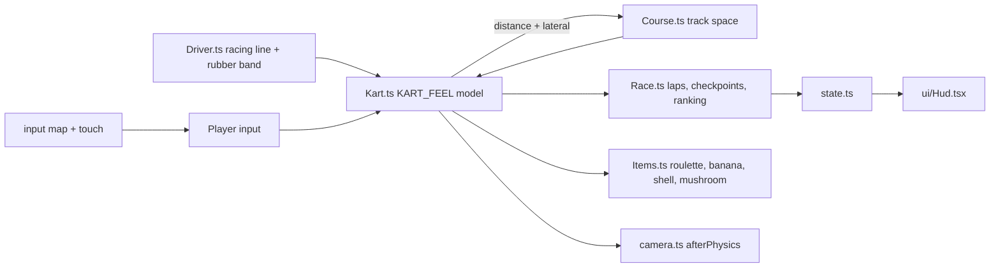

# PRD-734 — Clover Cup: a kart racer starter kit with MK64-style drifting, items and CPU drivers

**Status:** NOT STARTED
**Priority:** P2 — new genre kit: no shipped kit has a power-slide with a mini-turbo, item boxes, CPU drivers with rubber-banding or a kart chase camera (all three phases open).
**Complexity:** 5 (MEDIUM) — 11+ kit source files (+3), new kit system (+2). Risk override: none. The kit is game code in one template; the only `packages/` change is the engine-mcp kit router (one function, one test).
**Owner:** João
**Depends on:** [PRD-723](../Unreal/look/PRD-723-every-template-game-looks-like-unreal-on-the-engine-defaults.md) (aligned, not gating: the kit is born on the core Unreal defaults, so it pins no tone curve or fixed exposure). Sibling of [PRD-732](PRD-732-hop-garden-3d-platformer-starter-kit.md) and [PRD-733](PRD-733-lantern-vale-3d-action-adventure-starter-kit.md): the three kits ship in one PR (#563).

## Context

The owner asked for a third kit (2026-10-24, via the lead): "spawn another one to clone this
mechanic https://www.youtube.com/watch?v=r-G6jR5ZwL4 - https://github.com/n64decomp/mk64". The video
is a longplay of a Mario Kart 64 remake. It is the reference for feel, camera, course look and
effects. The [n64decomp/mk64](https://github.com/n64decomp/mk64) decompilation is the reference for
mechanics. Both were read on 2026-10-24 into scratch folders outside the repository; no frame, video
or decompiled code enters it.

**What exists.** `templates/racing` (Circuit racing) drives a `VehicleBody3D` on ray-cast
suspension: grip, weight transfer and understeer come from the physics backend. That is a sim car,
not an arcade kart: it has no hop, no power-slide, no mini-turbo, no items and one rival. A request
for "a game like Mario Kart" today routes to `collectathon`, because its `mario` alias matches the
first word.

**What the reference does.** MK64 runs kart logic at 60 Hz (`gTickSpeed` 2 at 30 fps,
`mk64: src/main.c:597`). It has no metre: its unit is a course unit. The kit keeps every ratio, time
and threshold in the table below and sets one absolute scale, a 150cc top speed of 24 m/s on a 1.7 m
kart (Decisions). "Tick" below is 1/60 s.

| Mechanic | Reference rule | Kit value (m, s) |
| --- | --- | --- |
| Top speed per class | throttle `topSpeed` 290 / 310 / 320 at 50 / 100 / 150cc (`mk64: src/data/kart_attributes.c:65-75`); force `F = throttle²/25` (`mk64: src/player_controller.c:2216`), terminal speed `F/696` | terminal speed ∝ throttle²: 20.5 / 22.5 / 24 m/s |
| Speed response | `v += (F − v·0.12·5800)/6000` per tick (`mk64: src/player_controller.c:2413`): a first-order lag of 8.6 ticks | speed follows its target with τ = 0.144 s |
| Acceleration curve | throttle gain per tick by tenth of top: 2.0, 2.0, 2.0, 1.6, 1.4, 1.2, 1.0, 0.8, 0.6, 0.4 (medium weight, `mk64: src/data/kart_attributes.c:248`) | same table ×60 per second; 0→top in 5.4 s |
| Coast and brake | throttle −1 per tick off the pedal (`mk64: src/player_controller.c:4688`), −1.2 to −5 braking (`:3563`) | −60/s coasting, −180/s braking |
| Steering | yaw per tick `∝ steer·|steer| / (8 + throttle/50)`, handling 1.25, +0.15 at ≥ 45/53 lock (`mk64: src/player_controller.c:4137-4173`, `src/data/kart_attributes.c:386`) | 94 °/s at full lock and top speed, faster when slow; fades to 0 below 3 m/s (kit guard) |
| Slip | the velocity heading follows the kart heading at 1/12 per tick, clamped to ±40° (`mk64: src/player_controller.c:1300`, `:1348`) | same |
| Hop | `hopVel` 0.93, jerk −0.03 per tick, a rise of about 8 ticks (`mk64: src/data/kart_attributes.c:401`, `src/player_controller.c:1192-1241`) | 0.35 m in 0.13 s |
| Power-slide entry | the hop sets the drift above 20 display km/h, 28% of top (`mk64: src/player_controller.c:4327`); cancelled by releasing the button, by speed or by a wall (`:3926`, `src/code_8003DC40.c:277`) | hop with the stick held left or right above 6.8 m/s locks that side |
| Drift turn | `mapped·(v2 + 3.0)·0.65` with the stick remapped to a narrow band (`mk64: src/player_controller.c:4197-4228`) | 36 °/s stick neutral, 90 °/s full inside, 15 °/s full outside |
| Mini-turbo charge | stick held against the drift ≥ 18 ticks, then released: stage +1, max 3; the counter keeps 10, so later stages need 8 ticks; ≥ 100 ticks stalls and resets (`mk64: src/player_controller.c:1145-1190`) | ≥ 0.30 s, then ≥ 0.133 s per stage; stalls at 1.67 s |
| Spark colour | stage 0 white, 1 yellow, ≥ 2 orange (`mk64: src/code_80057C60.c:2865`) | same |
| Mini-turbo | drift released at stage ≥ 2: 31 ticks, force → +580/4096 at 20% per tick, then bleeds 1% per tick (`mk64: src/player_controller.c:1123-1140`, `:3094`) | +14% speed for 0.52 s |
| Mushroom and boost pad | throttle pinned to top, boost → +400/4096 for 80 ticks, then −10% per tick (`mk64: src/effects.c:547`, `src/player_controller.c:1120`, `:3117`); the ramp pad applies the same (`mk64: src/effects.c:1184`) | +9.8% for 1.33 s |
| Off-road | grass drag 0.30 (medium weight), eased in at 5% per tick (`mk64: src/data/kart_attributes.c:169`, `src/player_controller.c:2990`) | top speed ×0.70 on grass |
| Drift and turn drag | slip° × 0.004 drifting, × 0.01 turning (`mk64: src/player_controller.c:2990-3106`) | same |
| Wall | velocity into the wall removed and reflected ×0.5, throttle −18 per contact tick, drift and mushroom cancelled (`mk64: src/player_controller.c:1079`, `:1952-1976`, `src/code_8003DC40.c:277`) | same |
| Green shell | launch `max(8, 1.2·kart)` units per tick, reflects off walls (`mk64: src/actors/green_shell/update.inc.c:100`, `src/racing/collision.c:550`) | 32.6 m/s (1.36 × top); 10 s life (kit guard) |
| Banana | dropped behind, thrown forward at `0.75·v + 3.5` (`mk64: src/actors/banana/update.inc.c:60`) | dropped 1.8 m behind |
| Hits | banana: spin 360° at 12°/tick then 360° at 6°/tick, 90 ticks (`mk64: src/effects.c:375-394`); shell: tumble 103 ticks, speed to 0 (`mk64: src/effects.c:197-224`) | banana 1.5 s spin, shell 1.7 s tumble |
| Item roulette | a 100-entry curve per rank: `curve[rank·100 + rand%100]` (`mk64: src/update_objects.c:3665`); the curves are ROM data | the rule; the kit authors its own curve (Decisions) |
| CPU drivers | target 6 to 20 path points ahead with a lane offset (`mk64: src/cpu_vehicles_camera_path/path_utils.inc.c:346`, `:597`); behind the best human → +380/4096 force; too far ahead → coast (`mk64: src/cpu_vehicles_camera_path.c:955`, `src/player_controller.c:3085`) | same kart model, same rule; +9.3% catch-up |
| Laps and position | progress `lap + point/count`, sorted every tick; the nearest point moves only in a −3..+6 window, so a cut across the infield does not count (`mk64: src/cpu_vehicles_camera_path.c:1126`, `:1250-1263`, `path_utils.inc.c:300`) | same; 3 laps; 4 ordered checkpoints guard the lap |
| Wrong way | heading 136°–225° off the path for 5 ticks (`mk64: src/cpu_vehicles_camera_path.c:673`) | same, shown as a toast |
| Rocket start | a fresh throttle press within 8 ticks of the last light (`mk64: src/update_objects.c:3055`, `src/player_controller.c:3669`) | 0.133 s window, gives the mushroom boost |
| Camera | offset (0, 9.5, −50), look-at +70; xz lerp 0.4 per tick, y 0.15; yaw chase 0.9°/tick turning, 2.7°/tick straight; ±12° offset while drifting (`mk64: src/camera.c:114-118`, `:381-400`, `:700-759`) | 10 m behind, 2 m up, look 15 m ahead; same gains |

### Capability lookups actually run (2026-10-24, `threenative-engine` MCP)

| Query (scope) | Result |
| --- | --- |
| the whole kart racer: drift and mini-turbo, hop, boost pads, item boxes, 7 CPUs with rubber-banding, laps, countdown, chase camera, procedural course with a jump and a bridge (`request`) | `VehicleBody3D`, `PathFollow3D`, `rapier`, `TerrainTiles`, `Area3D`, `PhysicsDirectSpaceState3D`, `afterPhysics`, `CharacterBody3D` |
| power slide drift with mini-turbo spark charge (`mechanic`) | **none** |
| lap counting, checkpoints and race position ranking (`mechanic`) | **none** |
| random item box roulette weighted by position, banana and shell projectiles (`mechanic`) | `Area3D` only |
| AI opponents follow a racing line with rubber-banding (`mechanic`) | `PathFollow3D` ("sample a racing line from a curve"), `Area3D` |
| sky atmosphere, GI, reflections, virtual shadows, fog per tier (`request`) | `WorldEnvironment` presets (GI per tier), `VirtualShadowNode`, `ssr`, `Daylight`, `SkyCapture`, `GIBudget` |

`VehicleBody3D` constraint: "write engineForce, brake and steering every physics update". It is a
suspension simulation; MK64's kart is a force-and-lag model, so the kit does not use it (Decisions).
`PathFollow3D` owns the speed along its curve, so a CPU on it could not be hit, slowed or boosted;
CPUs drive the same `Kart` model as the player. `afterPhysics` places the chase camera.
`VirtualShadowNode` gives the sun one cached shadow for the whole course.

## Solution

A new kit `kart`, titled **Clover Cup**: an original kart racer on one course, Clover Loop, against
seven CPU drivers. The kit is game code only.

- **Kart.** `src/entities/Kart.ts` is one model shared by the player and the CPUs. A `KART_FEEL`
  table holds every value of the table above. Input is four numbers per tick: throttle, brake,
  steer and the hop/drift button, plus an item press. The player's come from the input map and the
  touch controls; a CPU's come from `src/entities/Driver.ts`.
- **Track space.** `src/track/Course.ts` builds Clover Loop from a closed centre line: a figure-8
  with a bridge over an underpass, a ramp jump over a creek, a hairpin at each lobe and a chicane.
  Every kart keeps its distance along the line inside MK64's local window, so the bridge and the
  underpass never confuse and a shortcut never counts. The road, kerb, grass and wall come from the
  lateral offset at that distance, as MK64's path points and surface types do. No physics collider
  is needed, so every target runs the same numbers.
- **Race.** `src/track/Race.ts` owns the countdown, the rocket start, the 4 ordered checkpoints, the
  laps, the ranking and the finish order. `src/entities/Items.ts` owns item boxes, the roulette, the
  banana, the green shell and the mushroom.
- **Camera.** `src/render/camera.ts`, written in `afterPhysics`, with the reference gains.
- **Look.** All procedural: no mesh, texture, image or audio file. The look comes from
  `@threenative/core`: `WorldEnvironment(qualityPreset(tier))` gives the filmic curve, the metered
  auto exposure and the GI method per tier (screen probe gather on `high`, the irradiance field on
  `medium`, none on `low`). The scene adds a `VirtualShadowNode` sun (no shadow on `low`, as core's
  shadow tier says), a gradient sky with clouds, and exponential fog. Effects are pooled
  `GPUParticles3D` emitters: drift sparks by stage colour, a boost flame, dust, skid dust, item-box
  pops and hit stars.

**Registration:** `kit.json` (genre `kart-racer`, aliases `mario-kart`, `mariokart`, `mk64`,
`kart`), the scaffold hash and `cli.spec.ts` alias rows, the capability manifest, the engine-mcp
router (a longer kit phrase beats a shorter one inside it: "mario kart" is not "mario"), the README
kit row, the conventions row, the capability-recall rows and the template `AGENTS.md`.

**Risks.** (1) A figure-8 crossing: the bridge and the underpass share x and z, so the karts must
never search the whole line for their distance. (2) Seven CPUs with items can pile up: every hit is
time-bounded and a CPU off the line rejoins it by steering, never by teleport. (3) Scenario timing:
a full 3-lap race is about 80 s of game time.

## Acceptance criteria

The boxes in each phase are the acceptance criteria, all `local`. There are 10, two over the R5
guide of about 8: the kart needs four boxes (one per mechanic family) and Phase 3 carries the three
gates every kit must pass. Each playtest runs on a project scaffolded from `--template kart`:
`node packages/playtest/dist/runner/cli.js <project>/playtests/<name>.playtest.json --url http://127.0.0.1:5275 --server-command "<project dev command>" --browser-recipe webgpu`.

## Blocked on

- The owner's taste call on the kit's look and feel (does it read as a polished kart racer?) — unblocked by João after the judge pass in Phase 3.

## Integration Ledger

| Capability | Reachable consumer/trigger | Replaces / disposition | Evidence |
| --- | --- | --- | --- |
| `kart` kit | `npm create threenative -- --template kart` or `--genre mario-kart` → kit discovery through `kit.json` | new kit, nothing replaced | AC-1, AC-8 |
| kit router phrase rule | `engine_search_capabilities("a game like mario kart")` → `packages/engine-mcp/src/index.ts` `matchedStarterKits` | a shorter kit word inside a longer kit phrase no longer matches | AC-8 |

## Decisions

- 2026-10-24 (agent, on the owner's request): borrow mechanics, numbers and algorithms only. The
  drivers, karts, course, names, art and HUD are original; no Nintendo name, character, music,
  course layout or code. Decompiled code is read for its rules, never copied.
- 2026-10-24 (agent): one absolute scale. MK64 has no metre, so the kit keeps its ratios, times and
  thresholds and sets the 150cc top speed to 24 m/s on a 1.7 m kart (about 14 kart lengths a
  second), picked against the video's pace. Every other speed is a ratio of it.
- 2026-10-24 (agent): no `VehicleBody3D`. Its suspension decides grip and weight transfer, while
  MK64 decides speed with a throttle, a force and a lag. Track space gives that model with no
  collider and the same numbers on every target.
- 2026-10-24 (agent): CPUs do not use `PathFollow3D`, which owns the speed along its curve. They
  drive the player's `Kart` with a driver's input, as MK64's CPUs drive the player's physics.
- 2026-10-24 (agent): the item curve is the kit's. MK64's curves are ROM data, not in the
  decompiled source. Rank 1 to 2 draw mostly bananas and shells, the back half mostly mushrooms.
- 2026-10-24 (agent): one mini-turbo level for stages 2 and 3, as MK64. Stage 3 changes only the
  spark colour (it stays orange, as MK64).
- 2026-10-24 (agent): deferred until a user asks — red shells, the star, lightning, the blue shell,
  battle mode, split screen, a cup of several courses, audio (no asset files and no synthesis
  capability). Revisit when the owner asks or an engine capability makes audio portable.
- 2026-10-24 (agent): the countdown lights last 1 s each. MK64's grand-prix pre-roll of 240 object
  ticks (`mk64: src/code_8006E9C0.c:443`) is 8 s, too long for a starter kit and its playtests.

## Execution Phases

#### Phase 1: The kart drives like the reference

**Status:** NOT STARTED
**Files:** `templates/kart/` cloned from `collectathon`'s shell; new `src/entities/Kart.ts`,
`src/track/Course.ts`, `src/render/kart.ts`, `src/render/camera.ts`, `kit.json`,
`playtests/{survives,drift,surfaces,wall}.playtest.json`.
**Implementation:** `KART_FEEL` and the model, track space, the course, the chase camera, the kart
and driver models.
**Verification:** the four playtests below on WebGPU, `adapter.info` checked.

- [ ] AC-1: the scaffolded kit boots on the core Unreal defaults (`TN_WORLD_ENVIRONMENT` filmic, `TN_AUTO_EXPOSURE` measured and applied, `rg 'tonemapMode|autoExposureEnabled|exposure:' src/` finds no pin), the kart sits on the road and drives for 600 frames with no console error, and `assets/` holds no file. proof: `playtests/survives.playtest.json`
- [ ] AC-2: a hop with the stick held locks a drift to that side; two outside-and-back wiggles reach stage 2 (spark colour white → yellow → orange); the release fires a mini-turbo that lifts speed above the pre-drift top speed for 0.52 s; a drift released at stage 1 fires none. proof: `playtests/drift.playtest.json`
- [ ] AC-3: full throttle on grass settles at ×0.70 ± 0.03 of the road top speed, and a boost pad pins the throttle and lifts speed by +9.8% ± 1.5% for 1.33 s. proof: `playtests/surfaces.playtest.json`
- [ ] AC-4: driving into the wall removes the speed into it, the kart stays inside the wall line, and its throttle drops; the ramp sends the kart airborne for at least 0.4 s and it lands on the road. proof: `playtests/wall.playtest.json`

#### Phase 2: The course is a race

**Status:** NOT STARTED
**Files:** `src/entities/{Driver,Items}.ts`, `src/track/Race.ts`, `src/state.ts`, `src/ui/Hud.tsx`,
`src/render/effects.ts`, `playtests/{items,race,laps}.playtest.json`.
**Implementation:** CPUs and rubber-banding, items and the roulette, countdown, rocket start,
checkpoints, laps, ranking, finish screen, the effects.
**Verification:** the three playtests below, plus a rerun of Phase 1's four.

- [ ] AC-5: an item box gives an item drawn from the rank's curve; a dropped banana spins the kart behind for 1.5 s, a green shell hits a CPU ahead and tumbles it for 1.7 s, and a mushroom boosts the user for 1.33 s. proof: `playtests/items.playtest.json`
- [ ] AC-6: after a 3-2-1 countdown the 7 CPUs finish 3 laps with no CPU stuck, the finish order matches the progress ranking, and the HUD state shows the player's position and lap and the finish screen. proof: `playtests/race.playtest.json`
- [ ] AC-7: a lap counts only after the 4 checkpoints in order; driving backwards over the line does not add a lap, and a cut across the infield does not count. proof: `playtests/laps.playtest.json`

#### Phase 3: Registered, measured and judged

**Status:** NOT STARTED
**Files:** the registration list above, `playtests/performance.playtest.json`.
**Implementation:** register the kit in every gate; measure per tier; capture stills and a race
film; a fresh read-only judge with the reference frames.
**Verification:** the commands on each box.

- [ ] AC-8: the kit passes the registration gates. proof: `pnpm exec vitest run packages/create-threenative/__tests__ packages/engine-mcp/__tests__ && pnpm budgets && pnpm check:docs`
- [ ] AC-9: the `performance` scenario stays inside its budget on `high` (RTX 2080) and on `medium` (the Debian laptop's integrated GPU). proof: `playtests/performance.playtest.json`
- [ ] AC-10: the visual judge returns PASS on kart feel, drift sparks, course depth and relief, lighting and no regressions. proof: the judge report linked from the PR
