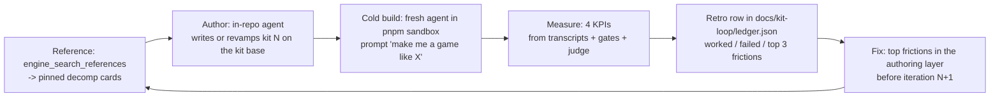

# PRD-750 — Kit authoring loop: build a genre kit, cold-build a game from it, learn, repeat

**Status:** PARTIAL — Phase 1 done
**Priority:** P1 — "make me a game like X" is the primary workflow before the release; the measure step exists, but no iteration has run (Phases 2-3 open)
**Complexity:** 3 (LOW) — 1–5 files +1, new module (the loop script) +2; risk override: none
**Owner:** João Paulo Furtado
**Depends on:** PRD-735 (reverse-engineer references at scale), PRD-749 (one kit base and a kit contract), PRD-751 (one dashboard)
**PR:** one epic PR for the loop and every kit it builds (owner, 2026-10-26), merged at the release

## Context

The owner wants the release to invest in the authoring layer: a user asks "make me a game like X",
an agent starts from the matching starter kit, and the first build is good on few tokens
(root `AGENTS.md`: "A request that names a game or genre a kit covers starts from that kit").

Today:

- 16 kits ship in `packages/create-threenative/templates/`. Only three (collectathon, adventure, kart;
  PRD-732/733/734) were built to the current bar, with `kit.json` `aliases` and pinned reference
  citations.
- The reverse-engineer tools (`engine_search_references`, `engine_reference_detail`,
  `engine_save_reference` in `packages/engine-mcp/src/references.ts`) shipped in #563, but the data
  release holds one Tier-1 game (SM64). PRD-735 fills it.
- Nothing measures what a cold user agent pays to build from a kit, or what friction it hits. Each
  kit lane learned alone, and the next lane did not read it.
- Harnesses exist and are reused here, not rebuilt: `pnpm sandbox` (user-like install),
  `pnpm sweep:measure` (`scripts/measure-sandbox.ts`), the `build-on-sandbox` and
  `score-build-experience` skills, the playtest runner and the visual judge rule.

## Solution

One **iteration** builds one row of the genre list below:

- **Author step.** An in-repo agent takes the genre row, reads the reference cards through the MCP,
  and writes (or revamps) the kit on the PRD-749 kit base with its own short PRD in
  `docs/PRDs/starter-kits/`. Mechanics borrow constants with `file:line` citations; art, names and
  layouts stay original.
- **Cold build.** A fresh agent in a `pnpm sandbox` folder gets only the user prompt
  ("make me a game like <reference game>"). It must find the kit by alias, build, and pass the kit's
  gates. It gets no repo `AGENTS.md` chain.
- **Measure.** `scripts/kit-loop.mjs` (the only new module) reads the cold-build transcript and the
  gate outputs and appends one ledger row. It measures; it does not drive agents.
- **Retro.** The coordinator reads both transcripts (author and cold), writes three lists into the
  ledger row (worked, failed, top 3 frictions with the transcript line), and the next iteration fixes
  the top frictions first. **Fix scope** (owner, 2026-10-26): the whole authoring layer — MCP tools,
  `capabilities.json`, template `AGENTS.md`, skills, scaffolder, and small shared helpers that several
  kits need. New engine systems are out of scope.
- **Dashboard.** The ledger is a tab of the single `pnpm dashboard` (PRD-751).

### KPIs (owner, 2026-10-26)

Each one is a field of every ledger row. Iteration 1 sets the baseline; targets are relative to it.

| KPI | Definition | Source | Target by the last iteration |
| --- | --- | --- | --- |
| K1 cold-build cost | tokens (input + output + cache writes), wall minutes and turns, from the prompt to the first build whose gates pass | cold transcript (`claude -p --output-format json` usage) | -40% tokens vs baseline |
| K2 first-build quality | share of kit playtest scenarios green on the first cold build with no human edit; the performance gate's cost p95 within budget; visual judge verdict against the reference image | playtest exit codes, `performance.maxFrameMsP95` cost p95, judge | 100% scenarios, budget met, judge CLOSE or better |
| K3 friction count | capability-search misses + hand-written duplicates of an installed system + wrong-API errors + retries of the same failing command | `score-build-experience` rows and the cold transcript | -50% vs baseline |
| K4 AI play grade | a fresh Opus judge plays the cold build (free play with real input, then the scenario captures) and grades feel and mechanics 1–5 against the reference cards | judge report | 4 or higher |

**Stop rule** (owner, 2026-10-26): the loop runs without the owner and stops when the genre list is
done, or when two iterations in a row improve none of K1–K4 by 5% or more. After each kit, the
owner gets one ping with the dashboard tab and the ledger row.

### Genre list (ranked; owner reviews it in the PR)

Ranked by user demand, then by reference availability. "Revamp" rebuilds an existing kit on the kit
base to the PRD-732/733/734 bar; "new" adds a kit. PRD-746 already owns the shooter revamp, so it is
not a row here. The reference for each row is a candidate until PRD-735 lands its cards.

| # | Genre (aliases) | Kind | Candidate reference |
| --- | --- | --- | --- |
| 1 | 3D platformer — calibration row (mario, sm64) | revamp collectathon | `sm64` (Tier 1 today) |
| 2 | Boomer shooter / arena FPS (doom, quake) | new | id Software GPL sources |
| 3 | Open-world third-person action (gta) | new | `re3` |
| 4 | RTS (command and conquer, red alert) | revamp rts | OpenRA |
| 5 | Metroidvania (metroid, castlevania) | new | Super Metroid disassembly |
| 6 | Arena fighter (smash) | new | SSB64 decomp |
| 7 | Voxel survival / crafting (minecraft) | new | Luanti (Minetest) |
| 8 | Arcade racer (need for speed, ridge racer) | revamp racing | to be scouted (PRD-735 Phase 3) |
| 9 | Tower defense (bloons, kingdom rush) | revamp tower-defense | to be scouted |
| 10 | Endless runner (subway surfers, temple run) | revamp runner | to be scouted |

Row 1 runs first on purpose: its reference already exists, so it calibrates the loop and sets the
KPI baseline while PRD-735 scouts the next references.

## Blocked on

- Rows 4..N (the author step) need the PRD-749 kit base on `pr563-followup` (PRD-749 Phase 3, the #574 lane).

## Acceptance Criteria

See the phase boxes. Each box names its proof.

## Integration Ledger

| Capability | Reachable consumer/trigger | Replaces / disposition | Evidence |
| --- | --- | --- | --- |
| Kit-loop ledger row | `pnpm kit:loop record <cold-build dir>` → `scripts/kit-loop.mjs` → `docs/kit-loop/ledger.json` | new | AC-1 |
| Kit KPI tab | `pnpm dashboard` → kit-loop tab reads the ledger | new tab in the PRD-751 hub | AC-2 |
| Kit found by genre words | cold agent → `engine_search_capabilities` / `--genre <alias>` → kit | unchanged path, measured | AC-4 |

## Decisions

- 2026-10-26 (owner): an iteration is an in-repo author step plus a cold sandbox build; both transcripts are inspected.
- 2026-10-26 (owner): fix scope is the whole authoring layer; new engine systems stay out.
- 2026-10-26 (owner delegated: "do whatever you want"): K2's frame budget is the performance gate's own cost p95 (`performance.maxFrameMsP95` `cost.p95`), not `TN_FRAME_BUDGET` presented p95. On the runner's private Xvfb, presented p95 is display cadence (17.5 ms with a game that costs 10.03 ms), and the gate itself reports it as not gated. Rows keep presented p95 for information; rows 1–3 were recomputed from their saved inputs (row 1 stays over at 17.27 ms).
- 2026-10-26 (owner): KPIs are K1–K4 above; the play grade comes from an AI judge, not the owner.
- 2026-10-26 (owner): a ranked mix of revamps and new kits; PRD-735 (references at scale) lands before the loop runs past row 1.
- 2026-10-26 (owner): one epic PR for the loop and every kit; it merges at the release.
- 2026-10-26 (owner): target-plus-plateau stop rule, autonomous, one ping per kit.
- 2026-10-26 (agent): the retro lives in the ledger row, not in a file per iteration, so the dashboard shows it and nothing drifts.

## Execution Phases

#### Phase 1: The ledger and the measure step

**Status:** DONE
**Files:** `scripts/kit-loop.mjs` (new), `scripts/__tests__/kit-loop.spec.ts` (new), `docs/kit-loop/ledger.json` (new), `package.json` (`kit:loop`).

- [x] AC-1 [local]: `pnpm kit:loop record <dir>` turns a cold-build transcript and its gate outputs into one ledger row with K1–K4, and a missing input fails closed (no zero, no pass). proof: `pnpm exec vitest run scripts/__tests__/kit-loop.spec.ts` — red (module missing), then 4/4 green; `pnpm kit:loop record /nonexistent ...` exits 1 with `transcript.json is missing`; the dir contract (five files) is in the script header (2026-10-26)
- [x] AC-2 [local]: the PRD-751 dashboard shows the kit-loop tab with each KPI against its baseline and target. proof: `pnpm exec vitest run scripts/__tests__/perf-live.spec.ts -t kit-loop` — green, see PRD-751 AC-4 (2026-10-26)

#### Phase 2: Iteration 1 — calibration on row 1 (3D platformer)

**Status:** PARTIAL — AC-4 done (ledger rows 1–3); AC-3 waits for the PRD-749 kit base
**Files:** the row-1 kit PRD, the collectathon kit, the ledger row.

- [ ] AC-3 [local]: the author step revamps the collectathon kit on the kit base, with SM64 card citations, and its own kit PRD is green. proof: the kit PRD's gates
  - Open (2026-10-26): the kit base is not on `pr563-followup`; only PRD-749 Phase 1 (the kit contract, `9d1a848a0`) landed. On collectathon the contract reads `explore-clean` ok, `camera-sees-subject` FAIL (`TN_PLAYTEST_SIGHT_LINE_BLOCKED`), `hud-clean` FAIL (`TN_PLAYTEST_HUD_CONTRAST`), `no-hitch` ok, `foot-slip` ok, three rows opted out. Both reds belong to PRD-749's per-kit red list (its rule: fix in the base, an engine node or a contract row), so this step waits for PRD-749 Phases 2–3.
- [x] AC-4 [local]: a cold sandbox agent prompted "make me a game like Super Mario 64" picks the collectathon kit and reaches a gate-green build; the ledger holds the baseline row with K1–K4 and the retro lists. proof: `pnpm kit:loop record <sandbox dir>`, ledger row 1
  - Done (2026-10-26): ledger row 1 holds the baseline with K1–K4 and the retro lists (K1 97,840 tokens, K2 21/22 + CLOSE, K3 7, K4 4; its performance gate was red on a loaded host). Rows 2 and 3 are cold builds with the same prompt and isolation that picked the collectathon kit on their first call and reached gate-green builds, rerun by the recorder: 22/22 scenarios each, performance gate cost p95 10.03 ms (row 2) and 12.59 ms (row 3) against 16.7 ms. The predeclared quiet-host rerun of row 1 is withdrawn: the host never got quiet in 2 h, and rows 2–3 settle the gate-green claim on the same kit at the high tier.

#### Phase 3: Iterations 2..N to the stop rule

**Status:** IN PROGRESS — rows 1 and 2 recorded; row 2's retro fixes (bac933cdc, 59d741907) landed for row 3
**Files:** one kit PRD per row, the authoring-layer fixes each retro names, the ledger.

- [ ] AC-5 [local]: each later iteration lands its top retro fixes before its author step, and its ledger row names them. proof: ledger rows 2..N, the fix commits
  - Open (2026-10-26): row 2 is recorded and names row 1's fixes (a4d5345ef: a failed cost bound names the foreign GPU processes and says rerun; 42cbf971c + c5bc052e7: start the agent in the project, or call `engine.mjs <tool> '<json>'`). Row 2 against row 1: K1 44,483 vs 97,840 tokens (−55%), 15 vs 37 turns, 7 vs 19 min; K2 22/22 vs 21/22, judge CLOSE both (fresh Opus judge: NEUTRAL row 2 vs row 1); K3 2 vs 7; K4 4 both (Hero.ts unchanged). The row 2 agent changed no code and did not chase performance; the gate rerun by the recorder passed at cost p95 10.03 ms. Row 2's retro fixes landed for row 3: `--scenario` takes a brace list (bac933cdc, red-green `bridgeClient.spec.ts`) and the scaffold line says CLAUDE.md copies AGENTS.md (59d741907, red-green `scaffold.spec.ts`). Row 3 names row 2's fixes and confirms them (AGENTS.md read without its CLAUDE.md copy, one glob run for 22 playtests): K1 47,107 (+6% vs row 2, AGENTS.md read twice because its 22 KB overflowed one tool result with other output), K2 22/22 + CLOSE (NEUTRAL vs row 2), K3 0, K4 4. The remaining frictions are kit-layer (the kit `AGENTS.md` size, no win state at three Sunseeds, the wall-kick camera that hides the hero, the K4 movement gaps), so rows 4..N wait for the PRD-749 kit base and the author step. The box stays open while rows 4..N run.
  - K2 budget: decided 2026-10-26 (see Decisions); rows 2 and 3 meet it at cost p95 10.03 and 12.59 ms, row 1 is over at 17.27 ms.
- [ ] AC-6 [local]: the loop stops by the rule: the list is done, or two rows in a row gain under 5% on all of K1–K4. proof: the ledger, the stop line in this PRD
- [ ] AC-7 [local]: K1–K4 meet their targets at the last row, or the gap per KPI is recorded with its cause. proof: dashboard kit-loop tab, the last ledger row
