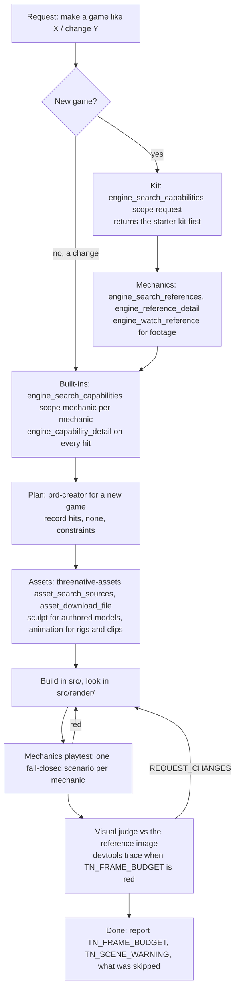
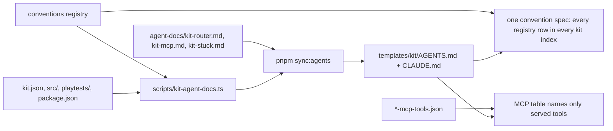

# PRD-825 — The kit AGENTS.md is a short router to the engine, its MCP servers and its conventions

**Status:** NOT STARTED
**Priority:** P1 — the kit `AGENTS.md` is the first file a cold agent reads for every "make me a game like X" request, and today it names none of the tools that request needs
**Complexity:** 4 (MEDIUM) — 16 kit docs, 3 shared fragments, 1 generator, 1 registry, about 18 specs; risk override: none
**Owner:** João Paulo Furtado
**Depends on:** PRD-750 (the `pnpm kit:loop` measure step and ledger), PRD-734 (the single planning gate this PRD revises)
**Siblings:** PRD-826 (junk that ships to users), PRD-827 (MCP integration: discovery gate hook, watcher tool, MCP load)
**PR:** one draft PR for this PRD, opened at the first commit

## Context

Owner, 2026-11-05: "CLAUDE.md from starter kits are confusing as fuck, bloated, and maybe not
guiding the agent through full engine potential". Then: "it doesnt mention engine_capabilities,
which is critical when creating a game", "it doesnt tell about the available mcps like threenative
asset mcp, threenative reverse engineer mcp", "i see the agent having to call it from inside
node_modules. and it only does it after I explicitly ask for it", and the flow they expect: "i
generally ask it to do a xyz game => should check on threenative reverse engineer mcp for
mechanics, then on threenative asset mcp for proper assets, etc". The reverse-engineer data also
has a gameplay-video watcher.

Measured on `dab02b929` (read-only scouts, DeepSeek flash on leanpi, plus the Starlance
transcripts of 2026-11-05):

| Finding | Evidence |
| --- | --- |
| 16 kit files, 2,257–3,631 words each, 40,959 words in total. About 66% is near-identical text in 8 or more kits. | `wc -w packages/create-threenative/templates/*/AGENTS.md` |
| `## Portable authoring contracts` is one paragraph per kit that glues about 10 unrelated conventions. It is 35% of the corpus. Single lines run to 365 words. | `starter/AGENTS.md:57`, `platformer/AGENTS.md:48` |
| `engine_search_capabilities`, `engine_capability_detail`, `engine_search_references`: 0 of 16 files. Servers `threenative-engine`, `-sculpt`, `-animation`: 0 of 16. | `rg -c` over the 16 files |
| A spec **forbids** the capability tool names in kit files. PRD-734 put the loop only in the skill, to stop drift between 13 hand copies. | `template.spec.ts:831-833`, `docs/PRDs/done/PRD-734-*.md:67` |
| A spec **requires** the `node node_modules/@threenative/core/mcp/call.mjs` bridge line. Nothing tells an in-folder session that its `mcp__threenative-*` tools are deferred and load with ToolSearch. | `template.spec.ts:868-878`; Starlance sessions `c58b357d`, `dfe8f9ce`, `5b86bab5` had the tools deferred and still used `call.mjs` 7 times |
| The existing-game route ("steps 5-7 only") skips capability and reference search. Every Starlance change after the first build ("loading screen", "quicker if I die", "asset streaming") went down that route. The agent searched only when the owner asked: "check engine_capabilities for asset streaming". | `agent-files/.agents/skills/threenative-capabilities/SKILL.md` "Existing game"; Starlance `dfe8f9ce` |
| The 8-step route exists in 4 copies: the engine server `instructions`, the `threenative-capabilities` skill, the ponytail hook text re-injected on every prompt, and each kit file. | `packages/core/mcp/engine-server.mjs:560`, `ponytail-context.mjs:16`, `SKILL.md`, `templates/*/AGENTS.md:10-12` |
| The shared-fragment mechanism exists and 0 kits use it. | `scripts/sync-agent-docs.ts:39,66,94`; `agent-docs/` holds only `references/` |
| About 60 phrase regexes in about 18 specs pin prose in all 16 kits. Each new convention adds one by hand. | anatomy scout table; for example `render-camera-cull-docs.spec.ts`, `matrix-world-docs.spec.ts`, `template.spec.ts:213-234` |
| The word caps are slack: 3,574 default, up to 4,691. Every kit sits 472–2,053 words under its cap. | `scripts/instruction-budget.ts:115-146` |
| A kit file names 26–38 of 488 manifest symbols (5–8%). | caps scout |
| The gameplay watcher ships as `releases/latest/download/watch.mjs` of `threenative-reverse-engineer-mcp`. No MCP tool wraps it and no kit names it. | `threenative-reverse-engineer-mcp/README.md:91-117` |
| Starlance (8 sessions, 1,279 tool calls): first `engine_search_capabilities` at hour 8, after the owner asked "are we making good use of threenative engine as we should?". 0 reads of the 12 kit skills. `threenative-sculpt` 0 calls against 196 Blender calls. `asset_download_file` 0 calls against 17 `curl` downloads. `pnpm test` 0 runs, `npx threenative doctor` 0 runs. | `~/.cache/tmp-tn/kit-agents-md/out/flow.md` §3 (scout digest of the session transcripts) |
| Starlance hand-wrote what the engine ships: a DOM loading cover (`createLoadingScreen`, `ctx.startup.hold`), 5 `new InstancedMesh` (`InstancedBatch`), 4 capture scripts (`threenative-playtest --browser-recipe webgpu --headed`). | same, §3 table |
| One bridge sentence once moved a cold build from 0 to 4 MCP calls. Trimming 22 KB to 20 KB alone gave −3.1% tokens. | `PRD-750` Decisions 2026-10-27; `docs/kit-loop/ledger.json` rows 3–4 |

Root causes, in order:

1. The file routes to a skill name, and a cold agent does not resolve a skill name into a tool call.
2. The existing-game route turns discovery off for every change after the first build.
3. The one MCP sentence teaches the `node_modules` fallback, not the loaded tools.
4. There is no single source: 16 hand copies plus 3 other route copies, held in shape by phrase regexes.
5. The rule "a convention missing from the templates' AGENTS.md does not exist" makes each new
   convention a paragraph in 16 files.

## Solution

Each kit `AGENTS.md` becomes a router of at most 120 lines and 1,200 words (today: 58–96 lines of 2,257–3,631 words), generated from one shared
source plus the kit's own `kit.json` and file tree. The router gives the flow as tool calls, a table
of the five MCP servers, the kit map, the commands, a one-line-per-convention index and the stuck
path. Detail stays in the skills and the reference pages. A shipped hook blocks the first new file
under `src/` until the session has searched the engine.

### The flow the router teaches



A change to an existing game also searches: capabilities for the change, and references when the
change is a gameplay mechanic. It skips only kit choice and whole-game planning.

### Router shape (generated, one per kit)

| Section | Source | Size |
| --- | --- | --- |
| Title and identity (kit title, blurb, genre words) | `kit.json` | 2 lines |
| `## Authoring flow` | shared fragment `agent-docs/kit-router.md` | about 20 lines |
| `## MCP servers` (server, when to call, top tools, how to load) | shared fragment `agent-docs/kit-mcp.md`, tool names checked against `*-mcp-tools.json` | about 10 lines |
| `## This kit` (files, mechanics, scenarios) | generated from `src/`, `playtests/`, plus a hand block of at most 6 lines per kit | about 12 lines |
| `## Commands` | generated from the kit `package.json` scripts | about 6 lines |
| `## Conventions` (name, default, named override, marker, page) | generated from one convention registry | one row per convention the kit applies, about 20 lines |
| `## When the framework blocks you, write plain Three.js` and `## Stuck` | shared fragment `agent-docs/kit-stuck.md` | about 8 lines |

### Generation and guards



`pnpm sync:agents --check` already fails on drift. One registry spec replaces the per-convention
phrase specs. The repo rule changes from "missing from the templates' AGENTS.md" to "missing from
the templates' convention index".

## Blocked on

Nothing. The cold-build A/B (AC-8) needs PRD-827 landed and a host quiet enough for the performance gate; PRD-750
records how to report a loaded-host gap.

## Acceptance Criteria

See the phase boxes. Each box names its proof. The PRD is done when AC-8 and AC-9 pass.

## Integration Ledger

| Capability | Reachable consumer/trigger | Replaces / disposition | Evidence |
| --- | --- | --- | --- |
| Kit router | `npx create-threenative --template <kit>` → the game's `AGENTS.md` and `CLAUDE.md` | replaces 16 hand-written files | AC-4, AC-5 |
| Convention index | the router `## Conventions` table, from the registry | replaces about 60 phrase regexes | AC-2, AC-3 |
| MCP load line | router `## MCP servers` + skill "Tools" paragraph | the `call.mjs` line becomes the fallback only | AC-6, AC-7 |

## Decisions

- 2026-11-05 (owner, interview Q1): the kit file is a router plus a one-line convention index. Full convention text moves to reference pages. The repo rule changes to "missing from the convention index".
- 2026-11-05 (owner, Q2): the files are generated from shared fragments plus `kit.json` and the kit tree, through the existing `sync-agent-docs` regions.
- 2026-11-05 (owner, Q3): proof is a paired cold-agent A/B with `pnpm kit:loop` on two kits, two runs per arm.
- 2026-11-05 (owner, Q4): text plus a hook gate. The hook blocks the first new `src/` file until the session searched the engine, and names the missing call. An env opt-out exists.
- 2026-11-05 (agent): the existing-game route gains discovery. Reason: the owner's Starlance asks were all changes, and the route skipped search for each of them.
- 2026-11-05 (agent): this PRD reverses PRD-734's ban on tool names in kit files (`template.spec.ts:831`). PRD-734's reason was drift between hand copies. One shared fragment removes that drift. PRD-734 stays in `done/`. This PRD cites it.
- 2026-11-05 (agent): an in-folder session loads `mcp__threenative-*` tools with `ToolSearch select:<names>`. `call.mjs` is the fallback for a session started outside the game folder only.
- 2026-11-05 (agent): a session with no user (`claude -p`, a scripted build) records the plan and its assumptions and continues, instead of waiting for approval (`docs/kit-loop/ledger.json:102`). An interactive session still waits for plan approval.
- 2026-11-05 (agent): the A/B kits are `collectathon` (the kit-loop baseline, prompt "make me a game like Super Mario 64") and `shooter`.

## Execution Phases

#### Phase 1: Baseline, convention registry and its index

**Status:** OPEN
**Files:** `docs/kit-loop/ledger.json` (rows), `scripts/kit-loop.mjs`, `packages/create-threenative/conventions.json` (new, or rows in `capabilities.json` `overrides[]` where the manifest already holds them; decide in the phase), `scripts/kit-agent-docs.ts` (new), `scripts/__tests__/kit-conventions.spec.ts` (new), `scripts/check-template-conventions.ts`, the per-convention phrase specs it replaces.

- [ ] AC-1 [local]: before any kit file changes, two cold builds per kit on today's files for `collectathon` and `shooter`, with the prompts and isolation the Phase 3 arm reuses. `scripts/kit-loop.mjs` adds two counts per row: MCP calls before the first `src/` write, and `call.mjs` calls while the tools were loaded. A transcript without tool events fails closed. proof: red-green `scripts/__tests__/kit-loop.spec.ts`; `pnpm kit:loop record <dir>` per run, 4 ledger rows
- [ ] AC-2 [local]: the registry holds every convention the 16 kits state today, each with name, default, named override, report marker and reference page. The 30 rows of the caps scout table are the floor. A row with no override or page fails. proof: `pnpm exec vitest run scripts/__tests__/kit-conventions.spec.ts`, red on a row with no page, then green
- [ ] AC-3 [local]: one spec asserts each registry row appears in the index of each kit that applies it. It replaces the per-convention phrase specs (`render-camera-cull-docs`, `matrix-world-docs`, the `template.spec.ts:213-234` net block, `primary-docs.spec.ts:279-307`, `check-template-conventions.ts`). Each removed assertion maps to a registry row, and each cut paragraph exists in a page under `agent-docs/references/`. proof: old-assertion → row table in this box; the spec red when a row leaves one kit; `pnpm exec vitest run scripts/__tests__/instruction-budget.spec.ts`

#### Phase 2: Shared router fragments, 16 generated kit files, the skill

**Status:** OPEN
**Files:** `packages/create-threenative/agent-docs/kit-router.md`, `kit-mcp.md`, `kit-stuck.md` (new), `scripts/sync-agent-docs.ts`, `scripts/kit-agent-docs.ts`, 16 `templates/*/AGENTS.md` and mirrors, `src/index.ts` (marker strip), `scripts/instruction-budget.ts`, `agent-files/.agents/skills/threenative-capabilities/SKILL.md`, `agent-files/.claude/hooks/ponytail-context.mjs`, `packages/engine-mcp/src/index.ts` (`AUTHORING_INSTRUCTIONS`), `template.spec.ts`, `scaffold.spec.ts` (16 hashes, one commit).

- [ ] AC-4 [local]: every kit file is at most 120 lines and 1,200 rendered words, with the seven sections in order. The caps in `instruction-budget.ts` drop to that size with no per-kit override, and the `template.spec.ts:798,1170` line cap moves from 100 to 120. proof: `pnpm sync:agents --check`, `pnpm budgets`, a word table in this box
- [ ] AC-5 [local]: the router names, in flow order, `engine_search_capabilities` (`scope: "request"`, then `scope: "mechanic"`), `engine_capability_detail`, `engine_search_references`, `engine_reference_detail`, `engine_watch_reference` (PRD-827), `asset_search_sources`, `asset_download_file`, and one sculpt, one animation and one devtools tool with when to call each. `template.spec.ts:831` is inverted to require them, and every named tool is served by its `*-mcp-tools.json`. proof: `pnpm exec vitest run packages/create-threenative/__tests__/template.spec.ts packages/create-threenative/__tests__/scaffold.spec.ts`
- [ ] AC-6 [local]: the MCP section says how an in-folder session loads the tools (`ToolSearch` with `select:` and the exact names), and keeps `call.mjs` as the fallback for a session started outside the game folder. `template.spec.ts:868` asserts both lines. proof: same spec run
- [ ] AC-7 [local]: the `threenative-capabilities` skill matches the router. The existing-game route searches capabilities for each change and references for each gameplay mechanic. The "Tools" paragraph has the ToolSearch line. A session with no user records the plan and continues. The engine server `instructions` (`AUTHORING_INSTRUCTIONS`) and the ponytail hook rung 2 point to the router flow and do not restate the steps. proof: `template.spec.ts:851-880` order assertions updated and green; a spec that fails when the step list appears outside `kit-router.md` and the skill

#### Phase 3: Paired cold-build A/B and the repo rule

**Status:** OPEN
**Files:** `docs/kit-loop/ledger.json`, root `AGENTS.md` (rule text), `pnpm sync:agents` mirrors.

- [ ] AC-8 [local]: the post-change arm repeats AC-1 (same kits, prompts, isolation, two runs each). Pass bar: each run calls `engine_search_capabilities`, and for a new game `engine_search_references`, before its first `src/` write; 0 `call.mjs` calls while the tools are loaded; K2 scenarios and visual verdict not worse than baseline; K1 tokens at most 10% above baseline; K3 not worse. A fresh read-only judge reads both arms' captures and returns NEUTRAL or IMPROVEMENT. proof: 4 ledger rows, the judge verdict, a per-KPI table in this box
- [ ] AC-9 [local]: root `AGENTS.md` says "A convention missing from the templates' convention index does not exist", and the mirrors regenerate. This file moves to `docs/PRDs/done/` with `git mv` in the closing commit. proof: `pnpm sync:agents --check`, `pnpm check:docs` and the prose-lane specs in root `AGENTS.md`

## Out of scope

- Files that ship to users but should not: PRD-826.
- The discovery gate hook, the gameplay watcher tool and MCP loading in a fresh session: PRD-827. AC-8 runs after PRD-827 lands, so the A/B measures the whole change.
- Rewriting the eleven other skills beyond the lines AC-7 names. A skill that contradicts the router gets one line fixed here and a follow-up note.
- New engine systems.
- Kit defaults the Starlance audit found, for example `templates/minimal/src/render/loading.ts:4` ships the loading cover with `enabled: false` (owner: "why didnt the starter kit came with this"). That is a small fix on its own commit, with a playtest.

## Appendix: the proposed router, rendered for `collectathon`

This is the target text. Phase 2 generates it. The flow and MCP sections are the shared fragments.
"This kit" and "Commands" come from `kit.json` and the kit tree. The conventions table comes from
the registry, and each page anchor is a section of a new `agent-docs/references/conventions.md`
that holds the paragraphs cut from today's files. The flow is a numbered list, not a diagram: an
agent follows numbered steps, and a Mermaid block costs tokens without adding a step.

~~~markdown
# AGENTS.md — __PROJECT_NAME__ (Hop Garden, the collectathon kit)

A 3D platformer kit: one free-roam island, triple jump, long jump, back flip, side flip, wall kick,
dive, ground pound and ledge grab, three Sunseeds past bumblets, hoppers and thornbacks. Routing
words: mario, sm64, super-mario, 3d-platformer, collectathon. `CLAUDE.md` is a copy of this file.

## Authoring flow

Do the steps in order. A step with no result records `none: <reason>`. A blank step blocks the next.

1. **Kit** (new game only): `engine_search_capabilities {situation: "<the whole request>", scope: "request"}`
   returns the matching starter kit first. This folder already is the collectathon kit.
2. **Mechanics**: for each mechanic the request names or implies, `engine_search_references
   {situation}`, then `engine_reference_detail` on each hit. Pinned cards give constants and feel.
   To see a mechanic, `engine_watch_reference {query: "<game> <mechanic>"}` returns a contact
   sheet of real gameplay. Borrow mechanics only: no code, layouts, names or art. Cite `file:line`.
3. **Built-ins**: for each mechanic, system or symptom, `engine_search_capabilities {situation,
   scope: "mechanic"}`, then `engine_capability_detail {symbol, importPath}` on every hit. Use what
   it returns. Its constraints are binding. `verdict: "none"` means the game writes it in `src/`.
4. **Plan** (new game, or a change to more than one system): `prd-creator` with the kit, mechanics,
   references and built-ins. With a user: wait for approval. With no user (`claude -p`, a script):
   write the plan and its assumptions, then continue.
5. **Assets**: `asset_search_sources`, then the source's search tool, then `asset_download_file`.
   Record source and licence in `CREDITS.md`. No asset fits: `sculpt_plan`. A rigged GLB:
   `animation_inspect`, then `animation_verify`.
6. **Build**: gameplay in `src/`, look in `src/render/`. For parallel work, give each subagent one
   area and its files, then integrate and review their changes yourself.
7. **Prove**: one fail-closed playtest per mechanic, then `pnpm test` (`threenative-playtest`
   skill). Capture only with `--browser-recipe webgpu --headed`; do not write a capture script.
   A fresh judge that did not write the change compares the capture to the reference image
   (`threenative-visuals` skill).
8. **Report**: give the user the `pnpm dev` URL, play from the spawn, and quote `TN_FRAME_BUDGET`,
   `TN_SCENE_WARNING` and `TN_RENDER_PROJECTION`. Name every step you skipped and why. Commit
   each finished mechanic.

A change to this game repeats steps 2-3 for the change, then 5-8. A hook blocks the first new file
under `src/` until step 3 ran for the current prompt (`TN_DISCOVERY_GATE=off` opts out).

## MCP servers

The five servers in `.mcp.json` load in a session started in this folder. They can show as deferred
tools: load them with `ToolSearch` `select:mcp__threenative-engine__engine_search_capabilities,mcp__threenative-engine__engine_capability_detail,mcp__threenative-engine__engine_search_references,mcp__threenative-engine__engine_reference_detail`.
A session started outside this folder runs `node node_modules/@threenative/core/mcp/call.mjs <server> <tool> '<json>'`.

| Server | Call it when | Start with |
| --- | --- | --- |
| `threenative-engine` | before any new mechanic, helper or render stage; on a slow frame or a wrong image | `engine_search_capabilities`, `engine_capability_detail`, `engine_search_references`, `engine_reference_detail`, `engine_watch_reference` |
| `threenative-assets` | a texture, HDRI, sound or model; an owned Fab or Unreal pack | `asset_search_sources`, `asset_download_file`, `audio_search_assets`, `fab_import_asset`, `mesh_optimize` |
| `threenative-sculpt` | a bespoke mesh or character from a reference image | `sculpt_plan`, `sculpt_spec_gate`, `sculpt_compare`, `sculpt_pass_gate` |
| `threenative-animation` | a rigged GLB: held prop, foot slide, loop seam, clip trim | `animation_inspect`, `animation_attach`, `animation_verify`, `animation_modify` |
| `threenative-devtools` | after `npx @threenative/playtest trace` names no cause | `performance_start_trace`, `performance_analyze_insight`, `list_console_messages` |

## This kit

| Path | Holds |
| --- | --- |
| `src/game.ts`, `src/scenes/Play.ts` | game definition, scene lifecycle |
| `src/entities/Hero.ts` | the moveset and its constants |
| `src/entities/Walker.ts`, `Pickup.ts` | the three walkers, coins, gems, Sunseeds |
| `src/level/Course.ts`, `terrain.ts` | the island, authored collision geometry |
| `src/render/` | sky, sun, materials, water, foliage, camera, quality tiers (game-owned look) |
| `src/ui/` | the HUD and health meter |
| `playtests/` | 23 scenarios; `survives` is the smoke proof, `win` clears the course |

Every model and animation is procedural. Tiling textures are `assets/tex-*.webp`, loaded by
`loadSurfaces(ctx.assets)` in `src/render/surface.ts`. Keep `assets/` at most 1.5 MB.

## Commands

```sh
pnpm dev                     # play in the browser
pnpm test                    # typecheck, lint, format, then every playtest (WebGPU, headed)
pnpm build --target desktop  # also: web, android, ios
npx threenative doctor       # build, import, device or blank-frame failure
```

## Conventions

Each one is on by default and has a named override. Detail: `node_modules/create-threenative/agent-docs/references/conventions.md#<anchor>`.

| Convention | Default | Override | Reports | Anchor |
| --- | --- | --- | --- | --- |
| Look | filmic curve, metered auto exposure | `tonemapMode: "aces"`; `autoExposureEnabled: false` + `exposure` | render log | `look` |
| Quality tier | GPU family picks `high`/`medium`/`low` | `setupPost(..., { tier })` | `TN_QUALITY_TIER` | `quality` |
| Feet on the floor | `GroundSnap` | `enabled: false` | clearance | `ground-snap` |
| One metre is one metre | `normaliseToMetres` | per-call option | — | `scale` |
| Held prop | `attachToBone` | a `Bone` named `RightHand` | `boneContact` | `attach` |
| Animation rate | `AnimationPlayer`, `updateRate: "auto"` | `updateRate: 1` | `updateRateReport` | `animation` |
| Physics interpolation | on for bodies and `ctx.camera` | `physicsInterpolation: false` | `TN_PHYSICS_INTERPOLATION` | `interpolation` |
| … one row per registry entry (about 25) | | | | |

## When the framework blocks you, write plain Three.js

When an `@threenative/*` API is broken, missing, or does not do what you need, replace only that
piece with portable Three.js. Keep the loop, scenes, input and playtest bridge. **Report what
blocked you** (API, expectation, result, replacement). Do not stall the game.

## Stuck

`npx threenative doctor`, then `npx @threenative/playtest doctor`. A confirmed engine bug:
`file-engine-bug` skill. Smallest correct change: `ponytail` skill.
~~~
