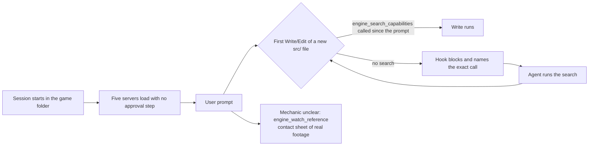

# PRD-827 — A kit session loads its MCP servers, can watch gameplay, and searches the engine before its first new file

**Status:** IN PROGRESS
**Priority:** P1 — the owner sees agents reach the ThreeNative MCP servers only through `node_modules` and only when asked, which breaks the primary "make me a game like X" workflow
**Complexity:** 3 (LOW) — 1 hook, 1 MCP tool, 1 search change, scaffold settings, 3 specs; risk override: none
**Owner:** João Paulo Furtado
**Depends on:** none. PRD-825 (the kit router) names the tool this PRD adds and runs the A/B after this PRD lands.
**Siblings:** PRD-825 (kit `AGENTS.md` router), PRD-826 (junk that ships to users)
**Order with PRD-826:** PRD-826 moves the 7 MCP host configs to scaffold time. Whichever lands second rebases its config change onto the other.
**PR:** one draft PR for this PRD, opened at the first commit

## Context

Owner, 2026-11-05: "imo noticing that MCPs are properly integrated on starter kit, i see the agent
having to call it from inside node_modules. and it only does it after I explicitly ask for it to use
it", and "on reverse engineer mcp there's also even a way to check gameplay videos". During the
interview the owner chose "text + hook gate": prose alone gets skipped.

Measured on 2026-11-05:

| Finding | Evidence |
| --- | --- |
| In Starlance sessions `c58b357d`, `dfe8f9ce` and `5b86bab5`, the `mcp__threenative-*` tools were in the deferred tool list, and the agent still ran `node node_modules/@threenative/core/mcp/call.mjs` 7 times. | `~/.claude/projects/-home-joao-projects-threenative-sandbox-starlance/*.jsonl` (`deferred_tools_delta` attachment, Bash tool calls) |
| The capability search ran after the owner asked: "check engine_capabilities for asset streaming". | Starlance `dfe8f9ce` |
| A host loads `.mcp.json` only for a session started in the game folder. Cold builds 2–8 made 0 calls to any ThreeNative server. | `PRD-750` Decisions 2026-10-27 |
| The scaffold settings carry hooks (`SessionStart`, `UserPromptSubmit`, `SubagentStart` → `ponytail-context.mjs`) and no `enabledMcpjsonServers`. | `sandbox/starlance/.claude/settings.json` |
| The gameplay watcher ships as `releases/latest/download/watch.mjs` of `threenative-reverse-engineer-mcp`. It needs `yt-dlp` and `ffmpeg`, writes a contact sheet, frames and `watch.json` to tmp. No MCP tool wraps it. | `threenative-reverse-engineer-mcp/README.md:91-117` |
| The reference tools live on `threenative-engine`: `engine_search_references`, `engine_reference_detail`, `engine_save_reference`. | `packages/engine-mcp/src/index.ts:108-114`, `src/references.ts` |
| `engine_search_capabilities` names the reference tools only when the query matches `/reverse[\s-]?engineer\|decomp\|disassembl/`. A search for "double jump" never reveals that pinned game references exist. | `packages/core/mcp/engine-server.mjs:816-829` (`withReferenceTools`) |
| Every engine tool call appends a JSON line with its time to `.threenative/engine-mcp.log` in the game folder, also through `call.mjs`. | `packages/engine-mcp/src/index.ts:943-962`, `engine-server.mjs:971-980` |
| The scaffold ships no `PreToolUse` hook. Codex hooks are project-scoped and need `/hooks` trust. | `agent-files/.claude/settings.json:2-35`, `agent-files/.codex/hooks.json:2` |

## Solution

Three parts, each small:

1. **Load:** the scaffold lists the five servers by name in `enabledMcpjsonServers`, so a fresh
   session has them without an approval step.
2. **References and watch:** a `scope: "request"` or `"mechanic"` search also returns the top
   reference hits and the reference tool names, whatever the wording. `engine_watch_reference` on
   `threenative-engine` runs the released `watch.mjs` and returns the contact sheet path, the
   frame paths and `watch.json`.
3. **Gate:** a `PreToolUse` hook blocks the first new file under `src/` after each user prompt
   until `.threenative/engine-mcp.log` holds an `engine_search_capabilities` line newer than that
   prompt. The `UserPromptSubmit` hook that already runs writes the prompt time. The log is
   host-neutral, so MCP calls and `call.mjs` calls both count, and the same script serves Claude
   Code and Codex. Edits to existing files pass. `TN_DISCOVERY_GATE=off` opts out, and the hook
   reports the opt-out once per session.

## Blocked on

Nothing.

## Acceptance Criteria

See the phase boxes. Each box names its proof.

## Integration Ledger

| Capability | Reachable consumer/trigger | Replaces / disposition | Evidence |
| --- | --- | --- | --- |
| MCP servers load | `npx create-threenative` → `.claude/settings.json` `enabledMcpjsonServers` → a fresh session | the approval prompt; `call.mjs` stays the out-of-folder fallback | AC-1 |
| References on every search | `engine_search_capabilities` response `references[]` + `referenceTools` | replaces the wording-gated `withReferenceTools` | AC-3 |
| Gameplay watcher | `engine_watch_reference` on `threenative-engine` | wraps the released `watch.mjs` | AC-4 |
| Discovery gate | Claude Code `PreToolUse` and Codex hooks in the scaffold | new | AC-5, AC-6 |

## Decisions

- 2026-11-05 (owner, PRD-825 interview Q4): text plus a hook gate, with an env opt-out.
- 2026-11-05 (agent): the gate reads `.threenative/engine-mcp.log`, not a host transcript. Reason: the log already exists, counts `call.mjs` calls, and has one format for every host.
- 2026-11-05 (agent): the gate keys on "since the last user prompt", so each new request searches once. A change with no new file passes. Reason: the Starlance changes were new requests on an existing game, and each skipped search.
- 2026-11-05 (agent): settings name the five servers, not `enableAllProjectMcpServers`. Reason: a blanket enable also trusts servers a user adds later.
- 2026-11-05 (agent): the watcher tool fetches the released script, as the reference tools already fetch released data. Frames stay in tmp, never in the game or the data repo, as the watcher README requires.

## Execution Phases

#### Phase 1: The five servers load in a fresh kit session

**Status:** DONE (2026-11-05)
**Files:** the scaffold `.claude/settings.json` source in `packages/create-threenative/agent-files/` or `templates/`, `scripts/sync-mcp-configs.ts` if it owns the list, `packages/create-threenative/__tests__/scaffold.spec.ts`.

- [x] AC-1 [local]: a `claude -p` session started in a scratch scaffold lists the five `threenative-*` servers as connected in its init event, with no approval step. proof: the init event's `mcp_servers` before (expected: pending approval or absent) and after; `scaffold.spec.ts` asserts the five names in `enabledMcpjsonServers`
  - Done (2026-11-05): the scaffold has six servers, not five (`threenative-terrain` joined after the PRD was written), so `enabledMcpjsonServers` lists all six in `MCP_SERVERS` order. `claude -p` (2.1.318) loads project servers with no approval step on both arms (init event: all six with `source: "project"`; `failed` only because the probe ran `--no-install`), so the approval step shows in a trusted interactive folder: `claude mcp get threenative-engine` with an isolated `CLAUDE_CONFIG_DIR` that trusts the probe folder reads `⏸ Pending approval` before and `✘ Failed to connect` (approved, launch attempted, no install) after. `scaffold-mcp.spec.ts` "approves every core server in the Claude Code project settings": red without the settings key (`expected undefined to deeply equal [ 'threenative-assets', …(5) ]`), green after. The spec lives in `scaffold-mcp.spec.ts`, beside the host-config proofs, not in `scaffold.spec.ts`.
- [x] AC-2 [local]: the animation server version is one number: `servers.mjs:51` says `0.1.3` and `animation-mcp-tools.json` records `0.1.8`. The shipped one wins, and its npx fallback resolves. proof: `npm view threenative-animation-mcp versions` (or the bundled server's `--version`) recorded here; the MCP config spec green (`pnpm sync:mcp --check` today, `scaffold-mcp.spec.ts` after PRD-826 removes the tracked copies)
  - Done (2026-11-05): `npm view threenative-animation-mcp versions` ends at `0.1.8`, and `packages/animation-mcp/package.json` is `0.1.8`. Three numbers became one: `servers.mjs` `0.1.3` → `0.1.8`, the server's own `serverInfo` `0.1.3` → `0.1.8`, and `animation-mcp-tools.json` `serverInfo` follows. Root cause: `prepare-release.ts` bumped the package and never these pins, so `syncSourceVersions` now moves both when the cohort names `threenative-animation-mcp`. The rebuilt bundled server answers `initialize` with `0.1.8`; the npx fallback `npx -y threenative-animation-mcp@0.1.8` resolves and answers `initialize` (published bytes still self-report `0.1.3`, which the next publish fixes). `prepare-release.spec.ts` "keeps one animation server version and moves it with a bump": red (`[ '0.1.3', '0.1.3' ]` vs `[ '0.1.8', '0.1.8' ]`), green after; `scaffold-mcp.spec.ts` + `mcp-tool-schemas.spec.ts` 37/37 green. The stale comment in `animation.mjs` ("not published yet") is corrected.

#### Phase 2: References on every search, and the gameplay watcher

**Status:** OPEN
**Files:** `packages/engine-mcp/src/references.ts`, `packages/engine-mcp/src/index.ts` (`ENGINE_MCP_TOOL_NAMES`, `withReferenceTools`), the bundled `packages/core/mcp/engine-server.mjs` rebuild, `packages/create-threenative/engine-mcp-tools.json`, `packages/engine-mcp/__tests__/watch-reference.spec.ts` (new), `capabilities.json` rebuild.

- [ ] AC-3 [local]: a `scope: "request"` or `"mechanic"` search returns `referenceTools` and up to 3 reference stubs for the situation, with no special wording. Offline it still returns the capability hits and says references are unavailable. proof: red-green spec: "double jump" returned no reference tools before, returns them after; the offline case passes
- [ ] AC-4 [local]: `engine_watch_reference { query, duration?, frames?, at?, pick?, from? }` fetches `watch.mjs` from the reference release base URL, runs it, and returns `sheet`, `frames[]` and the parsed `watch.json`. A missing `yt-dlp` or `ffmpeg` fails closed with the install command. A failed fetch fails closed with the URL. proof: red-green `watch-reference.spec.ts` with a stub watcher (pass, missing tool, failed fetch)
  - Also: one real call on this host returns a nonblank contact sheet for a named game mechanic. Record the sheet path and its pixel size here.

#### Phase 3: The discovery gate hook

**Status:** OPEN
**Files:** `packages/create-threenative/agent-files/.claude/hooks/discovery-gate.mjs` (new), the scaffold `.claude/settings.json` hooks block, `agent-files/.codex/hooks.json`, `packages/create-threenative/__tests__/discovery-gate.spec.ts` (new).

- [ ] AC-5 [local]: the Claude Code `PreToolUse` hook blocks a `Write` or `Edit` that creates a new path under `src/` when `.threenative/engine-mcp.log` has no `engine_search_capabilities` line newer than the last prompt time. The block message names the exact MCP call and the `call.mjs` form. Existing-file edits pass. `TN_DISCOVERY_GATE=off` passes and reports the opt-out once. A missing or unreadable log blocks with the reason. proof: red-green `discovery-gate.spec.ts` with fixtures (no search → block, search before the prompt → block, search after → pass, opt-out → pass with notice, missing log → block)
- [ ] AC-6 [local]: the same script runs from `.codex/hooks.json` on Codex's write tool, with a Codex hook-input fixture in the same spec. If Codex cannot run it, this box records why and the PRD-825 router says so. proof: the Codex fixture green, or the recorded reason

## Out of scope

- The kit `AGENTS.md` wording and the skill route: PRD-825.
- Files that ship to users but should not: PRD-826.
- New reference data or watcher features: those live in `threenative-reverse-engineer-mcp`.
