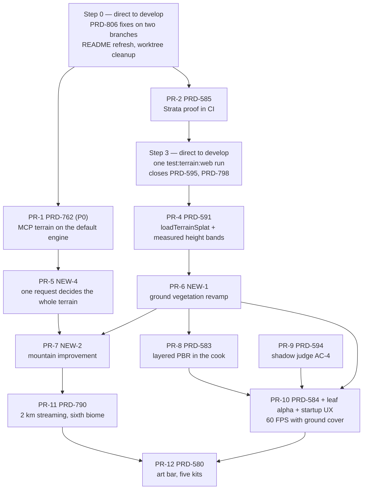

# Strata terrain — PR chain

**Written:** 2026-11-07, against `origin/develop` after the EPIC merge (PR #483, merged 2026-11-06).
**Purpose:** one ordered sequence for all open Strata work, plus the owner's new items: a ground vegetation revamp, a mountain improvement, and a noise, erosion and real-world elevation spike. The spike is done (below), and its decisions shape PR-5 and PR-7.

## Rules this chain follows

- One PR per PRD, opened as a draft at the first commit (owner, 2026-10-28). The two forest child PRDs ride in the PRD-584 PR.
- Work with no PRD, and a PRD that only needs a tick plus `git mv` after a green run, commits directly to local `develop`.
- A box that changes pixels ticks only with a fresh visual-judge verdict (headed, `--browser-recipe webgpu`, `adapter.info` checked, two runs per arm).
- Look PRDs read the Unreal subsystem first (there is no local clone on this machine, so use the sparse clone in `docs/PRDs/Unreal/README.md`) and cite `UE 5.8.3: Engine/...:line`.
- The new items get a PRD each, filed with `prd-creator` under the next free numbers. Until then they are named NEW-1 (ground vegetation), NEW-2 (mountains) and NEW-4 (real-world heightmap import).

## Spike results (done 2026-11-07)

Desktop CPU with AVX2 and no AVX512. FastNoise2 built from `Auburn/FastNoise2@c35d604` (2026-11-05) in 14 s. Graph: Perlin → FractalRidged, 5 octaves, gain 0.5, lacunarity 2, on a 513² grid, best of 20 runs.

| Measure | Result |
|---|---|
| Current TS `fbm` (`packages/terrain/src/core/math.ts`), ridged, 5 octaves, 513² | 95.6 ms |
| FastNoise2 ridged, SSE2 / SSE4.1 / AVX2 | 6.9 / 5.7 / 2.3 ms (AVX2 is 42× faster than TS) |
| FastNoise2 ridged + `DomainWarpGradient`, AVX2 | 2.7 ms |
| Cross-SIMD determinism, AVX2 against SSE2 (normalized noise) | max difference 7.2e-7 ridged, 4.7e-6 with domain warp. At the alpine relief (0.25 × 5 000 m = 1 250 m) that is up to 6 mm. The scalar path is not compiled. NEON and WASM SIMD were not run. |
| Alpine landform bake, split by layer (`landform("alpine").evaluate()`) | 2.1–2.3 s in total: `massif` noise 228 ms, `peak` stamp 38 ms, **`valleys` fluvial erosion 1 796 ms (about 80%)**, `talus` 221 ms |
| Real-world tile: AWS Terrain Tiles, terrarium z12, Mount Fuji | Fetched with no key. Decoded range 1 317–3 754 m (the summit is 3 776 m), 256 px over 8.0 km = **31.2 m/px** |
| Existing import path | `decodeHeightPNG` (16-bit grayscale, at most 4 097 px), `decodeRAW16`, and a `heightmap` layer already ship. The forest and tundra starters already use real USGS 3DEP 1 m surveys. `terrain_generate` takes no user heightmap. |

Decisions:

| Candidate | Decision | Why | Rating |
|---|---|---|---|
| Real-world elevation chosen by the MCP itself (new PR-5) | **Adopt** | The decoder and the layer exist. The tool picks a real survey from the request words, with attribution, so a request for mountains gets real mountain shapes. Global data is about 30 m/px, so it fits mountains and the backdrop. A walkable 512 m square needs the erosion and grain layers on top, or 1 m lidar. | ⭐⭐⭐⭐⭐ |
| [heightmap-level-generator](https://github.com/m-w-marker/heightmap-level-generator) (MIT, WGSL rain and scree erosion) | **Port the algorithm** into PR-7 | Erosion is about 80% of the bake, and its gullies and scree fans are the mountain detail we lack. The GPU path needs WebGPU in Node, so PR-7 first ports the scree and gully passes to the CPU bake, and measures a GPU path only if the bake time requires it. | ⭐⭐⭐⭐ |
| [Unreal Heightmap](https://github.com/manticorp/unrealheightmap) (MIT, browser, 16-bit PNG and EXR up to 8 129 px, Mapterhorn Copernicus GLO-30 plus lidar) | **Recommend as the user-side tool** | It exports the 16-bit PNG that `decodeHeightPNG` reads. Exports over 4 097 px must fail closed or downsample. Its MIT code is a reference for the georeferencing and the water mask. | ⭐⭐⭐⭐ |
| AWS Terrain Tiles ([tilezen/joerd](https://github.com/tilezen/joerd)) | **Adopt as the optional fetch source** | Public, no key, measured above. Each source carries its own attribution (USGS, Copernicus EU-DEM, LINZ CC BY, and others), so the import writes the attribution into the kit. | ⭐⭐⭐⭐ |
| [FastNoise2](https://github.com/Auburn/FastNoise2) (MIT, C++ SIMD) | **Reject for the bake. Defer for runtime tiles (PR-11)** | Noise is 228 ms of a 2.3 s bake, so a 42× noise speed-up saves under 10% of the bake. For streamed tiles on the native and Wasm engine it is fast enough to generate in-frame, but the results differ by SIMD level (up to 6 mm), so web and native heights do not match bit for bit. For domain warp, PR-7 ports the algorithm into the TS `fbm` instead of adding a C++ dependency. | ⭐⭐⭐ runtime, ⭐ bake |
| [TerraSynth](https://github.com/saagar210/TerraSynth) (MIT, Rust Wasm) | Reject | `erosion.ts` and `fluvial.ts` already cover its particle erosion. It has 0 stars and 17 commits. Its moisture-map biome idea is a note for PRD-790's blended borders. | ⭐⭐ |
| [reearth-terrain](https://github.com/reearth/reearth-terrain) (MIT, Cloudflare Worker) | Reject | A tile server for 3D globes. We need a bake input, not a server. | ⭐⭐ |
| [Mapper](https://github.com/vazgriz/Mapper) | Reject | Windows-only WPF app, needs a Mapbox key, and the page names no license. | ⭐ |
| [Tangram Heightmapper](https://github.com/tangrams/heightmapper) (MIT) | Reject | Auto-exposure normalizes heights to the view by default, so absolute heights are lost. It reads the retired Mapzen service. | ⭐ |

Not run: NEON and WASM SIMD determinism, and a look comparison of a domain-warped alpine landform. PR-7 owns the look verdict.

## Sequence

Two lanes can run at the same time: **A** engine, CI and MCP (Step 0, PR-1, PR-2, Step 3, PR-4, PR-5, PR-9), and **B** look (PR-6, PR-7, PR-8, then PR-10 to PR-12).

| Order | Lane | PR | Work | Depends on | Est. | Value |
|---|---|---|---|---|---|---|
| 0 | A | direct | PRD-806: review and land the unmerged fixes | — | 1–2 h | ⭐⭐⭐⭐⭐ |
| 1 | A | PR-1 | PRD-762 (P0): the MCP terrain starts on the default engine | 0 | 1–2 days | ⭐⭐⭐⭐⭐ |
| 2 | A | PR-2 | PRD-585: the `strata` CI job is green | 0 | 0.5–1 day | ⭐⭐⭐⭐ |
| 3 | A | direct | One web run closes PRD-595 AC-3 and the Strata half of PRD-798 | 2 | 2–3 h | ⭐⭐⭐⭐ |
| 4 | A | PR-4 | PRD-591: `loadTerrainSplat` plumbing and measured height bands | 3 | 0.5 day | ⭐⭐⭐⭐ |
| 5 | A | PR-5 | NEW-4: one request decides landform, water, size and a real survey | 1 | 1–2 days | ⭐⭐⭐⭐⭐ |
| 6 | B | PR-6 | NEW-1: ground vegetation revamp | 4 | 2–3 days | ⭐⭐⭐⭐⭐ |
| 7 | B | PR-7 | NEW-2: mountain improvement | 5, 6 | 2–3 days | ⭐⭐⭐⭐ |
| 8 | B | PR-8 | PRD-583: layered PBR surface in the cook, headed judge | 6 | 1 day | ⭐⭐⭐ |
| 9 | A | PR-9 | PRD-594 AC-4: the shadow judge with visible cast-shadow coverage | — | 0.5 day | ⭐⭐⭐ |
| 10 | B | PR-10 | PRD-584 with leaf alpha and the startup handoff: 60 FPS with ground cover | 6, 8, 9 | 1–2 days | ⭐⭐⭐⭐ |
| 11 | B | PR-11 | PRD-790 phases 2–3: 2 km streaming, a sixth biome as one row | 7 | 2–3 days | ⭐⭐⭐ |
| 12 | B | PR-12 | PRD-580: every rubric row ≥ 4 on all five kits | 10, 11 | 3+ days | ⭐⭐⭐ |

Why this order:

- Step 0 is first because the code exists. Fixes that stay off `develop` go stale with every merge.
- PR-1 is P0: an agent that follows the shipped MCP path gets a game that does not start. PR-5 changes the same MCP tool, so it comes after PR-1.
- PR-2 comes before any look work so that CI catches a regression in the later PRs.
- PR-4 comes before the ground revamp: the revamp reads the measured height bands, and PRD-790 needs them too.
- The ground revamp (PR-6) comes before PRD-584: PRD-584 AC-4 measures 60 FPS *with* walking-height grass, so the grass must exist first.
- PR-5 comes before PR-7 so that the mountain work can use real elevations for the backdrop.

## Step 0 — PRD-806 fixes, direct to develop

- [x] Review `origin/prd806-visual-fixes` (E46, E49, E73, E56) and `origin/prd806-e62-fir-cook` (E62, E52, E41, E40, E39) against `origin/develop`. Neither branch has a PR. A DeepSeek-written diff gets a full review before merge. 2026-11-09: done by content — every non-docs file of the 12 PRD-806 fix commits on both branches is byte-identical in the PR #635 head (`git diff <fix> HEAD -- <file>` empty for all 37 files).
- [x] Merge each branch, run `pnpm typecheck`, `pnpm lint`, `pnpm exec vitest run packages/terrain/__tests__/`, and the native engine texture and renderer tests for E49 and E73. Tick the PRD-806 boxes with the results. 2026-11-09 on the PR #635 head: `pnpm typecheck` exit 0 at `3817a9529` (exit 1 at `ecebc2fe5` on 3 chain-made spec type errors, fixed in that commit), `pnpm lint` exit 0, `vitest run packages/terrain/__tests__/` 600/600, E49 V8 `clone_listeners` red without the fix and green with it; E73 as ticked in PRD-806.
- [x] Refresh `README.md` in this folder: the EPIC is merged, and the scope table and "Current state" date from 2026-11-04. 2026-11-09: done in `e1ba845e5` (EPIC merge, pointer to this chain) and `7bad7d910`.
- [ ] Clean up the stale `strata-*` worktrees (`strata-base`, `strata-forest`, `strata-ground-fix`, `strata-ref-*`, `strata-terrain-hardening`). Check merge evidence and untracked data first, and ask before removing a dirty one.

## PR-1 — PRD-762 (P0)

Open boxes: the sandbox game starts from the MCP snippet with no game edit, sky gaps 1–4, the kit gaps (`VirtualShadowNode`, world prewarm, `TN_virtual_geometry`, the reflector hook), `verify-starter-kit.mjs` exit 0, a playtest scenario, load and presented FPS on the real display, and a judge against the `engine: "threejs"` arm. Each refusal found on the path gets its own box.

Sub-blockers on the same PR: [PRD-857](PRD-857-the-gpu-world-scene-runs-on-the-owned-engine.md) (the GPU world scene, Acceptance open) and [PRD-858](PRD-858-world-impostors-bake-on-the-owned-web-engine.md) (impostor bake; the kit's overview runs at 15 fps without it, so `verify-starter-kit.mjs` waits on it).

## PR-2 — PRD-585

Do this first: check the `strata` job on the current `develop` head again, because most boxes still name PR #483. Open: `test:terrain:web`, `test:consumer` and `test:terrain:editor` green in CI, and the relative layer lookup fix (`../leafy_grass/...`) without weaker manifest validation.

## Step 3 — playtest closers, direct to develop

Run `pnpm --filter strata-terrain-preview test:terrain:web` once on the owned engine. Green: tick PRD-595 AC-3 and the Strata half of PRD-798 (plus the machinefall map walk for PRD-595), then `git mv` each finished PRD to `done/`. Red: the fix goes into the PR of the PRD that owns the failing step. The last known red was the coastal `?water` step. PRD-798 AC-1 (existing world specs changed) needs a decision: revert the spec edits, or record why they change.

## PR-4 — PRD-591

AC-4: the ground uses `loadTerrainSplat`, and the height bands come from the world's measured range. AC-5: a five-kit judge, NEUTRAL or better.

## PR-5 — NEW-4: one sentence decides the whole terrain

**Owner direction (2026-11-07):** the terrain MCP receives a request such as "create a forest with mountains and a river" and decides everything itself. Real elevation is one of its internal choices, not an input the agent prepares.

**Today:** `terrain_generate` already takes `request`, but it reads only the biome words (`BIOME_WORD_ROWS`, `packages/terrain/src/mcp/tools.ts:198`). "Mountains", "river", "island", "huge" and every other word are dropped silently, and `landform`, `water` and `sizeMeters` come only from explicit arguments.

Scope (bake-time only, no network call at runtime):

1. The request words also pick the landform, the water bodies and the size (for example "mountains" → `alpine` or `temperateMountains`, "river" → a river row, "island" → `coastalCliffs` plus an ocean row). An explicit argument wins over a word. Proof: a red-green spec in `packages/terrain/__tests__/terrain-mcp.spec.ts`, one case per word row.
2. The result reports each choice and the word that made it, plus the words it did not use, so the calling agent can correct one argument instead of guessing. Proof: the same spec asserts the `decided` and `unused` fields.
3. The tool picks the ground source by itself: a real survey from a curated location table (one or more per landform, each with its attribution), or the procedural landform. It fetches AWS terrarium tiles at cook time, caches them, decodes them (`height = R·256 + G + B/256 − 32768`) and writes the attribution into the kit README. Global data is about 30 m/px, so the real survey sets the macro shape and the backdrop silhouettes, and the biome's erosion and grain layers add the walkable detail. Proof: a spec on a checked-in tile fixture, plus one real cook from "alpine mountains".
4. A named override for each automatic choice: `landform`, `water`, `sizeMeters`, and `ground: "procedural" | { heightmap: <16-bit PNG or .r16 path> } | { location: { lat, lon } }`. The result names the override when one is used. A PNG over 4 097 px or an 8-bit file throws and names the field. Proof: the same spec.
5. No network at cook time: the cook fails closed and names the missing tile, unless `ground: "procedural"` is passed. A silent switch to procedural is not allowed. Proof: the same spec with the fetch stubbed to fail.

## PR-6 — NEW-1: ground vegetation revamp

**Problem (owner, 2026-11-07):** the ground vegetation looks bad and too bright. Known measures: the soil reads L 46–51 against a reference of 29–37, the near foreground reads as one smooth dirt sheet with no needle detail, and grass, low plants and ferns are missing at walking height (PRD-580 AC-2, PRD-584 AC-4).

Plan:

1. Capture the current ground on all five worlds (`capture-strata-worlds`), with the Gaia and AAA reference frames beside them. Write the visual acceptance criteria before any change.
2. Run `engine_search_capabilities` for grass, ground cover and foliage, and read the PRD-766 Unreal foliage work. Read the Unreal Landscape grass subsystem (grass types, density scaling, cull distance) and the landscape layer blending. Cite each line.
3. Bring the soil value into the reference band: albedo and roughness in `render/surfaces.ts` and `render/terrain.ts`, checked under the metered auto exposure, not a fixed exposure.
4. Ground cover from layer weights: grass, low plants, ferns and litter density follow the measured height and slope bands (PR-4) and the splat layers. Grass clumps in `render/cover.ts` get a darker root, a value range and colour variation per clump.
5. Near-foreground detail: needle litter and a detail normal on the forest floor, so the near ground no longer reads as one sheet.
6. Budget: frame time, streaming and the 25 MiB cooked-kit budget stay at their original values. `loop.playtest.json` keeps `pipelinesSinceReveal` 0.

Acceptance: soil L inside 29–37 at the forest walk pose, a fresh judge IMPROVEMENT on the ground frames of all five worlds, PRD-580 AC-2 met, and no `TN_SCENE_WARNING` in the forest walk.

## PR-7 — NEW-2: mountain improvement

**Problem (owner, 2026-11-07):** the mountains need to improve. Step 1 names the visible defects, because the request does not.

Plan:

1. Capture the alpine, tundra and forest backdrop mountains at elevated and walking views, with references. Name each defect (silhouette, ridge sharpness, erosion channels, rock and snow placement, scale cues).
2. Read the Unreal landscape and erosion references.
3. Shape: add domain warp to the TS `fbm` (the algorithm only, about 20 lines, no new dependency). Use it in the landform presets (`packages/terrain/src/core/presets.ts`).
4. Erosion: port the heightmap-level-generator scree and gully passes (MIT) to the CPU bake beside `fluvial.ts` and `erosion.ts`. The fluvial pass is already about 80% of the alpine bake, so record the bake time before and after.
5. Backdrop: offer a real-world heightmap (PR-5) as the source of the far mountain silhouettes.
6. Material: rock where slope or curvature is high, snow from slope and height, strata banding. The look lives in `render/`, and the masks come from the bake.
7. Proof: the edge and walk playtests stay green, and the player can still climb the surveyed hills (`edgeOvershoot` ≥ 20).

Acceptance: a fresh judge IMPROVEMENT on the mountain frames against the references, no seam gap at the horizon ring, and the bake time recorded.

## PR-8 to PR-12

- **PR-8 PRD-583:** keep the authored layered PBR surface in the headless cook (the GLB uses only the first layer today), and resolve `texturesDir` headlessly. Then a headed render and a judge. It comes after PR-6 so that the cook carries the new ground layers.
- **PR-9 PRD-594 AC-4:** repeat the shadow, velocity and LUT judge at poses with visible cast shadows. The 2026-10-14 review was NEUTRAL with no visible shadow in the frames.
- **PR-10 PRD-584 + children:** web and native desktop p95 ≤ 16.7 ms over a 300-frame walk with the new ground cover, the BC-2 contact ceiling, leaf alpha AC-4 and AC-5 (squared leaf tips), and the same-pose startup-handoff judge.
- **PR-11 PRD-790:** phase 1 box 1 already holds (`rg 'world [!=]== "'` finds 0 matches after PRD-791). Then generator tiles streamed by `TerrainTiles` over 2 km, no seam gap, no hitch, a sixth biome as one data row, and blended biome borders. Evaluate FastNoise2 here for in-frame tile generation on the native and Wasm engine. First accept or work around the measured cross-SIMD difference (up to 6 mm).
- **PR-12 PRD-580:** the art bar on all five kits (coastal waves and foam, tundra ice, every rubric row ≥ 4). It comes last because it judges what the earlier PRs build.

## Out of scope

- PRD-537 (Machinefall far hills) and PRD-766 (Wildwood forest FPS) are open-world PRDs. PR-6 reads PRD-766 but does not close it.
