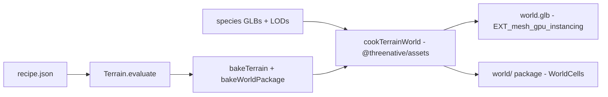

# PRD-583 — A Strata world bakes headlessly into an instanced GLB

**Status:** PARTIAL
**Priority:** P1 — No headless path turns a Strata recipe into a GLB with its trees and rocks; PRD-584's agent handoff cannot start without AC-1 to AC-4.
**Complexity:** 5 (MEDIUM); risk override: none
**Owner:** ThreeNative maintainers
**Depends on:** None
**Parent:** [PRD-466](../done/PRD-466-strata-terrain-threejs-integration.md), [PRD-468](../done/PRD-468-strata-world-controls-and-asset-imports.md)
**Epic:** [Strata terrain hardening](README.md)

## Context

The owner's goal for Strata (2026-10-05): another agent says "I am making an xyz game, generate a W
terrain" and gets "a glb or something ready to use". Audit of `2d2124792` (2026-10-10) found three
gaps on that path:

- `exportWorldGLB` (`packages/terrain/src/export.ts`) needs browser `FileReader` and canvas
  (`packages/terrain/README.md`), so a Node job or an MCP server cannot call it.
- The same encoder rejects instancing: `export.ts:167-169` throws "resolve skinning/instancing
  into static meshes first". A forest of 10 000 trees becomes 10 000 mesh nodes, so 10 000 draws
  in the consumer.
- `bakeWorldPackage` (`packages/terrain/src/core/world-package.ts:221`) is headless and writes
  `heightmap.u16`, `placements.bin`, `splat.rgba` and `world.json`, but no GLB, no LOD and no
  cell proxy. The legacy `makeExport(..., "glb")` holds terrain geometry only.

The cook in `@threenative/assets` already holds every piece this needs, in Node: gltf-transform
(`packages/assets/package.json:49-51`), the `EXT_mesh_gpu_instancing` compaction
(`packages/assets/src/passes/compact.ts:104`), meshopt simplification (`modelPass({ simplify })`)
and the per-cell HLOD proxy (`packages/assets/src/world/proxy.ts`).

## Solution

Add one cook entry in `@threenative/assets` (it carries the glTF dependencies the terrain package
must not inherit): `cookTerrainWorld({ state, species, out })`.

1. Terrain: `bakeTerrain(state)` chunks become GLB meshes with the kit's PBR layer maps, written as
   image bytes that already exist (JPG/PNG/KTX2). No canvas, no `FileReader`.
2. Scatter: each species GLB is read once. Placements of one species and one LOD become one node
   with `EXT_mesh_gpu_instancing`. LOD levels come from the species' own `*-mid`/`*-lod1` GLBs when
   present, else from `modelPass({ simplify })`.
3. Output: `world.glb` (single file, loads in vanilla `GLTFLoader`) and the existing world package
   directory with the species GLBs and LODs filled in, for `WorldCells` streaming.
4. Every placement samples the baked heightmap. A tree whose base misses the ground by more than
   one heightmap texel fails the cook by name (catches a flipped Z or transposed grid; audit H4).

`exportWorldGLB` stays the browser editor's encoder for now. When the cook is the one path the
editor uses too, it is deleted (PRD-588 decides).

## Acceptance Criteria

- [x] AC-1 [local]: `cookTerrainWorld` runs under plain Node 22 with no DOM globals and writes `world.glb` for the forest kit. proof: `npm exec --yes --package=node@22 -- node src/terrain/forest/bake.mjs --out assets/terrain/forest` in an isolated kit install — Evidence: 2026-10-10 Node v22.23.3, an isolated minimal-template game installed from the packed core/physics/assets/playtest/CLI/terrain tarballs (terrain override resolves the asset pipeline's transitive edge), with `document`/`window`/`FileReader`/`HTMLCanvasElement` all undefined: `bake.mjs` exit 0 and `world.glb` 24 641 592 B. The closure fix is in `examples/strata-terrain-preview/scripts/verify-starter-kit.mjs` (terrain tarball added to the scaffold `packageSources`, which writes the pnpm override) and `verify-game-handoff.mjs` (same tarball as an override-only entry).
- [x] AC-2 [local]: Each species-and-LOD pair is one `EXT_mesh_gpu_instancing` node; node count does not grow with tree count. proof: `pnpm exec vitest run packages/assets/__tests__/terrain-world.spec.ts` — Evidence: 2026-10-10 17 tests pass; the default `TerrainWorld` scene holds near nodes only and each species-and-LOD pair is one node in its own named scene (`fir_lod1`, `boulder_lod1`), every node carrying all logical placements; the all-scene census is constant 1 000→10 000, one instancing node for a single-mesh species and one flattened node (four primitives) for a two-mesh species. `instancedMeshCount` stays the default-scene count for compatibility; the all-scene test walk is authoritative and `nodeCount` counts every scene.
- [x] AC-3 [local]: A vanilla three `GLTFLoader` loads `world.glb` into `InstancedMesh` objects whose instance count equals the bake's placement count. proof: `CONSUMER_GAME=skip pnpm --filter strata-terrain-preview test:consumer` — Evidence: 2026-10-10 exit 0 in 23 s; the cooked forest GLB loads in the isolated packed install as `fir_instances` (4 primitives × 3 100), `fir-c_instances` (4 × 1 400) and `boulder_instances` (1 × 320), every child count equal to its manifest run count and 0 per-tree mesh copies. The parent subsequently passed the unskipped packed-game install, build and WebGPU playtest on NVIDIA Turing (2026-10-10); that game stage does not prove the cooked forest's layered material appearance.
- [x] AC-4 [local]: A placement mirrored in Z fails the cook with a named contact error. proof: `pnpm exec vitest run packages/assets/__tests__/terrain-world.spec.ts` — Evidence: 2026-10-10 12 tests pass, including `Placement '<id>' of species 'fir' contact check failed ... mirrored-Z`.
- [x] AC-5 [local]: The world package written next to it passes `validateWorldPackage` and lists a GLB and at least one LOD per species. proof: `pnpm exec vitest run packages/assets/__tests__/terrain-world.spec.ts` — Evidence: 2026-10-10 the spec reads the cook's `world.json` and `placements.bin`, calls core `validateWorldPackage` with `placementsByteLength` (and `heightmapByteLength`) and gets `{ ok: true, errors: [] }`, and every species lists `models/<id>.glb` plus a LOD whose bytes exist on disk.

## Integration Ledger

| Capability | Reachable consumer/trigger | Replaces / disposition | Evidence |
|---|---|---|---|
| Headless world GLB | `cookTerrainWorld` from `@threenative/assets`; kit `bake.mjs`; PRD-584 MCP tool | Browser `exportWorldGLB` stays for the editor until PRD-588 | AC-1 (Node 22 kit), AC-3 |
| Instanced scatter in GLB | Any `GLTFLoader` consumer | Per-tree mesh nodes | AC-2 |

## Execution Phases

#### Phase 1: terrain and scatter into one instanced GLB
**Status:** PARTIAL — layered surface appearance remains pending
**Files:** `packages/assets/src/world/terrain-world.ts` (new), `packages/assets/src/index.ts`, `packages/assets/__tests__/terrain-world.spec.ts`
**Implementation:** read `bakeTerrain` chunks and placements; group by species and LOD; write `EXT_mesh_gpu_instancing` nodes with gltf-transform; pass existing image bytes through; contact check per placement.
- [x] Node-only cook writes `world.glb`. proof: `pnpm exec vitest run packages/assets/__tests__/terrain-world.spec.ts` — 2026-10-10: 7/10 passed; cook writes `world.glb` for the evaluated-terrain fixture under Node.
- [x] Node count is constant from 1 000 to 10 000 trees. proof: same spec — 2026-10-10: node count equal at 1k and 10k, one instancing node for a single-mesh species.
- [x] Mirrored placements fail by name. proof: same spec — 2026-10-10: mirrored-Z case throws `Placement '<id>' of species 'fir' contact check failed`.

- [ ] Preserve the authored layered PBR surface and resolve `texturesDir` headlessly. proof: layered cook spec plus headed before/after visual judge — pending; the current GLB uses only the first layer.

#### Phase 2: LODs and the world package
**Status:** done
**Files:** `packages/assets/src/world/terrain-world.ts`, `packages/terrain/starter/forest/bake.mjs`
**Implementation:** prefer authored `*-mid` / `*-lod1` GLBs; fall back to `modelPass({ simplify })`; fill `assets[].glb` and `lods` in `world.json`.
- [x] World package validates and carries LODs per species. proof: `pnpm exec vitest run packages/assets/__tests__/terrain-world.spec.ts` — 2026-10-10 12 tests pass; `validateWorldPackage` returns `{ ok: true, errors: [] }` and each species lists a GLB plus a LOD.
- [x] The forest kit bake emits both outputs. proof: `node packages/terrain/starter/forest/bake.mjs` — 2026-10-10 exit 0 in 166 ms; writes `world.glb` (15 874 700 B) and the world package (`world.json`, `heightmap.u16`, `placements.bin`, `splat.rgba`, `terrain-table.json`, `models/{fir,boulder,fir-c}.glb` with LODs); 3 100 fir, 1 400 fir-c and 320 boulder placements.

#### Phase 3: consumer load
**Status:** PARTIAL — headed runtime and visual proof remain pending
**Files:** `examples/strata-terrain-preview/scripts/verify-consumer.mjs`
**Implementation:** load the cooked `world.glb` with stock `GLTFLoader`; assert instance counts and that no mesh is a per-tree copy.
- [x] Vanilla loader gets `InstancedMesh` with the bake's counts. proof: `CONSUMER_GAME=skip pnpm --filter strata-terrain-preview test:consumer` — 2026-10-10 exit 0; the generated consumer script reads the cooked `world.json`, derives each species' logical count from its runs, and checks each child `InstancedMesh` count (fir 4×3 100, fir-c 4×1 400, boulder 1×320) with 0 per-tree copies and no hardcoded values.

- [ ] Render the cooked world in the headed WebGPU consumer and pass the visual judge. proof: two same-pose runs per arm with checked adapter and labelled images — pending; the first baseline capture was black and is rejected.

## Current plan

1. Reuse `bakeTerrain` and `bakeWorldPackage`; preserve source glTF textures/transforms and verify real terrain, splat and species batching.
2. Repair the consumer script and run its actual forest bake/load proof after the focused assets gate passes.
3. Run required runtime and visual proof; keep every unsupported claim open.

Initial review: six weak unit tests passed; `node --check examples/strata-terrain-preview/scripts/verify-consumer.mjs` failed at line 584, and assets typecheck failed with three errors. Cook also dropped model textures/transforms, omitted terrain without custom LOD data and zeroed splat bytes. That initial completion claim was rejected; corrected focused results follow.

2026-10-10 focused correction: the cook uses `bakeTerrain` and `bakeWorldPackage`, preserves source image bytes and every source-node world transform through glTF-transform copying/flattening, rejects skinned or animated species, and produces one near-detail instance node per species. The 11-test spec passes (including reused source-mesh nodes, 1 000/10 000 placement census and exact splat/placement bytes); assets typecheck and scoped Biome pass, with one nonfatal cognitive-complexity warning. Node is v20.19.6, so Node 22 and the forest-kit claim remain unverified. Authored sibling LOD discovery, multi-layer terrain PBR appearance, actual forest bake/consumer and runtime/visual proof remain pending. No full-PRD completion is claimed.

2026-10-10 bounded integration: rebuilt `packages/assets` and `packages/terrain` so their `dist` matches source, then re-ran the forest kit. `packages/terrain/starter/forest/bake.mjs` now imports the public `cookTerrainWorld`, passes the real evaluated state (no `state.lods` injection), lets the cook own `world.json` and the species models, and writes only the surface table, its textures and `sky.hdr` beside them. The runner passed Node 20.19.6: `node --check` on both scripts, scoped Biome, assets typecheck, and `pnpm exec vitest run packages/assets/__tests__/terrain-world.spec.ts` (12 tests). The forest bake wrote `world.glb` (15 874 700 B) with 3 100 fir, 1 400 fir-c and 320 boulder placements in 166 ms. `CONSUMER_GAME=skip pnpm --filter strata-terrain-preview test:consumer` passed in 23 s and loaded that GLB through stock `GLTFLoader` at the manifest's per-species counts with 0 per-tree copies. The unskipped consumer run failed at the PRD-468 scaffold `pnpm install` (exit 1) in this environment. Authored sibling LOD discovery, full multi-layer surface appearance, Node 22 and runtime/visual proof remain pending; AC-1 stays open. No full-PRD completion is claimed.

2026-10-10 integration: the forest bake produced a 15 874 700-byte GLB and a valid world package (3 100 fir, 1 400 fir-c, 320 boulder). The scoped parser proof ran with CONSUMER_GAME=skip; the ordinary test:consumer command still fails during the separate PRD-468 scaffold install and is not game acceptance. A missing cooked forest fixture now fails closed. All-scene species/LOD census and full layered terrain appearance remain pending.

2026-10-10 cook follow-up: 17 focused tests pass (336 ms), assets typecheck passes and scoped Biome passes with one complexity warning. Alternate LODs live in named scenes while the default scene renders near detail once; every species/LOD pair has one instancing node. Empty species fail before output. Contact samples the baked uint16 heightmap with one quantization-step tolerance plus float rounding. Node 22.23.3 was resolved by an isolated npm launcher, but its forest cook failed because the standalone kit could not resolve @threenative/assets; AC-1 stays open until the kit/tarball dependency closure is wired. Multi-layer material appearance and runtime/visual proof remain pending.

2026-10-10 caller/dependency closure repair: the red failures had one cause — `@threenative/assets@0.3.5` depends on `@threenative/terrain`, which was absent from the local tarball closures, so both installs tried the registry and got `ERR_PNPM_FETCH_404 @threenative/terrain`. `verify-starter-kit.mjs` now packs the terrain tarball into the scaffold `packageSources` (writing the pnpm override for assets' transitive edge) before the kit's own `pnpm add -D`; `verify-game-handoff.mjs` packs the same tarball and writes it as an override-only entry, so the game still declares and installs no authoring package. `packages/terrain/starter/forest/README.md` names both `@threenative/terrain` and `@threenative/assets` plus the `three` peer. Node 22.23.3 forest proof in an isolated kit: `bake.mjs` exit 0, `world.glb` 24 641 592 B, no DOM globals — AC-1 ticked. `node --check` and scoped Biome pass on both scripts. The unskipped full consumer (scaffold build + WebGPU playtest) was not run; the root job runs it after commit. Multi-layer surface appearance and runtime/visual proof remain pending.

2026-10-10 direct checkout command: root now declares the existing @threenative/assets workspace package as a dev dependency (terrain does not depend on assets). node packages/terrain/starter/forest/bake.mjs also passes from the checkout and emits the instanced GLB plus package, so the documented direct command has an explicit dependency closure.

2026-10-10 parent integration: offline frozen installation, assets build/publint and 17 terrain-world tests pass (1.05 s test time). The direct forest command emits the 24 641 592 B GLB in 595 ms. The full consumer first stopped before the game stage because the default cooked fixture was absent; after the documented bake, the unskipped rerun passes (exit 0). Its scaffolded game playtest reports WebGPU, NVIDIA Turing and no direct authoring-package dependency; the forest stock-loader census reports 4 820 placements and zero per-tree copies. Layered-surface and headed forest visual acceptance remain open.

2026-10-10 fail-closed hardening (bounded): `packages/terrain/starter/forest/bake.mjs` refuses a bare, empty or flag-valued `--out`/`--assets` before any directory is created; `authoredSiblingLods` in `packages/assets/src/world/terrain-world.ts` propagates any non-ENOENT stat error instead of reading it as an absent sibling. proof: `pnpm exec vitest run packages/assets/__tests__/terrain-world.spec.ts` 18 tests pass; `pnpm exec vitest run packages/terrain/__tests__/starter-kit.spec.ts -t "refuses a bare"` 1 test passes; scoped Biome clean except the pre-existing cognitive-complexity warning. The four sibling kits (alpine, coastal, desert, tundra) still carry the identical bare `flag` parser and were left out of this bounded change.

Independent review: the CLI regression executes the actual checkout script from a temporary cwd (no TMPDIR lookup workaround), covers all six invalid flag forms, and leaves no world directory. `pnpm exec vitest run packages/assets/__tests__/terrain-world.spec.ts packages/terrain/__tests__/starter-kit.spec.ts -t "cookTerrainWorld|refuses a bare"`: 19 passed, 9 deliberately unselected, 8.67 s. Assets typecheck passes; scoped Biome has only the existing complexity warning. The broader starter golden hash/size check remains failing and is not claimed.

2026-10-10 sibling closure (bounded): the earlier note that the four sibling kits (alpine, coastal, desert, tundra) still carry the identical bare `flag` parser no longer holds. Each of the four `bake.mjs` now carries the exact seven-line guard from `packages/terrain/starter/forest/bake.mjs` (bare, empty or `--`-valued `--out`/`--assets` throw before any directory is created), with the per-kit defaults unchanged. The `refuses a bare` regression is parameterized over all five biome scripts, executing each actual checkout `bake.mjs` from a temporary cwd and asserting all six invalid forms throw and the cwd stays empty. proof: `pnpm exec vitest run packages/terrain/__tests__/starter-kit.spec.ts -t "refuses a bare"` 5 passed, 9 skipped; scoped Biome clean on all six files. Multi-layer terrain PBR appearance and runtime/visual proof remain open; no full-PRD completion is claimed.

2026-10-10 EPIC integration: parent reran the cook and five-kit flag regressions after integrating both commits: 23 passed, 9 deliberately unselected in 3.94 s. No runtime or appearance acceptance is claimed.

2026-10-11 texture-storage component integrated without an acceptance tick: the final combined GLB now uses the installed glTF-Transform TEXTURE-only dedup pass after the unchanged prune pass. The regression reproduced three identical images before the fix and one afterward, while preserving image bytes/MIME, each material sampler/UV offset, authored LOD material count, placements and loaded instance counts. The focused cooker suite passes 19/19; assets TypeScript and scoped Biome pass (one pre-existing complexity warning). The rejected layered-PBR/noise work was not included. Node GLTFLoader has no image decoder in this test; actual browser/native rendering, visual judging, generated-kit byte hashes and the complete size/performance acceptance remain open.

2026-10-11 package-surface handoff (no visual acceptance tick): `cookTerrainWorld` resolves all supplied layer maps through `texturesDir`, rejects escaping paths and unsafe layer IDs, names missing files, and writes unchanged albedo/normal/ORM/height bytes under `textures/`. Terrain GLB nodes and meshes carry `{ "tnTerrainSurface": "world.json" }` when the package names its surface table; the first-layer vanilla GLTFLoader fallback stays intact. Forest and MCP cooks pass every authored layer to the shared cooker. The new public `applyTerrainSurface(root: Object3D, options: ILoadTerrainSplatOptions): Promise<void>` at `@threenative/core/world` takes the loaded GLB URL, resolves the extras pointer through the existing asset/fetch path, reuses `loadTerrainSplat`, replaces only marked terrain, and disposes replaced fallback materials once while retaining materials still used by unmarked meshes. The MCP response now prints four consumer lines (import, load, add, apply). Capability manifests/reference were regenerated. Red regressions reproduced ignored non-base maps and the missing helper; green loaded-GLB proof runs without document/window and uses the existing stubbed texture convention. The exact requested focused Vitest command passes 88/88 (assets 22, starter-kit 19, terrain-MCP 29, core splat 18); assets/core typechecks and assets/terrain/core builds including publint pass. Terrain typecheck fails in untouched preview sources: six errors in `render/horizon.ts` from missing `src/world/horizon.json` and consequent unknown types, plus the four-argument call at `render/texturePreparation.ts:116`. Scoped Biome passes with three cognitive-complexity warnings. Comparing before/after forest packages found only `world.glb` changed: SHA256 `c23570826bc1100f13768ae57c7922b50e321327ec810ccb426e4b7fea818700` -> `7b327a774e4f6e1e7fa33f010db0231fe73cfb910c67b76da51a53a12d7e573f`; only the forest GLB golden pin was added, and all existing pins and other package bytes remain unchanged. No atlas, CPU blend, appearance-value change, dependency or lockfile change. Browser/GPU captures and actual native runtime proof were not run; headed visual acceptance remains open for the coordinator. All commits remain local.

2026-10-12 package half of the layered-surface box, already proven by existing cook specs and left unticked on purpose. `packages/assets/__tests__/terrain-world.spec.ts` has `preserves every relative layer texture byte-for-byte and marks terrain nodes` (authored layers and the node and mesh `tnTerrainSurface` pointers) and `names a missing non-base texture before writing a package`; both pass, and the assets suite passes 590 with two worker-pool cases that pass 6 of 6 when rerun alone. `texturesDir` is an explicit option resolved with `path.resolve`, so a relative value means relative to the caller's working directory, which is the intended headless behavior. What keeps the box open is the other half of its proof: the cooked GLB still draws only the first layer, and the headed before and after visual judge has not run.

2026-10-13 native packaging reproduction (engine layer, `packages/assets/src/compile.ts`): the retained accepted grid8 forest kit fails ordinary `build:desktop` against the freshly built V8 host. Preflight rejects `terrain/forest/world.4e55303c.glb` with 34 interleaved vertex views. The ordinary model pass already selects separate buffers for native targets, but cooked-world recognition deliberately bypasses all model passes and hashes only `terrain-world-v1`, so web and native reuse the same representation. Bounded repair: keep web byte-identical; use the existing model writer solely for native vertex layout, disabling optimization, texture conversion and LOD generation; distinguish native cache identity and report the pass that actually ran. Regression must prove a web-to-native build does not reuse the web file, geometry/material/image data survive, and repeat native compilation caches correctly. Then reinstall the changed package into the retained clean kit and rerun desktop packaging/playtest. No preflight bypass, performance claim or acceptance tick.

2026-10-13 native layout repair verified: the existing model writer now emits separate vertex buffers for cooked worlds on desktop/Android/iOS, preserves authored materials (including duplicates), geometry and image bytes, and uses a distinct native cache identity. Web output remains byte-identical. Focused assets tests pass 115/115; assets typecheck and build/publint pass. Reinstalling the packed assets package into the retained grid8 forest game makes ordinary `build:desktop` pass against V8 host SHA256 `de2d9cf932ed8422b3241756d8361562bf63a53070502aafc3eecebfb83e4242`, without a preflight bypass. A desktop diagnostic scenario retains all behavior/resource/performance assertions and omits only unsupported native visual-metric evaluation: it reaches runtime-ready on NVIDIA RTX 2080/Vulkan, exercises the driven collision path and all four camera views, and produces nonblank 1280x720 captures (ground manually inspected). The scenario remains FAILED: render p95 242.09 ms exceeds 40 ms, and lake GPU/frame measurement presence rows fail. It used fixed-step timing and another lane has an active native renderer, so this is not an isolated steady-state performance result. Browser visual assertions, native visual judging and performance acceptance remain open.
