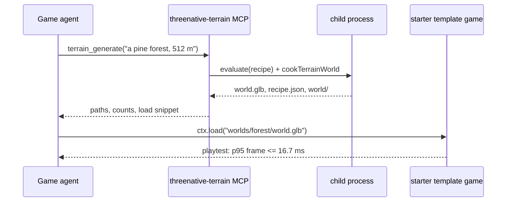

# PRD-584 — An agent asks for a forest over MCP and gets a 60 fps GLB

**Status:** PARTIAL
**Priority:** P1 — The epic's headline outcome: no MCP tool generates terrain today, and no measured number shows a handed-over Strata world holding 60 fps (AC-1 to AC-5).
**Complexity:** 7 (HIGH); risk override: closed-list boundary — a request-to-world tool sits next to the closed "preset/genre system" item
**Owner:** ThreeNative maintainers
**Depends on:** [PRD-583](PRD-583-a-strata-world-bakes-headlessly-into-an-instanced-glb.md)
**Epic:** [Strata terrain hardening](README.md)

## Context

Owner, 2026-10-10: "the AI agent could call some MCP endpoint like terrain_generation =>
'Generate a forest for me' => and then instantly it's generated and a .glb is provided, and the
game can use it at min 60fps performance."

Today, on `2d2124792`:

- No MCP server exposes terrain. `packages/core/mcp/servers.mjs` wires `threenative-assets`,
  `-sculpt`, `-engine` and `-blender`. None of them generates terrain.
- `engine_search_capabilities("generate a forest terrain with trees and rocks for my game and
  load it as a GLB", scope "request")` returns `Heightfield`, `getWorldCapabilities` and
  `TerrainTiles` first. `exportWorldGLB` is rank 7 (score 0.28) and needs a browser.
- The forest kit's trees come from licensed local-only assets (`examples/strata-terrain-preview/AGENTS.md`).
  CI and a user machine see procedural stand-ins.
- No playtest loads a handed-over Strata world in an ordinary game and measures it. The
  preview's own FPS reflects its own renderer (owner, 2026-10-05: judge the exported world as
  an ordinary game loads it).

## Solution

A fifth core-wired MCP server, `threenative-terrain`, follows the blender pattern: a shim in
`packages/core/mcp/terrain.mjs`, registered in `MCP_SERVERS`, launching a server bundled from
`packages/terrain`. It costs nothing until a tool is called.

Tools:

- `terrain_generate({ request, sizeMeters?, seed?, out? })` — picks one starter recipe
  (`forest`, `coastal`, `alpine`, `desert`, `tundra`) from the request, sets size and seed, runs
  `Terrain.evaluate` and PRD-583's `cookTerrainWorld` in a child process with a timeout (the
  evaluator only checks `AbortSignal` between operations; `AGENT_GUIDE.md` "Bounds"), and writes
  `public/worlds/<name>/world.glb`, `recipe.json` and the world package. It returns the paths,
  triangle, instance and draw counts, and a three-line load snippet.
- `terrain_patch({ recipe, commands })` reuses the editor's command vocabulary (`upsert`,
  `update`, `remove`, `move`, `toggle`) so the agent edits the returned recipe instead of
  re-prompting.

Species GLBs are CC0. They are fetched on first use through the existing asset MCP download path
and cached, so the tool does not depend on PRD-589's tarball diet.

The return names the starter recipe it chose. The recipe is editable game data, not a hidden
preset. That keeps the CHARTER's terrain allowance ("editable terrain starter documents") and
does not add a genre system. Phase 1 adds one line to that allowance naming this tool.

The 60 fps claim is measured on a stock template game, not the preview: the starter template
loads `world.glb` with `ctx.load`, walks a fixed path, and the playtest asserts frame time.

## Acceptance Criteria

- [x] AC-1 [local]: `tools/list` on the shipped shim lists `terrain_generate` and `terrain_patch`. proof: stdio spec beside the sculpt shim's `tools/list` test in `packages/core/__tests__` — Evidence: 2026-10-11 `mcp-install.spec.ts` 34/34 passed; shipped terrain shim lists both tools (377 ms).
- [x] AC-2 [local]: `terrain_generate({ request: "a pine forest" })` writes a `world.glb` that `GLTFLoader` loads, cold, within 60 s on the reference CPU. proof: `packages/terrain/__tests__/terrain-mcp.spec.ts` with timing — Evidence: 2026-10-11 cold shipped-server call + vanilla GLTFLoader passed, 18,058.2 ms < 60,000 ms; AMD Ryzen 9 5900X 12-Core Processor; 1/1 focused case. Full suite rerun: 39/39 passed, fresh tool child + loader 7,741.1 ms on the same CPU.
- [x] AC-3 [local]: `engine_search_capabilities` ranks the terrain tool or `cookTerrainWorld` first for "generate a forest for my game". proof: a case in the PRD-297 capability-recall gate — Evidence (2026-10-11): corpus row `request.terrain-forest-world` ("generate a forest for my game", scope request) returns `cookTerrainWorld` at rank 1 of 2 results. The stale not-owned `procedural-vegetation` situation "generate a forest of trees" became "grow procedural tree meshes" (tree-mesh growth stays game-owned; forest worlds are the terrain cook's), and `cookTerrainWorld` gained `@situation generate a forest world for my game`. `pnpm caps:recall` exits 0: recall@k 0.908 → 0.909 (80/88), zero-result rate 0.0575 → 0.0568, reject hits 16 → 16; capability-recall and capability-manifest specs 44/44.
- [ ] AC-4 [local]: The starter template loads the generated forest and holds p95 frame time ≤ 16.7 ms over a 300-frame walk on a named real GPU (WebGPU, `adapter.info` recorded). proof: `node packages/playtest/dist/runner/cli.js <terrain-forest>.playtest.json --browser-recipe webgpu` — Evidence: pending.
- [ ] AC-5 [local]: The same scenario holds p95 ≤ 16.7 ms on the native desktop host. proof: same scenario `--target desktop` — Evidence: pending.

## Blocked on

- An Android 60 fps claim needs the shared Pixel lane — unblocked by João lending the device (memory: ask for the Pixel). The emulator cannot hold a frame-time claim.

## Integration Ledger

| Capability | Reachable consumer/trigger | Replaces / disposition | Evidence |
|---|---|---|---|
| Terrain MCP server | `.mcp.json` written by installing `@threenative/core` → `mcp/terrain.mjs` | New | AC-1 |
| Request to world | `terrain_generate` → child process → `cookTerrainWorld` | Hand-run kit `bake.mjs` | AC-2 |
| Discovery | `engine_search_capabilities` | Rank 7 browser-only result | AC-3 |
| 60 fps handoff | starter template `ctx.load(world.glb)` | Preview-only FPS numbers | AC-4, AC-5 |

## Execution Phases

#### Phase 1: the tool generates a GLB
**Status:** COMPLETE
**Files:** `packages/terrain/src/mcp/server.ts` (new), `packages/core/mcp/terrain.mjs` (new), `packages/core/mcp/servers.mjs`, `docs/architecture/CHARTER.md`
**Implementation:** stdio MCP server; request → starter recipe by keyword with the choice returned; child process with timeout; CC0 species fetched through the asset MCP download path and cached.
- [x] Shim lists both tools. proof: stdio `tools/list` spec — 2026-10-11, 34/34 tests passed; terrain shim 377 ms.
- [x] A forest request writes a loadable GLB inside 60 s. proof: `terrain-mcp.spec.ts` — 2026-10-11, 18,058.2 ms, vanilla GLTFLoader; AMD Ryzen 9 5900X 12-Core Processor.
  Note 2026-10-11 (no box ticked). Decisions: D1 the server is hand-written stdio JSON-RPC, because the existing engine and blender servers are hand-written JSON-RPC with no SDK and their loops are bundled, not importable. D2 the server is a tsup entry of `packages/terrain` (`dist/mcp/server.js`, package `bin`), not a bundle in core, because bundling terrain into core closes the cycle core -> assets -> terrain -> core. Core gets only the shim `packages/core/mcp/terrain.mjs`, the `threenative-terrain` row in `MCP_SERVERS` and a `MCP_PACKAGES.terrain` pin; core gains no dependency on terrain. D3 terrain does not depend on `@threenative/assets`: the cook child loads it from the game project at run time and fails closed with `npm i -D @threenative/assets` when absent. D4 `packages/terrain/dist` stays under 2 MB.
  Changed: all five kits are accepted and each cooked through the built server (forest 5.6 s wall, 18,515,644 B `world.glb`; coastal, alpine, desert and tundra about 1.2 s each). `bounds` is narrowed by `parseBounds` with no cast. A pre-aborted signal never spawns. A timeout or cancel kills the whole process group and removes the partial output. `out` is rejected when it or any ancestor is a symlink leaving the project (realpath containment, dangling links included). `pnpm sync:mcp` rewrote the template MCP configs for the fifth server. `AGENT-INTERFACE.md` names it.
  Checks: `terrain-mcp.spec.ts` 23 of 23 pass. Red against the previous `child.ts` and `tools.ts`: 6 of the new cases fail. `mcp-install.spec.ts` 33 of 33 pass. Core typecheck 0 errors. Terrain `tsc --noEmit` has 165 errors in `starter/`, other specs and `examples/strata-terrain-preview`, 0 in `src/mcp` or `terrain-mcp.spec.ts`. Terrain build exits 0, `du -sb packages/terrain/dist` = 860,387. Stdio smoke through `node packages/core/mcp/terrain.mjs` lists `terrain_generate` and `terrain_patch` (`SMOKE PASS`). Scoped Biome exits 0 with one existing complexity warning in `servers.mjs`. Doctor pin test, primary-docs and release candidate cases pass with `-t "MCP|bundled"`.
  Open: `@threenative/terrain` is unpublished (npm 404), so the shim's npx fallback fails in a project that does not install it. `scripts/verify-golden-path.ts` (`MCP_SURFACES`, needs a recorded `terrain-mcp-tools.json`) and `scripts/verify-registry-install.ts` (safe tool, spec fixtures) still list four servers, so their specs fail until updated. The full runs of `doctor.spec.ts` and `verify-registry-install.spec.ts` have other failures not triaged. Species are the tracked starter GLBs, not the asset MCP download path. The result has no `ctx.load` snippet, triangle count or draw count. The cook reads data files from `starter/<kit>/`, which AGENTS.md says package code never imports. Input uses a `kit` enum, not `request`. The 60 s check is a timeout only, with no timing spec.
  Owner lane: /root/prd587_lifecycle. Checkout `.worktrees/strata-terrain-mcp`, branch `epic/strata-terrain-mcp`, base `f8c41d61070b967bc35351a2efd5573ccfe1d92d`. Lane retained until full584 integration.
  Note 2026-10-11 (no box ticked), continuation. Changed: `MCP_SURFACES` and `MCP_SAFE_TOOLS` carry `threenative-terrain` (probe: `terrain_patch` with an empty command list, never a cook); `terrain-mcp-tools.json` is written by `scripts/capture-terrain-mcp-tools.ts` and compared to the served tool table in `mcp-tool-schemas.spec.ts`. Doctor treats the terrain server as an optional addon: it is not probed through the shim's npx fallback when `@threenative/terrain` is absent, and says `Run: npm i -D @threenative/terrain`. `terrain_generate` now returns the kit as `recipe`, the `world.glb`, `recipe.json` and `world.json` paths, `triangles`, `instances` and `draws` read from the default scene of the produced GLB, and a three-line `ctx.assets.model` snippet (`ctx.load` is not an API in this repo). `triangles` counts every instance in full before LOD and culling, `draws` counts primitives with an instanced primitive once. Forest kit: 505,387,464 triangles, 4,820 instances, 25 draws.
  Checks (before, at 2e1ff40a4 -> after): `verify-golden-path.spec.ts` 21 of 23 -> 22 of 23, `verify-registry-install.spec.ts` 37 of 45 -> 45 of 45, `doctor.spec.ts` 99 of 99 -> 100 of 100, `scaffold-mcp.spec.ts` 27 -> 27, `mcp-install.spec.ts` 33 -> 33, `terrain-mcp.spec.ts` 23 -> 27. The one remaining golden-path failure (`packs a cold-layout CLI`) is not caused by the MCP change: the `create-threenative` prepack from f8c41d610 runs `stage-terrain-kits.mjs`, and the spec's copied tree has no `packages/terrain/starter-assets/credits.json`. Terrain `tsc --noEmit` now reports 6 errors, all in `examples/strata-terrain-preview/src/render/horizon.ts` (a missing `horizon.json`), a file with no diff against f8c41d610; the earlier 165 was not reproduced. `git diff --stat f8c41d610 HEAD -- packages/terrain` touches only `src/mcp`, `terrain-mcp.spec.ts`, `package.json` and `tsup.config.ts`.
  Open: the full golden-path and registry-install MCP steps are not run end to end: the golden-path scaffold does not install `@threenative/terrain`, and the package is unpublished, so the terrain probe there falls to the npx fallback until the package is published or the scaffold installs it.

#### Phase 2: agents find it
**Status:** NOT STARTED
**Files:** `packages/terrain` capability entries, `packages/create-threenative/capabilities.json` (generated), template `AGENTS.md` terrain line
**Implementation:** capability entry with situation "generate a forest/terrain/world for my game"; template `AGENTS.md` names the tool.
- [x] Search ranks the tool first. proof: capability-recall gate case — 2026-10-11: see AC-3; `pnpm caps:recall` exit 0, rank 1.

#### Phase 3: a stock game holds 60 fps on it
**Status:** NOT STARTED
**Files:** `packages/create-threenative/template-playtests/` (new forest scenario)
**Implementation:** scaffold the starter template, generate a forest with the tool, load it, walk 300 frames, assert p95 frame time.
- [ ] Web WebGPU p95 ≤ 16.7 ms. proof: playtest `--browser-recipe webgpu`
- [ ] Native desktop p95 ≤ 16.7 ms. proof: playtest `--target desktop`

2026-10-11 first-use asset preparation component verified, without an acceptance tick: a private session of the installed asset MCP downloaded the official CC0 Poly Haven `fir_tree_01` 1k Blender source (218,986,261 bytes; SHA-256 `153d20aae6d7c63a4c52689d91e8bead78f6d17a70e11ef4d03d19953383de00`) into an isolated artifact cache in 1.787 seconds, with `alreadyExisted: false` and license acknowledgement. Downloading the `.blend` alone is insufficient: the existing exporter first stopped on its missing bark image. The provider lists 18 PNG dependencies; retrieving them through the same MCP, verifying their declared sizes/MD5 and restoring their declared relative `textures/` paths took 1.265 seconds, all uncached. The unchanged existing `prep-polyhaven-fir.py --only b:2` then exported and self-checked the authored LOD2 in 3.848 seconds: 54,927 triangles, one mesh, four materials, six embedded images, POSITION/NORMAL/TEXCOORD_0 and base Y zero. Its 5,153,060-byte GLB has SHA-256 `a7e1f126ba7c09aa160f82e200689312334204928c9d822a1eaf13ed9d259dc8`, exactly matching the existing repository asset. The successful component timings sum to 6.900 seconds; this was a diagnostic sequence, not a single end-to-end cold forest generation. The existing 10 GiB downloader cap was unchanged. No new generator, shipped preparation path, loadability playtest, complete forest timing or web/native frame budget is proven; all full acceptance criteria remain open.

2026-10-11 imported-LOD runtime component remains unimplemented: isolated `strata-imported-lod` lane at `f8c41d610` completed offline frozen ignore-scripts install. A bounded Haiku MAX arm timed out after saving only additions to existing `model-lod-loader.spec.ts`; no production fix landed. The actual createAssetLoader/GLTFLoader fixture carrying EXT_mesh_gpu_instancing and TN_discrete_lod produces 7 passing and 2 failing tests (10.45 s): near/far instances draw the same geometry, and a separate ownership assertion finds no chain on the inspected base geometry (0 levels versus 2 expected). This does not isolate the partition-hook cause from chain association, so no GREEN or complete behavioural proof is claimed. Scoped test Biome passes; core typecheck fails on missing local playtest protocol/three declarations. No assets cook, native/browser conformance proof or FPS measurement ran; the current cook also still needs existing chain generation and writer preservation before its terrain triangle budget can improve. No acceptance box ticked.

2026-10-11 imported-LOD runtime component verified locally, without an acceptance tick: retained RED loader tests were committed unchanged as `03161de4b`. The empty chain was an association loss, not missing fixture metadata or a geometry clone: the fixture writes TN_discrete_lod on its primitive (`packages/core/__tests__/model-lod-loader.spec.ts:136`); Three's GLTFLoader constructs the imported InstancedMesh over the original geometry without transferring its primitive association (`packages/core/node_modules/three/examples/jsm/loaders/GLTFLoader.js:1762`), stamps only its node association (`:4402–4411`), and drops the replaced source mesh's association (`:4506`). The reader consequently skipped it for missing mesh/primitive indices. DiscreteLodPlugin now recovers those indices from the glTF node and primitive order, including multi-part nodes, and the asset loader injects the existing attachInstancedLod mechanism after decoded-chain registration, avoiding a runtime import cycle. Imported instances use the existing 4 px projected-error default and hysteresis, with manifest runtime overrides; an unchained primitive remains unchanged. The retained ray fixture required front-facing triangle winding and a ray away from a shared edge. Local focused baseline: 69 passing / 2 failing specs in six files (loader 7 / 2); final: 72 passing / 0 failing (loader 10 passing, including added mixed-chain multi-part coverage). Tests verify independent near/far detail, stable authored slots/count, public ray-hit ids, manifest budget/hysteresis, and disposal that releases partitions/restores base without disposing shared chain geometry. Core typecheck passes after the permitted @threenative/playtest build restored local protocol/three declarations; scoped Biome passes with eight cognitive-complexity warnings and no errors. No packages/assets changes, browser/native playtest, real-world triangle count or FPS measurement ran. The cooker still must emit and preserve valid TN_discrete_lod chains for real Strata worlds; 60 fps acceptance remains open.

2026-10-11 combined-world cooker LOD component verified locally, without an acceptance tick: `cookTerrainWorld` reuses `generateDiscreteLod` on near species with cutout conversion disabled and vertex-copy card reduction disabled; the final writer registers `TNDiscreteLod`. Index-only chain errors and error scales follow the existing source-node transform during flattening. The real forest spec runs the actual cooker on the shipped recipe, RAW16 sidecar, models and ground textures (5.638 s in the final focused rerun), checks decoded/transformed source vertex hashes, unchanged LOD0 indices/material factors, shared vertex buffers, transformed error scales, and computes selection from the cooked GLB's instance attributes using core's projected-error selector, 4 px budget and 0.15 hysteresis starting at LOD0. Camera position (256,40,600), look-at (256,10,256), 60-degree vertical FOV, 1920×1080 viewport, near 0.1, far 2000; this counts all placements without frustum/shadow-pass culling and is not a GPU frame measurement. Clean HEAD before: base and submitted 505,387,464 triangles, no species chains. After: unchanged base 505,387,464; submitted 18,917,904, including unchanged terrain 139,264. Fir: 3,100 instances, base 398,238,400, submitted 13,001,400; primitive triangle ladders including LOD0 [9582,2460,1339], [78776,3466,1488,722], [35136,1757], [4970,2418,902,376]. Boulder: 320 instances, base 10,579,200, submitted 528,640; ladder [33060,18794,6432,2350,1652]. Fir-c: 1,400 instances, base 96,430,600, submitted 5,248,600; ladders [9536,2442,1313], [9459,1500], [3616,2402,1188,428], [46268,1732,848,508]. Before/after kit bakes contain 22 files: only world.glb changes, SHA-256 e64b584dba6fdfd0ab05c30e2d0b0b3ad39231ae735208ef5283a8c2b6df3993 → c23570826bc1100f13768ae57c7922b50e321327ec810ccb426e4b7fea818700, because of added index chains and transformed error metadata; all 21 other files, including streamed models and every non-GLB output, retain their hashes. A byte comparison also confirms 109 default-scene vertex/index/instance streams and materials, textures, samplers and embedded images unchanged. No existing pin changed: the starter-kit pinned hashes cover non-GLB outputs, and the assets terrain-world spec has no cooked-GLB hash pin. Rebuilding checkout prerequisites and assets restored the clean baseline: requested four-file specs 92/92 passing, including non-finite placement; after 93/93 passing, followed by 20/20 terrain-world specs on the final census edit. The retained transformed-error assertion fails without source-scale propagation (1.3152257204 versus 9.2575621605) and passes with it. Assets/core typechecks and assets build pass; scoped Biome passes with seven warnings and no errors. No browser, GPU, native or FPS run; coordinator qualification and all full acceptance criteria remain open.

2026-10-11 Phase 3 scaffolding added, web smoke did not reach a frame (no box ticked). `pnpm verify:forest-playtest [--target web|desktop]` (`scripts/verify-forest-playtest.ts`, spec `scripts/__tests__/verify-forest-playtest.spec.ts`, 3/3 passing) packs the workspace, scaffolds the stock starter, calls the real `terrain_generate` through the core shim over stdio with `{ kit: "forest" }` (the tool takes `kit`, not `request`), inserts only the printed `ctx.assets.model("worlds/forest/world.glb")` + `ctx.scene.add(world.scene)` lines at the start of `Play.load`, and runs `template-playtests/starter-forest/forest.playtest.json` (web) or `forest.native.playtest.json` (desktop): 300-tick ArrowUp walk, `assert.performance.maxFrameMsP95 16.7`, `movement` -z >= 0.5. Web smoke on the NVIDIA GPU (`--browser-recipe webgpu`, private Xvfb) exited 2 with `TN_PLAYTEST_BRIDGE_MISSING` at 0 frames: no adapter, p50 or p95 was measured. Cause, shown with a control: the same scaffold without the two load lines boots (bridge present, 300-frame windows of p95 5.3 to 6.5 ms). With them, the page never requests `world.glb` and stalls with `TN_STARTUP_STALLED`, because the production build resolves assets through `assets.manifest.json` and `worlds/forest/world.glb` under `public/` is not listed (`packaging: 28 unmanaged file(s)`; `resolveCandidates` throws "is not listed in the asset manifest", which surfaces only as the stall). Moving the world to `assets/worlds/forest/` so the pipeline lists it made `pnpm build:web` run past 10 minutes (KTX2 encoding of the world's textures) before it was stopped, so that route is not yet measured. Open: the tool's default `out` and printed snippet do not load in a manifest-built game.

2026-10-11 D1–D5 production hardening (no boxes ticked). `terrain_generate` now derives the configured `assets.source` through the installed Vite config loader, defaults to `assets/worlds/<chosen-kit>/`, rejects outputs outside that source root, and prints a source-relative manifest key. A new cooker marker, `asset.extras.tnTerrainWorld = 1`, selects validated GLB passthrough: copy/hash/list without model passes or name-insensitive deduplication; ordinary models still process. Initial Scene.load failures and rejected `#goto` transitions now report the original error through `onLaunchFailure` and `TN_STARTUP_FAILED`; the previous `transition.then(settled, settled)` handler handled the rejection without reporting it. Request matching is deterministic in starter order: forest/pine/woods, coastal/beach/coast/sea, alpine/mountain/snowy/peaks, desert/dunes/sand, tundra/arctic/ice; `kit` overrides matching, unmatched requests list all five kits, and the recorded MCP schema is regenerated. Both terrain specs now use `makeTempDir`, without guard allowlisting. Checks: 212 focused tests pass across asset compile/terrain-world/shared-images (88), core game/launch diagnostics (62), terrain MCP (36), terrain consumer (18), temp-dir guard (1), and MCP schemas (7). Assets/core typechecks and assets/terrain builds pass; scoped Biome passes with warnings. Terrain typecheck still fails in untouched preview code because `examples/strata-terrain-preview/src/world/horizon.json` is missing. The single requested NVIDIA web run built within the 10-minute limit and loaded/walked: adapter.info vendor `nvidia`, architecture `turing`; startup ready; movement 1.40 m along -z; zero console/network errors. Nearest-rank frame times over 199 samples: p50 21.4 ms, p95 213.6 ms. Overall FAIL: unchanged p95 ceiling 16.7 ms. Production manifest lists the 19,199,432-byte world with `passes: []`; served bytes equal the source, SHA-256 `36c1e72f030203d2400604fae78029143d111da431648f348c531eab11a9f282`. No tuning, threshold change, second forest run, native run, or push. Full-board qualification and the 60 fps acceptance remain open. Failed-run diagnostics are retained at `/tmp/threenative-forest-playtest-1LjmWY/forest/artifacts/playtest` and `/tmp/584-forest-web.log`.

2026-10-11 Cooked-world model-loader LOD regression fixed (no boxes ticked). `ctx.assets.model` routes through `createAssetLoader`, which already registers and attaches `DiscreteLodPlugin`; the cooked forest retains `TN_discrete_lod`. The failure is in association discovery: Three.js replaces `parser.associations` with each scene's reduced map, so alternate species LOD scenes remove the main world's instanced-node mappings before `DiscreteLodPlugin.afterRoot`. The shared plugin now loads node dependencies and retains their complete association map in `beforeRoot`, then uses it for primitive/instancing discovery. No distance, threshold or appearance value changed. RED: the real cooked forest loaded through `createAssetLoader.model("worlds/forest/world.glb")` had zero partition children; a minimal multi-scene loader regression also returned zero instead of two. GREEN: 61/61 tests across terrain-world, model-lod-loader/runtime/clone/join pass; core and assets typechecks pass; scoped Biome passes with warnings. `pnpm capabilities:sync` and `pnpm api:surface:sync` pass with no tracked drift. Full lint passes on the Debian offload lane with warnings; full typecheck fails on absent package build outputs, and full `pnpm test` stops because that lane has no Git HEAD, so full qualification remains unverified. The single requested NVIDIA-environment web command (`flock /tmp/strata-terrain-gpu-proof.lock pnpm verify:forest-playtest`) exited 1 before browser launch: the driver inserts the tool's static `applyTerrainSurface` import inside `Play.load`, and the production scaffold build rejects `src/scenes/Play.ts:61` with a top-level-import parse error. Adapter, p50, p95 and triangles/frame were not measured. No second forest run, tuning, native run or push. Command output: `/tmp/584lod-forest-web.log`.

2026-10-11 bounded item 3 skipped after two recall runs returned `none` (1/1 focused failure, then 17/18 pass). The `procedural-vegetation` not-owned situation `generate a forest of trees` preempts the request. Adding an honest forest-world situation to `cookTerrainWorld` also makes `pnpm capabilities:sync` reject overlapping ownership (score 0.375000). Trial edits reverted; AC-3 and phase 2 remain open. Resolving the ownership declaration is required before description-only ranking can work; no ranker special case added.

2026-10-11 Black-fir diagnosis, root cause not found, no boxes ticked. In a scaffolded starter with the cooked forest `world.glb`, every fir renders near-black under the starter's post chain, and the same trees render lit with `exp=nopost`. This is not a regression between `3b32a45c2` (the SHA nearest the PR comment frame) and `b202ca25a`: `git diff 3b32a45c2 b202ca25a -- packages/create-threenative/templates/starter/src` is empty, and the HEAD template and cooked GLB on core built at `3b32a45c2` (with that SHA's Three patch) also render black. The PR comment frame (`BAD-prd591-hardware-walk`) came from the `examples/strata-terrain-preview` app, not a scaffold, so it never proved the starter path. Measured on the NVIDIA adapter (`vendor: nvidia`): a plain red `MeshBasicMaterial` on every fir is red with no chain and black under the default chain, so the cause does not depend on material, lighting, shadows, fog, `alphaAntialiasing` (turning it off changes nothing) or albedo. With the canvas CSS background set to magenta, fir pixels read about (87, 1, 86): near-zero RGB with alpha about 0.66, so the chain output carries a wrong alpha and colour on fir pixels while terrain stays opaque. Removing bloom, vignette, GTAO, grade and grain together turned the red firs red again; removing only some of them did not. The stage that zeroes fir RGB is therefore unidentified. Next step: add a per-stage alpha and RGB readout on a fir pixel to `WorldEnvironment`, then bisect stages one at a time. The playtest has no luminance assertion, so the black frame passed the 584 walk.

2026-10-11 Black-fir root cause found and fixed in the cooker (layer: engine, `packages/assets`), no boxes ticked. The cooked `world.glb` stored all-zero vertex normals for every instanced prop (fir 5 774 of 5 774, boulder 19 773 of 19 773, fir-c 5 750 of 5 750 vertices), while the source `fir.glb` had none. `@gltf-transform/functions` `transformMesh` writes a normalized-integer NORMAL back through `decodeNormalizedInt` instead of the encode function, and `addInstancedSpeciesNode` (`packages/assets/src/world/terrain-world.ts`) flattens each quantized species through it. Zero normals mean no direct light, and the starter's GTAO read zero MRT normals (confirmed with a normal-target view: tree pixels were 0, terrain and a plain user box were not) so its raw occlusion was 0 on trees. The earlier alpha 0.66 was premultiplied-canvas compositing of that near-black, not a stage bug. Fix: `dequantizeNormals` converts a normalized NORMAL to float before `transformMesh`. RED: new spec "keeps the unit length of quantized species normals through the flatten" fails with length 0, passes after; the real-forest spec's expectation had encoded the same bug and now transforms floats. Tree-only metric (pixels that change when firs are hidden, same pose, NVIDIA turing adapter): mean sRGB (13.8, 25.2, 29.8) before, (16.5, 20.7, 14.6) after, p90 luma 0.095 to 0.181, two identical runs per arm. A fresh read-only `claude -p --model sonnet` judge returned IMPROVEMENT on all three pairs (run1, run2, pose2); its ranked remaining defects start with foliage still near-black (GTAO radius 0.35 m and scale 1 crush dense cutout canopies: GTAO off or scale 0.3 lifts tree luma from 0.076 to about 0.2, an unjudged look change left for the template owner), then no visible sun shading, flat sky and fog, and an empty ground. The `forest world.glb` golden hash in `packages/terrain/__tests__/starter-kit.spec.ts` was repinned for the corrected bytes. The standard forest walk playtest frame (spawn arena) shows no trees, so a tree-pixel assertion there is not possible without a camera pose step; the data-level spec is the guard. Open: the visual-judge box for AC "looks lit" stays unticked because the verdict is IMPROVEMENT-from-black, not AAA.
