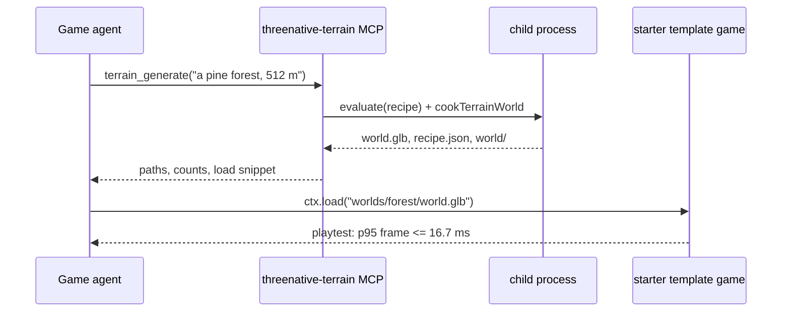

# PRD-584 — An agent asks for a forest over MCP and gets a 60 fps GLB

**Status:** PARTIAL
**Priority:** P1 — The epic's headline outcome: no MCP tool generates terrain today, and no measured number shows a handed-over Strata world holding 60 fps (AC-1 to AC-5).
**Complexity:** 7 (HIGH); risk override: closed-list boundary — a request-to-world tool sits next to the closed "preset/genre system" item
**Owner:** ThreeNative maintainers
**Depends on:** [PRD-583](PRD-583-a-strata-world-bakes-headlessly-into-an-instanced-glb.md)
**Epic:** [Strata terrain hardening](README.md)

## Context

Owner, 2026-10-10: "the AI agent could call some MCP endpoint like terrain_generation =>
'Generate a forest for me' => and then instantly it's generated and a .glb is provided, and the
game can use it at min 60fps performance."

Today, on `2d2124792`:

- No MCP server exposes terrain. `packages/core/mcp/servers.mjs` wires `threenative-assets`,
  `-sculpt`, `-engine` and `-blender`. None of them generates terrain.
- `engine_search_capabilities("generate a forest terrain with trees and rocks for my game and
  load it as a GLB", scope "request")` returns `Heightfield`, `getWorldCapabilities` and
  `TerrainTiles` first. `exportWorldGLB` is rank 7 (score 0.28) and needs a browser.
- The forest kit's trees come from licensed local-only assets (`examples/strata-terrain-preview/AGENTS.md`).
  CI and a user machine see procedural stand-ins.
- No playtest loads a handed-over Strata world in an ordinary game and measures it. The
  preview's own FPS reflects its own renderer (owner, 2026-10-05: judge the exported world as
  an ordinary game loads it).

## Solution

A fifth core-wired MCP server, `threenative-terrain`, follows the blender pattern: a shim in
`packages/core/mcp/terrain.mjs`, registered in `MCP_SERVERS`, launching a server bundled from
`packages/terrain`. It costs nothing until a tool is called.

Tools:

- `terrain_generate({ request, sizeMeters?, seed?, out? })` — picks one starter recipe
  (`forest`, `coastal`, `alpine`, `desert`, `tundra`) from the request, sets size and seed, runs
  `Terrain.evaluate` and PRD-583's `cookTerrainWorld` in a child process with a timeout (the
  evaluator only checks `AbortSignal` between operations; `AGENT_GUIDE.md` "Bounds"), and writes
  `public/worlds/<name>/world.glb`, `recipe.json` and the world package. It returns the paths,
  triangle, instance and draw counts, and a three-line load snippet.
- `terrain_patch({ recipe, commands })` reuses the editor's command vocabulary (`upsert`,
  `update`, `remove`, `move`, `toggle`) so the agent edits the returned recipe instead of
  re-prompting.

Species GLBs are CC0. They are fetched on first use through the existing asset MCP download path
and cached, so the tool does not depend on PRD-589's tarball diet.

The return names the starter recipe it chose. The recipe is editable game data, not a hidden
preset. That keeps the CHARTER's terrain allowance ("editable terrain starter documents") and
does not add a genre system. Phase 1 adds one line to that allowance naming this tool.

The 60 fps claim is measured on a stock template game, not the preview: the starter template
loads `world.glb` with `ctx.load`, walks a fixed path, and the playtest asserts frame time.

## Acceptance Criteria

- [x] AC-1 [local]: `tools/list` on the shipped shim lists `terrain_generate` and `terrain_patch`. proof: stdio spec beside the sculpt shim's `tools/list` test in `packages/core/__tests__` — Evidence: 2026-10-11 `mcp-install.spec.ts` 34/34 passed; shipped terrain shim lists both tools (377 ms).
- [x] AC-2 [local]: `terrain_generate({ request: "a pine forest" })` writes a `world.glb` that `GLTFLoader` loads, cold, within 60 s on the reference CPU. proof: `packages/terrain/__tests__/terrain-mcp.spec.ts` with timing — Evidence: 2026-10-11 cold shipped-server call + vanilla GLTFLoader passed, 18,058.2 ms < 60,000 ms; AMD Ryzen 9 5900X 12-Core Processor; 1/1 focused case. Full suite rerun: 39/39 passed, fresh tool child + loader 7,741.1 ms on the same CPU.
- [x] AC-3 [local]: `engine_search_capabilities` ranks the terrain tool or `cookTerrainWorld` first for "generate a forest for my game". proof: a case in the PRD-297 capability-recall gate — Evidence (2026-10-11): corpus row `request.terrain-forest-world` ("generate a forest for my game", scope request) returns `cookTerrainWorld` at rank 1 of 2 results. The stale not-owned `procedural-vegetation` situation "generate a forest of trees" became "grow procedural tree meshes" (tree-mesh growth stays game-owned; forest worlds are the terrain cook's), and `cookTerrainWorld` gained `@situation generate a forest world for my game`. `pnpm caps:recall` exits 0: recall@k 0.908 → 0.909 (80/88), zero-result rate 0.0575 → 0.0568, reject hits 16 → 16; capability-recall and capability-manifest specs 44/44.
- [ ] AC-4 [local]: The starter template loads the generated forest and holds p95 frame time ≤ 16.7 ms over a 300-frame walk on a named real GPU (WebGPU, `adapter.info` recorded), with grass, low plants and ferns visibly present at walking height in the generated forest starter consumer under the original streaming budgets. proof: `node packages/playtest/dist/runner/cli.js <terrain-forest>.playtest.json --browser-recipe webgpu` and matched headed walking-height captures with fresh independent visual judgment — Evidence: pending. Partial, NOT the prescribed scenario (no template forest walk scenario exists yet, so this stays open): 2026-10-11 `KIT=forest pnpm test:kit` on `19a2fb3b2`, adapter nvidia/turing (RTX 2080), headed WebGPU, 819 frames, pass. Machine load 7.9: frame p95 overview 10.5, lake 12.0, ground 13.6, edge 10.7 ms; GPU p95 2.47, 6.32, 4.88, 5.65 ms. An earlier run at load 39 measured ground 111.2 and edge 116.0 ms with the same GPU p95, so the measurement needs a quiet host.
- [ ] AC-5 [local]: The same scenario holds p95 ≤ 16.7 ms on the native desktop host. proof: same scenario `--target desktop` — Evidence: pending.

Forest appearance follow-up: [existing PRD-584 child](forest-leaf-alpha.md), AC-5, retains the unresolved squared needle tips; its earlier leaf IMPROVEMENT is historical. The scoped CPU audit finds trees/boulders but no low cover in the shipped source recipe; ignored staged BEFORE/AFTER packages already contain 9,000 fern and 5,000 small-fern placements, which prove neither runtime visibility nor delivery.

## Blocked on

- An Android 60 fps claim needs the shared Pixel lane — unblocked by João lending the device (memory: ask for the Pixel). The emulator cannot hold a frame-time claim.

## Integration Ledger

| Capability | Reachable consumer/trigger | Replaces / disposition | Evidence |
|---|---|---|---|
| Terrain MCP server | `.mcp.json` written by installing `@threenative/core` → `mcp/terrain.mjs` | New | AC-1 |
| Request to world | `terrain_generate` → child process → `cookTerrainWorld` | Hand-run kit `bake.mjs` | AC-2 |
| Discovery | `engine_search_capabilities` | Rank 7 browser-only result | AC-3 |
| 60 fps handoff | starter template `ctx.load(world.glb)` | Preview-only FPS numbers | AC-4, AC-5 |

## Execution Phases

#### Phase 1: the tool generates a GLB
**Status:** COMPLETE
**Files:** `packages/terrain/src/mcp/server.ts` (new), `packages/core/mcp/terrain.mjs` (new), `packages/core/mcp/servers.mjs`, `docs/architecture/CHARTER.md`
**Implementation:** stdio MCP server; request → starter recipe by keyword with the choice returned; child process with timeout; CC0 species fetched through the asset MCP download path and cached.
- [x] Shim lists both tools. proof: stdio `tools/list` spec — 2026-10-11, 34/34 tests passed; terrain shim 377 ms.
- [x] A forest request writes a loadable GLB inside 60 s. proof: `terrain-mcp.spec.ts` — 2026-10-11, 18,058.2 ms, vanilla GLTFLoader; AMD Ryzen 9 5900X 12-Core Processor.
  Note 2026-10-11 (no box ticked). Decisions: D1 the server is hand-written stdio JSON-RPC, because the existing engine and blender servers are hand-written JSON-RPC with no SDK and their loops are bundled, not importable. D2 the server is a tsup entry of `packages/terrain` (`dist/mcp/server.js`, package `bin`), not a bundle in core, because bundling terrain into core closes the cycle core -> assets -> terrain -> core. Core gets only the shim `packages/core/mcp/terrain.mjs`, the `threenative-terrain` row in `MCP_SERVERS` and a `MCP_PACKAGES.terrain` pin; core gains no dependency on terrain. D3 terrain does not depend on `@threenative/assets`: the cook child loads it from the game project at run time and fails closed with `npm i -D @threenative/assets` when absent. D4 `packages/terrain/dist` stays under 2 MB.
  Changed: all five kits are accepted and each cooked through the built server (forest 5.6 s wall, 18,515,644 B `world.glb`; coastal, alpine, desert and tundra about 1.2 s each). `bounds` is narrowed by `parseBounds` with no cast. A pre-aborted signal never spawns. A timeout or cancel kills the whole process group and removes the partial output. `out` is rejected when it or any ancestor is a symlink leaving the project (realpath containment, dangling links included). `pnpm sync:mcp` rewrote the template MCP configs for the fifth server. `AGENT-INTERFACE.md` names it.
  Checks: `terrain-mcp.spec.ts` 23 of 23 pass. Red against the previous `child.ts` and `tools.ts`: 6 of the new cases fail. `mcp-install.spec.ts` 33 of 33 pass. Core typecheck 0 errors. Terrain `tsc --noEmit` has 165 errors in `starter/`, other specs and `examples/strata-terrain-preview`, 0 in `src/mcp` or `terrain-mcp.spec.ts`. Terrain build exits 0, `du -sb packages/terrain/dist` = 860,387. Stdio smoke through `node packages/core/mcp/terrain.mjs` lists `terrain_generate` and `terrain_patch` (`SMOKE PASS`). Scoped Biome exits 0 with one existing complexity warning in `servers.mjs`. Doctor pin test, primary-docs and release candidate cases pass with `-t "MCP|bundled"`.
  Open: `@threenative/terrain` is unpublished (npm 404), so the shim's npx fallback fails in a project that does not install it. `scripts/verify-golden-path.ts` (`MCP_SURFACES`, needs a recorded `terrain-mcp-tools.json`) and `scripts/verify-registry-install.ts` (safe tool, spec fixtures) still list four servers, so their specs fail until updated. The full runs of `doctor.spec.ts` and `verify-registry-install.spec.ts` have other failures not triaged. Species are the tracked starter GLBs, not the asset MCP download path. The result has no `ctx.load` snippet, triangle count or draw count. The cook reads data files from `starter/<kit>/`, which AGENTS.md says package code never imports. Input uses a `kit` enum, not `request`. The 60 s check is a timeout only, with no timing spec.
  Owner lane: /root/prd587_lifecycle. Checkout `.worktrees/strata-terrain-mcp`, branch `epic/strata-terrain-mcp`, base `f8c41d61070b967bc35351a2efd5573ccfe1d92d`. Lane retained until full584 integration.
  Note 2026-10-11 (no box ticked), continuation. Changed: `MCP_SURFACES` and `MCP_SAFE_TOOLS` carry `threenative-terrain` (probe: `terrain_patch` with an empty command list, never a cook); `terrain-mcp-tools.json` is written by `scripts/capture-terrain-mcp-tools.ts` and compared to the served tool table in `mcp-tool-schemas.spec.ts`. Doctor treats the terrain server as an optional addon: it is not probed through the shim's npx fallback when `@threenative/terrain` is absent, and says `Run: npm i -D @threenative/terrain`. `terrain_generate` now returns the kit as `recipe`, the `world.glb`, `recipe.json` and `world.json` paths, `triangles`, `instances` and `draws` read from the default scene of the produced GLB, and a three-line `ctx.assets.model` snippet (`ctx.load` is not an API in this repo). `triangles` counts every instance in full before LOD and culling, `draws` counts primitives with an instanced primitive once. Forest kit: 505,387,464 triangles, 4,820 instances, 25 draws.
  Checks (before, at 2e1ff40a4 -> after): `verify-golden-path.spec.ts` 21 of 23 -> 22 of 23, `verify-registry-install.spec.ts` 37 of 45 -> 45 of 45, `doctor.spec.ts` 99 of 99 -> 100 of 100, `scaffold-mcp.spec.ts` 27 -> 27, `mcp-install.spec.ts` 33 -> 33, `terrain-mcp.spec.ts` 23 -> 27. The one remaining golden-path failure (`packs a cold-layout CLI`) is not caused by the MCP change: the `create-threenative` prepack from f8c41d610 runs `stage-terrain-kits.mjs`, and the spec's copied tree has no `packages/terrain/starter-assets/credits.json`. Terrain `tsc --noEmit` now reports 6 errors, all in `examples/strata-terrain-preview/src/render/horizon.ts` (a missing `horizon.json`), a file with no diff against f8c41d610; the earlier 165 was not reproduced. `git diff --stat f8c41d610 HEAD -- packages/terrain` touches only `src/mcp`, `terrain-mcp.spec.ts`, `package.json` and `tsup.config.ts`.
  Open: the full golden-path and registry-install MCP steps are not run end to end: the golden-path scaffold does not install `@threenative/terrain`, and the package is unpublished, so the terrain probe there falls to the npx fallback until the package is published or the scaffold installs it.

#### Phase 2: agents find it
**Status:** NOT STARTED
**Files:** `packages/terrain` capability entries, `packages/create-threenative/capabilities.json` (generated), template `AGENTS.md` terrain line
**Implementation:** capability entry with situation "generate a forest/terrain/world for my game"; template `AGENTS.md` names the tool.
- [x] Search ranks the tool first. proof: capability-recall gate case — 2026-10-11: see AC-3; `pnpm caps:recall` exit 0, rank 1.

#### Phase 3: a stock game holds 60 fps on it
**Status:** IN PROGRESS
**Files:** `packages/create-threenative/template-playtests/` (new forest scenario)
**Implementation:** scaffold the starter template, generate a forest with the tool, load it, walk 300 frames, assert p95 frame time.
- [ ] Web WebGPU p95 ≤ 16.7 ms with visible walking-height grass, low plants and ferns in the generated starter, preserving original streaming budgets. proof: playtest `--browser-recipe webgpu`
  Character component, 2026-10-14: fresh read-only visual judge returns IMPROVEMENT for both matched BEFORE/AFTER pairs and overall: north-facing running pose repeats, feet/shins remain visible, no introduced character artifact. All four headed Nvidia/Turing 1920×1080 captures have exactly matching tick 600, body position and complete camera metadata. The reviewer cautions that BEFORE also has a visible lower foot: these stills prove heading improvement, not contact throughout a stride or a dramatic burial correction. Stock starter coyote jump, buffered jump and respawn scenarios each pass on the laptop hardware adapter. Tree/ground art, continuous grounding, native and the frame budget remain open; this box stays unticked.
- [ ] Native desktop p95 ≤ 16.7 ms. proof: playtest `--target desktop`

2026-10-11 first-use asset preparation component verified, without an acceptance tick: a private session of the installed asset MCP downloaded the official CC0 Poly Haven `fir_tree_01` 1k Blender source (218,986,261 bytes; SHA-256 `153d20aae6d7c63a4c52689d91e8bead78f6d17a70e11ef4d03d19953383de00`) into an isolated artifact cache in 1.787 seconds, with `alreadyExisted: false` and license acknowledgement. Downloading the `.blend` alone is insufficient: the existing exporter first stopped on its missing bark image. The provider lists 18 PNG dependencies; retrieving them through the same MCP, verifying their declared sizes/MD5 and restoring their declared relative `textures/` paths took 1.265 seconds, all uncached. The unchanged existing `prep-polyhaven-fir.py --only b:2` then exported and self-checked the authored LOD2 in 3.848 seconds: 54,927 triangles, one mesh, four materials, six embedded images, POSITION/NORMAL/TEXCOORD_0 and base Y zero. Its 5,153,060-byte GLB has SHA-256 `a7e1f126ba7c09aa160f82e200689312334204928c9d822a1eaf13ed9d259dc8`, exactly matching the existing repository asset. The successful component timings sum to 6.900 seconds; this was a diagnostic sequence, not a single end-to-end cold forest generation. The existing 10 GiB downloader cap was unchanged. No new generator, shipped preparation path, loadability playtest, complete forest timing or web/native frame budget is proven; all full acceptance criteria remain open.

2026-10-11 imported-LOD runtime component remains unimplemented: isolated `strata-imported-lod` lane at `f8c41d610` completed offline frozen ignore-scripts install. A bounded Haiku MAX arm timed out after saving only additions to existing `model-lod-loader.spec.ts`; no production fix landed. The actual createAssetLoader/GLTFLoader fixture carrying EXT_mesh_gpu_instancing and TN_discrete_lod produces 7 passing and 2 failing tests (10.45 s): near/far instances draw the same geometry, and a separate ownership assertion finds no chain on the inspected base geometry (0 levels versus 2 expected). This does not isolate the partition-hook cause from chain association, so no GREEN or complete behavioural proof is claimed. Scoped test Biome passes; core typecheck fails on missing local playtest protocol/three declarations. No assets cook, native/browser conformance proof or FPS measurement ran; the current cook also still needs existing chain generation and writer preservation before its terrain triangle budget can improve. No acceptance box ticked.

2026-10-11 imported-LOD runtime component verified locally, without an acceptance tick: retained RED loader tests were committed unchanged as `03161de4b`. The empty chain was an association loss, not missing fixture metadata or a geometry clone: the fixture writes TN_discrete_lod on its primitive (`packages/core/__tests__/model-lod-loader.spec.ts:136`); Three's GLTFLoader constructs the imported InstancedMesh over the original geometry without transferring its primitive association (`packages/core/node_modules/three/examples/jsm/loaders/GLTFLoader.js:1762`), stamps only its node association (`:4402–4411`), and drops the replaced source mesh's association (`:4506`). The reader consequently skipped it for missing mesh/primitive indices. DiscreteLodPlugin now recovers those indices from the glTF node and primitive order, including multi-part nodes, and the asset loader injects the existing attachInstancedLod mechanism after decoded-chain registration, avoiding a runtime import cycle. Imported instances use the existing 4 px projected-error default and hysteresis, with manifest runtime overrides; an unchained primitive remains unchanged. The retained ray fixture required front-facing triangle winding and a ray away from a shared edge. Local focused baseline: 69 passing / 2 failing specs in six files (loader 7 / 2); final: 72 passing / 0 failing (loader 10 passing, including added mixed-chain multi-part coverage). Tests verify independent near/far detail, stable authored slots/count, public ray-hit ids, manifest budget/hysteresis, and disposal that releases partitions/restores base without disposing shared chain geometry. Core typecheck passes after the permitted @threenative/playtest build restored local protocol/three declarations; scoped Biome passes with eight cognitive-complexity warnings and no errors. No packages/assets changes, browser/native playtest, real-world triangle count or FPS measurement ran. The cooker still must emit and preserve valid TN_discrete_lod chains for real Strata worlds; 60 fps acceptance remains open.

2026-10-11 combined-world cooker LOD component verified locally, without an acceptance tick: `cookTerrainWorld` reuses `generateDiscreteLod` on near species with cutout conversion disabled and vertex-copy card reduction disabled; the final writer registers `TNDiscreteLod`. Index-only chain errors and error scales follow the existing source-node transform during flattening. The real forest spec runs the actual cooker on the shipped recipe, RAW16 sidecar, models and ground textures (5.638 s in the final focused rerun), checks decoded/transformed source vertex hashes, unchanged LOD0 indices/material factors, shared vertex buffers, transformed error scales, and computes selection from the cooked GLB's instance attributes using core's projected-error selector, 4 px budget and 0.15 hysteresis starting at LOD0. Camera position (256,40,600), look-at (256,10,256), 60-degree vertical FOV, 1920×1080 viewport, near 0.1, far 2000; this counts all placements without frustum/shadow-pass culling and is not a GPU frame measurement. Clean HEAD before: base and submitted 505,387,464 triangles, no species chains. After: unchanged base 505,387,464; submitted 18,917,904, including unchanged terrain 139,264. Fir: 3,100 instances, base 398,238,400, submitted 13,001,400; primitive triangle ladders including LOD0 [9582,2460,1339], [78776,3466,1488,722], [35136,1757], [4970,2418,902,376]. Boulder: 320 instances, base 10,579,200, submitted 528,640; ladder [33060,18794,6432,2350,1652]. Fir-c: 1,400 instances, base 96,430,600, submitted 5,248,600; ladders [9536,2442,1313], [9459,1500], [3616,2402,1188,428], [46268,1732,848,508]. Before/after kit bakes contain 22 files: only world.glb changes, SHA-256 e64b584dba6fdfd0ab05c30e2d0b0b3ad39231ae735208ef5283a8c2b6df3993 → c23570826bc1100f13768ae57c7922b50e321327ec810ccb426e4b7fea818700, because of added index chains and transformed error metadata; all 21 other files, including streamed models and every non-GLB output, retain their hashes. A byte comparison also confirms 109 default-scene vertex/index/instance streams and materials, textures, samplers and embedded images unchanged. No existing pin changed: the starter-kit pinned hashes cover non-GLB outputs, and the assets terrain-world spec has no cooked-GLB hash pin. Rebuilding checkout prerequisites and assets restored the clean baseline: requested four-file specs 92/92 passing, including non-finite placement; after 93/93 passing, followed by 20/20 terrain-world specs on the final census edit. The retained transformed-error assertion fails without source-scale propagation (1.3152257204 versus 9.2575621605) and passes with it. Assets/core typechecks and assets build pass; scoped Biome passes with seven warnings and no errors. No browser, GPU, native or FPS run; coordinator qualification and all full acceptance criteria remain open.

2026-10-11 Phase 3 scaffolding added, web smoke did not reach a frame (no box ticked). `pnpm verify:forest-playtest [--target web|desktop]` (`scripts/verify-forest-playtest.ts`, spec `scripts/__tests__/verify-forest-playtest.spec.ts`, 3/3 passing) packs the workspace, scaffolds the stock starter, calls the real `terrain_generate` through the core shim over stdio with `{ kit: "forest" }` (the tool takes `kit`, not `request`), inserts only the printed `ctx.assets.model("worlds/forest/world.glb")` + `ctx.scene.add(world.scene)` lines at the start of `Play.load`, and runs `template-playtests/starter-forest/forest.playtest.json` (web) or `forest.native.playtest.json` (desktop): 300-tick ArrowUp walk, `assert.performance.maxFrameMsP95 16.7`, `movement` -z >= 0.5. Web smoke on the NVIDIA GPU (`--browser-recipe webgpu`, private Xvfb) exited 2 with `TN_PLAYTEST_BRIDGE_MISSING` at 0 frames: no adapter, p50 or p95 was measured. Cause, shown with a control: the same scaffold without the two load lines boots (bridge present, 300-frame windows of p95 5.3 to 6.5 ms). With them, the page never requests `world.glb` and stalls with `TN_STARTUP_STALLED`, because the production build resolves assets through `assets.manifest.json` and `worlds/forest/world.glb` under `public/` is not listed (`packaging: 28 unmanaged file(s)`; `resolveCandidates` throws "is not listed in the asset manifest", which surfaces only as the stall). Moving the world to `assets/worlds/forest/` so the pipeline lists it made `pnpm build:web` run past 10 minutes (KTX2 encoding of the world's textures) before it was stopped, so that route is not yet measured. Open: the tool's default `out` and printed snippet do not load in a manifest-built game.

2026-10-11 D1–D5 production hardening (no boxes ticked). `terrain_generate` now derives the configured `assets.source` through the installed Vite config loader, defaults to `assets/worlds/<chosen-kit>/`, rejects outputs outside that source root, and prints a source-relative manifest key. A new cooker marker, `asset.extras.tnTerrainWorld = 1`, selects validated GLB passthrough: copy/hash/list without model passes or name-insensitive deduplication; ordinary models still process. Initial Scene.load failures and rejected `#goto` transitions now report the original error through `onLaunchFailure` and `TN_STARTUP_FAILED`; the previous `transition.then(settled, settled)` handler handled the rejection without reporting it. Request matching is deterministic in starter order: forest/pine/woods, coastal/beach/coast/sea, alpine/mountain/snowy/peaks, desert/dunes/sand, tundra/arctic/ice; `kit` overrides matching, unmatched requests list all five kits, and the recorded MCP schema is regenerated. Both terrain specs now use `makeTempDir`, without guard allowlisting. Checks: 212 focused tests pass across asset compile/terrain-world/shared-images (88), core game/launch diagnostics (62), terrain MCP (36), terrain consumer (18), temp-dir guard (1), and MCP schemas (7). Assets/core typechecks and assets/terrain builds pass; scoped Biome passes with warnings. Terrain typecheck still fails in untouched preview code because `examples/strata-terrain-preview/src/world/horizon.json` is missing. The single requested NVIDIA web run built within the 10-minute limit and loaded/walked: adapter.info vendor `nvidia`, architecture `turing`; startup ready; movement 1.40 m along -z; zero console/network errors. Nearest-rank frame times over 199 samples: p50 21.4 ms, p95 213.6 ms. Overall FAIL: unchanged p95 ceiling 16.7 ms. Production manifest lists the 19,199,432-byte world with `passes: []`; served bytes equal the source, SHA-256 `36c1e72f030203d2400604fae78029143d111da431648f348c531eab11a9f282`. No tuning, threshold change, second forest run, native run, or push. Full-board qualification and the 60 fps acceptance remain open. Failed-run diagnostics are retained at `/tmp/threenative-forest-playtest-1LjmWY/forest/artifacts/playtest` and `/tmp/584-forest-web.log`.

2026-10-11 Cooked-world model-loader LOD regression fixed (no boxes ticked). `ctx.assets.model` routes through `createAssetLoader`, which already registers and attaches `DiscreteLodPlugin`; the cooked forest retains `TN_discrete_lod`. The failure is in association discovery: Three.js replaces `parser.associations` with each scene's reduced map, so alternate species LOD scenes remove the main world's instanced-node mappings before `DiscreteLodPlugin.afterRoot`. The shared plugin now loads node dependencies and retains their complete association map in `beforeRoot`, then uses it for primitive/instancing discovery. No distance, threshold or appearance value changed. RED: the real cooked forest loaded through `createAssetLoader.model("worlds/forest/world.glb")` had zero partition children; a minimal multi-scene loader regression also returned zero instead of two. GREEN: 61/61 tests across terrain-world, model-lod-loader/runtime/clone/join pass; core and assets typechecks pass; scoped Biome passes with warnings. `pnpm capabilities:sync` and `pnpm api:surface:sync` pass with no tracked drift. Full lint passes on the Debian offload lane with warnings; full typecheck fails on absent package build outputs, and full `pnpm test` stops because that lane has no Git HEAD, so full qualification remains unverified. The single requested NVIDIA-environment web command (`flock /tmp/strata-terrain-gpu-proof.lock pnpm verify:forest-playtest`) exited 1 before browser launch: the driver inserts the tool's static `applyTerrainSurface` import inside `Play.load`, and the production scaffold build rejects `src/scenes/Play.ts:61` with a top-level-import parse error. Adapter, p50, p95 and triangles/frame were not measured. No second forest run, tuning, native run or push. Command output: `/tmp/584lod-forest-web.log`.

2026-10-11 bounded item 3 skipped after two recall runs returned `none` (1/1 focused failure, then 17/18 pass). The `procedural-vegetation` not-owned situation `generate a forest of trees` preempts the request. Adding an honest forest-world situation to `cookTerrainWorld` also makes `pnpm capabilities:sync` reject overlapping ownership (score 0.375000). Trial edits reverted; AC-3 and phase 2 remain open. Resolving the ownership declaration is required before description-only ranking can work; no ranker special case added.

2026-10-11 Black-fir diagnosis, root cause not found, no boxes ticked. In a scaffolded starter with the cooked forest `world.glb`, every fir renders near-black under the starter's post chain, and the same trees render lit with `exp=nopost`. This is not a regression between `3b32a45c2` (the SHA nearest the PR comment frame) and `b202ca25a`: `git diff 3b32a45c2 b202ca25a -- packages/create-threenative/templates/starter/src` is empty, and the HEAD template and cooked GLB on core built at `3b32a45c2` (with that SHA's Three patch) also render black. The PR comment frame (`BAD-prd591-hardware-walk`) came from the `examples/strata-terrain-preview` app, not a scaffold, so it never proved the starter path. Measured on the NVIDIA adapter (`vendor: nvidia`): a plain red `MeshBasicMaterial` on every fir is red with no chain and black under the default chain, so the cause does not depend on material, lighting, shadows, fog, `alphaAntialiasing` (turning it off changes nothing) or albedo. With the canvas CSS background set to magenta, fir pixels read about (87, 1, 86): near-zero RGB with alpha about 0.66, so the chain output carries a wrong alpha and colour on fir pixels while terrain stays opaque. Removing bloom, vignette, GTAO, grade and grain together turned the red firs red again; removing only some of them did not. The stage that zeroes fir RGB is therefore unidentified. Next step: add a per-stage alpha and RGB readout on a fir pixel to `WorldEnvironment`, then bisect stages one at a time. The playtest has no luminance assertion, so the black frame passed the 584 walk.

2026-10-11 Black-fir root cause found and fixed in the cooker (layer: engine, `packages/assets`), no boxes ticked. The cooked `world.glb` stored all-zero vertex normals for every instanced prop (fir 5 774 of 5 774, boulder 19 773 of 19 773, fir-c 5 750 of 5 750 vertices), while the source `fir.glb` had none. `@gltf-transform/functions` `transformMesh` writes a normalized-integer NORMAL back through `decodeNormalizedInt` instead of the encode function, and `addInstancedSpeciesNode` (`packages/assets/src/world/terrain-world.ts`) flattens each quantized species through it. Zero normals mean no direct light, and the starter's GTAO read zero MRT normals (confirmed with a normal-target view: tree pixels were 0, terrain and a plain user box were not) so its raw occlusion was 0 on trees. The earlier alpha 0.66 was premultiplied-canvas compositing of that near-black, not a stage bug. Fix: `dequantizeNormals` converts a normalized NORMAL to float before `transformMesh`. RED: new spec "keeps the unit length of quantized species normals through the flatten" fails with length 0, passes after; the real-forest spec's expectation had encoded the same bug and now transforms floats. Tree-only metric (pixels that change when firs are hidden, same pose, NVIDIA turing adapter): mean sRGB (13.8, 25.2, 29.8) before, (16.5, 20.7, 14.6) after, p90 luma 0.095 to 0.181, two identical runs per arm. A fresh read-only `claude -p --model sonnet` judge returned IMPROVEMENT on all three pairs (run1, run2, pose2); its ranked remaining defects start with foliage still near-black (GTAO radius 0.35 m and scale 1 crush dense cutout canopies: GTAO off or scale 0.3 lifts tree luma from 0.076 to about 0.2, an unjudged look change left for the template owner), then no visible sun shading, flat sky and fog, and an empty ground. The `forest world.glb` golden hash in `packages/terrain/__tests__/starter-kit.spec.ts` was repinned for the corrected bytes. The standard forest walk playtest frame (spawn arena) shows no trees, so a tree-pixel assertion there is not possible without a camera pose step; the data-level spec is the guard. Open: the visual-judge box for AC "looks lit" stays unticked because the verdict is IMPROVEMENT-from-black, not AAA.

2026-10-12 forest kit sky (game layer, `packages/terrain/starter/forest/sky.ts`): the overview and lake poses showed a flat white sky (80.5% and 63.5% of the top 30% of the frame at all channels >= 245) with a hard horizon. The kit sky now compresses only the lower and near-horizon dome (radiance scaled 0.3 to 1.0 by elevation) and blends it into the haze colour, leaving the upper blue sky and haze density alone. After: 0% of those pixels clipped in both poses, top-30% median RGB 248,248,248 to 218,226,230 (overview) and 222,229,232 (lake); ground and edge unchanged (190,220,238 to 188,219,236). Kit run on verified NVIDIA Turing (private Xvfb), both runs pass all kit assertions. A first attempt (global radiance x0.06) was judged REGRESSION (dusk-navy ground and edge poses, grey overview) and discarded. Visual judge, fresh read-only Sonnet subagent, two runs per pose: overview IMPROVEMENT, lake IMPROVEMENT, ground NEUTRAL, edge NEUTRAL, OVERALL IMPROVEMENT, runs agree. Judge's remaining complaints, not fixed: the overview and lake sky is a dull grey-lavender and does not match the saturated blue of the ground pose, and the lake shows no sky reflection. Images: `pr483/kit-sky-{overview,lake,ground,edge}-BEFORE-AFTER.jpg` on `strata-hardening-screenshots`. Native rendering unverified.

2026-10-12 forest kit lake (game layer, `packages/terrain/starter/forest/water.ts`): the lake was a flat dark navy slab with a hard sandy rim (lake-pose median RGB 17,47,50, no reflection, no depth). The material now uses a desaturated teal body, bed-depth shading, a widened shore fade with no foam rim, a capped grazing-angle highlight and a stronger sky-tint weight. After, on verified NVIDIA Turing (private Xvfb): lake median 17,47,50 to 32,94,99, overview 51,77,85 to 64,110,118, ground-pose water max-channel median 114 (no blow-out); kit assertions pass 25 of 25. Two earlier attempts were judged REGRESSION (neon pool-blue with a near-white ground pose) and NEUTRAL (white shore rim and a cream grazing streak) and were discarded. Visual judge for the final attempt (fresh read-only Sonnet subagent, two runs per pose): lake IMPROVEMENT, overview IMPROVEMENT, ground IMPROVEMENT (water strip only), edge NEUTRAL, OVERALL IMPROVEMENT, runs agree. Not fixed, the judge's remaining complaints: the lake body is nearly uniform flat teal, with no visible sky reflection or sun glint, the teal is slightly too saturated against the olive forest in the overview, and the wide shore fade tints the ground olive. The measured near-shore minus far-water luminance gap fell (+8.05 to +2.55), so the depth-gradient goal is not met. Images: `pr483/kit-water-{overview,lake,ground,edge}-BEFORE-AFTER.jpg` on `strata-hardening-screenshots`. Native rendering unverified.

2026-10-13 AC-4 web run on the merged branch (9ab9d5f12), no box ticked. `pnpm verify:forest-playtest --target web` under `scripts/xvfb.sh`, NVIDIA RTX 2080 (`vendor: nvidia`, `architecture: turing`), host load about 7 on 12 cores. FAIL: `performance.maxFrameMsP95` actual 149.5 ms against 16.7 ms over 75 samples (not 300); frame p50 72.3 ms; startup `readyMs` 40,083, warmup `incomplete` (10 of 1,868 candidate pipelines observed). The run is NOT valid proof for the bound: `phases.hostGap` is 57.8 ms of a 100.9 ms frame and `TN_SCENE_WARNING` reports `gpuShare` 0.009 to 0.061, which is the Xvfb present throttle ([desktop-xvfb-presents-throttle-fps] pattern), so the bound needs a real display. The same run records 10.85 M main-pass triangles over 278 draws and `trianglesPerDraw` 39,764, so the triangle cost named in README item 4 is real and independent of the throttle. Next: run on a real display (needs the owner to confirm the desktop is idle), then read `TN_WORLD_IMPOSTOR asset=fir reason=` and `TN_LOD_BIAS` markers, which this report does not carry.

2026-10-13 AC-4 web walk on a real display, Omarchy (no box ticked): `pnpm exec tsx scripts/verify-forest-playtest.ts --target web` at `fb775277f`, headed on the machine's Xwayland display, adapter `intel / gen-9` (Intel HD Graphics 620, 2 cores, Wi-Fi), 364 samples. FAIL: `performance.maxFrameMsP95` actual 337.6 ms against 16.7 ms; frame p50 236.1 ms, p95 330.8 ms; startup `readyMs` 114,620 and warmup `incomplete`. This is a 2017 ultrabook iGPU, so it does not speak for the bound on the RTX 2080: the NVIDIA run on `:0` is still owed (the Xvfb NVIDIA run, 149.5 ms, is invalid because of the present throttle). The Debian laptop was not usable: its offload jobs aborted at 99 to 100 C while other sessions' jobs held it hot.

2026-10-13 AC-4 web walk on the Debian laptop's real display (no box ticked): same command at `b0345cf00`, adapter `intel / gen-12lp` (Iris Xe), 80 samples. FAIL: `performance.maxFrameMsP95` actual 107 ms against 16.7 ms; `readyMs` 30,599. An integrated GPU, so it does not speak for the RTX 2080 bound, which still needs a valid run on `:0`.

2026-10-13 AC-4 on the RTX 2080 real display at `fef436694` (no box ticked): `TN_PLAYTEST_HOST_DISPLAY=1 DISPLAY=:0 TN_FOREST_KEEP=1 pnpm exec tsx scripts/verify-forest-playtest.ts --target web` uses authenticated Xwayland, adapter `nvidia / turing`, 1920×1080, scale 1 / MSAA 4. The unchanged scenario loads and moves 1.40 m along -z with zero console/network errors, but FAILS the unchanged 16.7 ms ceiling: 71 timing samples, p50 54.6 ms, p95 98.7 ms; ready 34,791 ms and warmup incomplete. The last 30 samples still have p50 50.3 ms and p95 67.6 ms. This is not the required 300 rendered-frame steady walk: fixed-step ticks do not establish that sample count, and first-use compilation remains in the series. Installed project retained at `/tmp/threenative-forest-playtest-tq3X2W/forest` for diagnosis.

The shipped `trace --url http://127.0.0.1:43929 --seconds 30 --settle 15 --key ArrowUp --viewport 1920x1080 --wait-timeout 120` ran on the same real display and adapter. Empty-page presentation control: 180 intervals, p50 16.7 ms, p95 16.8 ms, average 58.7 callbacks/s. Trace: 739,194 events over 38.5 s, 275 main-thread tasks over 40 ms, largest 14,090 ms; sampled CPU self time includes node `build` 4,048 ms, `updateByType` 1,977 ms, `_update` 1,434 ms, `writeBuffer` 1,360 ms, `_renderObjectDirect` 1,329 ms, and instanced-LOD `update` 1,168 ms. GPU busy 12.6%. Raw trace: `artifacts/pr483-forest-real-display-trace.json`; command exits 0, which validates trace collection only. The first-use stall remains inside this trace, so its aggregate rate is not a steady FPS result. Next diagnosis: separate that compile window and measure empty LOD partition processing before choosing a renderer change; no speculative optimization or budget change is applied.

2026-10-13 measurement correction (verification harness): both browser and desktop calls in `scripts/verify-forest-playtest.ts` now pass the existing `--live-clock` flag. The earlier fixed-step walk rendered only 71 observed frames, so it cannot establish the intended live walk or steady-state FPS. With a live clock, tick-based browser steps wait real rAF frames instead of advancing the synthetic bridge clock; the native runner receives the matching wall-clock setting. Existing setup specs pass 3/3 and scoped Biome passes. No runtime rerun or FPS acceptance is claimed: another lane currently owns an active native GPU renderer. The scenario performance series still has no startup-discard or minimum-count option; steady-state acceptance must additionally use the existing perf-marker window assessor with enough completed windows. Its default two steady windows contain only 600 frames, not the required 1,000-frame/30-second minimum. All runtime/performance boxes stay open.

Live-clock retry preparation: the real latest local-framework scaffold, `terrain_generate` forest bake and `build:web` complete successfully. The browser CLI then reports the shared capture lock held by another lane; only this goal's queued CLI was terminated after verifying its parent chain belongs to this checkout. No browser scenario executed. The fully built game is retained at `/tmp/threenative-forest-playtest-DnOVg6/forest`, so the next retry runs its existing CLI command directly instead of rebuilding or repacking. Runtime/FPS boxes remain open.

2026-10-13 live-clock browser observation: the already built generated forest was copied unchanged to the now-free laptop GPU. Both copies contain 88 files with path-and-content tree SHA256 `3332d272ed7f490c11b3a3bd6c39883bd07e020cef4f1dc101ab5ff910147178`. The existing runner uses the frozen forest scenario, hardware Intel gen-12lp WebGPU, live clock and an ordinary HTTP server. It fails: frame p95 125.8 ms > 16.7 ms (305 observations) and required −Z movement is effectively zero. Diagnostics, network/console policies and runtime-ready pass. Input injection is clock-independent, but the controller/contact cause remains under investigation; odometer growth alone does not prove successful held-key locomotion. Retained browser distribution/scenario/artifacts: `/tmp/pr483-forest-live-dccd` on laptop; full CLI log: `/tmp/pr483-forest-live-intel.log` on desktop.

The browser console does capture the existing `TN_FRAME_BUDGET` markers. Extracting its ten messages into the existing perf CLI file input disproves the earlier read-only claim that browser marker evidence cannot be consumed. The assessor, with six required windows, 60 FPS and 16.7 ms bounds, fails (minimum FPS 36.68/43.33, frame p95 113.7 ms). Every captured window still reports `surface.compiling: true`, so none qualifies as a settled measurement. No steady-state result or acceptance tick follows from these values. A future measurement must collect enough actual completed frames and elapsed time after settling; requested tick/rAF counts alone do not establish that window.

2026-10-13 measurement acceptance repair (playtest harness layer): the existing perf assessor now excludes every window explicitly marked `surface.compiling: true`, retaining the raw budgets for attribution and listing the discarded window ids. It keeps the established first-window discard and legacy records without that optional observation; malformed provided surface records/compilation flags throw. The new regression reproduces a false pass from fast-but-compiling windows before the fix. Parent-reviewed focused tests pass 86/86; playtest build, declaration generation and publint pass. The rebuilt CLI against the actual browser marker file exits 2 with `TN_PERF_WINDOWS_MISSING`, zero settled windows and all ten ids discarded. This corrects measurement eligibility; it supplies no new FPS or runtime acceptance.

2026-10-14 physical handoff repair, no acceptance box ticked: the MCP load snippet now reconstructs the baked RAW16 ground with the shipped Heightfield sampler and a fixed Rapier heightfield body, centered on the manifest extent. Removing its scene anchor disposes the body. The snippet also supplies the shipped GLTF type to the generic model loader; a generated consumer typecheck exposed the previous `unknown` result. Both asset-source regression cases fail against the old render-only snippet and pass with the collider, including column-major heights, manifest-relative lookup and scene-exit disposal. The final terrain MCP suite passes 39/39; the complete terrain suite passes 317/317 across 29 files, the forest verifier passes 3/3, and terrain typecheck, build and publint pass. The freshly packed consumer passes its own TypeScript check and web build. Its build initially rejected three generated world copies at the unchanged 64 MB asset budget; the two unused copies were moved outside the AFTER asset tree, preserving both them and the original baseline. The actual live-clock forest scenario then failed on the Intel adapter: 540 requested ticks, 300 performance observations, p95 136.6 ms against 16.7 ms, and net -z movement -0.000000835 m against the required 0.5 m. Startup compilation completed at 31,654.5 ms and framework readiness at 31,850.2 ms; console, network and runtime diagnostic checks passed. The collider component alone does not repair the live walk. Ground-support/spawn and collider lifetime are under investigation; native behaviour, visual acceptance and steady 60 fps remain open. No acceptance box is ticked.

2026-10-14 spawn diagnosis, no acceptance box ticked: the installed core heightmap loader and sampler read the actual generated world surface at the stock spawn x=-2, z=0 as 11.400151388230618 m. The stock capsule center is 0.9 m and its feet are at 0 m, so it begins beneath that heightfield. The existing Player constructor already accepts an explicit spawn position; the forest proof transformation is being adjusted to retain the tool-emitted heightfield from load until enter and derive the initial height at the actual spawn coordinates. This changes the generated proof game, not the stock template, and introduces no constant terrain elevation. Runtime movement and frame-time acceptance remain open until the unchanged scenario passes.

2026-10-14 owner visual rejection after the measured spawn change: the RTX 2080 live-clock walk moves 14.233197509785896 m along -z and passes console/network/runtime diagnostics, but p95 is 32.9 ms against 16.7 ms. Movement alone is insufficient: the owner observed the character sinking into the surface, facing backward while moving north, coarse ground texturing and poor tree appearance, and supplied the BEFORE screenshot. These remain failures. Opus 5.5 at high effort was explicitly requested for the visual diagnosis and is reviewing that image and the actual game/terrain sources. No visual or performance acceptance is claimed.

The spawn transformation has a reproduced RED against the prior flat-floor setup and six passing verifier tests after the change. A separate readiness-guard regression was reproduced before adding the field to the existing startup guard. The independently rerun six tests, scoped Biome, generated consumer typecheck and web build pass under Node 20. Two labelled RTX/Turing diagnostic captures are retained; their live-clock end positions differ by 0.167 m, so they are not claimed as the exact-pose visual acceptance pair. The owner-supplied image remains the visual rejection reference.

2026-10-14 owner-image diagnosis and first grounding attempt, no box ticked: the explicitly requested Opus 5.5 high audit completed against the owner image and actual generated game. It confirmed hidden feet and rejected the assumption that ground filtering was simply off: mipmaps and anisotropy were already enabled. Physics samples the clearing at 11.400 m; the capsule center at 12.310 m is correct. The stock template's arena-only support callback disables visual grounding outside the arena. Removing that redundant callback and deriving support from the grounded body passes 114 focused tests; after removing implementation-mirroring assertions, the independently rerun scaffold and forest-verifier suites pass 44/44. The generated consumer typecheck and build pass. However, the actual updated Intel/gen-12lp live walk still FAILS: -z movement 15.766 m passes, diagnostics pass, but visualAttached changes true to false, clearance becomes -0.258862 m and correction becomes disabled while grounded remains true. Its p95 is 69.7 ms against the unchanged 16.7 ms limit, with 323 observations; this is not settled performance proof. The remaining vertical-velocity gate and animation heading are under investigation. The scenario now asserts attachment, ±0.1 m clearance, grounded contact and enabled correction on both browser/native paths; native is unrun. Opus has a separate bounded tree-source repair task. Grounding, facing, art, visual judging and 60 fps acceptance remain open.

2026-10-14 facing regression reproduced and repaired, no acceptance box ticked: an actual generated-consumer live walk on Intel/gen-12lp moves 15.866 m north while the old Euler interpolation changes facingZ from -1 to +1 (the character faces south); the new facing assertion fails. The temporary actual-mannequin/SkeletalMesh3D probe also shows matrix decomposition changes Euler representation around π, so interpolating only rotation.y turns the figure back toward identity. The template now interpolates the heading quaternion with the same turn rate and uses its existing debug surface to expose facingZ; the browser/native forest scenarios require facingZ ≤ -0.95. After the source change, the actual live walk moves 15.766 m north with facingZ -1 before/after, attached feet, measured clearance 0, grounded contact and correction enabled; movement and diagnostics pass. A continuous consumer-only diagnostic records no grounded positive velocity rejected by the gate during this run, so the previous intermittent correction failure is not established as a vertical-velocity problem. The p95 still FAILS: 81.7 ms against 16.7 ms, 308 observations, startup/compilation mixed into the walk. The final focused scaffold/verifier matrix passes 51/51 in three files; scoped Biome and generated-consumer TypeScript/build pass. Exact-pose visual judging, repeated grounding stability, jump regression, native execution, tree/ground art and settled 60 fps remain open.

2026-10-14 publication preflight: the pre-push drift check correctly rejected the starter scaffold's prior tree hash after the intentional Player/Play changes; the other twelve template hashes matched. Updating only that starter snapshot to the measured generated-tree hash passes the complete 68-test scaffold suite. No quality or runtime threshold changed.

2026-10-14 extended hardware baseline, no box ticked: a long live-clock Nvidia/Turing 1920×1080 forest walk reaches 174.95 m north and passes attachment, ±0.1 m clearance, ground contact, correction, facing and diagnostics at its final sample. The full run still fails p95 at 44.8 ms against 16.7 ms. Signal observations locate walking after tick 8284; excluding the boundary window leaves nine consecutive non-compiling walking windows, 2700 main-pass records, and at least 84.1455 seconds of accumulated measured cadence after rounding allowance. Those windows fail both budget/cadence: callback p95 28.5–50.9 ms, presented p95 29.1–54.5 ms and 25.85–38.30 FPS. Startup is ready with compile settled and every selected window retains scale 1/MSAA 4. The empty-page control runs at 59.34 FPS on the 59.96 Hz display with no tracer blockers. OS foreground was explicitly activated during the run but is not joined continuously to every window, so full foreground-qualified performance proof remains open. The owner identifies the close/far tree-shape transition as a defect and rejects overall light/shadow/atmosphere; the baseline is being used to repair LOD and authored appearance, not to tick acceptance.

2026-10-14 develop integration audit, no box ticked: merged remote develop 99aeb6e30 at 6db7012e4, combining the branch async lightmap bake with PRD-568 ASTC encoding. Focused asset/core tests pass 198 with one skipped; assets/core typechecks and scoped Biome pass. The retained forest still pins older core/assets archives and must be rebuilt from a fresh complete cohort. Existing generated source already adopts GPU tier selection and height fog/grading, but its ordinary directional shadow map excludes VirtualShadowNode and its whole-world GLB load does not use WorldCells/TerrainTiles. Therefore cached shadow pages and streamed GPU terrain morph/selection are not established benefits of this consumer merely because their PRs are in branch ancestry. The existing streaming and virtual-shadow paths are being evaluated before new performance claims; ASTC applies to Android/iOS, not this desktop baseline.

2026-10-14 integration candidate, no acceptance box ticked: the cooked tree distortion is reproduced as index-only LOD levels retaining pre-compaction vertex numbering. The shared asset-cook fix remaps every level and mirrored winding, isolates shared chain/accessor state, and rejects malformed indices through the existing validator plus base bounds checking. Original-transform and shared-accessor RED reproductions fail; final terrain-world suite passes 29/29, including the real forest. The canonical MCP handoff now streams the existing world.json with WorldCells and loadTerrainSplat, preserves the complete collider/measured spawn, derives reach and placement budgets from the manifest, and releases resources on exit and load failure. Verifier/MCP tests pass 47/47. Opus 5.5 high supplies an optional cached-shadow path in generated render source while preserving the ordinary arena map; the forest verifier derives outer windows from the measured world diagonal and forwards regional stream invalidations. Assets/core builds and relevant typechecks pass. Rebuilding assets resolves the previously stale ASTC failures: focused mobile/ASTC contracts pass 14/14. Strict fresh consumer, hardware visual judgment, continuous grounding, settled performance and native proof remain open; the mechanism candidate does not establish the owner AAA scene bar.

2026-10-14 terrain sampler-input normalization candidate, no acceptance box ticked: focused assets/core/terrain tests pass 115/115 and assets typecheck passes. CPU compilation produces four compatible UASTC normal maps at 1024×1024 with 11 mips; the eight diffuse/normal maps total 9,601,284 bytes. The fresh fd16 consumer passes strict TypeScript and web build with unchanged consumer source; its assets archive SHA-256 is d9022bfb58b7dabd934b29310aba41c6fe8dc7c15233dcc9f0413545d88257d5. Actual NVIDIA/Turing and Intel/gen-12lp WebGPU runs report zero GPU validation or console errors, terrain layers=4 samplers=6 stacked=1 and shadow levels=4; all quality layers, resolution and effects remain enabled. Adapter/device sampled-texture and sampler limits were not observed. Fixed-step captures establish visual correctness only, not steady FPS; the unchanged Intel live-clock scenario fails its 16.7 ms p95 ceiling at 259.3 ms. Native and steady 60 fps acceptance remain open. The separate full-suite retry is incomplete because native test-binary prerequisites are missing.

2026-10-14 diagnostic CPU profile: `/tmp/pr483-fd16-function-trace/trace-retry.json` records a 45.3-second NVIDIA 1080p ArrowUp run with 96 actual main-thread tasks over 40 ms (worst 569.5 ms, including 205.6 ms in Node.build); terrain self samples are interpolatedLevelNormal 1814, buildLodMorphTargets 950 and interpolatedLevelHeight 641. The boundary-only morph candidate preserves full recomputation when source attribute identity/version changes; all 76 terrain-tile tests pass, including resident mutation, every edge mask and reversals. Its isolated consumer installs, typechecks and builds, but runtime speed is unverified. Profile timing is excluded from performance acceptance; trace GPUTask activity is not hardware utilization or per-stage GPU timing. The attempted live baseline is invalid because automatic resolution changed and the harness timed out. No acceptance box is ticked.

2026-10-14 owner-requested develop integration: merge 6cfb89a4c includes PR #505 at 2a6be3ed1, preserving this branch's split streaming modules, shadow paths and 64-view impostor bake. Combined streaming/impostor tests pass 222/222, terrain tests 76/76, asset HLOD tests 43/43, native runner tests 83/83, and core/root TypeScript passes. Impostors remain opt-in because the incoming change retains its failed visual-acceptance guard; GPU admission/publication improvements are integrated without claiming an FPS gain. Fresh consumer packaging and hardware validation remain pending; the separate art work stays staged until independent AAA acceptance.

2026-10-14 current-candidate focused verification: terrain-tile, terrain-world and profile-starter suites pass 124/124; core and assets TypeScript pass. This covers the boundary-only morph byte-equivalence/mutation cases, real forest cook and profiler contracts, not runtime performance. Local HEAD contains develop 2a6be3ed1; the hosted branch remains behind its local integration. Git metadata is on a read-only mount (writable=false), localhost listen fails EPERM and shell GitHub API access fails; commits, pushes and fresh browser proof cannot run in this session. No performance box is ticked.

2026-10-14 package-budget repair candidate (Complexity: 1 → LOW; engine asset-cook mechanism, not an appearance choice): one 512 px rock map caused `normalizeKind` to losslessly re-encode all already-sized 1024 px JPEG layers as large PNGs. The runtime array stack compares decoded texture dimensions/format, so equal source file encodings are unnecessary. Already-sized JPEG/PNG maps now retain their exact source bytes; only resized/alpha-normalized maps become PNG, with adaptive filtering and compression level 9. The regression first fails on source-byte preservation, then passes; all 31 terrain-world tests pass, including decoded-pixel preservation for resized maps and actual four-layer array stacking. Assets build/publint and TypeScript pass; scoped Biome has no errors. A fresh current portable-kit bake in `/tmp/pr483-budget-lossless-filtered` produces combined GLB 20,976,440 B and streamed package 26,110,764 B, each below the unchanged 26,214,400 B limit; the earlier streamed candidate was 40,935,063 B. This proves the current portable kit budget only: staged replacement tree art, updated golden hashes, paired hardware visual preservation, native runtime and final fresh installed-consumer/performance proof remain open. No acceptance box is ticked.

2026-10-15 current browser walk repair: the staged route skipped its asymmetric witness because it has no legacy terrain mesh; the shared starter also triangulated collision at 2 m while rendering subdivided at 0.5 m. The witness now runs for either route and the starter derives collision spacing from its actual TerrainTiles. Fresh headed Intel gen-12lp walk exits 0: 62.56 m travelled, grounded, 549 contacts, maximum visual/physical contact error 0.0000594 m (previously 0.03814 m; unchanged ceiling 0.02 m), asymmetric difference 1.5 m. Seven focused startup/witness/grid tests, terrain build, affected typechecks and scoped Biome pass. Two starter-kit forest bake hashes still fail; no hash or budget was weakened. Collision grows from 66,049 to 1,050,625 height samples, so memory/startup cost, native parity, paired visual judgment and settled frame performance remain open. Output/capture retained under `.linchpin/pr483-current-runtime/walk-repair-r2/`; no full acceptance box is ticked.

##### Bounded collision repair

Complexity: 5 → MEDIUM; risk override: preserve public ground-body identity and native heightfield replacement. The passing dense-grid browser candidate is not accepted: at 0.5 m spacing an accepted 8192 m world would allocate 268,468,225 height samples outside streaming limits. Reuse `IPhysicsSimulation.setColliderShape` and the existing native heightfield operation (the snow binding already uses the portable seam), rather than introducing a new physics backend or replacing `ground` with a different public type. Keep the source-resolution public field for sampling/water. Derive a canonical-resolution collision window from the actual terrain tile spacing and configured collider radius, retain one body ID, and update its shape/transform only when the followed tile changes. Cover the actual world extent on the render lattice, including partial edge cells, keep reported shape data coherent, and dispose updates with the world/ground lifetime. No whole-world fine-grid allocation or duplicate coarse contact surface may remain.

- [x] BC-1 [local, actor: implementing agent]: Actual `addStarterWorld` initialization, tile crossing and teleport keep collision samples bounded by the configured tile window for small and 8192 m extents, without changing ground-body identity or leaking updates after disposal. proof: 2026-10-15 all 28 forest-runtime tests pass, including four window-bound cases and eight outward-edge/sub-cell cases; oversized allocation is rejected before allocation, the radius-1 8192 m case uses at most 148,225 samples. Original source-field dimensions remain unchanged.
- [ ] BC-2 [local/shared, actor: implementing agent]: Browser and native walks retain the unchanged 2 cm contact ceiling across collision-window changes, with required paired visual preservation and measured memory/startup cost. proof: existing forest walk and native heightfield/playtest lane on the same candidate; pending. The dense candidate's browser pass is historical and does not satisfy this box.

2026-10-15 bounded-collision native operation proof: the existing Rust `snow_contacts` lane now includes replacement plus translation to `(12, -9)` under the same surface ID, checking solved support within 2 cm. Laptop execution passes both tests after a forced rebuild; the omitted-transform variant fails the contact assertion. Logs remain under `.linchpin/pr483-bounded-collision/native/`. This proves the native physics operations only: starter scheduling, host ABI integration, browser walk, paired visual preservation and actual memory/startup measurements remain open for BC-2. Two immutable forest bake hashes still fail and were not weakened.
