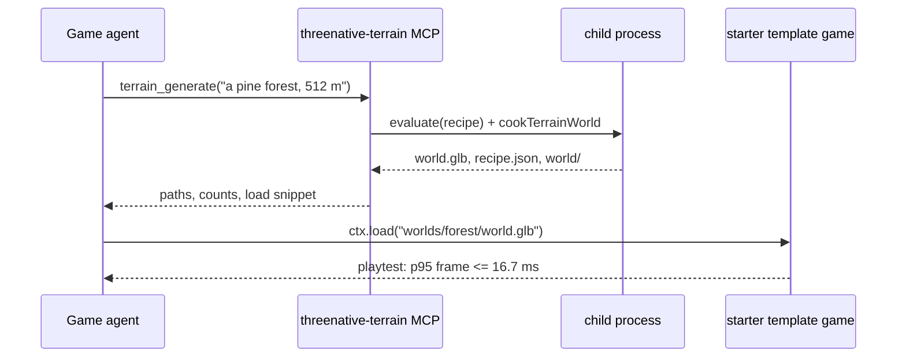

# PRD-584 — An agent asks for a forest over MCP and gets a 60 fps GLB

**Status:** PARTIAL
**Priority:** P1 — The epic's headline outcome: no MCP tool generates terrain today, and no measured number shows a handed-over Strata world holding 60 fps (AC-1 to AC-5).
**Complexity:** 7 (HIGH); risk override: closed-list boundary — a request-to-world tool sits next to the closed "preset/genre system" item
**Owner:** ThreeNative maintainers
**Depends on:** [PRD-583](PRD-583-a-strata-world-bakes-headlessly-into-an-instanced-glb.md)
**Epic:** [Strata terrain hardening](README.md)

## Context

Owner, 2026-10-10: "the AI agent could call some MCP endpoint like terrain_generation =>
'Generate a forest for me' => and then instantly it's generated and a .glb is provided, and the
game can use it at min 60fps performance."

Today, on `2d2124792`:

- No MCP server exposes terrain. `packages/core/mcp/servers.mjs` wires `threenative-assets`,
  `-sculpt`, `-engine` and `-blender`. None of them generates terrain.
- `engine_search_capabilities("generate a forest terrain with trees and rocks for my game and
  load it as a GLB", scope "request")` returns `Heightfield`, `getWorldCapabilities` and
  `TerrainTiles` first. `exportWorldGLB` is rank 7 (score 0.28) and needs a browser.
- The forest kit's trees come from licensed local-only assets (`examples/strata-terrain-preview/AGENTS.md`).
  CI and a user machine see procedural stand-ins.
- No playtest loads a handed-over Strata world in an ordinary game and measures it. The
  preview's own FPS reflects its own renderer (owner, 2026-10-05: judge the exported world as
  an ordinary game loads it).

## Solution

A fifth core-wired MCP server, `threenative-terrain`, follows the blender pattern: a shim in
`packages/core/mcp/terrain.mjs`, registered in `MCP_SERVERS`, launching a server bundled from
`packages/terrain`. It costs nothing until a tool is called.

Tools:

- `terrain_generate({ request, sizeMeters?, seed?, out? })` — picks one starter recipe
  (`forest`, `coastal`, `alpine`, `desert`, `tundra`) from the request, sets size and seed, runs
  `Terrain.evaluate` and PRD-583's `cookTerrainWorld` in a child process with a timeout (the
  evaluator only checks `AbortSignal` between operations; `AGENT_GUIDE.md` "Bounds"), and writes
  `public/worlds/<name>/world.glb`, `recipe.json` and the world package. It returns the paths,
  triangle, instance and draw counts, and a three-line load snippet.
- `terrain_patch({ recipe, commands })` reuses the editor's command vocabulary (`upsert`,
  `update`, `remove`, `move`, `toggle`) so the agent edits the returned recipe instead of
  re-prompting.

Species GLBs are CC0. They are fetched on first use through the existing asset MCP download path
and cached, so the tool does not depend on PRD-589's tarball diet.

The return names the starter recipe it chose. The recipe is editable game data, not a hidden
preset. That keeps the CHARTER's terrain allowance ("editable terrain starter documents") and
does not add a genre system. Phase 1 adds one line to that allowance naming this tool.

The 60 fps claim is measured on a stock template game, not the preview: the starter template
loads `world.glb` with `ctx.load`, walks a fixed path, and the playtest asserts frame time.

## Acceptance Criteria

- [ ] AC-1 [local]: `tools/list` on the shipped shim lists `terrain_generate` and `terrain_patch`. proof: stdio spec beside the sculpt shim's `tools/list` test in `packages/core/__tests__` — Evidence: pending.
- [ ] AC-2 [local]: `terrain_generate({ request: "a pine forest" })` writes a `world.glb` that `GLTFLoader` loads, cold, within 60 s on the reference CPU. proof: `packages/terrain/__tests__/terrain-mcp.spec.ts` with timing — Evidence: pending.
- [ ] AC-3 [local]: `engine_search_capabilities` ranks the terrain tool or `cookTerrainWorld` first for "generate a forest for my game". proof: a case in the PRD-297 capability-recall gate — Evidence: pending.
- [ ] AC-4 [local]: The starter template loads the generated forest and holds p95 frame time ≤ 16.7 ms over a 300-frame walk on a named real GPU (WebGPU, `adapter.info` recorded). proof: `node packages/playtest/dist/runner/cli.js <terrain-forest>.playtest.json --browser-recipe webgpu` — Evidence: pending.
- [ ] AC-5 [local]: The same scenario holds p95 ≤ 16.7 ms on the native desktop host. proof: same scenario `--target desktop` — Evidence: pending.

## Blocked on

- An Android 60 fps claim needs the shared Pixel lane — unblocked by João lending the device (memory: ask for the Pixel). The emulator cannot hold a frame-time claim.

## Integration Ledger

| Capability | Reachable consumer/trigger | Replaces / disposition | Evidence |
|---|---|---|---|
| Terrain MCP server | `.mcp.json` written by installing `@threenative/core` → `mcp/terrain.mjs` | New | AC-1 |
| Request to world | `terrain_generate` → child process → `cookTerrainWorld` | Hand-run kit `bake.mjs` | AC-2 |
| Discovery | `engine_search_capabilities` | Rank 7 browser-only result | AC-3 |
| 60 fps handoff | starter template `ctx.load(world.glb)` | Preview-only FPS numbers | AC-4, AC-5 |

## Execution Phases

#### Phase 1: the tool generates a GLB
**Status:** PARTIAL
**Files:** `packages/terrain/src/mcp/server.ts` (new), `packages/core/mcp/terrain.mjs` (new), `packages/core/mcp/servers.mjs`, `docs/architecture/CHARTER.md`
**Implementation:** stdio MCP server; request → starter recipe by keyword with the choice returned; child process with timeout; CC0 species fetched through the asset MCP download path and cached.
- [ ] Shim lists both tools. proof: stdio `tools/list` spec
- [ ] A forest request writes a loadable GLB inside 60 s. proof: `terrain-mcp.spec.ts`
  Note 2026-10-11 (no box ticked). Decisions: D1 the server is hand-written stdio JSON-RPC, because the existing engine and blender servers are hand-written JSON-RPC with no SDK and their loops are bundled, not importable. D2 the server is a tsup entry of `packages/terrain` (`dist/mcp/server.js`, package `bin`), not a bundle in core, because bundling terrain into core closes the cycle core -> assets -> terrain -> core. Core gets only the shim `packages/core/mcp/terrain.mjs`, the `threenative-terrain` row in `MCP_SERVERS` and a `MCP_PACKAGES.terrain` pin; core gains no dependency on terrain. D3 terrain does not depend on `@threenative/assets`: the cook child loads it from the game project at run time and fails closed with `npm i -D @threenative/assets` when absent. D4 `packages/terrain/dist` stays under 2 MB.
  Changed: all five kits are accepted and each cooked through the built server (forest 5.6 s wall, 18,515,644 B `world.glb`; coastal, alpine, desert and tundra about 1.2 s each). `bounds` is narrowed by `parseBounds` with no cast. A pre-aborted signal never spawns. A timeout or cancel kills the whole process group and removes the partial output. `out` is rejected when it or any ancestor is a symlink leaving the project (realpath containment, dangling links included). `pnpm sync:mcp` rewrote the template MCP configs for the fifth server. `AGENT-INTERFACE.md` names it.
  Checks: `terrain-mcp.spec.ts` 23 of 23 pass. Red against the previous `child.ts` and `tools.ts`: 6 of the new cases fail. `mcp-install.spec.ts` 33 of 33 pass. Core typecheck 0 errors. Terrain `tsc --noEmit` has 165 errors in `starter/`, other specs and `examples/strata-terrain-preview`, 0 in `src/mcp` or `terrain-mcp.spec.ts`. Terrain build exits 0, `du -sb packages/terrain/dist` = 860,387. Stdio smoke through `node packages/core/mcp/terrain.mjs` lists `terrain_generate` and `terrain_patch` (`SMOKE PASS`). Scoped Biome exits 0 with one existing complexity warning in `servers.mjs`. Doctor pin test, primary-docs and release candidate cases pass with `-t "MCP|bundled"`.
  Open: `@threenative/terrain` is unpublished (npm 404), so the shim's npx fallback fails in a project that does not install it. `scripts/verify-golden-path.ts` (`MCP_SURFACES`, needs a recorded `terrain-mcp-tools.json`) and `scripts/verify-registry-install.ts` (safe tool, spec fixtures) still list four servers, so their specs fail until updated. The full runs of `doctor.spec.ts` and `verify-registry-install.spec.ts` have other failures not triaged. Species are the tracked starter GLBs, not the asset MCP download path. The result has no `ctx.load` snippet, triangle count or draw count. The cook reads data files from `starter/<kit>/`, which AGENTS.md says package code never imports. Input uses a `kit` enum, not `request`. The 60 s check is a timeout only, with no timing spec.
  Owner lane: /root/prd587_lifecycle. Checkout `.worktrees/strata-terrain-mcp`, branch `epic/strata-terrain-mcp`, base `f8c41d61070b967bc35351a2efd5573ccfe1d92d`. Lane retained until full584 integration.

#### Phase 2: agents find it
**Status:** NOT STARTED
**Files:** `packages/terrain` capability entries, `packages/create-threenative/capabilities.json` (generated), template `AGENTS.md` terrain line
**Implementation:** capability entry with situation "generate a forest/terrain/world for my game"; template `AGENTS.md` names the tool.
- [ ] Search ranks the tool first. proof: capability-recall gate case

#### Phase 3: a stock game holds 60 fps on it
**Status:** NOT STARTED
**Files:** `packages/create-threenative/template-playtests/` (new forest scenario)
**Implementation:** scaffold the starter template, generate a forest with the tool, load it, walk 300 frames, assert p95 frame time.
- [ ] Web WebGPU p95 ≤ 16.7 ms. proof: playtest `--browser-recipe webgpu`
- [ ] Native desktop p95 ≤ 16.7 ms. proof: playtest `--target desktop`

2026-10-11 first-use asset preparation component verified, without an acceptance tick: a private session of the installed asset MCP downloaded the official CC0 Poly Haven `fir_tree_01` 1k Blender source (218,986,261 bytes; SHA-256 `153d20aae6d7c63a4c52689d91e8bead78f6d17a70e11ef4d03d19953383de00`) into an isolated artifact cache in 1.787 seconds, with `alreadyExisted: false` and license acknowledgement. Downloading the `.blend` alone is insufficient: the existing exporter first stopped on its missing bark image. The provider lists 18 PNG dependencies; retrieving them through the same MCP, verifying their declared sizes/MD5 and restoring their declared relative `textures/` paths took 1.265 seconds, all uncached. The unchanged existing `prep-polyhaven-fir.py --only b:2` then exported and self-checked the authored LOD2 in 3.848 seconds: 54,927 triangles, one mesh, four materials, six embedded images, POSITION/NORMAL/TEXCOORD_0 and base Y zero. Its 5,153,060-byte GLB has SHA-256 `a7e1f126ba7c09aa160f82e200689312334204928c9d822a1eaf13ed9d259dc8`, exactly matching the existing repository asset. The successful component timings sum to 6.900 seconds; this was a diagnostic sequence, not a single end-to-end cold forest generation. The existing 10 GiB downloader cap was unchanged. No new generator, shipped preparation path, loadability playtest, complete forest timing or web/native frame budget is proven; all full acceptance criteria remain open.

2026-10-11 imported-LOD runtime component remains unimplemented: isolated `strata-imported-lod` lane at `f8c41d610` completed offline frozen ignore-scripts install. A bounded Haiku MAX arm timed out after saving only additions to existing `model-lod-loader.spec.ts`; no production fix landed. The actual createAssetLoader/GLTFLoader fixture carrying EXT_mesh_gpu_instancing and TN_discrete_lod produces 7 passing and 2 failing tests (10.45 s): near/far instances draw the same geometry, and a separate ownership assertion finds no chain on the inspected base geometry (0 levels versus 2 expected). This does not isolate the partition-hook cause from chain association, so no GREEN or complete behavioural proof is claimed. Scoped test Biome passes; core typecheck fails on missing local playtest protocol/three declarations. No assets cook, native/browser conformance proof or FPS measurement ran; the current cook also still needs existing chain generation and writer preservation before its terrain triangle budget can improve. No acceptance box ticked.

2026-10-11 imported-LOD runtime component verified locally, without an acceptance tick: retained RED loader tests were committed unchanged as `03161de4b`. The empty chain was an association loss, not missing fixture metadata or a geometry clone: the fixture writes TN_discrete_lod on its primitive (`packages/core/__tests__/model-lod-loader.spec.ts:136`); Three's GLTFLoader constructs the imported InstancedMesh over the original geometry without transferring its primitive association (`packages/core/node_modules/three/examples/jsm/loaders/GLTFLoader.js:1762`), stamps only its node association (`:4402–4411`), and drops the replaced source mesh's association (`:4506`). The reader consequently skipped it for missing mesh/primitive indices. DiscreteLodPlugin now recovers those indices from the glTF node and primitive order, including multi-part nodes, and the asset loader injects the existing attachInstancedLod mechanism after decoded-chain registration, avoiding a runtime import cycle. Imported instances use the existing 4 px projected-error default and hysteresis, with manifest runtime overrides; an unchained primitive remains unchanged. The retained ray fixture required front-facing triangle winding and a ray away from a shared edge. Local focused baseline: 69 passing / 2 failing specs in six files (loader 7 / 2); final: 72 passing / 0 failing (loader 10 passing, including added mixed-chain multi-part coverage). Tests verify independent near/far detail, stable authored slots/count, public ray-hit ids, manifest budget/hysteresis, and disposal that releases partitions/restores base without disposing shared chain geometry. Core typecheck passes after the permitted @threenative/playtest build restored local protocol/three declarations; scoped Biome passes with eight cognitive-complexity warnings and no errors. No packages/assets changes, browser/native playtest, real-world triangle count or FPS measurement ran. The cooker still must emit and preserve valid TN_discrete_lod chains for real Strata worlds; 60 fps acceptance remains open.

2026-10-11 combined-world cooker LOD component verified locally, without an acceptance tick: `cookTerrainWorld` reuses `generateDiscreteLod` on near species with cutout conversion disabled and vertex-copy card reduction disabled; the final writer registers `TNDiscreteLod`. Index-only chain errors and error scales follow the existing source-node transform during flattening. The real forest spec runs the actual cooker on the shipped recipe, RAW16 sidecar, models and ground textures (5.638 s in the final focused rerun), checks decoded/transformed source vertex hashes, unchanged LOD0 indices/material factors, shared vertex buffers, transformed error scales, and computes selection from the cooked GLB's instance attributes using core's projected-error selector, 4 px budget and 0.15 hysteresis starting at LOD0. Camera position (256,40,600), look-at (256,10,256), 60-degree vertical FOV, 1920×1080 viewport, near 0.1, far 2000; this counts all placements without frustum/shadow-pass culling and is not a GPU frame measurement. Clean HEAD before: base and submitted 505,387,464 triangles, no species chains. After: unchanged base 505,387,464; submitted 18,917,904, including unchanged terrain 139,264. Fir: 3,100 instances, base 398,238,400, submitted 13,001,400; primitive triangle ladders including LOD0 [9582,2460,1339], [78776,3466,1488,722], [35136,1757], [4970,2418,902,376]. Boulder: 320 instances, base 10,579,200, submitted 528,640; ladder [33060,18794,6432,2350,1652]. Fir-c: 1,400 instances, base 96,430,600, submitted 5,248,600; ladders [9536,2442,1313], [9459,1500], [3616,2402,1188,428], [46268,1732,848,508]. Before/after kit bakes contain 22 files: only world.glb changes, SHA-256 e64b584dba6fdfd0ab05c30e2d0b0b3ad39231ae735208ef5283a8c2b6df3993 → c23570826bc1100f13768ae57c7922b50e321327ec810ccb426e4b7fea818700, because of added index chains and transformed error metadata; all 21 other files, including streamed models and every non-GLB output, retain their hashes. A byte comparison also confirms 109 default-scene vertex/index/instance streams and materials, textures, samplers and embedded images unchanged. No existing pin changed: the starter-kit pinned hashes cover non-GLB outputs, and the assets terrain-world spec has no cooked-GLB hash pin. Rebuilding checkout prerequisites and assets restored the clean baseline: requested four-file specs 92/92 passing, including non-finite placement; after 93/93 passing, followed by 20/20 terrain-world specs on the final census edit. The retained transformed-error assertion fails without source-scale propagation (1.3152257204 versus 9.2575621605) and passes with it. Assets/core typechecks and assets build pass; scoped Biome passes with seven warnings and no errors. No browser, GPU, native or FPS run; coordinator qualification and all full acceptance criteria remain open.
