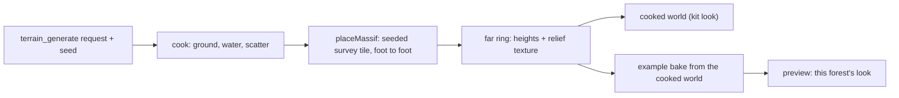

# PRD-866: A generated forest stands under mountains with real shapes

**Status:** NOT STARTED
**Priority:** P1 — the owner named the mountains as one of the two defects that keep the forest from "good to go" (2026-11-09); AC-1 is that defect.
**Complexity:** 6 (MEDIUM) — 6 to 10 files (2), a new placement module (2), state across bake and cook (2); risk override: none
**Owner:** João
**Depends on:** [PRD-854](../done/PRD-854-one-terrain-request-decides-the-landform-water-size-and-survey.md) (the survey fetch this PRD reuses, landed), [PRD-864](PRD-864-prop-and-collar-mechanisms-leave-the-strata-preview.md) (only for a kit game to draw the far ring; no box here waits on it)
**Epic:** [Strata terrain hardening](README.md). Continues the shape work of [PRD-856](PRD-856-the-mountains-carry-real-silhouettes-erosion-and-rock.md), whose open boxes stay there.

## Problem

Owner, 2026-11-09: "these crappy mountains that doesn thave proper textures or AAA mountain look", then "think about heightmaps etc. real shapes. how to make it procedural. and most importantly, making sure we can create variations of this forest with the MCP from strata".

The forest's near massif is two smooth stamps (`examples/strata-terrain-preview/scripts/recipe.mjs`, `nearMassif`: a `ridge` and a `mountain` stamp, `roughness: 0.1`) with ridged noise and droplet erosion on top (`alpineCrests`). It reads as smooth clay lobes with vertical flutes. The far ranges come from the same generator and read as mountains, because they are small on screen.

Three measured causes (2026-11-09, worktree `strata-forest-aaa`, RTX 2080, 1600 x 900):

| Cause | Measurement |
|---|---|
| The shape is not a mountain | Stamp profiles: median slope 50 degrees from 200 m to 700 m, 63 degrees above 700 m. A real mountain averages 30 to 40 degrees with cliff bands. |
| The mesh cannot carry rock at this range | The massif stands 1.1 to 2.4 km from the vista eye. One pixel covers 1.4 to 3.1 m there (`distance x 0.00128`). The far ring has 9.8 m cells, drawn on a 14 to 18 m ring grid, so one cell is 3 to 13 pixels of flat facet. |
| The lower slopes are bare | The far forest plants up to 36 to 46 degrees (`packages/terrain/starter/forest/biome.data.json`, `foliage[0].far.slope`). Only 29 to 38% of the massif between 200 m and 700 m is under 40 degrees, so most of it is bare rock from foot to top. |

Also true today:

- No sun shadow reaches the massif. The shadow window ends at 256 m (`src/render/sky.ts`, `RIG.shadowExtents: [24, 320]`), so a gully is lit like the rib beside it.
- `terrain_generate` writes no far ring. A cooked world has no mountains around its square at all (`packages/terrain/src/mcp/cook.ts`; PRD-856 records the same gap).
- The cooked forest kit is not this forest. The kit draws CC0 art with its own `world.ts` and `sky.ts`. The example draws the owner's licensed FAB assets with `src/render/`. The cook also places props from seeded rows (`stream: "seeded"`, `cook.ts:684`), not the example's ordered stream.

## What was tried and failed (do not repeat)

All four were captured and reverted on 2026-11-09. Frames are local only: `~/Downloads/strata-forest-aaa/`.

| Attempt | Result |
|---|---|
| Ridged `crags` noise (amplitude 80, scale 360 m, 4 octaves) plus 160 000 droplets | Marginal. Curvature kurtosis fell from 41.5 to 25.0, under the floor of 40 in `forest-backdrop.spec.ts`. With crags at 40 000 droplets it fell to 14.7, the value of smooth blobs. Frame `10-crags`. |
| Rock normal map on the faces, unwarped, 220 m and 60 m tiles | A faint crack net. No rock form. Frame `11-relief-clear`. |
| Dark gullies from the collar's `hollow` field | Blotches at the field's own 9.8 m scale. Frame `12-gully-shade`. |
| Longs Peak summit block (1.2 km each way, 9.8 m cells) pasted with `blend: "max"`, an offset and `falloff: 0.45` | Worse: one huge smooth bare cone. The crop was a summit dome, not a whole mountain, and the feather made its flank a ramp. Snow area rose from under 15% to 22%. Frame `13-survey-massif`. |

What does work, same renderer: the alpine world's surveyed headwall at 2 m cells reads as a real mountain (`ref-alpine-world/forest-overview.png`). Real shape at enough resolution is the lever. Noise and material tweaks are not.

## Solution

1. **Real shapes from surveys.** A massif is a height tile cut from a public survey, whole, foot to foot. The example cuts tiles with `scripts/dem/crop.mjs` from USGS 3DEP (public domain, 1 m source). The generator fetches them with the installed `surveyHeights` (`packages/terrain/src/mcp/survey.ts:228`) at terrarium zoom 14 or 15 (about 7.3 m and 3.7 m per pixel at 40 degrees north). Rows live beside the landform surveys in `packages/terrain/src/core/surveys.ts`, each with its attribution.
2. **Foot to foot, base relative.** A tile covers the whole mountain (3 km or more), so its edge is valley floor. The placement subtracts the tile's own base (the 10th percentile of its perimeter), clamps at zero and adds the rest to the host ground. No offset, no `max` plateau, no feather ramp.
3. **Procedural by seed.** The seed picks the row, the bearing sector, the distance, a rotation that turns the tile's steepest face to the play area within 20 degrees, a mirror, and a vertical scale of 0.85 to 1.15. One seed gives one mountain. Another seed gives another.
4. **Rock where the mesh ends.** The collar already bakes a relief texture from its 9.8 m cells (`src/render/terrain.ts`, `ICollarRelief`: normal, hollow, scree). Over the massif footprint the same bake reads the tile at its source spacing, 4 m or finer, so the faces take real ribs, couloirs and ledges in their light. No new shader path.
5. **Forest on the lower slopes.** A real tile has real slopes, so the installed far-forest rule plants it. A gate measures the planted share.
6. **This forest, varied through the MCP.** The cook writes the far ring. The example's bake takes a cooked world as its ground, so the preview draws this forest's look on generated ground.

Auto by default: the cook adds the ring and a massif when the landform is `alpine` or `temperateMountains`. Named override on the same request: `backdrop: "none"`. The result reports the choice in `decided.backdrop`.

## Execution Phases

### Phase 1 — one real mountain in the example

**Files:** `examples/strata-terrain-preview/scripts/dem/` (new tiles and metadata), `scripts/recipe.mjs` (`nearMassif`), `src/render/terrain.ts` (`ICollarRelief` source), `__tests__/`.

- [ ] Three whole mountains are cut foot to foot at 4 m cells or finer, each 3 km square or more, with the same metadata and hash file the other surveys carry. Start with Longs Peak (the 1 m source is already named in `scripts/dem/alpine.json`). proof: a new `__tests__/massif-tiles.spec.ts` asserts, per tile, the hash, relief of 700 m or more, and a perimeter whose 90th percentile is under 80 m above its base
- [ ] `nearMassif` places one tile base relative (Solution 2) where the stamps stood. proof: `pnpm exec vitest run --config vitest.config.ts __tests__/forest-backdrop.spec.ts` keeps its 7 cases green (relief 800 to 1200 m, kurtosis over 40, the vista skyline, snow under 15%), plus one new case: 60% or more of the massif cells between the valley floor plus 50 m and the treeline band are under 40 degrees
- [ ] The collar relief texture reads the tile at its source spacing over the massif footprint. proof: a spec asserts texels of 4 m or less inside the footprint and unchanged bytes outside it

### Phase 2 — the generator owns the mountain

**Files:** `packages/terrain/src/core/surveys.ts` (massif rows), a new `packages/terrain/src/core/massif.ts` (`placeMassif`), `packages/terrain/src/mcp/cook.ts`, `packages/terrain/__tests__/`.

- [ ] `placeMassif(terrain, { seed, tile })` ships in `@threenative/terrain` and the example's `nearMassif` calls it; no mountain stamp code stays in the example. proof: a spec in `packages/terrain/__tests__/` shows the same seed gives the same height hash, and 8 seeds each pass the Phase 1 gates (relief, kurtosis, slope share); `rg "massif-ridge|massif-summit" examples` returns nothing
- [ ] `terrain_generate` writes the far ring with a seeded massif for `alpine` and `temperateMountains`, reports `decided.backdrop`, and writes none under `backdrop: "none"`. Without network it fails closed and names the tile, as the ground fetch does. proof: red-green cases in `packages/terrain/__tests__/terrain-mcp.spec.ts` on a checked-in tile fixture

### Phase 3 — variations of this forest through the MCP

**Files:** `examples/strata-terrain-preview/scripts/bake.mjs`, `scripts/recipe.mjs`, one new verify script.

- [ ] The example bakes its forest from a cooked world: `STRATA_WORLD=<cook out dir> pnpm bake` takes that world's ground, water, scatter seed and far ring, and keeps the example's biome row and look. Unset, the bake is the pinned one. proof: a spec bakes from a fixture cook and asserts the baked heights equal the cook's; `node scripts/stamp.mjs` exits 0 on the pinned bake
- [ ] Three seeds give three forests. proof: a new `scripts/verify-variations.mjs` cooks "a spruce forest under mountains" with seeds 1, 2 and 3, bakes each, and asserts three different height hashes, three different `decided.backdrop` choices or poses, and the Phase 1 gates on each

## Acceptance Criteria

- [ ] AC-1 [local]: A fresh read-only visual judge returns IMPROVEMENT on the forest `overview` and `vista` frames against the frames of the commit before this PRD, with the owner's reference frame as the target (spruce wood at low sun; mountains with forested lower slopes, rock, snow and low cloud). Headed WebGPU, real adapter checked, two runs per arm, BEFORE and AFTER burned in. proof: the judge verdict and the sheets on the PR
- [ ] AC-2 [local]: The same judge finds one consistent look across the three seeded forests of Phase 3 and no REGRESSION against seed 0. proof: the three-seed sheet and verdict on the PR
- [ ] AC-3 [local]: Steady-state frame rate at `overview` and `vista` does not fall. proof: `measure-steady-state-fps`, paired arms on one code state, the numbers on the PR

## Integration Ledger

| Capability | Reachable consumer | Replaces | Evidence |
|---|---|---|---|
| Seeded real-shape massif | `scripts/recipe.mjs` `nearMassif` → `pnpm bake` → `src/world/horizon.json` → the collar mesh | The two stamps; they are deleted | Phase 1 box 2, Phase 2 box 1 |
| Far ring from the cook | `terrain_generate` → `cookKit` (`cook.ts:155`) → the cooked world's ring file | Nothing; the cook wrote no ring | Phase 2 box 2 |
| Example bake from a cooked world | `STRATA_WORLD` → `scripts/bake.mjs` → the preview | Nothing; the pinned bake stays the default | Phase 3 |

## Decisions

- 2026-11-09 (author, from the four failed attempts): the mountain shape comes from survey tiles, not from more noise or erosion on stamps. Noise lowered the sharpness metric and did not change the read.
- 2026-11-09 (author): a tile is a whole mountain, placed base relative. A summit crop lifted by an offset made a cone.
- 2026-11-09 (author): the look half of "this forest through the MCP" (the kit's own art and render files reaching this forest's look, and the ordered scatter stream in the cook) is not in this PRD. Phase 3 reaches this forest's look by baking the example from a cooked world. A kit that looks like this forest without the owner's licensed assets is separate work and needs its own PRD.

## Notes for the executor

- Read first: `scripts/recipe.mjs` (backdrop, `nearMassif`, `alpineCrests`), `packages/terrain/src/core/operations.ts` (the `stamp` and `paste` case, about lines 474 to 540), `packages/terrain/src/core/presets.ts:269` (`landformBackdrop`), `__tests__/forest-backdrop.spec.ts`, `src/render/benchmark.ts` (the `vista` pose).
- `alpineCrests` runs ridged noise and erosion over everything above 320 m. Place the massif after it, or mask it out, so the survey's own rock is not carved again.
- Capture with the `capture-strata-worlds` skill. Any edit to example source or a bake reloads the dev server and spoils a running capture. `KeyV` steps the views to `vista`.
- The GPU on this machine is shared with other sessions. A single FPS reading is not evidence; use paired arms.
- Erosion is about 80% of a landform bake (PR-CHAIN spike). A survey tile needs none, so the bake should not slow down. Record the bake time before and after.
- Follow-up, not in this PRD: a baked sun-horizon term so the massif takes shadow past the 256 m window (PRD-856 removed a first try because the world was then inside the window).
