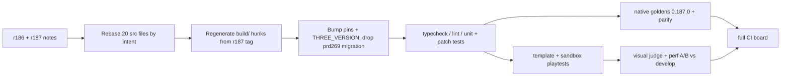

# PRD-775 — Upgrade three.js from 0.185.1 to 0.187.0

**Status:** IN PROGRESS (Phase 1 done)
**Priority:** P2 — planned dependency upgrade; every phase box is open and no release blocker is recorded.
**Complexity:** 6 (MEDIUM) — 11+ implementation files (3), engine patch rebase that ships to every generated game (+2 crosses the `@threenative/core` release boundary), external package (+1); risk override: none.
**Owner:** João (owner), agent executor
**Depends on:** None
**Branch:** `prd-775-three-0.187` from `origin/develop` at `6bf21eab2`, worktree `.claude/worktrees/prd-775-three-0.187/`. Open a draft PR into `develop` at the first commit.

## Context

The workspace pins `three: 0.185.1` and `@types/three: 0.185.3` in the `catalog:` of
`pnpm-workspace.yaml`. npm has 0.186.0 (2026-09-08), 0.186.1 (2026-09-24) and 0.187.0
(2026-10-30, latest). `@types/three` latest is 0.187.0. `three-mesh-bvh` peers on
`three >= 0.159.0`, so it does not block.

### Patch triage (dry run on 2026-10-30)

`packages/core/patches/three@0.185.1.patch` (35 files, 8748 lines) was dry-run against a clean
`npm pack three@0.187.0`, forward and reverse, file by file.

| Result | Files | Detail |
| --- | --- | --- |
| ✅ Applies as-is (offset or fuzz only) | 11 | `PassNode`, `Geometries`, `NodeManager`, `WebGPUBindingUtils`, `RenderPipeline`, `RenderContexts`, `TextureNode`, `VelocityNode`, `BatchedMesh`, `SMAANode`, `SSRNode` |
| ⚠️ Needs a hand rebase | 20 | 50 of 162 source hunks fail. Hot spots: `NodeMaterialObserver` 13/15 (upstream rewrote it), `WebGPUBackend` 4/23, `Instance` 4/5, `Skinning` 3/4, `RenderObjects` 3/4, `Renderer` 3/14. One-hunk fixes: `TextureSizeNode`, `NodeBuilder`, `PointShadowNode`, `Bindings`, `RenderObject`, `PMREMGenerator`, `WebGPUAttributeUtils`, `WebGPUPipelineUtils` |
| ❌ Already upstream | 0 | No hunk reverse-applies as a whole fix. Under 10% of added lines per file exist verbatim in 0.187.0, and those are imports and braces. **Every patch hunk is still needed.** |
| 🔁 Regenerate, do not rebase | 4 | `build/three.webgpu.js` (151 hunks), `build/three.webgpu.nodes.js` (119), `build/three.core.js`, `build/three.cjs`. Games import these bundles, so the bundle hunks must exist. They mirror the `src/` hunks. |

### Other surfaces

| Surface | Path | Risk |
| --- | --- | --- |
| Consumer patch installer | `packages/core/scripts/apply-three-patch.mjs:9-11` (`THREE_VERSION`, `PATCH_NAME`, `UPGRADE_PATCH_NAME`) | Core applies the patch inside every generated game and refuses a version mismatch (`TN_THREE_PATCH_VERSION`). |
| Predecessor migration | `packages/core/patches/three@0.185.1-prd269-upgrade.patch`, `packages/core/__tests__/three-patch-upgrade.spec.ts`, `packaging.spec.ts:222` | Migrates games from old 0.185.1 patch states (PRD-269). A three version change installs stock 0.187.0, so this migration has no predecessor to migrate. |
| Scaffold hashes | measured pins for the 13 templates (PRD-269 notes) | Every generated project embeds the patch, so each hash changes. |
| Template pins | `packages/create-threenative/templates/*/package.json` (for example `kart/package.json:26`) | Templates are excepted from `catalog:`. |
| Sandbox pins | `scripts/make-sandbox.ts:444,447` | Literal pins. |
| Native goldens | `packages/three-native/tests/compatibility/goldens/0.185.1/`, `fixtures/*.json`, `__tests__/fixture-protocol.spec.ts:26` | Recorded from one three version. |
| Internal hooks | `scripts/render-profile/renderer-stage-hooks.ts`, `scripts/exposure-ab.ts`, `scripts/engine-load-test/experiment-matrix.ts`, `scripts/verify-fluid-collision*.ts`, `scripts/unreal-look/scaffold/render/worldEnvironment.ts` | Read three internals or name the version. |
| Upstream shim | `packages/create-threenative/src/web-engine.ts:21` | A removed export breaks every game build. |

History docs under `docs/verification/`, `docs/benchmark/` and `artifacts/` stay as they are.

## Solution

1. **Read r186 and r187 notes** and the migration guide. List the breaking changes that hit a
   symbol this repository uses.
2. **Rebase `src/` only.** Apply the 11 clean files. Port the 50 failed hunks by intent, not by
   text: for each hunk, read what the 0.185.1 hunk fixed (the PRD or commit that added it, found
   with `git log -S` on the patch) and redo that fix on the 0.187.0 code. Start with
   `NodeMaterialObserver`, because upstream rewrote it.
3. **Regenerate the bundle hunks.** Check out the `r187` tag of `mrdoob/three.js`, run its build,
   and confirm the unpatched `build/` matches the npm `build/` byte for byte. Apply the rebased
   `src/` patch, build again, and diff `build/` to get the bundle hunks. If the stock build does not
   match npm, port the bundle hunks by hand and compare method bodies against `src/` (the PRD-269
   check).
4. **Bump in one commit:** `catalog:`, `patchedDependencies`, `THREE_VERSION`, template pins,
   sandbox pins, package ranges. Delete `three@0.185.1.patch` and the `prd269-upgrade` migration.
5. **Fix breaks in their layer** (engine in `packages/`, never in a template). Record the native
   goldens again and explain each changed value.
6. **Prove look and frame time** against `develop`: visual judge and paired perf A/B.

Fallback: if step 2 stalls on an r187-only change, stop at 0.186.1 and record it under Decisions.
Rollback: revert the squash commit.

## Execution Phases

#### Phase 1: Rebased patch installs everywhere

**Status:** DONE
**Files:** `packages/core/patches/three@0.187.0.patch` (new), `packages/core/patches/three@0.185.1*.patch` (deleted), `packages/core/scripts/apply-three-patch.mjs`, `pnpm-workspace.yaml`, `pnpm-lock.yaml`, `packages/create-threenative/templates/*/package.json`, `scripts/make-sandbox.ts`, `packages/*/package.json`.

- [x] AC-1: `pnpm install --frozen-lockfile` resolves only `three@0.187.0` and `@types/three@0.187.0`, applies the new patch, and no pin file names 0.185. proof: `pnpm install --frozen-lockfile && pnpm ls three -r --depth 0 && rg -n '0\.185\.[0-9]' pnpm-workspace.yaml packages/*/package.json packages/create-threenative/templates/*/package.json scripts/make-sandbox.ts packages/core/scripts/apply-three-patch.mjs`
  Result (45f8d12fa): frozen install exit 0; 42 importers, versions `['0.187.0']`; pin `rg` exit 1 (no match); no `0.185` entry left in `pnpm-lock.yaml`. Published `threenative-asset-mcp` pulls `@threenative/core@0.2.0` and `@threenative/playtest@0.3.2`, which pin 0.185.1, so the root `pnpm.overrides` sets `three: catalog:`.
- [x] AC-2: Every one of the 162 source hunks is kept, ported or dropped with a reason in the PR body, and one marker per kept hunk exists in both `src/` and `build/` of the installed three, also after `node_modules/three` is deleted and reinstalled. proof: marker `grep` script over `node_modules/three/{src,build}`
  Result: the per-hunk ledger has 153 rows (adjacent hunks share a row): 82 kept, 33 ported, 38 dropped with an upstream or obsolete reason (table in the PR body); 4 drops were reversed after review. 115 kept/ported markers: all found in installed `src/` before and after deleting the store copy and reinstalling frozen (one marker hand-checked because its `||` split the ledger cell). 110 also match a bundle verbatim; the other 5 are bundler rewrites (renamed `_cacheKeyValues$1`, stripped `export`, merged import, dead `if ( false )` removed). r187 moved the nodes into `build/three.tsl.js`, which the patch now covers. Stock r187 rollup build == npm `build/` byte for byte (6 files).
- [x] AC-3: The consumer installer applies the new patch to a packed core in a clean project, is idempotent, and refuses a tampered file. proof: `pnpm exec vitest run packages/core/__tests__/three-patch-upgrade.spec.ts packages/core/__tests__/packaging.spec.ts`
  Result: 22/22 pass. Red first: `TN_THREE_PATCH_INVALID: ambiguous hunk location` on two identical generated blocks in `build/three.tsl.js`; fixed in `apply-three-patch.mjs` (classification shifts later hunks only by hunks already patched on disk).

#### Phase 2: Code compiles and the native engine matches

**Status:** NOT STARTED
**Files:** source files that the breaking-change list names; `scripts/` hooks into three internals; `packages/three-native/tests/compatibility/goldens/0.187.0/`, `fixtures/*.json`, `__tests__/fixture-protocol.spec.ts`.

- [x] AC-4: Typecheck, lint and unit tests are green, and `capabilities.json` rebuilds with no lost entry. proof: `pnpm typecheck && pnpm lint && pnpm test && pnpm build && git diff --stat origin/develop -- packages/create-threenative/capabilities.json` → on `dd85d632e` (2026-10-30): typecheck 0, lint 0, `pnpm test` 0 (16545 passed, 0 failed: root 14016 plus 9 package suites), `pnpm build` 0, `capabilities.json` diff empty (exit 0).
- [x] AC-5: The native compatibility suite passes on goldens recorded from 0.187.0, and each changed golden has an upstream reason in the PR body. proof: `pnpm native:build && pnpm parity` plus the `packages/three-native` compatibility tests → on `dd85d632e` (2026-10-31): `test:reference -- --check` exit 0 on `goldens/0.187.0` (205 fixtures, 2371 observations, 0 blocked, NVIDIA Turing adapter); the changed-golden table with one upstream reason per row is in the PR #597 body. `pnpm native:build` 0. `pnpm parity` exits 1 with web 132 pass / 4 fail and desktop 125 pass / 8 fail; every one of those 12 reds fails the same way on develop `6bf21eab2` (base parity run in a clean worktree), this PR adds none and fixes desktop `realism-velocity-depth-normal`. Android and iOS rows are blocked (no device), as on develop.

#### Phase 3: Games play, look and run the same

**Status:** NOT STARTED
**Files:** none expected; fixes go back to the Phase 1 or Phase 2 files.

- [ ] AC-6: Every template and the in-repo fixture play from spawn, headed, on a real WebGPU adapter (`adapter.info` checked), with no new `TN_SCENE_WARNING` and no console error; one kit also builds and plays from a `pnpm sandbox` tarball install. proof: `pnpm test:templates && pnpm test:playtest` with `--browser-recipe webgpu`, then `pnpm sandbox`
- [ ] AC-7: A fresh read-only visual judge returns NEUTRAL or IMPROVEMENT for every template pose, 0.187.0 against `develop`, two runs per arm, with no change in exposure, shadows, PMREM reflections, SSR, skinning, instancing or post. proof: `pnpm visuals:ab` captures plus the judge subagent; sheet on the orphan `prd-775-screenshots` branch
- [ ] AC-8: Paired perf A/B on Midway and the stress lab shows no presented p95 regression past run noise on web WebGPU and native desktop, and the full CI board is green on the PR head. proof: `measure-steady-state-fps` skill (`TN_FRAME_BUDGET presented.p95`), `pnpm native:verify:desktop`, dispatched `ci.yml` run

## Blocked on

- iOS and Android device runs of the native host — unblocked by an attached device or a running emulator; the CI native matrix covers Android otherwise.

## Integration Ledger

| Capability | Reachable consumer/trigger | Replaces / disposition | Evidence |
| --- | --- | --- | --- |
| three runtime for every package | `pnpm install` → `catalog:` → `patchedDependencies` in `pnpm-workspace.yaml` | 0.185.1 entry and patch deleted | AC-1, AC-2 |
| Patch inside generated games | game install → `packages/core/scripts/apply-three-patch.mjs` | `THREE_VERSION` bumped; prd269 migration deleted | AC-3 |
| Generated game pin | `npm create threenative` → `packages/create-threenative/templates/*/package.json` | 0.185.1 pins replaced | AC-1, AC-6 |
| Native engine compatibility | `pnpm parity` → `goldens/0.187.0/` | `goldens/0.185.1/` deleted | AC-5 |
| User-like install | `pnpm sandbox` → `scripts/make-sandbox.ts:444,447` | literal pins replaced | AC-6 |

## Decisions

- 2026-10-30 (owner): target the latest npm release, 0.187.0. Branch from `origin/develop` at `6bf21eab2`.
- 2026-10-30 (agent): go straight to 0.187.0, not through 0.186.x. The rebase work is the same and one board run costs less than two. Fallback is 0.186.1.
- 2026-10-30 (agent): rebase by 3-way merge (stock 0.185.1 -> patched, cherry-picked onto stock 0.187.0), then a per-hunk intent review by two DeepSeek arms and a fresh Sonnet reviewer. Its 3 high findings were fixed: PMREM async face-5 mipmaps, settled-object uploads, BatchedMesh `null` previous matrices.
- 2026-10-30 (agent): keep the 0.185.1 patch's "every draw step runs" in `Renderer._renderObjectDirect` instead of r187's `RenderObjectRefreshType` gate. The settled skips live inside each step, and the gate skipped a settled InstancedMesh write. Keep the PRD-566 morph-layout pipeline-key term too: r187's stage id likely covers it, but when unsure the fix stays.
- 2026-10-30 (agent): r186 removed `PCFSoftShadowMap` for WebGPU (falls back to PCF with a warning) and made the GTAO distance knobs no-ops; r187 rebuilt PMREM. These are threejs-path look changes for the visual judge (AC-7), not code to restore.
- 2026-10-30 (agent): drop the PRD-269 predecessor migration. It migrates old patch states of 0.185.1, and a game on 0.187.0 starts from stock files.

## Self-verification steps (run in order)

1. `pnpm prd:progress <this file>` before Phase 1 and after each phase.
2. Dry run: `patch -p1 --dry-run` of the new patch on a clean `npm pack three@0.187.0` reports 0 failed hunks.
3. `pnpm install --frozen-lockfile`, then `pnpm ls three -r --depth 0` shows only 0.187.0 (AC-1).
4. `rg -n '0\.185\.[0-9]'` over the pin files returns nothing (AC-1).
5. Marker `grep` per kept hunk in `node_modules/three/src/` and `build/`. Delete `node_modules/three`, reinstall, grep again (AC-2; catches a stale copy).
6. Compare each patched method body in `src/` against the same body in `build/three.webgpu.js` (AC-2; catches a bundle that drifts from source).
7. Patch installer specs: clean install, idempotence, tamper refusal (AC-3).
8. `pnpm typecheck && pnpm lint && pnpm test` (AC-4).
9. `pnpm build`, then diff `capabilities.json` against `develop` (AC-4).
10. `pnpm budgets`, `pnpm check:docs`, `pnpm sync:agents --check`.
11. `pnpm native:build`, `pnpm parity`, `three-native` compatibility tests on the 0.187.0 goldens, with a reviewed golden diff (AC-5).
12. `node packages/playtest/dist/runner/cli.js doctor --text`. Rebuild `create-threenative` before browser playtests.
13. `pnpm test:playtest` and `pnpm test:templates`, headed, `--browser-recipe webgpu`, `adapter.info` checked; read `TN_FRAME_BUDGET`, `TN_SCENE_WARNING`, `TN_RENDER_PROJECTION` (AC-6).
14. `pnpm sandbox`: one kit built and played from a tarball install (AC-6).
15. Visual judge: same poses, `develop` against the branch, two runs per arm, fresh read-only subagent (AC-7).
16. Paired perf A/B on Midway and `?stress`, web and native, from one code state; runs over 5 minutes go to the laptop (AC-8).
17. `pnpm native:verify:desktop`: 300 frames and a non-blank screenshot (AC-8).
18. Full `ci.yml` board on the PR head (AC-8).
19. Close: tick boxes with results, `git mv` this file to `docs/PRDs/done/` in the finishing commit.
