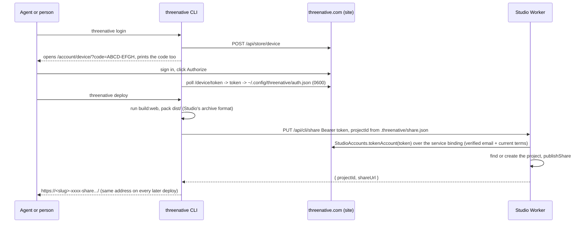

# PRD-904 — `threenative login` and `threenative deploy`: publish from the terminal the way Studio's Publish button does

**Status:** NOT STARTED
**Priority:** P1 — AC-1 to AC-8 are open: a game built outside Studio has no command to sign in or put it online, so an agent stops at a local build.
**Complexity:** 7 (HIGH) — 6-10 files (+2), new module (+2), crosses the engine/site/Studio release boundaries (+2), external API: the threenative.com and Studio Workers (+1); risk: an account credential on disk.
**Owner:** João
**Depends on:** None
**Repo:** this repo (`packages/create-threenative`); `ThreeNativeHQ/threenative-site` (token check); `threenative-live-studio` (CLI share route)

## Context

Studio already publishes a game. The terminal must do the same thing, with the same account and the same result.

**Studio's Publish today** (`threenative-live-studio`):

1. The browser calls `POST /api/projects/:id/share` (`hosting/cloudflare/src/routes/games.ts:14-36`), with a Studio session cookie.
2. The game's sandbox runs the `build:web` script (`src/server/routes/release.ts:47-77`). In every template that script is `threenative build --target web`. It then packs `dist/` with `packDirectory` (`src/server/release/shareArchive.ts`): per file a u32 path length, the path, a u32 size and the bytes. It skips `.br`/`.gz` twins, and the limits are 2 000 files and 50 MB.
3. `publishShare` (`hosting/cloudflare/src/share.ts:133-200`) checks the archive, puts the files in R2 under `share/<shareId>/` and keeps one link per game. A new publish replaces the files behind the same address. A link nobody opens for 30 days expires (`shareRules.ts`).
4. The answer is `{ shareUrl }`, an unlisted `https://<slug>-xxxx-share…` address (`origin.ts:77-81`).

**Accounts:** the site Worker owns accounts. Studio signs a person in with a one-time code that it trades over the `StudioAccounts` service binding (`threenative-site/worker/studio-auth.ts:81`). The site already has a device-code login for command lines: `POST /api/store/device`, `/device/token`, `/device/approve`, and the `/account/device/?code=…` page (`worker/store-device.ts`, store PRD-808). It issues a scoped `api_tokens` row.

**Engine:** `threenative` has `build` and `doctor` (`packages/create-threenative/src/commands.ts`). The "two commands, ever" rule was removed in `f9d168b00`.

## Solution

- **`threenative login`:** the device flow, in TypeScript with `fetch` and no new dependency. It opens the link with the code filled in, prints the code for a browser on another machine, and polls at the interval the site states until the user clicks Authorize. It prints the account email. `threenative logout` revokes the token on the site (a new bearer `DELETE /api/store/token`; today revoke needs a browser session, `worker/store.ts:202`) and then deletes the file.
- **Token:** `$XDG_CONFIG_HOME/threenative/auth.json` (default `~/.config`), mode `0600`, the same pattern as `gh` and `wrangler`. `THREENATIVE_TOKEN` overrides it for CI and Studio sandboxes.
- **`threenative deploy`:** runs the project's `build:web` script, the same script Studio's sandbox runs. It packs `dist/` with a copy of Studio's `packDirectory`. It uploads to `PUT /api/cli/share` and writes `.threenative/share.json` `{ "projectId": "…" }` on the first deploy (Studio already keeps its store link in `.threenative/store.json`, `src/server/release/publish.ts:36`), so later deploys replace the same link. Exit codes match `tn-store`: 0 ok, 2 bad arguments, 3 sign in again, 4 refused, 5 network.
- **Site:** `StudioAccounts.tokenAccount(token)` returns the same identity shape as `exchangeCode` for a live, unrevoked device-issued token, under the same rule as `exchangeCode`: verified email and current terms (`studio-auth.ts:42`). Studio therefore reuses its existing account adoption. The `/account/device` page names `threenative login` instead of `tn-store login`. An unverified or terms-pending account goes through the verify and terms steps and comes back to the same `?code=`.
- **Studio:** one route, `PUT /api/cli/share`, with an archive body, `Authorization: Bearer`, and an optional `projectId` and `name`. It reuses `createProject` (quota included) and `publishShare` (all its checks), so the terminal and the button have one set of rules.

Risks: the packer is copied, and the copy can drift from Studio's. `ponytail:` two copies of a 50-line format; the AC-6 e2e uploads the CLI's archive to Studio's real parser, so drift fails there. Move it to one shared package if a third writer appears. A token file on disk is a credential: it is created `0600`, and logout deletes it.

## Non-Goals

- Opening a CLI-deployed game's source in the Studio editor. The project row exists and shows its link, but deploy uploads the build, not the source.
- Listing on the store (`tn-store push`, review, build farm). That path stays as it is.
- Deploy targets other than the Studio share link (Netlify, Vercel, itch.io, desktop or Android builds).
- A localhost callback login. It fails on remote machines and in containers, the reason the store dropped it (store PRD-808).

## Acceptance Criteria

- [ ] AC-1 [local]: `threenative login` against local site `wrangler dev` opens `/account/device/?code=…`. After a scripted Authorize it writes a `0600` token file and prints the account email. proof: `pnpm exec vitest run packages/create-threenative/__tests__/login.spec.ts` (fake site) + the AC-6 run — Evidence: pending.
- [ ] AC-2 [local]: `threenative logout` revokes the token on the site, then deletes the file. `THREENATIVE_TOKEN` wins over the file, and a refused token exits 3 with "run threenative login". proof: `login.spec.ts` — Evidence: pending.
- [ ] AC-3 [local]: `StudioAccounts.tokenAccount` returns the account for a live device-issued token and refuses a revoked, expired or unknown token, an unverified email and an account without current terms. proof: site `pnpm vitest --config vitest.worker.config.ts worker/__tests__/studio-auth.spec.ts` — Evidence: pending.
- [ ] AC-4 [local]: `PUT /api/cli/share` with a valid token creates a project and returns a share URL. A second call with that `projectId` keeps the same URL and serves the new build. No token gets 401; no `index.html` or over 50 MB gets Studio's refusal message. proof: Studio `hosting/cloudflare` vitest — Evidence: pending.
- [ ] AC-5 [local]: `threenative deploy` runs `build:web`, packs `dist/` byte-for-byte like Studio's `packDirectory` on the same folder, uploads, writes `.threenative/share.json` once and prints the URL. proof: `pnpm exec vitest run packages/create-threenative/__tests__/deploy.spec.ts` — Evidence: pending.
- [ ] AC-6 [local]: A scaffolded starter, with the local `create-threenative` tarball, local site and Studio `wrangler dev`, runs `threenative login` (scripted Authorize) then `threenative deploy` twice. The share URL serves the game's `index.html` and stays the same across both deploys. The Studio games list shows the game with that link. proof: run log in the PR — Evidence: pending.
- [ ] AC-8 [local]: On `/account/device/?code=…`, an unverified or terms-pending account completes verify and terms and returns to the same code, then Authorize succeeds. The page names `threenative login`. proof: site `e2e/worker/store-device.spec.ts` — Evidence: pending.
- [ ] AC-7 [shared]: After site, Studio and engine releases, a `pnpm sandbox` clean room runs `npx create-threenative` → `npx threenative login` → `npx threenative deploy` and opens the live share URL. proof: `pnpm sandbox` run log — Evidence: pending.

## Blocked on

- AC-7 needs the site and Studio routes deployed to production and an engine release — unblocked by João's go-ahead to deploy the site and Studio and ship the engine release.

## Integration Ledger

| Capability | Reachable consumer/trigger | Replaces / disposition | Evidence |
| --- | --- | --- | --- |
| Sign in from a terminal | `threenative login` → site device routes → token file | New consumer of the shipped device flow | AC-1, AC-2, AC-6 |
| Studio trusts a CLI token | Studio `PUT /api/cli/share` → `StudioAccounts.tokenAccount` | New method beside `exchangeCode` | AC-3, AC-4 |
| Publish from a terminal | `threenative deploy` → `build:web` → Studio `publishShare` → share host | Same `publishShare` as the Publish button; no second publish path | AC-4, AC-5, AC-6 |

Fill the dispatcher and route `file:line` values when each phase lands.

## Decisions

- 2026-11-21 (João): use the `threenative` CLI as it is, with no `tn` alias. The "two commands, ever" rule is removed (`f9d168b00`).
- 2026-11-21 (João): deploy is the same as Studio's Publish (the share link), not the store push.
- 2026-11-21 (João): login UX: open a link, sign in with the threenative.com account, click Authorize, and the CLI detects it. The code is also accepted typed. The existing site device flow does exactly this.
- 2026-11-21 (agent, after a Gemini 4 Neon review): the store push is not the deploy path. A new account's release is held for review (`worker/games.ts:631,649`), the build farm runs scans and an AI review, and a listing needs 1 to 5 screenshots. The share link is live in seconds.
- 2026-11-21 (agent): the login is TypeScript in the engine, not a call to the private `tn-store` binary. Deploy no longer needs that binary, and the device flow is three `fetch` calls.

## Execution Phases

#### Phase 1: sign in and out
**Status:** NOT STARTED
**Files:** `packages/create-threenative/src/commands.ts`, `src/threenative.ts` (dispatch), `src/account.ts` (new: device flow, token file, `THREENATIVE_TOKEN`), `AGENTS.md` CLI surface. Site: `worker/store.ts` (bearer self-revoke), `src/components/sections/AccountDevice.tsx` and `AccountVerify.tsx` (copy, keep `?code=` through verify and terms).
- [ ] `login`/`logout` work against a fake site — proof: `login.spec.ts` + `cli.spec.ts` lists the new commands — covers AC-1, AC-2.
- [ ] The device page keeps the code through verify and terms — proof: site `e2e/worker/store-device.spec.ts` — covers AC-8.

#### Phase 2: Studio accepts a CLI publish
**Status:** NOT STARTED
**Files:** site `worker/studio-auth.ts` (`tokenAccount`). Studio `hosting/cloudflare/src/routes/cli.ts` (new: `PUT /api/cli/share`), `src/index.ts` (route before the session gate).
- [ ] The token check passes its site tests — proof: site worker vitest — covers AC-3.
- [ ] The CLI share route passes its Studio tests — proof: Studio `hosting/cloudflare` vitest — covers AC-4.

#### Phase 3: `threenative deploy` end to end
**Status:** NOT STARTED
**Files:** `packages/create-threenative/src/deploy.ts` (new: build, pack, upload, link file), `src/threenative.ts`, `src/commands.ts`.
- [ ] Deploy unit behaviour — proof: `deploy.spec.ts` — covers AC-5.
- [ ] Local end-to-end through both real Workers — proof: AC-6 run log — covers AC-6.
- [ ] Live clean-room deploy — proof: `pnpm sandbox` — covers AC-7.
