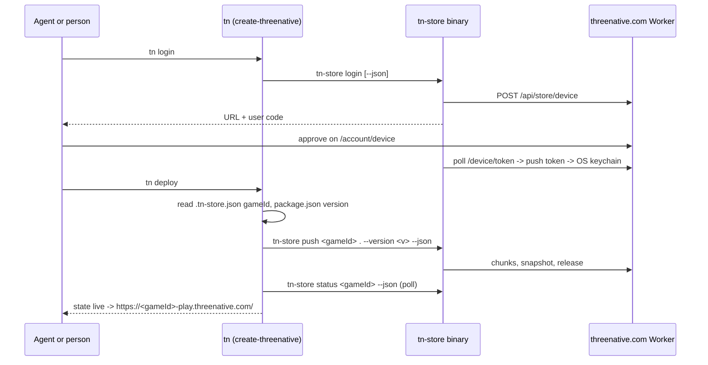

# PRD-904 — `tn login` and `tn deploy`: the engine CLI signs in and ships a game with the store's flow

**Status:** NOT STARTED
**Priority:** P1 — AC-1 to AC-6 are open: a generated game has no command to sign in or put it online, so an agent stops at a local build.
**Complexity:** 6 (MEDIUM) — 1-5 files (+1), new module (+2), crosses the engine/store release boundary (+2), external API: the threenative.com store routes (+1); risk override: HIGH, the change handles an account credential.
**Owner:** João
**Depends on:** PRD-811 (store repo) AC-2, which publishes `@threenative/store-cli` to npm
**Repo:** this repo (`packages/create-threenative`); `ThreeNativeHQ/threenative-store` for the e2e proof

## Context

The server and the client for sign-in and deploy already exist. They live in the private repos and the engine CLI does not reach them.

| Piece | Where | State |
| --- | --- | --- |
| Device-code login: `POST /api/store/device`, `/device/token`, `/device/approve` | site `worker/store-device.ts`, `migrations/0019_device_codes.sql`, page `/account/device` | Shipped (store PRD-808 AC-1..3). Works with no loopback port: containers, remote boxes, agents. |
| Scoped API tokens (`push`, `snapshot:read`, `build:upload`) | site `worker/auth.ts`, `migrations/0014_build_token_scope.sql` | Shipped |
| `tn-store login · logout · whoami · games · push · status`, `--json`, exit codes 0/2/3/4/5, OS keychain, `TN_STORE_TOKEN` for CI | store `crates/tn-store-cli/src/main.rs:9-60`, `lib.rs:77-86` | Shipped as a Rust binary. Not on npm yet (PRD-811 AC-2 open; `npm view @threenative/store-cli` returns 404 on 2026-11-21). |
| Push: FastCDC chunks, missing-chunk check, snapshot, release poll | store `crates/tn-store-cli/src/push.rs`, `crates/tn-store-core/src/pack.rs` | Shipped. The store builds from source, so a deploy pushes source. |
| Live web build hosting on `<gameId>-play.threenative.com` | site `worker/host.ts:24-35` | Shipped |
| Studio sign-in (browser redirect + one-time code over a service binding) | site `worker/studio-auth.ts`, `migrations/0029_studio_auth_codes.sql` | Shipped. Browser-only, so the CLI does not use it. Studio publishes with `TN_STORE_TOKEN` (`threenative-live-studio/src/server/config.ts:63`), the same variable this PRD honours. |

The engine side: `threenative` (bin of `create-threenative`) has two commands, `build` and `doctor` (`packages/create-threenative/src/commands.ts:6-8`). `packages/create-threenative/AGENTS.md` "CLI surface" says a third command needs the owner decision made again. No `tn` bin exists. The npm name `tn` belongs to an unrelated package (Titanium CLI wrapper, 4.2.1).

## Solution

`tn` becomes a second bin name for the `threenative` executable. Three borrowed commands (the `wrangler` and `vercel` vocabulary) join `build` and `doctor`: `login`, `logout`, `deploy`. Each one delegates to the store CLI. The engine re-implements no HTTP client, no chunker and no token store.

- **Binary resolution:** `tn-store` on `PATH` first (a cargo build, a test stub), else `npm exec --yes @threenative/store-cli@<pinned range> --`. The engine package takes no dependency on the private binary.
- **Game link:** `.tn-store.json` `{ "gameId": "..." }` in the project root, committed. The store's push already ignores this file name (`crates/tn-store-cli/src/ignore.rs:25`). `tn deploy --game <id>` writes it. With no link and no flag, `tn deploy` exits 2 and prints the `tn-store games create` line and the site URL.
- **Version:** `package.json` `version`. A refusal from the store (for example a reused version) passes through with its exit code and message.
- **Exit codes and `--json`:** pass through unchanged from `tn-store`, so an agent reads one table for both CLIs.
- **CI and Studio:** `TN_STORE_TOKEN` works unchanged, because `tn-store` reads it.

Risks: the PRD-811 publish is the gate for any user outside this machine. `npx tn` outside a project resolves the unrelated npm `tn` package, so docs show `npx tn` only inside a generated project, where the local bin resolves first.

## Non-Goals

- Creating the store listing from the CLI without screenshots. The site requires 1 to 5 shots (`worker/games.ts:587`); `tn-store games create` already covers it.
- A TypeScript port of the push protocol or the chunk format.
- Deploy targets other than the ThreeNative store (Netlify, Vercel, itch.io).
- Changes to the site Worker, its schema or the device flow.

## Acceptance Criteria

- [ ] AC-1 [local]: `tn login` and `tn logout` run `tn-store login` and `tn-store logout` with the same flags, and return its exit code. proof: `pnpm exec vitest run packages/create-threenative/__tests__/cli.spec.ts` with a stub `tn-store` on `PATH` that records its argv — Evidence: pending.
- [ ] AC-2 [local]: `tn --help` and `threenative --help` list exactly `build`, `doctor`, `login`, `logout`, `deploy`, and `tn` is the same executable. proof: `cli.spec.ts` (derives the list from the real executable) — Evidence: pending.
- [ ] AC-3 [local]: `tn deploy` with no `.tn-store.json` and no `--game` exits 2 and names the create command; `tn deploy --game <id>` writes the link. proof: `cli.spec.ts` — Evidence: pending.
- [ ] AC-4 [local]: `tn deploy` pushes `.` at the `package.json` version, polls `status --json` until `live` or `held`, prints the play URL on `live` and the `reason` on `held`, and passes exit code 3 through as "sign in again". proof: `cli.spec.ts` with the recording stub — Evidence: pending.
- [ ] AC-5 [local]: A scaffolded starter, with the local `create-threenative` tarball and a real `tn-store` built from the store repo, signs in with a scripted approval and deploys against local `wrangler dev`; the release reaches `live` and the play host serves its `index.html`. proof: store repo PRD-810 e2e harness, run on this machine — Evidence: pending.
- [ ] AC-6 [shared]: In a `pnpm sandbox` clean room with the published packages, `npx create-threenative` → `npx tn login` → `npx tn deploy` puts the game live on threenative.com. proof: `pnpm sandbox` run log — Evidence: pending.

## Blocked on

- AC-6 needs `@threenative/store-cli` on npm — unblocked by store PRD-811 AC-2 (`NPM_TOKEN` in the store repo, an owner action) and by the next engine release that carries this PRD.

## Integration Ledger

| Capability | Reachable consumer/trigger | Replaces / disposition | Evidence |
| --- | --- | --- | --- |
| Sign in from a game project | `tn login` → `threenative.ts` dispatcher → `tn-store login` → site device routes | New; delegates to the shipped flow | AC-1, AC-5 |
| Deploy a game | `tn deploy` → `.tn-store.json` + `tn-store push`/`status` → `<gameId>-play.threenative.com` | New; delegates to the shipped push | AC-3, AC-4, AC-5 |

Fill the `threenative.ts` dispatcher `file:line` when Phase 1 lands.

## Decisions

- 2026-11-21 (João): reopen the "two `threenative` commands, ever" rule for `login`, `logout` and `deploy`. Reason: a game an agent cannot put online is unfinished. The words are borrowed from `wrangler` and `vercel`, not invented, which keeps the charter's closed "bespoke CLI vocabulary" rule intact.
- 2026-11-21 (agent): delegate to the `tn-store` binary instead of porting it to TypeScript. A port duplicates the FastCDC format and the token store, and drift between two chunkers breaks the store's missing-chunk check.
- 2026-11-21 (agent): `tn` is a second bin name of the same executable, not a new package. The npm name `tn` is taken.

## Execution Phases

#### Phase 1: `tn` signs in and out
**Status:** NOT STARTED
**Files:** `packages/create-threenative/package.json` (`tn` bin), `src/commands.ts` (three commands), `src/threenative.ts` (dispatch), `src/store-cli.ts` (new: resolve and spawn `tn-store`), `AGENTS.md` "CLI surface" (five commands, this PRD as the decision).
**Implementation:** spawn with inherited stdio, so the device-code prompt and `--json` output reach the caller untouched. A spawn failure (no `tn-store`, no `npm`) exits 5 with the install line.
- [ ] AC-1 and AC-2 pass — proof: `pnpm exec vitest run packages/create-threenative/__tests__/cli.spec.ts` and `pnpm sync:agents && pnpm check:docs` — covers AC-1, AC-2.

#### Phase 2: `tn deploy` ships the project
**Status:** NOT STARTED
**Files:** `packages/create-threenative/src/store-cli.ts` (deploy), the generated-project `AGENTS.md` Commands block in each template that lists commands.
**Implementation:** read and write `.tn-store.json`; validate `gameId` against the site's id shape before it reaches argv. Poll `status --json` one second apart, 60 polls, the same budget as `push.rs:21`.
- [ ] AC-3 and AC-4 pass — proof: `cli.spec.ts` — covers AC-3, AC-4.

#### Phase 3: proof through the real binary and the real Worker
**Status:** NOT STARTED
**Files:** none in this repo unless the e2e run finds a bug; the e2e case lives in the store repo harness.
- [ ] AC-5 passes on this machine — proof: store repo PRD-810 e2e harness with the local tarball — covers AC-5, the real device flow and the real push.
- [ ] AC-6 passes in the clean room after the publish — proof: `pnpm sandbox` — covers AC-6.
