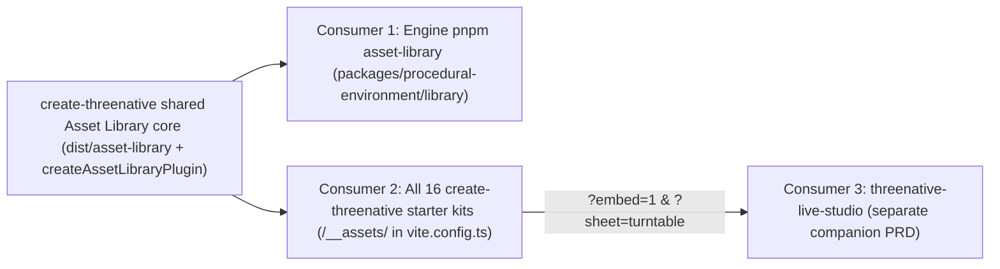

# PRD-915 — Shared ThreeNative Asset Library: Storybook-style 3D workbench for projects, starter kits and the engine

**Status:** NOT STARTED
**Priority:** P2 — AC-1 to AC-8 are open: AI agents and authors inside scaffolded games have no isolated 3D workbench to inspect assets (models, textures, audio), tune props, scrub/verify animations, attach props on bones, bundle scenes, or capture multi-angle contact sheets without booting the full game.
**Complexity:** 5 (MEDIUM) — 11+ implementation files (+3), new shared workbench module and Vite plugin (+2); risk override: none (dev-only Vite serve plugin, zero production runtime bytes).
**Owner:** João
**Depends on:** None (builds on [PRD-900](../done/PRD-900-the-procedural-asset-library.md))

## Context

Today, the repo's Storybook-style Asset Library lives solely inside `packages/procedural-environment/library/` (`index.html`, `main.ts`, `style.css`, `vite.config.ts`) and launches only from the monorepo root via `pnpm asset-library`. It is a custom ~1,800-line vanilla TypeScript + Three.js + Tailwind app (zero `@storybook/*` dependencies) that only knows about `@threenative/procedural-environment`, displays a generic cube SVG (`ICONS.logo`), and is excluded from the published npm package.

Inside a scaffolded `create-threenative` game, iterating on a single asset (a downloaded or sculpted `.glb`, a texture or PBR surface map, an audio clip, a rigged character, a procedural prop, a TSL shader/material, or a small modular cluster) still requires booting the full game — waiting for physics, world generation, and camera navigation just to check proportions, grounding, or material response. `create-threenative inspect` (`packages/create-threenative/src/inspect.ts`) reports geometry bounds and bone/clip names in Node, but cannot show pixels, animation playback, lighting response, cooked vs. raw compression deltas, or interactive prop adjustments.

Meanwhile, `packages/animation-mcp` (`threenative-animation-mcp`, "Pose Lab") already ships a standalone bone-landmark calibrator (`src/ops/landmarks.ts`), a Three.js `TransformControls` attachment gizmo (`src/client/scene.ts`), a 4-lane dope-sheet keyframe editor (`src/page.ts`, `src/client/App.tsx`), a deterministic `<model>.anim.json` op-log baker (`src/ops/log.ts`, `src/ops/attach.ts`), and an automated defect verifier (`src/ops/verify.ts` for `foot-skate`, `ground-penetration`, `loop-seam`, `jitter`, `bone-stretch`), running on its own disconnected server (`--view` on port `4192`). Similarly, `threenative-live-studio` (`src/client/features/assets/AssetsView.tsx`) renders static `<model-viewer>`, ``, and `<audio>` cards with none of the Asset Library's workbench controls, health badges, code stories, scene bundling, or multi-angle captures. Unifying Pose Lab and all project asset types into one `/__assets/` workbench keeps human gizmo edits and `threenative-animation` MCP edits on one op log with zero duplicated animation UI.

Two constraints from the [Charter](../../architecture/CHARTER.md) shape the design:
1. **Not a general game editor or serialized scene format:** any workbench or scene bundler must remain a dev-only inspection and authoring aid whose outputs are ordinary TypeScript source, baked `.glb` files, or `<model>.anim.json` op logs — never a proprietary runtime format, and zero bytes in `threenative build`.
2. **Zero dependency bloat across all 16 starter kits:** kits like `minimal` ship without React or Tailwind (`packages/create-threenative/templates/minimal/package.json`), yet all 16 share `vite.config.ts` via `packages/create-threenative/src/plumbing.ts`. Hosting the shared workbench inside `create-threenative` with prebuilt static client assets keeps one DRY codebase across every kit, the engine library, and external harnesses.

The official ThreeNative TN mark (`BrandMark` — `#e0fb50` on `#020407`, `viewBox="0 4.5 100 91"`, matching `threenative-site` `public/favicon.svg` and `src/components/ui/BrandMark.tsx`) replaces the generic cube icon across both the engine library and project workbenches.

## Solution

Extract the custom Vite + Three.js Storybook workbench into a single shared module in `create-threenative` (`src/asset-library/`) with a pre-compiled static HTML/CSS/ESM client (`dist/asset-library/`), a dev-only Vite plugin (`createAssetLibraryPlugin`), and a pluggable `IAssetLibrarySource` contract. Three consumers plug into that one core with zero duplicated UI:

### Shared Core & Consumers

1. **Consumer 1 — Engine Procedural Library (`pnpm asset-library`):** Delete `packages/procedural-environment/library/index.html`, `main.ts`, and `style.css`. `packages/procedural-environment/library/vite.config.ts` mounts `createAssetLibraryPlugin({ mountPath: "/", title: "Procedural Asset Library", sources: [proceduralEnvironmentSource()] })` using a `workspace:*` devDependency on `create-threenative`, retaining `tsup --watch` invalidation and all existing bake controls.
2. **Consumer 2 — Every `create-threenative` App (`/__assets/`):** Stamp `createAssetLibraryPlugin()` into every template's `vite.config.ts` via `packages/create-threenative/src/plumbing.ts` (`pnpm stamp:template-plumbing`). The plugin sets `apply: "serve"` (active only during `pnpm dev`, emitting zero bytes in `threenative build`), serves `/__assets/`, exposes a lazy co-opened **`Game` | `Asset Library`** dev shell on `pnpm dev`, prints the `/__assets/` URL beside the dev server URL, and requires zero Tailwind or React dependencies in user projects (so `minimal` works identically to `starter`).
3. **Consumer 3 — Studio Embed Contract (`?embed=1` & `?sheet=turntable`):** Expose clean URL flags and a `postMessage` bridge so `threenative-live-studio` (in a separate companion PRD) can iframe `${previewUrl}/__assets/?embed=1` in its Assets tab and capture turntable contact sheets for AI inspection without reimplementing any 3D UI.

### Polished Capabilities for AI & Author Asset Iteration

1. **Official ThreeNative Brand Logo & Favicon:** Use the official ThreeNative TN mark SVG (`#e0fb50` on `#020407`) in the sidebar header and `<link rel="icon">` across both `pnpm asset-library` and every project's `/__assets/`.
2. **Storybook Workbench Baseline (carried from `procedural-environment/library`):** Searchable/filterable sidebar tree, Overview side-by-side lineup, Single inspect view, Tiled ×3 modular seam view, dockable bottom/right addon panel (**Controls**, **Docs**, **Stats**), 1 m grid, 1.8 m scale figure, wireframe, wind sway (`_WIND`), Studio/Biome/Light backgrounds, URL hash state, and on-demand rendering.
3. **Project Assets Viewer (GLB, Textures & Audio) + Auto-LOD & Raw-vs-Cooked X-Ray:** Automatically discover and inspect 100% of `assets/` across three asset viewers (so Studio can drop in `/__assets/` without regression):
   - **3D Models (`assets/**/*.{glb,gltf}` + local drag-and-drop preview):** Full interactive 3D viewer with orbit/zoom/frame, scene node/mesh/material/texture hierarchy tree, bounding box, vertex normals & wireframe toggles, **Auto-LOD distance slider (`2 m → 80 m`)** swapping cooked LODs live with active triangle readout, `inspectAsset` health badges (cm-vs-m unit warning, `min.y` grounding offset, missing normals/UVs, unbound animation tracks), and a **Raw vs. Cooked** toggle comparing source `assets/` against cooked `public/` (`assets.manifest.json` byte size, estimated GPU VRAM, triangle count, texture slots, and target profile preview).
   - **Textures & PBR Maps (`assets/**/*.{png,jpg,jpeg,webp,ktx2,svg}`):** 2D zoom/pan inspector with alpha checkerboard, tileable repeat preview, normal-map / channel inspection (reusing `SURFACE_CHANNELS` channel semantics from `packages/terrain/src/editor/images.ts`), dimensions, `block-size` alignment warnings, and Raw-vs-Cooked size/VRAM delta.
   - **Audio (`assets/**/*.{wav,mp3,ogg}`):** Waveform visualization, play/pause transport, loop toggle, volume slider, duration, channel/sample-rate metadata, and file size.
4. **Pose Lab, Animation & Rig Inspector (Reusing `packages/animation-mcp`):** When a `.glb`/`.gltf` carries skeleton bones or `AnimationClip`s, expose unified rig calibration, animation playback, and defect verification without building a duplicate tool:
   - **Reused Pose Lab & Op Log:** Reuse `packages/animation-mcp`'s bone-landmark detection (`src/ops/landmarks.ts`), `TransformControls` attachment gizmo (translate/rotate/scale), 4-lane dope-sheet keyframe editor (`position`, `rotation`, `scale`, `attachment` attach/release diamond keyframes), and `<model>.anim.json` op-log persistence (`src/ops/log.ts`, `src/ops/attach.ts`) so interactive gizmo edits in `/__assets/` stay 100% compatible with `animation_attach` / `animation_open_view` MCP edits and bake deterministically into `.glb`.
   - **Playback & Defect Diagnostics:** Surface `animation_verify` (`src/ops/verify.ts`: `foot-skate`, `ground-penetration`, `loop-seam`, `jitter`, `bone-stretch`) and `@threenative/core` clip audit checks (`clipTrackBindings`, `clipBoneCoverage`) directly as clickable defect spans on the timeline ruler, alongside clip selection, play/pause, loop modes (`repeat` / `once` / `ping-pong`), playback speed (`0.1×`–`2×`), timeline scrubber + single-frame step, clip-to-clip crossfade preview, skeleton bone overlay, forward-axis indicator, root-motion lock toggle (pin at origin while inspecting locomotion), and live ground-clearance readout.
5. **Code Stories (`src/**/*.story.ts`) & Easy Prop Tweaking:** Auto-discover `src/**/*.story.ts` modules exporting `defineAssetStory({ title, category?, controls?, create(props), update?(dt, props), dispose? })` for custom entities, props, TSL materials/shader balls, `@threenative/core/spells`, or mini-scenes. Extend control widgets with `color` and `vec3` alongside `range`, `select`, `toggle`, and `text`; preserve HMR live updates when a story or shader file changes; and add **"Copy props"** / **"Copy snippet"** buttons so tuned props move straight into game code.
6. **Scene & Diorama Bundler (Compose → TypeScript Scene Module or Merged Static `.glb`):** A **Bundle / Stage** mode to assemble, preview, and bundle full scenes or reusable prefabs directly inside the workbench without introducing a serialized runtime format:
   - **Stage Composition:** Place any mix of project `.glb` assets, procedural elements, and `.story.ts` modules with `TransformControls` gizmos (translate/rotate/scale), grid & floor/surface snap, duplicate, hierarchy list, and camera framing presets to verify relative scale, silhouette harmony, and lighting.
   - **Two Real Build Outputs (saved to disk or copied):**
     1. **TypeScript Scene / Prefab Module (`src/scenes/<name>.ts` or copyable snippet):** Emits clean, editable ThreeNative TypeScript loading assets via `ctx.assets.model(...)`, grouping repeated props into `InstancedMesh` where appropriate, and preserving grounded transforms and camera framing.
     2. **Merged Static `.glb` Scene Bundle (`assets/bundles/<name>.glb` via `@gltf-transform`):** Merges staged static geometry into a single optimized `.glb` with deduplicated textures/materials, optional mesh simplification, and a draw-call / triangle / bounds report for room modules, courtyard chunks, or prop clusters.
   - **Scene-Level Story Inspection:** Preview scene-level `.story.ts` compositions with live draw-call, triangle, and VRAM budget readouts plus `?sheet=turntable` overview captures.
7. **AI-First Multi-Angle Contact Sheet (`?sheet=turntable`):** Deterministic URL mode that renders a single labelled 2×2 (Front / Side / Back / ¾ Iso) or 3×2 (+ Wireframe / 1.8 m scale figure) PNG view and sets `globalThis.__TN_ASSET_LIBRARY_READY__ = true` once settled, giving AI agents and Playwright captures full 360° visual verification in one screenshot.
8. **Optional Procedural Catalog Bridge:** When `@threenative/procedural-environment` is present in the project, automatically attach its procedural catalog alongside project assets with a **"Save to `assets/`"** action that bakes the configured GLB directly into `assets/` and outputs the `bake*` call.
9. **Embed Mode (`?embed=1`) & Project Lighting Toggle:** Suppress standalone chrome in `?embed=1` mode and accept `postMessage` commands (`select`, `theme`, `sheet`) for host harnesses. Add a lighting switcher (**Studio neutral**, **Daylight / Overcast / Night**, and **Filmic Unreal defaults** matching `WorldEnvironment`) so assets are tuned under the game's tone curve.
10. **Co-Opened Lazy `Game | Asset Library` Dev Companion (Zero Resource Theft):** Under `pnpm dev` in an interactive browser, `createAssetLibraryPlugin()` injects a lightweight dev-only switcher (`Game` | `Asset Library`) on the dev entry HTML (`apply: "serve"`) so the Asset Library opens alongside the game with zero extra URL to memorize:
    - **Lazy mount, 0% idle overhead:** `Game` is active at boot; the `Asset Library` pane/iframe stays completely unmounted (no `src`, no WebGL/WebGPU context, no catalog or `.glb` network fetches, zero timers) until `Asset Library` is clicked.
    - **Mutual pause & background throttling:** Switching to `Asset Library` lazily mounts it on first activation and suspends background rendering in the inactive tab; switching back to `Game` halts the Asset Library's `requestAnimationFrame` loop so gameplay keeps 100% of CPU/GPU. Opening `/__assets/` directly in a separate browser tab also gates renderer creation, catalog fetch, and `.glb` loading behind `document.visibilityState === "visible"` and pauses on `visibilitychange` when hidden.
    - **Clean suppression:** Never emitted in production (`apply: "serve"`), and suppressed inside embedded iframes (`window.self !== window.top`, e.g. Studio), automated browsers (`navigator.webdriver`), or `?noDevShell=1`, so playtests, visual baselines, Studio, and steady-state FPS runs see an untouched viewport.

Risks and mitigations: pre-bundling the Tailwind CSS for `dist/asset-library/` ensures `minimal` and Tailwind-free templates render identically without requiring `@tailwindcss/vite`; running Vite in `apply: "serve"` plus explicit exclusion checks guarantees `threenative build` never emits workbench files; code stories execute in the browser dev graph where ThreeNative's `createWebBrandPlugin` resolves `three`/`three/tsl` identically to the game.

## Non-Goals

- Implementing Studio's Assets tab UI, preview bridge wiring, or `previewCapture.ts` inside `threenative-live-studio` (belongs in a separate companion PRD for `threenative-live-studio` consuming `?embed=1` and `?sheet=turntable`).
- Built-in catalog sources for optional packages beyond `procedural-environment` (Spells Lab from `@threenative/core/spells`, MetaHuman facial sliders from `@threenative/metahuman`, Procedural Animals from `@threenative/procedural-animals`, and the VFX Gallery — deferred to a follow-up PRD plugging into the `IAssetLibrarySource` contract).
- Absorbing Strata's full terrain sculpting editor (`packages/terrain/src/editor/`), which remains its own terrain-authoring companion.
- Creating a serialized runtime scene format or a general level/game editor ([CHARTER.md](../../architecture/CHARTER.md)).
- Bundling Asset Library UI, client scripts, or Vite middleware into production builds (`threenative build`).
- Replacing `@threenative/playtest` full-game scenarios as the proof gate for gameplay changes.
- Adding any `@storybook/*` package dependencies.

## Acceptance Criteria

- [ ] AC-1 [local]: The shared workbench renders the official ThreeNative TN mark logo and favicon, and `pnpm asset-library` in `packages/procedural-environment` mounts it with its duplicated `index.html`/`main.ts`/`style.css` deleted while baking and drawing existing procedural stories — proof: `pnpm --filter @threenative/procedural-environment test` + headed browser smoke of `pnpm asset-library` — Evidence: pending.
- [ ] AC-2 [local]: A scaffolded game's `/__assets/` viewer auto-discovers models (`.glb`/`.gltf` + drag-and-drop), textures (`.png`/`.webp`/`.ktx2`/`.svg`), and audio (`.wav`/`.mp3`/`.ogg`) under `assets/`, shows node/material hierarchy, Auto-LOD distance switching, `inspectAsset` health badges, Raw-vs-Cooked `@threenative/assets` stats, texture/waveform previews, and unified Pose Lab animation controls (`packages/animation-mcp` landmarks, `TransformControls` gizmo, dope-sheet `<model>.anim.json` op log, `animation_verify` defect spans, loop/speed/crossfade/skeleton/root-motion lock) — proof: `pnpm exec vitest run packages/create-threenative/__tests__/asset-library.spec.ts` + headed Chromium check on a scaffolded starter — Evidence: pending.
- [ ] AC-3 [local]: `src/**/*.story.ts` modules auto-register in `/__assets/` with live controls (`range`, `select`, `toggle`, `text`, `color`, `vec3`), copyable tuned-props snippets, and HMR reload on edit without booting the full game scene — proof: `packages/create-threenative/__tests__/asset-library.spec.ts` + HMR story update check — Evidence: pending.
- [ ] AC-4 [local]: The Scene & Diorama Bundler composes multiple assets/stories with `TransformControls`, grid/floor snap, and framing presets, and outputs both (a) a typechecking TypeScript scene/prefab module (`ctx.assets.model` + repeated-prop instancing) and (b) a decodable, material-deduped merged `.glb` saved under `assets/bundles/` that passes `inspectAsset` — proof: `packages/create-threenative/__tests__/asset-library.spec.ts` bundler round-trip assertions — Evidence: pending.
- [ ] AC-5 [local]: Opening `/__assets/?sheet=turntable` renders a non-blank labelled multi-angle contact sheet and sets `globalThis.__TN_ASSET_LIBRARY_READY__ === true`; opening `/__assets/?embed=1` hides standalone chrome and handles `postMessage` selection — proof: Playwright headed WebGPU browser test in `packages/create-threenative/__tests__/asset-library-browser.spec.ts` — Evidence: pending.
- [ ] AC-6 [local]: All 16 starter kits stamp `createAssetLibraryPlugin()` via `pnpm stamp:template-plumbing` (including `minimal` with no React/Tailwind) and expose the lazy `Game | Asset Library` dev shell with zero Asset Library requests/renderer init until activated and automatic suppression under `navigator.webdriver`, iframes, and `?noDevShell=1` — proof: `pnpm stamp:template-plumbing --check && pnpm scaffold:pin --check && pnpm --filter create-threenative test` + `packages/create-threenative/__tests__/asset-library-browser.spec.ts` — Evidence: pending.
- [ ] AC-7 [local]: Production builds (`threenative build --target web`) of scaffolded `starter` and `minimal` projects contain zero Asset Library HTML/JS/CSS files or references in `dist/` — proof: `packages/create-threenative/__tests__/asset-library.spec.ts` production `dist/` audit — Evidence: pending.
- [ ] AC-8 [local]: Kit agent instructions (`packages/create-threenative/agent-docs/kit-router.md`, `references/finding-assets.md`) and the `threenative-assets` skill document the `/__assets/` and `?sheet=turntable` iteration loop within the 120-line / 1,200-word kit router budget — proof: `pnpm sync:agents && pnpm check:docs` — Evidence: pending.

## Integration Ledger

| Capability | Reachable consumer/trigger | Replaces / disposition | Evidence |
| --- | --- | --- | --- |
| Engine procedural viewer | `pnpm asset-library` → `packages/procedural-environment/library/vite.config.ts` → `createAssetLibraryPlugin` | Replaces duplicated `packages/procedural-environment/library/{index.html,main.ts,style.css}` | AC-1 |
| Project & kit workbench + lazy shell | `pnpm dev` in any scaffolded kit → `vite.config.ts` → `Game \| Asset Library` dev shell + `/__assets/` (`createAssetLibraryPlugin`) | New `apply: "serve"` lazy workbench stamped across all 16 templates via `plumbing.ts`; covers `.glb`, textures, and audio in `assets/` | AC-2, AC-6, AC-7 |
| Pose Lab & animation verification | `/__assets/` Rig & Pose tab → `packages/animation-mcp` ops (`landmarks`, `log`, `attach`, `verify`) | Reuses `threenative-animation-mcp` Pose Lab engine & `<model>.anim.json` op log; standalone `--view` delegates or shares core | AC-2 |
| Scene Bundler & code stories | `src/**/*.story.ts` glob + `/__assets/api/bundle` → `src/scenes/<name>.ts` or `assets/bundles/<name>.glb` (`@gltf-transform`) | New browser-side story helper `defineAssetStory` + TypeScript scene/prefab & merged `.glb` bundler | AC-3, AC-4 |
| External harness embed | `${previewUrl}/__assets/?embed=1` & `?sheet=turntable` | Embeddable surface and contact sheet consumed by separate companion Studio PRD | AC-5 |

Fill the concrete `file:line` entry points before each owning phase completes.

## Decisions

- 2026-11-23 (João): Ship the custom Vite + Three.js + Tailwind workbench (not `@storybook/*`) into `create-threenative` apps and refactor starter kits to mount it, keeping one DRY core shared with the engine's `pnpm asset-library`.
- 2026-11-23 (João): Use the official ThreeNative TN mark logo (`#e0fb50` on `#020407`) on both the engine Asset Library and the project Asset Library.
- 2026-11-23 (João): Support a full interactive GLB viewer (with Auto-LOD distance preview), texture/PBR map viewer, and audio waveform/playback viewer across 100% of `assets/`, reuse `packages/animation-mcp` Pose Lab / `animation_verify` instead of building a second joint/keyframe editor, include a first-class Scene & Diorama Bundler outputting editable TypeScript scene/prefab modules or merged static `.glb` bundles under `assets/bundles/` (never a serialized runtime scene format), and co-open the Asset Library with `pnpm dev` via a lazy `Game | Asset Library` shell that loads only when its tab is active so it never steals resources from the running game. Defer extra optional catalog sources (Spells Lab, MetaHuman facial sliders, Procedural Animals, VFX Gallery) to a follow-up PRD plugging into `IAssetLibrarySource`.
- 2026-11-23 (João): Split `threenative-live-studio` harness integration into its own companion PRD that embeds `/__assets/?embed=1` and consumes `?sheet=turntable`, avoiding duplicated 3D viewer code across repos.
- 2026-11-23 (agent): Pre-compile the Asset Library client UI into `packages/create-threenative/dist/asset-library/` during `create-threenative`'s build rather than requiring Tailwind or React in user projects, so `minimal` and all 16 kits work identically with zero new template dependencies.

## Execution Phases

#### Phase 1: Shared Workbench Core, ThreeNative Brand Logo & Engine Library Migration
**Status:** NOT STARTED
**Files:** `packages/create-threenative/src/asset-library/` (new client HTML/CSS/TS + Vite plugin `createAssetLibraryPlugin` + `IAssetLibrarySource` contract), `packages/create-threenative/tsup.config.ts`, `packages/create-threenative/package.json`, `packages/create-threenative/src/index.ts`, `packages/procedural-environment/package.json`, `packages/procedural-environment/library/vite.config.ts` (delete `index.html`, `main.ts`, `style.css`).
**Implementation:**
- Extract the Storybook-style UI (`index.html`, `main.ts`, `style.css`) and server middleware from `packages/procedural-environment/library/` into `packages/create-threenative/src/asset-library/`, building a self-contained static client bundle (`dist/asset-library/`) with precompiled Tailwind CSS and exporting `createAssetLibraryPlugin` / `defineAssetStory` from `create-threenative` (`./asset-library` subpath + root export).
- Replace `ICONS.logo` and the empty data favicon with the official ThreeNative TN mark SVG (`#e0fb50` on `#020407`, `viewBox="0 4.5 100 91"`).
- Migrate `packages/procedural-environment/library/vite.config.ts` to mount `createAssetLibraryPlugin` with a `proceduralEnvironmentSource()` adapter and delete the duplicated `index.html`, `main.ts`, and `style.css`.
- [ ] Shared workbench serves the official ThreeNative logo/favicon and runs `pnpm asset-library` with zero duplicated UI files — proof: `pnpm --filter create-threenative build && pnpm --filter @threenative/procedural-environment test` + headed Chromium capture of `pnpm asset-library` — covers AC-1.

#### Phase 2: AI Iteration Features — GLB/Texture/Audio Viewers, Pose Lab Reuse, Code Stories, Scene Bundler & Contact Sheet
**Status:** NOT STARTED
**Files:** `packages/create-threenative/src/asset-library/` (GLB/texture/audio viewers, Auto-LOD preview, Pose Lab & `animation_verify` integration, `story.ts` runtime API, project asset API routes, scene `.ts` generator & `@gltf-transform` merged `.glb` bundler, `?sheet=turntable` renderer, `?embed=1` bridge), `packages/animation-mcp/src/ops/` (reused landmarks, op log, attach, verify), `packages/create-threenative/src/inspect.ts` (reused for health badges), `packages/create-threenative/__tests__/asset-library.spec.ts` (new), `packages/create-threenative/__tests__/asset-library-browser.spec.ts` (new).
**Implementation:**
- Build zero-config project asset viewers across 100% of `assets/`: GLB/glTF 3D viewer (plus drag-and-drop preview, node/material hierarchy, bounds/normals/wireframe, Auto-LOD `2 m → 80 m` distance slider, `inspectAsset` health badges, Raw-vs-Cooked `@threenative/assets` X-Ray), 2D Texture/PBR map viewer (zoom/pan, checkerboard, tile repeat, normal/channel preview, `block-size` alignment), and Audio viewer (waveform, transport, loop, volume, sample rate), plus optional `@threenative/procedural-environment` "Save to `assets/`" action.
- Integrate `packages/animation-mcp` Pose Lab & Animation Inspector into the GLB viewer: landmark bone detection, `TransformControls` attachment gizmo, 4-lane dope-sheet reading/writing `<model>.anim.json` op logs, `animation_verify` + `@threenative/core` clip-audit defect spans on the timeline ruler, clip/loop/speed/frame-step/crossfade controls, skeleton overlay, forward axis, root-motion lock, and live ground clearance, alongside the Lighting Switcher (Studio, Daylight/Overcast/Night, Filmic Unreal look).
- Implement `src/**/*.story.ts` Vite glob discovery + HMR + `defineAssetStory` with `range`, `select`, `toggle`, `text`, `color`, and `vec3` controls, scene-story draw-call/triangle/VRAM budget readouts, and one-click **"Copy props"** / **"Copy snippet"** export.
- Implement the Scene & Diorama Bundler (stage composition of mixed `.glb`/procedural/story items with `TransformControls`, grid/floor snap, duplicate, hierarchy list, and camera framing presets, outputting a typechecking `src/scenes/<name>.ts` module with `ctx.assets.model` + repeated-prop instancing or a material-deduped merged `.glb` under `assets/bundles/` via `@gltf-transform`), `?sheet=turntable` multi-angle contact sheet mode with `globalThis.__TN_ASSET_LIBRARY_READY__ = true`, and `?embed=1` + `postMessage` host contract.
- [ ] Project GLB/texture/audio viewers, Auto-LOD & X-Ray stats, reused Pose Lab & `animation_verify` controls, code stories with HMR, and Scene Bundler (`.ts` module + merged `.glb`) pass API & integration assertions — proof: `pnpm exec vitest run packages/create-threenative/__tests__/asset-library.spec.ts` — covers AC-2, AC-3, AC-4.
- [ ] Multi-angle `?sheet=turntable` contact sheet and `?embed=1` bridge pass headed WebGPU browser checks — proof: `pnpm exec vitest run packages/create-threenative/__tests__/asset-library-browser.spec.ts` — covers AC-5.

#### Phase 3: Starter Kit Refactor, Co-Opened Lazy Shell, Agent Docs & Production Isolation Proof
**Status:** NOT STARTED
**Files:** `packages/create-threenative/src/plumbing.ts`, `packages/create-threenative/src/asset-library/` (lazy `Game | Asset Library` dev-shell transform + visibility gating), `packages/create-threenative/templates/*/vite.config.ts` (stamped via `pnpm stamp:template-plumbing`), `packages/create-threenative/templates/starter/src/entities/showcase.story.ts` (new sample story), `packages/create-threenative/agent-docs/kit-router.md`, `packages/create-threenative/agent-docs/references/finding-assets.md`, `packages/create-threenative/agent-files/.agents/skills/threenative-assets/SKILL.md`.
**Implementation:**
- Add `createAssetLibraryPlugin()` to `viteConfigText` in `packages/create-threenative/src/plumbing.ts`, ship the lazy `Game | Asset Library` dev-shell HTML injection (`apply: "serve"`, zero network/GPU/RAF overhead until tab activation, visibility pause when backgrounded, auto-suppressed in `navigator.webdriver`, iframes, and `?noDevShell=1`), add an illustrative `showcase.story.ts` to `starter`, regenerate all 16 template `vite.config.ts` files (`pnpm stamp:template-plumbing`), and refresh kit pins (`pnpm scaffold:pin`).
- Document the `/__assets/` isolated iteration loop, lazy dev shell, `defineAssetStory`, scene bundler, and `?sheet=turntable` capture workflow in `kit-router.md`, `finding-assets.md`, and `threenative-assets/SKILL.md`, then run `pnpm sync:agents`.
- Verify production web builds (`threenative build --target web`) across `starter` and `minimal` emit zero Asset Library assets, shell code, or routes.
- [ ] All 16 kits stamp `createAssetLibraryPlugin()` cleanly, lazy dev shell loads zero Asset Library resources until activated (and suppresses in automation/production), and `dist/` omits all workbench bytes — proof: `pnpm stamp:template-plumbing --check && pnpm scaffold:pin --check && pnpm exec vitest run packages/create-threenative/__tests__/asset-library.spec.ts packages/create-threenative/__tests__/asset-library-browser.spec.ts packages/create-threenative/__tests__/template-vite-plugins.spec.ts` — covers AC-6, AC-7.
- [ ] Agent docs, skill instructions, and generated kit `AGENTS.md`/`CLAUDE.md` stay current and within budget — proof: `pnpm sync:agents && pnpm check:docs && pnpm exec vitest run packages/create-threenative/__tests__/scaffold.spec.ts` — covers AC-8.
