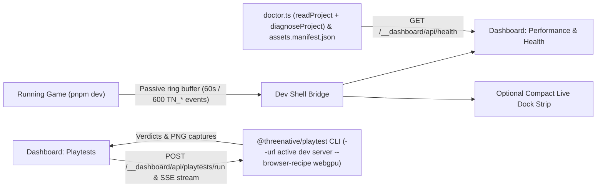

# PRD-923 — Dev Dashboard: Performance & Health diagnostics and Playtests runner

**Status:** PARTIAL (phase 3 open)
**Priority:** P2 — AC-1 through AC-6 are open: developers inside `pnpm dev` must still tail raw console logs for `TN_FRAME_BUDGET` / `TN_SCENE_WARNING`, invoke `npx threenative doctor` in a separate terminal, and run `playtests/*.playtest.json` manually outside the Dashboard.
**Complexity:** 6 (MEDIUM) — 6–10 implementation files (+2), new passive marker bridge / doctor API / playtest runner middleware (+2), process lifecycle & streaming state (+2); risk override: none (dev-only Vite serve plugin, zero production runtime bytes).
**Owner:** João
**Depends on:** [PRD-918](./PRD-918-dev-dashboard-studio-theme-settings-and-telemetry.md) (mounts into the Studio-themed Dev Dashboard side menu)

## Context

[PRD-918](./PRD-918-dev-dashboard-studio-theme-settings-and-telemetry.md) establishes the Studio-themed Dev Dashboard (`/__dashboard/`) with **Asset Library**, **Animations**, **Stage / Bundler**, and **Settings**. Two high-value developer workflows already exist in the engine and CLI, but are disconnected from the Dashboard:

1. **Engine performance markers & project health:** During `pnpm dev`, the engine emits structured markers (`TN_FRAME_BUDGET`, `TN_FRAME_SPANS`, `TN_SCENE_WARNING`, `TN_RENDER_PROJECTION`, `TN_HOT_CALL`, `TN_ASSET_UNUSED`, `TN_ALPHA_ANTIALIASING`), `@threenative/assets` writes raw-vs-cooked stats to `public/assets.manifest.json`, and `packages/create-threenative/src/doctor.ts` exports `readProject()` (`:2666`) and `diagnoseProject()` (`:2507`). None of these are visible inside the Dev Dashboard.
2. **Playtest scenarios:** Every scaffolded kit includes `playtests/*.playtest.json` verified by `@threenative/playtest` (`packages/playtest/dist/runner/cli.js`), yet developers cannot list, trigger, cancel, or inspect pass/fail assertions and captured screenshots from the Dashboard while `pnpm dev` is running.

Because the full-viewport Dashboard pauses the game's `requestAnimationFrame` loop (`devShellScript` in `packages/create-threenative/src/asset-library/plugin.ts`) to prevent 3D views from stealing GPU time, Performance & Health uses a zero-contention passive ring buffer plus an optional compact live dock strip.

## Solution

Add **Performance & Health** and **Playtests** to the Studio-themed Dev Dashboard side menu (`apply: "serve"` only, hidden in standalone `pnpm asset-library` where `options.project === false`, zero bytes in `threenative build`).

### 1. Passive `TN_*` Ring Buffer & Optional Live Dock Strip
- **Zero-distortion passive capture:** In `devShellScript`, attach a lightweight dev-only listener on the game page (suppressed in iframes, `navigator.webdriver`, `?noDevShell=1`, and production) that taps `TN_FRAME_BUDGET`, `TN_FRAME_SPANS`, `TN_SCENE_WARNING`, `TN_RENDER_PROJECTION`, `TN_HOT_CALL`, `TN_ASSET_UNUSED`, and `TN_ALPHA_ANTIALIASING` into a bounded ring buffer (60 seconds / 600 events max, O(1) push, zero DOM writes while closed).
- **Dashboard sync:** When opening **Dashboard → Performance & Health**, the game pauses as before and sends the ring buffer snapshot via `postMessage` so recent FPS, p95 frame time, draw calls, triangles, resolution scale, span breakdown, and warnings render immediately.
- **Optional compact live dock strip:** Toggle (**Dock live strip**) collapses the full-viewport Dashboard back to **Game** and displays a minimal Studio-themed corner/bottom strip updating live on `TN_FRAME_BUDGET` windows (disabled under automation/iframes/`?noDevShell=1`).

### 2. Performance & Health View (`/__dashboard/api/health`)
- **Performance section:** Timeline sparklines for FPS, frame ms (p50/p95), draw calls, triangles, and `resolutionScale`, frame-stage breakdown (`update`, `render`, `overlay`, `hostGap`, `residual` from `TN_FRAME_SPANS`), and a filterable `TN_SCENE_WARNING` / `TN_HOT_CALL` / `TN_ASSET_UNUSED` / `TN_RENDER_PROJECTION` log with Clear.
- **Health & Asset Cook section:** `GET /__dashboard/api/health` calls `readProject(root)` + `diagnoseProject(...)` (`packages/create-threenative/src/doctor.ts`) on demand (cached until **Re-check**) and summarizes `public/assets.manifest.json` (raw vs. cooked bytes, budget status, missing normals/UVs, unused assets).

### 3. Playtests View & Dev-Server CLI Runner (`/__dashboard/api/playtests/*`)
- **Discovery (`GET /__dashboard/api/playtests`):** Scans `playtests/**/*.playtest.json` safely inside `root`, returning scenario names, relative paths, assertion counts, and latest status.
- **Single-flight CLI execution (`POST /run`, `POST /cancel`, `GET /stream`):** Spawns `@threenative/playtest` against the active Vite dev URL (`--url <localUrl> --browser-recipe webgpu`) with a dedicated artifact directory (never spawns a second Vite server), enforces single-flight (`409` if busy), streams SSE logs, terminates cleanly on Cancel or Vite shutdown, and fails closed on missing runner or path traversal.
- **Results & Screenshots (`GET /artifact`):** Parses the runner's JSON report into per-assertion pass/fail verdicts and serves captured PNG thumbnails strictly contained inside the run's artifact directory.

## Non-Goals

- Replacing the `threenative-playtest` CLI or CI qualification lanes for release proofs.
- Building a live scene-graph or entity property editor ([CHARTER.md](../../architecture/CHARTER.md)).
- Running concurrent playtest browser processes from one dev server (single-flight only).
- Emitting any ring-buffer, dock-strip, health-check, or playtest-runner bytes into production `threenative build` outputs.

## Acceptance Criteria

- [x] AC-1 [local]: Under `pnpm dev`, the passive ring buffer captures `TN_FRAME_BUDGET`, `TN_FRAME_SPANS`, `TN_SCENE_WARNING`, and `TN_HOT_CALL` within a 600-event cap with zero DOM overhead while closed and populates **Performance & Health** on open while pausing the game — proof: `pnpm exec vitest run packages/create-threenative/__tests__/asset-library-browser.spec.ts` — Evidence: asset-library-browser.spec.ts: 700 markers keep 600, one kept marker per TN_ line, none for other lines, and Performance & Health shows the kept `TN_SCENE_WARNING`. A worker game (the starter) reaches the ring through core `DEV_MARKER_CHANNEL` (quiet-markers.spec.ts 13/13, red on the old file); `AFTER-{1,2}-performance.png` show live FPS 60, p95 16.8 ms, 15 draws, 17k triangles.
- [x] AC-2 [local]: Toggling **Dock live strip** returns focus to the running **Game** with a compact Studio-themed live FPS/draw-call/warning readout that updates on `TN_FRAME_BUDGET` windows and suppresses under `navigator.webdriver`, iframes, and `?noDevShell=1` — proof: `pnpm exec vitest run packages/create-threenative/__tests__/asset-library-browser.spec.ts` — Evidence: `AFTER-{1,2}-dock.png`: strip at top-right with FPS, p95, draws over the running game; asset-library-browser.spec.ts keeps the shell absent under webdriver and `?noDevShell=1`, and the shell never runs in an iframe.
- [x] AC-3 [local]: `GET /__dashboard/api/health` reuses `readProject()` + `diagnoseProject()` (`packages/create-threenative/src/doctor.ts`) and `public/assets.manifest.json` to render Doctor checks and cooked-asset budget health on demand — proof: `pnpm exec vitest run packages/create-threenative/__tests__/dashboard.spec.ts` — Evidence: dashboard.spec.ts asset cook summary; live `GET /__dashboard/api/health` returned the `threenative doctor` checks on the scratch starter (`AFTER-2-performance.png`).
- [x] AC-4 [local]: `GET /__dashboard/api/playtests` discovers `playtests/**/*.playtest.json` safely; `POST /run` spawns `@threenative/playtest` against the active dev URL (single-flight `409`, SSE stream, `POST /cancel` termination) and renders assertion verdicts and captured screenshots — proof: `pnpm exec vitest run packages/create-threenative/__tests__/dashboard.spec.ts packages/create-threenative/__tests__/asset-library-browser.spec.ts` — Evidence: dashboard.spec.ts: assert-kind count, path traversal refused, single-flight, report parsed, artifacts only from the run folder, loopback URL only, cancel; live: `POST /run` on `playtests/play.playtest.json` passed, a second run got 409, a cross-site POST got 403 (`AFTER-2-playtestrun.png`).
- [ ] AC-5 [local]: **Performance & Health** and **Playtests** match ThreeNative Studio's theme tokens and pass a read-only visual judge check on headed WebGPU captures — proof: headed WebGPU BEFORE/AFTER captures + visual judge verdict — Evidence: pending.
- [x] AC-6 [local]: Production builds (`threenative build --target web`) of scaffolded `starter` and `minimal` projects contain zero ring-buffer, dock-strip, health API, or playtest-runner bytes in `dist/` — proof: `pnpm exec vitest run packages/create-threenative/__tests__/asset-library.spec.ts` — Evidence: see PRD-918 AC-8: 0 Dashboard, ring, dock, health or playtest bytes in the starter `dist/`.

## Integration Ledger

| Capability | Reachable consumer/trigger | Replaces / disposition | Evidence |
|---|---|---|---|
| Passive `TN_*` ring buffer & live dock strip | `pnpm dev` → `devShellScript` (`packages/create-threenative/src/asset-library/plugin.ts`) → `postMessage` to `/__dashboard/` **Performance & Health** | New dev-only capture hook beside the `Game \| Dashboard` pill; zero production bytes | AC-1, AC-2, AC-6 |
| Project health & asset-cook diagnostics | Dashboard **Performance & Health** → `GET /__dashboard/api/health` → `readProject` / `diagnoseProject` (`packages/create-threenative/src/doctor.ts`) + `public/assets.manifest.json` | Reuses existing CLI doctor engine inside the Dashboard with no duplicated checks | AC-3 |
| Playtest scenario runner & viewer | Dashboard **Playtests** → `/__dashboard/api/playtests/{list,run,cancel,stream,artifact}` → `@threenative/playtest` CLI (`--url <devServer> --browser-recipe webgpu`) | Reuses shipped `@threenative/playtest` runner against the active dev server; single-flight with cancel cleanup | AC-4, AC-5 |

Fill concrete `file:line` entry points before each owning phase completes.

## Decisions

- 2026-11-26 (João): Add **Performance & Health** and **Playtests** as side-menu entries in sibling `PRD-923` so `PRD-918` stays within the 3-phase / ~8-box cap.
- 2026-11-26 (João): Keep the full-viewport Dashboard pausing the game's `rAF` loop, capture `TN_*` markers passively in a bounded ring buffer while playing, and offer an optional compact live dock strip for Performance.
- 2026-11-26 (João): Run Playtests by spawning the existing `@threenative/playtest` CLI against the active `pnpm dev` URL (single-flight with Cancel and live output/screenshot viewer).

## Execution Phases

#### Phase 1: Passive `TN_*` Ring Buffer, Performance View & Optional Live Dock Strip
**Status:** DONE
**Files:** `packages/create-threenative/src/asset-library/plugin.ts`, `packages/create-threenative/src/asset-library/client/performance.ts` (new), `packages/create-threenative/src/asset-library/client/main.ts`, `packages/create-threenative/src/asset-library/client/index.html`, `packages/create-threenative/__tests__/asset-library-browser.spec.ts` (new).
**Implementation:**
- Add the bounded passive ring buffer (60 s / 600 events) in `devShellScript` to record `TN_FRAME_BUDGET`, `TN_FRAME_SPANS`, `TN_SCENE_WARNING`, `TN_RENDER_PROJECTION`, `TN_HOT_CALL`, `TN_ASSET_UNUSED`, and `TN_ALPHA_ANTIALIASING` with zero DOM mutations while closed, forwarding snapshots on Dashboard open.
- Build the Studio-themed **Performance & Health** panel (`performance.ts`) with FPS/frame-time/draw-call/triangle/resolutionScale sparklines, span breakdown, warning log, and a **Dock live strip** toggle collapsing back to **Game** with a minimal live strip.
- [x] Passive ring buffer feeds Performance & Health on open, live dock strip streams new `TN_FRAME_BUDGET` windows over the running game, and automation/production stay untouched — proof: `pnpm --filter create-threenative build && pnpm exec vitest run packages/create-threenative/__tests__/asset-library-browser.spec.ts packages/create-threenative/__tests__/asset-library.spec.ts` — covers AC-1, AC-2, AC-6. Evidence: see AC-1, AC-2 and AC-6.

#### Phase 2: Doctor & Asset-Cook Health API Integration
**Status:** DONE
**Files:** `packages/create-threenative/src/dashboard/health.ts` (new), `packages/create-threenative/src/asset-library/plugin.ts`, `packages/create-threenative/src/asset-library/client/performance.ts`, `packages/create-threenative/__tests__/dashboard.spec.ts` (new).
**Implementation:**
- Implement `GET /__dashboard/api/health` calling `readProject(root)` and `diagnoseProject(...)` from `packages/create-threenative/src/doctor.ts` plus summarizing `public/assets.manifest.json` (raw vs. cooked totals, budget checks, warnings).
- Render categorized Doctor check badges (`pass`/`warn`/`fail`) and cooked-asset summaries in **Performance & Health** with an on-demand **Re-check** button.
- [x] Health endpoint returns live Doctor checks and cooked-asset summaries and renders them inside Performance & Health — proof: `pnpm exec vitest run packages/create-threenative/__tests__/dashboard.spec.ts` — covers AC-3. Evidence: see AC-3.

#### Phase 3: Playtests Side-Menu Runner, Live Stream, Artifact Viewer & Visual Verification
**Status:** PARTIAL: visual judge pending
**Files:** `packages/create-threenative/src/dashboard/playtest-runner.ts` (new), `packages/create-threenative/src/asset-library/plugin.ts`, `packages/create-threenative/src/asset-library/client/playtests.ts` (new), `packages/create-threenative/src/asset-library/client/main.ts`, `packages/create-threenative/__tests__/dashboard.spec.ts`, `packages/create-threenative/__tests__/asset-library-browser.spec.ts`.
**Implementation:**
- Implement `playtest-runner.ts` to discover `playtests/**/*.playtest.json` safely, spawn `@threenative/playtest` against the active Vite dev URL (`--browser-recipe webgpu`), enforce single-flight (`409` if busy), stream SSE logs, kill cleanly on `POST /cancel` or server shutdown, and serve artifact JSON/PNG files strictly inside the run's artifact dir.
- Build the Studio-themed **Playtests** panel (`playtests.ts`) with Run/Cancel buttons, live log stream, assertion pass/fail verdicts, and clickable captured screenshots.
- Capture headed WebGPU BEFORE/AFTER screenshots of **Performance & Health** and **Playtests** and run a fresh read-only visual judge subagent.
- [x] Playtests runner lists, runs, cancels, streams output, and renders assertion verdicts and screenshots with strict path containment — proof: `pnpm exec vitest run packages/create-threenative/__tests__/dashboard.spec.ts packages/create-threenative/__tests__/asset-library-browser.spec.ts` — covers AC-4. Evidence: see AC-4.
- [ ] Studio-themed Performance & Health and Playtests panels pass read-only visual judge verification — proof: headed WebGPU captures + visual judge verdict — covers AC-5.
